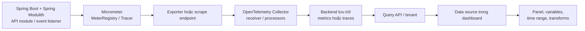
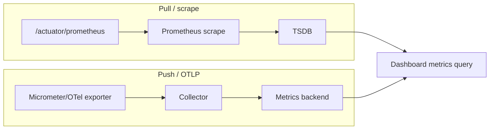
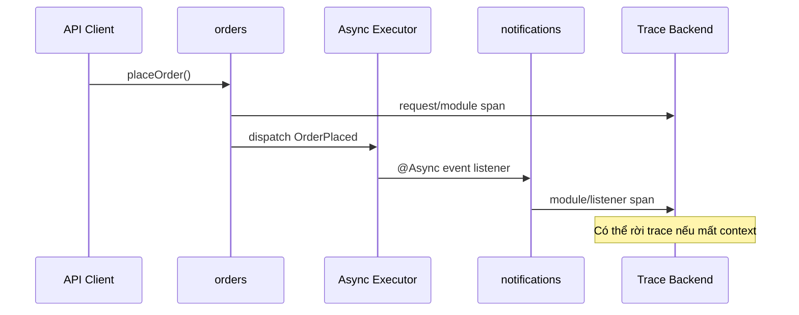
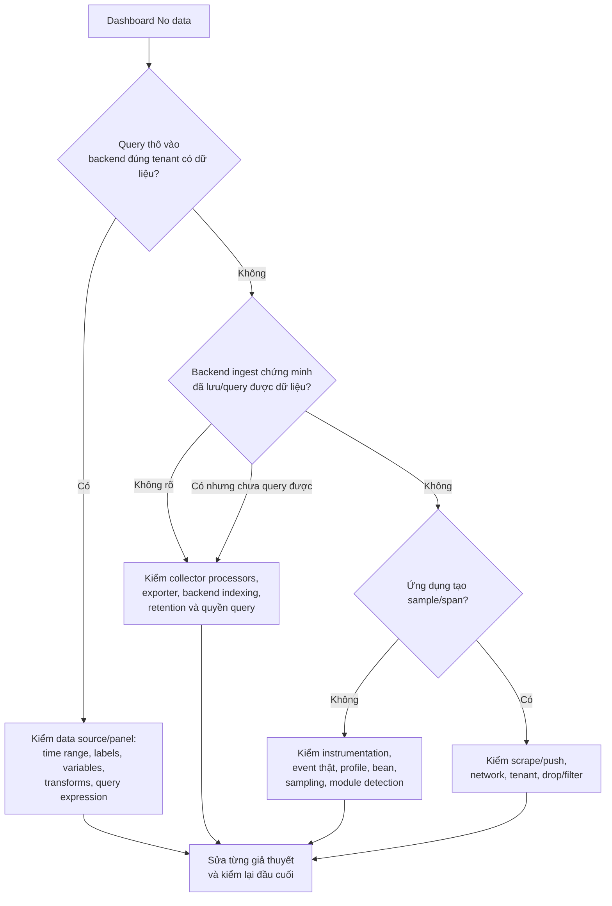

# Backend nhận telemetry nhưng dashboard không hiển thị

Một ứng dụng Spring Boot được tổ chức theo Spring Modulith có thể phát ra metrics và traces bình thường, OpenTelemetry Collector có log cho thấy đã nhận dữ liệu, nhưng dashboard vẫn hiển thị **No data**. Đây là tình huống thường gặp khi hệ thống quan sát gồm nhiều tầng: instrumentation trong JVM, exporter, collector, backend lưu trữ, API truy vấn, data source và dashboard. Việc một tầng **nhận** telemetry không bảo đảm các tầng phía sau **lưu, truy vấn và hiển thị** đúng dữ liệu.

Bài học thuộc chương **Chẩn đoán lỗi** của **SPRING_MODULITH_DOCUMENTATION_OBSERVABILITY**. Phạm vi tập trung vào quan sát tương tác giữa các application module trong Spring Boot bằng module graph, Actuator, event metrics, tracing và context propagation. Mục tiêu là tìm bằng chứng xác định telemetry đang dừng ở đâu, đặc biệt khi mô hình kiến trúc Spring Modulith vẫn đúng nhưng biểu đồ hoặc trace của một module không xuất hiện.

Các tên dịch vụ, nhãn, metric, địa chỉ và đoạn log trong bài là **ví dụ minh họa**, không đại diện cho một hệ thống thật. Tên metric và nhãn sau xuất có thể khác tùy phiên bản Spring Modulith, Micrometer, OpenTelemetry, exporter và backend; khi thao tác phải kiểm tra chính giá trị thực tế trong hệ thống.

## 1. Kết quả học tập

Sau bài này, bạn có thể:

1. Phân biệt việc collector/backend nhận telemetry, việc dữ liệu đã được lưu và việc dashboard có thể truy vấn dữ liệu.
2. Chia pipeline metrics và traces thành các bước có thể kiểm tra độc lập.
3. Xác minh đúng data source, tenant, service name, module identifier, khoảng thời gian, metric name và query của panel.
4. Giải thích sự khác biệt giữa module graph/Actuator, event publication metrics và trace của lời gọi giữa module.
5. Chẩn đoán mất trace do sampling, thiếu instrumentation, thay đổi context propagation hoặc exporter.
6. Tái hiện một sự cố dashboard **No data**, sửa nguyên nhân rồi ghi lại bằng chứng kiểm chứng đầu cuối.
7. Đặt kiểm tra hồi quy để phát hiện sớm telemetry drift sau đổi phiên bản hoặc cấu hình triển khai.

## 2. Mô hình luồng telemetry: thấy dữ liệu ở đâu?

Một triển khai phổ biến gồm:



**Các đường đi không nhất thiết giống nhau:**

- **Metrics** thường được Prometheus scrape qua `/actuator/prometheus`, hoặc được đẩy theo OTLP/remote write tùy cấu hình. Event metrics của Spring Modulith cuối cùng phải tới một hệ lưu trữ metrics để truy vấn.
- **Traces** thường được gửi tới collector/backend trace thông qua exporter (ví dụ OTLP). Traces cần span có thể được ghi nhận, lấy mẫu, chuyển tiếp và truy vấn theo trace ID hoặc thuộc tính.
- **Thông tin module** từ `ApplicationModules` và `/actuator/modulith` mô tả mô hình kiến trúc. Nó **không phải** một chuỗi time series hay một trace đã lưu; có module trong Actuator không có nghĩa sẽ có sẵn panel cho module đó.
- **Dashboard** như Grafana có thể dùng các data source khác nhau: Prometheus cho metrics, Tempo/Jaeger hoặc hệ tương đương cho traces. Chọn đúng data source là điều kiện cần.

### 2.1. Phân biệt ba mức độ “đã nhận”

| Bằng chứng | Có thể kết luận | Chưa thể kết luận |
|---|---|---|
| Ứng dụng tăng counter nội bộ | Instrumentation đã được gọi | Có exporter, backend hoặc dashboard |
| `/actuator/prometheus` có sample | Registry đã expose sample trên JVM đó | Prometheus đã scrape/lưu sample |
| Collector receiver nhận batch OTLP | Dữ liệu tới receiver | Processor/exporter không drop và backend đã index |
| Collector exporter ghi nhận gửi thành công | Backend đích đã xác nhận giao nhận theo giao thức | Dữ liệu lập tức có thể tìm qua query của tenant |
| Backend ingest API trả thành công | Request được chấp nhận theo hợp đồng API | Tất cả sample/span sẽ được lưu, có retention, đúng nhãn |
| Query API trả series/trace thực tế | Dữ liệu có thể truy vấn với phạm vi và quyền hiện tại | Panel dashboard đã chọn cùng data source, tenant, filter |
| Panel hiển thị | Toàn bộ đường đi phục vụ panel này đang hoạt động | Mọi module/sự kiện khác đều quan sát đầy đủ |

Vì vậy, khi nghe “backend đã nhận telemetry”, hãy hỏi **bằng chứng cụ thể là gì**: log receiver của collector, phản hồi HTTP 2xx của ingest, số batch exporter thành công hay một kết quả truy vấn có nội dung? Mỗi bằng chứng đưa điều tra tới một tầng khác.

## 3. Ba nhóm câu hỏi để thu hẹp phạm vi

Trước khi sửa cấu hình hoặc truy vấn, trả lời:

**Dữ liệu nào thiếu?**

- Mọi panel đều No data hay chỉ panel của một module?
- Chỉ metrics thiếu hay cả traces?
- Chỉ một service, một environment, một instance hay toàn bộ hệ thống?
- Panel hiển thị rỗng dù Explore có dữ liệu, hay ngay cả truy vấn thô cũng rỗng?

**Dữ liệu được kỳ vọng ở thời điểm nào?**

- Service có request/event thực trong khoảng thời gian đó không?
- Có sampling của traces, data delay, interval scrape, aggregation window, retention hoặc chính sách downsampling không?
- Đồng hồ máy và bộ lọc thời gian của dashboard có đồng bộ không?

**Ai/đường đi nào đang truy vấn?**

- Dashboard và Explore có dùng cùng data source không?
- Có đúng organization, tenant, project, namespace hoặc credentials không?
- Variables, label selector, panel transformations có làm dữ liệu bị loại không?

Ghi nhận phiên bản ứng dụng, commit/image digest, environment, khoảng thời gian UTC, service name, module identifier, tên panel và query gốc. Khi so sánh môi trường, chỉ chia sẻ metadata được phép, không gửi token, password hoặc payload nhạy cảm.

## 4. Chuẩn bị một bộ bằng chứng có thể đối chiếu

Ví dụ chúng ta quan sát ứng dụng thương mại điện tử:

```text
spring.application.name = shop-api

com.acme.shop
├── orders/           # nhận yêu cầu đặt hàng
├── inventory/        # xử lý tồn kho
└── notifications/    # phản ứng với sự kiện đơn hàng
```

Người vận hành nói rằng backend nhận được spans hoặc event metrics, nhưng panel “Orders – published events” không hiện số liệu. Một số câu hỏi cần xác định:

| Dữ liệu | Giá trị minh họa | Nguồn xác minh |
|---|---|---|
| Service khi chạy | `shop-api` | Runtime config và backend resource attributes |
| Module cần xem | `orders` | `ApplicationModules` / Actuator / metadata thực |
| Dạng telemetry | Counter sự kiện hoặc span tương tác module | Instruments và dữ liệu backend |
| Environment | `staging` | Resource attribute, deployment metadata |
| Khoảng kiểm tra | 10:00–10:15 UTC | Test log, dashboard và backend query |
| Tenant/organization | `team-apps` | Thông tin data source và quyền truy vấn |
| Panel | `Orders – events` | Dashboard JSON/query Inspector |
| Data source | Metrics backend đúng tenant | Data source settings và Explore |
| Dấu mốc nghiệp vụ | Một đơn hàng thử được tạo lúc 10:07 UTC | Application log/correlation ID, đã ẩn dữ liệu nhạy cảm |

**Không đoán tên nhãn:** thuộc tính trace có thể là `service.name`, còn trên hệ metrics kiểu Prometheus tên nhãn phải thỏa quy tắc của Prometheus và có thể trở thành `service_name`. Tên `module.identifier` hay `module_identifier` cũng chỉ là ví dụ; phải đọc các nhãn thật từ backend.

## 5. Kiểm từ nguồn: ứng dụng có thực sự tạo telemetry?

### 5.1. Xác nhận mô hình Spring Modulith

Chạy bài test kiến trúc trong vòng kiểm tra của dự án:

```java
package com.acme.shop;

import org.junit.jupiter.api.Test;
import org.springframework.modulith.core.ApplicationModules;

class ModuleArchitectureTests {

    @Test
    void modulesAreWellDefined() {
        ApplicationModules.of(ShopApplication.class).verify();
    }
}
```

Kiểm thử này giúp phát hiện sai ranh giới package, phụ thuộc vòng và những vi phạm API module. Nó **không chứng minh** một request đã được instrument hoặc backend đã nhận được telemetry.

Trong môi trường có Actuator Modulith và đã cho phép truy cập nội bộ, kiểm tra:

```bash
curl --fail --silent \
  http://127.0.0.1:8080/actuator/modulith
```

Kết quả giúp xác nhận module như `orders` và `inventory` được framework nhận diện ở runtime. Nếu không có endpoint, kiểm tra dependency Spring Modulith Actuator, cấu hình expose và quyền truy cập; không suy ngay rằng mô hình module rỗng.

**Ý nghĩa chẩn đoán:** nếu `orders` không được Spring Modulith nhận diện, metadata/instrumentation cho ranh giới đó có thể khác kỳ vọng. Nếu module có mặt, vẫn phải kiểm từng bước pipeline bên dưới.

### 5.2. Kiểm tra metrics ngay tại JVM

Trong Spring Boot, có thể dùng Micrometer MeterRegistry và Spring Boot Actuator để xác minh meter đang tồn tại. Ví dụ cấu hình dành cho **môi trường test được bảo vệ**:

```yaml
spring:
  application:
    name: shop-api

management:
  endpoints:
    web:
      exposure:
        include: health,info,metrics,prometheus,modulith
  tracing:
    sampling:
      probability: 1.0
```

Điều kiện:

- Endpoint `/actuator/metrics` cần Spring Boot Actuator và registry/instrument tương ứng.
- `/actuator/prometheus` chỉ tồn tại khi có dependency registry Prometheus tương thích và endpoint được expose.
- `/actuator/modulith` cần hỗ trợ Actuator của Spring Modulith.
- Sampling 100% ở đây chỉ phục vụ test ngắn; production cần chính sách sampling, chi phí và khả năng lưu trữ phù hợp.
- Việc expose các endpoint cần giới hạn truy cập, nhất là môi trường production.

Kiểm tra danh sách meter đang có:

```bash
curl --fail --silent \
  http://127.0.0.1:8080/actuator/metrics

curl --fail --silent \
  http://127.0.0.1:8080/actuator/prometheus
```

Để tránh phụ thuộc vào tên event metric cụ thể của từng phiên bản Spring Modulith, có thể tạo một **probe metric tạm cho môi trường lab**:

```java
package com.acme.shop.observability;

import io.micrometer.core.instrument.Counter;
import io.micrometer.core.instrument.MeterRegistry;
import org.springframework.stereotype.Component;

@Component
public class TelemetryProbe {

    private final Counter probe;

    public TelemetryProbe(MeterRegistry registry) {
        this.probe = Counter.builder("demo.telemetry.probe")
                .description("Lab-only telemetry probe")
                .tag("module", "orders")
                .register(registry);
    }

    public void mark() {
        probe.increment();
    }
}
```

Gọi `mark()` trong một integration test hoặc một đường thử nghiệm nội bộ được kiểm soát, rồi đọc endpoint metrics. Với registry Prometheus, tên được xuất thường qua bước chuẩn hóa (ví dụ một counter có thể thành `demo_telemetry_probe_total`); **xem chính đầu ra scrape** để biết tên chính xác, không viết truy vấn dựa vào phỏng đoán.

Probe metric xác nhận dòng dữ liệu metrics cơ bản; nó **không chứng minh** Spring Modulith event instrumentation đã đăng ký đúng. Sau khi probe thành công, quay lại kiểm tên meter sự kiện thật.

### 5.3. Phân biệt publish event và xử lý event

Ví dụ event được công bố từ API của module `orders`:

```java
// File: com/acme/shop/orders/OrderPlaced.java
package com.acme.shop.orders;

import java.util.UUID;

public record OrderPlaced(UUID orderId) {}
```

```java
// File: com/acme/shop/orders/internal/OrderService.java
package com.acme.shop.orders.internal;

import com.acme.shop.orders.OrderPlaced;
import java.util.UUID;
import org.springframework.context.ApplicationEventPublisher;
import org.springframework.stereotype.Service;

@Service
public class OrderService {

    private final ApplicationEventPublisher publisher;

    public OrderService(ApplicationEventPublisher publisher) {
        this.publisher = publisher;
    }

    public UUID placeOrder() {
        UUID id = UUID.randomUUID();
        // Ví dụ chỉ minh họa. Production cần lưu đơn hàng và
        // xác định transaction boundary trước khi publish event.
        publisher.publishEvent(new OrderPlaced(id));
        return id;
    }
}
```

Nếu `notifications` có event listener không được khởi tạo hoặc xử lý bị lỗi, **metric về số lần publish vẫn có thể tăng** trong khi không có dấu vết “notification handled”. Không suy từ counter publish rằng listener thành công. Muốn kiểm xử lý, kết hợp event completion/failure metrics, kết quả nghiệp vụ và log/trace có request ID.

Nếu event được xử lý sau transaction, dùng listener async hoặc event publication registry theo Spring Modulith, cần phân biệt thời điểm publish, dispatch, hoàn tất và retry. Sự khác nhau này giải thích vì sao dashboard “số sự kiện đã gửi” có dữ liệu nhưng panel “số sự kiện đã xử lý” rỗng.

## 6. Metrics: lần theo sample tới backend query

### 6.1. Dạng kéo và dạng đẩy

Hai mô hình phổ biến:



Với **scrape**, việc `/actuator/prometheus` trả sample không chứng minh job đã được Prometheus scrape. Kiểm scrape target, HTTP response, số series, scrape interval và nhãn `job`/`instance`.

Với **OTLP push**, collector receiver nhận request chưa chứng minh pipeline sau processors đã gửi dữ liệu tới backend metrics. Kiểm telemetry nội bộ của collector (received/sent/dropped/errors) theo phiên bản collector, cấu hình processor, batching, retry, exporter và phản hồi của đích.

Khi một hệ thống dùng cả hai mô hình, tránh nhầm panel đang truy vấn TSDB nào. Một counter được xuất qua OTLP chưa chắc có mặt tại một Prometheus chỉ scrape `/actuator/prometheus` của service khác.

### 6.2. Kiểm truy vấn thô trước khi vào panel

Khi sử dụng backend tương thích Prometheus, bắt đầu bằng một tên series **đã nhìn thấy thực tế trong backend**. Ví dụ nếu probe được lưu dưới tên `demo_telemetry_probe_total`:

```promql
demo_telemetry_probe_total
```

Sau đó kiểm không lọc và lọc từng chiều:

```promql
sum by (job, instance) (demo_telemetry_probe_total)
```

Nếu tập dữ liệu thực sự có nhãn `module` thì có thể thử:

```promql
sum by (module) (demo_telemetry_probe_total)
```

Chỉ sau khi thấy series mới thêm selector của service/environment/module. Không khẳng định mọi exporter tự thêm `service`, `environment` hoặc `module`; tên label phải xuất phát từ chính kết quả backend.

Với counter biến thiên, thường dùng `rate()` hoặc `increase()` để tránh hiểu giá trị tích lũy như tốc độ:

```promql
rate(demo_telemetry_probe_total[5m])
```

```promql
increase(demo_telemetry_probe_total[15m])
```

Nếu chỉ có **một sample** trong khoảng cần tính rate, một truy vấn tốc độ có thể rỗng. Cần xét scrape interval và ít nhất hai điểm dữ liệu đủ điều kiện. Khi kiểm event thưa, thử khoảng dài hơn và dùng truy vấn tức thời/thô để xác nhận tồn tại series. Không tạo lưu lượng giả trên production để “làm đẹp” biểu đồ.

### 6.3. Tên và nhãn sau khi export có thể đổi

Một meter logic Micrometer có tên dấu chấm có thể xuất qua Prometheus thành tên dùng gạch dưới và hậu tố theo kiểu instrument. Với event metrics của Spring Modulith, một số phiên bản có meter theo module/loại event hoặc tags chuyên biệt. Cần kiểm **tên meter trong JVM**, **tên ở backend** và **selector đang dùng trong panel**, vì chúng không mặc định trùng nhau.

| Nguồn | Ví dụ minh họa | Điểm cần kiểm |
|---|---|---|
| Meter logic | `module.events.published` | Meter có thật và tăng khi publish event? |
| Prometheus metric name | `module_events_published_total` | Đây có đúng tên trong backend hiện tại không? |
| Label thuộc tính module | `module_identifier="orders"` | Exporter có tạo label này không, hay tên khác? |
| Label nguồn phát | `job="shop-api"` | Job scrape có đúng hay service chỉ có resource attribute? |
| Môi trường | `deployment_environment="staging"` | Dữ liệu có thực sự mang nhãn này không? |

Dòng ở bảng là **hình thức khả dĩ**, không phải lời hứa về schema của một phiên bản Spring Modulith. Với trường hợp lỗi, hãy lấy một sample thực tế từ backend và copy đúng tên nhãn vào truy vấn; chỉ đổi một selector mỗi lần.

### 6.4. Temporality, histogram và độ phân giải

Khi xuất metrics qua OTLP hoặc chuyển từ registry này sang registry khác, lưu ý:

- Counter dùng **cumulative** hay **delta temporality** và backend có diễn giải đúng không.
- Đơn vị của timer/latency (seconds, milliseconds) có nhất quán giữa instrument, exporter và panel không.
- Histogram buckets, quantiles và aggregation có tồn tại với cấu hình thực tế không.
- Scrape interval, remote-write delay, query range step, min interval và retention có khiến dữ liệu bị làm thưa không.
- Processor drop/filter/attribute transform có đổi tên label hoặc loại bỏ metrics mà dashboard dùng không.

Nếu query thô có sample nhưng một phép tính histogram hoặc percentile không có dữ liệu, vấn đề có thể ở **kiểu metric và công thức** chứ không phải backend chưa nhận.

## 7. Traces: có spans ở backend nhưng không tìm được

Một trace không phải một metric time series. Backend trace thường tìm theo **trace ID**, **service/resource attributes**, **span name** và thời gian. Thủ tục điều tra cần khác với PromQL.

### 7.1. Lấy một trace ID cụ thể

Trong một yêu cầu thử có trace và log correlation đúng, ghi lại trace ID từ log được phép truy cập hoặc response/tracing UI. Tra cứu trực tiếp **bằng trace ID** trong backend của đúng tenant. Nếu có kết quả, xác định:

1. Trace thuộc `service.name` nào và environment nào?
2. Spans có thời gian bắt đầu/kết thúc nằm trong khoảng dashboard đang lọc không?
3. Có span thể hiện tương tác module Spring Modulith hay chỉ có HTTP/server/database spans?
4. Span name và thuộc tính module thực tế là gì?
5. Có lỗi, status hoặc thuộc tính riêng khiến dashboard loại trace không?

Nếu tìm bằng trace ID thấy trace nhưng bảng liệt kê service hoặc panel không thấy, xem lại **index/query/filter/variable** và thời gian. Nếu không tìm thấy cả trace ID, phải điều tra sampling, exporter, tenant, retention và indexing trước.

### 7.2. Sai khác giữa resource và span attributes

Trong OpenTelemetry, `service.name` thường là **resource attribute**. Thuộc tính mô tả application module có thể nằm trên **span attributes**, tùy Spring Modulith instrumentation và exporter. Backend trace có thể cho phép lọc theo cả hai, nhưng cú pháp truy vấn và indexing khác nhau.

Ví dụ mô tả (không phải truy vấn chuẩn của mọi backend):

```text
Resource:
  service.name = shop-api
  deployment.environment = staging

Span:
  module.identifier = orders
  module.invocation-type = bean
```

Nếu panel lọc `service="orders"` với giả định mỗi module Spring Modulith là một microservice, nó có thể luôn No data. Các module chạy **trong cùng tiến trình ứng dụng** có thể chia sẻ `service.name=shop-api`; định danh module là một chiều thông tin riêng. Hãy tìm metadata thực tế và dùng đúng trường mà backend hỗ trợ.

### 7.3. Sampling và trace thiếu spans

- **Head sampling:** request có thể bị bỏ trước khi spans được xuất. Không thấy trace của một request đơn lẻ chưa đủ chứng minh exporter hỏng.
- **Tail sampling:** collector/backend có thể quyết định giữ hoặc bỏ trace sau khi thu thập; receiver vẫn có thể log nhận spans nhưng cuối cùng không lưu trace.
- **Partial trace:** một số spans tới backend, spans của module con hoặc listener không tới. Cần kiểm instrumentation và context propagation.
- **Retention/indexing delay:** trace được ingest nhưng đã quá hạn lưu hoặc chưa hiển thị ngay ở search index.

Trong lab được kiểm soát có thể tăng sampling để chẩn đoán. Không chuyển production lên 100% sampling lâu dài nếu chưa đánh giá chi phí, lưu trữ và dữ liệu nhạy cảm.

## 8. Context propagation và event listener bất đồng bộ

Spring Modulith giúp quan sát tương tác giữa các module bằng instrumentation phù hợp, nhưng nếu event listener chạy trên thread khác, trace context của request ban đầu có thể không đi theo nếu executor không được cấu hình chuyển context.



### 8.1. Đọc dấu hiệu trên backend

| Kết quả | Khả năng |
|---|---|
| Có trace của API request, không có span listener | Listener không chạy, không được instrument, span bị drop hoặc exporter thiếu |
| Listener có span nhưng khác trace ID | Context không được propagate hoặc event async chủ động tách trace |
| Listener cùng trace ID nhưng không có parent phù hợp | Cơ chế propagation hoặc quan hệ span chưa đúng |
| Cả API lẫn listener đều không có trace | Sampling, instrumentation, exporter, tenant hoặc query |
| Metric publish có dữ liệu nhưng thiếu listener span | Publish không đồng nghĩa xử lý listener; kiểm bean/transaction/async |

Spring Framework có hỗ trợ `ContextPropagatingTaskDecorator` trên các phiên bản tương thích. Ví dụ executor phục vụ một listener bất đồng bộ trong **môi trường phù hợp**:

```java
package com.acme.shop.config;

import org.springframework.context.annotation.Bean;
import org.springframework.context.annotation.Configuration;
import org.springframework.core.task.support.ContextPropagatingTaskDecorator;
import org.springframework.scheduling.annotation.EnableAsync;
import org.springframework.scheduling.concurrent.ThreadPoolTaskExecutor;

@Configuration
@EnableAsync
class AsyncConfig {

    @Bean("moduleEventsExecutor")
    ThreadPoolTaskExecutor moduleEventsExecutor() {
        ThreadPoolTaskExecutor executor = new ThreadPoolTaskExecutor();
        executor.setCorePoolSize(2);
        executor.setMaxPoolSize(8);
        executor.setQueueCapacity(100);
        executor.setTaskDecorator(new ContextPropagatingTaskDecorator());
        executor.setThreadNamePrefix("module-event-");
        executor.initialize();
        return executor;
    }
}
```

Để listener sử dụng executor này, ứng dụng phải cấu hình đúng `@Async("moduleEventsExecutor")` hoặc event dispatch mechanism tương ứng. Đoạn mã **chỉ khai báo executor**, không tự chuyển toàn bộ listener sang async, không thay thế việc thêm Micrometer Context Propagation/Tracing và exporter. Với Spring Modulith event publication registry hoặc `@ApplicationModuleListener`, cần đối chiếu đúng cơ chế execution của phiên bản đang chạy.

Đừng sửa context propagation khi bằng chứng chỉ ra panel đang lọc sai data source. Đầu tiên phải chứng minh listener có chạy và trace đã đến backend.

## 9. Backend có dữ liệu nhưng panel No data: kiểm dashboard từ ngoài vào trong

Khi query API hoặc màn hình Explore đã cho thấy sample/span thực tế, phần lớn công việc còn lại ở lớp truy vấn và hiển thị.

### 9.1. Kiểm data source và tenant

Dashboard có thể trỏ nhầm data source:

- Metrics panel dùng data source staging, trong khi service gửi metrics vào production.
- Trace panel truy vấn hệ metrics thay vì hệ trace, hoặc chọn nhầm cluster.
- Tên data source trên UI giống nhau nhưng UID hoặc credentials khác nhau.
- Data source dùng organization/project/tenant khác với nơi backend đã nhận dữ liệu.
- Query của người vận hành và query của dashboard chạy với token/quyền khác nhau.

**Thử nghiệm tối thiểu:** mở Explore (hoặc query API tương ứng) **với đúng data source và danh tính truy vấn của dashboard**. Nếu Explore khác cấu hình panel, kết quả Explore thành công chưa đủ kết luận.

### 9.2. Kiểm time range và timezone

Các nguyên nhân điển hình:

- Dashboard đang chọn 5 phút gần nhất nhưng event chỉ xảy ra 30 phút trước.
- Panel có **relative time override** nên không dùng chung range với toàn dashboard.
- Clock skew hoặc timestamp của telemetry sai (ví dụ timestamp ở tương lai, tính sai mili-giây/giây).
- Timezone trình duyệt và UTC gây nhầm lúc đối chiếu log, dù timestamp thực dùng cùng mốc.
- Backend có ingestion delay hoặc đã loại dữ liệu vì retention/late arrival.

Hãy dùng một khoảng thời gian **tuyệt đối** bao phủ lần phát event hoặc trace đã biết. Nếu kết quả xuất hiện, chuyển sang kiểm time filter, step và chính sách dữ liệu đến trễ.

### 9.3. Kiểm variables và label selectors

Một panel kiểu Prometheus có thể vô tình lọc:

```promql
sum(
  rate(
    module_events_published_total{
      service="orders",
      environment="prod"
    }[5m]
  )
)
```

Đây là **truy vấn minh họa**, chỉ chạy nếu metric và các labels này thật sự tồn tại. Nếu backend có sample như sau:

```text
metric: module_events_published_total
labels:
  job="shop-api"
  module_identifier="orders"
  deployment_environment="staging"
```

thì panel không khớp vì:

1. `service` không phải nhãn thực trong ví dụ.
2. `environment=prod` không tương ứng `deployment_environment=staging`.
3. `orders` là **module**, không phải service name.

Bắt đầu lại từ query thô, rồi thêm một filter mỗi lần. Ví dụ sửa **chỉ theo dữ liệu minh họa ở trên**:

```promql
sum by (module_identifier) (
  rate(
    module_events_published_total{
      job="shop-api",
      deployment_environment="staging",
      module_identifier="orders"
    }[5m]
  )
)
```

Khi dùng dashboard variables, kiểm giá trị cụ thể mà `$service`, `$module`, `$env` được thay thế. Với biến hỗ trợ nhiều giá trị, thường cần toán tử regex `=~` thay vì so bằng `=`, nhưng phải chọn theo ngữ nghĩa và cú pháp của data source.

**Lưu ý:** các tên metric và nhãn trong đoạn ví dụ chỉ được dùng để minh họa quan hệ mismatch. Không lấy chúng làm cấu hình mặc định cho mọi hệ Spring Modulith.

### 9.4. Kiểm panel transformations và aggregation

Ngay cả khi query trả dữ liệu, panel vẫn có thể rỗng do:

- Transformations loại hết các field hoặc áp bộ lọc sau query.
- Chọn field name sai sau khi `sum by(...)` làm thay đổi tập labels.
- Legend template tham chiếu label không tồn tại.
- Panel đang hiển thị histogram/heatmap nhưng dữ liệu thực là counter hoặc gauge.
- Panel sử dụng threshold, null-value handling hoặc expression phụ thuộc một query khác bị lỗi.
- Range step/min interval hoặc `rate()` window không phù hợp với scrape interval.
- Query trả dữ liệu nhưng một join trên labels giữa hai query không tìm được cặp khớp.

Dùng Query Inspector (hoặc công cụ tương đương) để xem **request, response/raw series và lỗi của panel**. Tạm bỏ transformations, kiểm một query đơn giản, sau đó thêm lại từng thành phần. Không cần sửa exporter khi backend đã trả sample đúng cho chính query thô.

## 10. Trường hợp mô phỏng: counter đã lưu, dashboard lọc nhầm

### 10.1. Triệu chứng

Trong một đợt phát hành:

- Ứng dụng `shop-api` chạy Spring Boot và Spring Modulith.
- `/actuator/modulith` có module `orders`.
- Collector báo nhận dữ liệu, backend metrics có sample mới trong Explore.
- Panel `Orders published events` vẫn No data.
- Người phát triển vừa đổi bộ labels trên dashboard sau nâng cấp exporter.

Giả sử backend có đúng sample minh họa:

```text
module_events_published_total{
  job="shop-api",
  module_identifier="orders",
  deployment_environment="staging"
} 42
```

Trong khi panel đang tìm:

```promql
module_events_published_total{
  service="orders",
  environment="staging"
}
```

### 10.2. Quy trình tìm nguyên nhân

| Thao tác | Quan sát | Kết luận |
|---|---|---|
| Gọi query không filter theo tên metric | Có series | Backend và query API trả được dữ liệu |
| Thêm `service="orders"` | No data | Selector này không khớp các label thực |
| Xem sample ở Explore | Có `job="shop-api"`, `module_identifier="orders"` | Panel nhầm module với service |
| Thêm `environment="staging"` | No data | Tên label môi trường khác |
| Thay selector bằng nhãn thực tế | Có series | Lỗi ở dashboard query/variables |
| Mở lại panel sau cập nhật query | Biểu đồ xuất hiện với cùng time range | Xác nhận nguyên nhân đã được sửa |

**Nguyên nhân gốc:** dashboard sử dụng schema nhãn cũ và coi module identifier là service. Dữ liệu vẫn được lưu bình thường; query lọc bỏ tất cả series.

**Sửa:** cập nhật truy vấn và dashboard variables theo labels đã xác minh từ backend, kiểm lại data source và time range. Ghi nhận schema metric/labels đã phê duyệt để CI hoặc quy trình nâng cấp kiểm tra khi thay exporter, không hard-code kết quả một lần thăm dò thành quy tắc vĩnh viễn.

### 10.3. Xác nhận sau sửa

1. Thử một query thô trả sample thật trong Explore với đúng data source/tenant.
2. Chạy query của panel với cùng time range và ghi lại một kết quả có dữ liệu.
3. Kiểm dashboard panel hiển thị và mọi variable cần thiết có giá trị hợp lệ.
4. Đối chiếu một lần publish event có kiểm soát với mức tăng counter trong backend (lưu ý độ trễ scrape và aggregation).
5. Kiểm trace một use case liên module riêng biệt nếu mục tiêu màn hình còn bao gồm tracing; metrics xuất hiện không tự chứng minh tracing đã hoạt động.

## 11. Playbook phân loại sự cố theo bằng chứng



Bảng điều tra nhanh:

| Triệu chứng | Khả năng cao | Bước xác minh tiếp |
|---|---|---|
| `/actuator/prometheus` có sample, backend không có | Scrape target, service discovery, registry/export | Kiểm target và query không filter tại backend |
| Collector có nhận OTLP, backend không tìm thấy | Processor drop, exporter retry/error, tenant, storage/index | Kiểm pipeline counters và backend query API |
| Backend query được nhưng panel rỗng | Time range, data source, selectors, variables, transforms | Copy query vào Explore cùng data source |
| Chỉ panel `orders` rỗng | Nhãn module/service, không có event gần đây | Query thô toàn bộ series, so labels |
| Metric publish có nhưng metric xử lý không có | Listener không chạy, meter khác, bean condition | Kiểm kết quả nghiệp vụ/bean/transaction |
| Traces HTTP có, module spans thiếu | Instrumentation/range/sampling hoặc API boundary | Kiểm runtime module model và span attributes |
| Trace listener khác trace ID | Context propagation hoặc async dispatch | Kiểm executor và cơ chế chuyển context |
| Có trace ID nhưng search không tìm theo service | Resource mapping, index/filter, time | Truy vấn trực tiếp ID và kiểm resource attrs |
| Panel rate rỗng dù counter có giá trị | Quá ít sample trong cửa sổ rate | Tăng test window, so scrape interval |
| Một nhóm người thấy, nhóm khác không | Tenant/org, permissions, dashboard data source | So danh tính query và policy quyền |

## 12. Phân biệt lỗi telemetry với lỗi nghiệp vụ của Spring Modulith

Spring Modulith mô hình hóa application modules và cung cấp công cụ xác minh kiến trúc. Khi sự cố xảy ra, cần phân biệt:

1. **Module không có trong model:** xem application root package, cách phát hiện module, `@ApplicationModule` và các dependency dùng tại runtime.
2. **Module có trong model nhưng không có tương tác:** có thể chưa có request/event nào kích hoạt API; xác minh bằng một luồng nghiệp vụ có kiểm soát.
3. **Module có tương tác nhưng không được instrument:** kiểm dependency observability, class/bean được instrument và giới hạn proxy/AOP.
4. **Có span/meter trong JVM nhưng chưa tới backend:** kiểm scrape/exporter/collector và khả năng drop/sampling.
5. **Dữ liệu đã vào backend nhưng dashboard không hiển thị:** kiểm query/UI layer như phần 9 và 10.

**Module graph ≠ runtime call graph.** Diagram từ `Documenter` cho biết dependency và ranh giới tĩnh; trace thể hiện những lời gọi đã thực sự chạy. Một cạnh trên module graph không bảo đảm lúc nào cũng có span tương ứng.

Ví dụ tạo tài liệu từ source trong test:

```java
package com.acme.shop;

import org.junit.jupiter.api.Test;
import org.springframework.modulith.core.ApplicationModules;
import org.springframework.modulith.docs.Documenter;

class ModuleDocumentationTests {

    @Test
    void generateDocsFromCurrentCode() {
        ApplicationModules modules =
                ApplicationModules.of(ShopApplication.class);

        modules.verify();

        new Documenter(modules)
                .writeModulesAsPlantUml()
                .writeIndividualModulesAsPlantUml()
                .writeModuleCanvases();
    }
}
```

Nếu tên module/ID được đổi khi refactor, một dashboard hard-code label cũ có thể No data dù instrumentation vẫn hoạt động. Khi đổi package hoặc cấu hình phát hiện module, cần so artifact diagram/Actuator cùng schema telemetry và dashboard variables.

## 13. Hướng xử lý khi sự cố gắn với phiên bản hoặc cấu hình

Một bản nâng cấp Spring Boot, Spring Modulith, Micrometer hoặc exporter có thể thay đổi tên meter, hệ tag, trace resource attributes hoặc cách tự động cấu hình. Thay vì sửa dashboard theo cảm tính, thực hiện một bản so sánh có hệ thống:

| Thành phần | Trước nâng cấp | Sau nâng cấp | Cần xác minh |
|---|---|---|---|
| Module identifiers | Baseline từ `ApplicationModules` | Model bản mới | ID và ranh giới có thay không? |
| Meter names/types | Danh sách meter có dữ liệu | Danh sách hiện tại | Counter/histogram/timer có đổi schema? |
| Metric label keys | Snapshot label keys đã phê duyệt | Query backend hiện tại | Label nào đổi tên hoặc bị loại? |
| Trace resource attributes | `service.name`, environment | Resource dữ liệu mới | Có còn nhất quán? |
| Span attributes | Tên module, invocation type | Span mới | Query đang chọn đúng field? |
| Collector pipeline | Receiver/processor/exporter | Cấu hình đích | Có filter/transform/tenant thay đổi? |
| Dashboard data sources | UID, type, tenant | Cấu hình sau deploy | Có đang query đúng nơi không? |
| Sampling/retention | Chính sách cũ | Chính sách mới | Có giảm khả năng tìm trace? |

Thông tin nhạy cảm như token, password, private endpoint hoặc customer ID không nên đưa vào snapshot so sánh. Có thể lưu tên key và trạng thái cấu hình đã được xác thực.

### 13.1. Mẫu cấu hình và quan sát minh họa

Ở môi trường thử nghiệm, Spring Boot có thể expose endpoint metrics nội bộ:

```yaml
management:
  endpoints:
    web:
      exposure:
        include: health,info,metrics,prometheus,modulith
  tracing:
    sampling:
      probability: 1.0
```

Tuy nhiên, cấu hình này **không tự gửi OTLP traces**. Cần bộ dependency tracing và exporter/collector phù hợp, cùng endpoint/auth/certificate được cấu hình theo phiên bản và môi trường. Tương tự, thêm `prometheus` vào danh sách expose không thay thế việc thêm registry Prometheus và cấu hình scraping.

Đối với một triển khai dùng OpenTelemetry Collector, thay đổi ở processor có thể khiến resource attribute được đổi tên hoặc một nhóm metric bị loại. Khi điều tra, kiểm đường đi **receiver → processors → exporter** và các chỉ số nhận/gửi/bị loại. Chỉ sửa processor khi đã xác định nguyên nhân; bộ lọc có thể tồn tại vì giới hạn bảo mật hoặc cardinality hợp lệ.

## 14. Thiết kế các phép thử hồi quy telemetry

Một bộ thử nghiệm hợp lý cần xác minh nhiều lớp và dùng tên/tập labels từ chính phiên bản đang triển khai:

| Test | Hành động | Điều kiện đạt |
|---|---|---|
| Architecture model | Chạy `ApplicationModules.verify()` | Ranh giới module hợp lệ |
| Modulith runtime metadata | Truy vấn Actuator nội bộ nếu cấu hình | Danh sách module đúng phiên bản deploy |
| Instrument smoke | Gọi probe meter hoặc một use case | Meter/span được tạo ở ứng dụng |
| Export/scrape | Kiểm scrape target hoặc collector exporter | Không có lỗi/drop bất thường đối với tín hiệu thử |
| Metrics backend query | Truy vấn tên metric thật, trước và sau filter | Có series và timestamp phù hợp |
| Trace ID query | Tạo request có dấu vết và tra theo ID | Trace tìm được đúng tenant khi sampling cho phép |
| Module trace | Gọi API giữa module cần quan sát | Có span/thuộc tính module đúng thiết kế instrumentation |
| Dashboard query | Dùng query/panel thực trên đúng data source | Query có dữ liệu với range và variables hợp lệ |
| Dashboard rendering | Mở panel với test case | Panel vẽ được giá trị, đơn vị và legend đúng |
| Async propagation | Publish event tới listener async | Kiểm trace linkage theo ngữ nghĩa mong đợi |
| Error-path | Tạo lỗi có kiểm soát | Telemetry phản ánh trạng thái lỗi, không lộ dữ liệu nhạy cảm |

**Nên lưu một “golden query” cho từng panel quan trọng** dưới dạng kiểm chứng có thể tái hiện, gắn với tên metric/labels đã phê duyệt. Khi thay exporter hoặc version instrument, chạy test schema và query trước khi phát hành dashboard mới.

Với traces lấy mẫu thấp ở production, test trực tiếp phải hiểu chính sách sampling. Một phép thử chỉ mong “trace của request duy nhất luôn có” có thể sai ngay cả khi hệ thống hoạt động đúng. Dùng môi trường test có sampling đủ cho smoke test, hoặc chấp nhận điều kiện kết quả đúng theo cấu hình.

## 15. Quy trình xử lý sự cố trong thực tế

Áp dụng trình tự sau cho một incident No data:

1. **Khoanh phạm vi:** xác định panel/datasource/service/module/environment, khoảng thời gian UTC và triệu chứng thật (No data, error query hay field bị ẩn).
2. **Ghi bằng chứng nhận dữ liệu:** log collector, phản hồi exporter hoặc backend ingest; ghi rõ nhận ở tầng nào. Ưu tiên chứng cứ backend query trả sample/span.
3. **Truy vấn trực tiếp backend:** bỏ bộ lọc tùy chọn; tìm một series hoặc trace ID thật trong đúng tenant. Nếu không thấy, điều tra ingestion/index/retention.
4. **Kiểm nguồn dữ liệu nếu backend trống:** test meter/span trong JVM, cấu hình sampling, module detection và đường scrape/OTLP.
5. **Nếu backend có dữ liệu:** đối chiếu data source UID, time range, query text, template variables, label names, aggregations và transformations của panel.
6. **Sửa một giả thuyết mỗi lần:** đổi đúng selector hoặc cấu hình đã được chứng minh sai; tránh thay nhiều tầng rồi không biết nguyên nhân.
7. **Xác minh bằng tín hiệu thực:** ghi raw query kết quả, ảnh panel nếu quy trình cần, request ID/trace ID được phép lưu và kết quả nghiệp vụ.
8. **Đóng vòng phòng ngừa:** cập nhật metric/label contract, golden query, test và tài liệu triển khai. Phân định owner của ứng dụng, collector, backend và dashboard.

### 15.1. Mẫu biên bản sự cố

```text
Incident: Dashboard Orders Events hiển thị No data
Ứng dụng: shop-api / Spring Modulith
Module quan sát: orders
Signal: counter event publication
Bằng chứng ingest: collector báo exporter thành công (chưa đủ)
Bằng chứng lưu trữ: backend query trả series và timestamp
Time range: 10:00–10:15 UTC
Data source/tenant: metrics-staging / team-apps
Panel query cũ: service="orders", environment="staging"
Labels thực tế: job="shop-api",
               module_identifier="orders",
               deployment_environment="staging"
Root cause: sai nhãn service/environment trong selector
Fix: đổi panel selectors theo schema backend hiện tại
Verification: raw query PASS, panel PASS, test event PASS
Prevention: golden query + review schema label khi nâng exporter
```

Đây là biên bản **giả lập**. Trong báo cáo thật, nên gắn commit/ảnh triển khai và bằng chứng truy vấn đã ẩn dữ liệu nhạy cảm, không đính kèm token hay payload khách hàng.

## 16. Bài tập tình huống

**Tình huống A – metrics mất sau khi đổi collector.** JVM có meter, endpoint `/actuator/prometheus` có dữ liệu, collector nhận OTLP traces, nhưng Prometheus dashboard không có metrics. Hãy xác định liệu app thực sự export metrics qua OTLP hay Prometheus scrape, kiểm tra đích lưu trữ của từng signal và hỏi tại sao “collector nhận traces” không chứng minh metrics đã đến Prometheus.

**Tình huống B – chỉ trace của module con biến mất.** Trace HTTP có mặt, `/actuator/modulith` nhận diện module con, nhưng không thấy span event listener chạy async. Phân biệt ba giả thuyết: listener không chạy, instrumentation không tạo span, hoặc context propagation bị đứt. Đưa ra phép thử cho từng giả thuyết.

**Tình huống C – dashboard thỉnh thoảng rỗng.** Counter có các sample cách nhau 60 giây, panel dùng `rate(metric[30s])`. Giải thích vì sao range ngắn có thể không đủ hai sample và đề xuất kiểm tra với cửa sổ phù hợp scrape interval.

**Tình huống D – backend đã có trace ID nhưng UI không tìm theo service.** Khảo sát resource attribute `service.name`, tên environment thực, bộ lọc của panel, query syntax và quyền/tenant. Giải thích tại sao không nên đổi tên application module để chữa lỗi label.

**Tình huống E – production có ingest nhưng không ai xem được.** Hệ thống multi-tenant; exporter gửi vào tenant A, dashboard query tenant B. Đề xuất cách đối chiếu tenant/credential có kiểm soát mà không hiển thị token hoặc secret.

## 17. Checklist trước khi kết luận đã khắc phục

- [ ] Đã phân biệt collector nhận batch, backend chấp nhận ingest và backend query trả dữ liệu.
- [ ] Đã xác nhận đúng signal: metrics, traces hay metadata module.
- [ ] Có bằng chứng module được Spring Modulith nhận diện nếu cần quan sát tương tác module.
- [ ] Instrumentation tại JVM tạo meter/span thật với luồng nghiệp vụ có kiểm soát.
- [ ] Đã kiểm scrape/OTLP pipeline, filter/drop, exporter errors và storage/retention.
- [ ] Query trực tiếp backend có kết quả trên đúng tenant và time range.
- [ ] Tên metric, nhãn, resource/span attributes lấy từ dữ liệu thực, không suy đoán.
- [ ] Dashboard dùng đúng data source, quyền, variables, query và transformations.
- [ ] Đã kiểm sampling, context propagation nếu vấn đề thuộc tracing/event async.
- [ ] Có bằng chứng query + panel + hành vi nghiệp vụ sau khi sửa.
- [ ] Golden query hoặc kiểm thử schema/telemetry được cập nhật để tránh tái phát.
- [ ] Không expose Actuator nhạy cảm hoặc ghi secrets/PII chỉ để debug.

## Tài liệu tham khảo

- [Spring Modulith — Production-ready Features](https://docs.spring.io/spring-modulith/reference/production-ready.html): Actuator và observability của application modules.
- [Spring Modulith — Documenting Application Modules](https://docs.spring.io/spring-modulith/reference/documentation.html): module graph, module canvas và tài liệu từ code.
- [Spring Boot — Metrics](https://docs.spring.io/spring-boot/reference/actuator/metrics.html): Micrometer và endpoint metrics.
- [Spring Boot — Tracing](https://docs.spring.io/spring-boot/reference/actuator/tracing.html): Micrometer Tracing, sampling và cấu hình xuất trace.
- [OpenTelemetry — Concepts](https://opentelemetry.io/docs/concepts/): telemetry signals, resource attributes và trace/metric pipeline.
- [Prometheus — Querying basics](https://prometheus.io/docs/prometheus/latest/querying/basics/): selectors, time ranges và truy vấn metrics.

**Ghi nhớ:** khi backend nhận telemetry nhưng dashboard không hiển thị, cần xác định **dữ liệu đã đến tầng nào và đang bị lọc hoặc mất ở đâu**. Với Spring Modulith, kiểm tra kiến trúc module, event metrics và tracing là ba nguồn bằng chứng bổ sung nhau. Hãy bắt đầu bằng một sample hoặc trace có thật trong backend, truy vấn bằng đúng tenant và thời gian, rồi mới kiểm panel, nhãn, aggregation và context propagation. 
