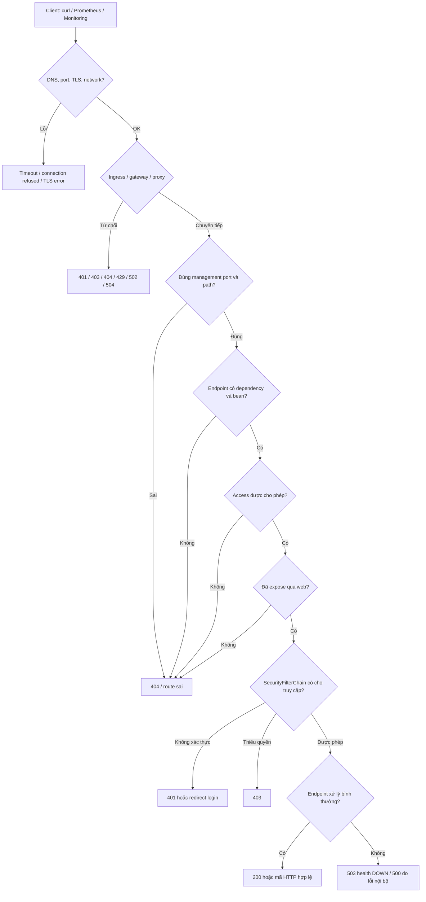

# Actuator trả lỗi do cấu hình expose hoặc bảo mật

> **Chương:** Chẩn đoán lỗi  
> **Module học:** `SPRING_MODULITH_DOCUMENTATION_OBSERVABILITY` — sử dụng Spring Modulith để tài liệu hóa ranh giới application module và quan sát tương tác trong Spring Boot qua module graph, Actuator, event metrics, tracing và context propagation.  
> **Bài toán:** `/actuator/health` hoạt động nhưng `/actuator/modulith`, `/actuator/metrics` hoặc `/actuator/prometheus` trả `404`, `401`, `403` hay lỗi khác. Làm thế nào xác định đúng nguyên nhân và khôi phục khả năng quan sát mà vẫn giữ bảo mật production?

## 1. Tình huống và mục tiêu chẩn đoán

Một ứng dụng bán hàng gồm các application module `ordering`, `inventory` và `billing`. Nhóm phát triển đã thêm Spring Modulith để kiểm tra ranh giới module, sinh tài liệu và quan sát các lời gọi hoặc domain event xuyên module. Ở local, `/actuator/health` trả `200 OK`; khi triển khai production, Grafana không lấy được metrics và kỹ sư truy cập `/actuator/modulith` thấy `404` hoặc `403`.

Những biểu hiện đó có thể do các nguyên nhân **khác nhau**:

- Spring Boot Actuator, Spring Modulith Actuator hoặc Prometheus registry chưa có trong runtime dependencies.
- Endpoint có tồn tại nhưng chưa được **expose** qua HTTP, hoặc bị cấu hình **access** loại bỏ.
- URL sai: ứng dụng chạy trên management port riêng, context path/base path thay đổi, hoặc reverse proxy rewrite khác với dự kiến.
- Spring Security, gateway, ingress hoặc proxy yêu cầu xác thực/quyền mà client giám sát chưa có.
- Endpoint vẫn khả dụng nhưng trả lỗi do logic vận hành: ví dụ `/actuator/health` báo `503` vì trạng thái `DOWN` hoặc `OUT_OF_SERVICE`.
- Một collector không nhận được dữ liệu tracing dù HTTP endpoint của Actuator vẫn trả `200`; đây là sự cố telemetry pipeline, không nhất thiết là lỗi HTTP exposure.

**Kết quả cần đạt:** đọc đúng tín hiệu HTTP, kiểm tra từng lớp theo thứ tự, sửa bằng cấu hình giới hạn quyền cụ thể, và viết kiểm thử ngăn lỗi tái phát. Cấu hình mẫu ưu tiên Spring Boot 3.4/3.5; các nhánh khác, đặc biệt Boot 4, cần đối chiếu package và property theo phiên bản trong BOM của ứng dụng.

## 2. Sơ đồ các lớp mà một yêu cầu phải đi qua



Đây là sơ đồ **quy trình kiểm tra** chứ không phải thứ tự thực thi cứng của mọi framework. Security filter có thể chạy trước lúc Spring MVC xác định handler; vì vậy request tới một URL không tồn tại đôi khi nhận `401`/`403` do một filter hoặc gateway chặn trước. Sau khi đi qua xác thực phù hợp, mới kiểm tra sự tồn tại và exposure của endpoint một cách đáng tin cậy.

Trong Spring Boot, hai điều kiện **khác nhau** quyết định endpoint Actuator có thể phục vụ qua HTTP:

1. **Access:** endpoint có được phép tồn tại và hoạt động trong application context không? Các nhánh mới hỗ trợ `management.endpoint.<id>.access`, `management.endpoints.access.default` và `management.endpoints.access.max-permitted`.
2. **Exposure:** endpoint đó có được công bố qua HTTP hay không? Điều khiển bằng `management.endpoints.web.exposure.include` và `exclude`.

Spring Security quyết định **ai được gọi** endpoint đã tồn tại và được công bố. Phân biệt rõ ba lớp này trước khi điều tra.

## 3. Bảng đọc mã HTTP trước khi sửa cấu hình

| Dấu hiệu | Cách hiểu thường gặp | Bước kiểm tra tiếp theo |
|---|---|---|
| **Connection refused / timeout** | Không có listener trên port, container/pod chưa sẵn sàng, firewall hoặc network policy | Kiểm tra địa chỉ, port, binding, service và đường truyền trước khi sửa Actuator |
| **404 Not Found** | Chưa có endpoint, chưa expose, access `none`, sai context/base path hoặc ingress rewrite | Kiểm tra dependency → access → exposure → URL theo runtime |
| **401 Unauthorized** | Chưa được xác thực; proxy hoặc Spring Security yêu cầu credentials | Xem `WWW-Authenticate`, `Server`, log proxy và chuỗi security đang áp dụng |
| **403 Forbidden** | Đã xác thực nhưng không có vai trò/quyền; hoặc CSRF chặn request thay đổi trạng thái | Xem role/authority, request matcher, CSRF và method |
| **302/303 tới trang đăng nhập** | Filter chain dùng form login hoặc gateway SSO redirect | Kiểm tra `Location`, `-L` có thể che giấu redirect khi chẩn đoán |
| **405 Method Not Allowed** | Sai HTTP verb cho operation của endpoint | Dùng `GET` cho read operation; kiểm tra `Allow` và API của endpoint |
| **429 Too Many Requests** | Rate limit ở ứng dụng/gateway/ingress | Xem nguồn trả mã và chính sách giới hạn |
| **500 Internal Server Error** | Endpoint có thể lỗi trong lúc tính nội dung, serialize hoặc gọi dependency | Kiểm tra log lỗi có tương quan request và stack trace ở môi trường an toàn |
| **503 từ `/actuator/health`** | Health aggregator hoặc health group phản ánh `DOWN`/`OUT_OF_SERVICE` | Xem health contributors và readiness; đừng vội mở security |
| **502/504 từ proxy** | Upstream unavailable hoặc timeout | Kiểm tra reverse proxy, service endpoints, readiness, timeout và port |
| **200 nhưng dữ liệu thiếu** | Endpoint trả thành công, song metric chưa được ghi, registry thiếu hoặc exporter không gửi trace | Kiểm tra nguồn dữ liệu và telemetry pipeline |

Mã HTTP là **điểm khởi đầu**, không phải chẩn đoán cuối cùng. Mọi lớp proxy, API gateway, auth middleware hoặc ứng dụng đều có thể quyết định mã phản hồi; phải xác định nơi **thực sự** trả mã.

## 4. Kiểm tra dependency trước khi thay exposure

Trước khi tăng quyền, xác nhận application có thành phần tạo endpoint. Ví dụ Gradle Kotlin DSL:

```kotlin
dependencies {
    implementation("org.springframework.boot:spring-boot-starter-actuator")

    // Bảo mật endpoint qua SecurityFilterChain (nếu ứng dụng dùng security).
    implementation("org.springframework.boot:spring-boot-starter-security")

    // Spring Modulith actuator + observability trong runtime.
    runtimeOnly("org.springframework.modulith:spring-modulith-starter-insight")

    // Chỉ cần khi Prometheus scrape /actuator/prometheus.
    runtimeOnly("io.micrometer:micrometer-registry-prometheus")
}
```

**Quy tắc version:** để Spring Boot BOM và Spring Modulith BOM tương thích quản lý phiên bản; đoạn trên không áp đặt một bản Spring Modulith cụ thể. Trong ứng dụng đã có Actuator hoặc Security nhờ starter khác, cần kiểm tra dependency hiện tại để tránh thêm thành phần không cần thiết.

| Tính năng | Điều kiện nền tảng | URL thông thường |
|---|---|---|
| Health | Spring Boot Actuator và web management | `GET /actuator/health` |
| Info / Metrics | Spring Boot Actuator; meter cần được instrument để có dữ liệu | `GET /actuator/info`, `GET /actuator/metrics` |
| Prometheus | Actuator + `micrometer-registry-prometheus` | `GET /actuator/prometheus` |
| Spring Modulith module structure | `spring-modulith-actuator` hoặc starter Insight và Actuator | `GET /actuator/modulith` |
| Span qua application module | Thành phần Spring Modulith observability + Micrometer tracing bridge/exporter | Xem ở tracing backend, **không phải** một URL `/actuator/traces` mặc định |
| Event publication metrics | Spring Modulith observability và event phát sinh khi runtime chạy | Qua Micrometer `/actuator/metrics`/`prometheus` nếu được cấu hình |

`spring-modulith-starter-insight` hỗ trợ cả actuator module và observability trong các nhánh Spring Modulith hiện đại; có thể dùng các module chuyên biệt theo BOM thay thế nếu cần. Endpoint `modulith` phản ánh **cấu trúc application module**, còn metric `module.events.published` liên quan **domain events đã phát**. Hai nguồn dữ liệu độc lập; thiếu module graph và thiếu published-event counter không nhất thiết cùng một lỗi.

**Phân biệt hai hiện tượng:** `/actuator/prometheus` trả `404` dù `/actuator/metrics` trả `200` có thể đơn giản là thiếu Prometheus registry; `/actuator/modulith` trả `404` dù `health` hoạt động có thể do chưa có Spring Modulith actuator hoặc chưa expose `modulith`. Bật `management.endpoints.web.exposure.include` không thể tạo endpoint của dependency chưa có.

## 5. Phân biệt `access`, `exposure` và `SecurityFilterChain`

### 5.1. Access quyết định endpoint có được khởi tạo không

Ở các nhánh Spring Boot hỗ trợ mô hình `access`, có thể sử dụng:

```yaml
management:
  endpoints:
    access:
      default: none
      max-permitted: read-only

  endpoint:
    health:
      access: read-only
    info:
      access: read-only
    metrics:
      access: read-only
    prometheus:
      access: read-only
    modulith:
      access: read-only
```

`default: none` chỉ cho phép các endpoint được khai báo lại rõ ràng. `max-permitted: read-only` giới hạn các operation được phép đọc, giúp tránh vô tình mở operation thay đổi trạng thái. Endpoint bị `access: none` có thể bị loại khỏi application context: một request HTTP tới nó không thể được phục hồi chỉ bằng thêm role vào Spring Security.

**Lưu ý phiên bản:** thuộc tính `management.endpoints.access.*` là cơ chế hiện đại (Spring Boot 3.4 trở lên); một số dự án Boot cũ dùng `management.endpoint.<id>.enabled` hoặc `management.endpoints.enabled-by-default`. Phải theo tài liệu của đúng phiên bản; đừng kết hợp các property của nhiều nhánh và giả định cùng tác dụng.

### 5.2. Exposure chỉ là công bố qua giao thức

Cấu hình endpoint có thể hoạt động trên HTTP:

```yaml
management:
  endpoints:
    web:
      exposure:
        include: "health,info,metrics,prometheus,modulith"
```

Mặc định chỉ `health` được expose qua HTTP; các endpoint khác cần khai báo rõ, miễn chúng tồn tại và có access hợp lệ. `exclude` có **ưu tiên cao hơn** `include`:

```yaml
management:
  endpoints:
    web:
      exposure:
        include: "health,info,metrics,prometheus,modulith"
        exclude: "modulith"
```

Trong cấu hình thứ hai, `/actuator/modulith` vẫn không được expose. Vì vậy cần kiểm tra cả `include`, `exclude` và mọi giá trị ghi đè từ `application-{profile}.yml`, biến môi trường, `SPRING_APPLICATION_JSON`, tham số dòng lệnh hoặc nguồn cấu hình tập trung.

Không nên dùng `include: "*"` trong production để “sửa nhanh” lỗi 404: wildcard có thể công bố `env`, `configprops`, `loggers`, `heapdump`, `beans` hoặc các endpoint nhạy cảm. Nếu dùng `*` trong YAML cho môi trường thử, phải bọc dấu sao trong chuỗi; nhưng nguyên tắc production là chọn danh sách nhỏ, có chủ đích.

### 5.3. Security quyết định danh tính và quyền

Cấu hình access và exposure **không phải cơ chế xác thực**. Ngay cả khi `modulith` đã sẵn sàng, người gọi không có quyền có thể nhận 401/403.

Với Spring Security trên classpath, khi ứng dụng **không khai báo** `SecurityFilterChain` riêng, Spring Boot có auto-configuration bảo vệ phần lớn Actuator endpoints, thường cho phép truy cập health. Khi ứng dụng tự khai báo bất kỳ `SecurityFilterChain` bean nào, auto-configuration security của Actuator lùi lại và ứng dụng phải chịu trách nhiệm về cả management endpoints lẫn request nghiệp vụ.

Đây là một nguồn lỗi phổ biến: lập trình viên tạo chain cho API, nghĩ Spring Boot vẫn tự bảo vệ Actuator, rồi thấy một số URL trả 401/403 hoặc bị mở ngoài dự kiến. Phần tiếp theo đưa ra mẫu bảo mật rõ ràng cho cả hai nhóm request.

## 6. Xác định đúng URL, port và đường đi qua proxy

Các endpoint Actuator thông thường có đường dẫn `/actuator/{id}`. Nhưng URL thực có thể thay đổi theo:

```properties
server.port=8080
server.servlet.context-path=/shop
management.endpoints.web.base-path=/manage
```

Nếu management cùng port và ứng dụng servlet dùng context path `/shop`, đường dẫn minh họa là:

```text
http://localhost:8080/shop/manage/health
```

Khi chạy management trên port riêng:

```properties
server.port=8080
management.server.port=9090
management.endpoints.web.base-path=/manage
management.server.address=127.0.0.1
```

Đường dẫn quản trị được phục vụ trên **port 9090** với base path `/manage`, ví dụ:

```text
http://127.0.0.1:9090/manage/health
```

`management.server.address=127.0.0.1` chỉ phù hợp khi tác nhân giám sát chạy trên cùng host hoặc thông qua một cơ chế truy cập nội bộ có kiểm soát. Trong Kubernetes/container, bind chỉ loopback có thể khiến Service hoặc Prometheus từ pod khác không kết nối được. Khi management dùng port khác, cần kiểm tra thêm `management.server.base-path`, address và cấu hình routing của nền tảng đang dùng; đừng suy ra management port luôn kế thừa đường dẫn servlet của cổng ứng dụng.

Ví dụ thay URL riêng cho health:

```yaml
management:
  endpoints:
    web:
      base-path: /manage
      path-mapping:
        health: healthcheck
```

Từ đây endpoint health có thể nằm ở `/manage/healthcheck`, và `/manage/health` có thể trả 404 dù health vẫn hoạt động.

**Kiểm tra cả từ trong pod và từ bên ngoài.** Nếu `curl` tới `127.0.0.1:9090/manage/health` trong container trả 200 nhưng từ Prometheus qua Service trả timeout/502, hãy kiểm tra port/service/ingress và policy mạng. Thay đổi `management.endpoints.web.exposure.include` không giải quyết lỗi định tuyến.

Cần phân biệt `GET /actuator` (discovery page) với `GET /actuator/health`: discovery page có thể bị vô hiệu hóa bởi `management.endpoints.web.discovery.enabled=false`, hoặc bị thay đổi path/giới hạn quyền. Việc không thấy danh sách `_links` **không đủ** để kết luận mọi endpoint đều mất.

## 7. Mẫu Spring Security xử lý 401 và 403

Ví dụ dưới đây dành cho Spring MVC, Spring Security 6, Spring Boot 3.x. Mục đích là chỉ cho phép truy cập health đơn giản; Prometheus cần vai trò `METRICS`, còn graph và metrics chi tiết cần `OPS`. API nghiệp vụ có chuỗi bảo mật riêng.

```java
package com.example.shop.config;

import static org.springframework.security.config.Customizer.withDefaults;

import org.springframework.boot.actuate.autoconfigure.security.servlet.EndpointRequest;
import org.springframework.context.annotation.Bean;
import org.springframework.context.annotation.Configuration;
import org.springframework.core.annotation.Order;
import org.springframework.security.config.annotation.web.builders.HttpSecurity;
import org.springframework.security.web.SecurityFilterChain;

@Configuration(proxyBeanMethods = false)
public class SecurityConfig {

    @Bean
    @Order(1)
    SecurityFilterChain actuatorChain(HttpSecurity http)
            throws Exception {
        http.securityMatcher(EndpointRequest.toAnyEndpoint())
            .authorizeHttpRequests(auth -> auth
                .requestMatchers(EndpointRequest.to("health"))
                    .permitAll()
                .requestMatchers(EndpointRequest.to("prometheus"))
                    .hasRole("METRICS")
                .requestMatchers(
                    EndpointRequest.to("modulith", "metrics", "info"))
                    .hasRole("OPS")
                .anyRequest().denyAll())
            .httpBasic(withDefaults());
        return http.build();
    }

    @Bean
    @Order(2)
    SecurityFilterChain applicationChain(HttpSecurity http)
            throws Exception {
        http.authorizeHttpRequests(auth -> auth
                .anyRequest().authenticated())
            .httpBasic(withDefaults());
        return http.build();
    }
}
```

Đây là **mẫu minh họa**, không phải cấu hình bảo mật dùng nguyên xi trong mọi production. `hasRole("OPS")` đòi authority `ROLE_OPS`; nếu dùng JWT/OAuth2, phải ánh xạ claims thành đúng authority. HTTP Basic chỉ thích hợp trên kênh TLS với danh tính được cấp phát và quản trị phù hợp; hệ thống thật có thể dùng mTLS, OAuth2 hoặc chính sách gateway.

**Vì sao có hai `SecurityFilterChain`?** Khi ứng dụng tự khai báo một chain, Spring Boot không còn tự áp dụng cấu hình bảo mật Actuator mặc định. Chain có `@Order(1)` khớp các Actuator endpoints, còn chain thứ hai giữ việc bảo vệ các request ứng dụng khác. Không dùng một chain chỉ khớp `/api/**` rồi giả định phần còn lại được Spring Boot tự chặn.

`EndpointRequest` dựa trên registry endpoint, thích hợp hơn hardcode `/actuator/**` khi base path đổi. Mã trên dùng import `org.springframework.boot.actuate.autoconfigure.security.servlet.EndpointRequest` của Spring Boot 3.x; package và thành phần auto-configuration có khác ở nhánh Boot 4.x, cần lấy import đúng với version trong dự án. Với management **port riêng**, hãy kiểm tra security thực sự áp dụng ở management context/port, không kết luận từ kết quả kiểm tra API port.

### Role, CSRF và HTTP method

- `401`: thông thường chưa có hoặc chưa xác thực danh tính. Kiểm tra header `WWW-Authenticate`, cơ chế Basic/Bearer/SSO, ingress có xóa header không.
- `403` với `GET`: thường là thiếu role/authority, chính sách gateway hoặc security matcher. Hãy xác thực bằng tài khoản vận hành có quyền đúng.
- `403` với operation `POST`, `PUT` hoặc `DELETE`: ngoài quyền, cần xét CSRF nếu Spring Security đang bật. Mặc định các operation thay đổi trạng thái có thể bị từ chối khi thiếu CSRF token.
- `405`: endpoint không hỗ trợ method được gửi, ví dụ dùng `POST` cho operation chỉ đọc. Kiểm tra tài liệu API và response `Allow`.
- `read-only` trong `management.endpoints.access.max-permitted` có thể chặn các operation ghi từ **tầng access** dù role hợp lệ.

Đừng tắt CSRF toàn cục hoặc cho phép anonymous trên mọi Actuator endpoint để “sửa nhanh” 403. Nên giữ các operation thay đổi trạng thái ở trạng thái không được expose/không được cấp access nếu production không cần đến.

`management.endpoint.health.show-details: never` là chính sách **nội dung của health response**, không tự cấp hoặc bỏ xác thực. `show-details: when-authorized` giúp người vận hành xem thêm thông tin khi đúng role, nhưng cần bảo vệ chi tiết của database/queue/dependency.

## 8. Quy trình kiểm tra qua `curl` và logs

Giả sử quản trị đang chạy `http://127.0.0.1:9090/manage`, thao tác đầu tiên là thu bằng chứng trên đúng nguồn kết nối.

### Bước 1 — Ghi phản hồi chưa đi qua redirect

```bash
curl --silent --show-error --include --max-time 5 \
  http://127.0.0.1:9090/manage/health

curl --silent --show-error --include --max-time 5 \
  http://127.0.0.1:9090/manage/modulith

curl --silent --show-error --include --max-time 5 \
  http://127.0.0.1:9090/manage/prometheus
```

Ghi **status**, `Content-Type`, `Location`, `WWW-Authenticate`, `Server` (nếu có) và một ít body không nhạy cảm. Không thêm `-L` ngay lập tức: nếu URL trả `302` tới trang login, tự theo redirect có thể làm tưởng rằng API trả `200` với HTML. Không dùng `-k` để bỏ xác minh TLS trong production; cấu hình trust/chứng chỉ đúng thay vì che lỗi.

Để thử vai trò có quyền với Basic auth trong môi trường phù hợp, có thể dùng `--user ops-user` (curl sẽ hỏi mật khẩu, tránh đặt mật khẩu trong lịch sử shell):

```bash
curl --include --max-time 5 --user ops-user \
  https://management.internal.example/manage/modulith
```

Thay hostname và username theo môi trường thử. Nếu auth thực tế dùng Bearer token hoặc mTLS, phải dùng cơ chế đó; Basic auth không thể vượt qua proxy yêu cầu dạng danh tính khác.

### Bước 2 — So sánh direct với ingress

| Trong pod / host | Qua ingress / service | Khả năng |
|---|---|---|
| `200` | `404` | Rewrite sai path hoặc ingress route không khớp |
| `200` | `401/403` | Policy auth/gateway/WAF ngoài ứng dụng |
| `200` | Timeout/502 | Port mapping, listener binding, service target hoặc network policy |
| `401` | `401` | Chưa cung cấp credentials đúng, hoặc cùng chính sách nhiều lớp |
| `404` | `404` | Xem dependency, access, exposure, URL/port và request matcher |

Trên Kubernetes, `management.server.address=127.0.0.1` có thể làm pod/service khác không kết nối được dù thử trên localhost thành công. Nếu management dùng port khác, Service cần trỏ vào **đúng port**. Trên host truyền thống, firewall hoặc reverse proxy cần route rõ ràng tới management port. Những lỗi này không sửa được bằng `management.endpoints.web.exposure.include`.

### Bước 3 — Đối chiếu cấu hình có hiệu lực

Kiểm tra từ deployment config và log khởi động qua kênh được phép:

```text
SPRING_PROFILES_ACTIVE
server.port
server.servlet.context-path
management.server.port
management.server.address
management.server.base-path
management.endpoints.web.base-path
management.endpoints.web.path-mapping.*
management.endpoints.web.exposure.include
management.endpoints.web.exposure.exclude
management.endpoints.access.default
management.endpoints.access.max-permitted
management.endpoint.modulith.access
management.endpoint.prometheus.access
```

Cấu hình có thể bị ghi đè bởi `application-production.yml`, biến môi trường, command line, Kubernetes ConfigMap/Secret hoặc config server. Đọc file `application.yml` trong repository chỉ cho thấy **một nguồn**, chưa chứng minh giá trị runtime. Không mở `/actuator/env`, `/actuator/configprops` hay `/actuator/conditions` công khai để chẩn đoán; chúng có thể làm lộ thông tin nội bộ dù có masking.

### Bước 4 — Kiểm tra đúng lớp theo mã lỗi

**Nếu 404:** xác minh starter Actuator và dependency tạo endpoint, access/`max-permitted`, `include`/`exclude`, base path và route của ingress, sau đó mới xét filter trả về 404 có chủ đích. `/actuator/metrics` có thể sẵn sàng nhưng `/actuator/prometheus` thiếu vì không có Prometheus registry. `/actuator/modulith` cần Spring Modulith actuator hoặc Insight starter.

**Nếu 401/403:** xác định mã trả từ Spring Security hay proxy, xác minh thứ tự chain, `securityMatcher`, credential, authority, CSRF và method. Có trường hợp filter chặn một URL chưa tồn tại và trả 401 trước khi DispatcherServlet có cơ hội trả 404; thử có xác thực đúng để bóc tách.

**Nếu 503 từ health:** đọc health group/status và dependency tương ứng; `DOWN`/`OUT_OF_SERVICE` thông thường có thể ánh xạ ra 503. Sửa database/queue/kết nối khi chính chúng bị lỗi thay vì mở quyền Actuator.

**Nếu 200 nhưng không có metric:** kiểm tra instrumentation và runtime event, meter registry và scrape; bảo mật và exposure có thể đã đúng. Đừng coi “không tìm thấy tên meter” là lỗi 404 của **toàn bộ** Actuator.

### Bước 5 — Ghi thay đổi nhỏ nhất

Nếu thiếu exposure, thêm đúng endpoint cần thiết. Nếu thiếu role, sửa chính sách cho service account phù hợp. Nếu thiếu registry, thêm runtime dependency. Nếu sai đường đi, chỉnh mapping ở proxy hoặc management URL. Mỗi thay đổi phải gắn với một giả thuyết có thể kiểm chứng trước/sau; không nên vừa mở wildcard vừa tắt security vì khi đó không biết nguyên nhân thật.

## 9. Khi Actuator hoạt động nhưng Spring Modulith không có dữ liệu

Trong module `SPRING_MODULITH_DOCUMENTATION_OBSERVABILITY`, cần phân biệt ba nguồn quan sát:

| Nguồn | Vị trí | Đọc được gì? | Khi dữ liệu thiếu |
|---|---|---|---|
| Module graph | `/actuator/modulith` | Các module và quan hệ phụ thuộc nhận diện được | Kiểm tra Modulith actuator/Insight starter, khả năng detect module, access và exposure |
| Event metrics | `/actuator/metrics` hoặc `/actuator/prometheus` | Các counters event được publish, timers/counters do ứng dụng instrument | Kiểm tra observability dependency, registry và xem có event thật được phát chưa |
| Traces | Backend tracing như Tempo/Jaeger/Zipkin | Những invocation/spans được instrument, chọn mẫu và export | Kiểm tra tracing bridge, sampler, exporter, collector và async context propagation |

Có thể gặp trường hợp:

```http
GET /actuator/metrics                   -> 200
GET /actuator/metrics/module.events.published -> 404
```

Điều này cho thấy endpoint `metrics` đã hoạt động; metric mang tên `module.events.published` có thể chưa được tạo vì sự kiện chưa phát hoặc thành phần observability chưa instrument. Không khắc phục bằng cách tăng exposure: hãy phát event giả lập hợp lệ trong staging, kiểm tra dependency và đối chiếu meter thực tế. Spring Modulith mô tả counter này trong tài liệu production-ready, nhưng **published event** không đồng nghĩa **listener đã xử lý thành công**.

Tương tự, `/actuator/modulith` trả `200` không chứng minh event listener đang chạy đúng. Graph phản ánh cấu trúc module, còn trạng thái xử lý event cần được xác minh bằng listener metrics, logs và Event Publication Registry. Nếu tracing backend không có span của listener async, kiểm tra context propagation trên executor (ví dụ `ContextPropagatingTaskDecorator` ở phiên bản hỗ trợ), cùng sampling và exporter. Retry sau restart có thể tạo trace mới; dùng `eventId` hoặc correlation ID bền vững để nối các lần xử lý.

`management.tracing.sampling.probability` điều khiển trace sampling, **không** quyết định `/actuator/modulith` trả 404 hay `/actuator/prometheus` trả 401. Không sửa Actuator security khi sự cố thực tế là pipeline tracing hoặc thiếu metric.

## 10. Profile production mẫu với quyền tối thiểu

Ví dụ cho ứng dụng Spring Boot 3.4/3.5 **chạy Actuator cùng port với API**, kết hợp SecurityFilterChain ở mục 7:

```yaml
spring:
  application:
    name: shop-modulith

management:
  endpoints:
    access:
      default: none
      max-permitted: read-only
    web:
      base-path: /actuator
      exposure:
        include: "health,info,metrics,prometheus,modulith"

  endpoint:
    health:
      access: read-only
      show-details: never
      probes:
        enabled: true
    info:
      access: read-only
    metrics:
      access: read-only
    prometheus:
      access: read-only
    modulith:
      access: read-only

  tracing:
    sampling:
      probability: 0.10
```

**Giải thích:** `access.default=none` loại các endpoint chưa được cho phép rõ ràng. `max-permitted=read-only` ngăn các operation ghi. `exposure.include` công bố đúng những endpoint cần thiết; SecurityFilterChain và network policy tiếp tục quyết định người có quyền truy cập. `tracing.sampling.probability=0.10` không giảm số metrics được instrument theo mặc định và không thay đổi tính sẵn có của endpoint.

Nếu production yêu cầu `/actuator/prometheus` nhưng dependency `micrometer-registry-prometheus` không có, cấu hình YAML này vẫn không thể tạo endpoint. Nếu API được đặt trên port quản trị riêng, điều chỉnh URL, Service/Ingress và kiểm chứng security ở port đó. Không cho rằng chỉ cần đổi `management.server.port` là endpoint tự an toàn.

Với Boot trước 3.4, cấu hình quyền access dùng các thuộc tính khác; với Boot 4.x một số package Java thay đổi. Khi áp dụng, phải đối chiếu BOM dự án với reference tương ứng, tránh sao chép hỗn hợp.

## 11. Kiểm thử tự động 200, 401, 403 và exposure

Tạo bài test Spring MVC bằng `spring-boot-starter-test`, `spring-security-test`, `spring-boot-starter-actuator` và các dependency cần thiết. Ví dụ giả định đã có security chain ở mục 7, `health` trả `UP` trong môi trường test và `modulith` endpoint tồn tại:

```java
import static org.springframework.test.web.servlet.request.MockMvcRequestBuilders.get;
import static org.springframework.test.web.servlet.result.MockMvcResultMatchers.status;

import org.junit.jupiter.api.Test;
import org.springframework.beans.factory.annotation.Autowired;
import org.springframework.boot.test.autoconfigure.web.servlet.AutoConfigureMockMvc;
import org.springframework.boot.test.context.SpringBootTest;
import org.springframework.security.test.context.support.WithMockUser;
import org.springframework.test.web.servlet.MockMvc;

@SpringBootTest(properties = {
    "management.endpoints.web.exposure.include=health,metrics,modulith",
    "management.endpoints.web.base-path=/actuator"
})
@AutoConfigureMockMvc
class ActuatorAccessTests {

    @Autowired
    MockMvc mvc;

    @Test
    void healthCanBeRead() throws Exception {
        mvc.perform(get("/actuator/health"))
            .andExpect(status().isOk());
    }

    @Test
    void anonymousMetricsRequiresLogin() throws Exception {
        mvc.perform(get("/actuator/metrics"))
            .andExpect(status().isUnauthorized());
    }

    @Test
    @WithMockUser(roles = "VIEWER")
    void viewerCannotReadMetrics() throws Exception {
        mvc.perform(get("/actuator/metrics"))
            .andExpect(status().isForbidden());
    }

    @Test
    @WithMockUser(roles = "OPS")
    void opsCanReadMetrics() throws Exception {
        mvc.perform(get("/actuator/metrics"))
            .andExpect(status().isOk());
    }

    @Test
    @WithMockUser(roles = "OPS")
    void opsCanReadModulithGraph() throws Exception {
        mvc.perform(get("/actuator/modulith"))
            .andExpect(status().isOk());
    }
}
```

`MockMvc` kiểm chứng routing/filter trong application context. Nếu health indicator của dữ liệu test báo `DOWN`, cần fixture phù hợp hoặc kiểm tra status dự kiến thay vì ép `200`. Nếu endpoint `modulith` chưa được tạo trong context test, cần thêm dependency/module hợp lệ. Test này **không thay** kiểm thử trực tiếp qua management port/ingress/TLS trên staging.

Ma trận cần bổ sung:

| Thử nghiệm | Kỳ vọng |
|---|---|
| `modulith` bị xóa khỏi `exposure.include` | Endpoint không thể truy cập qua HTTP |
| `management.endpoint.modulith.access=none` | Endpoint không khả dụng dù đã expose |
| User có quyền `OPS`, gọi `metrics` | HTTP 200 |
| User khác gọi `metrics` | HTTP 403 nếu đã xác thực, thiếu role |
| Anonymous gọi `metrics` | HTTP 401 với cấu hình HTTP Basic minh họa |
| Health contributor `DOWN` | HTTP 503 (theo status mapping mặc định) |
| Management base path đổi thành `/manage` | `/manage/health` hoạt động; URL cũ không còn đúng |
| Ingress rewrite sai | Direct HTTP thành công, proxy URL lỗi |
| Thiếu Prometheus registry | Endpoint `/prometheus` không khả dụng |
| Không phát event | Có thể không tìm thấy meter chuyên biệt; endpoint `/metrics` vẫn chạy |

Với một thay đổi security, ưu tiên kiểm thử cả **đúng quyền** lẫn **sai quyền**, và bảo đảm không vô tình expose `env`, `heapdump`, `loggers` hay cấu hình nhạy cảm.

## 12. Các ca chẩn đoán theo dấu hiệu

### Ca A — Health 200, Modulith 404

Hệ thống có `GET /actuator/health` thành công; `GET /actuator/modulith` trả 404 cả khi đã xác thực đúng. Kiểm tra dependency `spring-modulith-actuator`/Insight, `management.endpoint.modulith.access`, `include`/`exclude` và path. Nếu chỉ thiếu `modulith` trong exposure, thêm **đúng một tên endpoint** và giữ nguyên security; sau đó kiểm tra JSON graph và role truy cập.

### Ca B — Prometheus 401, người vận hành 200

Prometheus dùng service account không có credential hoặc chưa có authority đúng, trong khi tài khoản quản trị truy cập được. Kiểm tra `WWW-Authenticate`, target scrape và chain được áp dụng; cấp service account với quyền tối thiểu (`ROLE_METRICS` theo mẫu), bảo vệ transport và mạng. Không giải quyết bằng cách mở toàn bộ Actuator cho anonymous.

### Ca C — Health 503, bảo mật vẫn đúng

`GET /actuator/health` trả `{"status":"DOWN"}` hoặc `OUT_OF_SERVICE`. Đây có thể do database, queue, disk, hoặc health group trong lúc khởi động/tắt dịch vụ. Kiểm tra contributors qua kênh vận hành được bảo vệ, logs và dependency metrics; sửa nguyên nhân khiến health không đạt, không thay `exposure.include` hay role.

### Ca D — Direct 200, ingress 404

Khi chạy `curl` trong pod tới `localhost:9090/manage/health`, service trả 200, nhưng URL qua ingress `/actuator/health` trả 404. Có thể ingress route hoặc rewrite chưa khớp `/manage`, hoặc service target port sai. Đối chiếu rule đường dẫn, service port, readiness, management base path và address binding; thay exposure sẽ không chữa nguyên nhân.

### Ca E — Metrics 200 nhưng chưa thấy event metrics

`GET /actuator/metrics` hiển thị JVM/HTTP meters, nhưng `/actuator/metrics/module.events.published` chưa có dữ liệu. Xem dependency Modulith observability, có event nào được publish chưa, và meter name có đúng với version không. Thử một event trong staging rồi quan sát; không vội sửa security khi `/metrics` vẫn truy cập được.

## 13. Runbook và bài tập tự kiểm tra

Khi nhận cảnh báo, người trực vận hành thực hiện theo thứ tự:

1. Ghi URL đầy đủ, thời điểm, HTTP method, status, headers, nơi gọi và request/correlation ID; không ghi token/mật khẩu vào ticket.
2. So sánh direct management port với đường qua ingress/gateway; xử lý kết nối, TLS, route, base path trước.
3. Kiểm tra dependency endpoint và cấu hình **đang có hiệu lực**: profile, access, expose include/exclude, context path và override.
4. Xác định chain Spring Security và chính sách proxy; kiểm tra anonymous, authenticated thiếu quyền và authenticated đúng quyền.
5. Phân biệt endpoint lỗi với **dữ liệu quan sát thiếu**: Modulith graph, event metrics, registry, tracing exporter và context propagation.
6. Sửa đúng lớp, có test bảo vệ, xác nhận qua HTTP thật và Prometheus scrape, ghi lại cấu hình trước/sau.

**Bài tập 1.** `spring-modulith-starter-insight` có sẵn và user có role `OPS`, nhưng `management.endpoints.web.exposure.include=health`. Vì sao `/actuator/modulith` không chạy? Thay đổi gì là đủ?

**Bài tập 2.** Security chain yêu cầu `.hasRole("OPS")`, JWT mang authority `SCOPE_ops.read`. Vì sao user đã đăng nhập vẫn bị 403? Hãy đề xuất cập nhật rule hoặc mapping authority nhất quán.

**Bài tập 3.** Health endpoint trả 503 khi database bị mất kết nối. Tại sao đây không phải lỗi expose/permission? Cần nguồn thông tin nào để xác minh health contributor gây lỗi?

**Bài tập 4.** Direct management URL hoạt động nhưng scrape qua ingress lỗi 404. Hãy kiểm tra port, base path, route rewrite, network policy và mô tả cách chứng minh nguyên nhân.

**Bài tập 5.** `/actuator/modulith` trả 200 nhưng Grafana không có span của listener async. Phân biệt sampling, exporter, context propagation và registration của listener; tại sao event ID vẫn quan trọng khi retry qua restart?

### Tiêu chí hoàn thành

Bạn có thể đọc đúng ý nghĩa 404/401/403/503, cấu hình chính xác endpoint access + exposure, bảo vệ với security chain có thứ tự và quyền tối thiểu, xác minh URL khi dùng management port/base path, kiểm thử quyền tốt/xấu, và phân biệt sự cố Actuator với thiếu dữ liệu observability của Spring Modulith. Mọi thay đổi phải có bằng chứng trước/sau và không mở rộng quyền trái nhu cầu vận hành.

### Tài liệu tham khảo

- [Spring Boot 3.5 — Actuator Endpoints](https://docs.spring.io/spring-boot/3.5/reference/actuator/endpoints.html): access, exposure, endpoint security, CSRF và response.
- [Spring Boot 3.5 — Monitoring and Management over HTTP](https://docs.spring.io/spring-boot/3.5/reference/actuator/monitoring.html): base path, management port, address, custom mapping.
- [Spring Boot — Actuator Endpoints (nhánh mới)](https://docs.spring.io/spring-boot/reference/actuator/endpoints.html): đối chiếu thay đổi theo phiên bản.
- [Spring Modulith — Production-ready Features](https://docs.spring.io/spring-modulith/reference/production-ready.html): module graph, Actuator endpoint, published-event metrics và spans.
- [Spring Security — Authorize HTTP Requests](https://docs.spring.io/spring-security/reference/servlet/authorization/authorize-http-requests.html): matcher, SecurityFilterChain và authority.
- [Spring Boot — Actuator Metrics](https://docs.spring.io/spring-boot/3.5/reference/actuator/metrics.html): Micrometer, meters và Prometheus.

> **Lưu ý version:** Mã Java và property trọng tâm dựa trên Spring Boot 3.4/3.5 + Spring Security 6; Spring Boot 4 có thay đổi package auto-configuration. Hãy xác nhận các API và dependencies theo BOM thực tế của ứng dụng trước khi đưa các ví dụ lên production.
