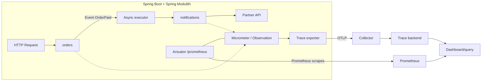
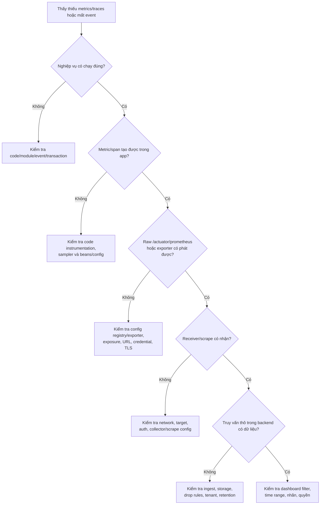
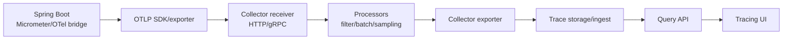

# Phân biệt lỗi code, lỗi cấu hình và lỗi backend

## 1. Tại sao phải xác định đúng lớp gây lỗi?

Trong ứng dụng Spring Boot dùng **Spring Modulith**, một request có thể đi qua module `orders`, phát `OrderPaid`, rồi kích hoạt listener bất đồng bộ ở `notifications`. Hệ thống có thể vẫn xử lý nghiệp vụ thành công nhưng dashboard không hiển thị metric mới; hoặc có metrics, không có trace; hoặc traces có trên collector nhưng biến mất khi truy vấn từ giao diện.

Cùng một triệu chứng như **“không thấy dữ liệu quan sát”** có thể bắt nguồn từ ba nhóm nguyên nhân:

1. **Lỗi code:** nhánh xử lý không chạy, listener không được gọi, instrumentation thiếu, span kết thúc quá sớm, exception bị nuốt, context không được truyền qua executor.
2. **Lỗi cấu hình:** thiếu dependency/bean, cấu hình Actuator không expose endpoint, profile sai, sampling bằng 0, URL collector sai, token/TLS không hợp lệ, tag môi trường lệch.
3. **Lỗi backend:** Prometheus không scrape hoặc drop series, collector nhận nhưng không chuyển tiếp, backend từ chối ingest/quá tải, retention hết hạn, sai tenant, index/query hay dashboard filter.

Một vấn đề có thể thuộc **nhiều lớp**. Ví dụ code có tạo span và exporter đã bật, nhưng cấu hình trỏ nhầm tenant khiến backend hiển thị trống. Chẩn đoán cần xác định **điểm cuối cùng dữ liệu còn đúng** và **điểm đầu tiên dữ liệu bị mất** thay vì sửa nhiều cấu hình cùng lúc.

Bài học **“Phân biệt lỗi code, lỗi cấu hình và lỗi backend”** thuộc chương **Chẩn đoán lỗi** của module `SPRING_MODULITH_DOCUMENTATION_OBSERVABILITY`. Phạm vi bao gồm **module graph, Actuator, event metrics, tracing và context propagation**; mục đích cuối cùng là kiểm chứng ranh giới application module cùng những tương tác thực tế khi hệ thống vận hành.

### Mục tiêu

Sau bài học, bạn có thể:

- Nêu được bằng chứng tối thiểu để phân loại sự cố thuộc code, cấu hình hay backend.
- Dùng kiểm thử ranh giới Spring Modulith và event listener để xác minh logic nghiệp vụ.
- Phân biệt *instrumentation*, *export*, *ingestion*, *storage* và *query* trong pipeline observability.
- Điều tra mất metrics/traces qua Actuator, Prometheus, collector và backend theo một trình tự lặp lại được.
- Nhận ra lỗi context propagation, sampling, cardinality, time range, tenant và nhãn môi trường.
- Viết playbook cùng các phép kiểm thử phòng ngừa để tránh tái diễn.

## 2. Bản đồ các ranh giới cần kiểm tra

Giả sử một ứng dụng duy nhất gồm các application module `orders`, `payments` và `notifications`. Spring Modulith mô tả và kiểm tra quan hệ giữa các module; điều đó **không tự động biến mỗi module thành một service mạng**.



Có hai luồng cần theo dõi song song:

- **Luồng nghiệp vụ:** request → service/module → event → listener → side effect/transaction.
- **Luồng telemetry:** instrumentation → meter/observation → exporter hoặc scrape → collector/backend → truy vấn/dashboard.

Một event có thể đến được `notifications` nhưng không tạo span; một span có thể được tạo và đưa vào hàng đợi exporter nhưng không được ghi vào backend. Vì thế phải kiểm tra **cả kết quả nghiệp vụ và bằng chứng telemetry**.

### 2.1. Ba lớp lỗi và loại bằng chứng

| Lớp | Phạm vi | Bằng chứng chính | Cách cô lập |
| --- | --- | --- | --- |
| **Code** | Publisher/listener, module dependency, instrumentation, exception handling, context propagation | Unit/integration test, breakpoint, structured log, counter tại bộ nhớ, span local | Chạy test với dependency giả và `SimpleMeterRegistry` |
| **Cấu hình** | Spring beans, profiles, property sources, Actuator, exporter, sampling, credentials, URL, TLS | Effective config đã che bí mật, bean availability, HTTP endpoint response, exporter diagnostics | So sánh local/staging/prod; kiểm tra startup và network |
| **Backend** | Scrape target, collector pipeline, ingest, storage, retention, query, dashboard, tenancy | `up`, target labels, collector logs/metrics, ingestion status, truy vấn thô | Truy vấn trực tiếp backend và so với raw telemetry tại ứng dụng |

**Lưu ý về định nghĩa:** Cấu hình collector/Prometheus về mặt triển khai cũng là “configuration”. Trong bài này, “lỗi cấu hình” được dùng cho **cấu hình ứng dụng và đường kết nối ở phía application**, còn “lỗi backend” bao gồm **cấu hình và vận hành bên tiếp nhận telemetry**. Luôn ghi rõ hệ thống và chủ sở hữu cụ thể khi tạo incident.

### 2.2. “Đã gửi” khác “đã thấy được”

| Chứng cứ quan sát | Có thể kết luận | Chưa thể kết luận |
| --- | --- | --- |
| HTTP nghiệp vụ trả 200 | Request được xử lý theo kết quả HTTP | Listener async đã xong, spans đã được xuất |
| Log `publishEvent` | Code đã gọi publisher | Listener đã chạy hoặc event bền vững |
| Counter trong `MeterRegistry` tăng | Code đã instrument và meter nhận mẫu | Prometheus đã scrape được |
| `/actuator/prometheus` có series | Registry đang expose số liệu tại thời điểm gọi | Target của Prometheus scrape thành công |
| Prometheus `up = 1` | Lần scrape gần nhất thành công | Mọi custom metrics đều có dữ liệu đúng |
| Exporter báo gửi thành công | Kết nối exporter đến receiver hoạt động | Trace đã được lưu/index và truy vấn đúng tenant |
| Collector thấy request OTLP | Receiver đã thấy traffic | Exporter tới storage downstream thành công |
| Dashboard có trace | Một trace đã được query thành công | Tất cả request đều được sample và quan sát |

Một thành phần “healthy” chỉ chứng minh phạm vi **health check của chính nó**. Đặc biệt, `/actuator/health` trạng thái `UP` không mặc nhiên xác nhận hệ thống tracing hoặc Prometheus đang hoạt động.

## 3. Quy trình khoanh vùng theo dấu vết

Điều tra hiệu quả thường trả lời theo thứ tự: **Nghiệp vụ có chạy không? Instrumentation có chạy không? Endpoint/exporter có dữ liệu không? Backend có nhận không? Query có đúng không?**



Dạng cây quyết định này là **đường hướng ưu tiên**, không phải phép chứng minh tuyệt đối. Một ví dụ: metric trong app không có cũng có thể do cấu hình vô hiệu instrumentation; cần đi tiếp bằng evidence thay vì gán nhãn nguyên nhân ngay từ nhánh đầu.

### 3.1. Thứ tự chẩn đoán trong 10 phút đầu

1. **Đóng khung triệu chứng:** tên application/module/operation, môi trường, thời điểm bắt đầu, kiểu mất dữ liệu (toàn bộ, một instance, một event, chỉ metrics hay chỉ traces).
2. **Xác minh nghiệp vụ:** request ID hoặc event ID mẫu có thật không? Trạng thái DB hay side effect của listener có đúng không? Có exception hoặc retry bất thường không?
3. **Kiểm tra ứng dụng:** log startup, meter trong registry, traces nội bộ/test, profile và dependency observability có hiệu lực.
4. **Kiểm tra điểm rời ứng dụng:** HTTP `/actuator/prometheus` hoặc exporter OTLP; xác minh URL, port, path, token, TLS và sampling.
5. **Kiểm tra điểm nhận:** Prometheus targets, collector receiver/exporter errors, ingest status, drop rules.
6. **Truy vấn thô, rồi mới xem dashboard:** dùng tên series/service/tenant chính xác và time range rộng đủ; đối chiếu nhãn `environment`, `region` và `instance`.
7. **Ghi nhận giả thuyết có bằng chứng:** lỗi bắt đầu ở đoạn nào, ai sở hữu đoạn đó, thay đổi nào đã diễn ra trước khi triệu chứng xuất hiện.

Đừng tăng đồng loạt log level, bật sampling 100% trong production hoặc mở công khai actuator để tìm lỗi. Mọi phép thử phải có phạm vi, thời hạn và cơ chế loại bỏ dữ liệu nhạy cảm.

## 4. Lỗi code: module đúng trên sơ đồ nhưng luồng chạy sai

### 4.1. Sai ranh giới hoặc thiếu listener

Spring Modulith có thể phân tích dependencies giữa các application modules theo package structure và cấu hình module. Một dependency lén từ `orders` tới implementation/internal package của `notifications` có thể đi ngược thiết kế. Một event không được listener xử lý có thể bắt nguồn từ sai kiểu event, bean không được Spring scan, handler chưa được đăng ký hoặc transaction không commit.

Kiểm tra ranh giới trong JUnit 5:

```java
package com.example;

import org.junit.jupiter.api.Test;
import org.springframework.modulith.core.ApplicationModules;

class ModuleBoundaryTest {
    @Test
    void modulesRespectDeclaredBoundaries() {
        ApplicationModules.of(OrderPlatformApplication.class)
                .verify();
    }
}
```

`verify()` kiểm tra các ràng buộc kiến trúc mà Spring Modulith áp dụng theo model module hiện tại. **Test pass không chứng minh runtime listener chạy, HTTP đối tác thành công hoặc exporter có trace.** Nếu module graph khác kỳ vọng, kiểm tra package layout, công khai API, allowed dependencies và version Spring Modulith; nên kiểm tra đó trước khi debug dashboard.

Một ví dụ sự kiện:

```java
package com.example.orders;

import java.util.UUID;

public record OrderPaid(UUID eventId, String orderId) {}
```

```java
package com.example.notifications;

import com.example.orders.OrderPaid;
import org.springframework.modulith.events.ApplicationModuleListener;
import org.springframework.stereotype.Component;

@Component
class PaymentNotificationListener {
    private final NotificationDelivery delivery;

    PaymentNotificationListener(NotificationDelivery delivery) {
        this.delivery = delivery;
    }

    @ApplicationModuleListener
    public void on(OrderPaid event) {
        delivery.send(event);
    }
}
```

`@ApplicationModuleListener` là một cách thường dùng để đăng ký listener giao dịch, bất đồng bộ của Spring Modulith; cách triển khai và xử lý publication phụ thuộc version và cấu hình event publication repository. Để kiểm tra listener có chạy, dùng integration test phát event trong **transaction thực và commit**, rồi chờ có điều kiện với timeout. Tránh tự gọi `listener.on(event)` và kết luận event dispatcher hoạt động: cách đó bỏ qua Spring events, transaction synchronization, async executor và registry.

**Dấu hiệu thiên về code:** breakpoint/log vào publisher nhưng không tới listener dù app context đã có listener bean; hoặc module verification báo dependency vi phạm. Tuy nhiên, listener không chạy cũng có thể do config transaction, component scan hoặc async executor, vì thế phải kiểm tra cùng lúc điều kiện runtime.

### 4.2. Transactional listener không có transaction như mong đợi

Một listener dùng `@TransactionalEventListener(phase = AFTER_COMMIT)` hoặc tiện ích annotation dựa trên transactional events thường chỉ được kích hoạt sau transaction commit hợp lệ. Khi publisher được gọi mà **không có transaction**, theo mặc định một `@TransactionalEventListener` có thể không được gọi (trừ khi cơ chế `fallbackExecution` được bật phù hợp). Khi transaction rollback, listener hậu commit không chạy là hành vi đúng.

| Biểu hiện | Câu hỏi cần trả lời |
| --- | --- |
| Log publish có nhưng không thấy listener | Có transaction thật tại thời điểm publish? Commit hay rollback? |
| Listener chạy trong integration test nhưng không chạy ở production | Đường thực thi có tự gọi `@Transactional` nội bộ, bỏ qua proxy không? |
| Listener nhận event nhưng side effect thất bại | Exception có thoát ra ngoài? Cơ chế ghi incomplete publication đã bật chưa? |
| Listener chạy lại sau restart | Có event publication registry và cơ chế resubmit? Event ID/idempotency được giữ nguyên không? |

`@Transactional` là hành vi áp dụng qua proxy ở cấu hình AOP thông thường. Self-invocation trong cùng bean có thể bỏ qua advice; phương thức có vẻ được annotation nhưng transaction thực tế không được tạo. Kiểm tra transaction status trong test và log transaction ở môi trường phát triển; không chỉ nhìn annotation trong source.

### 4.3. Nuốt exception làm sai cả nghiệp vụ lẫn metrics

```java
@ApplicationModuleListener
public void on(OrderPaid event) {
    try {
        delivery.send(event);
    } catch (Exception ex) {
        log.warn("Send failed for event {}", event.eventId(), ex);
        // Sai nếu failure cần được hệ thống phục hồi:
        // method trả về bình thường
    }
}
```

Nếu listener chỉ log rồi return, framework có thể coi publication **đã xử lý thành công** trong khi business side effect thất bại. Dashboard `invocations_success` tăng, backlog giảm nhưng thông báo bị mất. Lỗi bắt đầu ở **code quyết định kết quả của listener**, không phải ở Prometheus.

Sửa bằng cách chỉ nuốt exception khi thực sự có một kết quả thay thế bền vững và được xác định trong thiết kế; nếu cần retry/republication, phải báo lỗi ra ngoài:

```java
@ApplicationModuleListener
public void on(OrderPaid event) {
    delivery.send(event); // Throws nếu không thực hiện thành công
}
```

Không khẳng định cứ ném exception là hệ thống tự retry mãi: lưu publication và phát lại cần hạ tầng cùng policy phù hợp. Dùng metric riêng cho business success, listener invocation và attempts; đừng gộp một metric `events_processed` nếu nghĩa của nó không rõ.

### 4.4. Đo sai chỗ: instrumentation không nằm trong nhánh thực thi

Giả sử endpoint trả 200, nhưng code chỉ tăng counter ở nhánh success của client adapter mà production sử dụng implementation khác. Khi đó `MeterRegistry` không nhận giá trị mới, dù /actuator/prometheus và backend đều khỏe.

Ví dụ instrument trực tiếp ở một use case cụ thể:

```java
package com.example.notifications;

import io.micrometer.core.instrument.MeterRegistry;
import io.micrometer.core.instrument.Timer;
import org.springframework.stereotype.Service;

@Service
public class NotificationDelivery {

    private final PartnerClient partnerClient;
    private final MeterRegistry meters;

    public NotificationDelivery(PartnerClient partnerClient,
                                MeterRegistry meters) {
        this.partnerClient = partnerClient;
        this.meters = meters;
    }

    public void send(OrderPaid event) {
        Timer.Sample sample = Timer.start(meters);
        try {
            partnerClient.send(event);

            meters.counter("app.notification.delivery",
                    "module", "notifications",
                    "result", "success").increment();

        } catch (RuntimeException ex) {
            meters.counter("app.notification.delivery",
                    "module", "notifications",
                    "result", "error").increment();
            throw ex;
        } finally {
            sample.stop(Timer.builder("app.notification.duration")
                    .tag("module", "notifications")
                    .register(meters));
        }
    }
}
```

Ví dụ giả định `PartnerClient` và `OrderPaid` thuộc API/module được phép, đã được định nghĩa trong ứng dụng; package/import event cần điều chỉnh tương ứng. Counter `app.notification.delivery` tăng khi invocation kết thúc; Timer `app.notification.duration` đo cả invocation, **không** nhất thiết là thời gian HTTP request nếu trong phương thức còn nhiều bước.

**Cách cô lập code:** Dùng `SimpleMeterRegistry` trong unit test, gọi `NotificationDelivery.send` với partner giả và assert counter/timer trong registry. Nếu meter không tăng, lỗi code/instrumentation chưa cần Prometheus để chứng minh. Nếu test pass mà Boot app không có series, tiếp tục kiểm tra injection/registry/config/nhánh production, không đổ ngay lỗi cho backend.

### 4.5. Trace đứt khi xử lý bất đồng bộ

Khi publisher và listener chạy trên thread khác nhau, context của trace không tự bảo đảm được truyền qua mọi executor. Nếu publisher có trace nhưng listener bắt đầu trace mới, cần kiểm tra:

- Executor nào được `@Async` hoặc `@ApplicationModuleListener` thực sự sử dụng?
- Executor đó đã cấu hình Micrometer context propagation/`TaskDecorator` phù hợp chưa?
- Có bridge tracing/observation, sampling và context scope hợp lệ trong thread không?
- Listener được chạy sau restart/republication phải không? Context thread-local của process cũ không còn.

Một cấu hình minh họa khi dùng Spring Framework có `ContextPropagatingTaskDecorator`:

```java
package com.example.config;

import java.util.concurrent.Executor;
import org.springframework.context.annotation.Configuration;
import org.springframework.core.task.support.ContextPropagatingTaskDecorator;
import org.springframework.scheduling.annotation.AsyncConfigurer;
import org.springframework.scheduling.annotation.EnableAsync;
import org.springframework.scheduling.concurrent.ThreadPoolTaskExecutor;

@Configuration
@EnableAsync
class AsyncObservationConfig implements AsyncConfigurer {
    @Override
    public Executor getAsyncExecutor() {
        var executor = new ThreadPoolTaskExecutor();
        executor.setThreadNamePrefix("module-events-");
        executor.setCorePoolSize(4);
        executor.setMaxPoolSize(8);
        executor.setQueueCapacity(100);
        executor.setTaskDecorator(new ContextPropagatingTaskDecorator());
        executor.initialize();
        return executor;
    }
}
```

Đây là hướng triển khai cho các version hỗ trợ API tương ứng; cần kiểm tra dependency và executor selection của ứng dụng thực. Task decorator hỗ trợ capture/restore context **trong cùng process**. Nếu publication được phục hồi sau restart, phải dùng `eventId`/`correlationId` bền vững trong log/trace để liên kết xử lý; không kỳ vọng trace cha được hồi sinh tự động.

## 5. Lỗi cấu hình: code đúng nhưng dữ liệu không đi đến nơi

Lỗi cấu hình thường xuất hiện sau khi đổi environment, nâng version, thay secret hoặc chuyển cổng management. Một test `SimpleMeterRegistry` có thể pass nhưng production thiếu Prometheus registry; span có thể được tạo nhưng exporter chưa bật. Khi đó code ứng dụng có thể không cần thay đổi.

### 5.1. Kiểm tra dependency và bean quan sát

Các thành phần thường gặp của stack Spring Boot 3.x và Spring Modulith (chọn phiên bản tương thích với BOM của dự án):

```kotlin
dependencies {
    implementation("org.springframework.modulith:spring-modulith-starter-core")
    implementation("org.springframework.modulith:spring-modulith-observability")
    implementation("org.springframework.boot:spring-boot-starter-actuator")

    // Chọn bridge tracing phù hợp với exporter/backend.
    implementation("io.micrometer:micrometer-tracing-bridge-otel")
    runtimeOnly("io.opentelemetry:opentelemetry-exporter-otlp")

    // Cho endpoint Prometheus scrape.
    runtimeOnly("io.micrometer:micrometer-registry-prometheus")
}
```

Đây là **ví dụ hướng dẫn**, không khẳng định tất cả dự án cần cùng bộ thư viện. Với Spring Boot/Spring Modulith major version khác, tên artifact, auto-configuration và thuộc tính có thể khác. Trước khi chỉnh dependency, hỏi: registry nào đang được inject? tracing bridge nào? Exporter nào? `@Observed` có được hỗ trợ và aspect đã được đăng ký nếu instrumentation dựa trên annotation AOP?

**Các quan sát phân biệt nhanh:**

- Có `MeterRegistry` trong context nhưng không có `/actuator/prometheus`: kiểm tra registry Prometheus, endpoint exposure và management path.
- Có `/actuator/prometheus` nhưng thiếu **một metric tùy chỉnh**: thử kích hoạt nhánh code làm tăng metric; meter có thể được tạo *lười* khi code được gọi lần đầu.
- Có Actuator metrics nhưng thiếu traces: kiểm tra bridge, exporter, sampling, observation/span source, URL và outbound network.
- Có traces ở request HTTP nhưng không ở listener: kiểm tra asynchronous context propagation, instrumentation listener và sampling, không chỉ OTLP URL.

Đừng dựa vào việc thấy dependency `spring-modulith-observability` để kết luận mọi phương thức trong module đều tự tạo span/metric. Khả năng quan sát tương tác module phụ thuộc cấu hình instrumentation và phiên bản, còn metric tùy chỉnh trong code cần instrument riêng.

### 5.2. Đọc cấu hình đã áp dụng, không chỉ file YAML

Giả sử cấu hình production mong muốn là:

```yaml
spring:
  application:
    name: order-platform

management:
  server:
    port: 8081

  endpoints:
    web:
      exposure:
        include: health,info,prometheus

  metrics:
    tags:
      application: ${spring.application.name}
      environment: ${DEPLOYMENT_ENV}
      region: ${DEPLOYMENT_REGION}

  tracing:
    sampling:
      probability: ${TRACING_SAMPLE_PROBABILITY:0.20}

  otlp:
    tracing:
      endpoint: ${OTLP_TRACES_ENDPOINT}
```

Các biến này do deployment cung cấp; ví dụ `DEPLOYMENT_ENV=prod` và `OTLP_TRACES_ENDPOINT=https://collector.example.internal/v1/traces`. Cấu hình minh họa đường export **OTLP HTTP**; đừng dùng endpoint HTTP/protobuf nếu exporter đang được cấu hình dùng gRPC hoặc một giao thức khác. OTLP gRPC thường dùng cổng 4317; OTLP HTTP thường dùng cổng 4318 và đường dẫn tín hiệu như `/v1/traces`. Cần xác nhận giao thức và cả cổng thực của collector, không đoán từ hostname.

Một giá trị môi trường có thể bị ghi đè bởi `application-prod.yml`, biến môi trường, system property hoặc command-line argument. Để chẩn đoán, ghi lại **tên nguồn, tên key, profile và giá trị không nhạy cảm đã effective**, đồng thời **che token và URL có credential**. Có thể dùng Actuator `env`/`configprops` trong môi trường quản trị được bảo vệ để kiểm tra, nhưng không công khai endpoint hoặc thay chính sách show-values chỉ để debug.

| Cần xác minh | Gợi ý kiểm tra | Sai lệch thường thấy |
| --- | --- | --- |
| Profile runtime | Startup log và môi trường deploy | `dev` active trên pod prod |
| `spring.application.name` | Metric label/trace service name | Tên khác giữa exporter và dashboard |
| `management.server.port` | Cổng HTTP thực của management server | Prometheus vẫn scrape cổng business |
| `management.endpoints.web.exposure.include` | Status `/actuator/prometheus` | Endpoint chưa expose hoặc typo |
| Prometheus registry | Bean/Actuator Prometheus | Thiếu dependency registry |
| `management.tracing.sampling.probability` | Effective property theo profile | Sampling `0.0` làm mất trace dù app có hoạt động |
| `management.otlp.tracing.endpoint` | Scheme/host/port/path/protocol | Collector dùng gRPC nhưng exporter dùng HTTP |
| Exporter credential/TLS | Kết quả connect và log exporter | 401/403, PKIX, hết hạn chứng chỉ |
| `management.metrics.tags.environment` | Raw series tại app | `environment=staging` trên prod |
| Async executor | Bean/config runtime | Task decorator được tạo nhưng không được sử dụng |

**Đầu ra của bước này** nên là một bảng chênh lệch giữa *expected* và *effective*, ví dụ: “expected management port 8081; actual 8080”; hoặc “expected environment=prod; raw series reports staging”. Đây là bằng chứng mạnh hơn suy đoán từ file được commit.

### 5.3. Đọc trực tiếp Actuator, đúng cổng và quyền

Từ mạng nội bộ có quyền truy cập management:

```bash
# Tình huống dùng HTTP trên loopback, cổng ví dụ 8081
curl -i http://127.0.0.1:8081/actuator/health
curl -i http://127.0.0.1:8081/actuator/prometheus

# Tên meter ở Actuator JSON, nếu endpoint metrics đã được expose
curl -i http://127.0.0.1:8081/actuator/metrics
```

Không đồng nhất các status:

| HTTP status/triệu chứng | Hướng kiểm tra |
| --- | --- |
| `200` và raw metrics có dữ liệu | Registry/exposure của ứng dụng có thể hoạt động; tiếp tục tới Prometheus |
| `404` | Sai cổng/base path, chưa expose Prometheus, thiếu registry; hoặc security che endpoint |
| `401/403` | Spring Security/proxy/network identity; có thể là bảo vệ chủ ý |
| Connection refused/timeout | Sai port, không có listener, network policy, bind address |
| `200` nhưng thiếu metric tùy chỉnh | Nhánh code chưa chạy, meter chưa được tạo, filter/cấu hình metrics, tên meter khác |
| `200` nhưng nhãn environment sai | Profile/variable/tag config không đúng trong runtime |

`/actuator/metrics` và `/actuator/prometheus` là **hai endpoint khác nhau**: Prometheus registry và exposure không tự làm `metrics` web endpoint được expose nếu cấu hình chỉ bao gồm `health,info,prometheus`. Thấy `/actuator/metrics` 404 khi chưa expose có thể hoàn toàn đúng; hãy so yêu cầu vận hành trước khi bật thêm.

Một management port riêng **không thay thế access control**. Scraper phải có quyền truy cập, nhưng không nên mở `/actuator/env`, `/actuator/configprops`, `heapdump` hoặc endpoint điều khiển cho Internet.

### 5.4. Phân biệt lỗi cấu hình telemetry và lỗi mạng/credential

Đường OTLP có thể bị chặn ở nhiều nơi:

1. Ứng dụng không được cấu hình xuất trace, exporter bean vắng mặt.
2. Exporter hoạt động nhưng URL/protocol/port/path sai.
3. DNS, proxy, egress firewall hoặc TLS trust chặn kết nối.
4. Receiver trả 401/403 do token hết hạn, sai scope hoặc tenant.
5. Receiver nhận request nhưng collector pipeline phía sau gặp lỗi.

Các bước 1–4 thường thuộc **cấu hình hoặc kết nối phía ứng dụng**. Bước 5 là **backend/pipeline**. Tuy nhiên, quyền sở hữu cuối cùng phải dựa vào nơi cấu hình được quản lý, không chỉ nhóm tên lỗi.

Tìm log exporter ở mức đủ chi tiết và được bảo vệ; ghi loại lỗi, endpoint host, request status, certificate expiry hoặc token version, **không ghi Authorization header hoặc private key**. Nếu tracing backend thiếu dữ liệu nhưng exporter không báo lỗi, kiểm tra sampling và receiver logs, vì không có log lỗi **không có nghĩa** request cụ thể chắc chắn đã đến storage.

### 5.5. Nhầm metric tags hoặc sampling với mất dữ liệu

Một counter có thể hiện tại ứng dụng như sau:

```text
app_notification_delivery_total{
    application="order-platform",
    environment="staging",
    module="notifications",
    result="success"
} 42
```

Nếu dashboard truy vấn `environment="prod"`, series này sẽ không xuất hiện. Đó là sai lệch **label/config/query**, không nhất thiết là code không chạy. So sánh chuỗi raw tại application với chuỗi đã scrape ở Prometheus để biết nhãn sai từ nguồn nào.

Với tracing, sampling khác metrics. Khi xác suất sampling là `0.05`, chỉ một phần nhỏ traces được lưu. Không thấy trace cho một request cụ thể trong UI là **chưa đủ** kết luận exporter hay backend lỗi. Hãy chạy một phép thử có kiểm soát trong môi trường thử nghiệm với sampling tăng hợp lý hoặc dùng canary có quy tắc sampling rõ ràng; kiểm tra bridge, SDK và chính sách sampling ở collector/backend.

## 6. Lỗi backend: ứng dụng phát tín hiệu nhưng hệ thống tiếp nhận không lưu hoặc không hiển thị

Khi raw metric từ `/actuator/prometheus` đúng và endpoint có thể truy cập, điểm điều tra tiếp theo là **Prometheus scrape và pipeline lưu trữ/query**. Với traces, kiểm tra receiver, processors, exporters, lưu trữ và truy vấn ở backend.

### 6.1. Với Prometheus: target, scrape, relabel, query

Một cấu hình scrape mẫu (tại Prometheus, không đặt trong `application.yml` của Spring Boot):

```yaml
scrape_configs:
  - job_name: "order-platform"
    metrics_path: "/actuator/prometheus"
    scrape_interval: 15s
    static_configs:
      - targets: ["order-platform-management:8081"]
```

Địa chỉ là ví dụ; trong Kubernetes có thể dùng ServiceMonitor/PodMonitor hoặc service discovery thay cho `static_configs`. Nếu management endpoint cần authentication, cấu hình scrape phải cung cấp cơ chế được phép, không mở public để test.

Truy vấn thô:

```promql
# Thành công scrape lần gần nhất của từng target
up{job="order-platform"}

# Số mẫu scraper đọc trước khi metric relabel/drop
scrape_samples_scraped{job="order-platform"}

# Số mẫu còn lại sau metric relabel (nếu có)
scrape_samples_post_metric_relabeling{job="order-platform"}

# Request delivery mỗi giây theo environment (metric tùy chỉnh)
sum by (environment) (
  rate(app_notification_delivery_total[5m])
)
```

Diễn giải đúng:

- `up = 0`: scrape thất bại. Kiểm tra target URL, DNS, port, TLS, auth, response format và timeout. Điều này **không tự chứng minh ứng dụng không khỏe**.
- `up = 1` nhưng không có `app_notification_delivery_total`: có thể metric chưa được tạo, raw endpoint không có, metric bị drop bởi `metric_relabel_configs`, khác tên/label, hoặc dashboard query sai.
- Raw endpoint có metric, `scrape_samples_scraped` tăng, nhưng `scrape_samples_post_metric_relabeling` thấp bất thường: xét các quy tắc relabel/drop.
- Query không có series trong cửa sổ 5 phút: kiểm tra thời gian scrape gần nhất, metric mới có sample đầu tiên, cardinality, selectors và tenant/datasource.
- Backend không giữ đủ lịch sử: kiểm tra retention, lưu trữ, remote_write và trạng thái hệ thống đọc dữ liệu dài hạn.

Prometheus `up` được **Prometheus sinh theo scrape target**, khác với status `UP` của Actuator health. Hai chữ “up” không thay thế nhau.

### 6.2. Với tracing: collector thành công chưa chắc storage có trace

Pipeline OTLP thường gồm các phần:



Một số điểm mất dữ liệu:

| Điểm | Dấu hiệu | Cần kiểm tra |
| --- | --- | --- |
| App → receiver | Exporter timeout, connection refused, 401/403 | URL, TLS, token, DNS, egress, protocol |
| Receiver → processor | Receiver có request, output bị giảm | Filter, tail sampling, attribute/tenant rules |
| Processor → exporter | Queue đầy, retry nhiều, dropped spans | Collector logs/metrics, queue limits, backpressure |
| Exporter → storage | HTTP 429/5xx, throttling, disk full | Ingest limits, retry, quota, disk/cluster health |
| Storage → query | Dữ liệu ingest được nhưng tìm không thấy | Index delay, retention, time range, tenant, service name |
| Query → UI | API có dữ liệu nhưng dashboard trống | Filter, permission, datasource, timezone |

Một receiver trả status thành công chứng minh **receiver tiếp nhận request ở mức giao thức**, không đảm bảo từng span đã được giữ đến khi index xong. Nếu collector có processor filter hoặc sampling, spans có thể bị loại **theo chính sách**, không hẳn là lỗi runtime. Phải đối chiếu expected sampling/retention.

Quan sát các metrics của collector nếu được bật, chẳng hạn số accepted/refused spans ở receiver, số sent/failed spans ở exporter và mức dùng queue. **Tên metric collector thay đổi theo phiên bản**, vì thế xác minh tên thực từ exporter metrics của collector trước khi viết alerts; không dựa vào một tên đã thuộc phiên bản cũ.

### 6.3. Khi backend hiển thị trống nhưng ingest vẫn hoạt động

Trước khi kết luận “không có trace”, kiểm tra trực tiếp query API hoặc UI không có filter và bảo đảm:

- Khoảng thời gian bao trùm lúc event xảy ra; clock drift hoặc lệch timezone làm kết quả dễ bị bỏ sót.
- `service.name` đúng với tên được exporter thực tế gửi, không chỉ với `spring.application.name` trong file dự kiến.
- Environment/cluster/tenant được chọn đúng; credential truy vấn có quyền với tenant ingest.
- Span được sample; nếu có tail sampling, trace cụ thể có thể bị loại có chủ đích.
- Retention và index delay cho phép tìm trace trong khoảng thời gian yêu cầu.
- Dashboard đang dùng datasource đúng backend; các nhãn filter không còn giữ giá trị staging/prod cũ.

Một lỗi “backend” có thể là quy tắc query/dashboard, chứ không phải collector. Lưu lại query thô và response để chỉ ra **ingest đã thành công nhưng display chưa đúng**.

## 7. Bảng phân loại nhanh theo triệu chứng

| Triệu chứng | Giả thuyết code | Giả thuyết cấu hình | Giả thuyết backend | Phép thử đầu tiên |
| --- | --- | --- | --- | --- |
| Event được publish nhưng listener không xử lý | Sai event type, listener không đăng ký, exception | Không có transaction/commit, scan sai, executor | Thường không liên quan telemetry backend | Integration test event + publication registry |
| Module graph báo dependency bị cấm | Import/sử dụng internal API sai | Quy tắc allowed dependency sai | Không liên quan | `ApplicationModules.verify()` |
| Nghiệp vụ OK, counter không tăng tại app | Thiếu gọi `counter.increment()`, đi nhánh khác | Registry/metric filter vô hiệu | Không liên quan | `SimpleMeterRegistry` trong test |
| `/actuator/prometheus` 404 | Hiếm khi do business logic | Thiếu registry, exposure, sai path/port | Không liên quan nếu gọi localhost app | Kiểm tra dependency + management config |
| Raw metrics có, Prometheus không có | Ít khả năng là code meter | Target/scrape credential/path sai | Scrape/relabel/remote storage hỏng | `up` và Prometheus target status |
| Request HTTP có trace, async listener không có | Không tạo span/không propagate | Executor/decorator/bridge sai, sampling | Backend filter span | Kiểm tra trace parent trên listener |
| Collector receiver có spans, UI trống | Có thể span thiếu attributes mong đợi | Tenant/service/resource attributes sai | Processor filter, ingest/query/retention | Query raw backend + collector exporter |
| Prod hiện metrics nhãn `staging` | Code hardcode tag | Profile/env/common tag sai | Scrape relabel thêm nhãn sai | So raw app series với backend series |
| Chỉ một pod thiếu metrics | Nhánh code/traffic không đến pod | Pod có config/secret khác | Target của một pod bị down | Truy vấn theo `instance`/pod |
| Retry events tăng nhưng success metric vẫn tốt | Nuốt lỗi hoặc đếm success sai | Retry config khác dự kiến | Query aggregation sai | So registry outstanding, event ID, attempt và invocation |

Mỗi ô là **giả thuyết để kiểm chứng**, không phải kết luận chắc chắn. Nếu cùng một lỗi xuất hiện ở nhiều nơi, ưu tiên xác định *first failing boundary* và thay đổi nhỏ nhất có thể tái hiện được.

## 8. Bộ kiểm thử tối thiểu để khoanh vùng nguyên nhân

Bộ kiểm thử hữu ích cần tách **logic/instrumentation**, **Spring Boot runtime config**, và **backend integration** thành các lớp độc lập. Cùng một lỗi không nên phải chờ cả môi trường production mới phát hiện.

### 8.1. Unit test chứng minh instrumentation là code đang chạy

Ví dụ sau giả định `PartnerClient` là functional interface với phương thức `send(OrderPaid event)` và `NotificationDelivery` ở phần 4 đã được triển khai. Dùng registry trong bộ nhớ để tránh phụ thuộc Prometheus:

```java
package com.example.notifications;

import com.example.orders.OrderPaid;
import io.micrometer.core.instrument.simple.SimpleMeterRegistry;
import java.util.UUID;
import org.junit.jupiter.api.Test;

import static org.junit.jupiter.api.Assertions.assertEquals;
import static org.junit.jupiter.api.Assertions.assertThrows;

class NotificationMetricsTest {

    @Test
    void successIncrementsCounterOnce() {
        try (var meters = new SimpleMeterRegistry()) {
            PartnerClient fakePartner = event -> {};
            var delivery = new NotificationDelivery(fakePartner, meters);

            delivery.send(new OrderPaid(UUID.randomUUID(), "ORD-42"));

            assertEquals(1.0,
                meters.get("app.notification.delivery")
                    .tags("module", "notifications", "result", "success")
                    .counter().count());
            assertEquals(1L,
                meters.get("app.notification.duration")
                    .tag("module", "notifications")
                    .timer().count());
        }
    }

    @Test
    void failureIsCountedAndRethrown() {
        try (var meters = new SimpleMeterRegistry()) {
            PartnerClient fakePartner = event -> {
                throw new IllegalStateException("partner unavailable");
            };
            var delivery = new NotificationDelivery(fakePartner, meters);

            assertThrows(IllegalStateException.class,
                () -> delivery.send(
                    new OrderPaid(UUID.randomUUID(), "ORD-43")));

            assertEquals(1.0,
                meters.get("app.notification.delivery")
                    .tags("module", "notifications", "result", "error")
                    .counter().count());
        }
    }
}
```

Nếu test fail, lỗi gần nhất thuộc code/instrumentation trong đối tượng được thử; **chưa cần kiểm tra backend**. Nếu test pass, nó chỉ khẳng định counter tăng khi gọi đối tượng này, **chưa chứng minh Spring wiring sử dụng đúng đối tượng hoặc đúng nhánh ở production**.

### 8.2. Integration test xác nhận context và đường HTTP Actuator

Nếu endpoint Prometheus là yêu cầu của ứng dụng, một bài test có thể khởi động HTTP thật với cổng ngẫu nhiên. Ví dụ dưới đây giả định Spring Boot đã có Prometheus registry, cấu hình Actuator và policy security của test cho phép đọc endpoint; trong môi trường yêu cầu authentication, bổ sung identity phù hợp thay vì tắt security.

```java
package com.example;

import java.net.URI;
import java.net.http.HttpClient;
import java.net.http.HttpRequest;
import java.net.http.HttpResponse;

import org.junit.jupiter.api.Test;
import org.springframework.boot.test.context.SpringBootTest;

import static org.junit.jupiter.api.Assertions.assertEquals;
import static org.junit.jupiter.api.Assertions.assertTrue;

@SpringBootTest(
    webEnvironment = SpringBootTest.WebEnvironment.RANDOM_PORT,
    properties = {
        "management.endpoints.web.exposure.include=health,prometheus",
        "management.metrics.tags.environment=test",
        "management.server.port=0"
    }
)
class PrometheusEndpointIT {

    // Vì management.server.port=0, cổng quản trị có thể khác
    // cổng @LocalServerPort của business app.
    @org.springframework.beans.factory.annotation.Value(
        "${local.management.port}")
    private int managementPort;

    @Test
    void managementPortExposesPrometheus() throws Exception {
        URI uri = URI.create(
            "http://127.0.0.1:" + managementPort
            + "/actuator/prometheus");
        var request = HttpRequest.newBuilder(uri).GET().build();
        var client = HttpClient.newHttpClient();

        var response = client.send(request,
            HttpResponse.BodyHandlers.ofString());

        assertEquals(200, response.statusCode());
        assertTrue(response.body().contains("jvm_")
                || response.body().contains("process_"));
    }
}
```

**Điểm quan trọng:** `@LocalServerPort` chỉ lấy cổng web server ứng dụng; khi management server chạy cổng riêng, cần lấy `local.management.port` hoặc cách truy cập được phiên bản Spring Boot hỗ trợ. Ví dụ cố ý dùng `management.server.port=0` để không chiếm cổng cố định, và `@Value` lấy cổng thực của management. Mục tiêu là phân biệt chính xác **cổng ứng dụng** và **cổng management**, vì nhầm cổng là nguyên nhân thường gặp của `404`/connection refused.

Nếu kiểm thử HTTP trên chỉ trả `200` nhưng không chứa custom metric `app_notification_delivery_total`, hãy **kích hoạt luồng phát sinh metric trước** rồi kiểm tra nội dung tương ứng. Không nên mặc định mọi custom meter có sẵn trước khi code tạo ra nó.

Nếu hệ thống có nhiều cấu hình security, kiểm thử thêm một request không có quyền phải trả `401/403`, và một request của scraper có quyền phải trả `200`. Test không nên thay thế bằng cách mở public endpoint.

### 8.3. Kiểm thử giao dịch và publication registry thật

Spring Modulith có thể lưu các publication cho transactional event listeners bằng hạ tầng bền vững phù hợp, nhưng **có bean listener không đồng nghĩa publication được lưu**. Tạo integration test với test database và event publication repository đang dùng:

1. Publish một event có `eventId` cố định **bên trong transaction** rồi commit.
2. Làm listener thất bại có chủ ý và bảo đảm exception thoát khỏi listener.
3. Kiểm tra publication còn incomplete bằng API hoặc kho lưu được hỗ trợ, không chỉ nhìn log exception.
4. Kích hoạt cơ chế resubmit/republication đúng với version Spring Modulith của dự án.
5. Cho listener thành công; xác minh publication completed và side effect thực tế chỉ xuất hiện một lần do idempotency.
6. Kiểm tra counter `invocation_error`, `attempts` và backlog phản ánh đúng ý nghĩa, kể cả khi event được phát lại.

Nếu bước 3 không thấy publication, kiểm tra dependency lưu publication, transaction boundary, repository và event configuration **trước khi nhìn collector**. Nếu publication có nhưng metric phục hồi không có, quay lại instrument listener và metric registry.

### 8.4. Smoke test với collector và backend thật

Trong `staging`, tạo một **canary có kiểm soát**, ví dụ một request với correlation ID giả và một event không gửi thông báo thật. Thiết lập sampling đủ để quan sát canary; nếu chính sách sampling không bảo đảm được, cần xác định rằng không tìm thấy trace có thể là hành vi mong đợi.

Thực hiện tuần tự:

1. Ghi thời điểm, environment, instance và correlation ID trong log được phép.
2. Xác minh request/event đã được xử lý; ghi kết quả nghiệp vụ.
3. Mở `/actuator/prometheus` và xác minh metric mong đợi từ chính instance.
4. Kiểm tra Prometheus target `up` và query series theo `job/instance/environment`.
5. Kiểm tra collector receiver rồi collector exporter; tìm lỗi auth, queue, sampling, filter.
6. Truy vấn tracing backend bằng `service.name` và time range; dùng trace ID nếu có.
7. Nếu backend có dữ liệu nhưng dashboard không hiển thị, xét lại filters, tenant và datasource.
8. Ghi nhận **mốc mà dữ liệu biến mất** để phân loại và giao đúng người phụ trách.

Canary không nên tạo giao dịch tiền thật hoặc side effect không đảo ngược chỉ để kiểm tra tracing. Chọn thao tác read-only hoặc dữ liệu/sandbox riêng được thiết kế để thử nghiệm.

## 9. Ba tình huống điều tra cụ thể

### 9.1. Tình huống A: Actuator có metrics, dashboard trống

**Hiện tượng:** Sau deploy `order-platform`, gọi `http://127.0.0.1:8081/actuator/prometheus` trong pod thấy:

```text
# HELP app_notification_delivery_total ...
# TYPE app_notification_delivery_total counter
app_notification_delivery_total{
  application="order-platform",
  environment="prod",
  module="notifications",
  result="success"
} 12
```

Nhưng biểu đồ Production cho biết 0 request.

**Phép kiểm tra có thứ tự:**

1. Truy vấn raw Prometheus: `app_notification_delivery_total` không lọc label.
2. Nếu không có series, xem `up{job="order-platform"}`; `up=0` hướng tới scrape target/auth/TLS/network. Nếu `up=1`, kiểm tra target labels và metric relabel/drop.
3. Nếu series có, xem giá trị `environment` có thực sự là `prod` hay dashboard query đang lọc nhầm `production`, `staging` hoặc tenant.
4. Nếu query raw có data đúng mà dashboard vẫn trống, kiểm tra datasource, time range, step/rate windows, permissions và panel expression.

**Phân loại:** Khi raw endpoint đúng, code meter đã phát mẫu; lỗi có khả năng ở **scrape/backend/query**. Nếu lỗi do dashboard filter `environment=production` trong khi ứng dụng xuất `environment=prod`, root cause là **hợp đồng tên tag/config truy vấn** giữa các nhóm, không phải lỗi instrument counter.

### 9.2. Tình huống B: HTTP request có trace, async listener không có

**Hiện tượng:** API `POST /orders/{id}/pay` trả 200 và span controller xuất hiện. Log của `PaymentNotificationListener` ghi đã xử lý `OrderPaid`, nhưng trên tracing UI không thấy span listener là con của span request.

**Quy trình:**

1. Kiểm tra code listener có được instrument để tạo observation/span hay không; không mặc nhiên giả định mọi listener đều sinh span.
2. Xác định thread name và executor đang chạy listener; xem decorator/context propagation có được cấu hình trên đúng executor không.
3. Kiểm tra sampling của trace nguồn và policy sampling ở collector; so một số lượng request đủ lớn hoặc dùng canary sampling.
4. Xem log có trace ID trong listener không; nếu ID thay đổi, xác minh có async context capture/restore.
5. Nếu listener là **republication sau restart**, trace cha ban đầu không có trong process; dùng `eventId`/`correlationId` bền vững để liên kết, không đòi hỏi parent-child relation được khôi phục tự động.
6. Nếu span listener đã có trong collector nhưng không thấy UI, kiểm tra receiver/exporter/backend query.

**Phân loại:** Thiếu instrumentation là **code**; chọn sai executor hoặc bridge là **code/cấu hình**; collector filter span hoặc query không đúng là **backend**. Chỉ nhìn UI không đủ biết vấn đề nằm ở đâu.

### 9.3. Tình huống C: Lỗi được log nhưng publication đã completed

**Hiện tượng:** `notifications` gọi đối tác trả HTTP 503. Log ghi exception. Bảng publication không còn công việc incomplete và metric listener success vẫn tăng, nhưng side effect không xảy ra.

**Phân tích:** Listener catch exception rồi return, hoặc hàm recover của retry layer trả kết quả bình thường dù chưa có đường xử lý thay thế. Framework nhìn thấy listener completed, vì vậy registry có thể đánh dấu completed và metric thành công tăng.

**Bằng chứng cần tìm:** Unit test tái hiện `delivery.send` ném lỗi; integration test cho thấy listener method kết thúc thành công; record publication hoàn thành trong khi partner không được gọi thành công.

**Sửa tại code:** Giữ exception cho hệ thống biết failure, hoặc định nghĩa một đường fallback bền vững và metric đúng. Khi thêm retry, dùng idempotency key ổn định để lần phát lại không gây side effect trùng. Sau sửa, kiểm thử lại publication incomplete → resubmit → completed. **Tăng retention của Prometheus không giải quyết sự cố này.**

## 10. Mẫu ghi nhận bằng chứng và giao sự cố

Khi nhiều đội cùng điều tra, mô tả mỗi phát hiện theo mẫu để người tiếp nhận có thể tái hiện.

| Trường | Ví dụ |
| --- | --- |
| Incident | `OBS-2026-021` |
| Thời điểm bắt đầu | `2026-11-27 10:42 +07:00` |
| Environment / deployment | `prod / order-platform 2.4.1` |
| Module / operation | `notifications / sendOrderPaidNotification` |
| Triệu chứng cụ thể | “Nghiệp vụ gửi xong; 0 spans trong tracing UI ở 10:40–10:50” |
| Bằng chứng code | Listener invoked, event ID giả `E-42` xuất hiện trong structured log |
| Bằng chứng app | `/actuator/prometheus` có counter, trace exporter enabled |
| Bằng chứng đường truyền | Collector receiver accepted spans, exporter retries tăng |
| Bằng chứng backend | Storage ingest trả 429 trong cửa sổ sự cố |
| Giả thuyết | Backend ingest throttling, queue exporter đầy |
| Người sở hữu bước tiếp theo | Observability platform owner |
| Điều kiện kết thúc | Canary trace query thành công, error rate về baseline |

Các giá trị trong bảng là **minh họa**, không phải sự cố thực. Tránh đưa credential, token, private key, dữ liệu khách hàng và payload riêng tư vào incident log. Nếu cần định danh request, dùng correlation ID giả hoặc mã đã được phép lưu.

### 10.1. Kỷ luật xử lý sự cố

- **Một thay đổi có thể quan sát được tại một thời điểm:** đổi exporter URL, kiểm tra; sau đó mới xem đến sampling. Đổi nhiều biến một lúc khiến không biết nguyên nhân.
- **Ghi lại baseline:** metrics/traces/health trước khi thay đổi và sau khi sửa.
- **Phân tách ownership:** code module; platform deploy/config; SRE/observability backend. Giao cùng evidence và expected/actual, không chỉ giao câu “dashboard lỗi”.
- **Không nhầm khắc phục và che triệu chứng:** tăng sampling che lỗi chọn nhãn; tăng scrape interval không sửa listener bị nuốt exception; restart collector không sửa invalid token.
- **Lưu dấu cấu hình không nhạy cảm:** commit, image digest, active profile, endpoint host, secret version (không phải giá trị secret), version collector/backend và thời điểm thay đổi.
- **Bảo vệ dữ liệu:** trace, log và diagnostics có thể chứa thông tin cá nhân/kinh doanh; kiểm soát retention, quyền truy cập và redaction theo chính sách.

## 11. Bài thực hành chẩn đoán tổng hợp

**Hệ thống giả định:** `order-platform` có ba module `orders`, `payments` và `notifications`. Module `orders` phát event `OrderPaid` sau transaction commit. Listener `notifications` gọi partner API và ghi counter `app.notification.delivery`. Hệ thống dùng Spring Boot Actuator, Prometheus và collector OTLP.

Nhóm triển khai báo ba hiện tượng độc lập:

**Hiện tượng 1:** Unit test của `NotificationDelivery` pass; khi chạy ứng dụng staging, `/actuator/prometheus` trả `404`, còn `/actuator/health` trả `200`.

- Giả thuyết gần nhất: **cấu hình** exposure/registry/port/path. Health `200` chỉ xác minh health endpoint; không chứng minh Prometheus endpoint phải tồn tại.
- Việc cần làm: kiểm tra dependency `micrometer-registry-prometheus`, `management.endpoints.web.exposure.include`, `management.server.port`, base path và security.
- Tiêu chí hoàn tất: từ client được phép, nhận Prometheus text format và một metric tùy chỉnh xuất hiện sau khi tạo canary event.

**Hiện tượng 2:** Staging có `/actuator/prometheus` đúng và `up=1`; backend trace UI trống, collector ghi lỗi 401.

- Giả thuyết gần nhất: **credential/config xuất tracing** hoặc authentication ở receiver. Không liên quan Prometheus scrape.
- Việc cần làm: so OTLP endpoint/protocol/tenant với chính sách backend, xác minh secret version/role, rotate hoặc sửa cấu hình an toàn. Không log raw token và không tắt TLS verification.
- Tiêu chí hoàn tất: exporter không còn 401, collector receiver nhận spans và UI truy vấn canary thành công ở đúng tenant/time range.

**Hiện tượng 3:** Event publication registry cho biết một event đã completed dù đối tác chưa nhận; code listener có `catch (Exception e) { log.warn(...); }`.

- Giả thuyết gần nhất: **code xử lý exception** khiến listener return bình thường.
- Việc cần làm: sửa listener báo lỗi sau khi hết retry; dùng idempotency; thêm integration test theo transaction và event publication repository thật.
- Tiêu chí hoàn tất: khi partner lỗi, publication chưa completed; sau phục hồi và resubmit, side effect có đúng một lần và backlog về 0.

Yêu cầu thực hiện:

1. Với mỗi hiện tượng, viết một dòng **expected/actual**, chọn một phép thử đầu tiên và chỉ ra kết quả sẽ chuyển hướng chẩn đoán sang lớp nào.
2. Chạy unit test với `SimpleMeterRegistry`, integration test Actuator bằng management random port, và staging smoke test khi có môi trường thử nghiệm.
3. Dùng `ApplicationModules.of(...).verify()` để kiểm tra ranh giới kiến trúc; nhận xét vì sao pass không chứng minh event delivery hoặc exporter thành công.
4. Vẽ lại luồng từ publisher, listener, meter/span tới Prometheus và collector, đánh dấu *điểm cuối cùng dữ liệu còn đúng* cho từng lỗi.
5. Tạo một checklist release: module verification, transaction tests, effective profile, endpoint/credential, scrape target, OTLP pipeline, dashboard labels/retention.

### Câu hỏi tự đánh giá

1. Một event được xử lý đúng nhưng metric không có ngay trong `SimpleMeterRegistry`: nên ưu tiên code hay backend? Vì sao?
2. `/actuator/prometheus` trả 200 và có metric, nhưng `up=0`: hai tín hiệu đó khác nhau thế nào?
3. Khi `up=1` mà custom series không có, cần kiểm tra những khả năng nào trước khi sửa code?
4. Vì sao `@TransactionalEventListener(AFTER_COMMIT)` có thể không chạy nếu publisher gọi ngoài transaction?
5. Một listener log lỗi rồi return có thể khiến event publication registry ghi trạng thái gì? Cần sửa chỗ nào?
6. Trace của HTTP controller có nhưng listener async không có: vì sao có thể là lỗi propagation hoặc do replay sau restart?
7. Collector nhận spans có đồng nghĩa trace đã được lưu và query thành công không? Những bước nào ở giữa có thể loại bỏ dữ liệu?
8. Nếu series của `prod` có tag `environment=staging`, làm thế nào xác định nhãn sai tại app, scrape relabel hay dashboard filter?
9. Tại sao sampling thấp có thể khiến một request không có trace mà không phải exporter hỏng?
10. Khi gửi báo cáo cho nhóm observability backend, bộ bằng chứng nào sẽ giúp họ kiểm tra nhanh nhất?

**Tiêu chí thành thạo:** Bạn có thể chứng minh được luồng nghiệp vụ chạy ở application module nào, xác định điểm bắt đầu mất telemetry, giải thích nguyên nhân bằng bằng chứng ở từng ranh giới và giao đúng phạm vi sửa chữa. Phân biệt lỗi code, cấu hình và backend giúp tránh thay đổi nhầm thành phần, giữ sự ổn định của ứng dụng Spring Modulith và duy trì các chỉ số/traces đáng tin cậy khi hệ thống vận hành.


