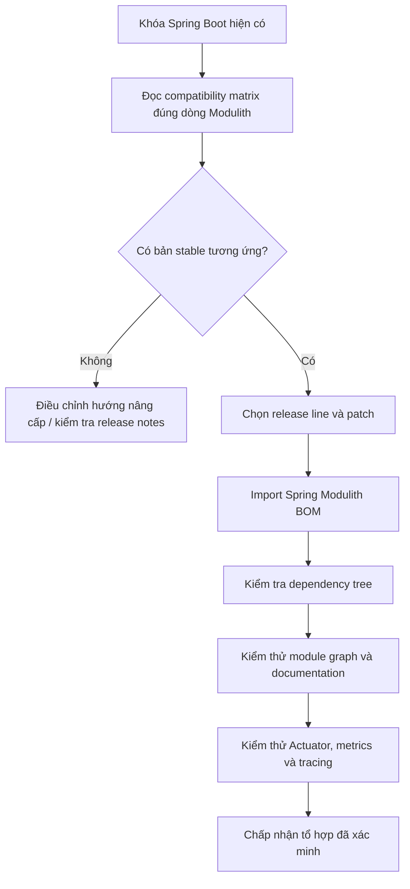

# Đọc ma trận tương thích Spring Boot và Spring Modulith

> **Chương:** Phiên bản  
> **Phạm vi học:** `SPRING_MODULITH_DOCUMENTATION_OBSERVABILITY` — dùng Spring Modulith để mô tả ranh giới application module, sinh module graph/Application Module Canvas và quan sát tương tác giữa các module trong ứng dụng Spring Boot bằng Actuator, event metrics, tracing và context propagation.  
> **Mục tiêu:** Đọc đúng ý nghĩa của từng cột trong ma trận tương thích, chọn cặp phiên bản và BOM phù hợp, rồi **kiểm chứng thực tế** chức năng tài liệu kiến trúc và observability sau khi nâng cấp.

Một dự án có thể biên dịch thành công nhưng không tạo ra tài liệu module, không thấy endpoint `/actuator/modulith` hoặc mất dấu trace khi xử lý sự kiện bất đồng bộ. Lý do thường không nằm ở một API riêng lẻ mà ở bộ phiên bản Spring Boot, Spring Modulith, Spring Framework, Micrometer, ArchUnit và các dependency hỗ trợ đang được resolve. Đọc ma trận tương thích giúp tránh kết hợp các thế hệ framework mà chưa có cơ sở kiểm chứng.

**Mốc tham khảo của bài:** 27/11/2026. Tại thời điểm này, Spring Modulith **2.2.0** đã phát hành bản GA ngày **19/11/2026**, hướng đến Spring Boot **4.2**. Các con số cụ thể được dùng để học cách đọc ma trận; khi áp dụng vào dự án thật, cần xem tài liệu khóa theo dòng phiên bản và changelog mới nhất trước khi nâng.

## 1. Ma trận tương thích là gì, dùng để quyết định điều gì?

Ma trận tương thích không đơn thuần là bảng “cứ Boot X thì dùng Modulith Y”. Nó chỉ ra **mức độ kiểm chứng đã được nhà phát triển công bố** và là điểm xuất phát cho việc chọn tổ hợp dependency.

| Khái niệm thường gặp | Cách hiểu đúng | Không suy ra được |
|---|---|---|
| **Spring Modulith version** | Dòng/bản phát hành của thư viện Modulith, ví dụ `1.4` hoặc `2.2` | Không quyết định duy nhất phiên bản mọi JAR trong ứng dụng |
| **Spring Boot version — compiled against** | Dòng Boot được sử dụng khi xây dựng Modulith ở thời điểm tài liệu/nhánh đó được phát hành | Không đồng nghĩa chỉ phiên bản ấy mới chạy được |
| **Spring Boot version — examples tested against** | Những dòng Boot đã được chạy kiểm tra ví dụ/test trong phạm vi được công bố | Không phải cam kết mọi ứng dụng ngoài đời đều tương thích |
| **jMolecules compiled/tested** | Bộ phiên bản jMolecules dùng trong build/test của Modulith | Không có nghĩa mọi phiên bản jMolecules tự chọn đều phù hợp |
| **GA / stable** | Bản chính thức của một release line | Không tự động có cùng vòng đời hỗ trợ với Boot |
| **M/RC/SNAPSHOT** | Milestone, release candidate hoặc bản phát triển | Không nên xem như GA chỉ vì đã lên repository |
| **BOM** | Bill of Materials quản lý phiên bản đồng bộ cho nhóm artifact | Không có nghĩa BOM kiểm chứng tích hợp của toàn bộ ứng dụng |

Cần phân biệt thêm **tương thích kỹ thuật**, **đã chạy test**, **được hỗ trợ theo chính sách sản phẩm** và **vẫn nhận bản vá bảo mật**. Bốn khái niệm này liên quan nhưng không đồng nhất. Một kết hợp có thể chạy qua bài test cụ thể trong matrix mà dòng Boot đã hết thời hạn hỗ trợ cộng đồng.

### Quy trình đọc đúng thứ tự



Ví dụ: ứng dụng đang ở Boot **3.5** và chỉ cần tài liệu module, metrics, tracing ổn định. Hãy bắt đầu từ dòng **Modulith 1.4** (được build theo Boot 3.5), thay vì lấy “Modulith mới nhất” 2.2 rồi ép chạy trên Boot 3.5. Nếu muốn dùng Modulith 2.2, trước tiên lập kế hoạch chuyển toàn bộ nền tảng sang Boot 4.2 và kiểm tra tác động major upgrade.

## 2. Đọc ma trận chính thức cho các dòng Modulith 1.x

Phụ lục Spring Modulith công bố hai cột Boot khác nhau: **compiled against** và **examples tested against**. Bảng dưới tái trình bày các dòng ổn định 1.1–1.4 dựa trên phụ lục, chỉ giữ các cột cần thiết cho bài này.

| Spring Modulith | Spring Boot dùng khi biên dịch | Spring Boot có trong danh sách example test | Nhận định khi chọn bản mới |
|---|---|---|---|
| **1.1** | **3.2** | 3.1, 3.2, 3.3, 3.4 | Dòng cũ; ưu tiên nâng nếu xây dựng dự án mới |
| **1.2** | **3.3** | 3.1, 3.2, 3.3, 3.4 | Phù hợp để đọc lịch sử hệ thống theo Boot 3.3 |
| **1.3** | **3.4** | 3.1, 3.2, 3.3, 3.4, 3.5 | Dòng cũ; việc đã test Boot 3.5 không khiến 1.3 trở thành lựa chọn mặc định cho Boot 3.5 |
| **1.4** | **3.5** | 3.1, 3.2, 3.3, 3.4, 3.5 | Dòng mục tiêu hợp lý khi tiếp tục ở thế hệ Boot 3.5 |

**Cách đọc hai ví dụ:**

- Dòng **1.4**: dự án Modulith được biên dịch theo Boot 3.5, trong khi tài liệu liệt kê ví dụ test trên Boot 3.1–3.5. Người dùng Boot 3.2 có thể cân nhắc 1.4 nếu điều kiện dự án phù hợp, nhưng cần chạy test riêng và xác minh Java/dependency. Danh sách “tested” không phải giấy phép bỏ qua quy trình xác minh.
- Dòng **1.3**: build theo Boot 3.4 nhưng có Boot 3.5 trong tập đã test. Điều đó thể hiện một mức kiểm chứng mở rộng; **không** có nghĩa mọi cập nhật về observability của 1.4 đã tồn tại trong 1.3.

Nguồn: [Appendix A — Spring Modulith 1.4, Spring Boot Compatibility](https://docs.spring.io/spring-modulith/reference/1.4/appendix.html). Tài liệu còn liệt kê jMolecules: 1.1–1.3 biên dịch với nhánh **2023.1**, còn 1.4 với **2023.2**. Khi dự án dùng annotation của jMolecules để mô hình hóa module, aggregate hay value object, hãy kiểm tra dòng thư viện này như một trục tương thích bổ sung.

**Lưu ý quan trọng về tài liệu động:** Một số bản trang `/reference/appendix.html` hiện vẫn hiển thị dòng `2.0 (snapshot)` bên cạnh ma trận 1.x. Khi thông báo phát hành đã công bố 2.2 GA, không được đọc dòng snapshot cũ đó như trạng thái hiện tại của 2.0/2.2. Hãy đối chiếu với trang của **release line** và thông báo GA, thay vì mặc định phụ lục tổng hợp đã cập nhật đồng bộ mọi dòng.

## 3. Đối chiếu các dòng Modulith 2.x với Spring Boot 4.x

Các thông báo phát hành chính thức cho thấy tiến trình nền tảng:

- **Spring Modulith 2.0 GA** ra ngày **21/11/2025**, chuyển baseline sang **Spring Boot 4.0** và **Spring Framework 7**.
- **Spring Modulith 2.1 GA** ra ngày **11/06/2026**; nhánh 2.1 đã cập nhật theo dòng **Boot 4.1** ngay từ các milestone đầu tiên.
- **Spring Modulith 2.2 GA** ra ngày **19/11/2026**, công bố build theo **Boot 4.2**, **Spring Framework 7.1** và **Micrometer Tracing 1.8**.

| Nếu ứng dụng đang theo dòng Boot | Dòng Modulith nên bắt đầu đánh giá | Cơ sở đối chiếu | Cần tránh suy diễn |
|---|---|---|---|
| **3.5.x** | **1.4.x** | Matrix 1.x: compiled against Boot 3.5 | Không tự ghép Modulith 2.x vào Boot 3.5 |
| **4.0.x** | **2.0.x** | Thông báo 2.0 GA: baseline Boot 4 | Không tự kết luận 2.2 chắc chắn tương thích đầy đủ với 4.0 |
| **4.1.x** | **2.1.x** | Release train 2.1 nâng theo Boot 4.1 | Không giả định mọi bản 2.0/2.2 đã test với mọi patch 4.1 |
| **4.2.x** | **2.2.x** | 2.2 GA công bố build với Boot 4.2 | Không coi “mới nhất” là điều kiện đủ để nâng production |

Bảng trên là **gợi ý chọn release train theo nền tảng**, không thay thế bảng kiểm chứng đầy đủ do dự án công bố. Đặc biệt, **2.2.0** là bản stable tại thời điểm viết; `2.3-SNAPSHOT` trên trang tài liệu là nhánh đang phát triển.

Các thông báo xác nhận:

1. [Spring Modulith 2.0 GA](https://spring.io/blog/2025/11/21/spring-modulith-2-0-ga-1-4-5-and-1-3-11-released/) — baseline Boot 4 / Framework 7.
2. [Spring Modulith 2.1 M1](https://spring.io/blog/2026/01/23/spring-modulith-2-1-m-1-2-0-2-and-1-4-7-released/) và [2.1 GA](https://spring.io/blog/2026/06/11/spring-modulith-2-1-ga-2-0-7-and-1-4-12-released/) — tiến trình nhánh Boot 4.1.
3. [Spring Modulith 2.2 GA](https://spring.io/blog/2026/11/19/spring-modulith-2-2-ga-2-1-3-and-2-0-10-released/) — build theo Boot 4.2 và Framework 7.1.

Đây cũng là lời giải cho câu hỏi “Modulith 1.4 có thấp hơn Modulith 2.0 về số version, vậy sao không dùng 2.0 với Boot 3.5?”: con số **major** cho biết đã chuyển **thế hệ framework nền tảng**. Khi nâng major, cần kiểm tra API, module hóa các starter, thư viện serialization, event registry và hạ tầng tracing; chọn theo điều kiện nền tảng rồi mới so tính năng.

## 4. Chọn bản GA, patch, milestone và snapshot

Spring Modulith có thể đồng thời duy trì các nhánh stable để sửa lỗi. Ngày **19/11/2026**, dự án phát hành **2.2 GA**, **2.1.3** và **2.0.10**; cùng thời gian đó, nhánh **1.4** tiếp tục có bản vá. Điều này bình thường: “latest release của mỗi dòng” và “latest release của toàn sản phẩm” là hai khái niệm khác nhau.

| Ký hiệu phiên bản | Ví dụ | Dùng khi nào |
|---|---|---|
| `2.2.0` | Release GA | Dự án chọn dòng 2.2/Boot 4.2 và đã xác minh hệ sinh thái |
| `2.1.3` | Patch ổn định của 2.1 | Ứng dụng đang ở dòng Boot 4.1, cần bug fix cùng release train |
| `2.0.10` | Patch ổn định của 2.0 | Ứng dụng đang ở Boot 4.0 và có kế hoạch nâng theo từng bước |
| `2.2.0-M1` | Milestone | Thử nghiệm tính năng, thử tích hợp; không xem là GA |
| `2.2.0-RC1` | Release candidate | Chạy thử trước GA với khả năng vẫn có thay đổi |
| `2.3.0-SNAPSHOT` | Snapshot phát triển | Nghiên cứu/CI thử nghiệm chuyên biệt, cần snapshot repository |

**Không so sánh phiên bản chỉ bằng số lớn nhất.** Khi một tổ chức có tiêu chí ổn định, ưu tiên patch mới nhất **của release train phù hợp**, đồng thời theo dõi tình trạng hỗ trợ của Boot và các thành phần khác. Một dòng cũ có thể còn build và test thành công nhưng không còn được cập nhật bảo mật theo kỳ vọng.

## 5. Dùng hai BOM cho hai trách nhiệm khác nhau

BOM của **Spring Boot** quản lý các dependency nền tảng (Spring Framework, Micrometer, Jackson và nhiều thư viện khác). BOM **Spring Modulith** quản lý phiên bản nhất quán của các artifact `org.springframework.modulith`. Cần chọn **cặp BOM tương thích**, không ép từng dependency Modulith một version khác nhau.

### 5.1. Mẫu Maven cho Boot 4.2 + Modulith 2.2

Ví dụ sau tập trung vào phần quản lý phiên bản; ứng dụng vẫn cần starter thực thi HTTP/data tùy nhu cầu.

```xml
<project xmlns="http://maven.apache.org/POM/4.0.0"
         xmlns:xsi="http://www.w3.org/2001/XMLSchema-instance"
         xsi:schemaLocation="http://maven.apache.org/POM/4.0.0
           https://maven.apache.org/xsd/maven-4.0.0.xsd">
    <modelVersion>4.0.0</modelVersion>

    <parent>
        <groupId>org.springframework.boot</groupId>
        <artifactId>spring-boot-starter-parent</artifactId>
        <version>4.2.0</version>
        <relativePath/>
    </parent>

    <groupId>com.example</groupId>
    <artifactId>shop-modulith</artifactId>
    <version>0.1.0-SNAPSHOT</version>

    <properties>
        <java.version>17</java.version>
        <spring-modulith.version>2.2.0</spring-modulith.version>
    </properties>

    <dependencyManagement>
        <dependencies>
            <dependency>
                <groupId>org.springframework.modulith</groupId>
                <artifactId>spring-modulith-bom</artifactId>
                <version>${spring-modulith.version}</version>
                <type>pom</type>
                <scope>import</scope>
            </dependency>
        </dependencies>
    </dependencyManagement>

    <dependencies>
        <dependency>
            <groupId>org.springframework.modulith</groupId>
            <artifactId>spring-modulith-starter-core</artifactId>
        </dependency>
        <dependency>
            <groupId>org.springframework.modulith</groupId>
            <artifactId>spring-modulith-starter-insight</artifactId>
            <scope>runtime</scope>
        </dependency>
        <dependency>
            <groupId>org.springframework.modulith</groupId>
            <artifactId>spring-modulith-starter-test</artifactId>
            <scope>test</scope>
        </dependency>
        <dependency>
            <groupId>org.springframework.boot</groupId>
            <artifactId>spring-boot-starter-test</artifactId>
            <scope>test</scope>
        </dependency>
    </dependencies>
</project>
```

Điểm cần nhìn vào mẫu:

- `spring-boot-starter-parent` đặt dòng Boot; project có thể thay bằng BOM Boot nếu không dùng parent của Spring Boot.
- `spring-modulith-bom` pin **2.2.0** để các artifact Modulith có cùng thế hệ và patch.
- Không khai báo version cho mỗi `spring-modulith-starter-*` vì BOM đã cung cấp.
- `spring-modulith-starter-insight` cung cấp hạ tầng module Actuator/observability; muốn xuất trace đến hệ thống cụ thể vẫn phải thêm bridge/exporter phù hợp.
- `spring-modulith-starter-test` dành cho `@ApplicationModuleTest` và `Documenter`; `spring-boot-starter-test` hỗ trợ hệ kiểm thử Spring Boot/JUnit. Phạm vi test/runtime được khai báo rõ ràng.

**Nếu vẫn dùng Boot 3.5:** dùng parent/BOM Boot **3.5.x** phù hợp, thay `spring-modulith.version` thành patch thuộc **1.4.x**, chẳng hạn **1.4.14** theo bản phát hành tháng 10/2026, rồi đối chiếu các artifact/test starter theo dòng 1.4. Không giữ nguyên Modulith 2.2 khi chỉ hạ parent xuống Boot 3.5.

### 5.2. Mẫu Gradle dùng Spring dependency-management plugin

Nếu build sử dụng plugin `io.spring.dependency-management`:

```groovy
plugins {
    id 'java'
    id 'org.springframework.boot' version '4.2.0'
    id 'io.spring.dependency-management' version '1.1.7'
}

group = 'com.example'
version = '0.1.0-SNAPSHOT'

ext['springModulithVersion'] = '2.2.0'

dependencyManagement {
    imports {
        mavenBom "org.springframework.modulith:spring-modulith-bom:${springModulithVersion}"
    }
}

dependencies {
    implementation 'org.springframework.modulith:spring-modulith-starter-core'
    runtimeOnly 'org.springframework.modulith:spring-modulith-starter-insight'
    testImplementation 'org.springframework.modulith:spring-modulith-starter-test'
    testImplementation 'org.springframework.boot:spring-boot-starter-test'
}
```

Đoạn trên là mẫu **Groovy DSL**. Nếu dùng Gradle Kotlin DSL, version catalog hoặc Gradle native `platform(...)`, cú pháp sẽ khác. Với Gradle native BOM, có thể dùng `implementation(platform("org.springframework.modulith:spring-modulith-bom:2.2.0"))` và thêm nền tảng phù hợp vào cấu hình test; chọn một cách quản lý dependency rõ ràng, tránh nhiều BOM hoặc constraint ghi đè khó hiểu.

**Điểm chính của cả hai ví dụ:** Boot và Modulith có vòng đời riêng nhưng được quản lý bằng **một cặp version đã chốt**, giữ các artifact Modulith đồng bộ qua BOM.

## 6. Khác biệt giữa “build chạy được” và “module documentation còn đúng”

Ở phạm vi `SPRING_MODULITH_DOCUMENTATION_OBSERVABILITY`, ma trận phiên bản có ý nghĩa trực tiếp đối với chất lượng tài liệu kiến trúc. Một ứng dụng chạy được API HTTP không có nghĩa model application module giống trước upgrade.

### 6.1. Xác minh module boundaries

Ví dụ kiểm tra bằng Modulith trong lớp test:

```java
import org.junit.jupiter.api.Test;
import org.springframework.modulith.core.ApplicationModules;

class ArchitectureVerificationTests {

    @Test
    void architectureStillMatchesModuleRules() {
        ApplicationModules.of(ShopApplication.class).verify();
    }
}
```

`ShopApplication` là lớp `@SpringBootApplication` do dự án cung cấp. Đoạn test xác minh quan hệ phụ thuộc và các quy tắc module trong model hiện hành. Khi nâng phiên bản, nên chạy test này **trước và sau** để biết một thay đổi nằm ở cấu trúc ứng dụng hay ở thuật toán phát hiện/công cụ phân tích.

### 6.2. Sinh module graph và Application Module Canvas

Ví dụ Spring Modulith `Documenter`:

```java
import org.junit.jupiter.api.Test;
import org.springframework.modulith.core.ApplicationModules;
import org.springframework.modulith.docs.Documenter;

class ArchitectureDocumentationTests {

    @Test
    void generateModuleDocumentation() {
        var modules = ApplicationModules.of(ShopApplication.class);
        new Documenter(modules).writeDocumentation();
    }
}
```

`Documenter` có thể sinh diagram ở mức module, C4/UML component diagram và **Application Module Canvas** thể hiện các thành phần quan trọng của module: Spring beans, domain events phát/nghe, cấu hình và điểm tích hợp. Tài liệu được sinh trong output build (thường là `target/spring-modulith-docs` với Maven). Phương thức được chạy **khi test này chạy**, không tự chạy chỉ vì thêm dependency.

Ví dụ tình huống khác biệt giữa phiên bản:

1. Trước nâng cấp, module `orders` chỉ phụ thuộc `inventory`; graph đúng kỳ vọng.
2. Sau nâng cấp, output hiển thị thêm module `shared` hoặc một dependency chưa từng có.
3. Có thể do code mới, do cấu hình detection strategy/`@ApplicationModule`, hoặc do cách phát hiện của phiên bản Modulith mới. Cần so sánh model và release notes, không kết luận ngay rằng framework “lỗi”.
4. Khi thay đổi có chủ ý, cập nhật baseline kiến trúc; nếu không có chủ ý, dùng `verify()` và kiểm tra package boundary để điều tra.

Một thay đổi diagram có thể ảnh hưởng người đọc tài liệu dù ứng dụng vẫn hoạt động; do đó file sinh ra là **artifact phải được so sánh** trong quy trình nâng cấp.

## 7. Tương thích của Actuator, event metrics và tracing

Spring Modulith Insight cung cấp lớp quan sát theo application module. Nền tảng Boot/Actuator/Micrometer tương thích là điều kiện cần; exporter và cấu hình thực tế là điều kiện bổ sung.

| Thành phần | Dependency/thành phần liên quan | Cách kiểm chứng sau khi chọn cặp version |
|---|---|---|
| Module graph tại runtime | `spring-modulith-starter-insight` hoặc Modulith Actuator + Boot Actuator | `GET /actuator/modulith` trả cấu trúc module đúng kỳ vọng |
| Module entry observation/span | Modulith observability, Micrometer Observation/Tracing | Span xuất hiện tại ranh giới module, mang `module.identifier` đúng |
| Event metrics | Modulith observability + meter registry | Metric gốc `module.events.published` tăng sau khi phát event |
| Prometheus endpoint | Micrometer Prometheus registry | `/actuator/prometheus` có series được export sau khi có traffic |
| Distributed tracing backend | Micrometer Tracing bridge, exporter/collector | Nhìn thấy trace/span trong backend, kiểm tra parent-child sau async |
| Context propagation | Spring Framework/Boot, Micrometer Context Propagation theo đường chạy thực tế | Span listener chạy thread khác vẫn được liên kết theo chính sách tracing |

Một cấu hình thử nghiệm có thể dùng:

```yaml
spring:
  application:
    name: shop-app

management:
  endpoints:
    web:
      exposure:
        include: health,info,modulith,metrics,prometheus
  tracing:
    sampling:
      probability: 1.0
```

`1.0` là **sampling cho môi trường kiểm thử**, không phải khuyến nghị mặc định cho production. `include: prometheus` chưa đủ nếu không có `micrometer-registry-prometheus`; tracing cũng chưa hoạt động nếu thiếu bridge/exporter hoặc hạ tầng thu thập phù hợp. Các Actuator endpoint cần kiểm soát quyền truy cập phù hợp.

Các lệnh minh họa (thực hiện trên môi trường được phép truy cập):

```bash
curl -s http://localhost:8080/actuator
curl -s http://localhost:8080/actuator/modulith
curl -s http://localhost:8080/actuator/metrics/module.events.published
curl -s http://localhost:8080/actuator/prometheus
```

Nếu `module.events.published` chưa được tạo, hãy **phát một domain event hợp lệ** qua ứng dụng rồi thử lại. Endpoint metrics có thể không có meter cho đến khi xảy ra sự kiện cần đo. Đối với exporter Prometheus, tên series/label thực tế có thể đã được chuẩn hóa so với tên meter gốc; không suy ra tên PromQL bằng phép thay dấu chấm một cách máy móc.

### Quan sát thêm gì khi nâng từ 2.1 lên 2.2?

Thông báo **2.2 GA** nêu thay đổi lớn về **event publication completion**: thao tác đánh dấu hoàn tất được thực hiện trong transaction của listener theo mặc định. Cùng với đó là trạng thái phân biệt publication thất bại/bị bỏ, các mở rộng quản lý dependencies và nâng Micrometer Tracing. Điều này có thể làm khác hành vi của **event publication registry, retry, transaction và số liệu quan sát event**, kể cả khi API phát event của ứng dụng không đổi.

Vì vậy, khi nâng từ **2.1/Boot 4.1** lên **2.2/Boot 4.2**, chạy lại bài kiểm thử event listener, transaction rollback, retry, các event chưa hoàn tất và tracing xuyên thread. Đừng chỉ dựa trên `ApplicationModules.verify()`: test đó kiểm tra ranh giới kiến trúc, không đo tính đúng đắn của delivery semantics.

## 8. Phân tích dependency tree trước khi chẩn đoán lỗi

Dùng dependency tree để kiểm tra phiên bản thực sự được resolve, đặc biệt với mono-repo có nhiều starter do các nhóm khác nhau quản lý.

### Maven

```bash
mvn dependency:tree -Dincludes=org.springframework.modulith
mvn dependency:tree -Dincludes=org.springframework.boot
mvn dependency:tree -Dincludes=io.micrometer
mvn help:effective-pom
```

Mục tiêu là phát hiện cùng một tập `org.springframework.modulith` có nhiều version không mong muốn, BOM bị override, hoặc Boot/Micrometer đi lệch khỏi nền tảng đã chốt. Một artifact có tên `2.2.0` xuất hiện trong `pom.xml` không đảm bảo mọi artifact khác trong classpath đều cùng version khi dependency resolution có override.

### Gradle

```bash
./gradlew dependencies --configuration runtimeClasspath
./gradlew dependencyInsight --dependency spring-modulith-core --configuration runtimeClasspath
./gradlew dependencyInsight --dependency micrometer-tracing --configuration runtimeClasspath
./gradlew dependencies --configuration testRuntimeClasspath
```

Đây là **các lệnh mẫu để chạy trong dự án**, không phải thao tác đã thực hiện cho bài học này. Trên Windows có thể dùng `gradlew.bat` nếu shell không hỗ trợ `./gradlew`.

### Lỗi thường gặp và cách đọc dữ liệu

| Triệu chứng | Dấu hiệu cần xác minh | Hành động |
|---|---|---|
| `NoSuchMethodError` / `ClassNotFoundException` lúc startup | Nhiều generation Spring Framework/Boot/Modulith trên classpath | Kiểm tra BOM, dependency tree, version override |
| Test `@ApplicationModuleTest` chạy lỗi sau nâng major | Test starter hoặc Spring Boot test infrastructure không cùng dòng | Kiểm tra `spring-modulith-starter-test`, Boot starter test và các import bị đổi |
| `Documenter` không compile | Artifact docs không có ở test classpath, thay đổi API hoặc import | Kiểm tra test starter và Javadoc chính xác theo dòng đang dùng |
| App chạy nhưng thiếu `/actuator/modulith` | Insight/Actuator thiếu hoặc endpoint chưa expose | Kiểm tra starter và `management.endpoints.web.exposure.include` |
| Metric `module.events.published` không tăng | Chưa có event, thiếu meter registry hoặc instrumentation | Tạo event kiểm thử, xem `/actuator/metrics` và registries |
| Có span ở dev, production không có | Sampling/exporter/context propagation khác | Kiểm tra sampling, bridge/exporter, trace backend và đường chạy listener |
| Tracing đổi tên metric/span sau upgrade | Convention hoặc kiểu event/module ID đã đổi | So schema telemetry trước/sau; đánh giá thay đổi có chủ ý |
| Graph có module mới không mong đợi | Package boundary, annotation hoặc detection strategy đổi | So sánh `@ApplicationModule`, model generated và release notes |

Các lỗi `ClassNotFoundException` có thể xuất hiện do dependency bất tương thích, nhưng không phải lúc nào nguyên nhân cũng là framework: Spring AOT/native-image reflection configuration, runtime container, hoặc artifact đóng gói sai cũng cần được kiểm tra.

## 9. Ví dụ chọn cặp phiên bản theo ba tình huống

### Tình huống A: Boot 3.5, cần duy trì hệ thống ổn định

Ứng dụng `shop-app` đang dùng Boot 3.5, có `orders` và `payments`, cần sinh module graph và trace qua `@ApplicationModuleListener`. Đội muốn “Modulith mới nhất” để bổ sung tính năng.

Lựa chọn xuất phát: **Modulith 1.4.x**. Cặp này được ma trận 1.x ghi rõ compiled against Boot 3.5. Nếu cần tính năng chỉ có ở Modulith 2.x, bài toán chuyển thành **nâng nền tảng Boot/Framework**, kèm bước chuyển Java, dependency, test và quan sát. Không thể giải quyết bằng cách chỉ đổi một version property.

Đầu ra cần lưu: cặp Boot–Modulith đang dùng, kết quả architecture verification, bản diagram trước/sau, thông số metrics/span và kết quả test event listener.

### Tình huống B: Boot 4.1, muốn nhận bản vá mới nhất cùng dòng

Ứng dụng dùng Boot 4.1, Modulith 2.1.0. Ngày 19/11/2026, dự án công bố Modulith 2.1.3 cùng bản 2.2.0. Nếu mục tiêu chỉ là lấy bug fix trong cùng dòng, hãy **đánh giá 2.1.3** trước. Nếu muốn chuyển 2.2, xem như dự án đang thực hiện **nâng release train** lên Boot 4.2.

Câu hỏi cần tự trả lời: “Tôi muốn giảm rủi ro và nhận patch của 2.1, hay tôi cần khả năng mới của 2.2 để chấp nhận nâng nền tảng?” Câu trả lời dẫn đến hai nhánh kế hoạch khác nhau.

### Tình huống C: Boot 4.2, triển khai Modulith documentation + observability mới

Với hệ thống mới chọn Boot 4.2, **Modulith 2.2.0** là điểm xuất phát dựa trên release notes 2.2 GA. Chốt BOM và starter như phần 5, sau đó kiểm chứng đủ:

1. `ApplicationModules.verify()` để kiểm tra ranh giới module.
2. `Documenter.writeDocumentation()` để sinh graph/canvas và so diff.
3. `GET /actuator/modulith` để kiểm tra identifier và dependency graph ở runtime.
4. Meter `module.events.published` sau khi gửi một domain event.
5. Tracing khi API gọi module trực tiếp và khi event listener xử lý bất đồng bộ.
6. Kịch bản failure/retry/transaction completion phù hợp với 2.2.

Nếu tất cả đều ổn mới xem cặp version này là **đã được xác minh trong ứng dụng**, bởi ma trận công bố không kiểm thử riêng hạ tầng event broker, CSDL và exporter của tổ chức.

## 10. Phạm vi cần lưu ý khi đọc “tương thích”

Có bốn lớp tương thích mà bảng Boot–Modulith chưa thể mô tả hết:

**Lớp A — JDK và Spring Framework.** Boot 3 đặt nền trên Spring Framework 6; Boot 4 chuyển sang Spring Framework 7. Trước khi nâng, xem minimum Java, source/target compatibility và công cụ build của dòng Boot chính xác đang dùng. Không tự kéo Spring Framework 7 xuống ứng dụng Boot 3 chỉ vì một dependency báo version mới hơn.

**Lớp B — Thư viện kiến trúc.** Spring Modulith dùng các thư viện phục vụ phân tích module (như ArchUnit) và có tích hợp jMolecules. Thay đổi version có thể ảnh hưởng cách phát hiện module hoặc quy tắc verify; xem changelog và giữ baseline diagram.

**Lớp C — Hạ tầng event.** Publication registry có nhiều implementation (JDBC, JPA, MongoDB, Neo4j...) và có thể liên quan schema, transaction hoặc serializer. Khi nâng major cần đọc migration notes/schema và thử nghiệm sự kiện lỗi, republish, retry, idempotency.

**Lớp D — Observability stack.** Insight starter chỉ là một phần. Meter registry, Micrometer Tracing, OpenTelemetry/Brave bridge, exporter, collector, dashboard, môi trường async và cấu hình sampling quyết định bạn có thấy span/metric ở backend hay không. Hai dòng Boot/Modulith tương thích **không bảo đảm** một exporter tùy chỉnh của bạn tự nhiên tương thích.

Ví dụ: Modulith 2.2 công bố nâng nền tảng **Micrometer Tracing 1.8**. Nếu ứng dụng cố giữ một bridge hay exporter thuộc thế hệ khác, một lỗi trace có thể đến từ lớp này dù `ApplicationModules.verify()` vẫn pass.

## 11. Checklist kiểm chứng tương thích thực tế

Trong bài tập hoặc quy trình CI, một tổ hợp chỉ nên đánh dấu là đã đánh giá khi có đủ bằng chứng tối thiểu.

| Cửa kiểm tra | Nội dung kiểm tra | Bằng chứng lưu lại |
|---|---|---|
| **Version selection** | Cặp Boot–Modulith phù hợp release train, cả hai đều GA và còn được sử dụng theo chính sách | Link ma trận/release notes, cặp version chính xác |
| **Dependency management** | Cùng patch trong nhóm Modulith; không override trái BOM Boot | Maven dependency tree/Gradle dependencyInsight |
| **Architecture** | Quan hệ module đúng, không phát sinh phụ thuộc nội bộ trái phép | `ApplicationModules.verify()` pass |
| **Documentation** | Graph và Application Module Canvas sinh được; thay đổi có giải thích | Diff artifact documentation trước/sau |
| **Runtime module view** | Actuator Modulith trả module IDs/dependencies đúng | Response `/actuator/modulith` từ môi trường test |
| **Event metrics** | Counter đúng tên/tag và phản ánh event thử | `/actuator/metrics` và registry/exporter |
| **Tracing** | Span tại module boundary; các span liên quan được liên kết đúng | Trace mẫu có parent-child hoặc links như thiết kế |
| **Event semantics** | Retry, failed/uncompleted publications và transaction rollback đúng | Integration test với CSDL/test broker |
| **Security/operations** | Actuator được bảo vệ; sample rate và exporter config phù hợp | Cấu hình triển khai và kết quả smoke test |

Thử nghiệm nên chạy ít nhất hai môi trường: một profile test gần production và một môi trường tích hợp có exporter/CSDL thực hoặc mô phỏng sát thực tế. Cần giữ cùng **tên metric/span/module identifier** giữa các môi trường và biểu diễn khác biệt môi trường bằng tag/resource attributes, tránh tạo schema quan sát riêng cho dev và prod.

### Một bài tập đọc ma trận

Nhóm có ba dự án:

| Dự án | Spring Boot | Yêu cầu | Dòng Modulith cần đánh giá đầu tiên |
|---|---|---|---|
| `billing-legacy` | 3.5.x | Giữ chạy ổn định, bổ sung module graph | **1.4.x** |
| `shop-events` | 4.1.x | Nâng patch để sửa lỗi, giữ hệ tích hợp | **2.1.x**, ví dụ 2.1.3 |
| `partner-platform` | 4.2.x | Dự án mới cần event observability | **2.2.x**, bắt đầu từ 2.2.0 |

**Câu hỏi thảo luận:** Nếu `shop-events` phải dùng tính năng event completion theo transaction mặc định của 2.2, có đủ lý do để chỉ thay `spring-modulith.version` không? **Không.** Đây là thay đổi hành vi kèm nâng release train; cần đánh giá Boot 4.2, transaction, schema event publication registry, integration test và telemetry. Nếu mục tiêu chỉ là sửa lỗi nhỏ, trước tiên đánh giá patch 2.1.x.

**Đạt yêu cầu học tập khi:** người học giải thích được khác nhau giữa `compiled against`, `examples tested against` và `GA/support lifecycle`; chọn được một cặp version có cơ sở; quản lý dependency bằng BOM; kiểm chứng module graph, Actuator, metrics, trace và event semantics trên ứng dụng của mình.

## 12. Nguồn đối chiếu và quy tắc cập nhật

1. [Spring Modulith — Spring Boot Compatibility, Appendix](https://docs.spring.io/spring-modulith/reference/1.4/appendix.html): nguồn cho bảng chi tiết các dòng **1.1–1.4**.
2. [Spring Modulith Reference — Overview và BOM](https://docs.spring.io/spring-modulith/reference/): phiên bản tài liệu ổn định và hướng dẫn import `spring-modulith-bom`.
3. [Spring Modulith 2.0 GA — 21/11/2025](https://spring.io/blog/2025/11/21/spring-modulith-2-0-ga-1-4-5-and-1-3-11-released/): baseline Boot 4 và Framework 7.
4. [Spring Modulith 2.1 M1 — 23/01/2026](https://spring.io/blog/2026/01/23/spring-modulith-2-1-m-1-2-0-2-and-1-4-7-released/): nâng theo Boot 4.1; xem thêm [2.1 GA — 11/06/2026](https://spring.io/blog/2026/06/11/spring-modulith-2-1-ga-2-0-7-and-1-4-12-released/).
5. [Spring Modulith 2.2 GA — 19/11/2026](https://spring.io/blog/2026/11/19/spring-modulith-2-2-ga-2-1-3-and-2-0-10-released/): Boot 4.2, Framework 7.1, Micrometer Tracing 1.8 và event publication changes.
6. [Documenting Application Modules](https://docs.spring.io/spring-modulith/reference/documentation.html): `Documenter`, module graph, Application Module Canvas.
7. [Production-ready Features](https://docs.spring.io/spring-modulith/reference/production-ready.html): Insight starter, `/actuator/modulith`, module observability và event metrics.
8. [Integration Testing Application Modules](https://docs.spring.io/spring-modulith/reference/testing.html): `spring-modulith-starter-test` và `@ApplicationModuleTest`.
9. [Spring Boot Reference](https://docs.spring.io/spring-boot/reference/): điều kiện chạy của phiên bản Boot, Actuator, Micrometer, tracing và cách quản lý dependency.

**Nguyên tắc áp dụng:** chốt ngày tham khảo và **khóa URL tài liệu theo dòng** (`/1.4/`, `/2.0/`, `/2.1/`, `/2.2/`) khi kiểm tra chi tiết API hoặc migration. Một trang `/reference/` động có thể trỏ sang phiên bản mới, hoặc một bảng cũ chưa được cập nhật. Khi gặp mâu thuẫn, đọc thêm thông báo GA, changelog/tag của release cụ thể và xác minh bằng dependency tree cùng test trong dự án.

Chọn đúng cặp Boot–Modulith là **bước đầu**; hoàn tất đánh giá khi module graph, tài liệu kiến trúc, event metrics, tracing và đường đi context qua các module vẫn đáp ứng hợp đồng quan sát của ứng dụng.
