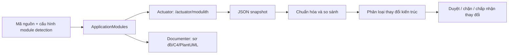
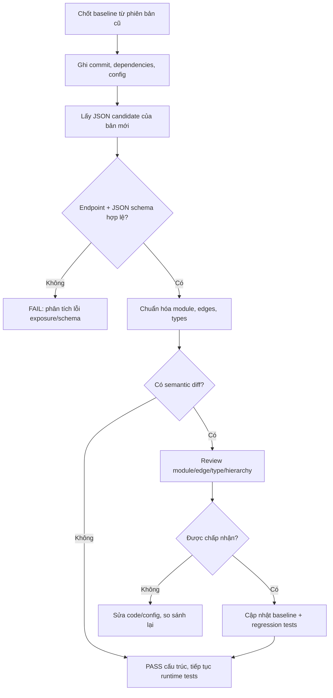

# Kiểm tra thay đổi JSON module graph

Trong **SPRING_MODULITH_DOCUMENTATION_OBSERVABILITY**, Spring Modulith giúp sinh tài liệu về ranh giới application module và quan sát tương tác giữa các phần của ứng dụng Spring Boot bằng module graph, Actuator, event metrics, tracing và context propagation. Khi nâng cấp phiên bản thư viện hoặc thay đổi mã nguồn, **JSON module graph** có thể thay đổi do cách phát hiện module, cách phân loại dependency hoặc cách xuất metadata.

Ở chương **Phiên bản**, mục tiêu của bài **“Kiểm tra thay đổi JSON module graph”** là xây dựng quy trình chụp, chuẩn hóa, so sánh và phân loại thay đổi của dữ liệu module graph trước/sau nâng cấp. Kết quả cần trả lời câu hỏi quan trọng: **kiến trúc module thật sự đổi, hay chỉ định dạng JSON và môi trường xuất dữ liệu thay đổi?**

## 1. JSON module graph đại diện cho điều gì?

`ApplicationModules` phân tích cấu trúc ứng dụng dựa trên các package, public API, tham chiếu Java, Spring components, event listeners và cấu hình phát hiện module. Spring Modulith có thể công bố mô hình đó ở **Spring Boot Actuator** dưới dạng JSON qua endpoint `/actuator/modulith`.



Đây là **mô hình quan hệ kiến trúc được suy ra từ code**, không phải thống kê cuộc gọi runtime. Ví dụ, module `billing` nhận sự kiện kiểu `OrderCompleted` do `order` định nghĩa có thể tạo cạnh dependency **billing → order**, trong khi luồng sự kiện thực tế chạy theo hướng **order phát → billing nhận**. Tracing, event metrics và context propagation giúp xác minh hành vi thực tế, nhưng không tự sinh ra tất cả cạnh cho mô hình tĩnh.

Một lần chụp JSON không chứng minh một listener đã xử lý thành công, một event đã được phát hay một span đã được truyền xuyên luồng. Để đánh giá đầy đủ, so sánh module graph với test kiến trúc và telemetry tương ứng.

## 2. Đọc đúng cấu trúc JSON của Actuator

Ví dụ phản hồi tối giản của `GET /actuator/modulith`:

```json
{
  "inventory": {
    "basePackage": "com.acme.shop.inventory",
    "displayName": "Inventory",
    "dependencies": []
  },
  "order": {
    "basePackage": "com.acme.shop.order",
    "displayName": "Order",
    "dependencies": [
      {
        "target": "inventory",
        "types": ["USES_COMPONENT"]
      }
    ]
  },
  "billing": {
    "basePackage": "com.acme.shop.billing",
    "displayName": "Billing",
    "dependencies": [
      {
        "target": "order",
        "types": ["EVENT_LISTENER"]
      }
    ]
  }
}
```

Ý nghĩa của các trường:

| JSONPath | Ý nghĩa | Cách đánh giá khi khác trước |
|---|---|---|
| `$.{moduleName}` | Key là **technical identifier** của module | Module được thêm, xóa hoặc đổi tên; kiểm tra package và chiến lược phát hiện |
| `$.{moduleName}.displayName` | Tên hiển thị cho con người | Có thể chỉ đổi nhãn tài liệu |
| `$.{moduleName}.basePackage` | Java package gốc của module | Thường là thay đổi cấu trúc/package cần rà soát |
| `$.{moduleName}.dependencies[]` | Các dependency **đi ra** từ module hiện tại | Mỗi item chỉ ra module đích mà module nguồn phụ thuộc |
| `dependencies[].target` | Technical identifier của module đích | Thêm/bớt/đổi hướng cạnh kiến trúc |
| `dependencies[].types[]` | Loại dependency được nhận diện | Kiểm tra nguyên nhân thay đổi phân loại |
| `$.{moduleName}.parent` | Tên module cha, nếu có nested module | Cần xác định thay đổi hierarchy hay khác biệt schema |
| `$.{moduleName}.nested` | Danh sách nested module, nếu có | Cần kiểm tra cách bố trí module lồng nhau |

Các dependency type được mô tả chính thức gồm:

- `DEFAULT`: dependency dựa trên tham chiếu type thông thường.
- `USES_COMPONENT`: module sử dụng Spring bean/component của module khác.
- `EVENT_LISTENER`: dependency phát sinh từ việc nghe event do module khác cung cấp.

Một target có thể chứa **nhiều type**. Ví dụ `["EVENT_LISTENER", "USES_COMPONENT"]` nghĩa là giữa hai module có các dạng quan hệ đó. Không tạo hai cạnh nghiệp vụ khác nhau chỉ vì mảng `types` có hai phần tử.

Dữ liệu này **không phải OpenAPI schema** và cũng không được tự suy là hợp đồng public API dài hạn của sản phẩm. Khi so sánh qua các bản Spring Modulith, cần xác nhận hành vi thực tế của từng phiên bản và biết trường nào là quan trọng với đội kiến trúc.

## 3. Sự khác nhau giữa các dòng phiên bản

Các tài liệu chính thức cho thấy cần đặc biệt chú ý lịch sử tên endpoint và những trường metadata được công bố:

| Dòng tài liệu | Điều cần ghi nhớ |
|---|---|
| Spring Modulith **0.2.x** | Tài liệu cũ mô tả `/actuator/applicationmodules`; không mặc định dùng URL hiện tại khi kiểm tra bản rất cũ |
| Spring Modulith **1.0.x – 1.3.x** | Tài liệu mô tả `/actuator/modulith` và các trường lõi: module name, displayName, basePackage, dependencies, target, types |
| Spring Modulith **1.4.x** | Bảng JSON chính thức còn mô tả `parent` và `nested`; lưu ý đây là thay đổi trong **bảng tài liệu** so với 1.3, không đủ để khẳng định chính xác phiên bản runtime đầu tiên thêm trường |
| Spring Modulith **2.x** | Tài liệu hiện hành tiếp tục mô tả `parent`, `nested` và những dependency type nêu trên; vẫn phải xác minh payload của bản đang chạy |

Không suy ra từ bảng rằng tất cả bản 1.3 đều chắc chắn **không có** `parent`/`nested`: nested modules được hỗ trợ từ 1.3, trong khi tài liệu của các phiên bản được công bố khác nhau. Hãy xem JSON thật hoặc release notes/changelog của bản mục tiêu để xác minh chi tiết chuyển đổi.

`/actuator` là **endpoint discovery** trả về các `_links`; `/actuator/modulith` mới trả về module map. Không lấy JSON của `/actuator` làm baseline module graph. Nếu ứng dụng dùng custom management base path, URL có thể khác; lấy URL từ cấu hình Actuator hoặc discovery response.

Để nâng cấp thư viện, kiểm tra **compatibility matrix** giữa Spring Boot và Spring Modulith, đồng thời sử dụng BOM cùng dòng phiên bản. Không chỉ nâng `spring-modulith-actuator` mà để `spring-modulith-core`, docs và observability ở các bản không tương thích.

## 4. Chuẩn bị môi trường lấy hai snapshot có thể so sánh

Để so sánh đáng tin, cần phân biệt thay đổi do **upgrade** với thay đổi do **cấu hình hoặc mã nguồn**. Mỗi snapshot cần ghi lại:

| Thông tin | Ví dụ | Vì sao cần? |
|---|---|---|
| `gitCommit` | `8ac7d31` | Xác định chính xác mã nguồn |
| `springBootVersion` | Giá trị của bản build | Kiểm soát khác biệt Actuator và module discovery |
| `springModulithVersion` | Giá trị của dependency resolved | Đối chiếu đúng tài liệu dòng phiên bản |
| `applicationProfile` | `architecture-test` | Profile khác có thể làm ứng dụng khởi động trong ngữ cảnh khác |
| `moduleDetection` | `direct-subpackages` hoặc `explicitly-annotated` | Có thể thay đổi số module và package được nhận diện |
| `endpointPath` | `/actuator/modulith` | Kiểm soát đổi URL hoặc base path |
| `captureTime` | UTC ISO-8601 | Dùng để truy vết artifact chụp |
| `artifactHash` | SHA-256 của JAR/image | Tránh so sánh nhầm image cũ với build mới |

Ví dụ cấu hình để truy cập `modulith` ở môi trường kiểm chứng:

```yaml
management:
  endpoints:
    web:
      exposure:
        include: health,info,modulith
```

Với Gradle, có thể dùng Spring Modulith starter insight nếu ứng dụng cũng cần observability, hoặc chỉ actuator support khi chỉ muốn đọc JSON:

```groovy
dependencies {
    // BOM Spring Modulith và Spring Boot được cấu hình ở build của dự án.
    runtimeOnly("org.springframework.modulith:spring-modulith-actuator")
    runtimeOnly("org.springframework.boot:spring-boot-starter-actuator")
}
```

Nếu đã dùng `spring-modulith-starter-insight` thì không cần khai báo lại actuator support riêng chỉ vì muốn xem graph. Môi trường chạy cần có đúng dependency và cấu hình expose endpoint; endpoint ở production phải được bảo vệ qua mạng quản trị và cơ chế xác thực phù hợp vì graph tiết lộ cấu trúc nội bộ.

Chụp trên các môi trường được kiểm soát bằng cùng quy trình, ví dụ khi kết nối tới ứng dụng local:

```bash
# Chạy một lần với bản trước khi nâng cấp.
curl --fail --silent --show-error \
  --header 'Accept: application/json' \
  --output baseline.json \
  http://localhost:8080/actuator/modulith

# Chạy sau khi deploy bản nâng cấp vào môi trường kiểm thử tương đương.
curl --fail --silent --show-error \
  --header 'Accept: application/json' \
  --output candidate.json \
  http://localhost:8080/actuator/modulith
```

Mỗi lần chạy cần giữ artifact và metadata build tương ứng. Lưu trong CI artifacts có kiểm soát quyền truy cập; tránh đưa trực tiếp topology/package nội bộ vào kho công khai. Đừng nhúng token vào script hay commit credential. Lệnh `curl --fail` phải trả mã thành công và file phản hồi phải là JSON module map hợp lệ trước khi dùng làm baseline.

## 5. Ví dụ thay đổi: nhìn raw JSON rất dễ nhầm

Giả sử trong bản trước nâng cấp có hai module `order` và `billing`:

**Snapshot trước:**

```json
{
  "order": {
    "displayName": "Order",
    "basePackage": "com.acme.shop.order",
    "dependencies": []
  },
  "billing": {
    "displayName": "Billing",
    "basePackage": "com.acme.shop.billing",
    "dependencies": [
      { "target": "order", "types": ["EVENT_LISTENER", "USES_COMPONENT"] }
    ]
  }
}
```

**Snapshot sau:**

```json
{
  "billing": {
    "basePackage": "com.acme.shop.billing",
    "displayName": "Billing",
    "nested": [],
    "dependencies": [
      { "types": ["USES_COMPONENT", "EVENT_LISTENER"], "target": "order" }
    ]
  },
  "order": {
    "basePackage": "com.acme.shop.order",
    "displayName": "Order",
    "nested": [],
    "dependencies": []
  }
}
```

`git diff` trên hai file có thể báo nhiều dòng khác nhau: thứ tự key bị đảo, thứ tự type thay đổi, thêm `nested: []`, các property được sắp lại. Tuy nhiên, **hai snapshot có cùng module identifiers, package, display name và tập dependency**. Nếu chính sách dự án xem `nested` vắng mặt và mảng rỗng là tương đương, đây là **không có thay đổi kiến trúc**.

Ngược lại, nếu bản sau đổi `billing.dependencies` thành `[]`, cạnh `billing → order` đã biến mất. Đây là thay đổi cần kiểm tra code và quy tắc thiết kế, dù ứng dụng vẫn build hoặc `ApplicationModules.verify()` vẫn PASS.

## 6. Chuẩn hóa để so sánh theo ngữ nghĩa

Khi làm regression test cho module graph, nên có **hai lớp kiểm tra**:

1. **Kiểm tra schema**: dữ liệu đầu vào là map các module, mỗi module có basePackage và dependencies đúng kiểu, mỗi dependency có target và mảng types hợp lệ. Nếu thiếu trường bắt buộc, dừng ngay; không âm thầm biến thành mảng rỗng.
2. **Kiểm tra kiến trúc**: chuẩn hóa thứ tự key/module/dependency/type; so sánh identifier, basePackage, parent/nested và các cạnh có gắn types.

Quy tắc chuẩn hóa gợi ý:

| Thuộc tính | Cách chuẩn hóa | Tại sao |
|---|---|---|
| Các module object keys | Sắp xếp theo identifier | Thứ tự trong JSON object không mang ý nghĩa kiến trúc |
| `dependencies[]` | Sắp xếp theo `target` | Thứ tự duyệt module khác nhau không được xem là thay đổi |
| `types[]` | Sắp xếp, phát hiện type trùng nếu có | `["DEFAULT","EVENT_LISTENER"]` và thứ tự đảo có cùng nghĩa |
| `nested[]` | Sắp xếp tên con; cân nhắc `undefined` ≈ `[]` | Chỉ áp dụng khi đã thống nhất không có nested là giá trị rỗng |
| `parent` | Quy đổi vắng mặt thành `null` nếu semantic tương đương | Tránh diff giả khi một dòng không xuất trường optional |
| `displayName` | So sánh riêng nhóm metadata | Đổi nhãn khác mức rủi ro đổi dependency |
| Trường JSON không nhận diện | Ghi cảnh báo schema evolution | Không được bỏ qua hoàn toàn khi nâng phiên bản |

Không nên chuẩn hóa `module identifier` hoặc `basePackage` thành một chuỗi không phân biệt chữ hoa/thường. Tên module và package có ý nghĩa cho các tham chiếu. Cũng không nên gộp tất cả dependency types thành boolean “có cạnh”: nếu `EVENT_LISTENER` biến thành `USES_COMPONENT`, mô hình phụ thuộc đã thay đổi về bản chất dù target giữ nguyên.

## 7. Công cụ so sánh JSON có kiểm tra cấu trúc

Ví dụ script Node.js sau đủ để chạy độc lập trên hai file snapshot. Nó chuẩn hóa thứ tự, so sánh module/package/hierarchy/edge/type, phát hiện schema sai và trả exit code để CI sử dụng. Đây là **công cụ minh họa do dự án tự xây**, không phải command chính thức của Spring Modulith.

Lưu script thành `compare-modulith-graph.mjs` trong dự án của bạn:

```javascript
import { readFileSync } from "node:fs";

const [beforePath, afterPath] = process.argv.slice(2);

if (!beforePath || !afterPath) {
  console.error("Usage: node compare-modulith-graph.mjs before.json after.json");
  process.exit(1);
}

function fail(message) {
  throw new Error(message);
}

function isObject(value) {
  return value !== null && typeof value === "object" && !Array.isArray(value);
}

function sortedUnique(values, where) {
  if (!Array.isArray(values) || values.some((v) => typeof v !== "string")) {
    fail(where + " must be a string array");
  }
  if (new Set(values).size !== values.length) {
    fail(where + " contains duplicate entries");
  }
  return [...values].sort();
}

function normalize(json, fileName) {
  if (!isObject(json)) fail(fileName + ": expected a module map");
  const modules = new Map();

  for (const [id, module] of Object.entries(json)) {
    if (!isObject(module)) fail(id + ": expected module object");
    if (typeof module.basePackage !== "string" || !module.basePackage) {
      fail(id + ": missing basePackage");
    }
    if (!Array.isArray(module.dependencies)) {
      fail(id + ": missing dependencies array");
    }
    if (module.parent != null && typeof module.parent !== "string") {
      fail(id + ": parent must be a string or absent");
    }
    if (module.nested != null && !Array.isArray(module.nested)) {
      fail(id + ": nested must be an array or absent");
    }

    const deps = new Map();
    for (const dep of module.dependencies) {
      if (!isObject(dep) || typeof dep.target !== "string"
          || !dep.target || !Array.isArray(dep.types)) {
        fail(id + ": invalid dependency");
      }
      if (deps.has(dep.target)) {
        fail(id + ": duplicate target " + dep.target);
      }
      deps.set(dep.target, sortedUnique(
        dep.types, id + " -> " + dep.target + " types"
      ));
    }

    modules.set(id, {
      basePackage: module.basePackage,
      displayName: module.displayName ?? id,
      parent: module.parent ?? null,
      nested: sortedUnique(module.nested ?? [], id + ".nested"),
      dependencies: Object.fromEntries(
        [...deps.entries()].sort(([a], [b]) => a.localeCompare(b))
      )
    });

    // Khi schema xuất hiện field mới, người review cần kiểm tra ý nghĩa.
    const known = new Set([
      "basePackage", "displayName", "parent", "nested", "dependencies"
    ]);
    const unknown = Object.keys(module).filter((key) => !known.has(key));
    if (unknown.length) {
      console.warn(fileName + ": " + id
        + " has additional fields: " + unknown.join(", "));
    }
  }

  for (const [id, module] of modules) {
    for (const target of Object.keys(module.dependencies)) {
      if (!modules.has(target)) {
        fail(id + ": unknown dependency target " + target);
      }
    }
  }
  return Object.fromEntries(
    [...modules.entries()].sort(([a], [b]) => a.localeCompare(b))
  );
}

function compare(before, after) {
  const findings = [];
  const ids = [...new Set([
    ...Object.keys(before), ...Object.keys(after)
  ])].sort();

  for (const id of ids) {
    const a = before[id];
    const b = after[id];

    if (!a) {
      findings.push("ADDED MODULE " + id);
      continue;
    }
    if (!b) {
      findings.push("REMOVED MODULE " + id);
      continue;
    }

    for (const field of ["basePackage", "displayName", "parent", "nested"]) {
      if (JSON.stringify(a[field]) !== JSON.stringify(b[field])) {
        findings.push("CHANGED " + id + "." + field
          + ": " + JSON.stringify(a[field])
          + " -> " + JSON.stringify(b[field]));
      }
    }

    const targets = [...new Set([
      ...Object.keys(a.dependencies),
      ...Object.keys(b.dependencies)
    ])].sort();

    for (const target of targets) {
      const oldTypes = a.dependencies[target];
      const newTypes = b.dependencies[target];
      if (!oldTypes) {
        findings.push("ADDED EDGE " + id + " -> " + target);
      } else if (!newTypes) {
        findings.push("REMOVED EDGE " + id + " -> " + target);
      } else if (JSON.stringify(oldTypes) !== JSON.stringify(newTypes)) {
        findings.push("CHANGED EDGE TYPES " + id + " -> " + target
          + ": " + oldTypes.join(",")
          + " -> " + newTypes.join(","));
      }
    }
  }
  return findings;
}

try {
  const before = normalize(
    JSON.parse(readFileSync(beforePath, "utf8")), beforePath
  );
  const after = normalize(
    JSON.parse(readFileSync(afterPath, "utf8")), afterPath
  );

  const findings = compare(before, after);
  if (findings.length) {
    console.log(findings.join("\n"));
    process.exitCode = 2; // Có thay đổi cần được review.
  } else {
    console.log("No normalized module graph changes.");
  }
} catch (error) {
  console.error("Invalid module graph: " + error.message);
  process.exitCode = 1; // Lỗi input/schema/cú pháp JSON.
}
```

Cách chạy khi đã lưu hai file chụp:

```bash
node compare-modulith-graph.mjs baseline.json candidate.json
```

Quy ước exit code: **0** = không thay đổi theo các trường được kiểm tra; **1** = lỗi nhập liệu/schema; **2** = có thay đổi cần review. Pipeline có thể chặn các kết quả 1 hoặc 2, sau đó người duyệt xác nhận sự khác biệt là chủ đích. Script có thể được mở rộng để **fail khi xuất hiện field mới** thay vì chỉ cảnh báo, phù hợp dự án yêu cầu kiểm tra schema nghiêm ngặt.

**Giới hạn minh họa:** script này yêu cầu `target` phải có trong module map; nếu hệ thống có representation khác (ví dụ snapshot được lọc một phần hoặc cách biểu diễn nested module đặc thù), hãy viết adapter theo đúng dữ liệu thực tế thay vì tắt validation. Trong ví dụ, `displayName` vắng mặt được mặc định bằng identifier; khi một phiên bản chuyển từ không có displayName sang có nhãn khác identifier, đây sẽ là thay đổi metadata đáng xem. Nếu muốn phân biệt tuyệt đối “vắng trường” với “có trường”, thay default bằng giá trị marker riêng.

## 8. Phân loại thay đổi trước/sau nâng cấp

Không phải diff nào cũng nghiêm trọng như nhau. Một bảng review giúp đội phát triển quyết định:

| Loại | Ví dụ | Mức xem xét đề xuất |
|---|---|---|
| **Formatting-only** | Đảo thứ tự module, đổi thứ tự `types` | Bỏ qua sau chuẩn hóa |
| **Optional field/schema** | Thêm `nested: []` hoặc trường metadata mới | Xem compatibility với parser và API consumer |
| **Display metadata** | `displayName` đổi | Rà soát tên hiển thị trong docs/dashboard |
| **Module added/removed** | Thêm `shipping`, xóa `legacyReports` | Rà soát ownership, API, migration |
| **Module identity/package** | Đổi technical key hoặc `basePackage` | Rà soát reference, detection, boundary |
| **Edge added** | `billing → inventory` mới | Rà soát coupling, quy tắc kiến trúc |
| **Edge removed** | `billing → order` biến mất | Kiểm tra refactor chủ đích hay lỗi detection |
| **Edge type changed** | `EVENT_LISTENER` chuyển thành `USES_COMPONENT` | Rà soát chuyển từ event sang direct bean call, thay đổi coupling |
| **Hierarchy changed** | Module chuyển vào/ra `parent`, `nested` | Rà soát nested module visibility và quyền truy cập |
| **Endpoint unavailable** | 404/401/403 hoặc response HTML | Đây là vấn đề HTTP/config/auth, **không phải** JSON graph rỗng |

Một thay đổi **edge removed** không tự động là lỗi: nó có thể là kết quả tốt của việc giảm coupling. Điều quan trọng là có bằng chứng refactor có chủ đích, test kiến trúc được cập nhật, và không làm mất tương tác nghiệp vụ.

### Ví dụ báo cáo có thể review

```text
Build trước:  commit a1b2c3, Spring Modulith 1.x, profile architecture-test
Build sau:    commit d4e5f6, Spring Modulith 2.x, profile architecture-test

NO CHANGE:    billing -> order, EVENT_LISTENER
NEW MODULE:   notifications
ADDED EDGE:   notifications -> order, EVENT_LISTENER
REMOVED EDGE: billing -> inventory, USES_COMPONENT
METADATA:     order.displayName "Orders" -> "Order Management"
SCHEMA:       order.nested [] xuất hiện ở payload mới

Kết luận kỹ thuật:
- Cần review 2 thay đổi dependency và việc thêm module;
- Kiểm tra displayName trong docs;
- nested [] có thể là thay đổi biểu diễn, không phải thêm nested module.
```

Đây chỉ là **mẫu báo cáo giả định**, không phải kết quả kiểm tra của module đang học.

## 9. Tách lỗi schema khỏi thay đổi kiến trúc

Trong CI, cần có hai bài kiểm tra riêng để dễ tìm nguyên nhân:

**Nhóm A — schema compatibility:**

- Endpoint trả `2xx` và `Content-Type` phù hợp; dữ liệu parse được thành JSON object.
- Có top-level module map; không phải error page, danh sách `_links` hay payload log.
- Mỗi module có `basePackage` và `dependencies[]` đúng kiểu (theo cấu trúc bản đang dùng).
- Mỗi `dependencies[].target` là tên module hợp lệ theo phạm vi snapshot; mỗi `types[]` là mảng string.
- Trường mới hoặc dependency type mới phải được báo cáo, không âm thầm bỏ qua.

**Nhóm B — architecture assertions:**

- Các module cốt lõi (ví dụ `order`, `billing`) có tồn tại với đúng identifier.
- Không có cycle hoặc vi phạm ranh giới module không được phép.
- Các cạnh bắt buộc do đội kiến trúc thống nhất vẫn tồn tại.
- Các cạnh mới nhạy cảm (ví dụ domain module trực tiếp phụ thuộc adapter của module khác) phải được duyệt.
- Trước/sau sử dụng cùng chiến lược phát hiện module để tránh false positive.

Ví dụ kiểm thử kiến trúc bằng JUnit:

```java
import static org.assertj.core.api.Assertions.assertThat;

import org.junit.jupiter.api.Test;
import org.springframework.modulith.core.ApplicationModules;

class ModuleArchitectureTests {

    private final ApplicationModules modules =
            ApplicationModules.of(ShopApplication.class);

    @Test
    void architectureIsValid() {
        modules.verify();
    }

    @Test
    void criticalDependencyStillExists() {
        var billing = modules.getModuleByName("billing").orElseThrow();

        assertThat(billing.getDirectDependencies(modules)
                .containsModuleNamed("order"))
                .as("billing listens to the event contract exposed by order")
                .isTrue();
    }
}
```

`verify()` giúp phát hiện cycle/vi phạm ranh giới **đối với dependency hiện có**; riêng nó không khẳng định mọi cạnh kỳ vọng đều tồn tại. Assertion thứ hai kiểm tra cụ thể một dependency **trực tiếp** đã được đội phát triển quyết định giữ lại. Không thêm assertion này nếu quan hệ thực sự qua message broker hoặc adapter động mà không có Java type dependency tĩnh.

## 10. Chẩn đoán các trường hợp diff bất thường

### 10.1. Toàn bộ module biến mất sau nâng cấp

Kiểm tra lớp root truyền vào `ApplicationModules.of(...)`, cấu trúc package, `spring.modulith.detection-strategy`, `@Modulithic(additionalPackages = ...)`, và classpath của bản mới. Nếu dùng custom `ApplicationModuleDetectionStrategy`, code và cấu hình đăng ký đặt ở `src/test` có thể chỉ ảnh hưởng tài liệu sinh trong test, còn Actuator tại runtime dùng strategy mặc định. Cấu hình dùng cho runtime cần hiện diện trong production sources.

### 10.2. Chỉ đổi các type của cạnh

Nếu `billing → order` còn tồn tại nhưng `EVENT_LISTENER` biến mất, đối chiếu chữ ký `@EventListener`/`@ApplicationModuleListener`, ownership của event type, cách inject Spring bean và các biến thể API khi chuyển phiên bản. Đừng tự kết luận event ngừng chạy chỉ từ một diff tĩnh; xác minh bằng integration test và tracing.

### 10.3. JSON cùng code khác nhau giữa test và production

Đối chiếu Git commit, dependency resolved, image digest, profile, auto-configuration và module detection. Test `ApplicationModules` có thể lấy thông tin từ source khác so với endpoint runtime. Không lấy JSON từ staging cũ rồi so với bản main hiện tại và quy nguyên nhân cho Spring Modulith.

### 10.4. Endpoint trả 404, 401 hoặc 403

404: kiểm tra dependency `spring-modulith-actuator`, endpoint exposure, management base path và phiên bản cũ có dùng `applicationmodules` không. 401/403: kiểm tra xác thực và phân quyền. Với Spring Boot Actuator, exposure HTTP phải khai báo rõ, và production nên chỉ cho các hệ thống quản trị có quyền truy cập.

### 10.5. Diagram thay đổi, JSON đã chuẩn hóa không đổi

`Documenter` có tùy chọn kiểu sơ đồ, độ sâu dependency, bộ lọc loại dependency và cách hiển thị; renderer có thể thay đổi bố cục. Khi JSON semantic diff bằng 0 mà hình C4/PlantUML khác, kiểm tra `DiagramOptions`, PlantUML/Mermaid renderer, phiên bản docs và các template trước khi sửa kiến trúc.

### 10.6. JSON không đổi nhưng runtime xuất hiện tương tác mới

Module graph là mô hình tĩnh. Một luồng event được route động qua broker hoặc HTTP, một call phản chiếu, hoặc một adapter mới không tạo Java type dependency rõ ràng có thể không làm graph đổi. Hãy xem metrics, traces, test tích hợp và schema message; nếu cần, bổ sung sơ đồ integration bên cạnh module graph.

## 11. Chiến lược CI và version migration

Một pipeline kiểm tra trước nâng cấp có thể đi theo thứ tự:



Đề xuất bố trí thành các gate:

1. **Build compatibility gate:** Spring Boot và Spring Modulith cùng dòng được hỗ trợ; dependency tree không trộn bản core/actuator/observability.
2. **Schema gate:** endpoint trả dữ liệu hợp lệ, parser nhận diện schema chính; thêm field mới được rà soát.
3. **Architecture gate:** `modules.verify()` và các assertion về module/edge quan trọng; semantic diff được review.
4. **Runtime gate:** kiểm thử HTTP, event listener, publication registry, tracing/context propagation; JSON graph không thể thay thế các kiểm thử này.
5. **Documentation gate:** sinh lại diagram/module canvas, cập nhật release notes và baseline khi thay đổi được chấp nhận.

**Quản lý baseline:** không tự động ghi đè `baseline.json` bằng `candidate.json` khi CI thấy diff. Người phụ trách kiến trúc duyệt thay đổi trước; lưu artifact baseline cũ cùng version/commit để có thể đối chiếu và rollback. Với module graph lớn, báo cáo ngắn các cạnh thay đổi, rồi đính kèm normalized snapshots để reviewer có thể truy vết.

## 12. Bài thực hành kiểm chứng thay đổi qua phiên bản

Bạn có thể tự xây hai module `ordering` và `notification` trong một ứng dụng mẫu rồi thực hiện:

1. Tạo `OrderPlaced` trong `ordering`; module `notification` có `@EventListener` nhận event này. Chạy test `ApplicationModules.of(...)` để xác nhận dependency `notification → ordering`.
2. Chụp `baseline.json` từ `/actuator/modulith` và lưu metadata của build. Kiểm tra số module, identifier và dependency types thực tế.
3. Trên bản candidate có cùng source, chỉ sắp lại thứ tự key JSON và `types[]` (trong bản sao dùng cho demo); script chuẩn hóa phải báo **No normalized module graph changes**.
4. Thêm một dependency thật bằng constructor injection sang module khác, rebuild và lấy snapshot mới; script phải báo **ADDED EDGE** hoặc **CHANGED EDGE TYPES** tùy quan hệ đã có.
5. Thay `@EventListener` bằng một bridge động không tham chiếu event type (chỉ trong bài demo), lấy snapshot và kiểm tra sự khác nhau giữa graph tĩnh với hành vi runtime.
6. Bật hoặc thay detection strategy trong một bản thử nghiệm; xác định vì sao module identifiers và cạnh thay đổi. Khôi phục cấu hình phù hợp trước khi kết luận.
7. Thử payload sai schema (`dependencies` bị xóa, JSON không hợp lệ) trong bản sao dữ liệu; script phải trả exit code **1**, không in “không có thay đổi”.
8. Cập nhật assertion kiến trúc khi đã xác nhận một thay đổi là chủ đích và sinh lại đồ thị/documentation.

**Tiêu chí hoàn thành:** phân biệt được diff giả do thứ tự/schema optional với thay đổi module/edge thực; phân tích được nguyên nhân trước khi sửa; biết cách dùng Actuator, `ApplicationModules`, Documenter, metrics và tracing đúng vai trò của từng công cụ.

## 13. Checklist trước khi xác nhận nâng cấp

- [ ] Đã xác nhận Spring Boot/Spring Modulith version, BOM, artifact hash, root package và detection strategy.
- [ ] Đã dùng đúng endpoint theo version: `applicationmodules` ở các bản cũ cần đối chiếu; `modulith` ở các bản mới.
- [ ] Snapshot là JSON module map hợp lệ; không nhầm response `/actuator`, trang lỗi hoặc response từ build khác.
- [ ] Đã chuẩn hóa thứ tự key, `dependencies[]` và `types[]`.
- [ ] Đã định nghĩa rõ cách xử lý `parent`/`nested` vắng mặt, rỗng hoặc khác giá trị.
- [ ] Đã ghi nhận thay đổi metadata/schema riêng với thay đổi module identifiers và dependencies.
- [ ] Các module được thêm/xóa/đổi package và cạnh thêm/bớt/đổi type đều được đánh giá có chủ đích.
- [ ] Có test `ApplicationModules.verify()` cùng assertion cho ràng buộc bắt buộc.
- [ ] Đã kiểm tra module canvas/diagram và runtime tracing/metrics cho các thay đổi liên quan hành vi.
- [ ] Baseline được cập nhật qua review, có thể truy vết commit, version và lý do chấp nhận.
- [ ] Endpoint công bố kiến trúc nội bộ được bảo vệ và không bị đưa ra mạng công khai ngoài chủ đích.

### Tài liệu tham khảo chính thức

- [Spring Modulith 2.2 — Production-ready Features: Application Module Actuator](https://docs.spring.io/spring-modulith/reference/production-ready.html)
- [Spring Modulith 1.4 — JSON structure in Production-ready Features](https://docs.spring.io/spring-modulith/reference/1.4/production-ready.html)
- [Spring Modulith 1.3 — JSON structure in Production-ready Features](https://docs.spring.io/spring-modulith/reference/1.3/production-ready.html)
- [Spring Modulith 0.2 — Reference documentation (legacy `applicationmodules` endpoint)](https://docs.spring.io/spring-modulith/docs/0.2.0/reference/html/)
- [Spring Modulith — Fundamentals: ApplicationModules and module detection](https://docs.spring.io/spring-modulith/reference/fundamentals.html)
- [Spring Modulith — Documenting Application Modules](https://docs.spring.io/spring-modulith/reference/documentation.html)
- [Spring Modulith — Verifying Application Module Structure](https://docs.spring.io/spring-modulith/reference/verification.html)
- [Spring Modulith — Spring Boot compatibility](https://docs.spring.io/spring-modulith/reference/)
