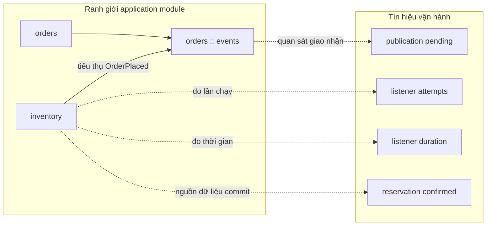

# Kiểm tra thay đổi metric name và tag khi nâng phiên bản

Khi nâng cấp **Spring Boot**, **Spring Modulith** hoặc **Micrometer**, ứng dụng có thể vẫn chạy tốt nhưng biểu đồ quan sát trở nên trống, cảnh báo không còn kích hoạt hoặc cùng một chỉ số xuất hiện thành hai dòng. Một nguyên nhân thường gặp là **tên metric**, **tên tag**, **giá trị tag** hoặc kiểu dữ liệu của phép đo thay đổi. Sự cố này nguy hiểm vì không nhất thiết gây lỗi khởi động hay lỗi API: nghiệp vụ hoạt động bình thường nhưng đội vận hành không còn nhìn đúng trạng thái hệ thống.

Bài thuộc chương **Phiên bản** của module `SPRING_MODULITH_DOCUMENTATION_OBSERVABILITY`. Bạn sẽ sử dụng mô hình **application module**, tài liệu **module graph**, **Spring Boot Actuator**, Micrometer, event metrics và traces để kiểm tra **hợp đồng telemetry** trước và sau khi nâng phiên bản. Trọng tâm là phát hiện thay đổi có ảnh hưởng đến dashboard, cảnh báo và phân tích tương tác giữa các module, rồi di chuyển an toàn sang hợp đồng mới.

Các tên metric trong bài chủ yếu là **quy ước minh họa do ứng dụng tự định nghĩa**. Không suy ra rằng Spring Modulith ở mọi phiên bản tự sinh các meter có tên giống như ví dụ. Tên, tag, thời điểm tạo và phạm vi instrumentation của framework cần được xác minh trên phiên bản và cấu hình thực tế.

## 1. Bài toán: nâng phiên bản thành công nhưng dashboard mất dữ liệu

Ứng dụng bán hàng Spring Boot gồm ba module:

- `orders` xác nhận đơn và phát sự kiện `OrderPlaced`.
- `inventory` nhận `OrderPlaced` qua listener bất đồng bộ để giữ hàng.
- `shared` cung cấp những kiểu dữ liệu chung; không sở hữu trạng thái nghiệp vụ.

Ở phiên bản đang chạy, nhóm vận hành theo dõi số lần listener bắt đầu xử lý bằng metric tự định nghĩa:

```text
Metric logic (Micrometer): shop.module.event.attempts
Tags:
  consumer.module = inventory
  event.type      = OrderPlaced
```

Sau khi đổi cấu hình instrumentation trong đợt nâng cấp, nhà phát triển đổi thành:

```text
Metric logic (Micrometer): shop.modulith.listener.attempts
Tags:
  listener.module = inventory
  event           = OrderPlaced
```

Bộ đo mới vẫn tăng đúng, nhưng query/dashboard cũ tìm `shop.module.event.attempts` và `consumer.module`, nên trả về **không có chuỗi thời gian phù hợp**.

| Thành phần | Trước nâng phiên bản | Sau nâng phiên bản | Hậu quả |
|---|---|---|---|
| Metric name | `shop.module.event.attempts` | `shop.modulith.listener.attempts` | Dashboard tìm tên cũ sẽ rỗng. |
| Tag key | `consumer.module` | `listener.module` | Bộ lọc theo module không khớp. |
| Tag key | `event.type` | `event` | Alert theo loại sự kiện không khớp. |
| Đơn vị đếm | Một lần listener bắt đầu | Một lần listener bắt đầu | Ý nghĩa vẫn như cũ nhưng query đã gãy. |
| Kết quả nghiệp vụ | Reservation đã commit theo `orderId` | Giữ nguyên | Nghiệp vụ đúng không chứng minh telemetry đúng. |

Tên mới ở bảng chỉ dùng để **mô phỏng drift**, không phải một thay đổi mặc định đã được xác nhận trong Spring Modulith.

### 1.1. Vì sao đây là vấn đề của quản lý phiên bản?

Một bản nâng cấp có thể thay đổi cách Spring Modulith tạo observation ở ranh giới module, cách Spring Boot bật Actuator, cách Micrometer chuẩn hóa meter name, hoặc cách exporter chuyển meter sang định dạng Prometheus/OTLP. Ngoài ra, chính **mã ứng dụng** và `MeterFilter` có thể đã đổi tên/tag. Tìm đúng nguồn thay đổi phải dựa trên bằng chứng, không gán lỗi cho framework ngay khi thấy phiên bản mới.

Một quy trình nâng phiên bản cần so sánh **ít nhất**:

1. Phụ thuộc và cấu hình đang sử dụng.
2. Danh sách meter/observation xuất hiện khi chạy cùng kịch bản.
3. Tên, kiểu, đơn vị, tag key, bộ giá trị hợp lệ và ý nghĩa của từng meter.
4. Biểu diễn thực tế ở exporter và query tiêu thụ dữ liệu.
5. Tác động lên dashboard, alert, trace correlation và việc đếm event retry.

## 2. Phân biệt năm lớp tên gọi trong telemetry

Cùng một phép đo có thể mang hình thức khác nhau ở các lớp. Không đối chiếu tên Prometheus trực tiếp với tên Micrometer rồi kết luận framework đã đổi meter.

| Lớp | Ví dụ | Điều cần kiểm tra |
|---|---|---|
| Observation do ứng dụng/framework tạo | `inventory.reserve` | Tên observation, key-value và handler có tạo meter/span không. |
| Meter logic trong Micrometer | `shop.module.event.duration` | `Meter.Id`: name, type, base unit, tags. |
| Actuator metrics | `/actuator/metrics/shop.module.event.duration` | Tên logic và metadata/measurements hiển thị. |
| Prometheus exporter | `shop_module_event_duration_seconds_count` | Naming convention, suffix đơn vị, mẫu `_count`/`_sum`/`_bucket`. |
| Dashboard/alert query | `rate(shop_module_event_duration_seconds_count[5m])` | Tên series sau export và nhãn được lọc. |

Ví dụ một **Micrometer Timer** có tên `shop.module.event.duration` có thể xuất sang Prometheus thành nhiều series như:

```text
shop_module_event_duration_seconds_count{consumer_module="inventory",...}
shop_module_event_duration_seconds_sum{consumer_module="inventory",...}
```

Nếu bật histogram phù hợp, còn có thể có series `_bucket`. Dấu chấm trong tên/tag Micrometer thường được chuẩn hóa thành dấu gạch dưới trong tên metric/label của Prometheus; `seconds` và các hậu tố phản ánh loại meter và quy tắc exporter. Cách hiển thị cụ thể phải kiểm tra ở endpoint thực tế vì có sự khác biệt theo phiên bản registry/client và naming convention.

**Ví dụ một Counter:** tên logic `shop.module.event.attempts` thường hiện ở Prometheus thành `shop_module_event_attempts_total`. **Không** xem sự khác biệt `shop.module.event.attempts` ↔ `shop_module_event_attempts_total` tự nó là thay đổi tương thích; đây có thể chỉ là hai dạng biểu diễn của cùng meter.

### 2.1. Kiểu đo cũng thuộc hợp đồng

- **Counter**: số lần xảy ra một hành động mà một process quan sát; thường reset khi instance restart. Dùng cho attempt, lỗi, retry.
- **Timer**: số lần và tổng/phân phối thời gian của các lời gọi; cần kiểm tra đơn vị và histogram/percentile.
- **Gauge**: trạng thái tại thời điểm đo, ví dụ số publication đang chờ; giá trị có thể tăng hoặc giảm.
- **LongTaskTimer/DistributionSummary**: đo một loại dữ liệu khác timer thông thường; đổi kiểu có thể làm query và alert thay đổi đáng kể.

Đổi một timer sang counter dù tên giữ nguyên cũng phá vỡ hợp đồng vì query `_sum`, `_count` và ý nghĩa độ trễ sẽ khác. Đổi base unit từ milliseconds sang seconds trong dữ liệu/biểu diễn mà không cập nhật truy vấn có thể tạo sai lệch lớn.

## 3. Đặt tên metric theo ý nghĩa nghiệp vụ và ranh giới module

Trong ứng dụng Spring Modulith, module graph cho biết quan hệ phụ thuộc **trong mã nguồn**. Metric cần mô tả **tương tác khi chạy**; hai thứ bổ sung cho nhau nhưng không được coi là đồng nhất.



Không tạo metric riêng cho từng method helper của `shared` chỉ vì nó xuất hiện trong module graph. Việc instrument mọi lời gọi nhỏ làm tăng số series/spans và có thể che lấp độ trễ nghiệp vụ. Nên ưu tiên các operation có ý nghĩa với người vận hành: nhận event, xử lý event, thời gian chờ publication, tạo reservation, giao tiếp sang hệ thống ngoài.

### 3.1. Hợp đồng metric tối thiểu cho bài lab

| Metric logic minh họa | Loại | Đơn vị | Tag key bắt buộc | Đơn vị đếm |
|---|---|---|---|---|
| `shop.module.event.attempts` | Counter | attempts | `consumer.module`, `event.type` | Một lần listener **bắt đầu**. |
| `shop.module.event.terminations` | Counter | attempts | `consumer.module`, `event.type`, `termination` | Một lần thân listener `returned` hoặc `threw`. |
| `shop.module.event.duration` | Timer | thời gian | `consumer.module`, `event.type`, `termination` | Thời gian một attempt. |
| `shop.module.event.publications.pending` | Gauge | publications | `consumer.module` | Số publication chưa hoàn tất tại lúc đo. |
| `shop.inventory.reservations.confirmed` | Gauge/DB query | reservations | `business.module` | Số reservation đang `CONFIRMED` trong dữ liệu bền vững. |

Các metric trên là **thiết kế của ví dụ**, không có nghĩa Spring Modulith luôn phát hành đúng các tên này. Nếu implementation dùng `@ApplicationModuleListener` và event publication registry, cần xem meter nào do framework đã tạo để tránh ghi đè hoặc đếm hai lần.

**Phân biệt rõ retry:** `attempts` và `duration` có thể tăng cho nhiều lần xử lý cùng `OrderPlaced`. `reservations.confirmed` phải dựa vào trạng thái đã commit có khóa idempotency, ví dụ `UNIQUE(order_id)`. Không tự đặt tên metric attempt là “orders completed” rồi sửa dashboard để trừ đi retry; hãy sửa định nghĩa và điểm đo.

### 3.2. Quy ước tag ổn định

Một bộ tag có thể sử dụng:

```text
consumer.module = inventory | billing | notifications
event.type      = OrderPlaced | OrderCancelled | PaymentCaptured
termination     = returned | threw
```

Danh sách trên phải được thống nhất với các module đang có; nếu một module không xử lý loại event nào, đừng tạo series giả để lấp dashboard.

Không dùng `orderId`, `eventId`, `correlationId`, `traceId`, email người dùng, URL chứa path động hoặc nội dung exception làm **metric tag**. Đây là các giá trị có cardinality cao, khiến số series tăng theo lượng nghiệp vụ. Các ID phục vụ chẩn đoán có thể được ghi trong log/span attribute đã kiểm soát quyền truy cập.

### 3.3. Tên tag phải có chủ sở hữu

Định nghĩa `consumer.module` là **module thực hiện listener**, còn `source.module` (nếu thêm) là **module phát event**. Không dùng cùng key `module` với ý nghĩa “publisher” ở một meter và “consumer” ở meter khác. Nếu module đổi tên, phải có kế hoạch tương thích vì các biểu đồ lọc theo value cũng có thể gãy dù metric name/tag key giữ nguyên.

## 4. Instrumentation minh họa và kiểm soát tên/tag trong mã

Ví dụ dưới đây định nghĩa một điểm đo rõ ràng tại `inventory`. Nó dùng Micrometer trực tiếp và giữ tên/tag dưới dạng hằng, để việc thay đổi được review như thay đổi API.

```java
package com.acme.shop.inventory;

public final class MetricContract {
    private MetricContract() {}

    public static final String ATTEMPTS = "shop.module.event.attempts";
    public static final String TERMINATIONS = "shop.module.event.terminations";
    public static final String DURATION = "shop.module.event.duration";

    public static final String CONSUMER_MODULE = "consumer.module";
    public static final String EVENT_TYPE = "event.type";
    public static final String TERMINATION = "termination";
}
```

Tạo bộ đo được gọi quanh quá trình xử lý một event:

```java
package com.acme.shop.inventory;

import io.micrometer.core.instrument.Counter;
import io.micrometer.core.instrument.MeterRegistry;
import io.micrometer.core.instrument.Timer;
import org.springframework.stereotype.Component;

@Component
public class InventoryAttemptMetrics {

    private final MeterRegistry registry;

    public InventoryAttemptMetrics(MeterRegistry registry) {
        this.registry = registry;
    }

    public void recordAttempt(Runnable handler) {
        Counter.builder(MetricContract.ATTEMPTS)
            .tag(MetricContract.CONSUMER_MODULE, "inventory")
            .tag(MetricContract.EVENT_TYPE, "OrderPlaced")
            .register(registry)
            .increment();

        Timer.Sample sample = Timer.start(registry);
        String termination = "returned";

        try {
            handler.run();
        } catch (RuntimeException | Error ex) {
            termination = "threw";
            throw ex;
        } finally {
            Counter.builder(MetricContract.TERMINATIONS)
                .tag(MetricContract.CONSUMER_MODULE, "inventory")
                .tag(MetricContract.EVENT_TYPE, "OrderPlaced")
                .tag(MetricContract.TERMINATION, termination)
                .register(registry)
                .increment();

            sample.stop(
                Timer.builder(MetricContract.DURATION)
                    .tag(MetricContract.CONSUMER_MODULE, "inventory")
                    .tag(MetricContract.EVENT_TYPE, "OrderPlaced")
                    .tag(MetricContract.TERMINATION, termination)
                    .register(registry));
        }
    }
}
```

Một listener Spring Modulith dùng bộ đo:

```java
package com.acme.shop.inventory;

import com.acme.shop.orders.events.OrderPlaced;
import org.springframework.modulith.events.ApplicationModuleListener;
import org.springframework.stereotype.Component;

@Component
public class InventoryEventListener {

    private final InventoryAttemptMetrics metrics;
    private final ReservationService reservations;

    public InventoryEventListener(InventoryAttemptMetrics metrics,
                                  ReservationService reservations) {
        this.metrics = metrics;
        this.reservations = reservations;
    }

    @ApplicationModuleListener
    public void on(OrderPlaced event) {
        metrics.recordAttempt(
            () -> reservations.reserveIdempotently(event.orderId()));
    }
}
```

`OrderPlaced` và `ReservationService` là thành phần nghiệp vụ cần được triển khai trong dự án. `reserveIdempotently` phải dựa trên giao dịch và khóa idempotency bền vững; ví dụ đo lường không tự đảm bảo đúng một tác động nghiệp vụ.

**Giới hạn của metric:** `returned` chỉ có nghĩa là khối `handler.run()` không ném lỗi. Với `@ApplicationModuleListener` và các advisor giao dịch, có thể transaction commit hoặc ghi nhận completion của publication diễn ra **sau** khi khối này trả về. Vì thế không đổi tên `terminations{termination="returned"}` thành `business.committed`. Ngoài ra, khi process chết đột ngột, counter `attempts` có thể đã tăng nhưng `terminations` chưa kịp tăng; đây là telemetry vận hành, không phải sổ cái bền vững.

### 4.1. Những thay đổi nhỏ cần review như breaking change

Trong pull request, cần đánh dấu rõ các thay đổi như:

```diff
- public static final String ATTEMPTS = "shop.module.event.attempts";
+ public static final String ATTEMPTS = "shop.modulith.listener.attempts";

- public static final String CONSUMER_MODULE = "consumer.module";
+ public static final String CONSUMER_MODULE = "listener.module";
```

Java vẫn biên dịch, nhưng mọi consumer dùng meter/tag cũ phải được điều chỉnh. Một thay đổi ở `MeterFilter`, `ObservationConvention` hoặc bean `MeterRegistryCustomizer` cũng có thể tạo kết quả tương tự mà không đụng đến listener.

## 5. Chuẩn bị baseline trước khi nâng phiên bản

Đo một bản triển khai **trước** và **sau** trong hai môi trường so sánh được. Ghi rõ version của Spring Boot, Spring Modulith, Micrometer core, tracing bridge, registry/exporter và các cấu hình như sampling, histogram, tag filters, endpoint exposure.

Ví dụ bản ghi phát hành dùng cho quá trình review:

| Thuộc tính | Baseline | Candidate |
|---|---|---|
| Spring Boot | Phiên bản đang vận hành | Phiên bản dự kiến |
| Spring Modulith | Phiên bản đang vận hành | Phiên bản dự kiến |
| Micrometer / registry | Phiên bản đã resolve trong dependency tree | Phiên bản sau nâng cấp |
| Java runtime | Cùng runtime hoặc ghi rõ thay đổi | Ghi giá trị thực |
| Metrics backend | Prometheus/OTLP hoặc hệ khác | Cùng backend để so sánh |
| Cấu hình | Exposure, common tags, filters, sampling | Ghi khác biệt có chủ đích |
| Bộ dữ liệu thử | Cùng event và luồng nghiệp vụ | Phát lại cùng kịch bản |

Không suy đoán tương thích chỉ vì version được BOM quản lý. BOM giảm rủi ro xung đột dependency nhưng không chứng minh dashboard query vẫn hợp lệ.

### 5.1. Tạo cùng một luồng sự kiện trước khi snapshot

Một meter thường được đăng ký **khi đường code liên quan chạy lần đầu**. Vì vậy, gọi `/actuator/metrics` ngay sau khởi động rồi thấy thiếu `shop.module.event.attempts` chưa đủ kết luận meter bị xóa.

Bộ kịch bản cố định cho cả hai build:

1. Tạo một `OrderPlaced` hợp lệ, xử lý thành công.
2. Gây một lỗi tạm thời để listener ném exception.
3. Cho cùng event retry và thành công.
4. Gửi duplicate của một `orderId` đã commit để kiểm tra idempotency.
5. Tạo một publication chưa hoàn tất nếu hệ thống dùng persistent event publication registry.
6. Gửi một request qua module graph có instrument để nhìn được trace tương ứng.

Các kịch bản tạo đủ giá trị tag `returned` và `threw`. Nếu chỉ thử đường thành công, tag `threw` sẽ chưa tồn tại trong `availableTags`; điều đó không chứng minh phiên bản mới không hỗ trợ tag này.

### 5.2. Chụp tên meter logic qua Actuator

Cấu hình môi trường kiểm thử:

```yaml
management:
  endpoints:
    web:
      exposure:
        include: health,info,metrics,prometheus,applicationmodules
```

`prometheus` cần registry Prometheus; `applicationmodules` cần phần hỗ trợ Spring Modulith Actuator tương ứng. Chỉ expose các endpoint đã cài đặt, và giới hạn truy cập bằng mạng/ủy quyền quản trị; không dùng cấu hình lab này để công khai metadata và metrics của production.

Ví dụ trên máy kiểm thử có `curl` và `jq`:

```bash
# Chạy kịch bản tạo meter trước khi chụp baseline.
curl -fsS http://localhost:8080/actuator/metrics \
  | jq -r '.names[] | select(startswith("shop.module."))' \
  | sort > baseline.names.txt

# Metadata của một metric: tên, baseUnit, statistic, tag key.
curl -fsS http://localhost:8080/actuator/metrics/shop.module.event.terminations \
  | jq '{
      name,
      baseUnit,
      statistics: ([.measurements[]?.statistic] | sort),
      tagKeys: ([.availableTags[]?.tag] | sort),
      tagValues: (.availableTags | map({
        tag,
        values: (.values | sort)
      }) | sort_by(.tag))
    }' > baseline.terminations.json
```

Lặp lại cùng kịch bản, cùng công cụ ở candidate và lưu thành `candidate.names.txt`, `candidate.terminations.json`. Lệnh ví dụ ghi ra tệp kết quả trong **bài lab**; các tệp này là artifact so sánh, không phải tệp cấu hình của Spring Modulith.

So sánh:

```bash
diff -u baseline.names.txt candidate.names.txt
diff -u baseline.terminations.json candidate.terminations.json
```

**Cách đọc kết quả:** sự khác nhau ở `name`, `tagKeys` hoặc tập `statistics` đáng chú ý; khác biệt ở `tagValues` cần phân biệt giữa giá trị mới hợp lệ và đổi tên giá trị đã gây gãy query. Đừng so raw counter value giữa hai build, vì traffic, thời gian chạy, restart và scrape interval có thể khác nhau.

### 5.3. Chụp định dạng exporter

Với Prometheus registry và endpoint được bật:

```bash
curl -fsS http://localhost:8080/actuator/prometheus \
  | grep -E '^(# (HELP|TYPE) shop_module_event_|shop_module_event_)' \
  > baseline.prometheus.txt
```

Với candidate cũng lấy snapshot tương tự. Kiểm tra tên series, nhãn, `# TYPE`, hậu tố đơn vị và sự có mặt của `_count`/`_sum`/`_bucket`. Tệp raw scrape có giá trị mẫu và timestamp biến thiên; để kiểm tra contract, nên so sánh cấu trúc đã chuẩn hóa chứ không diff từng giá trị số.

Nếu exporter không phải Prometheus, xác minh metric name và attributes qua protocol/backend tương ứng. Việc có metric ở `/actuator/metrics` không đảm bảo backend đã nhận nó; exporter, credentials, endpoint và collector còn có thể bị lỗi.

## 6. Đọc và phân loại khác biệt

Khi có baseline và candidate, mỗi chênh lệch phải được phân loại để chọn đúng cách xử lý.

| Loại thay đổi | Ví dụ | Tác động thường gặp | Cách xác minh |
|---|---|---|---|
| **Metric rename** | `shop.module.event.attempts` → `shop.modulith.listener.attempts` | Dashboard cũ trả về dữ liệu rỗng. | So `Meter.Id.name` và exporter. |
| **Tag key rename** | `consumer.module` → `listener.module` | Filter/aggregation không khớp. | So tập tag key trên cùng meter. |
| **Tag value rename** | `inventory` → `stock` | Các query chọn module bị mất series. | So giá trị tag theo cùng scenario. |
| **Tag bị bỏ/thêm** | Có/không `event.type` | Thay đổi chiều phân tích, aggregation hoặc cardinality. | So key set và số series. |
| **Meter type đổi** | Counter → Gauge | `rate()` hoặc logic query cũ không còn phù hợp. | Kiểm tra Meter.Type / `# TYPE`. |
| **Unit hoặc suffix đổi** | Timer xuất theo giây, query dùng mili-giây | Báo cáo độ trễ sai. | So baseUnit và series exporter. |
| **Distribution đổi** | Có/không `_bucket` | Query `histogram_quantile` không còn dữ liệu. | So cấu hình histogram và scrape. |
| **Instrumentation đổi** | Một ranh giới module không còn tạo observation | Trace/metrics biến mất dù app hoạt động. | Tái hiện flow, so trace và meter registry. |
| **Đường thu thập đổi** | Metrics bị filter/endpoint không expose | Meter có trong JVM nhưng không thấy ở backend. | So Actuator, exporter, collector. |

**Đổi tag value** cũng quan trọng như đổi tag key. Ví dụ `termination="threw"` chuyển thành `outcome="error"` vừa đổi key vừa đổi tập giá trị, làm alert vốn lọc `termination="threw"` không còn tác dụng.

### 6.1. Phân biệt “meter biến mất” với “meter chưa được tạo”

Kiểm tra theo thứ tự:

1. **Kịch bản đã chạy chưa?** Có event nào thực sự đến listener?
2. **Metric có trong `MeterRegistry` của JVM không?** Một meter có thể bị filter ngay khi đăng ký.
3. **Actuator có endpoint `metrics` và tên meter không?** Nếu chưa, xem exposure, dependency và thời điểm đăng ký.
4. **Exporter có xuất series không?** Kiểm tra registry, naming convention, batch/scrape và cấu hình histogram.
5. **Backend có nhận dữ liệu không?** Kiểm tra collector/remote write/OTLP và quyền truy cập.
6. **Query đang dùng đúng tên/tag đã export không?** So trực tiếp series trong backend.

Một metric có ở registry nhưng không tới Prometheus là vấn đề pipeline/exporter; không nên sửa tên metric trong code cho đến khi xác định được nguyên nhân.

## 7. Kiểm thử hợp đồng meter ở tầng Java

Snapshot runtime giúp thấy cấu hình thực tế, còn kiểm thử có chủ đích giúp phát hiện sớm những thay đổi tên/tag trong **mã do ứng dụng sở hữu**.

Ví dụ JUnit 5 + AssertJ + `SimpleMeterRegistry`. Giả định các lớp `MetricContract` và `InventoryAttemptMetrics` đã có như phần 4.

```java
package com.acme.shop.inventory;

import static org.assertj.core.api.Assertions.assertThat;
import static org.assertj.core.api.Assertions.assertThatThrownBy;

import io.micrometer.core.instrument.Meter;
import io.micrometer.core.instrument.Tag;
import io.micrometer.core.instrument.simple.SimpleMeterRegistry;
import java.util.Set;
import java.util.stream.Collectors;
import org.junit.jupiter.api.Test;

class InventoryMetricContractTest {

    @Test
    void attemptsNameTypeAndTagsStayStable() {
        try (var registry = new SimpleMeterRegistry()) {
            var metrics = new InventoryAttemptMetrics(registry);
            metrics.recordAttempt(() -> {});

            var attempts = registry
                .find(MetricContract.ATTEMPTS)
                .tags("consumer.module", "inventory",
                      "event.type", "OrderPlaced")
                .meter();

            assertThat(attempts).isNotNull();
            assertThat(attempts.getId().getType())
                .isEqualTo(Meter.Type.COUNTER);
            assertThat(attempts.getId().getName())
                .isEqualTo("shop.module.event.attempts");

            Set<String> tagKeys = attempts.getId().getTags().stream()
                .map(Tag::getKey)
                .collect(Collectors.toSet());

            assertThat(tagKeys)
                .containsExactlyInAnyOrder(
                    "consumer.module", "event.type");
        }
    }

    @Test
    void terminationTagHasStableValues() {
        try (var registry = new SimpleMeterRegistry()) {
            var metrics = new InventoryAttemptMetrics(registry);

            metrics.recordAttempt(() -> {});
            assertThatThrownBy(() -> metrics.recordAttempt(
                () -> { throw new IllegalStateException("test"); }))
                .isInstanceOf(IllegalStateException.class);

            var successful = registry
                .find(MetricContract.TERMINATIONS)
                .tags("consumer.module", "inventory",
                      "event.type", "OrderPlaced",
                      "termination", "returned")
                .counter();

            var failed = registry
                .find(MetricContract.TERMINATIONS)
                .tags("consumer.module", "inventory",
                      "event.type", "OrderPlaced",
                      "termination", "threw")
                .counter();

            assertThat(successful).isNotNull();
            assertThat(failed).isNotNull();
            assertThat(successful.count()).isEqualTo(1.0);
            assertThat(failed.count()).isEqualTo(1.0);
        }
    }
}
```

**Điểm cần hiểu:** các test trên bảo vệ hợp đồng **do code ứng dụng kiểm soát**. Chúng không kiểm tra một meter được Spring Modulith tự sinh, quy tắc đổi tên ở Prometheus registry, endpoint Actuator hay exporter. Để phát hiện thay đổi từ framework/registry, cần chạy **integration test hoặc smoke test trên ứng dụng đã khởi động** và đối chiếu snapshot cuối đường xuất dữ liệu.

### 7.1. Test không nên phụ thuộc thứ tự tag hoặc trị số ngẫu nhiên

Micrometer nhận diện series bằng tên và tập tag; so sánh tag key như một **tập** thường phù hợp hơn phụ thuộc thứ tự. Tuy nhiên, một số exporter có quy tắc chuẩn hóa tên nhãn; vì vậy vẫn cần test ở endpoint exporter.

Không assert số counter bằng một trị số tuyệt đối trong hệ thống tích hợp có traffic không kiểm soát. Với unit test `SimpleMeterRegistry` mới và duy nhất, giá trị 1.0 là ổn định; với môi trường staging/production, đo thay đổi trong một khoảng và gắn với kịch bản rõ ràng.

### 7.2. Bảo vệ cardinality

Ngoài kiểm tra có đúng các tag key, cần chắc chắn không có tag động như `orderId`. Có thể tạo nhiều event với order ID khác nhau rồi xác nhận số meter series của phép đo vẫn ổn định. Nếu dùng `Observation`, hãy phân biệt `lowCardinalityKeyValue` (có thể trở thành metric tag) với `highCardinalityKeyValue` (thường phục vụ trace, tùy handler); không đẩy request ID thành low-cardinality key-value.

Đặc biệt cẩn thận với `MeterFilter.commonTags` và các filter toàn cục: một tag động được thêm ở tầng platform có thể làm mọi meter của mọi module tăng cardinality.

## 8. Tương thích dashboard, PromQL và alert

Khi metric logic vẫn là `shop.module.event.attempts`, tên series Prometheus trong một cấu hình phổ biến có dạng:

```promql
sum(
  rate(
    shop_module_event_attempts_total{
      consumer_module="inventory",
      event_type="OrderPlaced"
    }[5m]
  )
)
```

Query này trả về **tốc độ attempt** trong 5 phút, bao gồm retry. Nó không phải tốc độ “đơn đặt hàng xác nhận thành công”. Cũng không nên dùng traceId hoặc correlationId làm label để lọc Prometheus.

Nếu ứng dụng đổi tên meter và tag như tình huống ở mục 1, query candidate có thể cần đổi sang:

```promql
sum(
  rate(
    shop_modulith_listener_attempts_total{
      listener_module="inventory",
      event="OrderPlaced"
    }[5m]
  )
)
```

Các nhãn `consumer_module`, `listener_module` và `event_type` là cách chuẩn hóa tên tag phổ biến của Prometheus; phải kiểm tra tên thực tế ở scrape.

### 8.1. Kế hoạch chuyển đổi an toàn

1. **Ghi nhận hợp đồng cũ:** tên meter, tags, query, dashboard ID, alert owner và ngưỡng.
2. **Xác minh hợp đồng mới:** chạy candidate với kịch bản tương đương và kiểm tra kiểu, đơn vị, ý nghĩa không đổi.
3. **Sửa truy vấn ở staging:** cập nhật metric name/tag key/tag value và so kết quả với dữ liệu nghiệp vụ hoặc số attempt quan sát được.
4. **Thời gian chuyển tiếp:** nếu cả tên cũ lẫn mới có thể đồng tồn tại, xác định rõ series nào được sử dụng cho từng khoảng thời gian để tránh đếm gấp đôi.
5. **Kiểm tra alert thực sự:** tạo tình huống có lỗi và xác minh alert phản ứng, không chỉ thấy biểu đồ có đường.
6. **Triển khai/rollback:** có kế hoạch query cho cả giai đoạn canary, rolling deploy và rollback.

Có thể dùng fallback query có chủ ý trong thời gian chuyển đổi:

```promql
sum(rate(shop_modulith_listener_attempts_total[5m]))
or
sum(rate(shop_module_event_attempts_total[5m]))
```

`or` ưu tiên dữ liệu bên trái khi cùng tập nhãn đầu ra, nhưng chỉ an toàn nếu cả hai phía **cùng định nghĩa phép đo**, cùng tập lọc ngữ nghĩa và có quy ước rõ ràng khi nhiều phiên bản chạy đồng thời. Đây là ví dụ minh họa, không phải giải pháp lâu dài; với metric có nhiều chiều tag, cần thiết kế fallback theo label/aggregation cụ thể để không làm mất hoặc nhân đôi các nhóm series.

**Không cộng** cả metric cũ và metric mới nếu chúng đang đo **cùng một attempt** được ghi hai lần. Việc publish đồng thời hai tên metric cho một phép đo nhằm tương thích tạm thời phải ghi rõ thời hạn, chi phí cardinality và quy tắc xóa tên cũ.

### 8.2. Cảnh báo có thể sai ngay cả khi metric vẫn có dữ liệu

Ví dụ một alert dùng ngưỡng 30 giây nhưng bản nâng cấp thay đổi đơn vị hoặc time series dùng milliseconds. Đường đồ thị có thể vẫn hiển thị nhưng ngưỡng không còn đúng. Vì thế trong checklist phải có:

- Tên series và nhãn có khớp không?
- Ý nghĩa `rate`/`increase`/`histogram_quantile` có còn hợp lệ không?
- Đơn vị và bucket của histogram đã đổi chưa?
- Alert có thực sự kích hoạt khi phát sinh lỗi đã mô phỏng không?
- Trong rolling deploy, các instance cũ/mới có tạo các series khác nhau làm phân mảnh số liệu không?

## 9. Spring Modulith observability, Actuator và tracing khi thay phiên bản

Spring Modulith giúp sinh tài liệu các application module và quan sát tương tác của chúng. Tuy nhiên **module documentation**, **Actuator module metadata**, **metrics** và **traces** là các cơ chế khác nhau, cần kiểm tra riêng.

| Thành phần | Có thể xác minh điều gì? | Không thể tự chứng minh điều gì? |
|---|---|---|
| `ApplicationModules.verify()` | Phụ thuộc mã nguồn và quy tắc ranh giới module. | Meter đang mang đúng tên/tag ở runtime. |
| `Documenter` / module graph | Các module, quan hệ phụ thuộc và API được công bố. | Spans, metrics đang được export tới backend. |
| `/actuator/applicationmodules` (nếu có) | Metadata application modules khi chạy. | Metric name/tag không bị thay đổi. |
| `/actuator/metrics` | Meter logic đang được đăng ký và metadata đo lường. | Backend ngoài đã nhận các series. |
| `/actuator/prometheus` (nếu có) | Biểu diễn Prometheus sau naming/exporter. | Alert/dashboard đã dùng đúng query. |
| Tracing backend | Spans, mối liên hệ parent–child và attributes đã export. | Kết quả nghiệp vụ không bị đếm lặp khi retry. |

Với event bất đồng bộ, trace parent có thể thay đổi hoặc mất khi executor chưa truyền context, khi broker không inject/extract header hoặc khi publication được replay sau restart. Khi nâng phiên bản, phải kiểm tra **context propagation** và **trace correlation** cùng với metric contract; đừng nhầm thay đổi traceId là bằng chứng metric bị đổi tên.

Một `correlationId` nghiệp vụ cần đi qua event payload/metadata khi muốn đối chiếu nhiều lần xử lý. `correlationId` có thể xuất hiện trong log/span attribute theo chính sách bảo mật; **không** dùng nó làm metric tag để tránh cardinality quá cao.

### 9.1. Kiểm tra baseline của tương tác module

Ví dụ lời gọi:

```text
HTTP POST /orders
  -> orders.placeOrder()
  -> publish OrderPlaced
  -> inventory listener (async)
  -> inventory.reserveOnce()
```

Sau khi nâng phiên bản, đối chiếu:

- Sơ đồ module vẫn hợp lệ, API `orders :: events` còn đúng.
- Listener vẫn được gọi, event publication có trạng thái phù hợp.
- Meter `attempts`/`terminations`/`duration` có tên, tag và định nghĩa thống nhất.
- Trace có spans theo đường đi hỗ trợ, `eventId`/`correlationId` đủ để nối retry.
- Business metrics vẫn dựa trên dữ liệu đã commit, không đổi theo số lần retry.

Nếu module graph hợp lệ nhưng metrics biến mất, đừng thay đổi cấu trúc module trước khi xác nhận đường instrumentation/registry/exporter.

## 10. Kiểm thử tương thích trước và sau nâng phiên bản

Để một phiên bản được xem là **không phá hợp đồng telemetry**, cần chứng minh các phép đo hiện tại vẫn nhận diện được hoặc các consumer của chúng đã được di chuyển có kiểm chứng.

| Mã | Kịch bản | Tiêu chí đạt |
|---|---|---|
| VER-01 | Ghi phiên bản Boot, Modulith, Micrometer, exporter | Có bản ghi baseline/candidate chính xác, quản lý bằng BOM phù hợp. |
| VER-02 | Chạy cùng smoke traffic ở cả hai build | Các đường instrumentation quan trọng đều chạy. |
| VER-03 | So danh sách meter logic qua Actuator | Mọi rename/add/remove được ghi nhận. |
| VER-04 | So `Meter.Id`: type, baseUnit, tag key | Không có drift ngoài danh sách thay đổi đã phê duyệt. |
| VER-05 | So tag values cho `returned` và `threw` | Bộ giá trị và ý nghĩa được thống nhất; không bỏ sót nhánh lỗi. |
| VER-06 | So scrape `/actuator/prometheus` | Tên series, suffix, labels, histogram phù hợp query. |
| VER-07 | Kiểm tra dashboard/alert trên candidate | Có dữ liệu đúng và alert kích hoạt khi mô phỏng điều kiện. |
| VER-08 | Retry cùng `OrderPlaced` nhiều lần | Attempts tăng theo lần chạy; business result chỉ ghi một lần. |
| VER-09 | Nhiều orderId/correlationId khác nhau | Số series không tăng theo các ID động. |
| VER-10 | Truyền event qua executor, retry và replay | Trace/log có thể đối chiếu cùng correlation ID; không dùng traceId làm tag. |
| VER-11 | Có instance old/new chạy đồng thời | Không cộng trùng số liệu và không bỏ sót nhóm series ở truy vấn. |
| VER-12 | Tắt exporter hoặc filter bỏ một meter | Quy trình phát hiện đúng tầng lỗi, cảnh báo missing-data phù hợp. |
| VER-13 | Kiểm tra `ApplicationModules.verify()` và tài liệu graph | Ranh giới module không bị phá khi nâng phiên bản. |
| VER-14 | Kiểm tra cấu hình an toàn Actuator | Metadata và metrics chỉ truy cập được từ đường quản trị đã cấp quyền. |

### 10.1. Một bài test định lượng với retry

Chuẩn bị cùng một `OrderPlaced(eventId=E1, orderId=O1)`. Cho listener lỗi lần đầu, retry thành công lần thứ hai, sau đó giao trùng lần thứ ba.

Nếu quá trình đo không bị mất do crash/exporter và đây là một instance test mới:

```text
shop.module.event.attempts:
  3 attempts

shop.module.event.terminations{termination="threw"}:
  1 attempt

shop.module.event.terminations{termination="returned"}:
  2 attempts

Số reservation CONFIRMED trong database cho orderId=O1:
  1
```

Kịch bản này vừa xác nhận **đúng ngữ nghĩa metric**, vừa có đủ tag value để phát hiện việc đổi tên `termination`. Ở production, counter có thể reset khi restart và process có thể chết trước khi ghi/export metric; không dùng số counter trong memory làm báo cáo giao dịch chính xác.

### 10.2. Một bài test “metric đổi tên nhưng dashboard không hỏng”

Thực hiện trên hai nhánh giả lập:

1. Baseline dùng `shop.module.event.attempts` với các tag `consumer.module`, `event.type`.
2. Candidate chủ động đổi tên và tag thành dạng ở mục 1.
3. Chạy cùng smoke traffic; xem diff qua Actuator/Prometheus.
4. Cập nhật PromQL, dashboard và alert ở môi trường staging.
5. Mô phỏng rolling deploy hai version; xác định cách query xử lý chồng lấn.
6. Ghi rõ thời điểm loại bỏ tên cũ và kiểm tra lại alert sau rollout.

Nếu test chỉ kiểm tra HTTP 200 của API và `ApplicationModules.verify()`, nó sẽ **không phát hiện** những thay đổi kể trên. Cần tối thiểu một phép kiểm tra dữ liệu thực được trả về từ registry/exporter.

## 11. Phương án xử lý khi phát hiện breaking change

| Tình huống | Phương án | Cần chú ý |
|---|---|---|
| Ứng dụng chủ động rename metric/tag | Giữ tên cũ đến khi consumer sẵn sàng hoặc cập nhật đồng bộ dashboard/alert. | Có changelog và thời hạn chuyển tiếp. |
| Library/framework thay đổi meter name | Đối chiếu release notes/version thực; cập nhật contract test và query. | Không suy đoán tên metric theo số version. |
| Exporter đổi quy tắc biểu diễn | Sửa queries theo tên series thực; kiểm tra đơn vị, type, labels. | Không sửa tên logic trong code nếu metric gốc không đổi. |
| Meter bị tắt vì config/conditional bean | Khôi phục dependency/cấu hình/flow nếu đó là phép đo bắt buộc. | Tránh tạo meter giả chỉ để dashboard có giá trị 0. |
| Metric bị đếm trùng vì instrument hai lần | Chọn một chủ sở hữu telemetry; loại bỏ instrumentation trùng. | Kiểm chứng attempt vs business effect. |
| Tag mới gây cardinality cao | Chặn/sửa ở nguồn; di chuyển ID sang logs/traces. | Ước lượng số series và chi phí lưu trữ. |
| Rollout hai version cùng tồn tại | Query tương thích có quy tắc chọn series, theo dõi toàn bộ canary. | Không sum cả hai nếu cùng đo một hành động. |
| Không thể đảm bảo tương thích | Đánh dấu breaking change, lên phiên bản contract và kế hoạch di chuyển. | Bổ sung cảnh báo missing data, rollback rõ ràng. |

Không lạm dụng `MeterFilter` để che mọi thay đổi. Filter có thể đổi tên/tag trong `MeterRegistry` hoặc chặn meter, nhưng không thay thế kiểm tra ngữ nghĩa; một metric `attempts` không thể biến thành metric `business.committed` chỉ bằng rename. Nếu cần phát song song hai dạng metric trong thời gian di chuyển, hãy quản lý rõ nguồn phát để tránh double instrumentation và nổ cardinality.

## 12. Bài thực hành tổng hợp

Bạn chịu trách nhiệm nâng cấp ứng dụng Spring Modulith với các module `orders` và `inventory`. Hãy cung cấp bộ bằng chứng để người review xác nhận rằng telemetry có thể vận hành sau nâng cấp.

### Phần A — Ghi baseline và hợp đồng

Tạo một bảng ghi phiên bản thực của Spring Boot/Spring Modulith/Micrometer/exporter. Chốt danh sách meter quan trọng, type, unit, tag keys, tập giá trị hợp lệ, mục đích đo và tên dashboard/alert đang sử dụng. Chạy luồng thành công, thất bại, retry và snapshot từ Actuator/Prometheus.

### Phần B — Nâng cấp và đối chiếu

Chạy candidate bằng cùng kịch bản. Dùng bảng phân loại ở mục 6 để giải thích từng khác biệt: framework instrument, app rename, naming convention, exporter, cấu hình hoặc thay đổi tag value. Chạy `InventoryMetricContractTest` và kiểm tra `/actuator/metrics` thực tế. Không xem một tên metric “mất” là lỗi framework trước khi xác nhận traffic và registry.

### Phần C — Di chuyển dashboard, alert, tài liệu

Đổi các PromQL query theo tên series đã xác minh, kiểm tra giá trị/đơn vị, mô phỏng điều kiện báo động và kịch bản canary. Cập nhật tài liệu metric contract cùng người sở hữu, rồi ghi nhận thay đổi trong changelog. Nếu chưa chuyển đổi được, lập kế hoạch giữ tương thích hoặc rollback.

### Phần D — Kiểm tra event và tracing

Dùng `OrderPlaced` có cùng `eventId`/`orderId` cho nhiều attempts; chứng minh `attempts=3` nhưng reservation trong database chỉ có một. Đối chiếu correlation ID trong logs/traces khi listener chạy async/replay. Kiểm tra `ApplicationModules.verify()` và module graph, nhưng không dùng chúng làm bằng chứng thay thế dữ liệu metrics ở runtime.

**Sản phẩm cần nộp:** bảng version/dependency, danh sách hợp đồng metric, snapshot baseline/candidate đã chuẩn hóa, diff được giải thích, test contract, kết quả kiểm thử retry, PromQL/dashboard/alert được cập nhật và biên bản quyết định tương thích/rollback.

### Câu hỏi tự kiểm tra

1. Vì sao `shop.module.event.attempts` trên Actuator và `shop_module_event_attempts_total` trên Prometheus có thể là cùng một meter?
2. Một metric name giữ nguyên nhưng `consumer.module` đổi thành `listener.module` thì dashboard bị ảnh hưởng thế nào?
3. Vì sao cần kiểm tra cả tag **value** và tag **key** sau khi nâng phiên bản?
4. Làm sao phân biệt meter bị xóa với meter chưa được tạo vì listener chưa chạy?
5. Có thể coi một counter lần xử lý event là số nghiệp vụ thành công duy nhất không? Vì sao?
6. Vì sao `ApplicationModules.verify()` không thể phát hiện query Prometheus mất dữ liệu?
7. Một Timer đổi đơn vị hoặc bật/tắt histogram ảnh hưởng đến query nào?
8. Tại sao không gắn `correlationId` hoặc `orderId` vào metric tags?
9. Nếu đồng thời phát meter cũ và mới, khi nào phép cộng của hai series sẽ đếm gấp đôi?
10. Vì sao cần chạy cả kịch bản lỗi để kiểm tra giá trị `termination="threw"`?
11. Khi Actuator thấy meter nhưng backend không có series, cần điều tra những tầng nào?
12. Nếu thay đổi exporter nhưng không đổi meter logic, nên sửa mã ứng dụng hay truy vấn/dashboard trước?

**Tiêu chí đạt:** mỗi lần nâng phiên bản có **bằng chứng rõ ràng về tên, type, unit, tags và ý nghĩa** của những phép đo quan trọng. Dashboard/alert còn hoạt động với series thực; event retry không làm đếm sai kết quả nghiệp vụ; module graph và tracing được kiểm tra ở đúng lớp của chúng. Điều này giúp Spring Modulith hỗ trợ cả việc **kiểm chứng kiến trúc mô-đun** lẫn **quan sát vận hành đáng tin cậy** khi ứng dụng phát triển qua nhiều phiên bản.
