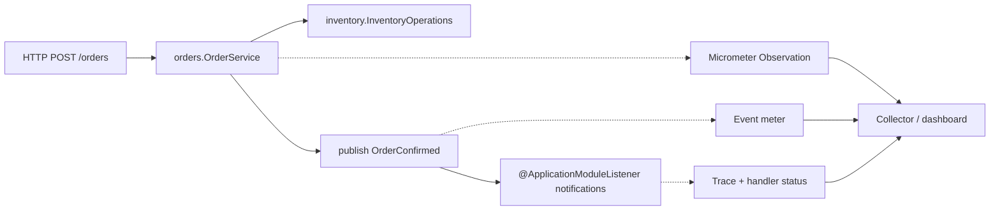
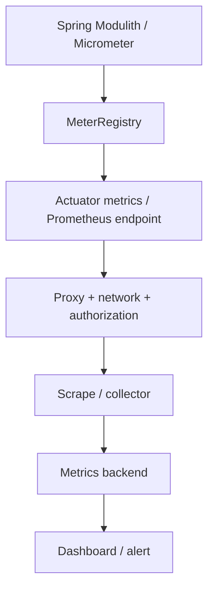

# Chạy kiểm thử telemetry trước khi nâng cấp

Khi nâng cấp **Spring Boot**, **Spring Modulith** hoặc hệ sinh thái **Micrometer**, ứng dụng có thể tiếp tục xử lý đơn hàng, phát sự kiện và trả HTTP 200 nhưng hệ thống quan sát vận hành lại bị thay đổi: tên hoặc nhãn metric khác trước, module không còn được nhận diện như dự kiến, trace mất quan hệ giữa publisher và listener bất đồng bộ, hoặc endpoint Actuator không xuất dữ liệu tới collector. Những thay đổi này thường chỉ được phát hiện sau khi phát hành, đúng lúc đội vận hành cần telemetry để điều tra sự cố.

Trong chương **Phiên bản**, bài học **“Chạy kiểm thử telemetry trước khi nâng cấp”** hướng dẫn tạo đường cơ sở (baseline), triển khai các phép thử hồi quy và đặt điều kiện chấp nhận cho ứng dụng **Spring Modulith Documentation & Observability**. Trọng tâm là ranh giới application module, module graph, Actuator, event metrics, tracing, context propagation và trạng thái xử lý sự kiện. Đây là kiểm thử **tính quan sát được khi chạy**, bổ sung cho unit test và integration test nghiệp vụ.

## 1. Telemetry nào cần được giữ ổn định?

**Telemetry** là dữ liệu giúp người vận hành biết hệ thống đang làm gì: metrics, traces, logs và thông tin trạng thái. Một lần nâng cấp thành công phải xác minh hai lớp độc lập:

1. **Hành vi nghiệp vụ:** API, transaction, event, listener và dữ liệu vẫn đúng.
2. **Khả năng quan sát:** các tín hiệu dùng để nhận biết hành vi đó vẫn được tạo, thu thập, liên kết và diễn giải chính xác.

| Loại bằng chứng | Ví dụ trong Spring Modulith | Rủi ro khi nâng cấp |
| --- | --- | --- |
| Cấu trúc module | `ApplicationModules`, `verify()`, module graph, named interfaces | Thay đổi quy tắc nhận diện package hoặc dependency khiến graph khác |
| Actuator | `/actuator/health`, `/actuator/metrics`, `/actuator/modulith` nếu có | Endpoint không được đăng ký, đổi path hoặc bị chặn |
| Metrics | JVM/HTTP counters; `module.events.published` trên phiên bản hỗ trợ | Metric không tạo, đổi tên/tag, không tới registry hoặc exporter |
| Tracing | Span HTTP, span tương tác module, listener span | Không có tracing bridge, mất sampling/export, span thành trace gốc khác |
| Async context | Observation, trace ID, MDC trên executor | Mất parent context khi đổi thread hoặc rò trace ID giữa hai task |
| Event processing | Publish, commit, listener completion, failure, retry | Chỉ số publish vẫn tăng nhưng listener không hoàn thành |
| Vận hành | Dashboard, alert, scrape target, retention | Series thực tế vẫn có nhưng query/label không còn phù hợp |

**Không đồng nhất các tín hiệu.** `module.events.published` phản ánh việc phát event được instrument, **không chứng minh** một `@ApplicationModuleListener` đã xử lý thành công. Module graph mô tả **phụ thuộc tĩnh**, còn trace diễn tả **một đường thực thi được quan sát**. Việc chưa thấy trace có thể do sampling, nên chưa đủ để nói sự kiện không xảy ra.

## 2. Xác định phạm vi nâng cấp và nguồn đối chứng

Trước khi chạy test, ghi rõ:

| Nhóm | Trước nâng cấp | Bản dự kiến |
| --- | --- | --- |
| Spring Boot / Spring Framework | Phiên bản và patch level thực tế | Phiên bản mục tiêu |
| Spring Modulith | BOM và các starter/artifact đang dùng | BOM và các starter/artifact mục tiêu |
| Java / build | JDK, Maven/Gradle, compiler target | JDK/toolchain và build thay thế |
| Micrometer | Core/Observation/Tracing bridge, registry | Phiên bản do BOM quản lý sau nâng cấp |
| Tracing | OpenTelemetry hoặc Brave, exporter/collector | Bridge, exporter và endpoint mục tiêu |
| Actuator | Port, base path, exposure, security | Các property và chính sách sẽ áp dụng |
| Async | `@Async` executor, task decorator, queue size | Executor/context propagation sau nâng cấp |
| Event publication | Backend registry, schema DB, retry policy | Storage, migration và recovery behavior |
| Deployment | Container/JVM flags, replicas, scrape labels | Image, profile, service discovery, dashboard |

Chỉ so sánh khi **cùng use case, cùng dữ liệu và cùng điểm quan sát**. Nếu sửa business code, đổi pool thread và thay đổi cơ sở dữ liệu cùng lúc, rất khó xác định khác biệt telemetry đến từ đâu.

Với mỗi lần thử, giữ một bản ghi ngắn:

```yaml
experiment:
  commit: "<commit-id>"
  environment: "staging"
  application: "shop"
  springBoot: "<observed-version>"
  springModulith: "<observed-version>"
  java: "<observed-version>"
  tracingBridge: "<otel-or-brave>"
  samplingProbability: 1.0
  eventStore: "<jdbc-jpa-or-other>"
  collector: "<actual-target>"
  testRun: "<run-id>"
```

Các giá trị trong dấu `<...>` là chỗ điền thông tin của môi trường đang kiểm tra. Đây **không phải** kết quả đo sẵn. Mức sampling 100% chỉ dùng trong **đợt thử lưu lượng nhỏ, có kiểm soát**; không sao chép sang production khi chưa đánh giá chi phí.

### Kiểm tra tương thích phiên bản

Spring Boot, Spring Framework, Spring Modulith, Micrometer và tracing bridge phải được quản lý bằng BOM/phụ thuộc **tương thích với release mục tiêu**. Đừng chỉ thay version Modulith rồi ép các dependency transitive về bản cũ để build qua lỗi.

Trước khi tiến hành, đối chiếu tài liệu release cụ thể:

- Java baseline và Spring Framework tối thiểu của bản Spring Boot mục tiêu.
- Starter observability/insight, actuator module, event publication và tên artifact được hỗ trợ bởi bản Modulith đang chạy và bản đích.
- Sự thay đổi API, auto-configuration, management properties, metrics tags, Micrometer Tracing bridge và exporter.
- Các thay đổi schema của Event Publication Registry (nếu dùng storage bền), công cụ migration và chính sách resubmission khi khởi động.

Một số counter event tự động có từ dòng **Spring Modulith 1.4 trở đi**; không viết test yêu cầu metric đó cho baseline cũ hơn rồi kết luận release cũ bị hỏng. Ngược lại, nếu baseline đã có meter và mục tiêu cũng tuyên bố hỗ trợ, mất meter là một **regression** cần giải thích.

## 3. Thiết kế telemetry contract cho ứng dụng

Không phải mọi tên span hoặc mọi tag đều là API tương thích ổn định. Hãy lập một **telemetry contract** ở mức đội vận hành thực sự phụ thuộc:

| Cần giữ | Ví dụ tiêu chí | Mức độ |
| --- | --- | --- |
| Health/metrics khả dụng | Endpoint quản trị trả đúng qua đường được cấp quyền | Bắt buộc |
| Module được nhận diện | `orders`, `inventory`, `notifications` và ranh giới đúng | Bắt buộc |
| Event publish được đo | Sau khi phát một `OrderConfirmed`, counter phù hợp tăng | Bắt buộc nếu release hỗ trợ |
| Listener outcome quan sát được | Có log/metric/trạng thái cho success, failure, retry | Bắt buộc nếu có event async |
| Trace liên kết | Có correlation giữa HTTP request và listener trong trường hợp propagation được yêu cầu | Bắt buộc với test context |
| Label ổn định cho dashboard | Tên và nhãn có cardinality thấp phục vụ alert vẫn truy vấn được | Bắt buộc hoặc có migration |
| Granularity của span | Có thể thay nếu vẫn giải đáp các câu hỏi vận hành | Theo nhu cầu |

Thay đổi tên metric/span có thể là thay đổi chủ đích của framework. Khi đó vẫn cần **migration dashboard/alert và kiểm thử query trước khi chuyển traffic**, thay vì coi build xanh là đủ.

Thống nhất trước các ngưỡng kỹ thuật: số endpoint quan trọng còn hoạt động, count delta của event, thời gian nhận trace tối đa, tỷ lệ trace có correlation, tỉ lệ listener thành công, và ngưỡng tăng overhead CPU/latency của instrumentation. Không lấy số mẫu rất ít để kết luận một thay đổi vài phần trăm.

## 4. Lập baseline khi phiên bản cũ còn hoạt động

Một lần đo baseline phải có khả năng lặp lại và truy về được build:

1. Triển khai phiên bản cũ vào môi trường staging có cùng thành phần cần thử (database, collector, registry, reverse proxy) và cô lập traffic thử.
2. Chạy một bộ use case biết trước: truy vấn health, gọi API, tạo đơn, phát event, xử lý listener thành công, kích hoạt listener thất bại có kiểm soát.
3. Xác minh module graph và các ràng buộc tĩnh; lưu tài liệu sinh ra.
4. Lưu **tên meter, tags, giá trị trước/sau event**, raw exporter output và cấu hình Actuator.
5. Lưu trace mẫu có ID, service/module, parent-child/link và duration; ghi sampling/collector configuration.
6. Lưu trạng thái publication trước/sau listener; nếu hỗ trợ, chạy ca retry/restart trong môi trường test.
7. Lưu truy vấn dashboard/alert đang được dùng và kết quả của chúng ở baseline.

Không chỉ lưu ảnh dashboard. Nên giữ **raw metrics**, trace đã loại thông tin nhạy cảm, cấu hình thử và phiên bản artifact. Hình ảnh của một panel không đủ để điều tra sự thay đổi tag hoặc lỗi ingest.

### Minh họa bối cảnh ba module



Trong ứng dụng dùng `@ApplicationModuleListener`, listener chạy theo ngữ nghĩa event sau commit và async với transaction riêng. Vì vậy HTTP request có thể hoàn tất trước listener; benchmark phải ghi tách **API completion** khỏi **event handling completion**.

## 5. Kiểm thử cấu trúc module trước và sau nâng cấp

Spring Modulith cung cấp `ApplicationModules` để phát hiện module và xác minh ranh giới. Chạy kiểm thử này ở **cả baseline và candidate**:

```java
package com.acme.shop;

import org.junit.jupiter.api.Test;
import org.springframework.modulith.core.ApplicationModules;

class ModuleStructureTest {

    @Test
    void moduleBoundariesAreValid() {
        ApplicationModules modules =
            ApplicationModules.of(ShopApplication.class);
        modules.verify();
    }
}
```

Nếu dự án có `@ApplicationModule(allowedDependencies=...)`, named interfaces hoặc cách phát hiện module tùy chỉnh, `verify()` cũng giúp phát hiện quan hệ không hợp lệ theo cấu hình. Nó **không kiểm tra runtime metrics**, nên đây mới là bước đầu.

Có thể sinh module graph qua `Documenter` trong bài test riêng:

```java
import org.junit.jupiter.api.Test;
import org.springframework.modulith.core.ApplicationModules;
import org.springframework.modulith.docs.Documenter;

class ModuleDocumentationTest {
    @Test
    void generateModuleDiagram() {
        var modules = ApplicationModules.of(ShopApplication.class);
        new Documenter(modules).writeModulesAsPlantUml();
    }
}
```

So sánh **danh sách module và các cạnh phụ thuộc có ý nghĩa**, không chỉ so byte của file PlantUML được sinh: thứ tự in, chú thích hoặc format có thể đổi giữa các bản mà không làm thay đổi kiến trúc. Nếu graph xuất hiện module mới hoặc biến mất module cũ, truy lại cách package/discovery và thay đổi API trước khi tiếp tục.

## 6. Kiểm thử Actuator và các đường export

Một test chạy trong JVM thấy có meter **chưa đủ** để khẳng định hệ thống giám sát đọc được nó. Cần kiểm tra theo từng chặng:



Ví dụ các truy vấn ở môi trường local được cấp quyền:

```bash
curl -fsS http://localhost:8080/actuator/health
curl -fsS http://localhost:8080/actuator/metrics
curl -fsS http://localhost:8080/actuator/metrics/module.events.published
curl -fsS http://localhost:8080/actuator/prometheus
```

Các URL là **ví dụ**. Nếu management port, base path hoặc security được cấu hình riêng, thay bằng địa chỉ thật. `/actuator/prometheus` chỉ tồn tại nếu đã có Prometheus registry và endpoint được bật/expose đúng cách. Không bật công khai các endpoint nhạy cảm chỉ để chạy bài thử.

Đề xuất phân loại kết quả:

| Kết quả | Chặng cần điều tra |
| --- | --- |
| `/actuator/health` không truy cập được | Deployment, management path/port, proxy, security |
| Có `metrics` nhưng không có meter event | Version, Modulith observability, event source, registry |
| `metrics` có event meter, `prometheus` thiếu | Prometheus registry, exporter, filter, endpoint |
| Raw exporter có nhưng dashboard trống | Scrape target, metric relabeling, label query, thời gian |
| Chỉ một pod có counter | Event được gửi vào pod nào, instance labels, phạm vi tổng hợp |

Nếu dùng tracing qua OTLP, thêm test **exporter/collector connectivity** độc lập với kiểm tra Prometheus: metrics đang hoạt động không chứng minh trace pipeline hoạt động. Mọi kiểm tra cần chỉ rõ **pod/instance và build ID**, tránh gửi event vào một pod rồi đọc metric từ pod khác.

## 7. Smoke test event counter ở runtime

### 7.1. Kích hoạt đúng điểm phát sự kiện

Một test telemetry phải kích hoạt **Spring application event thật** trong module được Modulith nhận diện. Tạo một object `OrderConfirmed` chưa đủ; phải có `ApplicationEventPublisher.publishEvent(...)` hoặc đường phát event tương đương đã được framework hỗ trợ.

Ví dụ event contract và service nghiệp vụ của module `orders`:

```java
// Package: com.acme.shop.orders
public record OrderConfirmed(java.util.UUID orderId) {}
```

```java
// Package: com.acme.shop.orders
import java.util.UUID;
import org.springframework.context.ApplicationEventPublisher;
import org.springframework.stereotype.Service;
import org.springframework.transaction.annotation.Transactional;

@Service
public class OrderService {
    private final ApplicationEventPublisher events;
    private final OrderRepository orders;

    public OrderService(ApplicationEventPublisher events, OrderRepository orders) {
        this.events = events;
        this.orders = orders;
    }

    @Transactional
    public void confirm(UUID id) {
        orders.markConfirmed(id);
        events.publishEvent(new OrderConfirmed(id));
    }
}
```

`OrderRepository` là abstraction **minh họa**, cần implementation và transaction manager thật cho ví dụ chạy được. Test nên đi qua `OrderService.confirm()` thay vì publish trực tiếp từ một test class bên ngoài application module: vị trí phát event có thể ảnh hưởng việc Modulith xác định **module nguồn**.

### 7.2. Đo counter delta mà không hardcode giá trị tổng

Giả sử version/bộ instrumentation **hỗ trợ** counter `module.events.published`, có thể viết test đọc `MeterRegistry`:

```java
package com.acme.shop;

import static org.assertj.core.api.Assertions.assertThat;

import java.util.UUID;
import org.junit.jupiter.api.Test;
import org.springframework.beans.factory.annotation.Autowired;
import org.springframework.boot.test.context.SpringBootTest;
import io.micrometer.core.instrument.Counter;
import io.micrometer.core.instrument.MeterRegistry;
import com.acme.shop.orders.OrderService;

@SpringBootTest
class EventMetricSmokeTest {
    @Autowired OrderService orderService;
    @Autowired MeterRegistry registry;

    private double totalPublished() {
        return registry.find("module.events.published")
                .counters().stream()
                .mapToDouble(Counter::count)
                .sum();
    }

    @Test
    void publishesAnObservableEvent() {
        double before = totalPublished();
        UUID knownOrderId = insertTestOrderAndReturnId();

        orderService.confirm(knownOrderId);

        double after = totalPublished();
        assertThat(after).isGreaterThan(before);
    }

    private UUID insertTestOrderAndReturnId() {
        // Dùng test fixture/DB của dự án để tạo đơn hàng hợp lệ.
        throw new UnsupportedOperationException("Implement in test fixture");
    }
}
```

Đây là **khung test cần bổ sung fixture**; không thể chạy nguyên vẹn khi chưa triển khai phương thức tạo order. Nếu `confirm()` publish event sau một tác vụ async khác, phải chờ theo điều kiện hữu hạn thay vì đọc counter ngay lập tức. Nếu test chạy chung với traffic khác, phép so sánh tổng counter có thể bị nhiễu; hãy dùng môi trường riêng, phân loại tag hoặc test data độc lập.

Điều kiện đạt là **counter sau ca thử lớn hơn counter trước khi thử**, đồng thời không có exception hoặc lỗi nghiệp vụ. Một bản nâng cấp có thể thay tên meter/tag: khi đó cần cập nhật test theo **telemetry contract của bản mục tiêu** và xác nhận dashboard/alert đã được chuyển đổi; không âm thầm xóa assertion.

**Tại sao không assert count luôn bằng 1?** Vì registry có thể ghi nhận sự kiện khởi động, event của test khác, nhiều loại event hoặc có counter tồn tại từ lần gọi trước. So delta và giữ workload độc lập giúp giảm kiểm thử không ổn định.

### 7.3. Kiểm tra raw metrics và hệ thống giám sát

Đọc counter qua Actuator sau cùng một event:

```bash
curl -fsS http://localhost:8080/actuator/metrics/module.events.published
```

Khi dùng Prometheus, tên counter sau chuyển đổi thường có dạng `module_events_published_total`, nhưng cần lấy **tên và nhãn thực từ `/actuator/prometheus`**. Ví dụ một truy vấn tổng:

```promql
sum(increase(module_events_published_total[5m]))
```

Trong thử nghiệm chỉ phát một event, chu kỳ scrape và kích thước cửa sổ query có thể làm đường biểu diễn `rate` gần 0 hoặc chưa có đủ sample. Hãy kiểm tra **giá trị counter tại nguồn** trước khi kết luận event không được đo. Không suy ra tên nhãn từ dấu chấm trong Micrometer khi nó đã được exporter chuyển đổi.

## 8. Kiểm thử tracing giữa các module

Giả sử đường nghiệp vụ `HTTP → orders → inventory → notifications`, có hai điều cần phân biệt:

- **Lời gọi Java đồng bộ** `orders → inventory` thường diễn ra trong cùng JVM/thread; một span cấp module có thể thể hiện ranh giới này nếu điểm gọi được instrument.
- **Event handler async** `notifications` có thể chạy sau commit và trong transaction mới; muốn trace có quan hệ với publisher thì context phải được capture/restore thích hợp.

### Lập expected trace theo nghiệp vụ, tránh phụ thuộc tên span ngẫu nhiên

```text
Trace được lấy mẫu, ví dụ:
  HTTP POST /orders/{id}/confirm
    orders: confirm
      inventory: reserve
      event: OrderConfirmed
        notifications: on(OrderConfirmed)   [có correlation]
```

Tên và cấu trúc cụ thể là **minh họa**, không phải những tên span được mọi release Spring Modulith bảo đảm. Trên backend tracing thật, kiểm tra:

1. Request có root/server span và trace ID.
2. Với một lời gọi cross-module được instrument, có thông tin module/operation giúp giải thích đường thực thi.
3. Listener async có span/observation hữu ích; khi propagation thành công, quan hệ nhân quả với request nguồn vẫn tìm được.
4. Khi intentionally gây lỗi, error status/exception được phản ánh đúng trong trace hoặc log được correlation.
5. Với event phát lại sau restart, có **event ID bền** để tìm các attempt, kể cả khi span mới không nằm trong trace cũ.

**Sampling:** một trace không xuất hiện có thể do sampling hoặc exporter bị nghẽn. Trong bài thử nhỏ có thể bật xác suất sampling cao, kiểm tra collector nhận span và xác minh số lượng mẫu trước khi kết luận instrumentation thiếu.

## 9. Kiểm thử context propagation qua executor

Một nâng cấp Spring Framework/Micrometer có thể làm thay đổi cách `@Async` sử dụng executor hoặc cách truyền context trong thread pool. `ContextPropagatingTaskDecorator` (Spring Framework 6.1+) là một cách truyền các `ThreadLocal` có accessor được đăng ký cho Micrometer Context Propagation:

```java
import org.springframework.context.annotation.Bean;
import org.springframework.context.annotation.Configuration;
import org.springframework.core.task.support.ContextPropagatingTaskDecorator;
import org.springframework.scheduling.concurrent.ThreadPoolTaskExecutor;

@Configuration
class AsyncTelemetryConfiguration {
    @Bean("taskExecutor")
    ThreadPoolTaskExecutor taskExecutor() {
        var executor = new ThreadPoolTaskExecutor();
        executor.setCorePoolSize(2);
        executor.setMaxPoolSize(4);
        executor.setQueueCapacity(100);
        executor.setThreadNamePrefix("module-async-");
        executor.setTaskDecorator(new ContextPropagatingTaskDecorator());
        executor.initialize();
        return executor;
    }
}
```

**Quan trọng:** test phải xác nhận `@ApplicationModuleListener` thực sự dùng executor đã trang trí. Nếu ứng dụng có `AsyncConfigurer`, nhiều `TaskExecutor` hoặc executor được chỉ định riêng, tên bean `taskExecutor` ở ví dụ có thể không phải lựa chọn thực tế. Một số phiên bản Spring Boot có hỗ trợ tự động propagation theo property; chỉ bật một cơ chế đúng và xác nhận bằng trace/test thay vì giả định.

### Phép thử capture/restore ở executor

Một kiểm thử nhỏ giúp xác nhận Observation còn hiện hành khi task chạy:

```java
package com.acme.shop;

import static org.assertj.core.api.Assertions.assertThat;

import java.util.concurrent.CompletableFuture;
import java.util.concurrent.TimeUnit;
import io.micrometer.observation.Observation;
import io.micrometer.observation.ObservationRegistry;
import org.junit.jupiter.api.Test;
import org.springframework.beans.factory.annotation.Autowired;
import org.springframework.beans.factory.annotation.Qualifier;
import org.springframework.boot.test.context.SpringBootTest;
import org.springframework.scheduling.concurrent.ThreadPoolTaskExecutor;

@SpringBootTest
class AsyncContextSmokeTest {
    @Autowired ObservationRegistry observationRegistry;
    @Autowired @Qualifier("taskExecutor")
    ThreadPoolTaskExecutor taskExecutor;

    @Test
    void currentObservationReachesWorker() throws Exception {
        Observation parent = Observation.start(
                "telemetry.upgrade.probe", observationRegistry);
        try (Observation.Scope ignored = parent.openScope()) {
            var seen = new CompletableFuture<Observation>();
            taskExecutor.execute(() ->
                seen.complete(observationRegistry.getCurrentObservation()));

            assertThat(seen.get(5, TimeUnit.SECONDS))
                .isSameAs(parent);
        } finally {
            parent.stop();
        }
    }
}
```

Phép thử này xác nhận **current Observation trong bộ nhớ** tại ranh giới executor, chưa chứng minh trace được export hoặc listener thật dùng executor đó. Cần có bài integration test tiếp theo phát event qua transaction, đợi listener hoàn thành với timeout, và kiểm tra trace/correlation từ collector. Đừng lấy `isSameAs(parent)` làm điều kiện cho **event replay sau restart**: lúc đó parent Observation cũ đã biến mất.

Để phát hiện rò context, gửi **hai tác vụ liên tiếp trên cùng worker**, mỗi tác vụ với một ID correlation khác nhau, kiểm tra giá trị trong task và kiểm tra scope được restore sau khi hoàn tất. Không dùng `InheritableThreadLocal` để sao chép trace context vào thread pool rồi bỏ qua cleanup.

## 10. Kiểm thử Event Publication Registry và các lần retry

Một hệ thống vận hành ổn định cần quan sát **kết quả xử lý event** bên cạnh việc phát event. Với `@ApplicationModuleListener`, handler hoạt động bất đồng bộ, sau commit và trong transaction riêng. Nếu ứng dụng dùng Event Publication Registry với bộ lưu trữ bền, cần kiểm tra cả **publication được ghi**, **listener hoàn thành**, **failure** và **resubmission**.

| Ca thử | Thực hiện | Bằng chứng mong đợi |
| --- | --- | --- |
| Đường thành công | Publish trong transaction rồi commit | Counter publish tăng (nếu có), listener hoàn thành, publication được đánh dấu tương ứng |
| Transaction rollback | Publish rồi cố ý rollback | Listener AFTER_COMMIT không thực hiện như ca commit |
| Listener thất bại | Mô phỏng exception trong handler | Log/trace lỗi, publication vẫn cần xử lý theo chính sách và không bị đánh dấu thành công sai |
| Retry | Cho handler thất bại một lần rồi xử lý lại | Có attempt riêng, kết quả hoàn thành đúng, không nhân đôi side effect |
| Restart/replay | Dừng trước khi xử lý xong, khởi động bản thử và kích hoạt cơ chế resubmission được cấu hình | Publication còn khả năng phục hồi và event ID vẫn giúp tìm các attempt |
| Async queue đầy | Tạo tải có kiểm soát vượt capacity executor | Lỗi/rejection được quan sát; không nhận nhầm lỗi queue là mất event metric |

Các bản Spring Modulith khác nhau có API, tên trạng thái publication và lựa chọn tự resubmit khác nhau. Đọc hướng dẫn phiên bản **đang chạy**, xác minh schema lưu trữ và không khẳng định tự phát lại khi restart luôn được bật. **Event Publication Registry không tự lưu mọi `ThreadLocal` hoặc current Observation qua restart**. Dùng event ID hoặc business correlation ID bền, tránh dùng trace ID như khóa idempotency.

Một listener có thể gửi email thành công nhưng tiến trình dừng trước khi ghi nhận publication completed. Khi khởi động lại, side effect có thể bị thực hiện lần nữa. Test nâng cấp phải kiểm chứng **idempotency** độc lập với trace và metrics; có trace đầy đủ không bảo đảm exactly-once delivery.

## 11. Ma trận kiểm thử telemetry trước khi cho phép nâng cấp

Không chỉ chạy một happy path. Ma trận sau nên được thực hiện trên **baseline và candidate**, với cùng tập dữ liệu:

| ID | Nhóm | Tình huống | Kết quả phải đạt |
| --- | --- | --- | --- |
| T01 | Module | Phát hiện modules và chạy `verify()` | Ranh giới hợp lệ; khác biệt graph được giải thích |
| T02 | Actuator | Health và metrics endpoint | Truy cập qua đường quản trị được phép; cấu trúc phản hồi phù hợp |
| T03 | Metrics | HTTP/JVM metrics có mặt | Registry và export hoạt động |
| T04 | Event metric | Một event được phát từ `orders` | Counter có tăng trên phiên bản hỗ trợ; đúng module/type |
| T05 | Event metric | Gửi nhiều event và đọc qua đúng instance | Không mất số đo hoặc nhân đôi bất thường; không lệ thuộc pod khác |
| T06 | Tracing | HTTP request qua module đồng bộ | Có trace/span và module correlation phù hợp sampling |
| T07 | Async | Event sau commit đi vào listener | Trace/log/context có liên kết đúng; listener hoàn thành |
| T08 | Async cleanup | Hai event với correlation khác nhau trên cùng worker | Không rò context từ task trước |
| T09 | Transaction | Rollback transaction publisher | Listener AFTER_COMMIT không chạy như commit |
| T10 | Recovery | Handler ném lỗi rồi retry/replay | Publication/attempt thấy được; không nhân đôi side effect |
| T11 | Export | Truy vấn raw Prometheus/OTLP và backend | Dữ liệu tới đúng collector, labels/query còn hoạt động |
| T12 | Vận hành | Dashboard/alert tiêu biểu | Hiển thị/đánh giá được tín hiệu trong test |
| T13 | Hiệu năng | Đo CPU, allocation, p95/p99 với cùng workload | Overhead trong giới hạn chấp nhận đã đặt |
| T14 | An toàn | Soát span attributes, metric tags và management endpoint | Không lộ secret/PII; giới hạn cardinality và quyền truy cập đúng |

Với `T07` và `T10`, dùng chờ có **timeout hữu hạn** thay vì `Thread.sleep()` cố định. Lưu lại kết quả có timestamp, build ID, instance, trace/event ID, cấu hình sampling và phiên bản registry để người khác tái lập.

Không phải mọi ứng dụng đều dùng event publication bền hoặc Prometheus. Nếu một phép thử không áp dụng, đánh dấu **N/A kèm lý do** và thay bằng phép thử tương đương của backend thực tế; không ghi PASS khi phần đó chưa được đo.

## 12. So sánh kết quả, xác định regression và ngưỡng phát hành

### 12.1. Phân loại khác biệt telemetry

| Khác biệt | Có thể chấp nhận khi nào? | Hành động |
| --- | --- | --- |
| File PlantUML thay format, module/dependencies giữ nguyên | Khi graph semantic không đổi | Ghi nhận format diff |
| Tên/tag metric đổi theo phiên bản | Khi có mapping, query và alert migration đã kiểm tra | Cập nhật contract/dashboard cùng release |
| Counter event mất ở candidate dù feature được hỗ trợ | Không có lý do hợp lệ | Điều tra dependency/instrumentation |
| Sampling giảm số trace nhưng metrics còn đầy đủ | Chỉ khi thay đổi chủ đích và vẫn đáp ứng điều tra | Ghi policy, kiểm tra collector và tỷ lệ trace |
| Listener mất correlation sau đổi executor | Không chấp nhận nếu use case đòi hỏi trace liên tục | Sửa propagation và thêm regression test |
| Registry migration làm mất publication chờ | Không chấp nhận khi yêu cầu xử lý bền | Kiểm tra schema, migration, backup và recovery |
| p95/p99 tăng vượt ngân sách overhead | Không chấp nhận nếu ảnh hưởng SLO | Profile instrumentation, exporter và sampling |
| Dashboard trống dù raw metrics còn | Chỉ khi dashboard mới sẵn sàng trước chuyển traffic | Cập nhật query/datasource/labels |

### 12.2. Báo cáo so sánh theo bằng chứng

Nên giữ một bảng kết quả cho từng test case:

| Tiêu chí | Baseline | Candidate | Quyết định |
| --- | --- | --- | --- |
| Số module và các cạnh hợp lệ | Chưa đo | Chưa đo | Chưa đánh giá |
| HTTP/JVM meter | Chưa đo | Chưa đo | Chưa đánh giá |
| Event publish counter delta | Chưa đo | Chưa đo | Chưa đánh giá |
| Trace/correlation sau async | Chưa đo | Chưa đo | Chưa đánh giá |
| Publication retry/recovery | Chưa đo | Chưa đo | Chưa đánh giá |
| Dashboard và alert | Chưa đo | Chưa đo | Chưa đánh giá |
| p95 latency / CPU overhead | Chưa đo | Chưa đo | Chưa đánh giá |

Không điền số giả. Một kết quả “trace mất” chỉ có ý nghĩa nếu đã xác minh sampling/exporter và đảm bảo cùng luồng nghiệp vụ có phát sinh trace ở baseline. Một kết quả “metric không xuất hiện” cần chỉ rõ nó vắng ở **MeterRegistry**, **Actuator**, **exporter** hay **dashboard**.

Các gate nên dùng để chấp nhận ứng dụng sang bước triển khai tiếp theo:

1. **Module boundaries:** test kiến trúc đạt; mọi thay đổi trong graph đều được duyệt.
2. **Core telemetry:** ít nhất health/metrics và sự kiện/trace thiết yếu hoạt động ở candidate.
3. **Event correctness:** không mất listener completion hoặc publication/recovery; tính đúng nghiệp vụ và idempotency vẫn đạt.
4. **Propagation:** với event async được kiểm thử, context/correlation đủ để tìm theo request hoặc event ID; không rò context qua thread pool.
5. **Observability pipeline:** metric và trace được backend nhận, dashboard/alert dùng tên và nhãn đúng.
6. **Performance & security:** overhead trong giới hạn đặt trước, không bùng nổ cardinality và không phát tán dữ liệu nhạy cảm.

Nếu một gate thất bại, lưu log và raw artifacts, xác định lớp gây lỗi rồi sửa ở đó. Không mặc định chữa lỗi bằng việc tắt tracing, xóa assertion hoặc nới quyền Actuator.

## 13. Xử lý lỗi thường gặp trong vòng nâng cấp

### 13.1. Build xanh nhưng `module.events.published` biến mất

Xác nhận tính năng được cả hai phiên bản hỗ trợ. Nếu có, kiểm tra starter/observability artifact trong runtime dependency tree, module discovery, điểm `publishEvent`, registry và `MeterFilter`. Kích hoạt một event có kiểm soát trên **đúng instance** rồi kiểm tra counter trong `MeterRegistry` trước khi kiểm tra exporter. Đừng tự tạo counter trùng tên để làm test xanh.

### 13.2. Có counter trong Actuator nhưng không có ở Prometheus

Kiểm tra `micrometer-registry-prometheus`, endpoint exposure, management port, TLS/auth, scrape target và metric relabeling. Tên Micrometer dạng dấu chấm có thể được đổi thành tên Prometheus có dấu gạch dưới và hậu tố `_total`. Truy vấn tên/label thực tế trong raw exporter trước khi sửa PromQL.

### 13.3. Listener hoạt động nhưng trace bị chia thành hai root

Tìm executor thực sự được sử dụng, xem `ContextPropagatingTaskDecorator` hoặc cơ chế propagation tương ứng và việc đăng ký `ThreadLocalAccessor`. Kiểm tra Observation còn active **tại thời điểm task được schedule**, không chỉ lúc HTTP request bắt đầu. Nếu event được phát lại sau restart, dùng event ID để correlation hoặc span link theo thiết kế; đừng đòi hỏi current span cũ còn tồn tại.

### 13.4. Số publication sau nâng cấp không khớp với số publish

Đối chiếu số listener, thời điểm transaction commit, rollback, failure/retry, cách registry lưu publication và tiêu chí đánh dấu completed. Một event có nhiều listener có thể có nhiều publication records. Counter publish không phải số publication completed. Cần test cả đường retry và xử lý side effect idempotent trước khi kết luận mất dữ liệu.

### 13.5. Dashboard đổi trạng thái sau khi nâng cấp exporter

Kiểm tra datasource, labels, tên job/instance, thay đổi thuộc tính resource như `service.name` và thời gian retention. Nếu đã đổi semantics của metric, phải cập nhật cả **alert expression, thresholds và runbook**, không chỉ thay query trên biểu đồ.

### 13.6. Test không ổn định khi chạy CI

Các lỗi phổ biến: môi trường dùng chung có traffic khác, fake collector chưa kịp ingest, tracing sampling thấp, async test đọc kết quả trước commit/handler completion, database test rollback tự động, hoặc JVM chưa warm-up. Giải pháp là test dữ liệu riêng, timeout hữu hạn, môi trường quản lý được, theo dõi event ID, và tách unit/integration test khỏi end-to-end exporter check. Không dùng `sleep(5000)` thay điều kiện chờ có thể quan sát.

## 14. Bài thực hành tổng hợp

### Đề bài

Ứng dụng `shop` sử dụng Spring Modulith với ba module `orders`, `inventory` và `notifications`. Đội dự án chuẩn bị nâng cấp Spring Boot và Spring Modulith. Hiện tại dashboard có metric phát event, HTTP traces và theo dõi listener async. Người học cần xây dựng một **telemetry regression suite** để phát hiện khác biệt giữa release cũ và release mới trước khi cấp quyền phát hành.

### Các bước thực hành

1. **Lập manifest:** ghi commit, JDK, BOM, starter, MeterRegistry, tracing bridge, exporter, event registry, sampling, port và cơ chế auth của Actuator.
2. **Chụp baseline:** từ bản cũ, sinh module graph, chụp raw `/actuator/metrics`, exporter, trace của một use case và log correlation.
3. **Viết test cấu trúc:** dùng `ApplicationModules.verify()`; giải thích từng cạnh phụ thuộc giữa ba module.
4. **Viết test event:** qua public service của `orders` tạo event hợp lệ và kiểm tra counter delta, không lấy listener completion làm đại diện publish count.
5. **Viết test async:** tạo listener `@ApplicationModuleListener`, kiểm tra trace/correlation, thread và transaction riêng sau commit; có bài test cleanup context.
6. **Thử lỗi/retry:** rollback publisher, cho listener lỗi một lần, phát lại theo registry khi cấu hình hỗ trợ; xác minh attempt, event ID và idempotency.
7. **Kiểm thử đường xuất:** xác minh Actuator và backend thu được meter/trace; thực hiện ít nhất một truy vấn dashboard hiện hữu.
8. **Thực hiện nâng cấp trong nhánh thử:** giữ nguyên test data và workload, chạy lại toàn bộ suite rồi điền bảng so sánh.
9. **Phân tích khác biệt:** phân loại thay đổi dự kiến của API/metric/trace, regression thực sự, tác động tới alert và phương án khắc phục.
10. **Ra quyết định gate:** công bố PASS/FAIL/N/A của từng tiêu chí, dẫn link tới log/metrics/trace và đề xuất có cho phép rollout hay không.

### Bàn giao tối thiểu

| Artifacts | Nội dung |
| --- | --- |
| Version manifest | Các phiên bản và cấu hình liên quan telemetry ở hai bản |
| Module graph | Cấu trúc module trước/sau và phân tích cạnh phụ thuộc |
| Regression tests | Test cấu trúc, event counter, async context, publication/retry |
| Raw telemetry | Actuator/Prometheus/trace samples đã xử lý dữ liệu nhạy cảm |
| Dashboard/alert checks | Query đã xác minh hoạt động ở bản mục tiêu |
| Comparison report | Số đo và bằng chứng cho từng T01–T14 |
| Release decision | Gate đạt/chưa đạt, rủi ro còn lại và cách rollback |

**Tiêu chí hoàn thành:** người học có thể dùng cùng một tập telemetry test để trả lời rõ **“ứng dụng còn xử lý đúng không?”** và **“người vận hành còn nhìn thấy được điều đó không?”**. Một nâng cấp chỉ được xem là đủ điều kiện phát hành khi các luồng event, trạng thái publication, module graph, metrics, trace và context propagation đều được kiểm chứng hoặc có thay đổi được phê duyệt, đo được và đã chuyển đổi dashboard/alert tương ứng.

## Tài liệu tham khảo để đối chiếu phiên bản

- [Spring Modulith — Reference Documentation](https://docs.spring.io/spring-modulith/reference/): module model, events, observability và công cụ sinh tài liệu.
- [Spring Modulith — Production-ready Features](https://docs.spring.io/spring-modulith/reference/production-ready.html): module observability, Actuator và event metrics tùy phiên bản.
- [Spring Modulith — Working with Application Events](https://docs.spring.io/spring-modulith/reference/events.html): `@ApplicationModuleListener` và Event Publication Registry.
- [Spring Boot — Observability](https://docs.spring.io/spring-boot/reference/actuator/observability.html): Micrometer Observation, tracing và context propagation.
- [Spring Boot — Metrics](https://docs.spring.io/spring-boot/reference/actuator/metrics.html): meter registry, Actuator metrics và exporters.
- [Micrometer Context Propagation](https://docs.micrometer.io/context-propagation/reference/): capture/restore `ThreadLocal` context qua thread boundary.

Trong hệ thống nhiều application module, **kiểm thử telemetry trước khi nâng cấp** bảo đảm rằng thay đổi phiên bản không làm đội vận hành mất khả năng phát hiện lỗi hoặc theo dõi tương tác giữa các module. Duy trì baseline, kiểm thử đường đi của một event và kiểm tra đầy đủ từ `MeterRegistry` đến dashboard giúp biến việc nâng cấp Spring Modulith thành quyết định có bằng chứng, có thể đánh giá và khôi phục khi cần.
