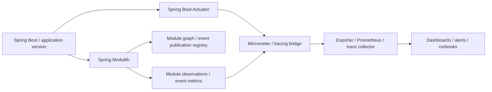
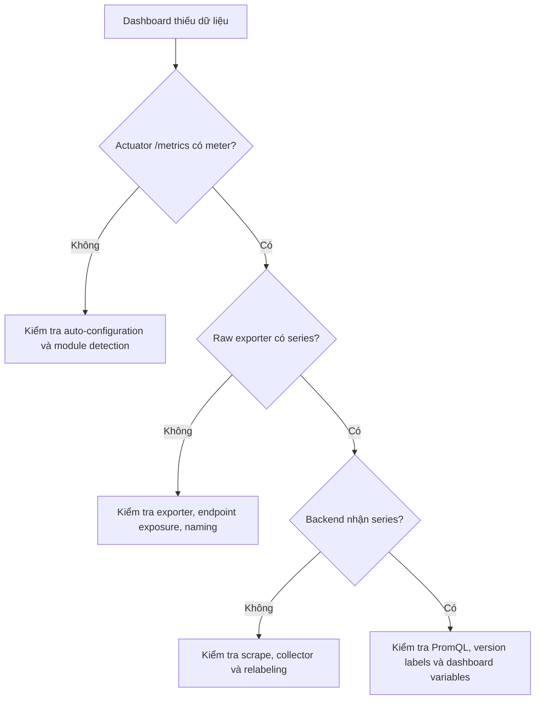
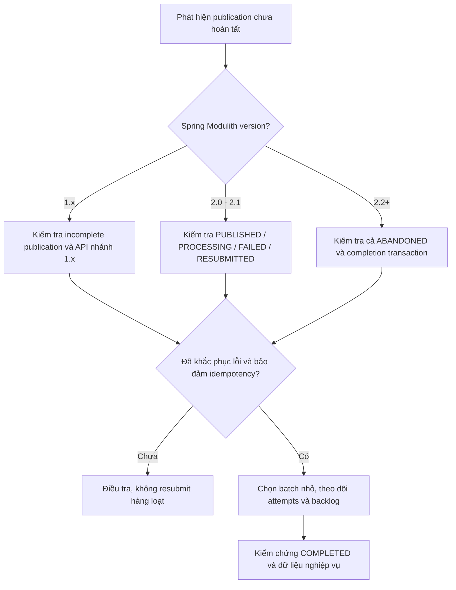

# Cập nhật dashboard và runbook theo version

## 1. Vì sao nâng cấp framework phải kéo theo nâng cấp observability?

Một hệ thống Spring Boot có thể xử lý request và domain event bình thường sau khi nâng cấp, nhưng dashboard lại mất một số đường biểu diễn, bộ lọc theo module trả về rỗng, hoặc runbook hướng dẫn gọi API phục hồi event đã thay đổi. Nguy hiểm hơn, dashboard có thể **tiếp tục có số liệu** nhưng lại diễn giải sai trạng thái event publication giữa các phiên bản.

Bài **Cập nhật dashboard và runbook theo version** thuộc chương **Phiên bản** của học phần **SPRING_MODULITH_DOCUMENTATION_OBSERVABILITY**. Học phần sử dụng Spring Modulith để sinh tài liệu ranh giới application module và quan sát tương tác trong Spring Boot: module graph, Actuator, event metrics, tracing và context propagation. Trọng tâm bài này là biến một lần thay đổi phiên bản thành quy trình vận hành có thể kiểm chứng.

Sau bài học, bạn sẽ:

1. Xác định tổ hợp phiên bản Spring Boot, Spring Modulith, Micrometer, tracing bridge, exporter và collector **thực sự đang chạy**.
2. Xây dựng **hợp đồng observability** cho mỗi release: tên metric, tag, span, module identifier, endpoint và ý nghĩa trạng thái.
3. Chuyển các thay đổi tương thích thành chỉnh sửa cụ thể trên dashboard, alert và runbook.
4. Xử lý khi nhiều phiên bản cùng chạy trong rolling deployment mà không cộng trùng hoặc bỏ sót dữ liệu.
5. Kiểm chứng sau nâng cấp: module graph đúng, số event đúng, listener lỗi được ghi nhận đúng, trace có liên kết hợp lý và quy trình khôi phục còn thực thi được.

**Nguyên tắc:** version của ứng dụng là một phần ngữ cảnh vận hành. Không giả định tên metric, tập tag, thời điểm hoàn tất event publication hoặc API phục hồi giữ nguyên sau mọi lần nâng cấp.

## 2. Các tầng phiên bản có thể thay đổi tín hiệu

Giả sử ứng dụng `orders` dùng Spring Modulith để phát `OrderCompleted`, module `billing` nhận sự kiện và tạo bản chiếu hóa đơn.



| Tầng | Điều có thể thay đổi | Nơi kiểm chứng |
|---|---|---|
| Spring Boot / Actuator | Auto-configuration, endpoint exposure, naming convention, security | `/actuator`, `/actuator/metrics`, `/actuator/prometheus` |
| Spring Modulith | Module detection, event lifecycle, API registry, metric conventions, module entry spans | `/actuator/modulith`, publication registry, spans |
| Micrometer / Tracing | ObservationHandler, tags, trace context, span attributes, sampling | `MeterRegistry` và tracing exporter |
| Exporter / collector | Chuyển tên metric, nhãn series, histogram, resource attributes, relabeling | Raw scrape hoặc OTLP payload |
| Dashboard / Alert | PromQL, legend, nhãn lọc, ngưỡng, alert routing | Dashboard revision và alert rules |
| Runbook | Điều kiện nhận biết lỗi, API retry, trạng thái publication, rollback | Runbook được diễn tập trên version thật |

Nếu metric biến mất trên dashboard, nguyên nhân có thể ở bất kỳ tầng nào. Bắt đầu từ dữ liệu trong ứng dụng, rồi kiểm tra exporter, pipeline và query; không đoán từ tên dependency.

## 3. Ma trận thay đổi Spring Modulith cần cập nhật

Bảng tập trung vào các cột mốc có ý nghĩa với dashboard/runbook. Khi triển khai thật phải tra release notes của **phiên bản cụ thể** được BOM chọn và các bản vá liên quan.

| Dải phiên bản | Điểm cần quan tâm | Hệ quả đối với vận hành |
|---|---|---|
| **1.x** | Event registry thường được tiếp cận qua khái niệm publication hoàn tất/chưa hoàn tất, `IncompleteEventPublications`. | Runbook không sử dụng enum trạng thái hay API mới của 2.x nếu runtime là 1.x. |
| **2.0** | Có vòng đời tường minh `PUBLISHED`, `PROCESSING`, `COMPLETED`, `FAILED`, `RESUBMITTED`; bổ sung `FailedEventPublications`, `ResubmissionOptions`, completion attempts và staleness monitor. | Có thể vẽ dashboard backlog theo trạng thái và diễn tập retry theo điều kiện. |
| **2.1** | Release notes cho biết hạ tầng observability được điều chỉnh, metric naming/conventions được cải thiện và artifact API/Core được tổ chức lại. | So actual meter/tag/exporter trước và sau, kiểm tra lại query cũ. |
| **2.2** | Thêm `ABANDONED` cho publication ngừng retry; đánh dấu publication hoàn tất tham gia transaction của listener **theo mặc định**. | Tách alert `FAILED` và `ABANDONED`; cập nhật runbook và test commit failure. |

Các lưu ý về ngữ nghĩa:

- `FAILED` nghĩa là một publication bị lỗi và còn có thể cần retry theo chính sách; `ABANDONED` từ 2.2 thể hiện quyết định ngừng retry. `COMPLETED` biểu thị listener xử lý thành công.
- Trạng thái registry thuộc **publication của một listener đích**, không đồng nghĩa với HTTP status, transaction của publisher hoặc OpenTelemetry span status.
- Staleness monitor của 2.x cần cấu hình thời lượng phù hợp. Các giá trị mặc định bằng zero không tự động biến mọi publication treo thành `FAILED`.
- API resubmission không tạo đảm bảo exactly-once. Listener phải idempotent khi event được gửi lại hoặc khi nhiều instance xử lý.
- Trong 2.2, log ở cuối thân method chưa đủ chứng minh transaction đã commit; phải kiểm tra registry và dữ liệu sau transaction.

Tính đến **27/11/2026**, thông báo chính thức ngày **19/11/2026** nêu **Spring Modulith 2.2 GA**, đồng thời phát hành bản vá **2.1.3** và **2.0.10**. Thông tin này dùng làm ví dụ mốc chuyển phiên bản của bài; khi triển khai thực tế luôn xác minh changelog mới nhất và compatibility matrix.

## 4. Thiết lập hợp đồng observability theo release

**Hợp đồng observability** là bản mô tả những tín hiệu ứng dụng cam kết cung cấp, ý nghĩa của chúng và cách kiểm chứng. Dùng nó để quản lý thay đổi dashboard/runbook cùng lúc với dependency.

| ID | Nguồn | Ý nghĩa | Kiểm tra |
|---|---|---|---|
| `OBS-MOD-01` | `GET /actuator/modulith` | Danh sách module và dependencies | `orders`, `billing` cùng quan hệ `EVENT_LISTENER` |
| `OBS-EVT-01` | `module.events.published` nếu đã được version hỗ trợ | Counter tổng số domain event được publish | Một `publishEvent` kiểm soát làm delta tăng 1 |
| `OBS-EVT-02` | Counter chuyên biệt theo module/event | Số event được phát thuộc một loại | Không cộng lại với counter tổng |
| `OBS-REG-01` | Event Publication Registry | Hoàn tất, lỗi, đang xử lý, resubmit hoặc abandoned | Query/API đúng phiên bản và completion mode |
| `OBS-TRC-01` | Module entry span | Lượt thực thi qua module API hoặc listener | Span có module identifier/method |
| `OBS-TRC-02` | Custom Observation | Thời gian/thành bại của một bước nghiệp vụ riêng | Một method invocation tạo số lượt đo dự kiến |
| `OBS-CTX-01` | Trace context / event ID | Liên kết thực thi qua `@Async` và retry | Kiểm tra trace/log trong cùng process và sau restart |

**Quan trọng:** một số tín hiệu là **tùy chọn hoặc phải tự instrument**. Event registry không tự bảo đảm có một Prometheus gauge cho số `FAILED`; muốn panel backlog, bạn phải có nguồn đo cụ thể từ registry hoặc một hệ vận hành đáng tin cậy. Nếu thiếu tracing bridge/exporter, không thể đòi có span trong Zipkin/Tempo chỉ vì ứng dụng đã bật Observation.

### 4.1. Mẫu metric contract

```yaml
# Tài liệu về metric, không phải application.yml.
contractId: OBS-EVT-01
service: order-service
releaseLine: "2.1"
owner: spring-modulith-observability
micrometerName: module.events.published
prometheusName: module_events_published_total # phải xem raw exporter
semantic: "Số lượt domain event đã publish"
type: counter
requiredMicrometerTags:
  - module.event.type
  - module.identifier
  - module.name
validation: "Publish một OrderCompleted, delta count ở bộ tags đúng = 1"
dashboardRevision: modulith-events-v2.1-r3
runbookRevision: event-publication-v2.1-r2
```

Tên `prometheusName` ở ví dụ chỉ đúng nếu raw exporter thực sự tạo ra tên đó. `/actuator/metrics` dùng **tên Micrometer**, còn PromQL dùng **tên series sau xuất**. Label keys ở Prometheus có thể được chuẩn hóa từ tag keys gốc; kiểm tra raw output trước khi viết query.

### 4.2. Gắn nhãn phiên bản vào tín hiệu

Nên biết ít nhất `service`, `environment`, `cluster` và `app_version`/release ID để so sánh traffic giữa stable và canary. Có thể thêm `pod`/`instance` để debug và `spring_modulith_version` nếu thực sự cần phân tích theo phiên bản thư viện.

Các nhãn này có thể xuất phát từ Kubernetes labels hoặc OTLP resource attributes qua pipeline relabel, không cần nhồi mọi version vào từng lời gọi business. Không dùng `eventId`, `orderId` hoặc trace ID làm low-cardinality metric tags vì sinh vô số series. Với tracing backend, `service.version` là một resource attribute phù hợp để theo dõi bản triển khai; cách cấu hình cụ thể phụ thuộc exporter/collector.

## 5. Chụp baseline trước khi nâng cấp

Một lần nâng cấp đáng tin cậy bắt đầu bằng việc ghi lại dữ liệu của release đang chạy, trước khi thay đổi dependency hoặc dashboard.

### 5.1. Xác định phiên bản thực tế

Phân biệt **version khai báo**, **resolved version** và **version đang chạy**:

- Lấy dependency tree của Spring Boot, Spring Modulith, Micrometer và tracing bridge.
- Ghi image digest, application release ID, cấu hình runtime và thời điểm rollout.
- Đối chiếu phiên bản Prometheus/OTLP exporter, collector và dashboard.
- Đọc release notes và compatibility matrix của **toàn bộ tổ hợp**, nhất là khi đổi Spring Boot/Spring Framework major.

Ví dụ người học tự chạy trong dự án Gradle của mình:

```bash
./gradlew dependencyInsight \
  --dependency spring-modulith-observability-core \
  --configuration runtimeClasspath

./gradlew dependencyInsight \
  --dependency micrometer-tracing \
  --configuration runtimeClasspath
```

Không dùng dòng version trong build file làm bằng chứng duy nhất: BOM/dependency management có thể chọn artifact version khác.

### 5.2. Chụp raw Actuator và metric exporter

Trong môi trường kiểm thử đã cho phép truy cập endpoint:

```bash
curl -fsS http://localhost:8080/actuator
curl -fsS http://localhost:8080/actuator/modulith
curl -fsS http://localhost:8080/actuator/metrics
curl -fsS http://localhost:8080/actuator/prometheus
```

`/actuator/modulith` đòi hỗ trợ Modulith Actuator/Insight. `/actuator/metrics` và `/actuator/prometheus` có thể chưa được expose; endpoint Prometheus còn cần registry dependency. Bảo vệ các endpoint theo chính sách security; không cho rằng mọi ứng dụng đều mở ở localhost:8080.

Baseline nên chứa:

| Nhóm | Lưu gì? | Mục đích đối chiếu |
|---|---|---|
| Module graph | Identifier, base package, dependencies và loại `EVENT_LISTENER` | Phát hiện ranh giới module đổi |
| Metric catalog | Tên Micrometer, type, tag keys, tên Prometheus/OTLP | Tìm query không còn khớp |
| Sample measurements | Delta của một event, số lượt listener, timer count | Phát hiện đếm trùng hoặc mất metric |
| Trace schema | Span name, resource attributes, module identifier, parent-child | Tìm mất span hoặc đứt context |
| Registry | Số publication theo trạng thái được hỗ trợ, completion mode | Đánh giá backlog và retry semantics |
| Dashboard/rules | Revision, truy vấn và ngưỡng | Có kế hoạch nâng dashboard/alert |
| Runbook | Version scope, chủ sở hữu, link thao tác và rollback | Không dùng API sai phiên bản |

Với Counter, nên so **delta/rate trên cùng khoảng thời gian**. Khi process restart, giá trị counter tích lũy có thể về 0. Không so số tuyệt đối của pod mới lên với pod đã chạy nhiều ngày.

### 5.3. Module graph cũng có version

`GET /actuator/modulith` mô tả cấu trúc application module đang được phát hiện chứ không phải toàn bộ lời gọi runtime. Ví dụ dữ liệu rút gọn:

```json
{
  "orders": {
    "displayName": "Orders",
    "basePackage": "com.acme.orders",
    "dependencies": []
  },
  "billing": {
    "displayName": "Billing",
    "basePackage": "com.acme.billing",
    "dependencies": [
      {"target": "orders", "types": ["EVENT_LISTENER"]}
    ]
  }
}
```

Nếu nâng cấp làm thay đổi tên/ranh giới module hoặc dependency type, dashboard filter theo module identifier có thể rỗng dù nghiệp vụ vẫn chạy. So baseline và hỏi rõ thay đổi đó xuất phát từ code, cấu hình module detection hay framework; đừng vội coi “không có module span” là “không còn gọi module”.

## 6. Cập nhật dashboard cho rolling deployment

Trong canary hoặc rolling deployment, bản cũ và mới cùng xử lý traffic. Dashboard phải giúp so sánh chúng mà không tính hai lần cùng dữ liệu.

### 6.1. Truy vấn phân tách theo version

Giả sử đã xác minh raw exporter rằng hai version cùng có series `module_events_published_total` và labels `service`, `app_version`:

```promql
sum by (app_version) (
  rate(module_events_published_total{service="order-service"}[5m])
)
```

Đây là query minh họa. Nó so **tốc độ event**, chưa chuẩn hóa theo tỷ lệ traffic: canary nhận 5% request có tốc độ thấp hơn stable là bình thường. Nếu tên metric hay label key khác giữa hai version, phải xây query riêng và test từng bên.

### 6.2. Chiến lược chuyển query

| Giai đoạn | Dashboard | Điều kiện đạt |
|---|---|---|
| Trước nâng cấp | `events-v1` | Đọc đúng dữ liệu version cũ |
| Canary | `events-v1` và `events-v2` hoặc lớp tương thích đã kiểm chứng | Cả hai release xuất số liệu, không đếm trùng |
| Full rollout | `events-v2` chính, `events-v1` chỉ để tra cứu | New version có dữ liệu đầy đủ và alert đúng |
| Sau retention | Gỡ truy vấn legacy | Dữ liệu phiên bản cũ đã hết nhu cầu phân tích |

Không đổi tên mọi metric về tên cũ nếu ý nghĩa đã thay đổi. Không viết query `or` để hợp nhất hai tên rồi mặc định chúng không trùng: `or` trong PromQL có thể tạo hai series khi nhãn khác nhau.

### 6.3. Đừng cộng hai counter khác ngữ nghĩa

Spring Modulith có counter tổng `module.events.published` và counter chuyên biệt theo module/event type, ví dụ `module.events.published.orders.OrderCompleted` khi được export theo convention tương ứng. Chúng có thể phản ánh **cùng một hành động publish dưới hai góc nhìn**. Không cộng cả hai để tính tổng event.

`module.events.published` đo số **event được phát**, không bảo đảm mọi listener đã xử lý thành công. Nếu có hai listener nhận một event hoặc một listener retry hai lần, số lượt xử lý listener có thể khác số publish. Dashboard nên thể hiện hai chỉ số với nhãn/diễn giải riêng.

### 6.4. Sáu nhóm panel cần có

| Nhóm | Các panel hữu ích | Nguồn/giới hạn |
|---|---|---|
| Release overview | HTTP throughput, error rate, latency theo `app_version` | HTTP server metrics và labels version |
| Architecture | Link module graph, module IDs và dependencies thay đổi | Snapshot Modulith Actuator |
| Event publishing | Event rate theo module/type | Modulith event meters đã đối chiếu |
| Listener processing | Attempts, duration, success/error và retries | Custom metric/Observation nếu ứng dụng có |
| Event backlog | Incomplete, `FAILED`, `ABANDONED` và tuổi publication | Dữ liệu registry được instrument riêng |
| Tracing | Module entry spans, span lỗi và context qua `@Async` | Micrometer Tracing / exporter; chịu tác động sampling |

Đặt mô tả ngay trên panel để người trực ca biết ý nghĩa nguồn. Ví dụ: “Listener attempt count có thể lớn hơn published-event count khi retry”; “FAILED khác ABANDONED”; “Một trace bị thiếu không tự chứng minh listener chưa chạy”.

### 6.5. Metric tùy biến để tính lỗi listener

Giả sử ứng dụng **tự cung cấp**, không phải mặc định của Spring Modulith, counter `app_modulith_listener_attempts_total` với labels `service`, `app_version` và `outcome`. Query tính tỷ lệ lỗi theo version:

```promql
sum by (app_version) (
  rate(app_modulith_listener_attempts_total{
    service="order-service", outcome="error"
  }[10m])
)
/
clamp_min(
  sum by (app_version) (
    rate(app_modulith_listener_attempts_total{service="order-service"}[10m])
  ),
  1e-9
)
```

`clamp_min` tránh chia cho 0, nhưng không biến cửa sổ gần như không có event thành tỷ lệ đáng tin cậy. Alert cần thêm điều kiện số mẫu tối thiểu. Với metric backlog, nếu `FAILED` nằm trong `incomplete` thì **không cộng** chúng để suy ra số publication độc lập.

## 7. Cập nhật alert cùng lúc với dashboard

Alert quyết định ai nhận thông báo và phải làm gì. Mỗi alert cần owner, version scope, query đã kiểm chứng và runbook đúng phiên bản.

| Alert | Ý nghĩa | Điểm cần cập nhật khi nâng version |
|---|---|---|
| `EventPublishMetricsMissing` | Metric dự kiến không xuất hiện khi có traffic phù hợp | Metric name/tag/exposure có thể đổi |
| `ListenerErrorRateHigh` | Lỗi lượt xử lý listener vượt baseline và đủ samples | Custom observation/metric convention |
| `PublicationBacklogGrowing` | Publication tồn đọng hoặc quá tuổi | Cách đọc trạng thái 1.x/2.x |
| `FailedPublicationAgeHigh` | `FAILED` kéo dài cần điều tra | Retry policy và API từ 2.0 |
| `AbandonedPublicationsNonZero` | Publication bị bỏ retry cần đánh giá nghiệp vụ | Chỉ áp dụng khi runtime hỗ trợ 2.2+ |
| `TraceCoverageDrops` | Module spans bị thiếu bất thường | Instrumentation, sampling, bridge, context |
| `ModuleGraphUnexpectedChange` | Snapshot ranh giới module thay đổi ngoài dự kiến | Module discovery, code và cấu hình |

Không cảnh báo “event rate = 0” cho mọi service không điều kiện: có thể không có event vào giờ thấp điểm. Dùng traffic điều kiện, synthetic event hoặc baseline theo lịch.

### 7.1. Ví dụ Prometheus alert rule

Rule minh họa **chỉ hợp lệ khi ứng dụng đã xuất metric custom** `app_modulith_listener_attempts_total` và labels trong query. Ngưỡng 5% với tối thiểu 20 attempts/10 phút mang tính bài tập, phải được chỉnh theo SLO:

```yaml
groups:
  - name: order-service-modulith
    rules:
      - alert: ModulithListenerErrorsElevated
        expr: |
          (
            sum by (service, app_version) (
              increase(app_modulith_listener_attempts_total{outcome="error"}[10m])
            )
            /
            clamp_min(
              sum by (service, app_version) (
                increase(app_modulith_listener_attempts_total[10m])
              ),
              1
            )
          ) > 0.05
          and on(service, app_version)
          sum by (service, app_version) (
            increase(app_modulith_listener_attempts_total[10m])
          ) >= 20
        for: 5m
        labels:
          severity: warning
        annotations:
          summary: "Listener error rate cao ở {{ $labels.service }}"
          description: "Kiểm tra app_version={{ $labels.app_version }} và runbook tương ứng."
```

Kiểm tra rule bằng `promtool check rules` khi môi trường có công cụ, đồng thời kiểm thử query trên dữ liệu thật. Cú pháp hợp lệ chưa bảo đảm query đúng nghĩa. Alert phải trỏ đến đúng revision runbook dành cho `app_version` xuất hiện trong nhãn.

### 7.2. Đọc biến động trong canary

Khi tỷ lệ lỗi tăng, kiểm tra lần lượt: canary được chia bao nhiêu traffic, counter có reset sau restart, exporter có đổi naming, số event attempts có tăng do retry, backlog có tăng và có lỗi thực tế trong log/trace hay không. Gắn deployment marker lên dashboard để phân biệt sự cố với thời điểm rollout.

## 8. Runbook có scope phiên bản

Một runbook thao tác phục hồi event phải chỉ rõ release được hỗ trợ, runtime version và trạng thái registry. Không dùng chung một lệnh “retry tất cả” cho mọi nhánh.

### 8.1. Cấu trúc runbook mẫu

```markdown
# Runbook: Event publication backlog

Applies to:
- service: order-service
- application releases: 2026.11.x
- Spring Modulith: 2.2.x
- Event Publication Repository: JDBC
- dashboard revision: events-v2.2-r3

Symptoms:
- FAILED publications tồn đọng; listener error rate tăng
- hoặc ABANDONED khác 0 (điều tra riêng)

Preflight:
- xác định pod version, data store, completion mode
- kiểm tra event ID, completion attempts, downstream health
- đối chiếu raw metric, log và trace

Actions:
- xử lý nguyên nhân lỗi trước
- xác minh idempotency, transaction và quyền thao tác
- resubmit publication FAILED đủ điều kiện theo batch nhỏ
- không mặc định resubmit ABANDONED hoặc PROCESSING
- chờ trạng thái COMPLETED và đối chiếu dữ liệu nghiệp vụ

Stop / Escalation:
- dừng resubmit nếu tạo side effects trùng hoặc backlog tăng
- chuyển owner orders/billing, ghi nhận event IDs và release
```

Đây là mẫu tài liệu vận hành, không phải cú pháp framework. Tên class và lệnh thực hiện phải được kiểm chứng theo version triển khai.

### 8.2. Runbook cho lỗi “dashboard trắng”



Cách chạy:

1. Chọn một pod thuộc đúng version bị lỗi, lưu release ID và thời điểm rollout.
2. Đọc `/actuator/metrics` bằng tên Micrometer thực tế; nếu meter tạo lười, chạy một synthetic event trước.
3. Đọc `/actuator/prometheus` nếu dùng Prometheus; nếu raw exporter có dữ liệu mà dashboard trống, kiểm tra pipeline/query trước.
4. So tên/tag/module identifier với baseline.
5. Chỉ sửa query hoặc instrument khi đã biết tầng gây mất dữ liệu.
6. Sau thay đổi, tạo một event, xem delta metric và xác nhận alert/dashboard thật sự nhận dữ liệu.

### 8.3. Runbook xử lý event lỗi theo version



Những điểm cần ghi rõ trong runbook:

- Trên 2.0+, `FailedEventPublications.resubmit(ResubmissionOptions)` được dùng để phát lại các publication `FAILED` theo điều kiện. Xác minh đúng API của release đang chạy trước khi thao tác.
- Trên 2.2+, `ABANDONED` biểu thị quyết định ngừng retry thông thường. Việc “mở lại” cần một quy trình/phê duyệt nghiệp vụ riêng; không mặc định rằng lệnh resubmit cho FAILED sẽ chọn ABANDONED.
- Từ 2.2, completion tham gia transaction listener theo mặc định. Log “xử lý xong” ở trong method không chứng minh publication đã `COMPLETED`. Kiểm tra sau commit.
- Không bật bừa `spring.modulith.events.republish-outstanding-events-on-restart=true` để xử lý backlog khi nhiều instance cùng chạy. Phải xác định cơ chế ngăn xử lý song song, chính sách batch/concurrency và idempotency.
- Staleness monitor không tự có hiệu lực khi thời lượng cấu hình vẫn bằng 0; thời lượng quá ngắn có thể đánh dấu đang xử lý hợp lệ là stale.
- Một event có thể tới nhiều listener; phải tìm publication của **listener đích** trước khi quyết định có tác động nghiệp vụ hay không.

### 8.4. Runbook cho trace mất liên kết

Khi người dùng hoặc đội vận hành thấy span của module `billing` không còn nằm trong trace của `orders`:

1. Kiểm tra Micrometer Tracing bridge và exporter thực sự hoạt động trong version mới.
2. So tên span, module identifier, `service.version` và các attributes trước/sau nâng cấp; dashboard filter cũ có thể không khớp.
3. Nếu listener chạy qua `@Async`, xác nhận **executor thực tế** và context propagation. Với Spring Framework phù hợp có thể dùng `ContextPropagatingTaskDecorator`.
4. Kiểm tra sampler, collector và exporter errors; trace bị sampling loại bỏ không đồng nghĩa method không chạy.
5. Retry xảy ra **sau restart** có thể tạo trace mới; dùng event ID/correlation ID đã lưu bền vững trong log và span attribute để ghép nhiều lượt.
6. Xác nhận module graph không đổi ngoài dự kiến; graph mô tả dependency tĩnh, trace mô tả lượt thực thi runtime.

## 9. Quy trình phát hành dashboard và runbook

Không đợi production nâng cấp xong mới sửa dashboard. Dashboard, alerts và runbooks nên thuộc cùng thay đổi có thể review.

### 9.1. Giai đoạn A: phân tích

1. Chốt old/new versions, JDK, Spring Boot, Spring Modulith, Micrometer, tracing bridge và exporter. Dùng resolved dependency versions, không chỉ version khai báo.
2. Đọc changelog chính thức cho từng release line; xác định breaking API, metric naming, module detection và event lifecycle.
3. Chụp baseline thực tế, đánh dấu các contract không còn chính xác.
4. Liệt kê dashboard, alert rules, runbooks và tài liệu module graph phụ thuộc contract cũ.
5. Lập bảng mapping giữa old và new, ghi rõ dữ liệu có đổi **tên** hay đổi **ý nghĩa**.

Ví dụ bảng mapping:

| Contract | Bản cũ | Bản mới | Hành động |
|---|---|---|---|
| Event count | Metric đã được old version xuất | `module.events.published` khi version mới xuất | So raw exporter và cập nhật query |
| Listener error | `incomplete` hoặc metric custom cũ | `FAILED`/metric custom của 2.x | Điều chỉnh label và khái niệm backlog |
| Abandoned | Chưa hỗ trợ trạng thái tương ứng | `ABANDONED` từ 2.2 | Panel và quy trình riêng |
| Completion semantics | Theo transaction/completion mode của old version | Hoàn tất tham gia transaction listener theo mặc định ở 2.2 | Test commit failure và sửa runbook |
| Module entry tracing | Span/attributes ở baseline | Span/attributes trong version mới | Cập nhật filter, không đoán tên |
| Module graph | Snapshot module IDs old | Snapshot mới | Review thay đổi có chủ đích |

### 9.2. Giai đoạn B: sửa artifact

- Tạo dashboard revision mới, giữ revision cũ cho canary.
- Thêm phân nhóm theo release/`app_version` đã xác minh.
- Thay những query phụ thuộc tên metric/tag/semantic đã đổi.
- Không cộng legacy và new counter cho cùng hành động.
- Sửa alert rules, alert annotations, dashboard links và runbook.
- Runbook phải có “applies to version”, các thao tác retry tương ứng và nhánh rollback.
- Kiểm tra quyền truy cập Actuator và quyền vận hành event registry.

### 9.3. Giai đoạn C: thử trên staging

Với một `OrderCompleted` kiểm soát:

1. Publisher phát đúng một lần và transaction commit.
2. Module graph chứa `orders`, `billing` và quan hệ `EVENT_LISTENER` theo kiến trúc đã phê duyệt.
3. Counter publish tăng đúng delta tại tên/tag thực tế.
4. Listener thành công, publication hoàn tất; không lấy published count làm số completed listener.
5. Ép listener lỗi, xác nhận trạng thái registry tương ứng và span/metric lỗi nếu được instrument.
6. Sửa lỗi, thực hiện resubmit có kiểm soát; dữ liệu nghiệp vụ không bị tạo trùng.
7. Kiểm tra module entry span, async context propagation và resource version.
8. Sử dụng chính dashboard và runbook mới để phân tích sự cố giả lập. Nếu runbook không dẫn đến quyết định đúng, artifact chưa đạt.

### 9.4. Giai đoạn D: canary/rolling deployment

Bắt buộc có: release marker; dashboard đọc được stable và canary; so rate đã chuẩn hóa theo traffic; alert không báo sai do query cũ; kế hoạch rollback cả binary/configuration và đánh giá event registry schema.

**Lưu ý:** nâng cấp có thể thay đổi schema hoặc cách ghi trạng thái Event Publication Registry. Nếu có migration dữ liệu, rollback binary đơn thuần có thể không an toàn. Kiểm tra tương thích đọc/ghi giữa hai version cùng tồn tại, thứ tự migration và khả năng rollback database trước triển khai.

### 9.5. Giai đoạn E: sau full rollout

- Kiểm tra qua ít nhất một chu kỳ hoạt động đủ đại diện về traffic và lỗi.
- Chuyển dashboard mới thành mặc định, giữ legacy phục vụ hồi cứu theo retention policy.
- Điều chỉnh ngưỡng cảnh báo dựa trên baseline mới đã được review.
- Cập nhật link runbook trong paging/incident routing; diễn tập một lỗi listener.
- Ghi người duyệt, ngày hiệu lực và ngày gỡ dashboard/query cũ.

## 10. Kiểm thử hồi quy cho hợp đồng observability

Không dừng ở unit test nghiệp vụ. Upgrade của Spring Modulith có thể thay đổi tín hiệu ngay cả khi API HTTP bên ngoài vẫn hoạt động.

### 10.1. Kiểm thử module boundaries

```java
import org.junit.jupiter.api.Test;
import org.springframework.modulith.core.ApplicationModules;

class ModuleStructureTest {

    @Test
    void verifyModuleBoundaries() {
        ApplicationModules.of(Application.class).verify();
    }
}
```

`Application` là lớp Spring Boot main application trong ví dụ. Kiểm thử xác nhận ràng buộc module mà Spring Modulith kiểm tra; nó **không thay thế** việc review snapshot `/actuator/modulith`. Một thay đổi kiến trúc hợp lệ về kỹ thuật vẫn có thể làm dashboard filter theo module name sai.

### 10.2. Kiểm thử nguyên lý delta meter

Ví dụ thuần Micrometer để phân biệt meter identity với số lần ghi:

```java
import static org.junit.jupiter.api.Assertions.assertEquals;
import io.micrometer.core.instrument.Counter;
import io.micrometer.core.instrument.simple.SimpleMeterRegistry;
import org.junit.jupiter.api.Test;

class EventMeterContractExampleTest {

    @Test
    void oneRecordedPublishChangesCounterByOne() {
        try (var registry = new SimpleMeterRegistry()) {
            Counter counter = registry.counter(
                "demo.event.published", "module", "orders");

            double before = counter.count();
            counter.increment(); // Một lần gọi instrument có chủ đích.
            double after = counter.count();

            assertEquals(1.0, after - before, 0.00001);
        }
    }
}
```

Đây chỉ là **minh họa**; nó không kiểm thử instrumentation thực sự của Spring Modulith. Trong integration test, cấu hình `MeterRegistry` đang được Modulith sử dụng, phát event qua `ApplicationEventPublisher`, rồi assert **delta của meter thực tế** với đúng tags. Tránh đo sai do các test khác cùng ghi vào registry hoặc do event async chưa kết thúc.

### 10.3. Kiểm thử metrics qua endpoint

Một test HTTP có thể đọc `/actuator/prometheus` và so tên/label keys đã được xác minh. Nhưng một số meter chỉ xuất hiện sau lượt nghiệp vụ đầu tiên, vì thế phải tạo synthetic event trước khi assert series tồn tại.

Giữ một fixture “metric contract v2.1”, một fixture “metric contract v2.2” nếu có thay đổi. Không cố hard-code một tên metric cho mọi release nếu actual exporter đã đổi.

### 10.4. Kiểm thử trace

Trong integration test có in-memory tracing exporter hoặc collector staging, xác nhận:

- Có module entry span cho thao tác thực sự đi qua ranh giới module.
- Module identifier và invocation type theo convention của version mới.
- `@Async` listener có liên hệ trace phù hợp khi context propagation được bật cùng process.
- Retry sau restart có thể tạo trace mới, nhưng event ID vẫn cho phép đối chiếu.
- Observation lỗi ghi nhận exception; nếu có span và instrumentation đặt trạng thái lỗi thì span thể hiện `ERROR`.
- Không yêu cầu mọi span thành công phải tường minh `OK`: OpenTelemetry cho phép `UNSET` với thao tác thành công thông thường.

Nếu span vắng mặt do sampling, test không được suy ra listener chưa chạy. Đánh giá runtime registry và dữ liệu nghiệp vụ riêng.

## 11. Bài thực hành: nâng từ Spring Modulith 2.1 lên 2.2

### 11.1. Bối cảnh

Một ứng dụng gồm `orders` và `billing` đang chạy Spring Modulith **2.1.x**, có Event Publication Registry bền vững, `/actuator/modulith`, metric publish, listener attempts custom và tracing.

Nhóm dự kiến nâng lên **2.2.x** với BOM tương thích. Bạn đóng vai trò kỹ sư ứng dụng kiêm vận hành và phải cập nhật dashboard/runbook để phù hợp phiên bản mới.

### 11.2. Nhiệm vụ

1. Chụp module graph, tên meter và raw exporter trước nâng cấp.
2. Tạo dashboard version filter, tách sự kiện **được publish** và **được xử lý bởi listener**.
3. Cập nhật runbook khi có `ABANDONED`, không coi abandoned là failed có thể retry ngay.
4. Kiểm thử trạng thái hoàn tất publication trong transaction của listener trên 2.2, nhất là trường hợp commit thất bại.
5. Tạo một event thành công và một event khiến listener ném lỗi. Theo dõi registry và trace.
6. Khôi phục dependency, thử resubmit batch nhỏ, xác minh idempotency.
7. Diễn tập canary hai version, xác minh dashboard không thiếu/đếm trùng series.
8. Kiểm tra alert links đưa tới đúng runbook phiên bản đang chạy.

### 11.3. Bằng chứng nghiệm thu

```text
Application release: 2026.11.27-canary.1
Spring Modulith runtime: 2.2.x
Spring Boot / Micrometer: <resolved versions>
Dashboard revision: modulith-events-v2.2-r1
Runbook revision: modulith-recovery-v2.2-r1

Module graph: PASS / FAIL
One-event published counter delta: 1 / ...
Listener error and recovery: PASS / FAIL
FAILED -> resubmit -> COMPLETED: PASS / FAIL
ABANDONED runbook branch: PASS / FAIL
Listener commit semantics: PASS / FAIL
Trace context across @Async: PASS / FAIL
No duplicate legacy/new event counts: PASS / FAIL
Rollback compatibility reviewed: PASS / FAIL
```

Đây là **mẫu báo cáo**, không phải kết quả kiểm thử đã thực hiện. Lưu kèm raw metrics, registry state, trace và revision dashboard thực tế.

## 12. Chẩn đoán nhanh sau nâng cấp

### Dashboard trắng nhưng ứng dụng vẫn phục vụ request

Đọc `/actuator/metrics` rồi raw exporter, cuối cùng mới kiểm tra PromQL/collector. Meter có thể chưa được tạo vì chưa có event; hãy chạy một thao tác kiểm soát. Nếu raw exporter có series mà dashboard không có, tìm lỗi ở query/labels. Nếu meter vắng ngay từ ứng dụng, kiểm tra starter, auto-configuration, module detection và instrumentation.

### Event counter tăng gấp đôi

Kiểm tra có cộng counter tổng `module.events.published` và counter riêng theo event type không. Rà soát instrument thủ công trùng auto instrument, scrape hai lần, publish lặp hoặc retry listener. Một event ID và log publish/attempt sẽ giúp phân biệt nghiệp vụ thật với đo đếm sai.

### Sau nâng cấp xuất hiện ABANDONED

Trên 2.2+, xem `AbandonPolicy`, cấu hình giới hạn attempts và từng publication cụ thể. Không coi `ABANDONED` là `COMPLETED` hoặc tự động xóa cảnh báo. Đội nghiệp vụ cần xác định có bỏ qua, xử lý thủ công hay mở quy trình phục hồi riêng.

### Listener log thành công nhưng publication chưa hoàn tất

Đọc transaction outcome và registry sau commit. Với 2.2, completion tham gia transaction listener theo mặc định; log trong method có thể xuất trước khi commit thất bại. Kiểm tra side effects đã commit và thông tin failure.

### Span mất parent khi qua module bất đồng bộ

Kiểm tra executor thực tế, context propagation, tracing bridge, exporter, sampling và thay đổi tên attribute. Nếu retry chạy sau restart, một trace ID mới là hợp lệ; dùng event ID để nối lịch sử.

### Rollback code nhưng thao tác registry báo lỗi

Kiểm tra schema migration, API version và data compatibility. Không ghi đè/xóa publication để che lỗi khi chưa đánh giá tác động dữ liệu. Runbook phải chỉ rõ điểm dừng thao tác và hướng escalation.

## 13. Checklist đóng release

| Tiêu chí | Bằng chứng cần có |
|---|---|
| Version inventory | Resolved dependencies, image digest và release ID |
| Changelog mapping | Có bảng thay đổi API, metric, trace và registry state |
| Module graph | Snapshot được review, module IDs/dependencies đúng |
| Metric contract | Tên meter/tag/exported series được đọc từ bản chạy thật |
| Dashboard canary | Stable/new được phân tách, không đếm trùng |
| Alert rules | Rule đúng cú pháp, có dữ liệu và link runbook version |
| Tracing | Module entry spans, context qua `@Async`, resource version |
| Publication registry | Trạng thái và API được xử lý đúng cho 1.x/2.0+/2.2+ |
| Retry | Có kiểm thử thất bại, resubmit, idempotency và commit failure |
| Rollback | Đã đánh giá schema/data và hỗ trợ version chạy đồng thời |
| Ownership | Có chủ sở hữu, ngày hiệu lực và lịch sử dashboard/runbook |

**Tiêu chí hoàn thành bài học:** người học chỉ ra được tín hiệu nào đổi sau nâng cấp, cập nhật dashboard và runbook, chứng minh bằng dữ liệu test và giải thích được tác động của rolling deployment, retries và transaction semantics đến observability.

## 14. Tài liệu tham khảo theo release line

Ưu tiên tài liệu chính thức của **đúng release line** đang triển khai. Trang `/reference/` mặc định có thể được cập nhật theo thời gian, nên ghi ngày đối chiếu và version trong bản ghi nâng cấp.

- [Spring Modulith – Production-ready Features](https://docs.spring.io/spring-modulith/reference/production-ready.html): Modulith Actuator, module spans, event metrics và metric tags.
- [Spring Modulith – Working with Application Events](https://docs.spring.io/spring-modulith/reference/events.html): event publication lifecycle, staleness, resubmission, abandoned.
- [Spring Modulith – 2.1 Production-ready Features](https://docs.spring.io/spring-modulith/reference/2.1/production-ready.html): tài liệu observability theo nhánh 2.1.
- [Spring Modulith 2.1 GA, 11/06/2026](https://spring.io/blog/2026/06/11/spring-modulith-2-1-ga-2-0-7-and-1-4-12-released/): cải tiến hạ tầng observability.
- [Spring Modulith 2.2 GA, 19/11/2026](https://spring.io/blog/2026/11/19/spring-modulith-2-2-ga-2-1-3-and-2-0-10-released/): transactional completion và abandoned publications.
- [Spring Boot – Metrics](https://docs.spring.io/spring-boot/reference/actuator/metrics.html): `/actuator/metrics`, Prometheus exporter và meter naming.
- [Spring Boot – Actuator Endpoints](https://docs.spring.io/spring-boot/reference/actuator/endpoints.html): exposure và quyền truy cập endpoint.
- [Micrometer – Observation Components](https://docs.micrometer.io/micrometer/reference/observation/components.html): quan hệ Observation, Timer/Counter và span.
- [OpenTelemetry – Semantic Conventions](https://opentelemetry.io/docs/specs/semconv/): resource attributes như `service.version` và trace attributes.
- [Prometheus – Alerting Rules](https://prometheus.io/docs/prometheus/latest/configuration/alerting_rules/): khai báo và kiểm tra alert rules.

Sau mỗi lần nâng cấp, gắn link changelog cụ thể vào ticket release, lưu snapshot metric/trace và ghi rõ bản runbook áp dụng. Không tái sử dụng runbook dành cho 2.2 cho một ứng dụng 1.x nếu API và vòng đời publication chưa được kiểm chứng.
