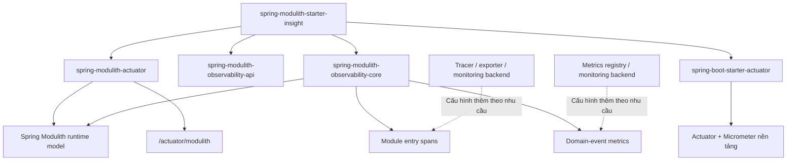
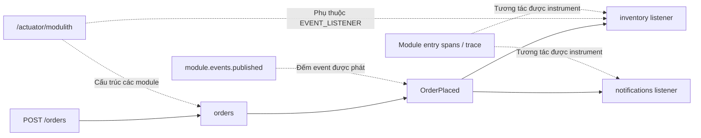

# Thành phần observability được kéo theo

## 1. Insight starter giải quyết nhu cầu nào?

Trong chương **Insight starter** của module **SPRING_MODULITH_DOCUMENTATION_OBSERVABILITY**, chúng ta cần biết chính xác những thành phần quan sát nào được đưa vào ứng dụng khi khai báo `spring-modulith-starter-insight`. Mục tiêu cuối cùng là có thể **đọc cấu trúc application module** và **theo dõi tương tác thực tế giữa các module** trong một ứng dụng Spring Boot: module graph qua Actuator, metric khi phát domain event, span của lời gọi qua ranh giới module và trace liên kết các bước xử lý.

Hình dung ứng dụng bán hàng gồm `orders`, `inventory`, `payments` và `notifications`. Nhóm phát triển muốn trả lời:

- Khi chạy ứng dụng, Spring Modulith nhận diện những module và dependency nào?
- Yêu cầu đặt hàng đã đi qua ranh giới module nào, bước nào mất nhiều thời gian?
- Có bao nhiêu `OrderPlaced` event được phát từ module `orders`?
- Nếu trace bị ngắt giữa publisher và listener chạy bất đồng bộ, phần truyền context nằm ở đâu?

**Insight starter** là cách gọn để bật các khả năng vận hành của Spring Modulith. Cần phân biệt **thư viện được kéo vào classpath**, **instrumentation có thể hoạt động** và **dữ liệu thật sự được xuất tới dashboard**. Ba trạng thái đó không tự động đồng nghĩa với nhau.

## 2. Dependency tree: starter bao gồm những gì?

Với **Spring Modulith 2.2.x**, tài liệu chính thức liệt kê bốn thành phần trực tiếp của `spring-modulith-starter-insight`:

| Artifact được kéo theo | Vai trò | Phạm vi điển hình trong starter |
| --- | --- | --- |
| `org.springframework.modulith:spring-modulith-actuator` | Đưa mô hình application module ra một Spring Boot Actuator endpoint. | Runtime |
| `org.springframework.modulith:spring-modulith-observability-api` | Cung cấp API mở rộng, tùy biến metric và observation của Modulith. | Compile trong POM của starter |
| `org.springframework.modulith:spring-modulith-observability-core` | Hạ tầng thực thi: instrument tương tác module, tạo observation/span và ghi metric về domain event. | Runtime |
| `org.springframework.boot:spring-boot-starter-actuator` | Nền tảng Actuator và hạ tầng Micrometer của Spring Boot, bao gồm các endpoint vận hành phù hợp. | Runtime |

Các thành phần này còn sử dụng những phụ thuộc bắc cầu khác, chẳng hạn `spring-modulith-runtime` để khởi tạo và truy cập mô hình `ApplicationModules` lúc ứng dụng chạy. **Bảng trên là các thành phần trực tiếp được công bố trong tài liệu starter, không phải danh sách toàn bộ JAR của `runtimeClasspath`.**



Sơ đồ thể hiện quan hệ chức năng để học, không mô phỏng mọi cạnh phụ thuộc Maven/Gradle. Nhánh nét đứt nhấn mạnh những phần phải bổ sung nếu muốn **xuất** tín hiệu ra một hệ thống bên ngoài.

### 2.1. Vì sao có cả `actuator` và `spring-boot-starter-actuator`?

Hai artifact phục vụ **hai lớp khác nhau**:

- `spring-modulith-actuator` định nghĩa endpoint đặc thù của Modulith: dữ liệu về module và dependency.
- `spring-boot-starter-actuator` cung cấp nền tảng để đăng ký, cấu hình, expose và truy cập các endpoint vận hành của Spring Boot.

Nếu chỉ khai báo `spring-modulith-actuator`, cần bảo đảm ứng dụng đã có Boot Actuator tương ứng. Insight starter kéo theo cả hai để giảm việc lắp ghép bằng tay.

### 2.2. Vì sao tách `observability-api` và `observability-core`?

- **Core** chứa phần triển khai instrumentation cần ở runtime.
- **API** chứa các điểm mở rộng dành cho lập trình viên, chẳng hạn `ModulithEventMetricsCustomizer` và `ModulithObservationConvention`.

Phân tách này giúp ứng dụng chỉ cần quan sát mặc định có thể thêm starter ở runtime. Khi tự viết mã tham chiếu API mở rộng, mã đó phải nhìn thấy artifact API ở **compile classpath**. Ví dụ, trong Gradle nếu starter được khai báo bằng `runtimeOnly`, việc POM của starter ghi API là compile dependency **không bảo đảm** lớp của API có mặt ở compile classpath của chính ứng dụng. Lúc đó nên khai báo trực tiếp:

```groovy
dependencies {
    runtimeOnly 'org.springframework.modulith:spring-modulith-starter-insight'

    // Chỉ cần thêm nếu mã nguồn ứng dụng dùng các lớp API tùy biến.
    implementation 'org.springframework.modulith:spring-modulith-observability-api'
}
```

Các dependency Spring Modulith ở ví dụ này cần được quản lý phiên bản bằng BOM hoặc cơ chế quản lý dependency tương thích với dự án.

### 2.3. Lưu ý thay đổi giữa các dòng phiên bản

Ở các dòng Spring Modulith **1.x**, tài liệu có thể dùng artifact `spring-modulith-observability`. Trong **2.x**, tài liệu phân tách thành `spring-modulith-observability-api` và `spring-modulith-observability-core`. Đừng ghép một tọa độ cũ với mã nguồn hoặc starter mới chỉ vì tên gần giống. Ví dụ trong bài sử dụng cách đặt tên theo tài liệu **Spring Modulith 2.2**, còn khi làm dự án thực tế phải đối chiếu với phiên bản Spring Boot/Spring Modulith được chọn.

## 3. Bốn thành phần đó đem lại chức năng quan sát nào?

### 3.1. Module graph thông qua Spring Boot Actuator

Với hỗ trợ Modulith Actuator và endpoint được expose, truy cập:

```http
GET /actuator/modulith
```

Endpoint cung cấp mô hình application module mà Spring Modulith nhận diện. Ví dụ JSON minh họa, rút gọn:

```json
{
  "orders": {
    "basePackage": "com.example.shop.orders",
    "displayName": "Orders",
    "dependencies": []
  },
  "inventory": {
    "basePackage": "com.example.shop.inventory",
    "displayName": "Inventory",
    "dependencies": [
      {
        "target": "orders",
        "types": ["EVENT_LISTENER"]
      }
    ]
  }
}
```

Các trường hữu ích:

| Trường | Ý nghĩa khi kiểm chứng kiến trúc |
| --- | --- |
| `basePackage` | Package gốc của application module. |
| `displayName` | Tên hiển thị của module. |
| `dependencies[].target` | Module đích mà module hiện tại phụ thuộc. |
| `dependencies[].types` | Loại phụ thuộc, ví dụ `DEFAULT`, `USES_COMPONENT`, `EVENT_LISTENER`. |
| `parent`, `nested` (nếu có) | Quan hệ module cha/con trong thiết kế nested modules. |

**Cần hiểu đúng:** đây là **mô hình cấu trúc** chứ không phải bản ghi các request vừa chạy. Endpoint trả lời “module nào phụ thuộc vào module nào”, không trả lời một đơn hàng cụ thể đã chạy qua những bước nào. Để quan sát dòng thực thi, dùng spans/traces.

### 3.2. Module entry spans: ranh giới nào được gọi?

`spring-modulith-observability-core` hỗ trợ instrument lời gọi đến những **Spring component thuộc API của application module**. Khi hệ thống observation/tracing được cấu hình phù hợp, các lần đi qua điểm vào module có thể sinh span chứa:

| Span tag | Nội dung |
| --- | --- |
| `module.identifier` | Định danh module. |
| `module.name` | Tên module. |
| `module.invocation-type` | Kiểu lời gọi, ví dụ `bean` hoặc `event listener`. |
| `module.method` | Phương thức ở điểm vào module. |

Ví dụ trace giả định sau khi có tracer, exporter và các đoạn cần thiết được instrument:

```text
HTTP POST /orders
  -> orders: placeOrder(...)
     -> payments: authorize(...)
     -> inventory: reserve(...)
```

Trace giúp nhóm biết thời gian thực thi ở từng điểm vào module. Tuy nhiên:

- Insight không tự tạo span cho **mọi phương thức** trong mọi package; instrumentation có phạm vi cụ thể, như các component ở module API.
- Một lời gọi tự gọi nội bộ trên cùng đối tượng (self-invocation) có thể không đi qua proxy/advice cần thiết, tùy cách instrument.
- Nếu chưa có tracer và hạ tầng ghi nhận trace, không nên kỳ vọng một trace xuất hiện trong Zipkin/Tempo chỉ vì có starter.
- Listener chạy ở thread khác có thể khiến trace tách đoạn nếu thiếu context propagation; cần kiểm tra theo cấu hình executor thực tế.

### 3.3. Metrics cho sự kiện domain được phát

Spring Modulith đăng ký hai dạng counter phục vụ quan sát **domain event publication**:

| Metric Micrometer | Điều nó đo |
| --- | --- |
| `module.events.published` | Counter tổng hợp các lần phát domain event. |
| `module.events.published.$moduleIdentifier.$simpleEventTypeName` | Counter riêng cho một event type thuộc một module. |

Counter tổng hợp có các low-cardinality keys `module.event.type`, `module.identifier` và `module.name`; counter riêng có `module.identifier` và `module.name`. Trên Prometheus, tên chuỗi có thể được chuẩn hóa so với tên meter gốc của Micrometer; phải xem tên thực tế backend xuất ra.

Ví dụ: `orders` phát `OrderPlaced` 120 lần trong 10 phút. Metric publication giúp nhận thấy **tần suất phát event** tăng hoặc giảm. Nó **không** chứng minh `inventory` đã hoàn thành 120 lần giữ hàng, listener chỉ xử lý đúng một lần, hoặc mọi notification đều gửi thành công. Để xác minh hiệu quả xử lý cần bổ sung metric kết quả, log/trace của listener hoặc dữ liệu publication registry nếu ứng dụng có sử dụng cơ chế đó.

Khi cần tag nghiệp vụ, API mở rộng `ModulithEventMetricsCustomizer` cho phép điều chỉnh meter của một event type. Chỉ thêm các tag có **tập giá trị nhỏ, ổn định**, chẳng hạn `channel=web|mobile`. Không thêm `orderId`, `customerId` hoặc trace ID làm metric label: mỗi giá trị khác nhau có thể tạo time series mới, làm nổ cardinality. Cũng tránh đưa dữ liệu nhạy cảm vào tag.

### 3.4. Boot Actuator và các meter chung

`spring-boot-starter-actuator` cung cấp hạ tầng vận hành Spring Boot, trong đó có hỗ trợ quan sát JVM, hệ thống, ứng dụng và endpoint metrics khi điều kiện auto-configuration thỏa mãn. Ví dụ:

```text
/actuator/health
/actuator/metrics
/actuator/metrics/jvm.memory.used
```

Các metric nền tảng như `jvm.memory.used` **không phải** metric ranh giới module. Chúng vẫn rất hữu ích để phân biệt độ trễ do CPU, GC hoặc thread pool với độ trễ của một interaction nghiệp vụ. Spring Modulith bổ sung chiều “module nào” lên nền observability chung của Spring Boot.

## 4. Những gì Insight starter chưa tự mang đến

Insight là **điểm khởi đầu cho instrumentation và endpoint**, không phải cả hệ thống giám sát:

| Khả năng mong muốn | Insight starter có đủ chưa? | Cần gì thêm? |
| --- | --- | --- |
| Mô hình module trong Actuator | Có hỗ trợ | Chạy ứng dụng, cấu hình expose `modulith` endpoint, bảo vệ truy cập. |
| Metric phát domain event | Có hỗ trợ instrument/đăng ký | Có event thực tế, registry và cấu hình truy xuất hoặc export phù hợp. |
| Span ở điểm vào module | Có hỗ trợ instrument | Tracer/observation handler thích hợp; sampling phù hợp để lưu trace. |
| Gửi traces sang Zipkin, Tempo hoặc Jaeger | Chưa | Tracer implementation, exporter/transport và địa chỉ collector; chọn theo dòng Spring Boot. |
| Endpoint `/actuator/prometheus` | Chưa chắc | Micrometer Prometheus registry và expose endpoint. |
| Dashboard Grafana, lưu trữ dài hạn, cảnh báo | Chưa | Prometheus/OTLP collector/tracing backend và cấu hình dashboard/cảnh báo. |
| Tự động truyền trace context qua mọi executor hoặc broker | Chưa | Context propagation cho executor, messaging instrumentation và inject/extract phù hợp. |
| Sinh tài liệu sơ đồ hoặc canvas từ mã nguồn vào file | Không thuộc Insight | Công cụ `spring-modulith-docs`/`Documenter` thường dùng ở test/build. |
| Event publication registry bền vững, replay sự kiện thất bại | Không được suy ra từ Insight | Các dependency/event publication infrastructure riêng theo nhu cầu. |

Đặc biệt, **logging vẫn tồn tại trong ứng dụng Spring Boot**, nhưng Insight không tự thiết kế log nghiệp vụ, log format, chiến lược che thông tin nhạy cảm hoặc hệ thống thu thập log. Khi tracer của Spring Boot được cấu hình, các giá trị correlation như `traceId`/`spanId` có thể được đưa vào MDC và hiển thị qua log pattern phù hợp.

## 5. Ví dụ cấu hình tối thiểu có chủ đích

### 5.1. Bật Insight trong một ứng dụng Spring Boot

Với Gradle Groovy DSL và một phiên bản Spring Modulith tương thích với Spring Boot, có thể khai báo:

```groovy
dependencies {
    // Minh họa phiên bản 2.2.0; chọn BOM đúng dòng Spring Boot của dự án.
    implementation platform('org.springframework.modulith:spring-modulith-bom:2.2.0')

    // Kéo theo Modulith Actuator, Observability API/Core và Boot Actuator.
    runtimeOnly 'org.springframework.modulith:spring-modulith-starter-insight'
}
```

Nếu dự án đã nhập Spring Modulith BOM ở nơi khác, không khai báo trùng. Đoạn trên giả định dự án đã được khởi tạo bằng Spring Boot và có dependency quản lý Spring Boot riêng; chỉ thêm Insight không tạo thành một ứng dụng Spring Boot hoàn chỉnh.

Để thấy tác dụng của starter, trong giai đoạn học có thể cấu hình:

```yaml
management:
  endpoints:
    web:
      exposure:
        include: health,info,modulith,metrics
```

Sau khi chạy ứng dụng, thử:

```bash
curl http://localhost:8080/actuator
curl http://localhost:8080/actuator/modulith
curl http://localhost:8080/actuator/metrics
```

Nếu có module được phát hiện, endpoint Modulith trả về thông tin module. Nếu `/actuator/modulith` trả 404, cần kiểm tra dependency/runtime classpath, exposure, base path, security và quá trình khởi tạo Actuator; **không** kết luận dự án không có module chỉ từ một phản hồi 404.

> Trong triển khai thật, nên expose tối thiểu các endpoint cần dùng và cấu hình xác thực, phân quyền hoặc mạng quản trị. Không mở toàn bộ actuator endpoint ra Internet.

### 5.2. Muốn xem metric trên Prometheus

Bổ sung dependency:

```groovy
dependencies {
    runtimeOnly 'io.micrometer:micrometer-registry-prometheus'
}
```

Sau đó expose `prometheus` trong cấu hình:

```yaml
management:
  endpoints:
    web:
      exposure:
        include: health,metrics,modulith,prometheus
```

Thử theo trình tự: chạy ứng dụng, **phát ít nhất một domain event**, mở `/actuator/metrics/module.events.published` (khi meter đã có) rồi kiểm tra `/actuator/prometheus`. Không thấy tên meter trước khi event từng được phát có thể chỉ là **chưa có dữ liệu**, cần kiểm tra đồng thời điều kiện instrument và đường export. Ở Prometheus, query tên series theo quy tắc naming của registry thực tế.

### 5.3. Muốn xem trace trên tracing backend

Trên **Spring Boot 4.x**, một lựa chọn được tài liệu Spring Boot mô tả là starter OpenTelemetry:

```groovy
dependencies {
    runtimeOnly 'org.springframework.boot:spring-boot-starter-opentelemetry'
}
```

Đây là **ví dụ riêng cho dòng Spring Boot hỗ trợ starter này**; với Spring Boot 3.x, hãy dùng tổ hợp dependency Micrometer Tracing và exporter tương ứng với tài liệu phiên bản đó. Ngoài dependency cần cấu hình endpoint OTLP hoặc backend được chọn, policy sampling và quyền truy cập. Không cần thêm cả nhiều tracer implementation cùng lúc.

Ở môi trường học, có thể tạm đặt:

```yaml
management:
  tracing:
    sampling:
      probability: 1.0
```

Sampling 100% giúp dễ tìm trace khi thực hành nhưng không phải giá trị mặc định nên áp dụng cho hệ thống có lưu lượng lớn. Sau khi hệ thống xuất trace được, tìm request thuộc module `orders` và xem các span có tag `module.identifier`; đối chiếu độ trễ ở module `payments` hoặc `inventory`.

### 5.4. Chú ý context propagation ở listener bất đồng bộ

Trace context gắn với quá trình thực thi hiện tại; một listener `@Async` hoặc một executor riêng có thể chuyển công việc sang thread khác. Insight không mặc định bảo đảm mọi thread và broker sẽ mang cùng trace context.

Trong các phiên bản Spring Boot có hỗ trợ, `spring.task.execution.propagate-context=true` giúp truyền context cho `AsyncTaskExecutor` **do Boot auto-configure**. Với executor tự cấu hình, cần gắn `ContextPropagatingTaskDecorator` hoặc cơ chế truyền context tương đương lên **đúng executor** chạy listener. Trên Reactor có cơ chế riêng, ví dụ `spring.reactor.context-propagation=auto` ở các phiên bản hỗ trợ.

Qua HTTP hoặc message broker, còn cần thư viện/instrumentation dùng để inject/extract trace headers qua ranh giới mạng. Đừng tạo mới `traceId` bằng tay để “nối” trace.

## 6. Đọc các tín hiệu kết hợp trong một kịch bản

Giả sử module `orders` phát `OrderPlaced`; `inventory` nhận event và giữ hàng; `notifications` gửi email. Một đơn hàng có thể tạo các tín hiệu sau:



| Câu hỏi vận hành | Nguồn nào hỗ trợ? | Điều chưa thể khẳng định |
| --- | --- | --- |
| “`inventory` đang phụ thuộc module nào?” | `/actuator/modulith` | Không chứng minh listener đã chạy ở request cụ thể. |
| “Đã phát bao nhiêu `OrderPlaced`?” | `module.events.published` và counter event riêng. | Không xác nhận giữ hàng/email đều thành công. |
| “Request này chậm ở đoạn nào?” | Trace có các module entry spans. | Không thấy một span chưa chắc thao tác không chạy; có thể bị sampling hoặc thiếu context. |
| “Lý do giữ hàng thất bại?” | Log nghiệp vụ, exception, metric kết quả xử lý và trace cùng correlation ID. | Không nên suy nguyên nhân chỉ từ counter publication. |

Kết hợp mô hình và tín hiệu đúng cách: **module graph** giúp kiểm tra thiết kế dependency; **span** kiểm tra những tương tác thực thi thực sự quan sát được; **event metric** cho biết mức hoạt động phát event; **logs** giải thích kết quả cụ thể. Đây là ý nghĩa của “kiểm chứng kiến trúc mô-đun khi hệ thống vận hành”.

## 7. Checklist xác minh starter đã hoạt động

1. **Dependency:** kiểm tra Gradle/Maven runtime dependency tree, xác nhận có `spring-modulith-starter-insight` cùng `spring-modulith-actuator`, `spring-modulith-observability-core` và `spring-boot-starter-actuator` (tên artifact thay đổi theo dòng phiên bản). Với Gradle, có thể dùng `./gradlew dependencies --configuration runtimeClasspath` trong dự án mẫu.
2. **Module model:** yêu cầu `GET /actuator/modulith` khi endpoint đã expose; kiểm tra tên module, base package và dependency có hợp lý không.
3. **Meter:** phát một domain event, đọc `/actuator/metrics`, tìm `module.events.published`; lặp lại để thấy counter tăng. Nếu dùng Prometheus, kiểm tra registry và metric đã export.
4. **Span:** có tracer/exporter và backend, thực hiện một lời gọi tới module API; tìm `module.identifier`, `module.invocation-type`, `module.method` trên span được ghi nhận.
5. **Async:** thử listener bất đồng bộ; xem log có correlation ID nhất quán không và trace có liên kết hợp lý không. Nếu không, rà soát executor và context propagation.
6. **Bảo mật và chi phí:** hạn chế quyền truy cập Actuator, chọn sampling phù hợp, không gắn giá trị có cardinality cao làm metric tag.

### Các nhầm lẫn phổ biến

| Hiện tượng | Cần hiểu/kiểm tra |
| --- | --- |
| “Đã có Insight nên phải có Grafana dashboard” | Dashboard, lưu trữ metrics/traces và exporters nằm ngoài starter. |
| “`/actuator/metrics` mở được nên phải có trace” | Metrics và tracing có hạ tầng xử lý khác nhau; cần tracer/exporter. |
| “Có `spring-modulith-observability-api` nên đã có span” | API là điểm mở rộng; phần thực thi ở core và phụ thuộc tracer/handler. |
| “Insight tự sinh PlantUML/Canvas” | Tạo artifact tài liệu qua `spring-modulith-docs`/`Documenter` là quy trình riêng. |
| “Metric event tăng tức là listener hoàn thành” | Counter ghi nhận publication, không thay thế kiểm tra kết quả listener. |
| “Thiếu trace nghĩa là module không được gọi” | Kiểm tra sampling, instrumentation, async context và exporter trước. |
| “Nhìn được `modulith` endpoint là có thể công khai nó” | Endpoint có thể tiết lộ cấu trúc nội bộ; chỉ expose có kiểm soát. |

## 8. Ghi nhớ

`spring-modulith-starter-insight` là gói bật **hai nhóm khả năng chính**: **Actuator cho sơ đồ cấu trúc module** và **observability cho tương tác module/domain event**. Trong Spring Modulith 2.2, bốn artifact được kéo theo trực tiếp là `spring-modulith-actuator`, `spring-modulith-observability-api`, `spring-modulith-observability-core` và `spring-boot-starter-actuator`. Runtime model của Modulith là một dependency bắc cầu quan trọng.

Phải cấu hình và kiểm tra riêng đường **thu thập → xuất → lưu trữ → truy vấn**. Insight giúp ứng dụng phát sinh những tín hiệu mang ý nghĩa ranh giới module; để xem được chúng trên Prometheus, Zipkin/Tempo/Jaeger hoặc dashboard cần registry, tracer/exporter và backend tương ứng. Đây là cơ sở kỹ thuật để kết hợp module graph, Actuator, event metrics, tracing và context propagation trong kiểm chứng kiến trúc lúc vận hành.

## Tài liệu tham khảo

- [Spring Modulith — Appendix C: Spring Modulith modules](https://docs.spring.io/spring-modulith/reference/appendix.html): danh sách artifact trực tiếp trong Insight starter và ý nghĩa API/core.
- [Spring Modulith — Production-ready Features](https://docs.spring.io/spring-modulith/reference/production-ready.html): Actuator module, span khi vào module, counter domain event, extension points.
- [Spring Boot — Actuator Observability](https://docs.spring.io/spring-boot/reference/actuator/observability.html): Micrometer Observation, low/high cardinality và context propagation.
- [Spring Boot — Tracing](https://docs.spring.io/spring-boot/reference/actuator/tracing.html): tracer, exporter, correlation và lan truyền trace.
- [Spring Boot — Metrics](https://docs.spring.io/spring-boot/reference/actuator/metrics.html): các meter nền tảng, registry và endpoint metrics.

> **Giới hạn ví dụ:** Dependency và cấu hình cần được đối chiếu với cặp phiên bản Spring Boot/Spring Modulith đang dùng. JSON, trace và các số liệu trong bài là ví dụ giả định; chúng không phải đầu ra từ một dự án cụ thể.
