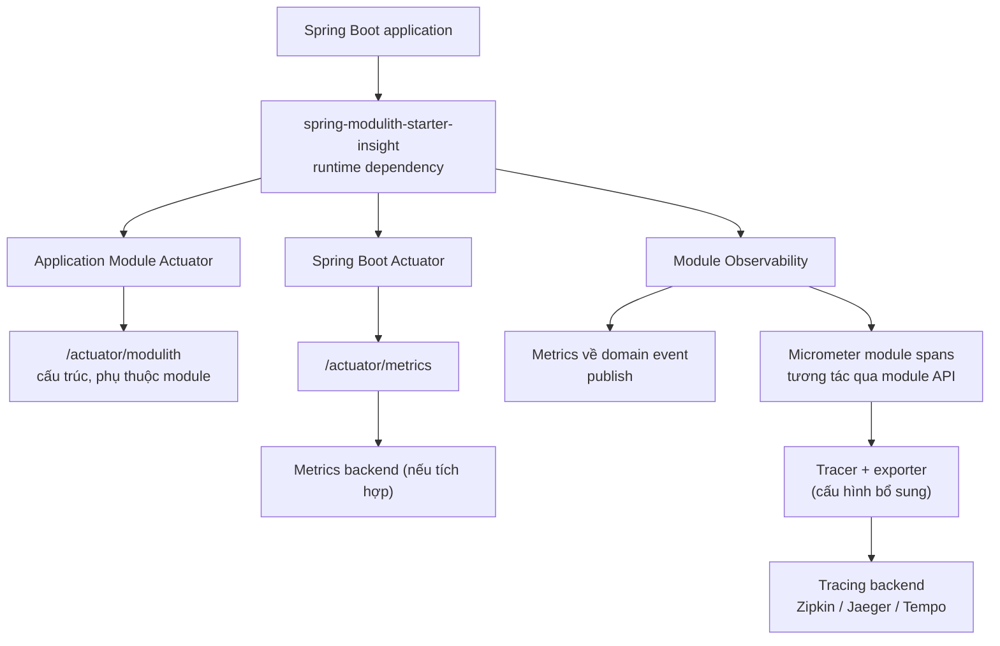
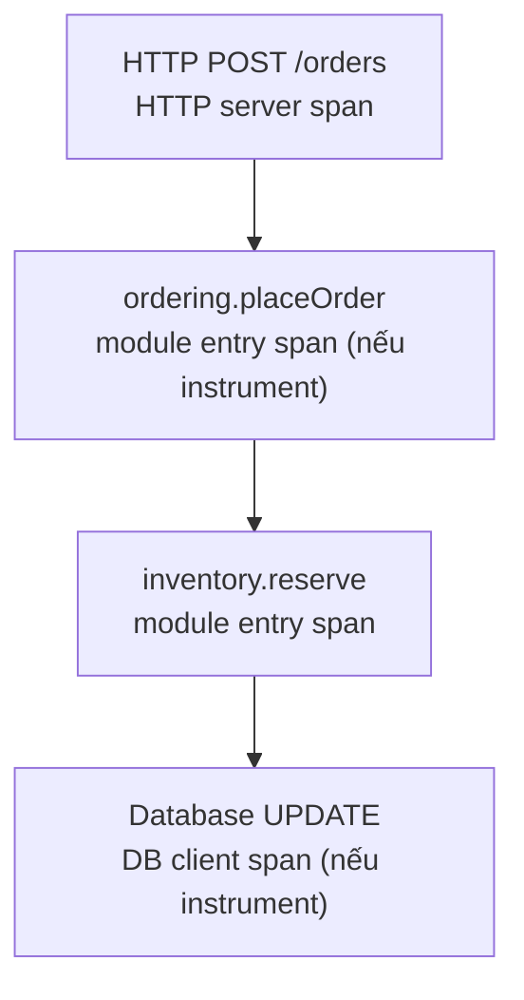
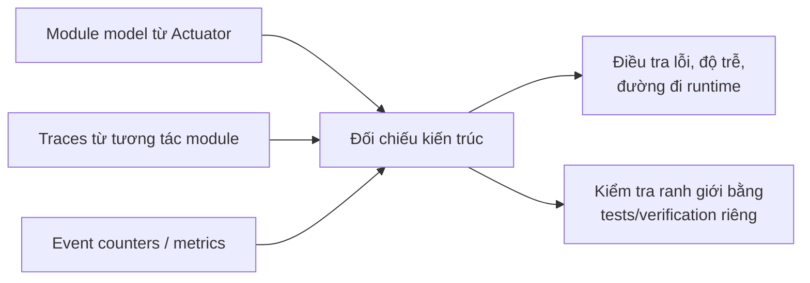

# Phạm vi runtime của Spring Modulith Insight starter

## 1. Insight starter giải quyết vấn đề gì?

Một ứng dụng **Spring Boot** được thiết kế theo **Spring Modulith** có thể chia thành các application module như `ordering`, `inventory` và `payment`. Nhìn vào mã nguồn hoặc module graph, ta biết module nào tồn tại và phụ thuộc vào module nào. Nhưng sau khi triển khai, nhóm phát triển còn phải trả lời các câu hỏi khác:

- Ứng dụng đang nhận diện những application module nào?
- Lúc thực thi, lời gọi nào đi vào API của từng module?
- Một luồng đặt hàng đã đi qua các module nào, tốn bao nhiêu thời gian?
- Các domain event được publish với tần suất ra sao?

**`spring-modulith-starter-insight`** gom hai nhóm năng lực phục vụ vận hành: **Application Module Actuator** để công bố cấu trúc module dưới dạng dữ liệu và **module observability** để quan sát tương tác giữa các module cùng các phép đo liên quan đến sự kiện. Nó cũng kéo theo Spring Boot Actuator để cung cấp hạ tầng quản trị và quan sát cơ bản.

Ở đây, **“phạm vi runtime”** có hai ý quan trọng:

1. Starter thường được khai báo với dependency scope `runtime` (Maven) hoặc `runtimeOnly` (Gradle), vì các chức năng chính được kích hoạt khi ứng dụng khởi động và chạy.
2. Dữ liệu mà starter cung cấp là **mô hình module được nạp lúc chạy, telemetry của tương tác đã được instrument và event metrics**. Đây không phải công cụ tự động tạo báo cáo kiến trúc tĩnh hay một hệ thống tracing/monitoring hoàn chỉnh.

> **Mục tiêu bài học:** xác định chính xác Insight mang gì vào runtime, cái gì quan sát được, cái gì chưa được đảm bảo, và cách chứng minh chức năng thực sự hoạt động trong một ứng dụng Spring Boot.

## 2. Insight mang những thành phần nào vào ứng dụng?

Theo cấu trúc dependency của Spring Modulith, một starter Insight thường bao gồm:

| Thành phần | Vai trò khi ứng dụng chạy |
| --- | --- |
| `spring-modulith-starter-insight` | Dependency tổng hợp để kích hoạt khả năng nhìn thấy cấu trúc và tương tác của application module |
| `spring-modulith-actuator` | Đăng ký endpoint Actuator `modulith` nhằm cung cấp mô hình module và các phụ thuộc |
| `spring-modulith-observability-core` | Cung cấp hạ tầng instrumentation của module, bao gồm việc chặn lời gọi tại API module và tích hợp quan sát qua Micrometer |
| `spring-modulith-observability-api` | Các kiểu API để tùy biến convention và event metrics; nếu trực tiếp tham chiếu từ mã nguồn, cần khai báo API thích hợp ở compile scope |
| `spring-boot-starter-actuator` | Kích hoạt nền tảng endpoint quản trị và metrics/observability của Spring Boot |
| Hạ tầng module model của Spring Modulith (transitive) | Phát hiện và nạp thông tin application module để Actuator và instrumentation sử dụng |

Sơ đồ triển khai khái niệm:



**Đọc sơ đồ đúng cách:** Starter cung cấp điểm instrument và tích hợp Actuator, nhưng muốn thấy trace trên một tracing backend thì vẫn phải bổ sung bridge, exporter và cấu hình tương ứng. Tương tự, muốn scrape Prometheus cần có registry cho Prometheus; bản thân Insight không cung cấp máy chủ Prometheus.

### 2.1. Thêm dependency vào dự án

Ví dụ **Gradle Kotlin DSL**, khi dự án đã quản lý phiên bản Spring Modulith bằng BOM hoặc dependency management tương thích:

```kotlin
dependencies {
    runtimeOnly("org.springframework.modulith:spring-modulith-starter-insight")
}
```

Tương đương trong **Maven**:

```xml
<dependency>
    <groupId>org.springframework.modulith</groupId>
    <artifactId>spring-modulith-starter-insight</artifactId>
    <scope>runtime</scope>
</dependency>
```

Nếu dự án **chưa** khai báo cơ chế quản lý version, cần chỉ định phiên bản Spring Modulith tương thích với Spring Boot đang dùng. Không tùy tiện trộn các phiên bản khác nhánh. Các đoạn trên cố ý không ghim version để phù hợp với dependency management đã có.

Vì Gradle `runtimeOnly` không đưa dependency vào compile classpath của mã ứng dụng, **nếu muốn tự định nghĩa bean tùy biến dùng lớp `ModulithObservationConvention` hoặc `ModulithEventMetricsCustomizer`**, cần khai báo thêm API phù hợp ở `implementation`/compile scope theo phiên bản sử dụng. Còn để chỉ bật instrumentation mặc định, dependency runtime thường là lựa chọn được tài liệu khuyến nghị.

## 3. Phạm vi thứ nhất: nhìn thấy mô hình application module tại runtime

Spring Modulith sử dụng mô hình `ApplicationModules` để xác định các module và quan hệ của chúng. Với Insight, thông tin này có thể được cung cấp qua endpoint Actuator có ID **`modulith`**.

Ví dụ ứng dụng có base package `com.example.shop` và các module `ordering`, `inventory`. Sau khi bật endpoint và exposure cần thiết:

```bash
curl http://localhost:8080/actuator
curl http://localhost:8080/actuator/modulith
```

Một đoạn JSON **minh họa** từ `/actuator/modulith` có thể như sau:

```json
{
  "inventory": {
    "displayName": "Inventory",
    "basePackage": "com.example.shop.inventory",
    "dependencies": []
  },
  "ordering": {
    "displayName": "Ordering",
    "basePackage": "com.example.shop.ordering",
    "dependencies": [
      {
        "target": "inventory",
        "types": ["USES_COMPONENT"]
      }
    ]
  }
}
```

Các trường quan trọng:

| Trường trong JSON | Ý nghĩa |
| --- | --- |
| Key module, ví dụ `ordering` | Định danh kỹ thuật của application module |
| `displayName` | Tên module dễ đọc |
| `basePackage` | Package gốc của module |
| `dependencies[].target` | Module đích của một quan hệ phụ thuộc |
| `dependencies[].types` | Loại quan hệ: `DEFAULT`, `USES_COMPONENT` hoặc `EVENT_LISTENER` |
| `parent` / `nested` (nếu có) | Quan hệ module cha-con, trong trường hợp dùng nested modules |

**Điều endpoint này khẳng định được:** tại thời điểm mô hình được nạp, Spring Modulith nhận diện cấu trúc và phụ thuộc như đã thể hiện. Ví dụ `ordering` có dependency đến `inventory` thông qua một Spring component.

**Điều endpoint không khẳng định được:** lời gọi ấy đã thực sự chạy lúc 09:00, chạy mấy lần, mất bao lâu hoặc có gây lỗi không. Endpoint là biểu diễn cấu trúc của ứng dụng đang vận hành; nó **không phải** trace các request cụ thể.

### 3.1. Endpoint tồn tại chưa có nghĩa đã truy cập được qua HTTP

Actuator phân biệt việc endpoint được đăng ký với việc endpoint được **expose qua web**. Với ứng dụng thử nghiệm, có thể cấu hình:

```yaml
management:
  endpoints:
    web:
      exposure:
        include: health, info, modulith, metrics
```

`/actuator/modulith` chỉ truy cập qua HTTP khi endpoint được enable, được expose và truy cập được theo cấu hình mạng/bảo mật. `management.endpoints.web.base-path` hoặc cổng management riêng cũng có thể làm URL khác ví dụ.

Trong production, dữ liệu về module, package và dependencies có thể là thông tin kiến trúc nội bộ. Chỉ mở endpoint này cho người vận hành hoặc hệ thống được cấp quyền; không công khai toàn bộ Actuator cho Internet chỉ để kiểm tra Insight.

Một lưu ý đặc biệt: nếu dự án **tùy biến quy tắc phát hiện application module**, phần cấu hình ấy phải hiện diện trong nguồn production (hoặc nguồn được nạp ở runtime). Tùy biến chỉ nằm trong test sẽ không tự được Insight sử dụng khi chạy ứng dụng thật.

## 4. Phạm vi thứ hai: instrument tương tác qua API module

Điểm mạnh còn lại của Insight là **module observability**. Spring Modulith có thể áp dụng aspect lên các Spring component thuộc **API của application module** để chặn lời gọi và tạo Micrometer spans; từ đó có thể dựng đường đi qua các module trong một trace.

Giả sử:

- `ordering` tiếp nhận yêu cầu đặt hàng.
- `ordering` gọi một Spring component được công bố trong API của `inventory` để giữ hàng.
- `inventory` gọi một repository nội bộ để cập nhật số lượng tồn kho.

Khi instrumentation, tracing và context được cấu hình phù hợp, một trace minh họa có thể được tổ chức như sau:



Trong trường hợp `inventory.reserve` là lời gọi tới thành phần API có instrumentation, nó có thể sinh một **module entry span**. Theo tài liệu Spring Modulith, các tag tiêu biểu của span này gồm:

| Tag | Ý nghĩa |
| --- | --- |
| `module.identifier` | Định danh application module |
| `module.name` | Tên hiển thị của module |
| `module.invocation-type` | Kiểu tương tác, chẳng hạn `bean` hoặc `event listener` |
| `module.method` | Method được thực thi trong module |

Những metadata đó giúp liên hệ **công việc thực thi** với **ranh giới module**. Khi thấy span của `inventory` tiêu tốn phần lớn thời gian, nhóm phát triển biết nên điều tra phần inventory trước.

### 4.1. Ranh giới instrument cần hiểu chính xác

Không nên suy ra rằng Insight:

- Tạo span cho **mọi method Java**, mọi constructor hoặc mỗi lời gọi tới class nội bộ của module.
- Tự động trace đoạn mã tạo trực tiếp bằng `new` ngoài Spring container.
- Luôn quan sát được lời gọi nội bộ không đi qua proxy/aspect tương ứng, chẳng hạn một số trường hợp self-invocation.
- Bảo đảm mọi span đều tồn tại trong tracing backend, dù sampling hoặc exporter bị tắt.

Điểm instrument chính được tài liệu mô tả là **Spring component thuộc API module**. Những lời gọi khác chỉ xuất hiện nếu có instrumentation riêng (ví dụ HTTP, database, message client). Điều này khác với việc mặc định trace toàn bộ mã nguồn.

### 4.2. Observation, span và trace liên quan ra sao?

**Micrometer Observation** là lớp API bao quanh thao tác và chuyển vòng đời cho các handler. Một handler có thể ghi metric, handler tracing có thể tạo span. Mỗi **span** mô tả một lần thực thi cụ thể; các spans có liên hệ được gom thành một **trace**. Trong khi đó, một **meter** như Counter/Timer tổng hợp nhiều lần thực thi để quan sát xu hướng.

Vì vậy:

- `/actuator/modulith` cho thấy mô hình module, không hiển thị từng trace.
- Module entry span cho thấy một tương tác đã được instrument khi chạy.
- Trace viewer bên ngoài ứng dụng giúp xem các span theo `traceId`.
- Metrics là nguồn tốt để đếm hoặc giám sát xu hướng, không thay thế cây span của một request.

### 4.3. Async event và context propagation

Ví dụ `ordering` publish `OrderPlaced`, còn `notification` nhận event rồi gửi thông báo. Listener có thể được thực thi không đồng bộ hoặc sau khi transaction đã kết thúc. Nếu không có context propagation phù hợp, span listener có thể không nối với trace của yêu cầu đặt hàng ban đầu.

Muốn tiếp tục ngữ cảnh qua `@Async`, `Executor`, Reactor hoặc message broker, cần cơ chế capture/restore hoặc inject/extract trace context tương thích với stack sử dụng. Với broker, header như W3C `traceparent` có thể được dùng nếu instrumentation của producer/consumer hỗ trợ.

**Insight cung cấp instrumentation ở ranh giới module; nó không bảo đảm mọi ranh giới thread, transaction và tiến trình tự động truyền trace context.** Để kết luận luồng event có nối trace hay không, phải quan sát trace thật.

## 5. Phạm vi thứ ba: metrics của domain event

Tài liệu Spring Modulith mô tả hai nhóm counter cho **domain event đã được publish**:

| Meter | Công dụng |
| --- | --- |
| `module.events.published` | Counter tổng hợp số lượt publish domain event |
| `module.events.published.$moduleIdentifier.$simpleEventTypeName` | Counter riêng cho một loại event thuộc một module, có khả năng bổ sung thông tin nghiệp vụ |

Trong nhóm tổng hợp, các low-cardinality keys được tài liệu liệt kê là `module.event.type`, `module.identifier` và `module.name`. Với metric theo event riêng, các key cơ bản là `module.identifier` và `module.name`.

Ví dụ `ordering` publish `OrderPlaced` nhiều lần, đội vận hành có thể đo lưu lượng event từ module ordering. Cần phân biệt rõ các chỉ số:

- **Số event đã publish** không đồng nghĩa số event đã xử lý thành công bởi tất cả listener.
- Counter publish không thay thế trạng thái **Event Publication Registry** của Spring Modulith khi cần xác minh xử lý bền vững, completion hoặc khả năng phát lại.
- Counter có thể bị đặt tên hoặc chuyển đổi theo convention của backend, vì vậy cần kiểm tra danh sách meter thực tế trước khi viết dashboard.

Nếu cần thêm tag nghiệp vụ cho counter theo event, Spring Modulith cung cấp API `ModulithEventMetricsCustomizer`. Chẳng hạn gắn `channel=web/mobile` nếu tập giá trị được kiểm soát. Không gắn `orderId` hoặc ID khách hàng thành metric tag: số lượng time series sẽ phình to do cardinality lớn. Mã tùy biến này cần `spring-modulith-observability-api` có mặt ở compile classpath.

### 5.1. Đọc event metrics qua Actuator

Khi metrics được đăng ký và endpoint `metrics` đã expose, có thể bắt đầu bằng:

```bash
curl http://localhost:8080/actuator/metrics
curl http://localhost:8080/actuator/metrics/module.events.published
```

Tên meter theo event riêng phụ thuộc định danh module và tên class event của ứng dụng. Hãy liệt kê các meter đang tồn tại rồi truy vấn đúng tên thay vì đoán. Nếu không có event được publish, metric cần kiểm tra có thể chưa hình thành hoặc chưa được ghi số liệu.

## 6. Những chức năng **không** được Insight tự cung cấp

Một lỗi thiết kế thường gặp là xem starter Insight như trọn bộ “giám sát và bảo đảm kiến trúc”. Bảng sau tách rõ phạm vi:

| Nhu cầu | Insight cung cấp? | Thành phần/công việc cần thêm |
| --- | --- | --- |
| Công bố module graph dạng JSON tại runtime | **Có**, qua `modulith` Actuator | Bật exposure, kiểm soát quyền truy cập |
| Instrument lời gọi tại API module | **Có**, khi điều kiện instrumentation được thỏa mãn | Cấu hình tracing/metrics phù hợp để quan sát kết quả |
| Ghi nhận counters về domain event publish | **Có**, theo hỗ trợ observability | Metrics registry và backend nếu muốn dashboard/alert |
| Xem trace trên Zipkin, Jaeger, Tempo | **Chưa đủ** | Tracing bridge, exporter, backend, sampling và propagation |
| Xem Prometheus metrics tại `/actuator/prometheus` | **Chưa đủ** | Micrometer Prometheus registry và endpoint exposure |
| Sinh file tài liệu module diagram/canvas | **Không thuộc tác vụ runtime của Insight** | `spring-modulith-docs` / `Documenter`, thường chạy ở test/build |
| Kiểm tra mọi dependency có vi phạm module boundary | **Không tự thay thế kiểm thử kiến trúc** | `ApplicationModules.verify()`, `@ApplicationModuleTest` hoặc runtime verification được cấu hình riêng |
| Bảo đảm event không bị mất, có retry và publication log bền vững | **Không phải nhiệm vụ của Insight** | Event Publication Registry và module persistence tương ứng như JDBC/JPA |
| Quan sát mọi method và tự nối mọi async trace | **Không** | Chọn instrumentation điểm cần thiết và cấu hình context propagation |

Một ứng dụng có thể **vừa** dùng Insight cho quan sát runtime, **vừa** dùng `Documenter` để sinh tài liệu kiến trúc, **vừa** chạy kiểm thử module, **vừa** dùng event publication registry. Các thành phần này giải quyết những câu hỏi khác nhau.

## 7. Thiết lập một môi trường quan sát tối thiểu

Giả sử dự án đã có Spring Boot, các application module và dependency Insight. Để kiểm tra mô hình module và metric:

```yaml
management:
  endpoints:
    web:
      exposure:
        include: health, info, modulith, metrics, prometheus
```

`prometheus` trong danh sách chỉ có tác dụng khi thêm **registry Prometheus** tương ứng. Với Gradle, ví dụ:

```kotlin
dependencies {
    runtimeOnly("org.springframework.modulith:spring-modulith-starter-insight")
    runtimeOnly("io.micrometer:micrometer-registry-prometheus")
}
```

Đoạn ví dụ giả định version đã được quản lý. Muốn có trace thực tế, cần bổ sung dependencies tracing và exporter phù hợp với **phiên bản Spring Boot** và backend đã chọn (ví dụ Micrometer Tracing kết nối OpenTelemetry/OTLP). Cấu hình exporter không thể rút gọn thành một khóa YAML dùng chung cho tất cả phiên bản.

Khi kiểm thử trong local, có thể tăng sampling để dễ quan sát, nhưng tên property và cơ chế tích hợp phụ thuộc Boot version. Với các phiên bản sử dụng `management.tracing.sampling.probability`, cấu hình minh họa là:

```yaml
management:
  tracing:
    sampling:
      probability: 1.0
```

Đây là cấu hình phục vụ **thử nghiệm**, không phải giá trị khuyến nghị mặc định cho hệ thống lưu lượng lớn.

### 7.1. Quy trình kiểm chứng

**Bước 1 — Kiểm tra endpoint module.** Gọi `GET /actuator` rồi `GET /actuator/modulith`. Xác nhận có module `ordering`, `inventory` và quan hệ phụ thuộc đúng với thiết kế. Nếu endpoint không hiện, kiểm tra dependency, exposure, security và mô hình module.

**Bước 2 — Phát sinh lời gọi liên module.** Gọi API đặt hàng sao cho `ordering` thực sự dùng Spring bean thuộc API `inventory`. Phải có request chạy mới kỳ vọng xuất hiện span của tương tác đó.

**Bước 3 — Kiểm tra tracing backend.** Tìm trace của request, mở các span có `module.identifier`/`module.name`, đọc `module.invocation-type` và `module.method`. Nếu không thấy span, kiểm tra điểm instrument, tracer/exporter, sampling và context.

**Bước 4 — Publish domain event.** Gửi thao tác khiến ứng dụng phát `OrderPlaced`; kiểm tra `/actuator/metrics` và meter về publication. Đừng suy ra listener xử lý hoàn tất chỉ từ counter publish.

**Bước 5 — So sánh với tài liệu kiến trúc.** Module graph thể hiện phụ thuộc được phát hiện; trace thể hiện đường thực thi được ghi nhận; metrics phản ánh số liệu tổng hợp. Dùng cả ba để đánh giá hiện trạng một cách có căn cứ.



## 8. Những tình huống dễ hiểu sai

| Hiện tượng | Giải thích có thể xảy ra | Cách xác minh |
| --- | --- | --- |
| Đã thêm Insight nhưng `/actuator/modulith` trả 404 | Endpoint chưa được expose, disabled, base path/cổng khác, hoặc auto-configuration chưa được kích hoạt | Kiểm tra dependencies và cấu hình Actuator trước |
| `/actuator/modulith` có module nhưng trace không có span module | Thiếu tracing bridge/exporter, request chưa đi qua API module, bị sampling, instrumentation hoặc AOP không áp dụng | Tạo request mẫu, xem module API, kiểm tra exporter và backend |
| Chỉ thấy span HTTP, không thấy repository bên trong | Insight không có nhiệm vụ instrument mọi lời gọi nội bộ và database | Kiểm tra instrumentation database độc lập |
| Có event counter nhưng không chắc listener thành công | Counter đo lượt publish, không chứng minh hoàn thành công việc bất đồng bộ | Kiểm tra publication status, handler, logs và trace |
| Đường trace bị đứt khi chuyển sang event/async | Context không được propagate qua thread hoặc message | Kiểm tra cơ chế capture/restore hay inject/extract |
| Thấy dependency trong graph nhưng không thấy lời gọi trong trace | Dependency có thể tồn tại tĩnh dù không được thực thi trong request mẫu | Kiểm tra code và chạy kịch bản sử dụng dependency |
| Instrumentation xuất nhãn có quá nhiều giá trị | Thêm ID/giá trị động vào metric tags | Giới hạn low-cardinality tags, rà soát customizer |
| Local có endpoint, production thiếu một số module | Custom module detection chỉ cấu hình trong test hoặc cấu hình đóng gói khác | Đưa customization vào production sources và xác minh build/runtime |

## 9. Kết luận và cách nhớ phạm vi

Insight là **gói tích hợp runtime** để đặt câu hỏi về cấu trúc và hoạt động của application module ngay khi Spring Boot đang chạy:

1. **Actuator Modulith:** “Ứng dụng nhận diện những module và quan hệ phụ thuộc nào?”
2. **Observability tại module API:** “Lần xử lý được instrument này đã đi qua những ranh giới module nào?”
3. **Domain event metrics:** “Các event được publish với số lượng và đặc trưng nào?”

Để trả lời sâu hơn về trace, latency, event completion và tính hợp lệ của kiến trúc, cần nối Insight với **tracing backend, metrics registry, context propagation, event publication infrastructure và các bài kiểm thử kiến trúc** tương ứng. Sử dụng đúng ranh giới trách nhiệm giúp tránh hai kết luận sai phổ biến: “Đã có Insight là thấy được mọi lời gọi” và “Đã thấy module graph thì đã chứng minh mọi tương tác runtime đều đúng”.

### Tài liệu tham khảo

- [Spring Modulith — Production-ready Features](https://docs.spring.io/spring-modulith/reference/production-ready.html): Insight starter, Modulith Actuator, spans, tags, event publication metrics.
- [Spring Modulith — Appendix, Spring Modulith modules](https://docs.spring.io/spring-modulith/reference/appendix.html): các starter và artifact, dependency scope.
- [Spring Modulith — Fundamentals](https://docs.spring.io/spring-modulith/reference/fundamentals.html): khái niệm module API và phụ thuộc giữa các application module.
