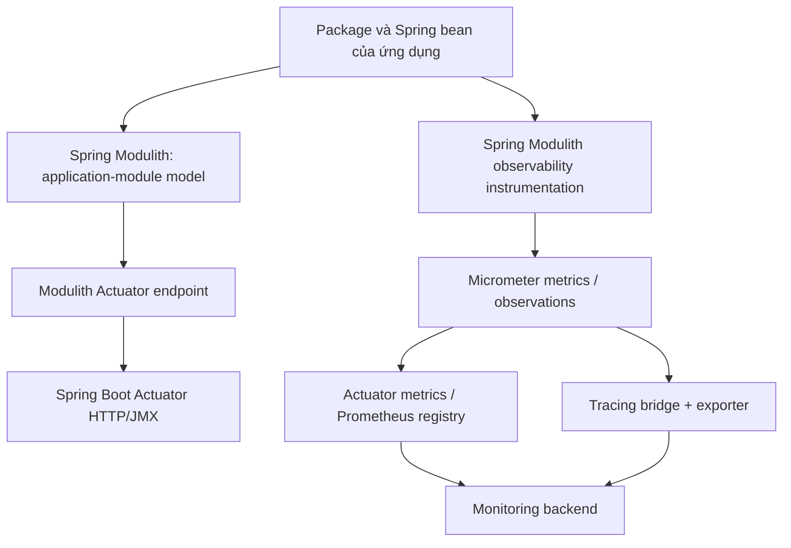
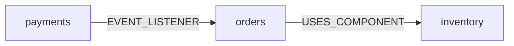

# Phối hợp với Spring Boot Actuator

## 1. Tại sao Insight starter cần Spring Boot Actuator?

Trong một ứng dụng Spring Boot được chia thành các **application module** bằng Spring Modulith, lập trình viên cần quan sát cả **cấu trúc dự kiến** lẫn **hành vi khi hệ thống chạy**. Ví dụ, nhóm phát triển có thể thiết kế ba module `orders`, `inventory` và `payments`. Sơ đồ kiến trúc nói rằng `orders` dùng API của `inventory` và phát sự kiện để `payments` xử lý. Nhưng khi triển khai, nhóm vận hành còn muốn biết:

- Phiên bản ứng dụng đang chạy thực sự nhận diện những module nào?
- Có quan hệ phụ thuộc ngoài dự kiến giữa các module không?
- Tần suất công bố domain event có thay đổi bất thường không?
- Một lần xử lý đơn hàng đã đi qua những điểm vào module nào, và bước nào chậm?

**Spring Modulith Insight starter** kết nối hai nhóm khả năng: công bố **metadata về application module** bằng Spring Boot Actuator, và tạo **dữ liệu observability** về các tương tác module bằng Micrometer. Actuator là giao diện kiểm tra/vận hành; metadata Modulith và các observation cung cấp dữ liệu cho giao diện đó hoặc cho hệ thống monitoring liên quan.

Bài này thuộc chương **Insight starter**, trong module học **SPRING_MODULITH_DOCUMENTATION_OBSERVABILITY**: dùng Spring Modulith để sinh tài liệu ranh giới application module và quan sát tương tác giữa các phần trong Spring Boot. Trọng tâm bài là **phối hợp với Spring Boot Actuator**, bao gồm cách kích hoạt, cấu hình endpoint, đọc dữ liệu, bảo vệ bề mặt quản trị và kiểm chứng kết quả.

Sau bài học, người học cần giải thích được vì sao `/actuator/modulith` khác `/actuator/metrics`, cách expose endpoint có kiểm soát, cách xác định dữ liệu event metrics có thực sự được ghi nhận và cách lần theo nguyên nhân khi thiếu metrics hoặc tracing.

## 2. Mô hình tích hợp: mỗi thành phần chịu trách nhiệm gì?

| Thành phần | Vai trò trong bài | Có làm được gì? |
| --- | --- | --- |
| **Spring Modulith Core** | Phát hiện module và phân tích các quan hệ trong mã nguồn | Mô hình module, API công khai, phụ thuộc module |
| **Spring Modulith Actuator** | Đưa mô hình module vào một endpoint Actuator | Cấu trúc module qua `/actuator/modulith` |
| **Spring Modulith Observability** | Instrument một số điểm tương tác module và sự kiện | Module-entry spans, event-publication metrics |
| **Spring Boot Actuator** | Cung cấp hạ tầng endpoint quản trị | `/actuator/health`, `/actuator/metrics`, các endpoint được đăng ký |
| **Micrometer** | Định nghĩa và thu thập meter/observation/trace | Counter, timer, tags, trace/span |
| **Prometheus, Grafana, Tempo, Zipkin...** | Thu thập, lưu trữ hoặc hiển thị tín hiệu | Biểu đồ theo thời gian, truy vấn metric, phân tích traces |



Có hai luồng thông tin cần tách biệt:

1. **Luồng kiến trúc:** Mô hình application module được xây từ mã nguồn và công bố qua `modulith` endpoint. Nó trả lời câu hỏi *hệ thống được chia như thế nào*.
2. **Luồng thực thi:** Instrumentation ghi nhận những sự kiện/lời gọi thực sự xảy ra. Micrometer đưa số đo vào registry và gửi trace qua hạ tầng đã cấu hình. Nó trả lời câu hỏi *hệ thống hoạt động như thế nào*.

Vì vậy, **thấy quan hệ `orders → inventory` trong JSON không đồng nghĩa đã có lời gọi runtime**, cũng như **không thấy trace** chưa đủ chứng minh không có tương tác.

## 3. Khởi tạo dependency đúng cách

### 3.1. Phương án gọn: dùng Insight starter

Với dự án Spring Boot đã quản lý các phiên bản dependency tương thích, thêm Spring Modulith Insight starter. Ví dụ Gradle Groovy:

```groovy
dependencies {
    runtimeOnly 'org.springframework.modulith:spring-modulith-starter-insight'
}
```

Starter này gom các phần cần thiết cho bài toán insight:

- `spring-modulith-actuator` để cung cấp endpoint mô tả module.
- `spring-modulith-observability-core` và API liên quan để quan sát tương tác.
- `spring-boot-starter-actuator` để cung cấp hạ tầng Actuator của Spring Boot.

Các artifact và phân chia module có thể khác nhau giữa những dòng phiên bản Spring Modulith. Hãy sử dụng **BOM/dependency management của dự án** tương ứng với phiên bản Spring Boot đã chọn, thay vì đoán phiên bản riêng cho từng JAR.

**Chú ý:** Insight starter đưa những chức năng trên vào runtime; nó **không tự cấu hình mọi hệ thống giám sát bên ngoài**. Nếu cần xuất metrics cho Prometheus hoặc traces cho Tempo/Zipkin, vẫn phải bổ sung registry, tracing bridge và exporter tương ứng.

### 3.2. Phương án tách riêng khi chỉ cần Actuator

Nếu chỉ muốn kiểm tra metadata application module, không cần bật toàn bộ tính năng insight, có thể dùng:

```groovy
dependencies {
    runtimeOnly 'org.springframework.modulith:spring-modulith-actuator'
    runtimeOnly 'org.springframework.boot:spring-boot-starter-actuator'
}
```

Đây là **phương án thay thế** cho starter insight ở bước khởi tạo. Không cần khai báo đồng thời starter insight và toàn bộ dependency con khi chúng đã được starter kéo vào.

Nếu cần xem số đo dạng Prometheus, bổ sung dependency tùy chọn:

```groovy
dependencies {
    runtimeOnly 'io.micrometer:micrometer-registry-prometheus'
}
```

Trên thực tế, project phải có Spring Boot application, các module nghiệp vụ và cơ chế quản lý phiên bản dependency phù hợp. Chỉ chép những dòng Gradle trên vào một dự án trống chưa tạo được một ứng dụng Spring Modulith hoàn chỉnh.

## 4. Cấu hình Actuator để truy cập thông tin Modulith

### 4.1. Endpoint tồn tại và endpoint được expose là hai việc khác nhau

Spring Boot Actuator hỗ trợ các endpoint phục vụ quản trị. Với ứng dụng web, địa chỉ thường có dạng:

```text
http://localhost:8080/actuator/{endpoint-id}
```

Có thể xem ba lớp điều kiện để một endpoint truy cập được từ bên ngoài:

1. **Đã có thành phần tạo endpoint:** Ví dụ, muốn có `modulith` phải có hỗ trợ Modulith Actuator tương ứng.
2. **Endpoint được phép truy cập và expose:** Cấu hình access/enablement và `management.endpoints.web.exposure` quyết định endpoint có sẵn qua HTTP hay không.
3. **Yêu cầu vượt qua lớp bảo mật:** Spring Security, proxy, firewall hoặc chính sách của hệ thống phải cho phép người gọi.

Theo mặc định của Spring Boot, HTTP exposure chủ yếu chỉ công bố `health`. Vì vậy, thêm Insight starter **không có nghĩa** một client bên ngoài sẽ lập tức gọi được `/actuator/modulith`.

### 4.2. Ví dụ cấu hình dành cho môi trường local

```yaml
management:
  endpoints:
    web:
      exposure:
        include: "health,info,modulith,metrics"
```

Cấu hình trên chọn các endpoint cần quan sát trong bài học. Nếu ứng dụng đã cung cấp và cho phép các endpoint đó, URL thường là:

| URL | Thông tin chính |
| --- | --- |
| `GET /actuator` | Discovery links của các endpoint đang được expose; có thể chứa khóa `modulith` |
| `GET /actuator/health` | Tình trạng sức khỏe ứng dụng |
| `GET /actuator/info` | Thông tin chung do các `InfoContributor` cung cấp |
| `GET /actuator/modulith` | Module, base package và quan hệ phụ thuộc |
| `GET /actuator/metrics` | Danh sách tên meter đang được đăng ký |
| `GET /actuator/metrics/{name}` | Giá trị hiện có của một meter, có thể lọc theo tag |

Để expose `prometheus`, cần **cả registry Prometheus và tên endpoint trong danh sách expose**:

```yaml
management:
  endpoints:
    web:
      exposure:
        include: "health,info,modulith,metrics,prometheus"
```

Chỉ thêm chuỗi `prometheus` vào cấu hình mà thiếu dependency registry sẽ không tự sinh số đo ở endpoint đó.

### 4.3. Khi thay đổi cổng hoặc base path

Spring Boot cho phép triển khai cổng quản trị riêng và thay đổi base path:

```yaml
management:
  server:
    port: 9090
  endpoints:
    web:
      base-path: "/manage"
      exposure:
        include: "health,modulith,metrics"
```

Khi ứng dụng được cấu hình như trên, kiểm tra `http://localhost:9090/manage/modulith`, **không** còn dùng `http://localhost:8080/actuator/modulith`. Đây chỉ là minh họa routing: triển khai thật cần bảo vệ cổng quản trị ở cấp mạng, proxy và ứng dụng.

Khi không tìm thấy endpoint, hãy xác nhận trước **đúng host, port và base path** rồi mới kiểm tra dependency.

## 5. Khám phá endpoint và đọc module graph

### 5.1. Quy trình gọi từ Actuator

Sau khi khởi động ứng dụng, gọi discovery endpoint:

```bash
curl -i http://localhost:8080/actuator
```

Nếu được công bố và cấu hình discovery phù hợp, response `_links` có mục tương tự:

```json
{
  "_links": {
    "health": {
      "href": "http://localhost:8080/actuator/health",
      "templated": false
    },
    "modulith": {
      "href": "http://localhost:8080/actuator/modulith",
      "templated": false
    }
  }
}
```

Đoạn JSON là **ví dụ rút gọn**; ứng dụng thực tế có thể hiển thị thêm link. Danh sách link phụ thuộc endpoint exposure, quyền truy cập và việc bật discovery.

Tiếp theo:

```bash
curl -i http://localhost:8080/actuator/modulith
```

Một response minh họa cho hệ thống bán hàng:

```json
{
  "inventory": {
    "displayName": "Inventory",
    "basePackage": "com.example.shop.inventory",
    "dependencies": []
  },
  "orders": {
    "displayName": "Orders",
    "basePackage": "com.example.shop.orders",
    "dependencies": [
      {
        "target": "inventory",
        "types": ["USES_COMPONENT"]
      }
    ]
  },
  "payments": {
    "displayName": "Payments",
    "basePackage": "com.example.shop.payments",
    "dependencies": [
      {
        "target": "orders",
        "types": ["EVENT_LISTENER"]
      }
    ]
  }
}
```

Đây là **dữ liệu giả lập để luyện đọc JSON**, không phải kết quả đo từ một ứng dụng đang chạy. Tên module, dependency và các trường có thể khác theo cấu trúc dự án/phiên bản Spring Modulith.

### 5.2. Các trường quan trọng

| Đường dẫn JSON | Cách hiểu |
| --- | --- |
| `$.orders` | Module có technical identifier là `orders` |
| `$.orders.displayName` | Tên hiển thị của module |
| `$.orders.basePackage` | Package gốc được xác định cho module |
| `$.orders.dependencies[]` | Các quan hệ phụ thuộc hướng **từ orders đến module khác** |
| `$.orders.dependencies[].target` | Tên module đích |
| `$.orders.dependencies[].types[]` | Phân loại quan hệ phụ thuộc, có thể gồm `DEFAULT`, `USES_COMPONENT`, `EVENT_LISTENER` |
| `$.orders.parent` / `$.orders.nested` | Thông tin module lồng nhau, nếu có |

Các loại dependency thường gặp:

- **`DEFAULT`:** Phụ thuộc kiểu dữ liệu Java thông thường.
- **`USES_COMPONENT`:** Sử dụng Spring component/bean của module khác.
- **`EVENT_LISTENER`:** Quan hệ liên quan tới listener của sự kiện công bố.

Một quan hệ có thể mang **nhiều loại**. Chẳng hạn `orders` vừa sử dụng bean từ `inventory`, vừa phụ thuộc vào kiểu dữ liệu được module đó công bố.

### 5.3. Từ dữ liệu JSON đến câu hỏi kiến trúc

Với ví dụ trên:



Dữ liệu này cho biết **Spring Modulith nhận diện quan hệ nào** tại phiên bản code đang chạy. Nó giúp:

- Đối chiếu các dependency của bản triển khai với tài liệu kiến trúc.
- Xác nhận một module mới đã được nhận diện đúng chưa.
- Kiểm tra hướng phụ thuộc trước khi quyết định tách hoặc tái cấu trúc module.
- Tìm các mối liên hệ bất ngờ để kiểm tra sâu trong mã nguồn.

Endpoint `modulith` **không đo số lần gọi**, **không thống kê độ trễ** và **không tự ngăn một phụ thuộc sai**. Muốn kiểm chứng quy tắc mô-đun, nên có kiểm thử kiến trúc với `ApplicationModules.verify()`; muốn xem hành vi runtime, tiếp tục dùng metrics và tracing.

### 5.4. Kiểm chứng cấu trúc bằng test

Ví dụ lớp kiểm thử trong một dự án có `spring-modulith-test` hoặc dependency cung cấp `ApplicationModules`:

```java
import org.junit.jupiter.api.Test;
import org.springframework.modulith.core.ApplicationModules;

class ModuleStructureTests {

    @Test
    void verifyModuleBoundaries() {
        ApplicationModules.of(ShopApplication.class).verify();
    }
}
```

Kiểm thử này nhằm phát hiện các vi phạm ranh giới module như dependency vòng hoặc truy cập thành phần nội bộ không được công bố. Nó bổ sung cho Actuator: test giúp kiểm tra **đúng/sai theo quy tắc**, còn Actuator cho phép **quan sát cấu trúc** của ứng dụng ở môi trường runtime.

## 6. Phối hợp với Actuator Metrics

### 6.1. Tại sao endpoint `metrics` quan trọng?

Insight starter có hỗ trợ observability để ghi nhận **domain event publication metrics**. Spring Modulith cung cấp các counter:

- `module.events.published`: tổng hợp các lần công bố domain event.
- `module.events.published.<moduleIdentifier>.<simpleEventTypeName>`: counter dành riêng cho loại event của một module.

Counter tổng hợp có thể gắn các low-cardinality keys như `module.identifier`, `module.name` và `module.event.type`. Counter riêng của event có thể dùng để theo dõi một loại nghiệp vụ cụ thể.

Ví dụ: Module `orders` công bố `OrderPlaced` khi nhận đơn thành công. Khi event thực sự được phát và phần observability được kích hoạt, hệ thống có thể ghi nhận lần công bố.

**Phân biệt:** Counter ghi nhận **publication** không chứng minh event đã được listener xử lý xong. Listener có thể thực thi bất đồng bộ, thất bại, thử lại hoặc phải đợi điều kiện giao dịch.

### 6.2. Cách kiểm tra metric qua HTTP

Bước đầu liệt kê meter:

```bash
curl http://localhost:8080/actuator/metrics
```

Tìm tên `module.events.published`. Nếu meter đã tồn tại:

```bash
curl http://localhost:8080/actuator/metrics/module.events.published
```

Khi cần lọc theo module:

```bash
curl "http://localhost:8080/actuator/metrics/module.events.published?tag=module.identifier:orders"
```

Với ứng dụng thử nghiệm, hãy chạy một nghiệp vụ tạo sự kiện trước khi truy vấn. Một số meter được tạo khi có hoạt động thực tế; endpoint `/actuator/metrics` có thể chưa liệt kê metric trong trạng thái hoàn toàn chưa có event.

Actuator Metrics endpoint thích hợp để **kiểm tra trực tiếp một snapshot meter**. Nó không thay thế kho lưu trữ time series. Để xem xu hướng nhiều giờ/ngày hoặc tạo cảnh báo, cần một backend như Prometheus và hệ thống hiển thị liên quan.

### 6.3. Minh họa công bố sự kiện

Ví dụ mã nghiệp vụ đặt trong module `orders`:

```java
package com.example.shop.orders;

import java.util.UUID;

public record OrderPlaced(UUID orderId) {
}
```

```java
package com.example.shop.orders;

import java.util.UUID;

import org.springframework.context.ApplicationEventPublisher;
import org.springframework.stereotype.Service;

@Service
public class OrderManagement {

    private final ApplicationEventPublisher events;

    public OrderManagement(ApplicationEventPublisher events) {
        this.events = events;
    }

    public void place(UUID orderId) {
        // Lưu đơn hàng theo logic nghiệp vụ của ứng dụng.
        events.publishEvent(new OrderPlaced(orderId));
    }
}
```

Đây là ví dụ tối giản để minh họa **nguồn tạo domain event**, không phải quy trình đặt hàng hoàn chỉnh. Phép đo event còn phụ thuộc cách instrumentation hoạt động và cấu hình application/module runtime. Khi kiểm tra production, phải xem thêm transaction, listener, xử lý lỗi và các event publication logs nếu ứng dụng có bật.

### 6.4. Prometheus cần registry và naming convention phù hợp

Sau khi có dependency `micrometer-registry-prometheus` và expose endpoint:

```bash
curl http://localhost:8080/actuator/prometheus
```

Đừng nhầm tên meter logic trong Micrometer với tên được xuất cho Prometheus. Backend có thể biến dấu chấm thành dấu gạch dưới và thêm hậu tố như `_total` cho counter theo quy ước đặt tên của registry. Khi tra `/actuator/metrics/{name}`, sử dụng **tên meter của Micrometer**; khi viết truy vấn PromQL, sử dụng **tên mẫu xuất thực tế** quan sát được từ `/actuator/prometheus`.

**Tránh high-cardinality tags:** `module.identifier=orders` là một tập giá trị nhỏ; `orderId=<UUID riêng cho từng đơn>` là tập giá trị có thể tăng không giới hạn. Không dùng ID của từng đơn hay email khách hàng làm tag metric.

## 7. Phối hợp Actuator với tracing và context propagation

### 7.1. Spring Modulith tạo ra những span nào?

Spring Modulith Observability có thể gắn aspect vào các Spring component nằm ở **API của application module**, ghi nhận lần đi vào module qua những điểm được hỗ trợ. Các attribute điển hình của module-entry span gồm:

| Attribute | Ý nghĩa |
| --- | --- |
| `module.identifier` | Định danh kỹ thuật module |
| `module.name` | Tên hiển thị module |
| `module.invocation-type` | Kiểu truy cập, ví dụ bean invocation hoặc event listener |
| `module.method` | Phương thức được thực thi |

Ví dụ một yêu cầu có thể tạo trace logic:

```text
HTTP POST /orders
└── orders.OrderManagement.place
    ├── inventory.InventoryManagement.reserve
    └── event OrderPlaced
        └── payments.PaymentListener.on
```

Sơ đồ này minh họa khả năng quan sát luồng công việc. Việc có những span thực tế nào phụ thuộc cách component được Spring quản lý, ranh giới API, thiết lập instrumentation và cơ chế thực thi của event listener. Một lời gọi Java nội bộ, tự gọi phương thức trên cùng object hoặc đoạn code không đi qua điểm instrument **không được bảo đảm** tạo span.

### 7.2. Actuator không tự là trace backend

Spring Boot Actuator tích hợp với Micrometer và cung cấp khả năng quản lý/kiểm tra. Tuy nhiên, việc nhìn thấy traces trong Zipkin, Tempo hoặc một nền tảng OpenTelemetry cần đủ các mảnh ghép:

1. Tracing bridge tương ứng với stack lựa chọn (ví dụ Micrometer Tracing qua OpenTelemetry).
2. Exporter và địa chỉ collector/backend có thể truy cập.
3. Cấu hình sampling, resource/service name và propagation phù hợp.
4. Tác vụ thật được instrument và tạo spans.

Bản thân việc gọi được `/actuator/modulith` **không có nghĩa** Zipkin/Tempo đã nhận trace. Cũng không nên mặc định rằng có một endpoint `/actuator/traces` trong mọi phiên bản Spring Boot hiện đại; dữ liệu distributed tracing thường được xuất sang backend chuyên dụng.

### 7.3. Context propagation khi có listener bất đồng bộ

Trong ứng dụng modular monolith, sự kiện có thể được listener xử lý ở thread khác. Một trace cha bắt đầu từ HTTP request có thể mất liên kết với xử lý sau đó nếu **trace context** không được chuyển sang executor hoặc pipeline bất đồng bộ.

Những điểm cần kiểm tra khi thấy một span “đứng riêng”:

- Listener có chạy đồng bộ, `@Async`, qua `@ApplicationModuleListener` hoặc bằng một executor riêng không?
- Executor có hỗ trợ cơ chế `ContextPropagatingTaskDecorator` hoặc cơ chế propagation tương ứng theo Spring Framework/Spring Boot đang dùng không?
- Tracing bridge và exporter có hoạt động không?
- Sampling có khiến một phần trace không được ghi/xuất không?
- Instrumentation có áp dụng cho đúng Spring bean/module API không?

Một lỗi propagation là vấn đề **giữ mối liên hệ giữa các bước quan sát**. Nó không tự chứng minh event bị mất hay listener không chạy. Muốn xác định xử lý thành công hay thất bại, cần đối chiếu trạng thái nghiệp vụ, logs và cơ chế theo dõi event publication của hệ thống.

## 8. Bảo vệ endpoint quản trị

Actuator có thể tiết lộ thông tin về môi trường, cấu hình và cấu trúc nội bộ. `/actuator/modulith` chứa tên module, base package và quan hệ phụ thuộc; dù chủ yếu là metadata, đây vẫn là thông tin kiến trúc cần kiểm soát.

Các nguyên tắc khi đưa lên môi trường thật:

- **Chỉ expose endpoint cần dùng.** Không đặt `include: "*"` trên một cổng Internet công khai chỉ để thuận tiện.
- **Áp dụng quyền truy cập.** Người dùng vận hành có thể cần `modulith` và `metrics`; người gọi từ Internet thường chỉ cần một health check giới hạn thông tin.
- **Giới hạn mạng.** Dùng mạng quản trị nội bộ, proxy hoặc network policy; nếu dùng cổng quản trị riêng, vẫn phải bảo vệ cổng đó.
- **Kiểm tra Spring Security.** Khi ứng dụng tự định nghĩa `SecurityFilterChain`, cấu hình bảo mật tự động của Actuator có thể không còn áp dụng; người phát triển phải tự bảo vệ các request matcher của endpoint.
- **Hạn chế dữ liệu lộ ra.** Không bổ sung bí mật, token, PII hoặc giá trị định danh vô hạn vào metric tags/trace attributes.
- **Theo dõi phiên bản ứng dụng.** Metadata của bản đang chạy cần được đối chiếu đúng commit/build với tài liệu được sinh ở CI.

Chỉ đặt `management.endpoints.web.exposure.include` không tương đương với thiết lập xác thực. **Exposure** là quyết định công bố endpoint; **authentication/authorization** là quyết định ai được phép gọi.

## 9. Bài thực hành: kiểm chứng Insight + Actuator theo từng lớp

Giả sử một ứng dụng có package gốc `com.example.shop`:

```text
com.example.shop
├── ShopApplication.java
├── orders
│   ├── OrderManagement.java
│   └── OrderPlaced.java
├── inventory
│   └── InventoryManagement.java
└── payments
    └── PaymentListener.java
```

Mục tiêu là xác định: bản chạy đã nhận diện các module đúng chưa, endpoint quản trị được expose đúng chưa, event metric có tăng sau nghiệp vụ không và trace có phản ánh tương tác giữa các module hay không.

### Bước 1 — Đưa Insight starter vào build

Thêm `spring-modulith-starter-insight` trong runtime dependencies, sử dụng Spring Modulith BOM phù hợp. Nếu định xuất Prometheus, thêm `micrometer-registry-prometheus`. Nếu muốn xem traces trong backend, cấu hình tracing bridge/exporter thích hợp với phiên bản Spring Boot.

**Dấu hiệu đúng:** Ứng dụng khởi động được, không báo lỗi resolve dependency hoặc bean configuration.

### Bước 2 — Chỉ expose các endpoint cần thiết

Dùng cấu hình local:

```yaml
management:
  endpoints:
    web:
      exposure:
        include: "health,info,modulith,metrics,prometheus"
```

Nếu chưa cài Prometheus registry, bỏ `prometheus` khỏi danh sách. Nếu cần quyền xác thực, chuẩn bị thông tin đăng nhập hợp lệ khi gọi Actuator.

### Bước 3 — Kiểm tra health và discovery

```bash
curl -i http://localhost:8080/actuator/health
curl -i http://localhost:8080/actuator
```

**Dấu hiệu đúng:** Health endpoint truy cập được theo chính sách đã cấu hình; discovery (nếu bật) cho thấy link `modulith`. Nếu không có link, xem lại exposure, access, đường dẫn và dependency.

### Bước 4 — Đối chiếu module metadata

```bash
curl http://localhost:8080/actuator/modulith
```

Đọc technical identifier của từng module, `basePackage`, `dependencies[].target` và `dependencies[].types`. Vẽ lại các cạnh và đối chiếu với sơ đồ tài liệu hoặc kết quả kiểm thử `ApplicationModules.verify()` của **cùng một phiên bản build**.

**Dấu hiệu đúng:** Các module và hướng phụ thuộc phản ánh cấu trúc mã đã triển khai.

### Bước 5 — Tạo event và kiểm tra metrics

Thực thi nghiệp vụ thử nghiệm có `ApplicationEventPublisher.publishEvent(new OrderPlaced(...))`, sau đó gọi:

```bash
curl http://localhost:8080/actuator/metrics
curl http://localhost:8080/actuator/metrics/module.events.published
```

Nếu có tag module `orders`:

```bash
curl "http://localhost:8080/actuator/metrics/module.events.published?tag=module.identifier:orders"
```

**Dấu hiệu đúng:** Meter được ghi nhận sau sự kiện và số đếm tăng theo số lần công bố đã instrument. Counter không dùng làm bằng chứng duy nhất rằng listener đã hoàn tất.

### Bước 6 — Kiểm tra tracing theo một lần xử lý

Nếu dự án cấu hình tracing backend, chạy cùng nghiệp vụ và tìm trace theo service name/timestamp/trace ID. Trong trace, xác định module-entry span và các attribute `module.identifier`, `module.invocation-type`, `module.method`.

**Dấu hiệu đúng:** Có thể nhận diện điểm vào module được instrument và liên kết giữa các đoạn xử lý. Với event bất đồng bộ, kiểm tra propagation nếu quan hệ cha–con bị đứt.

### Bước 7 — Kết luận từ nhiều nguồn

| Câu hỏi | Bằng chứng phù hợp | Không đủ nếu chỉ có |
| --- | --- | --- |
| Module nào tồn tại trong bản chạy? | `/actuator/modulith` | Logs khởi động thông thường |
| Phụ thuộc module có vi phạm quy tắc? | `ApplicationModules.verify()` + mã nguồn | HTTP 200 từ `/actuator/modulith` |
| Domain event được công bố bao nhiêu lần? | Counter `module.events.published` | Chỉ nhìn module graph |
| Listener xử lý thành công? | Kết quả nghiệp vụ, logs, state/event publication tracking | Chỉ counter publish |
| Bước nào chậm trong một lần xử lý? | Trace spans/timing và logs liên quan | Chỉ tên module trong Actuator |
| Lỗi có xu hướng tăng theo thời gian? | Metrics backend với dữ liệu chuỗi thời gian | Chỉ snapshot của `/actuator/metrics` |

## 10. Xử lý sự cố thường gặp

| Triệu chứng | Nguyên nhân khả dĩ | Thứ tự kiểm tra |
| --- | --- | --- |
| `/actuator/modulith` trả `404` | Thiếu dependency, endpoint không expose/không có access, sai port hoặc base path | Dependency → cấu hình management → địa chỉ thật → logs khởi động |
| `/actuator/modulith` trả `401` | Chưa xác thực | Cơ chế đăng nhập, header/token, cấu hình security |
| `/actuator/modulith` trả `403` | Đã nhận diện người gọi nhưng không đủ quyền hoặc bị security policy từ chối | Quy tắc authorization, role, proxy |
| `/actuator` không có link `modulith` | Endpoint không công bố, discovery bị giới hạn hoặc không có endpoint | Exposure/access/discovery và dependency |
| Module graph thiếu module mong đợi | Cách phát hiện application module không khớp với package/metadata | Package gốc, module detection customization, phiên bản build |
| `/actuator/metrics` không thấy `module.events.published` | Chưa phát event, instrumentation chưa hoạt động, meter chưa được tạo | Chạy tác vụ thử, kiểm tra starter/config và event publisher |
| `/actuator/prometheus` trả `404` | Thiếu Prometheus registry hoặc chưa expose | Registry dependency, `prometheus` endpoint và security |
| Actuator thấy metric nhưng Prometheus không thấy | Sai scrape target, cổng/base path, auth hoặc tên metric đã chuyển đổi | Đọc response `/actuator/prometheus` rồi kiểm tra scrape target |
| Không có trace ở backend | Thiếu tracing bridge/exporter, sai endpoint collector, sampling hoặc không có span phù hợp | Trace config → collector → sampling → instrumentation |
| Async listener bị tách thành trace khác | Thiếu context propagation hoặc listener tạo ngữ cảnh riêng | Executor/pipeline, tracing context và ranh giới async |

Chẩn đoán theo từng lớp sẽ nhanh hơn suy luận từ một dấu hiệu đơn lẻ. Ví dụ, `404` là lỗi **truy cập endpoint**, không phải bằng chứng Spring Modulith không có module. Và việc không tìm được trace trong backend không phải bằng chứng nghiệp vụ chưa chạy.

## 11. Các hiểu lầm cần tránh

1. **Insight starter = mọi dashboard đã có sẵn.** Starter cung cấp khả năng instrument và tích hợp; backend giám sát thường cần thêm dependency, endpoint và cấu hình.
2. **Actuator trả metadata nghĩa là kiến trúc hợp lệ.** `/actuator/modulith` trình bày mô hình nhận diện. Để kiểm tra ràng buộc nên dùng `ApplicationModules.verify()` và chính sách module rõ ràng.
3. **Đã expose metric thì lịch sử metric tự được lưu.** Actuator chủ yếu trình bày dữ liệu hiện tại; lưu trữ, tổng hợp và cảnh báo nhiều ngày cần monitoring backend.
4. **Counter sự kiện có thể xác định độ trễ listener.** Counter publication đếm sự kiện được công bố, không đo thời gian hoặc kết quả xử lý của listener.
5. **Không có span = không có lời gọi module.** Instrumentation chỉ áp dụng cho những điểm được hỗ trợ; sampling và exporter cũng ảnh hưởng đến trace hiển thị.
6. **Mở mọi endpoint là cách debug nhanh nhất.** Quá nhiều endpoint có thể lộ thông tin nội bộ. Cần xác thực và kiểm soát mạng ngay cả khi hệ thống chỉ dành cho vận hành.
7. **Cấu hình mẫu áp dụng nguyên vẹn mọi phiên bản.** Tên artifact, dependency management và thuộc tính access có thể khác theo dòng Spring Boot/Spring Modulith; đối chiếu tài liệu đúng phiên bản đang dùng.

## 12. Tự đánh giá

Hãy giải thích các tình huống sau bằng dữ liệu có thể kiểm chứng:

1. Vì sao thêm `spring-modulith-starter-insight` nhưng `GET /actuator/modulith` vẫn có thể trả về `404`?
2. `$.orders.dependencies[].types` có `USES_COMPONENT` cho biết điều gì? Nó có đo số lần gọi thực tế không?
3. Cần dùng `ApplicationModules.verify()` hay `/actuator/modulith` khi muốn phát hiện vi phạm ranh giới?
4. Vì sao `/actuator/metrics/module.events.published` có thể chưa có ngay khi vừa khởi động?
5. Cần bổ sung gì để metric hiển thị trong Prometheus và traces hiển thị trong Tempo/Zipkin?
6. Khi listener chạy async nhưng span không nằm cùng trace với HTTP request, những cấu hình nào đáng kiểm tra?
7. Tại sao không nên gắn `orderId` hoặc email khách hàng làm tag metric?
8. Khi triển khai cổng quản trị riêng, địa chỉ endpoint và cấu hình bảo mật cần thay đổi như thế nào?

Nếu trả lời được, người học có thể triển khai một chu trình quan sát tối thiểu: **xác định cấu trúc module bằng Actuator → xác minh bằng kiểm thử kiến trúc → kích hoạt nghiệp vụ → đọc event metrics/traces → đối chiếu hành vi thực tế với module graph**.

## 13. Nguồn tham khảo chính thức

- [Spring Modulith — Production-ready Features](https://docs.spring.io/spring-modulith/reference/production-ready.html): Insight starter, `modulith` endpoint, module spans và event metrics.
- [Spring Modulith — Appendix / module dependencies](https://docs.spring.io/spring-modulith/reference/appendix.html): thành phần đi kèm các starter.
- [Spring Modulith — Verifying Application Module Structure](https://docs.spring.io/spring-modulith/reference/verification.html): kiểm chứng dependency và API module.
- [Spring Boot — Actuator Endpoints](https://docs.spring.io/spring-boot/reference/actuator/endpoints.html): exposure, access, discovery, security.
- [Spring Boot — Metrics](https://docs.spring.io/spring-boot/reference/actuator/metrics.html): `MeterRegistry`, `/actuator/metrics`, Prometheus.
- [Spring Boot — Observability](https://docs.spring.io/spring-boot/reference/actuator/observability.html): observation và context propagation.
- [Spring Boot — Tracing](https://docs.spring.io/spring-boot/reference/actuator/tracing.html): Micrometer Tracing, bridge, exporter, sampling.

> **Ghi nhớ:** Insight starter nối Spring Modulith với Spring Boot Actuator và Micrometer, tạo một đường đi rõ ràng từ **mô hình cấu trúc module** tới **đo lường hành vi runtime**. Endpoint `/actuator/modulith` dùng để xem module graph; `/actuator/metrics` và các backend observability dùng để theo dõi hoạt động. Dữ liệu từ các nguồn này chỉ có ý nghĩa khi hiểu rõ dependency, exposure, security và phạm vi instrumentation.
