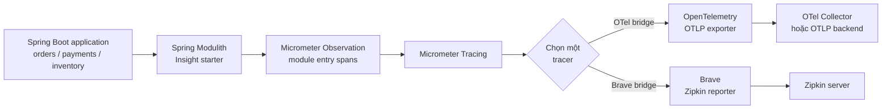
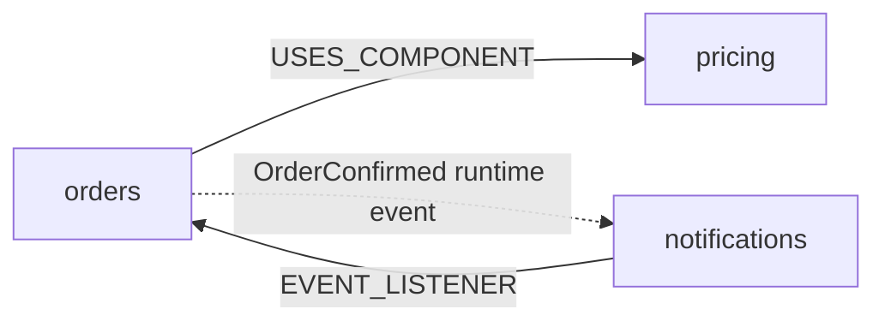

# Phối hợp với OpenTelemetry hoặc Brave

> **Chương:** Insight starter  
> **Bối cảnh:** Spring Modulith trong ứng dụng Spring Boot có nhiều application module. Bài học tập trung vào cách đưa dấu vết tương tác giữa các module tới hệ thống quan sát qua **OpenTelemetry** hoặc **Brave**, từ đó đối chiếu hành vi runtime với ranh giới kiến trúc.

## Mục tiêu học tập

Sau khi học, bạn có thể:

1. Giải thích vai trò của Spring Modulith Insight starter, Micrometer Observation, Micrometer Tracing, OpenTelemetry, Brave và hệ thống nhận trace.
2. Chọn **một** tuyến tracing phù hợp: OpenTelemetry → OTLP hoặc Brave → Zipkin, rồi cấu hình dependency và exporter đúng với phiên bản Spring Boot.
3. Đọc span đi vào application module, đặc biệt các tag `module.identifier`, `module.method` và `module.invocation-type`.
4. Giữ hoặc khôi phục trace context qua HTTP, `@Async`, `@ApplicationModuleListener`; không nhầm việc gửi event với bảo đảm xử lý thành công.
5. Chẩn đoán trường hợp module graph hiển thị bình thường nhưng không thấy trace, trace đứt nhánh hoặc log thiếu correlation ID.

## 1. Vì sao Insight starter cần OpenTelemetry hoặc Brave?

Spring Modulith xem ứng dụng như tập hợp **application module**. Nó có thể phát hiện ranh giới module, trình bày quan hệ phụ thuộc qua Actuator và ghi nhận tương tác của Spring component nằm trong API module. Khi một lời gọi đi vào module, phần observability của Modulith có thể tạo thông tin đo lường để quan sát phương thức được gọi, loại lời gọi và module đích.

Tuy nhiên, cần phân biệt:

- **Spring Modulith Insight starter:** kích hoạt hỗ trợ Actuator và instrumentation liên quan đến module; cung cấp thông tin *module nào đang được đi vào*.
- **Micrometer Observation:** mô hình thống nhất để tạo observation và metadata; kết nối khả năng đo lường với tracing.
- **Micrometer Tracing:** lớp API/bridge làm việc với trình truy vết cụ thể.
- **OpenTelemetry hoặc Brave:** phần triển khai tracing, tạo/quản lý span và trace context.
- **OTLP exporter hoặc Zipkin reporter:** gửi span ra bên ngoài.
- **Collector/backend/UI:** nhận, lưu và hiển thị trace để điều tra.



**Điểm cốt lõi:** Bạn không cần viết một bộ instrumentation riêng cho từng module chỉ để tạo module entry span. Spring Modulith cung cấp thông tin ngữ nghĩa của module; Micrometer và tracer chuyển thông tin đó thành trace có thể xuất đi. Chỉ thêm Insight starter **chưa đủ** để chắc chắn một trace xuất hiện trong Zipkin, Jaeger hay Grafana Tempo: còn phải có tracer bridge, exporter, cấu hình và backend đang hoạt động.

### 1.1. Module graph và trace trả lời hai câu hỏi khác nhau

| Dữ liệu | Câu hỏi trả lời | Không nên suy ra |
| --- | --- | --- |
| `/actuator/modulith` | Module nào phụ thuộc module nào, thuộc loại phụ thuộc nào? | Phụ thuộc đó đã được thực thi trong request vừa rồi. |
| Module entry span | Lời gọi nào đã vào module nào, kéo dài bao lâu? | Mọi method trong module đều có span riêng. |
| Trace theo `traceId` | Các span được liên kết thế nào trong một lần xử lý? | Mọi tác vụ async luôn nằm trong cùng trace cha. |
| `module.events.published` | Có bao nhiêu event đã được publish theo cơ chế đo lường? | Listener đã commit thành công. |
| Event publication registry, log và dữ liệu nghiệp vụ | Event còn chờ xử lý/retry không, kết quả thực tế thế nào? | Đây là dữ liệu tự động có sẵn chỉ nhờ exporter tracing. |

## 2. Chọn OpenTelemetry hay Brave

Hai lựa chọn cùng nhận thông tin quan sát từ Micrometer; khác nhau chủ yếu ở hệ sinh thái tracing và cách báo cáo dữ liệu.

| Tiêu chí | OpenTelemetry (OTel) | Brave |
| --- | --- | --- |
| Tích hợp Spring Boot | Micrometer Tracing bridge OTel; có starter chuyên dụng ở Boot 4.x | Micrometer Tracing bridge Brave; có starter Zipkin ở Boot 4.x |
| Tuyến xuất phổ biến | OTLP qua HTTP/gRPC đến Collector hoặc backend hỗ trợ OTLP | Zipkin reporter gửi span tới Zipkin API |
| Hệ thống nhận phù hợp | OTel Collector, Tempo, Jaeger hoặc nền tảng nhận OTLP | Zipkin; các nền tảng có đầu vào Zipkin tương thích |
| Propagation | Hỗ trợ W3C Trace Context và các cấu hình tương thích | Hỗ trợ W3C/B3 theo cấu hình framework |
| Cách chọn | Khi hạ tầng đã chuẩn hóa OTLP hoặc có Collector tập trung | Khi đang dùng Zipkin/Brave và muốn tích hợp trực tiếp |

**Một ứng dụng nên chọn một tracer bridge chính** cho đường tracing do Spring Boot quản lý. Đừng tùy tiện đặt cả `micrometer-tracing-bridge-otel` lẫn `micrometer-tracing-bridge-brave` lên classpath: lựa chọn auto-configuration sẽ trở nên khó kiểm soát và việc truy vết có nguy cơ trùng hoặc thiếu nhất quán.

Việc chọn OTel hay Brave **không thay đổi bản chất ranh giới application module**. Trong cả hai trường hợp, Modulith vẫn quan sát cùng các điểm vào module nếu instrumentation và môi trường thực thi tương đương.

## 3. Chuẩn bị nền tảng và phiên bản

Phần cấu hình dưới đây phân biệt hai nhánh vì **Spring Boot 3.5 và 4.x có dependency/properties tracing khác nhau**. Hãy dùng đúng nhánh khớp phiên bản ứng dụng; không ghép một nửa cấu hình Boot 3 với một nửa Boot 4.

Điều kiện chung:

1. Ứng dụng là Spring Boot có application module hợp lệ, xác định được từ package/metadata của Spring Modulith.
2. Dùng phiên bản Spring Modulith tương thích phiên bản Spring Boot; ưu tiên dependency management/BOM chính thức, tránh cố định version của từng artifact theo cảm tính.
3. Có hệ thống nhận trace đang chạy: ví dụ OTLP HTTP tại `localhost:4318` hoặc Zipkin tại `localhost:9411`.
4. Môi trường cho phép gửi dữ liệu từ ứng dụng tới endpoint exporter; Actuator được cấu hình hiển thị endpoint cần thiết để kiểm tra.

Trong các snippet Gradle bên dưới, **giả định Spring Boot và Spring Modulith BOM đã quản lý version**. Các tọa độ thiếu version là có chủ ý. Nếu chưa có dependency management phù hợp, hãy cấu hình BOM trước.

### 3.1. Insight starter cung cấp gì?

```groovy
dependencies {
    runtimeOnly 'org.springframework.modulith:spring-modulith-starter-insight'
}
```

Starter này kéo theo hỗ trợ Spring Boot Actuator, Spring Modulith Actuator và observability. Nhờ vậy, ứng dụng có thể công bố endpoint mô hình module `/actuator/modulith` và tạo module entry observation/span khi lớp tracing được cấu hình.

Để sử dụng riêng từng phần, dự án có thể khai báo `spring-modulith-actuator` hoặc `spring-modulith-observability-core`, nhưng khi học về **Insight starter**, chỉ cần starter là đường đi gọn nhất.

### 3.2. Các endpoint và tùy chọn thường dùng

Ví dụ chung cho môi trường thực hành:

```yaml
spring:
  application:
    name: shop-modulith

management:
  endpoints:
    web:
      exposure:
        include: health,info,modulith,metrics
  tracing:
    sampling:
      probability: 1.0
```

`spring.application.name` giúp các thành phần quan sát có tên dịch vụ dễ nhận diện. `sampling.probability: 1.0` cho phép lấy 100% mẫu trong lab; trên hệ thống thật phải cân nhắc lưu lượng, chi phí và chính sách bảo mật. `/actuator/modulith` là endpoint cấu trúc kiến trúc, **không phải** giao diện xem trace.

## 4. Phương án A — Spring Boot 3.5 + OpenTelemetry/OTLP

Thêm Insight starter cùng OTel bridge và OTLP exporter:

```groovy
dependencies {
    runtimeOnly 'org.springframework.modulith:spring-modulith-starter-insight'
    runtimeOnly 'io.micrometer:micrometer-tracing-bridge-otel'
    runtimeOnly 'io.opentelemetry:opentelemetry-exporter-otlp'
}
```

Trong `application.yml`, ngoài cấu hình chung ở mục 3.2:

```yaml
management:
  otlp:
    tracing:
      endpoint: http://localhost:4318/v1/traces
```

Địa chỉ trên giả sử Collector/backend đang mở **OTLP qua HTTP**. Cổng `4317` thường dùng cho OTLP gRPC; không tự đổi `4318/v1/traces` thành `4317/v1/traces` mà giữ nguyên exporter HTTP. Khi chạy trong Docker/Kubernetes, `localhost` trỏ tới chính container/pod ứng dụng, nên endpoint thường cần dùng tên service trong mạng.

Luồng dữ liệu:

```text
Modulith module entry observation
  -> Micrometer Tracing
  -> micrometer-tracing-bridge-otel
  -> OpenTelemetry SDK/OTLP exporter
  -> OTLP endpoint (Collector/Tempo/Jaeger...)
  -> trace UI
```

OpenTelemetry Collector là thành phần **tùy chọn**: nếu backend nhận OTLP trực tiếp thì exporter có thể kết nối thẳng. Khi dùng Collector, có thể bổ sung batching, lọc dữ liệu, giới hạn tài nguyên và định tuyến đến các hệ thống quan sát khác nhau.

## 5. Phương án B — Spring Boot 3.5 + Brave/Zipkin

Đổi tracer bridge và reporter:

```groovy
dependencies {
    runtimeOnly 'org.springframework.modulith:spring-modulith-starter-insight'
    runtimeOnly 'io.micrometer:micrometer-tracing-bridge-brave'
    runtimeOnly 'io.zipkin.reporter2:zipkin-reporter-brave'
}
```

Cấu hình endpoint Zipkin:

```yaml
management:
  zipkin:
    tracing:
      endpoint: http://localhost:9411/api/v2/spans
```

Nếu một ứng dụng không sử dụng Spring MVC hoặc WebFlux, một số tổ hợp Boot 3.x có thể cần thêm sender HTTP `io.zipkin.reporter2:zipkin-sender-urlconnection`. Hãy đối chiếu dependency với tài liệu đúng minor version của Spring Boot.

Luồng dữ liệu:

```text
Modulith module entry observation
  -> Micrometer Tracing
  -> micrometer-tracing-bridge-brave
  -> Zipkin reporter
  -> Zipkin API /api/v2/spans
  -> Zipkin UI
```

**Không cần viết code tracing dùng API riêng của Brave** chỉ để xem lời gọi giữa các module. Để giữ ứng dụng độc lập với bộ truy vết, ưu tiên Spring/Micrometer API khi cần quan sát bổ sung.

## 6. Nếu dự án dùng Spring Boot 4.x

Spring Boot 4.x cung cấp **starter chuyên dụng** cho các lựa chọn tracing phổ biến. Với hệ thống dùng Spring Modulith tương thích Boot 4, có thể chọn một trong hai cấu hình sau.

### 6.1. Boot 4.x + OTel/OTLP

```groovy
dependencies {
    runtimeOnly 'org.springframework.modulith:spring-modulith-starter-insight'
    runtimeOnly 'org.springframework.boot:spring-boot-starter-opentelemetry'
}
```

```yaml
management:
  opentelemetry:
    tracing:
      export:
        otlp:
          endpoint: http://localhost:4318/v1/traces
```

Trong Boot 4, hãy dùng nhóm cấu hình `management.opentelemetry.tracing.export.otlp.*`. Đường cấu hình `management.otlp.tracing.*` thuộc ví dụ Boot 3.x ở trên, không nên sao chép nguyên sang Boot 4.

### 6.2. Boot 4.x + Brave/Zipkin

```groovy
dependencies {
    runtimeOnly 'org.springframework.modulith:spring-modulith-starter-insight'
    runtimeOnly 'org.springframework.boot:spring-boot-starter-zipkin'
}
```

```yaml
management:
  tracing:
    export:
      zipkin:
        endpoint: http://localhost:9411/api/v2/spans
```

Đường cấu hình tương ứng là `management.tracing.export.zipkin.*`. Nếu nâng cấp dự án Boot 3.x sang 4.x, cần xem lại cả dependency lẫn tên thuộc tính cấu hình.

| Thành phần | Spring Boot 3.5 | Spring Boot 4.x |
| --- | --- | --- |
| OTel bridge + exporter | `micrometer-tracing-bridge-otel` và `opentelemetry-exporter-otlp` | `spring-boot-starter-opentelemetry` |
| Thuộc tính OTLP tracing | `management.otlp.tracing.endpoint` | `management.opentelemetry.tracing.export.otlp.endpoint` |
| Brave bridge + reporter | `micrometer-tracing-bridge-brave` và `zipkin-reporter-brave` | `spring-boot-starter-zipkin` |
| Thuộc tính Zipkin | `management.zipkin.tracing.endpoint` | `management.tracing.export.zipkin.endpoint` |
| Modulith instrumentation | `spring-modulith-starter-insight` tương thích Boot 3.x | `spring-modulith-starter-insight` tương thích Boot 4.x |

Các snippet là **hai phương án độc lập** cho từng dòng Spring Boot, không phải các dependency phải khai báo cùng lúc. Lấy phiên bản và cấu hình hiệu lực từ ứng dụng đang chạy làm nguồn quyết định cuối cùng.

## 7. Nhìn thấy lời gọi module trong trace

Giả sử có ba module:

```text
com.example.shop
├── orders
│   ├── OrderConfirmed.java
│   └── internal/Checkout.java
├── pricing
│   ├── PriceCalculator.java
│   └── internal/DefaultPriceCalculator.java
└── notifications
    └── internal/OrderConfirmedListener.java
```

`Checkout` gọi trực tiếp `PriceCalculator` để tính giá, sau đó publish `OrderConfirmed`. `notifications` có listener xử lý event sau commit:

```java
// com.example.shop.orders.OrderConfirmed
package com.example.shop.orders;

import java.util.UUID;

public record OrderConfirmed(UUID orderId) {}
```

```java
// com.example.shop.notifications.internal.OrderConfirmedListener
package com.example.shop.notifications.internal;

import com.example.shop.orders.OrderConfirmed;
import org.springframework.modulith.events.ApplicationModuleListener;
import org.springframework.stereotype.Component;

@Component
class OrderConfirmedListener {

    @ApplicationModuleListener
    void on(OrderConfirmed event) {
        // Ví dụ: lưu yêu cầu gửi email xác nhận cho event.orderId().
        // Xử lý cần idempotent nếu event được thực hiện lại.
    }
}
```

Điểm cần nhận diện là **hai dạng tương tác khác nhau**:

- **Bean invocation:** `orders.Checkout` gọi bean API `pricing.PriceCalculator`; đây là tương tác đồng bộ giữa module nếu sử dụng lời gọi method thông thường.
- **Event listener invocation:** `notifications` nhận `OrderConfirmed`; với `@ApplicationModuleListener`, listener được thực thi bất đồng bộ theo transaction event và chạy trong transaction mới theo ngữ nghĩa annotation này.

Một trace minh họa có thể được hiển thị như sau (tên và thứ tự chính xác tùy instrumentation, executor và backend):

```text
Trace: HTTP POST /orders
└── orders.Checkout.placeOrder
    ├── pricing.PriceCalculator.totalFor
    │   ├── module.identifier=pricing
    │   └── module.invocation-type=bean
    └── publish OrderConfirmed

Sau khi transaction commit:
notifications.OrderConfirmedListener.on
    ├── module.identifier=notifications
    └── module.invocation-type=event listener
```

Với async, span ở `notifications` có thể xuất hiện trong nhánh khác của trace hoặc trong trace mới nếu mất context. Đừng khẳng định một listener chắc chắn là span con của HTTP request chỉ dựa trên việc dùng `@ApplicationModuleListener`.

### 7.1. Metadata của module entry span

Spring Modulith công bố các tag module entry span tiêu biểu:

| Tag | Ý nghĩa | Ví dụ minh họa |
| --- | --- | --- |
| `module.identifier` | ID của application module nhận lời gọi | `pricing` |
| `module.name` | Tên hiển thị của module | `Pricing` |
| `module.method` | Method được đi vào | `PriceCalculator.totalFor(..)` |
| `module.invocation-type` | Loại lời gọi vào module | `bean` hoặc `event listener` |

Các tag này trả lời *module nào tham gia request*, khác với tag HTTP cho biết route/status. Trên backend tracing, nên tìm theo service name rồi lọc theo span hoặc tag `module.identifier`. Không phải mọi UI đều hiển thị cùng tên trường ở vị trí giống nhau.

### 7.2. Liên hệ với module graph



Trong graph tĩnh, `notifications → orders` thể hiện listener tham chiếu **kiểu event** do `orders` định nghĩa. Trong runtime, event chạy từ `orders` sang listener ở `notifications`. Không phải sơ đồ mâu thuẫn: một sơ đồ mô tả phụ thuộc mã, sơ đồ còn lại mô tả hướng chuyển thông báo.

## 8. Trace context propagation: không chỉ là có exporter

Một span được gắn `traceId` và `spanId`. Nếu parent/child relationship được duy trì, người điều tra có thể theo một request từ HTTP vào các application module, qua service bên ngoài hoặc tác vụ async.

### 8.1. Gọi đồng bộ trong một luồng

Ở lời gọi bean đồng bộ, context tracing đang active thường được truyền theo scope hiện tại. Khi gọi API sang service khác bằng HTTP, cần inject/extract context thông qua headers.

- Với `RestClient` hoặc `WebClient`, sử dụng **builder do Spring Boot auto-configure**; tự tạo client hoàn toàn độc lập có thể khiến instrumentation và propagation không được áp dụng.
- Trong trường hợp sử dụng messaging, framework/binder/producer/consumer phải được instrument và cấu hình propagation phù hợp.
- Hai dịch vụ cần thống nhất định dạng header, ví dụ W3C `traceparent` hoặc B3. OTel/Brave không bảo đảm liên kết trace nếu một bên gửi định dạng mà bên kia không đọc.

Ví dụ HTTP header W3C (giá trị minh họa):

```http
traceparent: 00-4bf92f3577b34da6a3ce929d0e0e4736-00f067aa0ba902b7-01
```

Những header này mang **tracing context**, không chứa mặc định ID nghiệp vụ như `orderId`. Nếu cần truy vấn theo đơn hàng trong hệ thống, nên lưu ID nghiệp vụ vào event/log phù hợp; không đặt ID có cardinality lớn thành tag của metric.

### 8.2. Qua `@Async` và `@ApplicationModuleListener`

Async chuyển công việc sang thread/executor khác. `ThreadLocal` của tracing và MDC không tự động đi theo mọi executor. Vì vậy, ứng dụng có thể vẫn ghi nhận span của listener nhưng mất mối liên hệ với trace bắt nguồn từ request.

**Đối với Spring Boot 3.4/3.5**, có thể đăng ký decorator theo hướng dẫn observability:

```java
import org.springframework.context.annotation.Bean;
import org.springframework.context.annotation.Configuration;
import org.springframework.core.task.support.ContextPropagatingTaskDecorator;

@Configuration(proxyBeanMethods = false)
class ContextPropagationConfiguration {

    @Bean
    ContextPropagatingTaskDecorator contextPropagatingTaskDecorator() {
        return new ContextPropagatingTaskDecorator();
    }
}
```

Spring Boot tự cấu hình task executor có thể áp dụng decorator này. **Nếu tự cấu hình executor riêng**, bạn cần gắn `ContextPropagatingTaskDecorator` vào executor thực sự dùng để chạy listener. Một bean decorator tồn tại trong context không chứng minh mọi executor tự tạo đều dùng nó.

**Đối với Spring Boot 4.x**, khi dùng `AsyncTaskExecutor` được Boot auto-configure, có thể bật:

```yaml
spring:
  task:
    execution:
      propagate-context: true
```

Nếu tự định nghĩa executor, vẫn phải cấu hình propagation cho executor đó; không giả định thuộc tính trên tác động lên mọi executor tùy biến. Context propagation có chi phí chụp/khôi phục scope nên chỉ bật cho nơi cần quan sát.

Với Reactive, còn có khác biệt giữa context của Reactor và `ThreadLocal`; cấu hình `spring.reactor.context-propagation: auto` có thể được dùng khi ứng dụng áp dụng Reactor và phiên bản framework hỗ trợ.

### 8.3. Trace context khác transaction context

`@ApplicationModuleListener` kết hợp listener theo transaction, thực thi async và transaction mới. Context tracing được truyền qua executor **không có nghĩa** transaction cũ được giữ lại. Trong ví dụ đơn hàng:

1. Transaction `orders` lưu đơn và publish `OrderConfirmed`.
2. Sau commit thành công, listener có thể chạy trong một transaction mới.
3. Trace có thể liên kết các bước nếu propagation hoạt động, nhưng rollback của listener không tự đảo ngược transaction đã commit của đơn hàng.

Điều này quan trọng khi đọc trace: một trace là mô tả diễn tiến xử lý, **không phải** bằng chứng tất cả span cùng nằm trong một database transaction.

### 8.4. Log và baggage

Spring Boot với Micrometer Tracing có thể thêm correlation ID gồm `traceId` và `spanId` vào log. Với baggage tùy biến, cần cấu hình rõ trường nào được truyền qua service, trường nào đưa vào MDC. Baggage và các trường log có thể mang dữ liệu nhạy cảm, nên chỉ truyền thông tin thật sự cần thiết; tránh đặt email, token hay thông tin khách hàng vào baggage/tracing tags.

## 9. Event metrics và tracing bổ sung nhau ra sao?

Spring Modulith công bố metric cho event đã publish:

- `module.events.published`: số lượng publish tổng hợp theo loại event và module.
- `module.events.published.<moduleIdentifier>.<simpleEventTypeName>`: meter cho từng event cụ thể, cho phép bổ sung nhãn phù hợp.

Các metric này do Micrometer quản lý và có thể đọc qua Actuator/registry tương ứng. Để đưa metric đến Prometheus hoặc OTLP metrics backend, cần cấu hình **metric exporter/registry** tương ứng; chỉ thêm OTLP **trace exporter** không tự động xuất mọi metric bằng OTLP.

Truy vấn thử trong lab:

```http
GET /actuator/metrics/module.events.published
```

Với một event:

| Bằng chứng | Diễn giải |
| --- | --- |
| Counter publish tăng | Event đã được publish theo bộ đo. |
| Có span vào `notifications` | Listener đã được instrument và có đường thực thi được quan sát. |
| Span listener thành công | Không đồng nghĩa mọi side effect nghiệp vụ đã được xác nhận, nếu logic xử lý thiếu kiểm chứng. |
| Có publication registry và bản ghi hoàn tất | Có thêm bằng chứng về cơ chế theo dõi việc giao/hoàn tất của listener, tùy cách cấu hình registry. |
| Trạng thái dữ liệu/email đã cập nhật | Bằng chứng nghiệp vụ cần thiết để kết luận kết quả thực tế. |

Spring Modulith hỗ trợ **Event Publication Registry** cho các transactional listener nếu ứng dụng cấu hình hạ tầng lưu publication. Hãy dùng nó khi cần xác định publication còn chưa hoàn tất hoặc phải resubmit. Trace và metrics dùng để điều tra thời gian/lỗi; chúng không thay thế được chính sách giao nhận, idempotency hay retry.

## 10. Quy trình thực hành từ module graph đến trace UI

### Bước 1 — Kiểm tra cấu trúc application module

Khởi động ứng dụng với Insight starter, mở endpoint sau khi cho phép expose:

```http
GET http://localhost:8080/actuator/modulith
```

Tìm ba module `orders`, `pricing`, `notifications`. Graph tĩnh nên phản ánh `orders → pricing` do bean dependency và `notifications → orders` do listener tham chiếu kiểu event. Nội dung JSON phụ thuộc cấu trúc module thực tế.

### Bước 2 — Kiểm tra đường gửi trace

Xác nhận backend nhận đúng giao thức và endpoint: OTLP HTTP `...:4318/v1/traces` hoặc Zipkin HTTP `...:9411/api/v2/spans`. Trong container, kiểm tra DNS/mạng và khả năng kết nối tới service thực, tránh dùng `localhost` sai ngữ cảnh.

### Bước 3 — Gọi một API nghiệp vụ

Thực hiện lệnh đặt hàng thử có ID xác định. Cho nghiệp vụ gọi `pricing` đồng bộ và phát `OrderConfirmed`, chờ commit và listener xử lý đủ lâu để exporter gửi batch span.

### Bước 4 — Tra trace và log

Trong UI của Zipkin/Tempo/Jaeger, tìm `shop-modulith` hoặc tên service đã cấu hình. Mở trace của request, tìm các span có `module.identifier=pricing` và `module.identifier=notifications`. Kiểm tra `module.invocation-type`, thời lượng, trạng thái lỗi và `traceId` trong log.

### Bước 5 — Đối chiếu event metric và trạng thái dữ liệu

So sánh số lần publish với số lần xử lý/commit thực tế. Nếu có registry, kiểm tra publication chưa hoàn tất. Nếu trace thiếu listener, đối chiếu transaction phase, executor, sampling và khả năng exporter đang gửi span.

## 11. Xử lý sự cố thường gặp

| Triệu chứng | Nguyên nhân cần cân nhắc | Cách kiểm tra |
| --- | --- | --- |
| `/actuator/modulith` trả cấu trúc module nhưng backend không có trace | Có Insight/Actuator nhưng thiếu tracer bridge, exporter, backend hoặc sampling đã loại span | Kiểm tra dependency, properties, kết nối exporter, sample rate |
| Có HTTP span, không có span module | Không có tương tác đi qua API module đã instrument, hoặc cấu hình observability không được kích hoạt như mong đợi | Kiểm tra ranh giới, Spring bean/proxy, dependency Modulith, đường gọi cụ thể |
| Boot 4 không gửi trace theo cấu hình Boot 3 | Thuộc tính OTLP/Zipkin đã chuyển tên | Dùng `management.opentelemetry.tracing.export.otlp.*` hoặc `management.tracing.export.zipkin.*` |
| Có trace từ `orders`, listener lại nằm trong trace khác | Không truyền trace context qua async executor, propagation mismatch, hoặc listener xử lý ngoài trace gốc | Kiểm tra decorator, executor được sử dụng, header/context format |
| Log trong `@Async` không có `traceId` | MDC hoặc observation context không được khôi phục trên thread mới | Bật context propagation cho đúng executor |
| Thấy counter event nhưng không thấy tác động nghiệp vụ | Listener lỗi, transaction không commit, việc xử lý đang chờ, hoặc side effect không thành công | Xem log, transaction phase, publication registry, dữ liệu thực |
| Span bị nhân đôi | Nhiều cơ chế instrumentation cùng bọc một method, hoặc agent và auto-configuration cùng instrument | Kiểm tra OpenTelemetry Java Agent, `@Observed`, AOP, các starter/tracer đang dùng |
| Chỉ có một số request xuất hiện | Trace sampling dưới 100%, filter, giới hạn exporter/backend | Đọc tỷ lệ sampling và tình trạng exporter; dùng 100% chỉ trong lab |

**Lưu ý về `@Observed` và Java Agent:** Nếu một method đã được Modulith instrument, gắn thêm instrumentation thủ công hoặc agent cũng theo dõi method có thể tạo quan sát trùng. Chỉ bổ sung span thủ công khi thực sự cần đo công việc sâu hơn bên trong module, và kiểm tra trace thực tế trước khi đưa vào production.

## 12. Những giới hạn khi diễn giải số liệu

1. **Không có span không đồng nghĩa không có phụ thuộc.** Graph phát hiện quan hệ mã nguồn; trace chịu ảnh hưởng lời gọi runtime, sampling, proxy và exporter.
2. **Có trace không có nghĩa thành công về nghiệp vụ.** Một listener có thể chạy rồi bị lỗi logic, thực thi lại hoặc cập nhật hệ thống ngoài thất bại.
3. **Trace ID không phải ID nghiệp vụ.** Trace phục vụ quan sát một lần thực thi; cần một khóa như `orderId` để tra cứu nhiều lần retry cùng một đơn hàng.
4. **Metric có giới hạn cardinality.** Không gắn orderId, customerId, email hoặc requestId thành metric tag; số series có thể tăng cực lớn và gây áp lực lưu trữ.
5. **Actuator phải được bảo vệ.** Endpoint mô hình module tiết lộ kiến trúc nội bộ; ở môi trường thật cần giới hạn network/access và chỉ expose những endpoint thực sự cần.
6. **Trace sampling có tác động khi điều tra.** Với tỉ lệ lấy mẫu thấp, không có span có thể chỉ do không được chọn mẫu.
7. **OTLP traces không phải OTLP metrics/logs.** Exporter trace chỉ giải quyết đường đi cho span; các tín hiệu khác cần pipeline và exporter riêng theo nhu cầu.

## 13. Bài tập tự kiểm tra

**Bài tập A — chọn bridge.** Một ứng dụng Spring Boot 3.5 đang gửi trace tới OTel Collector qua HTTP cổng 4318. Bạn cần thêm dependency nào ngoài Insight starter? Dùng thuộc tính cấu hình nào?

**Bài tập B — nâng cấp.** Sau khi chuyển từ Boot 3.5 sang Boot 4.x, dự án vẫn dùng `management.zipkin.tracing.endpoint`. Trace không đến Zipkin. Cần xem lại những gì?

**Bài tập C — trace bị ngắt.** Request đặt hàng có span `orders` và `pricing`, nhưng listener `notifications` xuất hiện với traceId khác. Điều đó có chứng minh event không được nhận không? Bạn sẽ kiểm tra ở đâu?

**Bài tập D — số liệu.** Counter `module.events.published` báo 100 lần publish, trong khi hệ thống chỉ ghi nhận 98 lần gửi thông báo thành công. Bạn có thể kết luận chính xác điều gì từ mỗi nguồn?

**Gợi ý đáp án:**

- **A:** với Boot 3.5, dùng `micrometer-tracing-bridge-otel` và `opentelemetry-exporter-otlp`, cấu hình `management.otlp.tracing.endpoint=http://...:4318/v1/traces`.
- **B:** kiểm tra dependency `spring-boot-starter-zipkin` và thuộc tính Boot 4 `management.tracing.export.zipkin.endpoint`, đồng thời kiểm tra kết nối Zipkin, sampling và log exporter.
- **C:** không. Event có thể được xử lý nhưng trace context chưa truyền đúng qua executor. Kiểm tra decorator/`spring.task.execution.propagate-context`, log listener, publication registry và trạng thái nghiệp vụ.
- **D:** metric chỉ cho biết số lượt publish được đo; thành công cần bằng chứng từ handler, transaction/registry và dữ liệu thực tế. Hai sự kiện còn lại có thể đang chờ, thất bại hoặc bị retry; phải điều tra mới kết luận.

## 14. Ghi nhớ

- Spring Modulith Insight starter giúp tạo **module-aware observations**; OpenTelemetry hoặc Brave giúp biến chúng thành các trace có thể xuất và xem trên hệ thống quan sát.
- **OpenTelemetry + OTLP** phù hợp pipeline có OTel Collector/OTLP backend; **Brave + Zipkin** phù hợp hệ thống đang dùng Zipkin.
- Khai báo dependency và thuộc tính **theo đúng phiên bản Spring Boot**; Boot 3.5 và Boot 4.x có điểm khác biệt quan trọng.
- Bảo toàn trace context qua `@Async` và các listener là việc của executor/context propagation, không phải của module graph.
- Đọc module graph, span, event metrics và trạng thái xử lý nghiệp vụ cùng nhau để kiểm chứng kiến trúc mô-đun trong lúc ứng dụng vận hành.

### Tài liệu tham khảo

- [Spring Modulith — Production-ready Features](https://docs.spring.io/spring-modulith/reference/production-ready.html): Insight starter, Actuator, module entry span, tag và event metrics.
- [Spring Boot 3.5 — Tracing](https://docs.spring.io/spring-boot/3.5/reference/actuator/tracing.html): Micrometer Tracing bridge, OTel/OTLP và Brave/Zipkin.
- [Spring Boot 4.0 — Tracing](https://docs.spring.io/spring-boot/4.0/reference/actuator/tracing.html): các tracing starter và nhóm properties mới.
- [Spring Boot 3.5 — Observability](https://docs.spring.io/spring-boot/3.5/reference/actuator/observability.html): observation, metrics và context propagation.
- [Spring Boot 4.0 — Observability](https://docs.spring.io/spring-boot/4.0/reference/actuator/observability.html): propagation cho auto-configured executor và các tín hiệu quan sát.
- [Spring Modulith — Working with Application Events](https://docs.spring.io/spring-modulith/reference/events.html): transactional listener và event publication registry.
