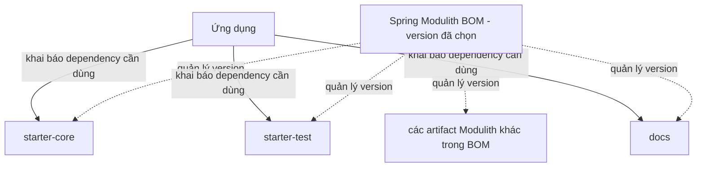
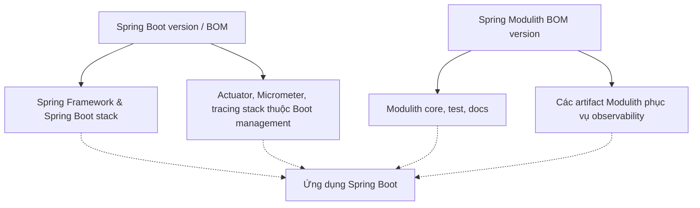
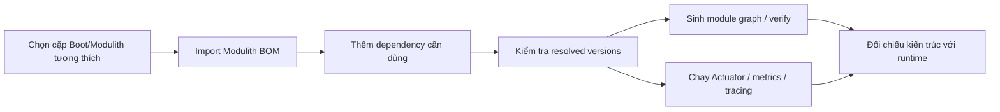

# Quản lý version bằng Spring Modulith BOM

Khi học **Spring Modulith** trên một ứng dụng Spring Boot, bạn thường cần nhiều thành phần cùng lúc: thư viện mô hình hóa application module, công cụ kiểm tra ranh giới, công cụ sinh tài liệu module graph, và các thành phần hỗ trợ Actuator, event metrics hoặc tracing. Nếu tự chọn một version riêng cho từng thư viện Spring Modulith, dự án rất dễ có một tập dependency không đồng bộ.

**Spring Modulith BOM** (*Bill of Materials*) giúp quản lý vấn đề này: khai báo **một version của BOM** để công cụ build biết version tương ứng của các artifact Spring Modulith mà BOM quản lý. Bạn vẫn phải khai báo những dependency thật sự muốn sử dụng; BOM chỉ đưa ra thông tin quản lý phiên bản.

Trong phạm vi học phần `SPRING_MODULITH_DOCUMENTATION_OBSERVABILITY`, BOM là nền tảng để các thành phần tài liệu hóa kiến trúc và quan sát runtime được phối hợp trên cùng một dòng phát hành. Bài này tập trung vào **cách khai báo, chọn, kiểm tra và nâng cấp version**, đồng thời phân biệt trách nhiệm của Spring Modulith BOM với Spring Boot dependency management.

## 1. Vì sao một ứng dụng Modulith cần BOM?

Giả sử dự án dùng những thư viện sau:

```text
Ứng dụng Spring Boot
├── spring-modulith-starter-core        → mô hình application module
├── spring-modulith-starter-test        → hỗ trợ kiểm thử module
├── spring-modulith-docs                → sinh tài liệu/module graph
└── thành phần quan sát Spring Modulith → quan sát tương tác module
```

Đây là **các vai trò minh họa**, không phải danh sách dependency bắt buộc. Một ứng dụng có thể chỉ dùng một phần trong số đó. Tên artifact cung cấp chức năng quan sát có thể phụ thuộc dòng phiên bản Spring Modulith đang dùng, vì vậy cần đối chiếu tài liệu phát hành trước khi thêm dependency cụ thể.

Nếu mỗi artifact dùng version do người viết `pom.xml` hoặc `build.gradle` chọn độc lập, một lần nâng cấp có thể vô tình giữ lại thư viện cũ. Trường hợp xấu có thể dẫn đến lỗi liên kết lớp/phương thức khi chạy, cấu hình tự động không tương thích, hoặc hành vi kiểm thử khác với runtime.

Với BOM, sơ đồ quản lý trở nên rõ ràng:



Các mũi tên nét đứt thể hiện **quản lý version**, không phải việc BOM tự kéo thư viện vào classpath. Điều này đặc biệt quan trọng khi cấu hình observability: chỉ nhập BOM không tự bật Actuator endpoint, tự sinh trace, tạo event metrics hoặc xuất dữ liệu sang Jaeger/Tempo.

### BOM, starter và module graph có nhiệm vụ khác nhau

| Thành phần | Vai trò chính | Điều không tự làm |
| --- | --- | --- |
| `spring-modulith-bom` | Quản lý version của các artifact thuộc tập BOM | Không thêm dependency runtime, không kiểm chứng module |
| Spring Modulith starter/thư viện | Cung cấp API, auto-configuration hoặc tính năng cụ thể tùy artifact | Không quyết định toàn bộ version của hệ sinh thái Spring Boot |
| Spring Boot BOM/parent | Quản lý bộ version của nhiều thư viện thuộc hệ sinh thái Boot | Không thay thế việc chọn dòng Spring Modulith tương thích |
| Module verification/documentation | Phân tích cấu trúc, kiểm tra phụ thuộc và có thể sinh tài liệu module graph | Không giải quyết xung đột dependency bằng chính nó |
| Actuator/Micrometer/Tracing | Cung cấp hạ tầng quan sát khi được cấu hình | Không bảo đảm đúng kiến trúc module chỉ từ số liệu runtime |

## 2. BOM hoạt động như thế nào?

Trong Maven, BOM là một artifact có packaging kiểu POM, thường chứa các khai báo trong `dependencyManagement`. Trong Gradle, có thể nhập BOM dưới dạng **platform** hoặc qua plugin quản lý dependency tương thích với Maven BOM.

Điểm cốt lõi:

1. Bạn chọn một **version Spring Modulith BOM** cụ thể.
2. Bạn nhập BOM vào cơ chế dependency management của công cụ build.
3. Khi khai báo một artifact được BOM quản lý mà **không chỉ định version riêng**, công cụ build lấy version từ ràng buộc/quy tắc quản lý được áp dụng.
4. Bạn kiểm tra dependency đã **được resolve** trước khi chạy hoặc phát hành ứng dụng.

Ví dụ về ý tưởng, không phải tên version phát hành thực tế:

```text
spring-modulith-bom:VERSION_M
    ├── spring-modulith-starter-core → version do BOM M quản lý
    ├── spring-modulith-starter-test → version do BOM M quản lý
    └── spring-modulith-docs         → version do BOM M quản lý
```

**Không có nghĩa** BOM có thể tự sửa mọi xung đột. Version được resolve cuối cùng còn phụ thuộc vào cơ chế ưu tiên dependency của Maven/Gradle, version khai báo trực tiếp, các BOM khác và dependency graph. Do đó, “đã import BOM” và “các thư viện đã được resolve như mong muốn” là hai điều cần kiểm tra riêng.

## 3. Khai báo Spring Modulith BOM với Maven

Với một dự án Maven sử dụng Spring Boot parent, bạn có thể khai báo BOM Spring Modulith trong `dependencyManagement`:

```xml
<project xmlns="http://maven.apache.org/POM/4.0.0"
         xmlns:xsi="http://www.w3.org/2001/XMLSchema-instance"
         xsi:schemaLocation="http://maven.apache.org/POM/4.0.0 https://maven.apache.org/xsd/maven-4.0.0.xsd">
    <modelVersion>4.0.0</modelVersion>

    <parent>
        <groupId>org.springframework.boot</groupId>
        <artifactId>spring-boot-starter-parent</artifactId>
        <version>BOOT_VERSION</version>
        <relativePath/>
    </parent>

    <groupId>com.example</groupId>
    <artifactId>shop-modulith</artifactId>
    <version>0.0.1-SNAPSHOT</version>

    <properties>
        <java.version>17</java.version>
        <spring-modulith.version>MODULITH_VERSION</spring-modulith.version>
    </properties>

    <dependencyManagement>
        <dependencies>
            <dependency>
                <groupId>org.springframework.modulith</groupId>
                <artifactId>spring-modulith-bom</artifactId>
                <version>${spring-modulith.version}</version>
                <type>pom</type>
                <scope>import</scope>
            </dependency>
        </dependencies>
    </dependencyManagement>

    <dependencies>
        <dependency>
            <groupId>org.springframework.modulith</groupId>
            <artifactId>spring-modulith-starter-core</artifactId>
        </dependency>
        <dependency>
            <groupId>org.springframework.modulith</groupId>
            <artifactId>spring-modulith-starter-test</artifactId>
            <scope>test</scope>
        </dependency>
        <dependency>
            <groupId>org.springframework.modulith</groupId>
            <artifactId>spring-modulith-docs</artifactId>
            <scope>test</scope>
        </dependency>
    </dependencies>
</project>
```

`BOOT_VERSION` và `MODULITH_VERSION` là **chỗ giữ chỗ**: thay bằng **số phiên bản phát hành thật** có trong kho artifact và được ghi nhận là tương thích trước khi chạy build. `java.version` cũng phải đáp ứng yêu cầu của dòng Spring Boot/Modulith được chọn. Ví dụ chỉ minh họa cấu trúc quản lý phiên bản, không tuyên bố một cặp version cụ thể.

Trong cấu hình này:

- Spring Boot parent cung cấp phần dependency management cho hệ sinh thái Spring Boot và cấu hình build liên quan.
- Spring Modulith BOM cung cấp version cho các artifact Spring Modulith mà BOM liệt kê.
- `starter-core` là dependency dùng bởi ứng dụng; `starter-test` và `docs` chỉ được đặt ở phạm vi test trong ví dụ.
- Các dependency Spring Modulith **không có thẻ `<version>`**, nên chủ đích quản lý tập trung được thể hiện ngay trong POM.

Nếu không sử dụng `spring-boot-starter-parent`, có thể nhập Spring Boot BOM trong `dependencyManagement` và tự cấu hình plugin cần thiết. **Import BOM không thay thế `pluginManagement` hay cấu hình Maven Compiler/Surefire.**

### Vì sao phải đặt BOM trong `dependencyManagement`?

Đoạn sau **không đúng mục đích**:

```xml
<!-- Sai: đặt BOM như một dependency thông thường. -->
<dependencies>
    <dependency>
        <groupId>org.springframework.modulith</groupId>
        <artifactId>spring-modulith-bom</artifactId>
        <version>MODULITH_VERSION</version>
        <type>pom</type>
    </dependency>
</dependencies>
```

Maven cần `dependencyManagement` với `type=pom`, `scope=import` để nhập các khai báo version mà BOM quản lý. BOM không phải một thư viện Java để đưa vào application classpath như `starter-core`.

### Khi dự án Maven có nhiều module build

Ví dụ dự án gồm `shop-app`, `shop-api` và `shop-integration-test` (đây là **Maven modules**, khác với khái niệm *application module* của Spring Modulith). Có thể đặt Spring Modulith BOM tại **POM cha mà các Maven module thực sự kế thừa**. Các POM con chỉ cần khai báo artifact Spring Modulith phù hợp với chức năng của từng module.

Nếu một POM chỉ đóng vai trò *aggregator* qua `<modules>` nhưng POM con không khai báo nó làm `<parent>`, đừng mặc định rằng `dependencyManagement` của aggregator sẽ tự được kế thừa.

## 4. Khai báo BOM với Gradle

Gradle có thể tiêu thụ Maven BOM qua **native platform**. Với Gradle Groovy DSL, ví dụ phần cấu hình dependency:

```groovy
// build.gradle (Groovy DSL)
def springModulithVersion = 'MODULITH_VERSION'

dependencies {
    implementation platform("org.springframework.modulith:spring-modulith-bom:${springModulithVersion}")
    implementation 'org.springframework.modulith:spring-modulith-starter-core'

    testImplementation platform("org.springframework.modulith:spring-modulith-bom:${springModulithVersion}")
    testImplementation 'org.springframework.modulith:spring-modulith-starter-test'
    testImplementation 'org.springframework.modulith:spring-modulith-docs'
}
```

Đây là **phần cấu hình minh họa**, giả định dự án đã có các plugin và repository cần thiết cho Java/Spring Boot. Thay `MODULITH_VERSION` bằng version thật. Platform trong `implementation` cung cấp các constraint liên quan đến cấu hình ứng dụng; khai báo riêng cho `testImplementation` ở đây nhằm thể hiện rõ mục đích quản lý version của dependency test.

Một dự án Gradle sử dụng plugin `io.spring.dependency-management` cũng có thể nhập Maven BOM theo phong cách quen thuộc của hệ sinh thái Spring:

```groovy
// Chỉ dùng khi dự án đã áp dụng plugin io.spring.dependency-management.
ext['springModulithVersion'] = 'MODULITH_VERSION'

dependencyManagement {
    imports {
        mavenBom "org.springframework.modulith:spring-modulith-bom:${springModulithVersion}"
    }
}

dependencies {
    implementation 'org.springframework.modulith:spring-modulith-starter-core'
    testImplementation 'org.springframework.modulith:spring-modulith-starter-test'
}
```

Hai đoạn trên minh họa **hai cơ chế khác nhau**: Gradle native `platform(...)` và plugin `io.spring.dependency-management`. Chọn cơ chế phù hợp với dự án và kiểm tra version resolve của nó; tránh nhập cùng BOM lặp lại mà không có mục đích rõ ràng. Với Gradle, cách xử lý ràng buộc version có thể khác Maven, đặc biệt khi xuất hiện các platform khác hoặc version được chỉ định trực tiếp.

### Khác nhau giữa Maven BOM và Gradle platform

| Nội dung | Maven | Gradle native |
| --- | --- | --- |
| Nhập BOM | `dependencyManagement` + `type=pom` + `scope=import` | `platform("group:artifact:version")` |
| Khai báo thư viện dùng thật | Trong `<dependencies>` | Trong `dependencies { ... }` |
| Không viết version cho từng artifact | Maven lấy version từ dependency management đang có hiệu lực | Gradle resolve theo constraints/platform và các version yêu cầu khác |
| Kiểm tra kết quả | `help:effective-pom`, `dependency:tree` | `dependencies`, `dependencyInsight` |
| Phạm vi test | `<scope>test</scope>` | `testImplementation`, `testRuntimeOnly` tùy mục tiêu |

## 5. Chọn version: Spring Boot BOM và Spring Modulith BOM phải phối hợp

Một ngộ nhận phổ biến: **“Tôi đã chọn Spring Modulith BOM nên các version Spring Boot, Actuator, Micrometer và tracing cũng tự đúng.”** Điều đó không được đảm bảo chỉ bằng Spring Modulith BOM.

Spring Boot và Spring Modulith có **dòng phát hành và phạm vi dependency management khác nhau**. Trong học phần về documentation và observability, các thư viện có vai trò như sau:



Sơ đồ mô tả **phạm vi quản lý chủ yếu**, không khẳng định mọi artifact trong nhóm đều được quản lý bởi BOM tương ứng ở tất cả dòng phiên bản. Cần xem nội dung BOM được phát hành và dependency graph của dự án thực tế.

Thực hiện theo trình tự:

1. **Xác định dòng Spring Boot hiện dùng** và yêu cầu Java tương ứng.
2. **Đọc compatibility matrix/release notes** của dòng Spring Modulith dự định áp dụng để chọn phiên bản được hỗ trợ với Spring Boot đó.
3. **Pin** một version cụ thể của Spring Modulith BOM, tránh version động hoặc dải version không kiểm soát trong build phát hành.
4. **Khai báo artifact Spring Modulith không kèm version riêng** khi nó được BOM quản lý, trừ trường hợp có lý do và đã kiểm tra kỹ.
5. **Kiểm tra dependency đã resolve** của cả môi trường compile, test và runtime, đặc biệt sau khi đổi Spring Boot hoặc Modulith.

Spring Modulith BOM giúp **đồng bộ version nội bộ Modulith**, nhưng bản thân nó không chứng minh toàn bộ tổ hợp Spring Boot + Modulith + Micrometer + exporter đã tương thích. Nếu cần một tổ hợp khác với tài liệu tương thích chính thức, phải kiểm thử chủ động thay vì giả định BOM tự khắc phục.

### Chuyện gì xảy ra khi ghi đè version thủ công?

Ví dụ Maven này tạo ra một điểm cần kiểm soát:

```xml
<dependency>
    <groupId>org.springframework.modulith</groupId>
    <artifactId>spring-modulith-starter-core</artifactId>
    <version>ANOTHER_VERSION</version>
</dependency>
```

Version trực tiếp của dependency có thể ghi đè ý định lấy version từ BOM. Khi một artifact được ép sang bản khác mà các artifact liên quan vẫn theo BOM, lợi ích đồng bộ giảm đi. Nếu phải override để xử lý một lỗi đã biết, hãy ghi lại nguyên nhân, phạm vi và kế hoạch gỡ override, rồi kiểm tra version resolve thực tế.

## 6. Kiểm tra version đang được sử dụng thật sự

**Đọc file build chưa đủ.** Cần xem dependency graph sau khi Maven/Gradle giải quyết constraints, phần kế thừa và các dependency transitives.

### Maven

Trong thư mục dự án Maven, có thể chạy:

```bash
./mvnw help:effective-pom
./mvnw dependency:tree -Dincludes=org.springframework.modulith
```

Trên Windows PowerShell, dùng `./mvnw.cmd` hoặc `.\mvnw.cmd` thay cho `./mvnw`. `effective-pom` giúp xem khai báo đã được kết hợp từ parent và dependency management; `dependency:tree` cho biết các artifact Modulith thực tế trong dependency tree cùng version được resolve. Nếu plugin hoặc artifact filter hoạt động khác theo phiên bản Maven Dependency Plugin, có thể chạy `dependency:tree` không filter rồi tìm các artifact có `groupId` `org.springframework.modulith`.

### Gradle

```bash
./gradlew dependencies --configuration runtimeClasspath
./gradlew dependencies --configuration testRuntimeClasspath
./gradlew dependencyInsight --dependency spring-modulith --configuration runtimeClasspath
```

Với Windows, dùng `gradlew.bat`. `dependencyInsight` giúp xem lý do chọn một version, nhưng nếu cần kiểm tra một artifact cụ thể, nên đặt tên artifact cụ thể vào `--dependency` thay vì lọc quá rộng. Hai cấu hình `runtimeClasspath` và `testRuntimeClasspath` có thể chứa tập artifact khác nhau.

Kiểm tra tối thiểu ba điều:

| Câu hỏi kiểm tra | Vì sao quan trọng? |
| --- | --- |
| Các artifact Spring Modulith đã về đúng version dự kiến chưa? | Phát hiện version trực tiếp hoặc constraint khác ghi đè BOM |
| Dependency dùng ở runtime và test có cùng dòng Modulith tương thích không? | Tránh test qua một API nhưng runtime dùng phiên bản khác |
| Spring Boot và thư viện liên quan đến Actuator/tracing đang ở version nào? | Đánh giá tính tương thích với môi trường observability |

Sau khi version đã khớp, tiếp tục chạy bài test module và các bài kiểm tra tích hợp phù hợp. Ví dụ, test gọi `ApplicationModules.of(...).verify()` phát hiện vấn đề phụ thuộc module trong phạm vi Spring Modulith hỗ trợ; nó **không thay cho** việc kiểm tra dependency graph.

## 7. Áp dụng BOM vào bài toán documentation và observability

Trong một ứng dụng `shop` có các application module `order`, `inventory`, `payment`, bạn có thể dùng tài liệu/module graph để thấy các quan hệ phụ thuộc được khai báo và dùng quan sát runtime để kiểm tra trace khi đặt hàng qua nhiều module.

Một lộ trình thiết lập hợp lý là:

1. **Chọn dòng phiên bản.** Chốt Spring Boot và Spring Modulith tương thích; khai báo Spring Modulith BOM ở nơi quản lý dependency chung.
2. **Thêm core và test.** Khai báo các artifact Spring Modulith cần cho mô hình và kiểm chứng module, để BOM quyết định version của chúng.
3. **Thêm công cụ documentation nếu dùng.** Ví dụ `spring-modulith-docs` cho bài test sinh tài liệu/module graph; kiểm tra version được quản lý qua BOM.
4. **Thêm các thành phần Actuator/observability/tracing phù hợp.** Phân biệt artifact của Spring Modulith với Actuator, Micrometer và exporter thuộc hệ sinh thái Spring Boot. Những thành phần này cần dependency và cấu hình riêng.
5. **Đối chiếu runtime.** Chạy một yêu cầu qua `order` → `inventory` → `payment`, quan sát span/log/metric được thu thập, rồi so với ranh giới module trong tài liệu đã sinh.

Sơ đồ chuỗi công việc:



Ví dụ quan trọng: khi trace không xuất hiện trong backend, việc có BOM đúng **không đủ** để kết luận observability đã hoạt động. Còn cần kiểm tra những thứ như cấu hình tracing/exporter, sampling, collector, thiết lập truyền context qua luồng bất đồng bộ, và liệu đường gọi cần quan sát có được instrument không.

Ngược lại, khi module graph cho thấy dependency không hợp lệ, việc nâng version BOM cũng không phải phương án sửa kiến trúc. Cần kiểm tra API công khai của module, cấu trúc package và hướng phụ thuộc trong code.

## 8. Các lỗi cấu hình thường gặp

| Hiện tượng | Nguyên nhân cần kiểm tra | Cách xử lý |
| --- | --- | --- |
| Maven báo dependency Spring Modulith không có version | BOM chưa được import hoặc artifact không nằm trong BOM đang dùng | Kiểm tra `dependencyManagement`, `scope=import`, tọa độ artifact và BOM phát hành |
| Gradle không resolve được dependency thiếu version | Chưa có platform/constraint có hiệu lực ở cấu hình liên quan | Kiểm tra `implementation`/`testImplementation`, plugin dependency management và dependency graph |
| Đã import BOM nhưng một artifact vẫn dùng version khác | Version trực tiếp hoặc rule/constraint khác đã tham gia giải quyết | Xem effective POM hoặc `dependencyInsight`, loại bỏ override không cần thiết |
| Test chạy nhưng ứng dụng lỗi `NoSuchMethodError`/`NoClassDefFoundError` | Có thể có version không tương thích hoặc thiếu artifact ở runtime | So sánh compile/test/runtime classpath và compatibility matrix; không mặc định chỉ có một nguyên nhân |
| Dùng BOM mới mà runtime tracing không có dữ liệu | Thiếu instrumentation, bridge/exporter/collector hoặc do sampling | Kiểm tra cấu hình quan sát và đường xuất trace, bên cạnh dependency |
| Nhiều subproject có các BOM version khác nhau | Version được khai báo lặp lại ở nhiều nơi | Đưa version về một nguồn quản lý có chủ đích, kiểm tra từng subproject |
| Đổi Spring Boot nhưng giữ nguyên Modulith không kiểm tra | Cặp version có thể vượt ngoài phạm vi được hỗ trợ | Đọc tài liệu tương thích và kiểm thử trước khi nâng cấp |

### Không nhầm dependency management với plugin management

Các plugin của Maven/Gradle chịu trách nhiệm compile, test, đóng gói và chạy build. Version plugin **không mặc nhiên** được Spring Modulith BOM quản lý. Ví dụ Maven Compiler Plugin hoặc plugin Spring Boot của Gradle phải được cấu hình theo quy ước build của dự án; import `spring-modulith-bom` không quyết định version của chúng.

### Không nhầm Maven module với Spring Modulith application module

Một dự án Maven multi-module có thể tạo nhiều JAR ở thời điểm build; Spring Modulith application module lại là một đơn vị kiến trúc bên trong ứng dụng Spring Boot. BOM hoạt động ở **lớp dependency management của build**, còn phân tích ranh giới bằng Spring Modulith hoạt động ở **lớp kiến trúc ứng dụng**. Dự án chỉ có một `pom.xml` vẫn có thể có nhiều application module; dự án nhiều POM chưa chắc đã thiết kế đúng application module.

## 9. Quy trình nâng cấp có kiểm soát

Khi muốn nâng Spring Modulith để dùng tính năng documentation hoặc observability mới, nên tiến hành theo chuỗi sau:

```text
Kiểm tra phiên bản hiện tại
    ↓
Đọc release notes và tương thích Spring Boot/Java
    ↓
Cập nhật đúng một version BOM ở nơi quản lý chung
    ↓
Resolve lại dependency graph (runtime + test)
    ↓
Chạy test module và test tích hợp
    ↓
Thử sinh tài liệu, Actuator, event metrics, tracing
    ↓
Đối chiếu kết quả trước/sau và ghi nhận thay đổi
```

Nếu version được quản lý tập trung, diff nâng cấp thường nhỏ và dễ review hơn vì không phải sửa rải rác nhiều dependency. Tuy vậy, nâng BOM có thể thay đổi nhiều thư viện cùng lúc; cần xem release notes về API, cấu hình, thay đổi auto-configuration và yêu cầu Java/Spring Boot trước khi phát hành.

Để build có thể lặp lại, ưu tiên **pin version phát hành cụ thể**, kiểm tra lockfile/dependency locking nếu dự án dùng, lưu lại kết quả test quan trọng và bảo đảm pipeline dùng cùng cấu hình dependency management. BOM không tự tạo lockfile hay bảo đảm bit-for-bit reproducible build.

## 10. Bài thực hành tự kiểm tra

**Bối cảnh:** ứng dụng Spring Boot có các module `order`, `inventory` và `notification`. Bạn muốn sinh tài liệu module graph, chạy test xác thực ranh giới, và bật tracing để quan sát việc xử lý đặt hàng.

1. Chọn một cặp Spring Boot/Spring Modulith tương thích từ tài liệu chính thức. Viết rõ version dự định dùng cho mỗi bên.
2. Với Maven hoặc Gradle, khai báo Spring Modulith BOM tại đúng nơi, rồi thêm core và test mà không ghi version riêng cho từng dependency Modulith.
3. Thêm dependency cho việc sinh tài liệu module graph, bảo đảm nó có phạm vi phù hợp với nơi chạy `Documenter` của ứng dụng.
4. Dùng `dependency:tree` hoặc `dependencyInsight` kiểm tra các artifact Spring Modulith thực sự đã resolve; ghi lại version và phát hiện bất kỳ override nào.
5. Chạy kiểm tra application module, sinh tài liệu kiến trúc và thực hiện một luồng đặt hàng có trace. Giải thích vì sao **BOM chỉ giải quyết một phần** yêu cầu của ba hoạt động này.
6. Thử đặt version trực tiếp khác với BOM cho một artifact trong nhánh thử nghiệm, quan sát kết quả resolve, sau đó đưa dependency trở lại cơ chế quản lý tập trung. Không đưa override thử nghiệm vào nhánh phát hành.

**Tiêu chí hoàn thành:** bạn giải thích được BOM có quản lý những gì, import đúng cách trong Maven/Gradle, biết chọn version Spring Modulith tương thích với Spring Boot, xác nhận version đã resolve, và không đồng nhất quản lý version với khả năng sinh tài liệu hoặc quan sát ứng dụng khi chạy.

## Tài liệu tra cứu khi áp dụng vào dự án

- [Spring Modulith Reference Documentation](https://docs.spring.io/spring-modulith/reference/) — tìm phần cấu hình dependency, release compatibility, documentation và observability của **phiên bản sẽ sử dụng**.
- [Spring Boot Reference Documentation](https://docs.spring.io/spring-boot/reference/) — đối chiếu yêu cầu Java, dependency management, Actuator và Micrometer Tracing.
- [Maven Dependency Mechanism](https://maven.apache.org/guides/introduction/introduction-to-dependency-mechanism.html) — cách Maven quản lý và ưu tiên version.
- [Gradle Platforms](https://docs.gradle.org/current/userguide/platforms.html) — cơ chế import BOM thành platform và dependency constraints.

Các đường dẫn dẫn tới tài liệu tham khảo chung; khi build thật, cần chọn đúng **nhánh phiên bản** ứng với dự án thay vì mặc định sử dụng nội dung của bản tài liệu mới nhất.
