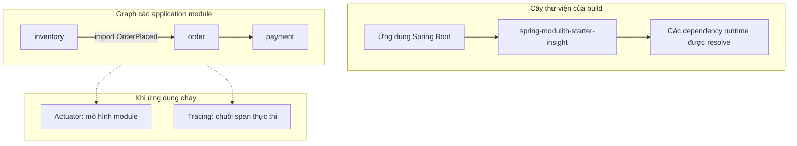
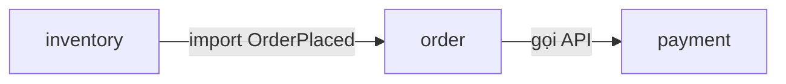

# Kiểm tra dependency graph sau khi thêm starter

## 1. Vì sao phải kiểm tra graph?

Trong ứng dụng Spring Boot sử dụng **Spring Modulith**, `spring-modulith-starter-insight` đưa các khả năng quan sát module vào môi trường chạy, giúp khai thác thông tin kiến trúc qua Spring Boot Actuator và instrumentation của module. Thêm starter là thao tác nhỏ trong Gradle/Maven, nhưng cần kiểm tra xem ứng dụng đã giải quyết dependency đúng chưa và mô hình module nghiệp vụ có giữ được ranh giới như thiết kế không.

Xét hệ thống bán hàng có ba application module `order`, `payment` và `inventory`. Sau khi thêm Insight starter, cần trả lời:

1. Starter có nằm trên **runtime classpath** và các thư viện đi kèm có phiên bản tương thích không?
2. Spring Modulith còn nhận diện đúng ba module cùng quan hệ phụ thuộc mong đợi không?
3. Dữ liệu ở Actuator có phù hợp với graph được phân tích từ mã nguồn không?
4. Nếu có cạnh hoặc artifact bất ngờ, cần sửa mã nguồn, dependency build hay cấu hình vận hành?

Bài học thuộc chương **Insight starter** của **SPRING_MODULITH_DOCUMENTATION_OBSERVABILITY**. Mục tiêu chung là dùng Spring Modulith để tạo tài liệu ranh giới application module và quan sát tương tác trong Spring Boot. Việc kiểm tra dependency graph là tiền đề trước khi sử dụng module graph, Actuator, event metrics, tracing và context propagation để đối chiếu kiến trúc với hành vi thực tế.

## 2. Hai loại dependency graph khác nhau

| Thuộc tính | Dependency graph của build | Dependency graph của application module |
| --- | --- | --- |
| Node | Artifact/thư viện như `spring-modulith-starter-insight` | Module nghiệp vụ như `order` và `payment` |
| Cạnh | Artifact A phụ thuộc trực tiếp/gián tiếp vào artifact B | Mã module A tham chiếu đến kiểu hoặc API của module B |
| Nguồn | Cơ chế giải quyết dependency của Gradle/Maven | Phân tích package và class bằng Spring Modulith |
| Công cụ | `dependencies`, `dependencyInsight`, `dependency:tree` | `ApplicationModules`, `verify()`, Documenter, Actuator |
| Điều cần xác nhận | Starter đã có mặt, version đúng, không xung đột | Hướng phụ thuộc hợp lệ, không có cạnh/chu trình ngoài dự kiến |

**Sau khi thêm starter, graph thư viện thường lớn hơn; graph module nghiệp vụ không tự đổi nếu mã nguồn không đổi.** Thư viện observability không tự tạo lời gọi nghiệp vụ từ `order` sang `inventory`.

Còn một khái niệm khác: **trace lúc chạy**. Trace mô tả những lời gọi được instrument và thực thi trong một yêu cầu cụ thể; nó không liệt kê mọi cạnh tĩnh trong mã. Bài này sẽ dùng module graph làm chuẩn kiến trúc, rồi liên hệ Actuator và trace trong bước kiểm chứng runtime.



Sơ đồ là mô hình khái niệm. **Không suy ra danh sách artifact bắc cầu chính xác từ sơ đồ**: dependency thực tế phụ thuộc phiên bản, BOM và build configuration, nên phải quan sát kết quả resolve của dự án.

## 3. Xây dựng graph mong đợi trước khi thay đổi

Ví dụ cấu trúc package:

```text
com.example.shop
├── ShopApplication.java
├── order/
│   ├── OrderService.java
│   └── OrderPlaced.java
├── payment/
│   └── PaymentOperations.java
└── inventory/
    └── InventoryOnOrderPlaced.java
```

Giả định `OrderService` ở module `order` dùng API của `payment` để thực hiện thanh toán; listener ở `inventory` import kiểu event `OrderPlaced` do `order` công khai:

| Module nguồn | Module đích | Ý nghĩa |
| --- | --- | --- |
| `order` | `payment` | Sử dụng API thanh toán: **mong đợi** |
| `inventory` | `order` | Import kiểu sự kiện `OrderPlaced`: **mong đợi** |
| `order` | `inventory` | **Không mong đợi** nếu giao tiếp bằng sự kiện và nguồn không biết listener |
| `payment` | `inventory` | **Không mong đợi** nếu không có yêu cầu thiết kế rõ ràng |

Phân biệt hai chiều dễ nhầm:

- **Phụ thuộc mã nguồn:** `inventory → order` vì listener import `OrderPlaced`.
- **Luồng sự kiện lúc chạy:** `order` phát `OrderPlaced`, rồi `inventory` có thể xử lý nó. Điều này không đòi hỏi mã `order` import lớp listener của `inventory`.

Tốt nhất, lưu graph và kết quả phân tích trước khi thêm starter làm baseline trong artifact CI hoặc tài liệu thay đổi. Nếu không có baseline, lập bảng quan hệ mong đợi để so sau khi chạy.

## 4. Kiểm tra build dependency graph bằng Gradle

### 4.1. Khai báo Insight starter

Trong Gradle Groovy DSL, ví dụ khi dự án sử dụng BOM Spring Modulith phù hợp với Spring Boot hiện tại:

```groovy
dependencies {
    implementation platform(
        "org.springframework.modulith:spring-modulith-bom:${springModulithVersion}"
    )

    implementation "org.springframework.modulith:spring-modulith-starter-core"
    runtimeOnly "org.springframework.modulith:spring-modulith-starter-insight"
}
```

`springModulithVersion` là biến cấu hình của dự án. **Không chọn tùy ý phiên bản Spring Modulith**: phải phù hợp dòng Spring Boot và các dependency đã quản lý. Nếu dự án đã import BOM bằng cách khác thì dùng cơ chế sẵn có, tránh định nghĩa version phân tán.

Đặt Insight starter ở `runtimeOnly` là phù hợp khi chỉ cần tính năng quan sát lúc chạy. Vì vậy phải kiểm tra **`runtimeClasspath`**, không kết luận starter thiếu chỉ vì không thấy nó trong `compileClasspath`.

### 4.2. Liệt kê thư viện đã resolve

Trong PowerShell tại thư mục gốc dự án:

```powershell
.\gradlew.bat dependencies --configuration runtimeClasspath
```

Trên macOS/Linux, dùng `./gradlew dependencies --configuration runtimeClasspath`. Tìm `org.springframework.modulith:spring-modulith-starter-insight` và những nhánh phụ thuộc theo sau. Chú ý các thành phần Spring Modulith liên quan đến Actuator/observability, các artifact Spring Boot/Micrometer và những thay đổi phiên bản do resolution.

Để biết *vì sao* artifact được chọn:

```powershell
.\gradlew.bat dependencyInsight --dependency spring-modulith-starter-insight --configuration runtimeClasspath
```

Nếu thấy một thư viện Micrometer hoặc Spring Boot không như mong đợi, chạy `dependencyInsight` lần nữa với tên artifact đó. Phân tích kết quả theo:

- Dependency được khai báo trực tiếp hay kéo theo gián tiếp.
- Phiên bản yêu cầu so với phiên bản Gradle thực sự chọn.
- BOM, constraint hoặc đường phụ thuộc nào tác động đến lựa chọn.
- Có lỗi không resolve được dependency hoặc lệch dòng tương thích hay không.

Gradle có ký hiệu `->` khi phiên bản yêu cầu được chọn lại và `(*)` cho một nhánh lặp đã hiển thị; đọc theo cách Gradle diễn giải, không coi mỗi nhánh là một bản thư viện mới.

**PASS ở tầng build:** Starter có mặt trên `runtimeClasspath`, các artifact được giải quyết thành công và phiên bản của chúng tương thích. Đây mới là xác nhận dependency; **chưa chứng minh** Actuator endpoint hay tracing backend đã chạy.

## 5. Kiểm tra build dependency graph bằng Maven

Ví dụ quản lý phiên bản bằng BOM và chỉ dùng Insight ở runtime:

```xml
<dependencyManagement>
    <dependencies>
        <dependency>
            <groupId>org.springframework.modulith</groupId>
            <artifactId>spring-modulith-bom</artifactId>
            <version>${spring-modulith.version}</version>
            <type>pom</type>
            <scope>import</scope>
        </dependency>
    </dependencies>
</dependencyManagement>

<dependencies>
    <dependency>
        <groupId>org.springframework.modulith</groupId>
        <artifactId>spring-modulith-starter-core</artifactId>
    </dependency>
    <dependency>
        <groupId>org.springframework.modulith</groupId>
        <artifactId>spring-modulith-starter-insight</artifactId>
        <scope>runtime</scope>
    </dependency>
</dependencies>
```

Biến `spring-modulith.version` cần được khai báo ở cấu hình Maven hiện có bằng phiên bản tương thích. Nếu BOM đã được import ở parent, không cần thêm lại.

Xem toàn bộ cây dependency:

```powershell
.\mvnw.cmd dependency:tree
```

Để chỉ xem nhanh các artifact thuộc Spring Modulith:

```powershell
.\mvnw.cmd dependency:tree -Dincludes=org.springframework.modulith
```

Trên macOS/Linux dùng `./mvnw`. Khi điều tra xung đột sâu, quay lại **toàn bộ dependency tree** và cấu hình `dependencyManagement`, vì bộ lọc có thể che khuất nguồn kéo dependency từ nhóm khác. Một artifact xuất hiện trong Maven tree xác nhận kết quả giải quyết dependency, nhưng không thay thế kiểm tra runtime.

## 6. Kiểm tra dependency graph của application module

### 6.1. Verify ranh giới kiến trúc

Lớp `ShopApplication` cần ở package gốc phù hợp với các module được phân tích. Có thể dùng JUnit 5:

```java
package com.example.shop;

import org.junit.jupiter.api.Test;
import org.springframework.modulith.core.ApplicationModules;

class ModuleArchitectureTests {

    @Test
    void moduleDependenciesMustBeValid() {
        ApplicationModules modules =
            ApplicationModules.of(ShopApplication.class);

        modules.verify();
    }
}
```

`ApplicationModules` phân tích application module và `verify()` kiểm tra các quy tắc mà Spring Modulith áp dụng, như chu trình hoặc tham chiếu tới phần nội bộ không được công khai theo mô hình module. Bài kiểm tra PASS chứng minh không phát hiện các vi phạm thuộc phạm vi kiểm tra. Nó **không tự chứng minh** graph khớp hoàn toàn với mọi yêu cầu nghiệp vụ: một cạnh phụ thuộc mới có thể hợp lệ về kỹ thuật nhưng không mong đợi về thiết kế. Vì thế phải tiếp tục xem và so graph.

### 6.2. Xuất sơ đồ bằng Documenter

Nếu muốn lưu graph làm tài liệu hoặc so trong pull request, bổ sung artifact docs vào test scope (phiên bản do BOM quản lý):

```groovy
dependencies {
    testImplementation "org.springframework.modulith:spring-modulith-docs"
}
```

Ví dụ JUnit sinh sơ đồ:

```java
package com.example.shop;

import org.junit.jupiter.api.Test;
import org.springframework.modulith.core.ApplicationModules;
import org.springframework.modulith.docs.Documenter;

class ModuleDocumentationTests {

    @Test
    void generateModuleDiagrams() {
        ApplicationModules modules =
            ApplicationModules.of(ShopApplication.class);

        new Documenter(modules)
            .writeModulesAsPlantUml()
            .writeIndividualModulesAsPlantUml();
    }
}
```

Kết quả sinh ra là sơ đồ phụ thuộc **tĩnh**. Kiểm tra thư mục output do Documenter dùng ở phiên bản dự án và lưu artifact để review. Khi so trước/sau, chú ý:

1. Danh sách module và định danh module.
2. Hướng của từng cạnh (module sử dụng → module cung cấp).
3. Loại phụ thuộc hoặc API bị tham chiếu nếu sơ đồ/thông tin chi tiết cung cấp.
4. Module mới, module mất, cạnh mới hoặc chu trình mới.

Graph ví dụ mong đợi:



Nếu graph sau khi thêm starter xuất hiện cạnh `order → inventory`, trước tiên tìm tham chiếu mã nguồn như `OrderService` inject `InventoryService`, import một DTO thuộc `inventory` hoặc gọi lớp nội bộ. Thêm starter **không** tự tạo tham chiếu nghiệp vụ mới; nếu cùng pull request có sửa mã, xem diff mã nguồn để xác định nguyên nhân.

## 7. Đối chiếu graph qua Actuator sau khi thêm Insight

Khi ứng dụng có thành phần Actuator/Modulith phù hợp trên runtime classpath và endpoint được bật, có thể lấy mô hình module từ ứng dụng đang chạy. Ví dụ cấu hình phát triển:

```yaml
management:
  endpoints:
    web:
      exposure:
        include: "health,info,modulith,metrics"
```

Khởi động ứng dụng, sau đó gọi từ PowerShell:

```powershell
curl.exe -i http://localhost:8080/actuator
curl.exe -i http://localhost:8080/actuator/modulith
```

Cần điều chỉnh host, `server.port`, `management.server.port` hoặc `management.endpoints.web.base-path` nếu đã tùy biến. Với Spring Security, yêu cầu xác thực/phân quyền hợp lệ. Tránh expose dữ liệu kiến trúc nội bộ trên Internet công cộng.

Đọc dữ liệu trả về để xác minh danh sách module, tên/định danh và các thông tin quan hệ phụ thuộc, rồi đối chiếu với kết quả `ApplicationModules`/Documenter. **Không hard-code một cấu trúc JSON theo ví dụ cũ**: cách hiển thị thông tin ở endpoint có thể khác giữa phiên bản Spring Modulith.

Hướng xử lý khi kết quả không như mong đợi:

| Dấu hiệu | Kiểm tra tiếp theo |
| --- | --- |
| `404 Not Found` | Endpoint có được bật và expose không; runtime classpath có thành phần cần thiết không; URL/port/path đúng chưa? |
| `401/403` | Spring Security, quyền, token hoặc cấu hình bảo vệ Actuator |
| `500` | Log khởi động và exception của endpoint, sau đó kiểm tra xung đột thư viện |
| Thiếu module trong kết quả | Package gốc, cấu trúc package, quy tắc nhận diện module hoặc đang chạy nhầm build/profile |
| Cạnh phụ thuộc bất ngờ | Import, injection, tham chiếu kiểu và các thay đổi mã nguồn liên quan |

Endpoint trả dữ liệu thành công chứng minh ứng dụng đang chạy có thể xuất **mô hình module**. Nó không đồng nghĩa toàn bộ quan hệ trong graph đã được thực thi trong request vừa gửi, và cũng không bảo đảm không có lỗi nghiệp vụ.

## 8. Liên hệ dependency graph với metrics và tracing

Sau khi xác minh graph, chạy một luồng tạo đơn hàng thật:

1. Gọi API để request đi vào `order` và gọi API công khai của `payment`.
2. Nếu `order` phát domain event `OrderPlaced`, kiểm tra các meter sự kiện tại `/actuator/metrics` sau khi sự kiện đã phát.
3. Nếu đã cấu hình Micrometer Tracing cùng tracer/exporter/backend, mở một trace và tìm những span lời gọi vào module được instrument.
4. So sánh những lời gọi nhìn thấy trong trace với graph tĩnh; giải thích mọi khác biệt bằng điều kiện chạy, instrumentation, sampling hoặc context propagation.

| Tín hiệu | Chứng minh được | Không tự chứng minh |
| --- | --- | --- |
| Starter có trên runtime classpath | Thư viện đã được resolve | Endpoint/tracing đã hoạt động |
| `modules.verify()` PASS | Không phát hiện vi phạm trong các quy tắc được kiểm tra | Mọi cạnh đều đúng với thiết kế kỳ vọng |
| `/actuator/modulith` trả dữ liệu | Ứng dụng xuất được mô hình module | Tất cả các cạnh đều đã chạy trong một giao dịch |
| Counter event tăng | Event được công bố theo điểm quan sát tương ứng | Listener đã xử lý thành công |
| Có span module trong trace | Một lời gọi đã được instrument và ghi/xuất | Mọi lần gọi đều sẽ có span |

**Insight starter không đồng nghĩa một backend tracing đã được cấu hình.** Để xuất trace sang Zipkin/Tempo/Jaeger hoặc nền tảng khác, ứng dụng cần tracer, exporter và kết nối backend tương thích. Sampling có thể khiến một số giao dịch không có trace được lưu; context propagation quyết định có giữ được mối liên hệ span qua luồng bất đồng bộ hay không. Tương tự, muốn endpoint `/actuator/prometheus` hoạt động cần thêm Prometheus registry và cấu hình exposure phù hợp.

## 9. Ví dụ review một thay đổi

Giả sử pull request bổ sung Insight starter nhưng **không** sửa logic nghiệp vụ. Bảng đánh giá:

| Thành phần | Trước | Sau | Kỳ vọng |
| --- | --- | --- | --- |
| Cây dependency build | Chưa có Insight | Thêm Insight và transitives | Resolve thành công, đúng phiên bản |
| Module list | `order`, `payment`, `inventory` | Không đổi | Không phát sinh module ngoài dự kiến |
| Module edges | `order → payment`, `inventory → order` | Không đổi | Không có cạnh/chu trình lạ |
| Kiểm tra kiến trúc | `verify()` PASS | `verify()` PASS | Không có vi phạm mới |
| Actuator module model | Chưa kiểm tra/expose | Có thể đọc mô hình module | Trả graph phù hợp với mã đang chạy |
| Observability | Chưa có hoặc chưa rõ | Có khả năng instrument module | Có dữ liệu khi luồng phù hợp thực thi và cấu hình hỗ trợ |

**Tình huống A:** Build có Insight và Gradle/Maven giải quyết thành công, nhưng `/actuator/modulith` trả 404. Đừng sửa source module vội: hãy kiểm tra dependency runtime, endpoint enable/expose, Spring Security và URL. Nếu vẫn lỗi, dùng log để xác định auto-configuration và tính tương thích của thư viện.

**Tình huống B:** Graph xuất hiện cạnh `payment → inventory` sau khi một developer thêm import `inventory.internal.StockGateway` trong `payment`. Nếu vi phạm ranh giới, `verify()` có thể báo lỗi; kể cả không báo lỗi thì vẫn cần so thiết kế. Giải pháp có thể là thay lời gọi bằng API công khai, chuyển giao tiếp qua sự kiện hoặc điều chỉnh ranh giới module có chủ đích. **Thay Gradle/Maven dependency không sửa được một tham chiếu Java sai.**

## 10. Những nhầm lẫn thường gặp

| Nhầm lẫn | Cách hiểu đúng |
| --- | --- |
| “Cây dependency dài hơn nghĩa là module graph đã thay đổi.” | Dependency của thư viện và dependency nghiệp vụ là hai graph khác nhau. |
| “Không thấy Insight trong compileClasspath tức là chưa thêm.” | `runtimeOnly` xuất hiện ở `runtimeClasspath`. |
| “Có Insight jar chắc chắn sẽ thấy trace.” | Còn cần tracer/exporter/backend, sampling và propagation phù hợp. |
| “`verify()` PASS thì mọi cạnh đúng với thiết kế.” | Vẫn cần đối chiếu graph với các quan hệ mong đợi. |
| “`order` phát event cho `inventory` nên graph phải có `order → inventory`.” | Với listener import kiểu event của `order`, cạnh mã nguồn có thể là `inventory → order`. |
| “Không có span nghĩa là không có dependency tĩnh.” | Trace chỉ thấy các lời gọi chạy và được instrument, lưu/xuất. |
| “Endpoint 404 nghĩa là Spring Modulith không phát hiện module.” | Cũng có thể do endpoint, exposure, bảo mật hoặc URL. |

## 11. Checklist thực hành

- [ ] Chọn phiên bản Spring Boot và Spring Modulith tương thích với nhau.
- [ ] Khai báo `spring-modulith-starter-insight` ở scope phù hợp và xác nhận nó có trong runtime classpath.
- [ ] Dùng `dependencies/dependencyInsight` hoặc `dependency:tree` để xem các thư viện thực tế và nguồn chọn phiên bản.
- [ ] Phân biệt cây artifact với graph các application module.
- [ ] Chạy `ApplicationModules.of(ShopApplication.class).verify()` để phát hiện vi phạm kiến trúc.
- [ ] Xem graph từ Documenter và đối chiếu danh sách module, hướng cạnh với kỳ vọng ban đầu.
- [ ] Xác minh endpoint `/actuator/modulith` qua cổng, đường dẫn, quyền và cấu hình exposure phù hợp.
- [ ] Thử một request/event thực tế khi cần và đối chiếu Actuator/trace, không nhầm trace với module graph.
- [ ] Ghi nhận mọi khác biệt trước/sau, xác định nguyên nhân thuộc build, source code hay môi trường chạy.

## Tài liệu tham khảo

- [Spring Modulith — Production-ready Features](https://docs.spring.io/spring-modulith/reference/production-ready.html): Insight starter, Actuator và observability.
- [Spring Modulith — Fundamentals](https://docs.spring.io/spring-modulith/reference/fundamentals.html): Application module, API và phụ thuộc module.
- [Spring Modulith — Documenting Application Modules](https://docs.spring.io/spring-modulith/reference/documentation.html): Documenter và sơ đồ mô-đun.
- [Gradle — Viewing Dependencies](https://docs.gradle.org/current/userguide/viewing_debugging_dependencies.html): `dependencies` và `dependencyInsight`.
- [Apache Maven Dependency Plugin — dependency:tree](https://maven.apache.org/plugins/maven-dependency-plugin/tree-mojo.html): Cây dependency của Maven.
- [Spring Boot — Actuator Endpoints](https://docs.spring.io/spring-boot/reference/actuator/endpoints.html): Cấu hình và bảo vệ Actuator endpoint.
