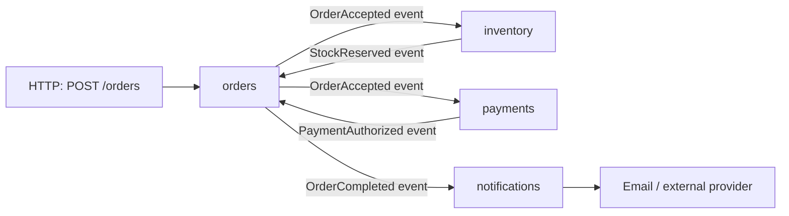
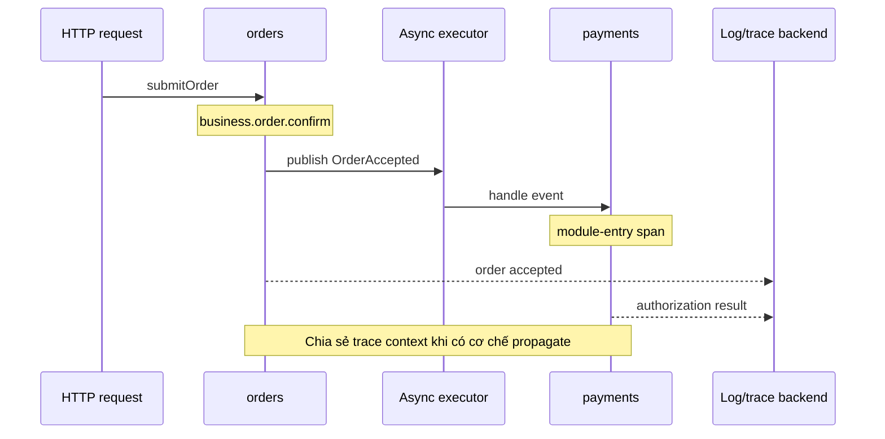

# Chọn telemetry cần thiết cho một modular monolith

> **Chương:** Thiết kế thực tế  
> **Phạm vi:** `SPRING_MODULITH_DOCUMENTATION_OBSERVABILITY` — sử dụng Spring Modulith để sinh tài liệu ranh giới application module và quan sát tương tác trong ứng dụng Spring Boot. Bài thực hành kết hợp **module graph, Actuator, event metrics, tracing, log và context propagation** để kiểm chứng kiến trúc mô-đun khi ứng dụng đang chạy.  
> **Đích học tập:** Thiết kế được một tập telemetry **vừa đủ để vận hành**, chỉ rõ tín hiệu nào đã có sẵn, tín hiệu nào phải tự xây, ai chịu trách nhiệm, ngân sách dữ liệu và cách chứng minh tín hiệu hoạt động.

Một **modular monolith** chạy trong cùng tiến trình nhưng được chia thành các application module có ranh giới rõ ràng. Khi khách hàng đặt hàng, HTTP request có thể đi qua các module `orders`, `inventory`, `payments` và `notifications`. Việc tất cả cùng chạy trong một JVM không có nghĩa chỉ cần một biểu đồ CPU hoặc một dòng log chung. Ngược lại, cũng không cần tạo metric cho từng phương thức Java hay xuất toàn bộ span để hiểu hệ thống.

Mục tiêu của telemetry là trả lời **một câu hỏi vận hành có hành động tiếp theo**: giao dịch có thành công không, chậm tại module nào, event nào đang bị kẹt, thay đổi kiến trúc nào gây tác động và ai phải xử lý. Mọi metric, span và log được chọn phải phục vụ ít nhất một quyết định như vậy.

## 1. Bắt đầu từ đường đi nghiệp vụ và module graph

Giả sử một ứng dụng thương mại có luồng:



Đây là sơ đồ **minh họa**, không giả định Spring Modulith tự tạo các module hay tự kết nối sự kiện như trên. Ranh giới module được xác định bởi tổ chức package, API và cấu hình ứng dụng. Các tương tác có thể là lời gọi bean trực tiếp, phát event đồng bộ hoặc listener bất đồng bộ; mỗi loại cần tín hiệu khác nhau.

Phân biệt **ba bản đồ**:

| Bản đồ | Câu hỏi trả lời | Nguồn |
|---|---|---|
| **Thiết kế tĩnh** | Module nào được phép phụ thuộc module nào? Bean/event nào là API công khai? | `ApplicationModules`, `verify()`, `Documenter` / Application Module Canvas |
| **Cấu trúc runtime** | Ứng dụng đang nhận diện module và dependency ra sao? | Spring Modulith Actuator `/actuator/modulith` |
| **Đường đi thực thi** | Request/event hôm nay thật sự đi qua những module nào, mất bao lâu, lỗi ở đâu? | Metrics, traces, structured logs và trạng thái event publication |

**Module graph không phải bản đồ lưu lượng thực tế.** Một dependency có trong graph có thể chưa được gọi; một trace chỉ phản ánh các thao tác được instrument và được lấy mẫu. Cần kết hợp hai loại bằng chứng để tránh khẳng định sai.

Ví dụ, `orders` phụ thuộc `payments` trong graph nhưng không thấy span `payments` của một request: có thể nhánh nghiệp vụ đó không cần thanh toán, có thể sampling loại bỏ span, hoặc context propagation bị đứt. Không kết luận “module không chạy” chỉ từ một trace thiếu.

## 2. Chọn tín hiệu theo câu hỏi, không theo khả năng thu thập

Đầu tiên viết ra những câu hỏi mà người trực vận hành hoặc đội phát triển thực sự cần trả lời.

| Câu hỏi vận hành | Tín hiệu ưu tiên | Vì sao | Người xử lý |
|---|---|---|---|
| Người dùng có tạo được đơn hàng không? | Request success/error rate và latency của luồng đặt hàng | Phản ánh kết quả người dùng thấy | Đội `orders` |
| Đơn hàng đã nhận nhưng chậm hoàn tất ở đâu? | Tuổi của đơn `pending`, thời gian từ accepted đến completed; trace mẫu theo luồng | Đo kết quả nghiệp vụ và xác định chặng chậm | Đội `orders` phối hợp module nhận event |
| Sự kiện có được phát đúng mức dự kiến? | `module.events.published` theo module/event type | Phát hiện thay đổi cường độ phát event | Chủ module phát event |
| Listener thất bại hoặc event bị tồn đọng? | Số publication thất bại/chưa hoàn tất, tuổi publication cũ nhất và retry count | Phát sự kiện thành công **không** đồng nghĩa consumer xử lý thành công | Chủ module listener / vận hành event registry |
| Lời gọi giữa module nào đang tốn thời gian? | Module-entry spans và timer có chọn lọc cho thao tác trọng yếu | Giúp khoanh vùng mà không instrument từng helper | Đội tích hợp |
| Kiến trúc có bị phá ranh giới sau release? | `ApplicationModules.verify()`, diff module graph/Canvas | Kiểm tra kiến trúc bằng mã nguồn | Tech lead / kiến trúc sư |
| Hệ thống tổng thể có quá tải? | CPU, heap, GC, threads, connection pool và HTTP server metrics | Chẩn đoán vấn đề hạ tầng chung | SRE / platform |
| Có lỗi cụ thể cần điều tra? | Structured logs có correlation/trace ID, mã lỗi hữu hạn | Phục vụ điều tra một giao dịch | Đội phụ trách module |

Một quy tắc hữu ích: **mỗi chỉ số quan trọng phải có một quyết định đi kèm**. Nếu không ai biết phải làm gì khi chỉ số tăng hoặc giảm, ưu tiên của nó thấp hơn những tín hiệu đã gắn với hành động.

## 3. Xây bộ telemetry tối thiểu: P0, P1 và P2

Không phải loại tín hiệu nào cũng cần phát hành ngay ngày đầu. Dùng thứ tự sau cho một modular monolith có đơn hàng, thanh toán và sự kiện bất đồng bộ.

| Mức | Nên có gì | Điều kiện chọn |
|---|---|---|
| **P0 — ngay khi vận hành** | Health/readiness; request throughput, error, duration; một SLI nghiệp vụ quan trọng; lỗi hoặc tồn đọng event trọng yếu; log lỗi có trace/correlation ID; architecture verification trong CI | Thiếu tín hiệu sẽ khó phát hiện sự cố tác động trực tiếp đến khách hàng hoặc dữ liệu |
| **P1 — khi hệ thống đã có nhiều module và luồng async** | `/actuator/modulith` có kiểm soát truy cập; module-entry tracing; event publication metrics; lag theo module/listener; dashboard module và trace propagation qua executor | Cần xác định nơi phát sinh lỗi/chậm, kiểm tra coupling và event recovery |
| **P2 — theo nhu cầu điều tra cụ thể** | Custom observation ở chặng nghiệp vụ, metric riêng cho một loại event, histogram theo operation, business funnel, profiling, trace sampling thích ứng | Chỉ bổ sung sau khi biết câu hỏi và chi phí lưu trữ/nhãn |

**Lưu ý:** P0 không có nghĩa Spring Modulith cung cấp mọi chỉ số trong bảng. Những tín hiệu như **tuổi event còn pending, số event xử lý thất bại, số đơn quá hạn hoặc checkout business-success** thường phải được đo từ ứng dụng, kho trạng thái nghiệp vụ, event publication registry hoặc hạ tầng monitoring. Đừng nhận một metric tùy biến là metric mặc định của framework.

### 3.1. Vì sao không bật mọi thứ?

Instrument từng repository method, từng phép map DTO hay từng vòng lặp tạo ra:

- Trace quá dài, phần lớn span không cho biết ranh giới module.
- Chi phí exporter, collector và lưu trữ tăng.
- Metric có cardinality lớn vì class/method, exception message, ID giao dịch hoặc từng endpoint động.
- Khó xác định đâu là lỗi ảnh hưởng người dùng và đâu là hành vi bình thường.

Chỉ instrument thêm khi có **điểm ra quyết định** rõ ràng: lời gọi đến đối tác thanh toán, transaction quan trọng, bước xử lý event, hoặc pha nghiệp vụ cần SLO riêng.

## 4. Spring Modulith có thể cung cấp sẵn những gì?

Trong tài liệu Spring Modulith 2.2, nhóm khả năng production-ready gồm Actuator để công bố cấu trúc module và observability để ghi nhận các tương tác tại API module. Starter `spring-modulith-starter-insight` gom các hỗ trợ đó cho môi trường runtime.

### 4.1. Thông tin kiến trúc

- `ApplicationModules.of(ShopApplication.class)` xây model application module.
- `verify()` kiểm tra các quy tắc cấu trúc và phụ thuộc.
- `Documenter` sinh component diagrams và **Application Module Canvas**: module API, beans, aggregate roots, các event phát/nghe và cấu hình.
- `/actuator/modulith` công bố module identifiers, display names, base packages và dependencies ở runtime khi endpoint đã được kích hoạt.

Một bài test kiến trúc và tài liệu minh họa:

```java
import org.junit.jupiter.api.Test;
import org.springframework.modulith.core.ApplicationModules;
import org.springframework.modulith.docs.Documenter;

class ModuleArchitectureTest {

    @Test
    void verifyAndDocument() {
        var modules = ApplicationModules.of(ShopApplication.class);
        modules.verify();
        new Documenter(modules).writeDocumentation();
    }
}
```

`ShopApplication` là lớp ứng dụng Spring Boot do dự án tự định nghĩa. Ví dụ cần các dependency Modulith core và test/docs đúng với dòng phiên bản. Tài liệu chỉ sinh khi test chạy. Lưu diff graph/Canvas khi thay đổi module trong pull request để mọi người biết ai đã phụ thuộc thêm vào module nào.

### 4.2. Metric về phát sự kiện

Theo reference Spring Modulith 2.2, có hai dạng counter:

| Tên logic | Ý nghĩa | Đặc điểm |
|---|---|---|
| `module.events.published` | Tổng các lần phát domain event | Có nhãn `module.identifier`, `module.name`, `module.event.type` |
| `module.events.published.$moduleIdentifier.$simpleEventTypeName` | Counter theo module và loại event | Tên metric thay nếu module identifier hoặc tên class event thay |

Vì vậy, nếu `orders` phát `OrderAccepted`, giá trị counter tăng cho biết **event đã được phát**. Nó **không** xác nhận `inventory` đã giữ hàng, `payments` đã ghi nhận giao dịch hoặc `notifications` đã gửi email. Muốn cảnh báo về xử lý thất bại, cần xem **event publication lifecycle** và trạng thái nghiệp vụ.

Thêm nữa, metric dạng tên riêng theo class dễ tạo đứt gãy đồ thị khi refactor `OrderAccepted` thành `OrderPlaced`. Dashboard dài hạn nên ưu tiên metric tổng hợp với tag có giới hạn; khi cần metric riêng để điều tra, ghi nhận rủi ro về tên.

### 4.3. Span tại ranh giới module

Spring Modulith có thể tạo span khi đi vào các Spring component thuộc **API của application module**, không phải tự động tạo span cho toàn bộ method trong JVM.

Các tag module được document gồm:

- `module.identifier`: định danh kỹ thuật của module.
- `module.name`: tên hiển thị.
- `module.invocation-type`: kiểu gọi, chẳng hạn bean hoặc event listener.
- `module.method`: method được gọi.

Chúng giúp trả lời “span này thuộc module nào” hoặc “listener nào liên quan”. Nhưng nếu không có exporter/tracing bridge, các span có thể không xuất hiện trong Jaeger/Tempo/Zipkin. Nếu sampling thấp, một trace đơn lẻ cũng có thể không đầy đủ.

**Thực hành ưu tiên:** kiểm tra khả năng sẵn có trước khi thêm custom annotation, aspect hoặc trace interceptor riêng, tránh đếm đôi latency và tạo span lồng nhau vô ích.

## 5. Chọn SLI/SLO ở cấp luồng nghiệp vụ

SLO là cam kết về một kết quả quan trọng; SLI là đại lượng đo kết quả đó. Telemetry cấp module hỗ trợ tìm nguyên nhân, nhưng **SLO nên phản ánh trải nghiệm người dùng hoặc kết quả nghiệp vụ**, không chỉ số lượng span.

Giả định nhóm thống nhất các mục tiêu minh họa sau:

| SLI | Định nghĩa đo | SLO ví dụ | Nguồn |
|---|---|---|---|
| **Order acceptance success rate** | Số yêu cầu tạo đơn được chấp nhận / tổng yêu cầu hợp lệ | ≥ 99,9% trong 30 ngày | HTTP outcome hoặc counter nghiệp vụ có định nghĩa rõ |
| **Order acceptance latency** | Thời gian từ khi API bắt đầu đến khi báo đã chấp nhận | p95 ≤ 500 ms | HTTP timer/Observation của thao tác tạo đơn |
| **Order completion delay** | Từ `OrderAccepted` đến khi đơn đạt trạng thái `COMPLETED` | 99% hoàn thành trong 2 phút | Timestamp nghiệp vụ ở `orders` |
| **Event recovery** | Thời gian publication quan trọng ở trạng thái chưa hoàn tất | Không publication quan trọng tồn đọng trên 5 phút | Registry/query theo state, age, listener |
| **Architecture integrity** | Kết quả `verify()` và diff graph trên nhánh phát hành | 100% build phát hành có test pass | CI, `Documenter` |

Mọi con số trên **chỉ là bài tập**; nhóm thực tế phải lựa chọn theo cam kết đối tác, tải và hành vi kinh doanh. Một số điểm cần làm rõ ngay khi định nghĩa:

1. **“Accepted” khác “Completed”.** API trả `202 Accepted` hoặc `201 Created` không đảm bảo thanh toán đã xử lý xong. Nếu luồng là eventual consistency, nên có SLI cho độ trễ hoàn tất hoặc backlog.
2. Phải xác định yêu cầu **hợp lệ** là gì. Lỗi validation 4xx có thể là hành vi đúng, không nên tự động tính thành lỗi hệ thống trong SLO.
3. Nếu event bị retry, số lần listener chạy có thể lớn hơn số event nghiệp vụ duy nhất; tránh dùng số publication làm mẫu số cho tỷ lệ “đơn hoàn tất”.
4. Cần thống nhất cửa sổ đo và khoảng trễ dữ liệu. Đừng so sánh throughput một phút với SLO độ trễ 30 ngày rồi kết luận hệ thống tốt/xấu.
5. Trace sampling giúp chẩn đoán; **không** là nguồn đếm đáng tin cậy cho tổng giao dịch. Đếm theo meter và dữ liệu nghiệp vụ.

Một SLO có thể tính chính xác bằng meter HTTP/ứng dụng nếu trạng thái thành công được phân loại rõ. Nếu chưa có counter nghiệp vụ, trước tiên định nghĩa cách ghi nhận kết quả thành công/thất bại; **không dựng một dashboard chỉ dựa vào sự tồn tại của span**.

## 6. Telemetry nào cần tự bổ sung?

Hãy chọn rất ít custom measurements, bám theo phần chưa được Spring Boot hoặc Spring Modulith cung cấp.

### 6.1. Custom observation cho pha nghiệp vụ

Giả sử `orders` có một bước “xác nhận đơn” có SLO riêng. Micrometer Observation vừa có thể đo duration, vừa tạo trace context nếu có handler/bridge phù hợp.

```java
package com.example.shop.orders;

import io.micrometer.observation.Observation;
import io.micrometer.observation.ObservationRegistry;
import org.springframework.stereotype.Service;

@Service
public class OrderConfirmationFacade {

    private final ObservationRegistry observations;
    private final OrderWorkflow orders;

    public OrderConfirmationFacade(
            ObservationRegistry observations,
            OrderWorkflow orders) {
        this.observations = observations;
        this.orders = orders;
    }

    public void confirm(String orderId) {
        Observation.createNotStarted("business.order.confirm", observations)
                .contextualName("order.confirm")
                .lowCardinalityKeyValue("module.identifier", "orders")
                .lowCardinalityKeyValue("business.operation", "confirm")
                .observe(() -> orders.confirm(orderId));
    }
}

// Interface do ứng dụng triển khai; đặt tại public API thích hợp.
interface OrderWorkflow {
    void confirm(String orderId);
}
```

Điểm thiết kế:

- `business.order.confirm` và `order.confirm` là tên logic **không thay theo môi trường**.
- `module.identifier=orders` và `business.operation=confirm` là các giá trị có tập hữu hạn.
- `orderId` không được gắn vào metric tag hoặc tên span. Nếu muốn đưa ID vào trace phục vụ điều tra, phải xét phân quyền và chính sách dữ liệu nhạy cảm; thường nên dùng một correlation ID được kiểm soát.
- Nếu `orders.confirm` đã tạo module-entry span thì observation trên chỉ hợp lý khi đo **một pha nghiệp vụ riêng**; nếu đo trùng hoàn toàn, cân nhắc bỏ custom observation.

Khi handler metric hoạt động, tên timer được truy vấn qua registry theo observation name. Khi gửi ra Prometheus hoặc hệ khác, **tên meter xuất ra có thể được chuẩn hóa**; hãy đọc dữ liệu thực ở `/actuator/metrics` và exporter trước khi viết query.

### 6.2. Số publication tồn đọng và tuổi publication cũ nhất

Spring Modulith có **Event Publication Registry** để theo dõi việc giao sự kiện cho transactional listener, với trạng thái publication. Trên dòng 2.2 có các trạng thái:

```text
PUBLISHED -> PROCESSING -> COMPLETED
                 |
                 +----------> FAILED -> RESUBMITTED -> PROCESSING
                                    |
                                    +----------------> ABANDONED
                                    (theo chính sách; từ 2.2)
```

Sơ đồ trên minh họa những chuyển trạng thái quan trọng, không phải toàn bộ máy trạng thái. Một publication có thể bị đánh dấu `FAILED` do listener ném exception hoặc do staleness monitor (nếu được bật). `ABANDONED` nghĩa là đã từ bỏ retry, **khác** `COMPLETED`.

Để vận hành, có thể bổ sung một collector/query qua interface registry hoặc kho persistence phù hợp rồi xuất các metric **do ứng dụng tự định nghĩa**, chẳng hạn:

| Custom metric gợi ý | Loại | Nhãn hữu hạn | Câu hỏi |
|---|---|---|---|
| `business_event_publications_pending` | Gauge | `consumer_module`, `event_type`, `state` | Đang chờ xử lý bao nhiêu publication? |
| `business_event_publication_oldest_age_seconds` | Gauge | `consumer_module`, `event_type` | Publication cũ nhất bị kẹt bao lâu? |
| `business_event_publications_failed_total` | Counter | `consumer_module`, `reason_class` | Có bao nhiêu lần xử lý thất bại thuộc nhóm nguyên nhân nào? |
| `business_order_completion_seconds` | Timer / histogram | `flow=order_checkout`, `outcome` | Từ chấp nhận đơn đến hoàn tất mất bao lâu? |

**Các tên trong bảng là đề xuất, không phải metric mặc định Spring Modulith.** Dữ liệu tính `pending`/`oldest age` cần định nghĩa cách đối xử với `FAILED`, `RESUBMITTED` và `ABANDONED`, làm sạch publication đã hoàn thành, cũng như schema thực của persistence implementation. Đo riêng `ABANDONED` để không bỏ sót thất bại vĩnh viễn.

**Chọn phép đo rẻ:** không quét toàn bộ bảng publication vào mỗi HTTP request. Dùng query tổng hợp có index phù hợp, một tác vụ đo theo chu kỳ hoặc dữ liệu đã có từ monitoring persistence. Điều chỉnh tần suất theo tốc độ event và ngân sách hệ thống.

### 6.3. Phân loại lỗi bằng mã hữu hạn

Một lỗi thanh toán thường có các nhóm `timeout`, `validation`, `provider_error`, `declined`. Có thể dùng chúng làm tag `reason_class` nếu số giá trị được kiểm soát. Tuyệt đối không lấy thông điệp exception, URL đầy đủ, UUID hay text phản hồi của đối tác làm metric label.

Phân loại này giúp chọn hành động: `declined` do quyết định nghiệp vụ có thể không cần đánh thức SRE; `provider_error` tăng đột biến cùng completion lag có thể cần chuyển traffic hoặc cô lập phụ thuộc.

## 7. Log và trace: giữ liên kết mà không lộ dữ liệu

Metric giúp nhận biết xu hướng; trace giúp theo đường đi của một giao dịch được lấy mẫu; log giúp giải thích tình huống cụ thể. Một trace đẹp nhưng không liên kết được log của listener bất đồng bộ vẫn thiếu giá trị.

### 7.1. Một schema log tối thiểu

Ví dụ bản ghi **minh họa**:

```json
{
  "timestamp": "2026-11-27T04:30:00Z",
  "level": "ERROR",
  "service": "shop-app",
  "environment": "prod",
  "module": "payments",
  "operation": "authorize",
  "eventType": "OrderAccepted",
  "errorCode": "PARTNER_TIMEOUT",
  "traceId": "trace-id-example",
  "spanId": "span-id-example",
  "message": "Payment provider timed out"
}
```

Các field `traceId`/`spanId` chỉ có nếu tracing context hiện hành được propagate và logging pattern/appender đã cấu hình để đưa chúng vào log. Đừng hardcode trace ID minh họa; runtime sinh ID khi trace được tạo.

Khi ghi log:

- Dùng mã lỗi hữu hạn, event type và module identifier để lọc có cấu trúc.
- Đặt mức `WARN`/`ERROR` theo mức tác động, tránh ghi mỗi retry bình thường như một sự cố P0.
- Thực hiện log có kiểm soát tại ranh giới nghiệp vụ và nơi khôi phục exception; tránh một exception bị log nguyên stack ở 4 module liên tiếp.
- Không log token, secret, PAN, thông tin thanh toán, payload nhạy cảm, header Authorization hoặc toàn bộ message event nếu có dữ liệu người dùng.
- Khi phải tra một đơn cụ thể, dùng công cụ tìm kiếm được phân quyền theo correlation ID và thời hạn lưu log, không sử dụng ID đó làm metric label.

### 7.2. Span và context propagation

Một trace lý tưởng đi qua:



Khi listener chạy ở thread khác, không thể dựa vào `ThreadLocal` của request ban đầu để tự động có parent span. Với executor tùy chỉnh trên các phiên bản Framework/Boot có hỗ trợ, đăng ký `ContextPropagatingTaskDecorator`:

```java
import org.springframework.context.annotation.Bean;
import org.springframework.context.annotation.Configuration;
import org.springframework.core.task.support.ContextPropagatingTaskDecorator;

@Configuration(proxyBeanMethods = false)
class TraceContextConfiguration {

    @Bean
    ContextPropagatingTaskDecorator contextPropagatingTaskDecorator() {
        return new ContextPropagatingTaskDecorator();
    }
}
```

Đoạn bean trên theo hướng dẫn Spring Boot/Framework hiện hành cho `AsyncTaskExecutor` tùy chỉnh. **Phải kiểm tra executor thực sự sử dụng decorator**. Nếu Boot tự cấu hình `AsyncTaskExecutor` và phiên bản hỗ trợ, có thể bật `spring.task.execution.propagate-context=true`; với Reactor có `spring.reactor.context-propagation=auto`. Hai cơ chế là các lựa chọn theo cách thực thi và version, không phải một công tắc áp dụng cho mọi hệ thống.

Khi event đi qua **message broker hoặc tiến trình khác**, phải chuyển context bằng headers/protocol theo tracing propagation đã chọn. Khi xử lý event được retry sau khi ứng dụng restart, không nên giả định span cũ còn active; việc tiếp nối và liên kết trace phải có chủ đích.

Để chứng minh truyền context, chạy bài test có listener async và kiểm tra trace backend hoặc in-memory tracing handler: span listener có parent/link như thiết kế, module tag đúng và log thể hiện trace ID khi có context. Không coi sự trùng tên span là bằng chứng propagation.

## 8. Dựng telemetry stack ở mức vừa đủ

Phần này giả định một ứng dụng đã dùng Spring Boot và một **dòng Spring Modulith phù hợp theo compatibility matrix**. Ví dụ dependency minh họa cho Maven với BOM Modulith do project quản lý phiên bản:

```xml
<!-- Spring Modulith Insight: Actuator module info + module observability -->
<dependency>
    <groupId>org.springframework.modulith</groupId>
    <artifactId>spring-modulith-starter-insight</artifactId>
    <scope>runtime</scope>
</dependency>

<!-- Xuất metrics nếu chọn Prometheus -->
<dependency>
    <groupId>io.micrometer</groupId>
    <artifactId>micrometer-registry-prometheus</artifactId>
    <scope>runtime</scope>
</dependency>

<!-- Kiểm thử ranh giới và sinh tài liệu module -->
<dependency>
    <groupId>org.springframework.modulith</groupId>
    <artifactId>spring-modulith-starter-test</artifactId>
    <scope>test</scope>
</dependency>
```

Starter `insight` bao gồm hỗ trợ Actuator và observability của Modulith. Để có trace trong backend cần thêm **bridge, exporter, collector** phù hợp với Spring Boot/Micrometer version và công nghệ quan sát được chọn; chỉ thêm `insight` không bảo đảm trace đã được gửi đi.

Ví dụ `application.yml`:

```yaml
spring:
  application:
    name: shop-app

management:
  endpoints:
    web:
      exposure:
        include: health,info,metrics,prometheus,modulith
  metrics:
    tags:
      application: ${spring.application.name}
      environment: ${DEPLOYMENT_ENV:local}
  tracing:
    sampling:
      probability: ${TRACE_SAMPLE_PROBABILITY:0.10}
```

Điểm cần kiểm chứng:

- `/actuator/metrics` yêu cầu Actuator/meter registry đang hoạt động; `/actuator/prometheus` cần Prometheus registry.
- `/actuator/modulith` yêu cầu hạ tầng Spring Modulith Actuator đã bật và endpoint được expose.
- `management.tracing.sampling.probability` chỉ điều khiển tỷ lệ lấy mẫu; exporter/collector mới quyết định trace có tới backend không.
- `environment` nên có tập giá trị xác định (`local`, `dev`, `staging`, `prod`). Đưa môi trường vào resource attributes của tracer, ví dụ OpenTelemetry `deployment.environment.name`, bằng cơ chế exporter/collector phù hợp. **Metric common tag không tự đồng bộ sang resource attribute của trace.**
- Endpoint quản trị và tài liệu mô-đun có thể lộ cấu trúc nội bộ. Đặt trong mạng quản trị hoặc yêu cầu xác thực/phân quyền; đừng mở công khai chỉ để Grafana thu thập dễ dàng.

**Cấu hình là ví dụ triển khai, không thay thế tài liệu version.** Tên starter, property context propagation và API test có thể khác giữa Modulith 1.x/2.x hoặc Boot 3.x/4.x. Chốt cặp BOM trước khi sao chép.

## 9. Thiết kế metric và tag để không gây bùng nổ cardinality

Một tên metric phải ổn định qua môi trường. Tag giúp phân nhóm; chỉ dùng các giá trị có giới hạn rõ ràng.

| Nên là tag hữu hạn | Không dùng làm metric label | Đưa ở đâu khi thật sự cần? |
|---|---|---|
| `module.identifier=orders` | `orderId=78a...` | Trace attribute/log bảo vệ theo chính sách |
| `business.operation=confirm` | `requestId=<uuid>` | Correlation ID ở log/trace |
| `outcome=success|failure` | `errorMessage=<text tự do>` | Log đã kiểm soát dữ liệu |
| `reason_class=timeout|validation|provider` | `customerEmail=<email>` | Không đưa vào telemetry không cần thiết |
| `environment=dev|staging|prod` | `instanceId=<hàng nghìn pod>` nếu được nhân trên nhiều nhãn khác | Resource/instance dimensions do nền tảng quản lý |

Không phải toàn bộ key trong cột thứ nhất đều cần xuất ở mọi meter. Chỉ thêm khi một dashboard hoặc alert đang dùng. Giá trị `module.identifier` từ Modulith nên khớp module graph. Đổi package có thể làm tên module suy ra thay đổi; khi identifier cần ổn định, cân nhắc khai báo `@ApplicationModule(id = "orders")` ở `package-info.java` và kiểm chứng.

**Ngân sách telemetry** nên giới hạn rõ: số module, event type, operation, environment, phiên bản ứng dụng, retention và sampling. Số series có thể tăng theo **tích số** các chiều nhãn; chỉ thêm một nhãn có hàng chục nghìn giá trị cũng đủ gây chi phí rất lớn.

Đừng tính tổng giao dịch qua sampling span. Đừng tạo một timer tên `confirm-order-<orderId>`. Đừng chép toàn bộ field domain event thành nhãn bằng `ModulithEventMetricsCustomizer` khi chưa kiểm soát giá trị; nó có thể tạo cardinality ngoài dự kiến.

## 10. Thiết kế ba màn hình dashboard có khả năng hành động

### 10.1. Màn hình tổng quan dịch vụ

Ưu tiên **người dùng cảm nhận gì**:

- Request rate, error rate, duration của endpoint tạo đơn/thanh toán.
- Số đơn `accepted`/`completed`/`failed` theo kết quả nghiệp vụ và độ trễ hoàn tất.
- Availability, connection pool, CPU/heap/GC và tình trạng exporter.

Cảnh báo P0 nên dựa vào tác động người dùng (ví dụ tỷ lệ yêu cầu 5xx tăng đủ lớn và kéo dài), thay vì chỉ `CPU > 80%` hoặc “có một exception”.

### 10.2. Màn hình luồng module

Ưu tiên **tương tác giữa module**:

- Event publication rate theo `module.identifier` và `module.event.type`.
- Publication pending/failed/abandoned và tuổi cũ nhất theo listener hoặc nhóm event quan trọng — các chỉ số này **phải do ứng dụng đo thêm** nếu chưa có hệ đo khác.
- Latency theo pha nghiệp vụ được instrument có chủ đích.
- Link từ biểu đồ sang trace mẫu và log đã lọc theo correlation ID.

Ví dụ truy vấn PromQL minh họa **sau khi xác minh tên exporter thực tạo**:

```promql
sum by (module_identifier, module_event_type) (
  rate(module_events_published_total{
    application="shop-app",
    environment="prod"
  }[5m])
)
```

`module_events_published_total` và các label dạng gạch dưới là **ví dụ chuyển đổi từ Micrometer/Prometheus**. Các registry/phiên bản có thể đặt tên khác. Trước khi sử dụng, kiểm tra trực tiếp `/actuator/prometheus`, metric metadata và label thực tế; không copy truy vấn mù quáng.

Nếu query trên cho biết event vẫn được phát đều, nhưng số pending publication ngày càng lớn, đó là tín hiệu nghi ngờ **consumer lag/failure**, không phải producer đã ngừng phát.

### 10.3. Màn hình kiến trúc và thay đổi

- Sơ đồ module được sinh tại build, có phiên bản và diff.
- Các dependency mới/đã xóa giữa module.
- Module identifiers trong `/actuator/modulith` so với baseline build.
- Liên kết tới dashboard về các module đã thay đổi trong release.

Đây không nhất thiết là màn hình live streaming. Thay đổi dependency giữa module chỉ xảy ra khi code/deployment đổi; kiểm tra ở **CI và lúc phát hành** thường hữu ích hơn việc scrape module graph mỗi vài giây.

## 11. Cảnh báo dựa vào rủi ro và quyền sở hữu

| Alert minh họa | Điều kiện gợi ý | Mức độ | Hành động đầu tiên |
|---|---|---|---|
| **Order acceptance error budget burn** | Tỷ lệ lỗi hợp lệ vượt ngưỡng trong nhiều cửa sổ | P0 nếu nhiều khách hàng ảnh hưởng | Kiểm tra release mới, các lỗi từ `orders` và dependency |
| **Order completion backlog** | `oldest_age_seconds` vượt mức cam kết, hoặc pending tăng liên tục | P0/P1 tùy số đơn ảnh hưởng | Kiểm tra listener `inventory`/`payments`, registry và dependency |
| **Failed/abandoned publication** | Số publication thất bại quan trọng vượt ngưỡng | P1 hoặc P0 theo mức ảnh hưởng | Phân loại lỗi, kiểm tra retry policy và transaction |
| **Partner payment latency** | p95 của thao tác đối tác tăng kéo dài, kèm kết quả lỗi | P1 | Mở traces `payments`, xem timeout/circuit breaker |
| **Actuator/telemetry pipeline missing** | Scrape target hoặc exporter ngừng nhận số liệu | P1 vận hành | Kiểm tra service discovery, network, credentials, collector |
| **Unexpected module dependency** | `ApplicationModules.verify()` fail hoặc graph diff chưa được duyệt | Chặn phát hành trong CI | Kiểm tra import, API boundary, module config |

Đặt alert theo **triệu chứng trước, nguyên nhân sau**. Một event `OrderAccepted` được phát nhưng chưa xử lý không đồng nghĩa khách hàng bị lỗi ngay; tuy vậy, nếu quá ngưỡng 5 phút và làm trễ hoàn tất đơn, nó có thể thành lỗi tác động trực tiếp.

Cảnh báo phải ghi rõ module owner, dashboard/truy vấn và runbook ngắn. Tránh gửi email/chat cho toàn đội mỗi lần retry, vì sẽ tạo nhiễu và làm người trực bỏ qua cảnh báo thật.

## 12. Kiểm chứng telemetry bằng test và sự cố giả lập

Việc cấu hình exporter thành công không đủ: cần chứng minh tín hiệu tăng đúng lúc, đúng tag, đúng quan hệ trace và đủ dữ liệu để điều tra.

### 12.1. Kiểm tra kiến trúc

- Chạy `ApplicationModules.of(ShopApplication.class).verify()` ở CI.
- Sinh `Documenter.writeDocumentation()` và so module graph/Canvas với baseline.
- Nếu dùng `@ApplicationModule(id)`, xác nhận identifier trùng tag `module.identifier` tại runtime.

### 12.2. Kiểm tra metric

- Gửi một yêu cầu đặt hàng hợp lệ; xác nhận HTTP success/latency meter và business SLI nếu có.
- Phát một `OrderAccepted`; xác nhận `module.events.published` tăng ở module đúng.
- Gửi hai event cùng loại, kiểm tra counter tăng hai lần — **không** tự suy diễn listener thành công hai lần.
- Nếu ứng dụng có custom gauges cho publication, giả lập listener thất bại rồi xác nhận `pending/failed/oldest-age` phản ánh trạng thái.
- Kiểm tra exporter: nhãn hữu hạn, tên metric ổn định giữa dev/staging/prod, không có `orderId` trong labels.

### 12.3. Kiểm tra trace và log

- Gọi tuyến `orders` → `payments` trực tiếp; kiểm tra module-entry span và `module.identifier`.
- Chạy `@ApplicationModuleListener` bất đồng bộ; xác nhận context propagation bằng parent/link theo chính sách tracing.
- Mô phỏng timeout thanh toán; truy từ alert tới trace mẫu, rồi tới log có `errorCode=PARTNER_TIMEOUT`.
- Giảm sampling xuống mức production để kiểm tra hành vi exporter; xác nhận meter/SLO vẫn đếm đúng dù span không phải lúc nào cũng có.

### 12.4. Kiểm tra khả năng hành động

Cho một người **không viết instrumentation** đọc dashboard và trả lời:

1. Có bao nhiêu đơn bị ảnh hưởng?
2. Lỗi bắt đầu từ khi nào, thuộc module nào?
3. Event đang không được phát hay đã phát nhưng listener chưa hoàn tất?
4. Có thể tìm được một trace/log đại diện không?
5. Hành động đầu tiên trong runbook là gì và liên hệ ai?

Nếu không trả lời được, cải thiện định nghĩa tín hiệu hoặc liên kết dashboard thay vì thêm hàng loạt metrics không gắn với mục đích.

## 13. Lộ trình triển khai cho một đội nhỏ

### Giai đoạn 1 — baseline kiến trúc và kết quả người dùng

Chốt `orders`, `payments`, `inventory`, `notifications` cùng owner. Chạy `verify()` và sinh Canvas. Định nghĩa SLI `order acceptance success` và `order completion delay`. Bật HTTP server metrics và structured logs có correlation/tracing context nếu hạ tầng cho phép.

**Đầu ra:** có một dashboard trả lời “khách hàng có thể đặt hàng và đơn có hoàn tất không?”.

### Giai đoạn 2 — giải thích tương tác module

Bật Insight starter, công bố `/actuator/modulith` trong phạm vi bảo vệ, thêm registry/exporter và dashboard event publication. Bật module-entry traces với sampling có kiểm soát. Dùng module identifier thống nhất giữa graph, metrics và traces.

**Đầu ra:** có thể truy vết từ một giao dịch đến module có khả năng gây chậm/lỗi.

### Giai đoạn 3 — độ tin cậy của event

Nếu dùng Event Publication Registry, thiết kế collector theo `pending`, `FAILED`, `ABANDONED` và tuổi cũ nhất. Kiểm tra hành vi rollback, retry/resubmission, staleness và chính sách xóa publication hoàn thành. Bổ sung cảnh báo backlog kèm runbook cho listener quan trọng.

**Đầu ra:** biết event nào bị kẹt và có đường khôi phục, thay vì chỉ nhìn thấy counter phát event tăng.

### Giai đoạn 4 — tối ưu chi phí và độ chính xác

Đo chi phí telemetry, loại bỏ span/meter không mang quyết định, rà soát cardinality, ẩn dữ liệu nhạy cảm, thử sự cố và chứng minh alert có thể hành động. Chỉ thêm custom observation khi cần đo pha nghiệp vụ chưa có sẵn.

**Đầu ra:** bộ telemetry vừa đủ, ổn định qua môi trường và release, có dashboard cùng quy trình phản ứng.

## 14. Những lỗi lựa chọn telemetry hay gặp

| Lựa chọn sai | Vấn đề | Cách thiết kế lại |
|---|---|---|
| Dùng `module.events.published` để kết luận event xử lý thành công | Counter đếm **phát sự kiện**, không đếm thành công listener | Theo dõi event publication lifecycle và trạng thái nghiệp vụ |
| Dùng module graph để suy ra request đi qua mọi module có dependency | Graph là cấu trúc tĩnh, không thể hiện lưu lượng thực | So span mẫu và metric đường chạy |
| Chỉ có CPU/heap metrics | Không biết khách hàng đặt hàng/thanh toán có thành công | Thêm SLI theo kết quả nghiệp vụ |
| Coi HTTP `200/202` là đơn đã hoàn tất | Luồng eventual consistency chưa kết thúc | Thêm completion latency và backlog |
| Đặt order ID vào tên metric/tag | Cardinality tăng, chi phí lớn và nguy cơ rò dữ liệu | Giữ nhãn hữu hạn; dùng correlation ID trong log/trace theo chính sách |
| Bật trace sampling 100% ở production không có ngân sách | Tải exporter và lưu trữ tăng mạnh | Xác định sampling, retention, giới hạn exporter phù hợp |
| Mọi method đều có custom observation | Trùng lặp với instrumentation mặc định, trace khó đọc | Instrument ranh giới module và pha nghiệp vụ quan trọng |
| Context không theo listener async | Trace bị tách, khó xác định nguyên nhân xuyên module | Cấu hình executor propagation và kiểm tra đường thực thi |
| Không phân biệt nhãn log, metric, resource | Dashboard không filter được giữa môi trường | Chuẩn hóa schema cho service/module/environment |
| Chỉ kiểm tra `/actuator/health` | Ứng dụng còn sống nhưng event backlog và business failure vẫn tăng | Thêm business SLI + publication reliability signals |
| Xây quá nhiều alert từ đầu | Dễ cảnh báo trùng/nhiễu | Bắt đầu bằng user-impact và backlog; bổ sung alert theo sự cố đã gặp |

## 15. Bài tập thiết kế hoàn chỉnh

**Đề bài:** Một modular monolith xử lý 1.000 đơn/phút (số giả định để thảo luận) với bốn module `orders`, `inventory`, `payments`, `notifications`. `orders` phát `OrderAccepted`, các listener xử lý bất đồng bộ. Các triệu chứng: khách hàng thấy đơn “đang xử lý” lâu; dashboard HTTP vẫn xanh; hệ thống có nhiều retry thanh toán; phần lớn trace bị tách khi chạy listener.

**Yêu cầu:**

1. Vẽ module graph và phân biệt dependency tĩnh với luồng event thực tế.
2. Chọn **không quá tám tín hiệu P0/P1**. Với mỗi tín hiệu, ghi tên, nguồn, ý nghĩa, module owner, ngưỡng, hành động và chi phí/cardinality.
3. Phân loại tín hiệu do Spring Boot/Spring Modulith cung cấp sẵn và tín hiệu phải tự xây. Đặc biệt chỉ rõ `module.events.published` đo gì.
4. Viết SLI cho `order completion delay` theo timestamp nghiệp vụ, không dùng duration của HTTP acceptance thay thế.
5. Thiết kế metric backlog/failed publication và xử lý trường hợp `ABANDONED`.
6. Đề xuất cách truyền context qua listener async, cách tương quan log với trace và giới hạn sampling.
7. Tạo dashboard tổng quan, dashboard module và một runbook xử lý `payments` timeout.
8. Tự giả lập một listener thất bại rồi giải thích telemetry nào giúp phát hiện trước khi khách hàng báo lỗi.

**Một tập tám tín hiệu tham khảo:** (1) request success rate, (2) request latency, (3) order completion delay, (4) event published rate, (5) pending publication count, (6) oldest pending age, (7) failed/abandoned publication count, (8) module-entry traces có correlation ID trong log. Architecture verification và module graph đi qua CI/documentation và không nhất thiết chiếm một time-series metric trong bộ tám trên.

**Tiêu chí đạt:**

- Biết **đo điều gì để quyết định điều gì**; mỗi alert có người chịu trách nhiệm.
- Không nhầm event **published** với **completed**.
- Có tín hiệu ở cả cấp trải nghiệm người dùng, module interaction và event recovery.
- Có đường truy lỗi từ dashboard tới trace/log và từ trace tới module graph.
- Tên metric/span/tag ổn định, không chứa giá trị có cardinality không giới hạn.
- Có bài kiểm chứng thực tế cho async context propagation và ít nhất một trường hợp publication thất bại.
- Giải thích được vì sao một số loại instrumentation **chưa cần** triển khai.

## 16. Tài liệu tham khảo

Các tham khảo dưới đây dựa trên tài liệu Spring Modulith/Spring Boot hiện hành. Khi áp dụng vào một nhánh khác, dùng URL khóa theo dòng phiên bản để kiểm tra API, dependency và property.

1. [Spring Modulith — Fundamentals](https://docs.spring.io/spring-modulith/reference/fundamentals.html): ranh giới module, API công khai, dependency giữa application modules.
2. [Spring Modulith — Documenting Application Modules](https://docs.spring.io/spring-modulith/reference/documentation.html): `Documenter`, module graph, Application Module Canvas.
3. [Spring Modulith — Production-ready Features](https://docs.spring.io/spring-modulith/reference/production-ready.html): Insight starter, Modulith Actuator, module-entry spans và `module.events.published`.
4. [Spring Modulith — Working with Application Events](https://docs.spring.io/spring-modulith/reference/events.html): `@ApplicationModuleListener`, Event Publication Registry, lifecycle và xử lý sự kiện thất bại.
5. [Spring Boot — Observability](https://docs.spring.io/spring-boot/reference/actuator/observability.html): metrics, traces, Micrometer Observation và context propagation.
6. [Spring Boot — Metrics](https://docs.spring.io/spring-boot/reference/actuator/metrics.html): các meter cơ bản, exporter, common tags và Prometheus.
7. [Micrometer — Observation](https://docs.micrometer.io/micrometer/reference/observation/introduction.html): observation lifecycle, low-/high-cardinality key-values.
8. [OpenTelemetry — Semantic Conventions](https://opentelemetry.io/docs/specs/semconv/): resource attributes và tên ngữ nghĩa phổ biến cho telemetry.

**Nguyên tắc vận hành:** bắt đầu với tín hiệu về **kết quả người dùng và độ tin cậy event**; sử dụng Spring Modulith để nối tín hiệu đó với **ranh giới module đã được kiểm chứng**. Chỉ mở rộng telemetry khi câu hỏi mới, rủi ro mới hoặc bài kiểm thử sự cố cho thấy một khoảng trống thực sự.
