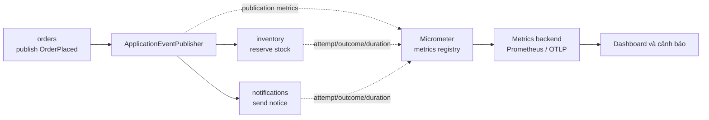
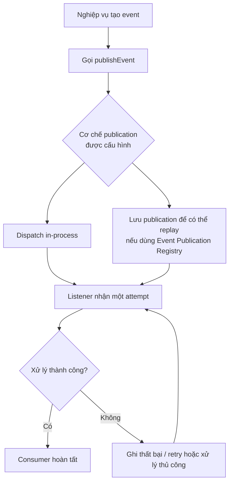
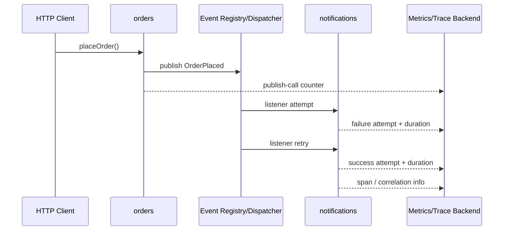

# Chọn metric tổng hợp cho domain event

Trong một ứng dụng Spring Boot theo kiến trúc mô-đun, **domain event** giúp các application module trao đổi thông tin mà không cần gọi trực tiếp vào phần triển khai của nhau. Ví dụ, module `orders` phát `OrderPlaced`, module `inventory` giữ hàng, rồi module `notifications` gửi thông báo. Khi hệ thống chạy thật, câu hỏi vận hành không chỉ là “đã phát bao nhiêu sự kiện?” mà còn là “có bao nhiêu sự kiện xử lý thành công, mất bao lâu, bị thử lại mấy lần và còn tồn bao nhiêu?”.

Bài **Chọn metric tổng hợp cho domain event** thuộc chương **Thiết kế thực tế** của **SPRING_MODULITH_DOCUMENTATION_OBSERVABILITY**. Phạm vi là dùng Spring Modulith để xác minh ranh giới application module, sinh module graph và quan sát tương tác giữa các phần của ứng dụng Spring Boot bằng Actuator, event metrics, tracing và context propagation. Chúng ta thiết kế bộ chỉ số cho event theo nghiệp vụ, chọn chiều tổng hợp ít nhãn, viết ví dụ với Micrometer, xây dựng truy vấn dashboard và kiểm tra ý nghĩa của số liệu khi listener bất đồng bộ hoặc xử lý lại.

> Các tên package, event, metric, biểu đồ và địa chỉ trong bài là ví dụ. Spring Modulith có thể cung cấp event publication metrics và observability riêng tùy phiên bản, dependency và registry. Mã minh họa tạo **custom metrics có tên do ứng dụng quản lý** để giải thích thiết kế; không khẳng định chúng đã có sẵn trong mọi phiên bản Spring Modulith.

## 1. Kết quả cần đạt

Sau bài này, bạn có thể:

1. Mô tả các giai đoạn của một domain event và xác định thời điểm đo ở mỗi giai đoạn.
2. Phân biệt số lần **gọi publish**, số publication được ghi bền vững, số lần **thử xử lý**, số lần thành công và số event nghiệp vụ duy nhất hoàn tất.
3. Chọn Counter, Timer, Gauge, histogram và các nhãn theo nhu cầu giám sát thực tế.
4. Tránh làm tăng cardinality của metrics bằng cách gắn `orderId`, `eventId`, user ID hay trace ID thành tag.
5. Tạo metric có thể tổng hợp theo `source_module`, `consumer_module`, `event_type` và `outcome` mà không làm mất ý nghĩa nghiệp vụ.
6. Viết PromQL cho throughput, tỷ lệ lỗi theo lần thử, phân phối thời gian xử lý và backlog; tránh lỗi khi traffic thấp hoặc thiếu sample.
7. Đối chiếu bộ metric với module graph, Actuator, trace và hành vi listener để biết dashboard phản ánh đúng hệ thống.

## 2. Mô hình nghiệp vụ dùng xuyên suốt

Giả sử ứng dụng `com.example.shop` có các application module:

```text
com.example.shop
├── ShopApplication.java
├── orders/
│   ├── OrderPlaced.java                # public domain event
│   ├── OrderOperations.java            # API công khai
│   └── internal/
│       └── OrderService.java
├── inventory/
│   ├── InventoryOperations.java
│   └── internal/
│       └── InventoryReservationListener.java
├── notifications/
│   └── internal/
│       └── OrderNotificationListener.java
└── observability/
    ├── DomainEventMetrics.java         # API quan sát dùng chung
    └── internal/
        └── ...                         # nếu có triển khai bổ sung
```

Khi đặt hàng, `orders` phát `OrderPlaced`. Có hai listener độc lập: `inventory` giữ hàng và `notifications` gửi email. Sau này ứng dụng có thể bổ sung `PaymentCaptured` hoặc `ShipmentDispatched`.



**Câu hỏi thiết kế:** nếu một event `OrderPlaced` được gửi tới hai listener, inventory xử lý một lần thành công nhưng notifications lỗi một lần rồi retry thành công, hệ thống phải báo cáo gì?

- **Một lần gọi publish** từ `orders`.
- **Hai consumer khác nhau** được dự kiến xử lý.
- **Ba lần thử xử lý** nếu notifications thử hai lần và inventory một lần.
- **Hai lượt xử lý thành công theo consumer** nếu cả hai hoàn tất.
- **Một lần thử thất bại** ở notifications, dù nghiệp vụ cuối cùng thành công.

Không thể dùng một bộ đếm duy nhất để trả lời đồng thời năm điều trên. Các metric phải được định nghĩa gắn với **đơn vị đếm**, **điểm quan sát** và **chiều tổng hợp**.

## 3. Domain event đi qua những trạng thái nào?

Một luồng event có thể gồm các giai đoạn sau:



Không phải mọi ứng dụng Spring Modulith đều bật registry lưu publication; ví dụ luồng đồng bộ chỉ dùng Spring Application Events có thể không có dữ liệu “outstanding publications”. Khi dùng **Spring Modulith Event Publication Registry**, cần cài đặt và cấu hình cơ chế ghi nhận tương thích; chức năng này khác với việc publish vào một broker ngoài như Kafka hoặc RabbitMQ.

Bảng phân biệt **đơn vị đếm**:

| Cột mốc | Đơn vị nên đếm | Ý nghĩa chính xác |
|---|---|---|
| Lời gọi publisher thành công ở API | *publish call* | Method publish trả về mà không ném lỗi; chưa mặc nhiên chứng minh transaction đã commit |
| Publication được ghi bền vững | *durable publication* | Bản ghi publication tồn tại theo cơ chế lưu trữ đã chọn |
| Một listener được gọi | *handling attempt* | Có một lần chạy handler, gồm cả retry |
| Handler hoàn tất không lỗi | *successful attempt* | Một lần thử thành công, có thể là thử lại |
| Handler ném lỗi | *failed attempt* | Một lần thử thất bại, chưa chắc là thất bại cuối cùng của event |
| Publication hoàn tất theo consumer | *completed publication* | Theo trạng thái của registry/handler đã xác minh |
| Publication chưa hoàn tất | *outstanding publication* | Công việc chưa được đánh dấu hoàn tất tại thời điểm đo |
| Event nghiệp vụ duy nhất đã xử lý | *unique business event* | Chỉ đếm một lần cho mỗi event/consumer theo cơ chế idempotency hoặc dữ liệu nghiệp vụ |

**Điểm cốt lõi:** **thành công của một attempt không nhất thiết bằng một event nghiệp vụ duy nhất hoàn tất**. Với retry, crash hoặc redelivery, cùng event có thể được xử lý nhiều lần. Nếu dashboard hiển thị “số đơn hàng đã xử lý”, phải lấy từ trạng thái nghiệp vụ hoặc logic deduplication đáng tin cậy, không cộng thô số callback listener.

## 4. Chọn nhóm metric tổng hợp theo câu hỏi vận hành

Một bộ metric nhỏ, có ý nghĩa rõ thường hiệu quả hơn hàng chục meter không rõ đơn vị.

| Câu hỏi | Metric logic đề xuất | Loại | Chiều tổng hợp phù hợp |
|---|---|---|---|
| Ứng dụng gọi publisher bao nhiêu lần? | `business.domain.events.publish.calls` | Counter | `source_module`, `event_type` |
| Listener thử xử lý bao nhiêu lần và ra sao? | `business.domain.events.handler.attempts` | Counter | `consumer_module`, `event_type`, `outcome` |
| Mỗi lần handler mất bao lâu? | `business.domain.events.handler.duration` | Timer | `consumer_module`, `event_type`, có thể có `outcome` |
| Còn bao nhiêu publication chưa hoàn tất? | `business.domain.events.outstanding` | Gauge | `consumer_module`, `event_type` nếu dữ liệu nguồn hỗ trợ |
| Publication lâu nhất đã chờ bao lâu? | `business.domain.events.oldest.age` | Gauge (thời gian) | Module/consumer hoặc toàn ứng dụng |
| Có bao nhiêu sự kiện nghiệp vụ đã hoàn tất thật? | Chỉ số nghiệp vụ từ nguồn trạng thái | Counter hoặc phép tính từ dữ liệu nghiệp vụ | Theo hợp đồng dữ liệu; phải deduplicate |

Đây là **tên custom metric minh họa**. Nếu dự án đã dùng metric do Spring Modulith phát, nên kiểm tra tên/ý nghĩa/labels thực tế trước khi tự tạo một meter trùng semantics. Hai bộ đếm có tên khác nhau nhưng cùng đếm một lần publish dễ khiến dashboard cộng đôi.

### 4.1. Các metric tối thiểu nên chọn

Đối với một ứng dụng chưa có nhu cầu phân tích sâu, có thể bắt đầu với:

1. `handler.attempts` theo `outcome` để biết mức lỗi và tần suất retry.
2. `handler.duration` để biết thời gian xử lý và độ trễ mỗi attempt.
3. `outstanding` hoặc một chỉ số công việc tồn khác có nguồn dữ liệu tin cậy nếu sử dụng xử lý bền vững.
4. `publish.calls` nếu cần đánh giá lượng phát hoặc phát hiện gián đoạn luồng sự kiện.

Khi không có publication registry, **đừng dựng gauge `outstanding` bằng dữ liệu giả hoặc lấy `published - successes`**: một event có nhiều consumer, retry và transaction khác nhau sẽ làm phép trừ này sai. Thay vào đó, ghi “không hỗ trợ đo tồn đọng theo publication” và thiết kế nguồn dữ liệu phù hợp trước.

### 4.2. Phân biệt Counter, Timer và Gauge

**Counter** chỉ tăng theo thời gian. Nó thích hợp để tính rate/increase cho publish calls, handler attempts hoặc lỗi. Restart có thể làm giá trị counter reset; khi dùng Prometheus, `rate()` và `increase()` xử lý counter reset tốt hơn lấy hiệu hai điểm bằng tay.

**Timer** đo phân phối thời lượng của operation. Micrometer thường thu count và total time; histogram có thể được bật nếu cần P95/P99. Timer không cho biết số publication đang tồn.

**Gauge** mô tả trạng thái tại một thời điểm, như số publication chưa hoàn tất hoặc tuổi của bản ghi lâu nhất. Gauge phải được cập nhật từ nguồn trạng thái thực và có thể thiếu nếu nguồn không sẵn sàng; không coi giá trị 0 trong mọi trường hợp là hệ thống khỏe.

**Long-task timer** có thể hữu ích cho tác vụ đang chạy lâu, nhưng cần thiết kế vòng đời bắt đầu/kết thúc rõ ràng. Nó không tự thay thế gauge của publication đang chờ trong registry.

## 5. Quy định metric contract trước khi viết code

Với mỗi metric, nên có một hợp đồng quan sát (*metric contract*) ngắn:

| Thuộc tính | Ví dụ cho handler attempts |
|---|---|
| Tên logic | `business.domain.events.handler.attempts` |
| Loại | Monotonic Counter |
| Điểm tăng | Sau khi một lần thực thi handler trả về hoặc ném lỗi |
| Đơn vị | Lần thử xử lý |
| Tags | `consumer_module`, `event_type`, `outcome` |
| Giá trị của outcome | Chỉ `success` hoặc `failure`; thống nhất từ điển |
| Không bao gồm | Event ID, order ID, exception message, request ID |
| Kiểu phép tính | `rate()` / `increase()`, tỷ lệ failure theo attempts |
| Giới hạn | Có thể đếm nhiều lần cùng event khi retry |
| Chủ sở hữu | Nhóm phụ trách observability và module consumer |
| Kiểm chứng | Integration test có một success và một failure case |

Hợp đồng phải giải thích **một đơn vị tăng tương ứng hành động nào**. Tên `events.successful` nếu không nói rõ “một callback chạy xong” hay “một event nghiệp vụ đã hoàn tất duy nhất” là mơ hồ. Tên metric và mô tả càng rõ, dashboard càng ít suy diễn sai.

Đơn vị thời gian cũng cần khai báo, ví dụ Timer Micrometer thường được backend Prometheus thể hiện dưới đơn vị seconds. Đừng đặt tiêu đề panel “milliseconds” rồi vẽ một series seconds mà không chuyển đổi.

## 6. Chọn nhãn: chiều phân tích hữu ích và cardinality

Các chiều thường có giá trị nhất cho domain event là:

| Tag | Ví dụ | Lý do dùng |
|---|---|---|
| `source_module` | `orders` | Biết module phát sự kiện |
| `consumer_module` | `inventory` | Biết module xử lý sự kiện |
| `event_type` | `order_placed` | Phân biệt loại sự kiện hữu hạn |
| `outcome` | `success` / `failure` | Tính tỷ lệ thất bại theo attempts |
| `application` hoặc `service` | `shop-api` | Phân biệt ứng dụng hoặc tiến trình khi nhiều service cùng dùng backend |
| `environment` | `prod` | Tách môi trường khi pipeline đã chuẩn hóa nhãn |

Không bắt buộc mọi metric đều có đủ các nhãn trên. Publisher không cần `consumer_module` vì một event có thể có nhiều consumer; handler attempt nên có `consumer_module` nhưng không mặc nhiên biết chính xác source module nếu cùng event type có nhiều nguồn.

**Không dùng high-cardinality tags** cho metrics:

- `eventId`, `orderId`, `customerId`, `userId`, `traceId`, `spanId`.
- URL chứa ID cụ thể, email, số điện thoại, exception message hoặc stack trace.
- Giá trị động lấy trực tiếp từ payload không có danh sách cho phép.

Để tra cứu một event cụ thể, dùng log hoặc trace được bảo vệ có **correlation ID** phù hợp. Metric tổng hợp nhằm trả lời xu hướng; nó không phải kho lưu lịch sử từng giao dịch.

### 6.1. Ước lượng cardinality

Giả sử có 4 consumer modules, 8 event types và 2 outcomes. Chỉ riêng tổ hợp nhãn có tối đa:

\[
4 \times 8 \times 2 = 64
\]

series cho một metric, nếu mọi tổ hợp đều xuất hiện. Khi thêm 3 môi trường và 10 instances, cận trên thành:

\[
64 \times 3 \times 10 = 1\,920
\]

Nếu thêm `orderId` với hàng triệu giá trị, số series có thể tăng vượt khả năng lưu trữ. Cần rà soát cả nhãn do target/exporter thêm như `job`, `instance`, `pod`, `region`; việc chỉ xem tags khai báo trong code là chưa đủ.

**Quy tắc:** giữ danh sách giá trị tag cố định hoặc có giới hạn biết trước, công bố chuẩn tên module/event/outcome và có budget cho số series. Tránh gộp các lỗi thành tag `exceptionMessage`; dùng outcome `failure`, còn nguyên nhân chi tiết nằm trong log/trace.

### 6.2. Đặt tên event type nhất quán

Có thể chuẩn hóa event type ở dạng hữu hạn như `order_placed`, `payment_captured`, `shipment_dispatched`. Đừng lấy trực tiếp `event.getClass().getName()` làm nhãn ở mọi môi trường nếu tên class/package có thể đổi liên tục do refactor. Nếu vẫn dùng tên class, quy định migration metric schema khi refactor.

Ví dụ:

```java
package com.example.shop.observability;

public enum EventKind {
    ORDER_PLACED("order_placed"),
    PAYMENT_CAPTURED("payment_captured");

    private final String metricName;

    EventKind(String metricName) {
        this.metricName = metricName;
    }

    public String metricName() {
        return metricName;
    }
}
```

Một enum quản lý tập nhãn giúp kiểm soát cardinality, nhưng không thay thế review contract khi có event type mới.

## 7. Cài đặt metric wrapper bằng Micrometer

Ta dùng Micrometer để tạo **custom metrics** có thể đo độc lập với các meter mà Spring Modulith phát sinh tự động. Các ví dụ Java sau đặt trong ứng dụng Spring Boot có dependency Micrometer tương thích.

### 7.1. API ghi nhận publish call và handler attempt

```java
package com.example.shop.observability;

import io.micrometer.core.instrument.Counter;
import io.micrometer.core.instrument.MeterRegistry;
import io.micrometer.core.instrument.Timer;
import org.springframework.stereotype.Component;

@Component
public class DomainEventMetrics {

    private final MeterRegistry registry;

    public DomainEventMetrics(MeterRegistry registry) {
        this.registry = registry;
    }

    /**
     * Đếm lời gọi publishEvent đã trả về không lỗi.
     * KHÔNG khẳng định transaction đã commit.
     */
    public void publishCall(String sourceModule, EventKind kind) {
        Counter.builder("business.domain.events.publish.calls")
                .description("Completed calls to the event publisher API")
                .tag("source_module", sourceModule)
                .tag("event_type", kind.metricName())
                .register(registry)
                .increment();
    }

    /**
     * Đo đúng một handling attempt. Nếu handler thất bại,
     * ném lại exception để cơ chế retry/registry xử lý.
     */
    public void observeHandling(
            String consumerModule,
            EventKind kind,
            Runnable handler) {

        Timer.Sample sample = Timer.start(registry);
        String outcome = "success";

        try {
            handler.run();
        } catch (RuntimeException | Error ex) {
            outcome = "failure";
            throw ex;
        } finally {
            Counter.builder("business.domain.events.handler.attempts")
                    .description("Handling attempts by outcome")
                    .tag("consumer_module", consumerModule)
                    .tag("event_type", kind.metricName())
                    .tag("outcome", outcome)
                    .register(registry)
                    .increment();

            sample.stop(
                    Timer.builder("business.domain.events.handler.duration")
                            .description("Duration of one handling attempt")
                            .tag("consumer_module", consumerModule)
                            .tag("event_type", kind.metricName())
                            .tag("outcome", outcome)
                            .register(registry)
            );
        }
    }
}
```

**Ý nghĩa:** mỗi lần `observeHandling(…)` được gọi sẽ tạo đúng một điểm ghi nhận attempts và duration. Nếu `handler.run()` thất bại, exception vẫn lan ra ngoài, giúp hệ thống transaction/retry nhận được lỗi. Nếu có retry, số attempts tăng tương ứng số lần listener chạy, đây là hành vi có chủ đích của metric.

Code minh họa chủ động **không** ghi event ID vào tags. Trong ứng dụng thực tế, cần tránh instrument cùng một handler ở nhiều tầng hoặc vừa dùng custom counter vừa cộng counter tự động Spring Modulith như thể đó là một metric duy nhất. Nên có một nơi chịu trách nhiệm chuẩn hóa tên metric và ý nghĩa.

### 7.2. Dùng ở module phát sự kiện

Đặt event type trong API của `orders` để những module khác được phép tham chiếu:

```java
// File: com/example/shop/orders/OrderPlaced.java
package com.example.shop.orders;

import java.time.Instant;
import java.util.UUID;

public record OrderPlaced(UUID orderId, Instant occurredAt) {}
```

Service phát event:

```java
// File: com/example/shop/orders/internal/OrderService.java
package com.example.shop.orders.internal;

import com.example.shop.observability.DomainEventMetrics;
import com.example.shop.observability.EventKind;
import com.example.shop.orders.OrderPlaced;
import java.time.Instant;
import java.util.UUID;
import org.springframework.context.ApplicationEventPublisher;
import org.springframework.stereotype.Service;
import org.springframework.transaction.annotation.Transactional;

@Service
public class OrderService {

    private final ApplicationEventPublisher publisher;
    private final DomainEventMetrics metrics;

    public OrderService(
            ApplicationEventPublisher publisher,
            DomainEventMetrics metrics) {
        this.publisher = publisher;
        this.metrics = metrics;
    }

    @Transactional
    public UUID placeOrder() {
        UUID id = UUID.randomUUID();
        // Minh họa: thực tế phải validate và lưu đơn hàng.
        publisher.publishEvent(new OrderPlaced(id, Instant.now()));
        metrics.publishCall("orders", EventKind.ORDER_PLACED);
        return id;
    }
}
```

**Ranh giới phép đo:** khi `publishEvent(…)` trả về, counter tăng; transaction chứa `placeOrder()` vẫn có thể rollback sau đó. Do đó tên metric là **publish calls**, không phải “committed events” hoặc “successfully delivered events”.

Nếu cần đếm số event đã được commit/ghi publication bền vững, hãy lấy dữ liệu từ **transaction boundary hoặc publication repository** với ngữ nghĩa được kiểm chứng. Chuyển thời điểm increment counter bằng cảm tính không bảo đảm tính atomic giữa database và metrics registry.

### 7.3. Dùng ở module consumer

Ví dụ listener ở module `notifications`:

```java
// File: com/example/shop/notifications/internal/OrderNotificationListener.java
package com.example.shop.notifications.internal;

import com.example.shop.observability.DomainEventMetrics;
import com.example.shop.observability.EventKind;
import com.example.shop.orders.OrderPlaced;
import org.springframework.modulith.events.ApplicationModuleListener;
import org.springframework.stereotype.Component;

@Component
class OrderNotificationListener {

    private final DomainEventMetrics metrics;
    private final NotificationService notificationService;

    OrderNotificationListener(
            DomainEventMetrics metrics,
            NotificationService notificationService) {
        this.metrics = metrics;
        this.notificationService = notificationService;
    }

    @ApplicationModuleListener
    void on(OrderPlaced event) {
        metrics.observeHandling(
                "notifications",
                EventKind.ORDER_PLACED,
                () -> notificationService.sendForOrder(event.orderId())
        );
    }
}
```

`NotificationService` là application service minh họa mà người học tự triển khai. Annotation `@ApplicationModuleListener` của Spring Modulith dành cho listener kiểu transactional event, thường được xử lý bất đồng bộ theo cấu hình framework; hãy đối chiếu dependency, cơ chế dispatch và transaction thực tế của phiên bản đang dùng. Khi bật **Event Publication Registry**, việc ghi nhận và resubmit publication cần tích hợp registry hỗ trợ; annotation riêng lẻ không thay thế thiết lập lưu trữ/recovery.

**Một lần xử lý thành công** ở ví dụ chỉ có nghĩa `notificationService.sendForOrder(…)` trả về không ném lỗi. Nếu service gửi mail qua API ngoài, cần quyết định rõ “thành công” là **đã chấp nhận request**, **đã gửi cho nhà cung cấp**, hay **người nhận đã nhận thư**. Metric không thể tự biết kết quả cuối cùng của bên thứ ba.

### 7.4. Đặt metric wrapper ở module riêng có phù hợp không?

Trong ví dụ, `DomainEventMetrics` nằm ở base package `com.example.shop.observability`, được các module khác gọi qua API công khai. `ApplicationModules.verify()` nên được chạy để bảo đảm mọi phụ thuộc đều hợp lệ.

Nếu tổ chức không muốn có application module quan sát dùng chung, có thể dùng Micrometer trực tiếp trong từng module và chuẩn hóa metrics bằng thư viện hoặc convention thống nhất. Dù chọn cách nào, cần tránh tạo vòng dependency `orders → observability → orders`: lớp instrumentation nên biết **tên event/module**, không phụ thuộc vào logic nghiệp vụ của các module phát sự kiện.

## 8. Kiểm tra ranh giới module và tài liệu bằng Spring Modulith

Metric theo module chỉ có ý nghĩa nếu tên và ranh giới module nhất quán giữa code, cấu hình và runtime. Kiểm tra trong test:

```java
package com.example.shop;

import org.junit.jupiter.api.Test;
import org.springframework.modulith.core.ApplicationModules;

class ArchitectureTests {

    @Test
    void checkBoundaries() {
        ApplicationModules.of(ShopApplication.class).verify();
    }
}
```

Dùng `Documenter` để sinh module graph/canvas:

```java
package com.example.shop;

import org.junit.jupiter.api.Test;
import org.springframework.modulith.core.ApplicationModules;
import org.springframework.modulith.docs.Documenter;

class DocumentationTests {

    @Test
    void generateModulesDocumentation() {
        ApplicationModules modules =
                ApplicationModules.of(ShopApplication.class);

        modules.verify();

        new Documenter(modules)
                .writeModulesAsPlantUml()
                .writeIndividualModulesAsPlantUml()
                .writeModuleCanvases();
    }
}
```

Sau khi sinh tài liệu, kiểm xem `orders` công bố loại event nào, `notifications`/`inventory` phụ thuộc API nào và module nào đang chịu trách nhiệm listener. Module graph là đồ thị **phụ thuộc tĩnh**, không phải bản đồ số event đã xử lý trong một phút. Sự kiện được công bố trong code nhưng chưa phát khi chạy thì metric throughput có thể bằng không.

Ở runtime, Spring Modulith Actuator có thể cung cấp `/actuator/modulith` khi có dependency và exposure tương ứng. Endpoint này giúp đối chiếu tên/base package của module với convention metric, nhưng **không** tự xác nhận số event đã xử lý:

```bash
# Chỉ từ môi trường đã được cấp quyền:
curl --fail --silent http://127.0.0.1:8080/actuator/modulith
```

Nếu module identifiers hoặc tên event đổi khi refactor, phải cập nhật **metric contract, dashboard variables và alert selectors** có liên quan. Không đổi nhãn tùy tiện khiến số liệu trước/sau nâng cấp bị trộn với nhau.

## 9. Metric có sẵn của Spring Modulith: dùng hay tạo mới?

Spring Modulith có các tính năng observability cho module interaction và event publication, thường dựa trên Micrometer. Tùy phiên bản và thư viện kích hoạt, có thể gặp các meter về event publication với tên logic như `module.events.published` hoặc các biến thể có thông tin module/loại event.

**Quy trình lựa chọn:**

1. Kiểm dependency observability đang sử dụng và metric names thực sự được đăng ký trong `MeterRegistry`.
2. Xem cách framework định nghĩa một “publication”: lời gọi publisher, event được gửi vào listener hay publication registry; đọc tài liệu của **phiên bản đang dùng**.
3. Kiểm nhãn hiện có (module identifier, event type, outcome nếu được hỗ trợ), khả năng tổng hợp và giới hạn cardinality.
4. Nếu metric tích hợp đã trả lời chính xác câu hỏi, ưu tiên dùng metric đó và xây dashboard trên hợp đồng được xác minh.
5. Nếu thiếu nghiệp vụ như “notification attempts failed” hoặc “oldest unfinished publication”, bổ sung custom metrics **đúng phần thiếu**, với tên không gây nhầm nghĩa.

Một số tên metric do Micrometer xuất sang Prometheus có thể được chuẩn hóa từ dấu chấm sang gạch dưới và thêm hậu tố theo loại meter. Không hard-code việc `business.domain.events.handler.attempts` nhất định xuất ra tên nào mà chưa đọc scrape/backend. Ví dụ truy vấn ở phần sau sử dụng tên đã **giả định được xác nhận** trong một pipeline Prometheus mẫu.

## 10. Cấu hình xuất và đọc metrics

Một ứng dụng Spring Boot có thể dùng Spring Boot Actuator và Prometheus registry để trình bày metrics qua HTTP, với cấu hình lab:

```yaml
spring:
  application:
    name: shop-api

management:
  endpoints:
    web:
      exposure:
        include: health,info,metrics,prometheus,modulith
```

Cấu hình exposure không tự cài Actuator, Prometheus registry hay Spring Modulith Actuator. Cần dependency đúng với Spring Boot/Spring Modulith trong dự án. Endpoint `modulith` và `prometheus` chỉ khả dụng khi tính năng tương ứng hiện diện và được phép expose.

Kiểm meter đang có:

```bash
curl --fail --silent http://127.0.0.1:8080/actuator/metrics

# Sau khi có thao tác nghiệp vụ tạo metric:
curl --fail --silent http://127.0.0.1:8080/actuator/prometheus
```

Môi trường production cần quản lý authentication, network access và quyền của endpoint; ví dụ dùng `127.0.0.1` dành cho kiểm tra tại máy/container được phép. Khi sử dụng OTLP/collector, đường metrics có thể khác với Prometheus scrape, nhưng **ngữ nghĩa của metric và labels phải được giữ nhất quán** trong backend đích.

### 10.1. Tên biểu diễn trong Prometheus

Giả sử backend đã xác nhận những metric names và nhãn ví dụ:

```text
business_domain_events_publish_calls_total{
  application="shop-api",
  source_module="orders",
  event_type="order_placed"
}

business_domain_events_handler_attempts_total{
  application="shop-api",
  consumer_module="notifications",
  event_type="order_placed",
  outcome="failure"
}

business_domain_events_handler_duration_seconds_count{...}
business_domain_events_handler_duration_seconds_sum{...}
```

Chúng thể hiện cách Prometheus thường đặt tên cho Micrometer Counter/Timer. Tên và labels cụ thể phải được kiểm trong output thực tế; nhãn `application` chẳng hạn **không tự xuất hiện** nếu chưa được cấu hình thêm ở registry, exporter hoặc pipeline.

Với Timer đã bật histogram phù hợp, backend có thể có thêm series `business_domain_events_handler_duration_seconds_bucket`. Nếu không bật histogram, không thể yêu cầu P95 đáng tin cậy từ bucket không tồn tại.

## 11. Thiết kế PromQL từ metric contract

Các truy vấn dưới đây **giả định** backend Prometheus có tên metric trong phần 10. Không nên áp dụng nguyên xi khi metric backend dùng schema khác.

### 11.1. Throughput gọi publish theo module nguồn

```promql
sum by (source_module, event_type) (
  rate(business_domain_events_publish_calls_total[5m])
)
```

Đơn vị là **lời gọi publish trên giây**. Nó không chứng minh những event tương ứng đã được commit, tới từng consumer hay xử lý thành công.

Nếu muốn tổng số publish calls trong một giờ:

```promql
sum by (source_module, event_type) (
  increase(business_domain_events_publish_calls_total[1h])
)
```

Khi traffic thưa, `increase()` là phép ước tính từ các sample trong range chứ không phải con số kiểm toán chính xác tuyệt đối. Có thể hiển thị số thực do nội suy/ngoại suy. Đối soát số event chính xác theo transaction nên dùng nguồn dữ liệu nghiệp vụ/registry phù hợp.

### 11.2. Handling attempts theo kết quả

```promql
sum by (consumer_module, event_type, outcome) (
  rate(business_domain_events_handler_attempts_total[5m])
)
```

Một biểu đồ stacked với `outcome="success"` và `outcome="failure"` cho thấy mức độ thất bại theo lần thử. Nếu event được retry, cả hai nhóm có thể tăng cho cùng một event.

### 11.3. Tỷ lệ thất bại theo handling attempt

```promql
100 *
sum by (consumer_module, event_type) (
  rate(business_domain_events_handler_attempts_total{
    outcome="failure"
  }[5m])
)
/
on (consumer_module, event_type)
sum by (consumer_module, event_type) (
  rate(business_domain_events_handler_attempts_total[5m])
)
```

Đây là **failure-attempt ratio**, không phải tỷ lệ “đơn hàng thất bại vĩnh viễn”. Với retry, một event cuối cùng thành công vẫn đã tạo failure attempt. Khi mẫu ít hoặc không có traffic, mẫu số có thể bằng 0/không tồn tại khiến kết quả rỗng hoặc không xác định; dashboard phải hiển thị **No traffic/Insufficient data** thay vì tự biến thành 0% thành công tuyệt đối.

Khi vẽ chart, dùng phần trăm và chỉ tính ratio khi đủ lượng attempts để tránh cảnh báo giả.

### 11.4. Thời gian xử lý trung bình theo consumer

Với Timer xuất ra count và sum:

```promql
sum by (consumer_module, event_type) (
  rate(business_domain_events_handler_duration_seconds_sum[5m])
)
/
on (consumer_module, event_type)
sum by (consumer_module, event_type) (
  rate(business_domain_events_handler_duration_seconds_count[5m])
)
```

Đơn vị là **seconds/attempt**. Không nhầm với thời gian **từ khi event phát cho tới khi mọi consumer hoàn tất**. Để đo end-to-end latency cần timestamp/event lifecycle phù hợp, có thể qua registry hoặc trạng thái nghiệp vụ đã xác minh, đặc biệt khi có queue/retry.

### 11.5. P95 thời gian attempt

Chỉ dùng khi đã bật và kiểm được histogram buckets:

```promql
histogram_quantile(
  0.95,
  sum by (le, consumer_module, event_type) (
    rate(business_domain_events_handler_duration_seconds_bucket[5m])
  )
)
```

Nếu không có buckets hoặc backend không hỗ trợ kiểu histogram phù hợp, dùng latency trung bình và count; không giả định bất kỳ Timer nào cũng tự có P95. Để báo cáo P95 cộng gộp trên nhiều instances, cần **histogram có buckets nhất quán**. Không cộng trực tiếp các percentile đã tính riêng ở từng instance.

### 11.6. Backlog và tuổi bản ghi tồn đọng

Nếu hệ thống có gauge được ghi từ publication registry/repository với tên đã thỏa thuận:

```promql
sum by (consumer_module) (
  business_domain_events_outstanding
)
```

Đơn vị là **publication chưa hoàn tất tại thời điểm đo**. Nếu một publication được gắn cho nhiều consumer thì hệ thống có thể lưu nhiều bản ghi; tổng này đếm công việc theo consumer, không phải số domain event duy nhất.

Để quan sát sự kiện lâu nhất đang tồn (giả định gauge có đơn vị seconds):

```promql
max by (consumer_module) (
  business_domain_events_oldest_age_seconds
)
```

Không suy backlog bằng `publish_calls - success_attempts` vì hai bộ đếm khác đơn vị. Nếu cần backlog thật, xác định trạng thái chưa hoàn tất từ registry/broker hoặc hàng đợi. Cấu hình và API cụ thể phụ thuộc loại persistence hoặc event infrastructure.

## 12. Histogram, SLA và cảnh báo

### 12.1. Đo độ trễ theo đúng định nghĩa

Có ít nhất ba kiểu latency khác nhau:

| Metric latency | Bắt đầu | Kết thúc | Dùng để quyết định |
|---|---|---|---|
| Handler execution | Khi attempt bắt đầu | Khi attempt trả về/ném lỗi | Handler chạy nhanh hay chậm |
| Publication-to-first-attempt | Khi event sẵn sàng xử lý | Khi consumer bắt đầu | Có queueing/delay không |
| Publication-to-completion | Khi publication hợp lệ được tạo | Khi consumer thực sự hoàn tất | Thỏa SLA end-to-end không |

Handler duration có thể rất thấp nhưng event phải chờ 20 phút mới được xử lý, khiến khách hàng vẫn thấy chậm. Chỉ nhìn P95 duration của handler sẽ bỏ sót backlog/queueing.

Nếu đo end-to-end từ `Instant occurredAt` trong payload, đồng hồ giữa các tiến trình và thời điểm phát sự kiện phải được chuẩn hóa; cần xác định đó là “thời điểm nghiệp vụ xảy ra”, “thời điểm commit” hay “thời điểm gửi”. Tùy hệ thống, các mốc này cách nhau đáng kể.

### 12.2. Khi nào bật histogram?

Bật histogram khi cần phân tích P95/P99 hoặc bucket-based SLO và backend có thể xử lý số series tăng lên. Không bật histogram cho mọi nhãn một cách mặc định: số bucket nhân với tổ hợp labels, có thể làm chi phí lưu trữ tăng mạnh.

Trong mã Micrometer, có thể khai báo histogram cho Timer đo một attempt:

```java
Timer.builder("business.domain.events.handler.duration")
    .tag("consumer_module", consumerModule)
    .tag("event_type", kind.metricName())
    .tag("outcome", outcome)
    .publishPercentileHistogram()
    .register(registry);
```

Đây là đoạn rút gọn thể hiện cấu hình meter; dự án thật phải đặt nhất quán với đoạn `Timer.Sample.stop(…)` và kiểm format histogram sau export. Nếu có nhiều consumer/event types, nên thử nghiệm chi phí cardinality trước khi bật rộng.

### 12.3. Cảnh báo theo tác động nghiệp vụ

Một tập cảnh báo ví dụ:

- **Attempt failure cao** liên tục, đồng thời có đủ lưu lượng: điều tra consumer, dependency ngoài hoặc lỗi payload.
- **Backlog hoặc tuổi tồn đọng tăng** qua nhiều kỳ: nguy cơ không đạt thời gian hoàn tất sự kiện.
- **Không có event trong thời gian đáng lẽ có lưu lượng**: có thể publisher ngừng chạy hoặc mất telemetry; so với tín hiệu request/đơn hàng.
- **Handler duration P95 vượt ngưỡng** trong khoảng đủ mẫu: kiểm database, network, thread pool hoặc downstream.
- **Telemetry mất tín hiệu**: có dấu hiệu request/transaction nhưng metric instruments không được export, scrape target down hoặc collector lỗi.

Không đặt một ngưỡng toàn cục cho mọi event type. `OrderPlaced` được xử lý gần tức thì có SLA khác `MonthlyInvoiceGenerated` chạy theo lịch. Ngưỡng và cửa sổ đánh giá phải dựa vào hành vi nghiệp vụ, tần suất và dung lượng của từng luồng.

## 13. Metric và tracing bổ sung cho nhau thế nào?

**Metrics trả lời “bao nhiêu, nhanh hay chậm, lỗi ở mức nào?”; tracing trả lời “một yêu cầu hoặc publication cụ thể đi qua những bước nào?”** Cả hai đều quan trọng khi kiểm chứng kiến trúc mô-đun vận hành thật.



Khi xem dashboard có tỷ lệ lỗi tăng, dùng trace/log để xác định consumer nào, dependency nào hoặc retry nào có vấn đề. Ngược lại, một trace đơn lẻ không cho thấy tình trạng toàn bộ hệ thống nếu sampling thấp.

### 13.1. Context propagation cho event bất đồng bộ

Nếu listener chuyển sang thread khác, trace context có thể không được tiếp nối khi executor không có cơ chế propagation phù hợp. Spring Framework có `ContextPropagatingTaskDecorator` ở các phiên bản hỗ trợ, ví dụ:

```java
package com.example.shop.config;

import org.springframework.context.annotation.Bean;
import org.springframework.context.annotation.Configuration;
import org.springframework.core.task.support.ContextPropagatingTaskDecorator;
import org.springframework.scheduling.concurrent.ThreadPoolTaskExecutor;

@Configuration
class AsyncExecutionConfiguration {

    @Bean("moduleEventsExecutor")
    ThreadPoolTaskExecutor moduleEventsExecutor() {
        ThreadPoolTaskExecutor executor = new ThreadPoolTaskExecutor();
        executor.setCorePoolSize(4);
        executor.setMaxPoolSize(8);
        executor.setQueueCapacity(100);
        executor.setTaskDecorator(new ContextPropagatingTaskDecorator());
        executor.setThreadNamePrefix("module-event-");
        executor.initialize();
        return executor;
    }
}
```

Đoạn trên **chỉ khai báo executor**. Cần bảo đảm listener/dispatcher thực sự dùng executor này, có Micrometer Context Propagation/Tracing và exporter cần thiết. Với Spring Modulith event publication/replay hoặc broker ngoài tiến trình, phải kiểm cách truyền context trên từng chặng; chỉ dùng TaskDecorator trong một JVM không thể tự truyền trace context qua broker.

Metric Counter không cần mang trace ID thành label. Có thể đưa correlation ID vào log/trace theo chính sách bảo mật, còn metrics giữ nhãn hữu hạn. Nếu dùng exemplar liên kết metric tới trace, cấu hình exemplar phải do registry/backend hỗ trợ; không tự tạo tag `traceId` để mô phỏng exemplar.

### 13.2. Dùng Actuator để phân biệt lỗi metric và lỗi module

- `/actuator/modulith`: xác minh mô hình module hiện được phát hiện.
- `/actuator/metrics`: kiểm tên meter đã đăng ký và số liệu cục bộ.
- `/actuator/prometheus`: kiểm metrics được xuất ở dạng scrape khi registry phù hợp.
- Backend metrics query: xác nhận scrape/exporter đã đưa dữ liệu tới nơi lưu.
- Trace backend: xác nhận spans, module attributes và context propagation.

Nếu module có mặt trong Actuator nhưng không có event metrics, hãy hỏi event có phát thật không và instrumentation đã được bật chưa. Nếu metric hiện ở JVM nhưng không có trên dashboard, điều tra export, data source, labels, time range trước khi sửa module graph.

## 14. Kiểm thử metric bằng case có kết quả đã biết

Một kiểm thử đơn vị cho wrapper có thể dùng `SimpleMeterRegistry` của Micrometer để minh họa ý nghĩa của attempts:

```java
package com.example.shop.observability;

import static org.assertj.core.api.Assertions.assertThat;
import io.micrometer.core.instrument.simple.SimpleMeterRegistry;
import org.junit.jupiter.api.Test;

class DomainEventMetricsTests {

    @Test
    void countsSuccessAndFailureAttemptsSeparately() {
        try (SimpleMeterRegistry registry = new SimpleMeterRegistry()) {
            DomainEventMetrics metrics = new DomainEventMetrics(registry);

            metrics.observeHandling(
                    "notifications", EventKind.ORDER_PLACED, () -> {});

            try {
                metrics.observeHandling(
                        "notifications", EventKind.ORDER_PLACED,
                        () -> { throw new IllegalStateException("failed"); });
            } catch (IllegalStateException expected) {
                // Một failure attempt vẫn phải được ghi nhận.
            }

            double success = registry
                    .get("business.domain.events.handler.attempts")
                    .tags(
                        "consumer_module", "notifications",
                        "event_type", "order_placed",
                        "outcome", "success")
                    .counter().count();

            double failure = registry
                    .get("business.domain.events.handler.attempts")
                    .tags(
                        "consumer_module", "notifications",
                        "event_type", "order_placed",
                        "outcome", "failure")
                    .counter().count();

            assertThat(success).isEqualTo(1.0);
            assertThat(failure).isEqualTo(1.0);
        }
    }
}
```

Test này xác minh semantics của custom counter trong Java. Nó **không thay thế** integration test của Spring Modulith event listener, transaction boundary hoặc pipeline xuất metrics. Với deployment thực, nên kiểm một luồng event thành công và một luồng lỗi/retry, rồi đọc meter sau lần chạy.

### 14.1. Bộ kiểm thử tích hợp nên có

| Test | Kết quả mong đợi | Điều chưa chứng minh |
|---|---|---|
| Publish một event, một consumer thành công | Publish calls +1, success attempts +1 | Transaction đã commit nếu chỉ đo lời gọi |
| Consumer ném exception | Failure attempts +1, exception vẫn được lan truyền | Publication cuối cùng đã thất bại |
| Retry một lần rồi thành công | Failure attempts +1, success attempts +1 | Event nghiệp vụ chỉ tác động một lần nếu chưa có idempotency |
| Hai consumers cho một event | Mỗi consumer có metric attempts riêng | Tổng attempts bằng số unique events |
| Listener chạy async | Span/correlation theo cơ chế tracing được cấu hình | Counter tự tạo liên kết trace context |
| Publication chưa hoàn tất | Gauge backlog phản ánh trạng thái registry | Có thể khôi phục nếu chưa kiểm recovery |
| Scrape/export | Backend có tên metric và labels đã định nghĩa | Dashboard tự động đúng query |
| Dashboard | Panel hiện với data source/time range/labels đúng | Tất cả event nghiệp vụ đã được xử lý thành công |

Nếu test tích hợp có Event Publication Registry, phải thiết lập cơ chế persistence phù hợp với môi trường test và kiểm trạng thái của publication **qua API/repository thực**. Không dùng bảng cứng hay tên field đoán từ phiên bản khác.

## 15. Trường hợp thực tế: một event, nhiều listener và retry

Xét tình huống trong 15 phút:

- `orders` gọi publish `OrderPlaced` **100 lần**.
- `inventory` xử lý 100 attempts và đều thành công.
- `notifications` nhận 100 event: 90 thành công ở lần đầu, 10 thất bại ở lần đầu; sau đó 8 trong số 10 được retry thành công, 2 vẫn đang chờ.
- Giả sử mỗi lần retry được ghi là một handling attempt mới và không có sự kiện phát lại nào khác.

Từ các giả thiết đó, tính được:

| Metric | inventory | notifications |
|---|---:|---:|
| Handler attempts | 100 | 108 |
| Success attempts | 100 | 98 |
| Failure attempts | 0 | 10 |
| Failure-attempt ratio | 0% | Khoảng 9,26% |
| Publication chưa hoàn tất theo consumer (giả định có registry) | 0 | 2 |

Cách tính notifications: 90 successful first attempts + 10 failed first attempts + 8 successful retries = **108 attempts**. Success attempts = 90 + 8 = **98**. Failure ratio = 10 / 108 ≈ **9,26%**.

Cũng phải hiểu:

- Publish calls chỉ là **100**, không phải 208 hay 108.
- Tổng attempts của cả hai consumers là **208**, lớn hơn số event.
- Notifications có **98 event đã xử lý thành công** trong giả thiết retry/idempotency đơn giản này, nhưng không phải lúc nào cộng số success attempts cũng cho số unique business events. Nếu một event được xử lý lại thành công lần hai, metric attempts sẽ đếm thêm.
- Hai publication còn tồn không thể suy chính xác bằng phép trừ từ publish calls/attempts trong tình huống tổng quát. Bảng chỉ dùng số tồn đọng vì giả thiết registry đang lưu theo consumer.

**Chọn dashboard hợp lý:** biểu đồ attempts và outcome để đánh giá chất lượng xử lý; panel backlog/oldest pending để biết công việc còn tồn; biểu đồ duration để biết hiệu năng handler. Nếu ban quản lý muốn “bao nhiêu đơn hàng đã được giao”, phải dùng nguồn trạng thái giao hàng thay vì một attempt counter.

## 16. Thiết kế dashboard thực dụng

Một dashboard cho domain event có thể chia thành các vùng, nhưng luôn giữ một **cách lọc nhất quán** theo application, environment, module và event type nếu backend có các labels tương ứng.

| Vùng dashboard | Chỉ số | Câu hỏi hỗ trợ |
|---|---|---|
| Tổng quan | Publish-call throughput, handling-attempt throughput | Có lưu lượng event và consumer đang chạy không? |
| Chất lượng xử lý | Failure-attempt ratio theo consumer và event type | Consumer nào lỗi nhiều, lỗi có đang tăng không? |
| Hiệu năng | Handler duration P50/P95 khi có histogram, throughput | Nơi nào chậm và chậm theo tải hay bản thân handler? |
| Tồn đọng | Outstanding publications, oldest pending age (nếu có nguồn) | Event có bị kẹt, có nguy cơ trễ SLA không? |
| Điều tra | Liên kết trace/log theo consumer/module | Tại sao một nhóm attempts thất bại? |
| Sức khỏe telemetry | Scrape/OTLP exporter/collector errors, series count | Có phải mất quan sát thay vì mất nghiệp vụ không? |

### 16.1. Kiểm tra No data và traffic thấp

Một panel trống có thể do nhiều lý do:

1. Không có event nào phát trong cửa sổ đang xem.
2. Counter mới xuất hiện có quá ít sample để `rate()` tính.
3. Tên metric sau xuất khác tên logic Micrometer.
4. Selector dùng `module="orders"` trong khi backend chỉ có `source_module="orders"`.
5. Data source, tenant hoặc environment không đúng.
6. Collector/registry không xuất signal đó.
7. Query histogram dùng `_bucket` nhưng chưa bật histogram.

Vì vậy, khi panel rỗng, bắt đầu bằng **query thô không có selector tùy chọn** trong đúng backend, kiểm thời gian và nhãn thật, rồi thêm từng điều kiện. Đừng mặc định No data nghĩa là mọi nghiệp vụ đều thành công và không còn sự kiện.

### 16.2. Quy định tên và nhãn theo phiên bản

Khi đổi package module, tên event, framework hoặc exporter, cần so:

- Module IDs trong `ApplicationModules`/Actuator và module graph.
- Tên metric logic ở `MeterRegistry`.
- Tên metric/nhãn đã được xuất ở backend.
- Query, variables và alerts đang dùng những tên đó.
- Contract về đơn vị, outcome và event type.

Nếu một metric schema phải đổi, lựa chọn chiến lược migration: panel chấp nhận cả hai schema trong cửa sổ chuyển đổi, hoặc version hóa tên metric và triển khai dashboard mới có kiểm soát. Tránh rename ngầm khiến lịch sử bị đứt khó phát hiện.

## 17. Event semantics, transaction và tính đúng của số liệu

### 17.1. Transaction commit

Trong đoạn `OrderService`, publish xảy ra bên trong `@Transactional`. Spring transaction có thể commit sau khi method hoàn tất. Nếu metric tăng trước commit mà transaction rollback, metric vẫn tăng. Đây không nhất thiết là bug nếu metric được đặt tên “publish calls”; nó trở thành bug khi dashboard diễn giải thành “đơn hàng được lưu thành công”.

Để có một chỉ số sau commit với ý nghĩa nghiêm ngặt, có thể thiết kế theo các cơ chế nhận biết transaction completion hoặc lấy dữ liệu từ trạng thái đã commit. Không có cơ chế biến một Micrometer counter trong bộ nhớ thành thao tác atomic với database transaction.

### 17.2. Retry, idempotency và mất event

Khi retry, cùng event có thể được xử lý nhiều lần. Cần bảo đảm consumer xử lý idempotent hoặc có cơ chế deduplication thích hợp theo nghiệp vụ. Mức metric tổng hợp nên tách:

- **Attempts**: đo hoạt động và độ khó xử lý.
- **Completed publications**: trạng thái xử lý ở cơ chế event publication registry nếu có.
- **Unique business outcomes**: trạng thái nghiệp vụ xác nhận, thường không thể suy trực tiếp từ attempts.

Nếu có broker, queue hoặc outbox, “pending” phải được định nghĩa theo nơi chứa dữ liệu. Một message được ack tại broker nhưng business transaction chưa commit có thể làm con số broker và nghiệp vụ khác nhau.

### 17.3. Restart và bộ nhớ

Micrometer Counter tồn tại trong tiến trình và có thể reset khi ứng dụng restart. Một gauge đọc từ dữ liệu registry có thể phục hồi số pending sau restart, còn Counter cần backend time-series xử lý reset. Không dùng số counter cục bộ làm sổ cái nghiệp vụ; muốn đếm số event duy nhất có tính kiểm toán, lưu dữ liệu nghiệp vụ hoặc publication log bền vững.

### 17.4. Quyền riêng tư và an toàn dữ liệu

Domain events có thể chứa nội dung nhạy cảm. Khi instrument, hãy đo loại event và trạng thái xử lý, tránh log toàn bộ payload hoặc gắn tên cá nhân/thông tin giao dịch làm tags. Nếu cần tra cứu sự cố theo ID, sử dụng log/trace được kiểm soát quyền truy cập và retention, tách khỏi metric có phạm vi chia sẻ rộng hơn.

## 18. Quy trình triển khai theo từng bước

1. **Liệt kê domain events và consumers:** ghi `event_type`, module nguồn, từng module xử lý, yêu cầu SLA và điều kiện retry.
2. **Chọn câu hỏi cần trả lời:** throughput, attempts/outcomes, latency, backlog và unique business outcomes; đánh dấu câu hỏi nào không thể đo từ hạ tầng hiện tại.
3. **Viết metric contract:** tên logic, loại meter, thời điểm đo, đơn vị, tags và giới hạn. Ghi rõ attempts khác với unique events.
4. **Đối chiếu metric có sẵn:** xem MeterRegistry và observability của Spring Modulith; chỉ bổ sung custom metrics khi có khoảng trống.
5. **Instrument đúng lớp:** tránh đếm trùng giữa publisher, event dispatch và handler. Đảm bảo handler không nuốt exception.
6. **Kiểm kiến trúc:** chạy `ApplicationModules.verify()` và sinh module graph/canvas; xác nhận ranh giới event API.
7. **Kiểm luồng thực:** chạy success, failure, retry, nhiều consumers và kiểm meter/transaction/event state.
8. **Kiểm đường xuất:** Actuator metrics/Prometheus hoặc OTLP/collector/backend; lấy tên metric và nhãn thực tế.
9. **Thiết kế dashboard:** viết query từ metric contract, kiểm cửa sổ rate, đơn vị, label filters, data source và histogram.
10. **Đặt cảnh báo có traffic guard:** dùng SLO/SLI phù hợp với mỗi event; tránh cảnh báo do mẫu số 0 hoặc xử lý thưa.
11. **Giám sát sau triển khai:** kiểm throughput, latency, backlog, trace context và số series; đo độ trễ ingest khi cần.
12. **Quản lý thay đổi schema:** khi module/event/exporter đổi tên, cập nhật test, tài liệu và dashboard theo cùng release.

## 19. Bài tập và câu hỏi vận dụng

**Bài 1 — Chọn meter:** Ứng dụng gửi sự kiện `PaymentCaptured` tới hai consumer. Một consumer có thể retry 5 lần. Đề xuất một Counter, một Timer và một Gauge (nếu có nguồn trạng thái), ghi rõ đơn vị và điểm tăng/đọc.

**Bài 2 — Cardinality:** Nhóm dự định thêm nhãn `customerId` cho 200.000 khách hàng. Hãy giải thích vì sao điều này gây rủi ro cho TSDB và đề xuất cách tra một đơn cụ thể mà không tăng metric series.

**Bài 3 — Chọn SLI:** Tỷ lệ failure attempts của notifications là 12%, nhưng mọi event đều được retry thành công trong 30 giây. KPI “xử lý thành công trong 1 phút” có nhất thiết là 88% không? Giải thích chênh lệch giữa chất lượng attempt và kết quả end-to-end.

**Bài 4 — Truy vấn:** Một Counter có 1 sample duy nhất trong 5 phút. Panel `rate(metric[5m])` rỗng. Hãy giải thích vì sao và đề xuất kiểm tra metric thô/đổi cửa sổ phù hợp với scrape interval.

**Bài 5 — Thiết kế module:** `orders` trực tiếp import `notifications.internal.NotificationService` để đo thời gian gửi mail. Hãy xác định vi phạm ranh giới và đề xuất cách instrument tại module notifications, sau đó kiểm bằng `ApplicationModules.verify()`.

**Bài 6 — Khôi phục sau lỗi:** Một listener thất bại, publication registry lưu trạng thái chưa hoàn tất. Khi retry thành công, những metric nào phải đổi? Loại dữ liệu nào xác nhận số công việc còn tồn giảm?

## 20. Checklist bàn giao

- [ ] Đã xác định từng loại domain event và danh sách consumer.
- [ ] Metric contract ghi rõ **đơn vị**, điểm tăng/đọc và ý nghĩa của kết quả.
- [ ] Đã phân biệt publish calls, handling attempts, completed publications và unique business outcomes.
- [ ] Tags chỉ dùng các chiều có giới hạn, không chứa ID cá nhân/giao dịch/trace ID.
- [ ] Không đếm trùng metric tích hợp Spring Modulith và custom metrics.
- [ ] Có Counter cho attempts/outcomes, Timer cho handler duration; Gauge backlog chỉ khi có nguồn dữ liệu tin cậy.
- [ ] Đã tính chi phí cardinality và kiểm nhu cầu histogram/P95.
- [ ] `ApplicationModules.verify()` thành công, domain event type nằm ở API module được phép truy cập.
- [ ] Đã test success, failure, retry, nhiều consumers, transaction rollback và khôi phục theo phạm vi ứng dụng.
- [ ] Actuator/backend thực sự có tên metric và nhãn như dashboard sử dụng.
- [ ] PromQL xử lý đúng counter reset, traffic thấp, đơn vị thời gian và histogram buckets.
- [ ] Đã kiểm tracing, context propagation khi listener chạy bất đồng bộ.
- [ ] Có cảnh báo dựa trên SLA, backlog/oldest pending và chất lượng telemetry.
- [ ] Có quy trình đổi tên metric/tag/module khi nâng cấp hoặc refactor.

## Tài liệu tham khảo

- [Spring Modulith — Production-ready Features](https://docs.spring.io/spring-modulith/reference/production-ready.html): quan sát module và event publication.
- [Spring Modulith — Event Publication Registry](https://docs.spring.io/spring-modulith/reference/events.html): quản lý publication, listener và cơ chế hoàn tất/khôi phục khi được cấu hình.
- [Spring Modulith — Verification](https://docs.spring.io/spring-modulith/reference/verification.html): kiểm tra phụ thuộc giữa application modules.
- [Spring Modulith — Documenting Application Modules](https://docs.spring.io/spring-modulith/reference/documentation.html): module graph, module canvas và tài liệu kiến trúc.
- [Micrometer — Concepts](https://docs.micrometer.io/micrometer/reference/concepts.html): Counter, Timer, Gauge và naming conventions.
- [Spring Boot — Metrics](https://docs.spring.io/spring-boot/reference/actuator/metrics.html): MeterRegistry, Actuator và registry export.
- [Prometheus — Querying Functions](https://prometheus.io/docs/prometheus/latest/querying/functions/): rate, increase và histogram_quantile.

**Ghi nhớ:** metric tổng hợp tốt phải trả lời được một câu hỏi cụ thể với đơn vị rõ ràng. Với domain event trong Spring Modulith, **publish calls**, **handling attempts**, **độ trễ**, **publication còn tồn** và **kết quả nghiệp vụ duy nhất** là những sự thật khác nhau. Hãy đo đúng điểm trong vòng đời event, chọn tags ít cardinality, đối chiếu module graph và runtime, rồi kiểm truy vấn dashboard trên dữ liệu đã xuất thật. 
