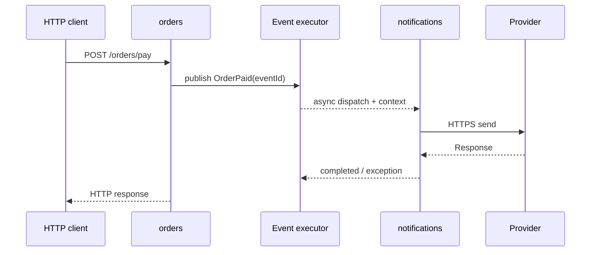
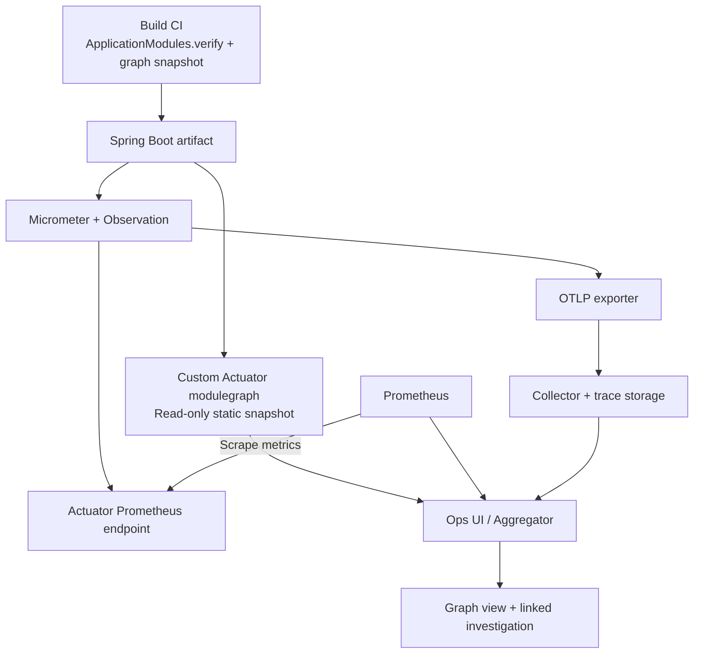

# Thiết kế endpoint graph cho vận hành

## 1. Mục tiêu: từ sơ đồ mô-đun tới một giao diện có thể dùng khi hệ thống chạy

Spring Modulith giúp một ứng dụng Spring Boot tổ chức thành các **application module** với API và quan hệ phụ thuộc được kiểm soát. Khi kiểm tra kiến trúc, ta muốn biết `orders` được phép gọi `payments` hay không; khi vận hành, ta còn cần biết các sự kiện từ `orders` đến `notifications` có đang chậm, thất bại hoặc tồn đọng không.

Một sơ đồ module được sinh khi build giải đáp câu hỏi **“ứng dụng được thiết kế như thế nào?”**. Metrics, traces và Event Publication Registry phản ánh **“các đường tương tác đã hoạt động như thế nào trong một khoảng thời gian?”**. Một **endpoint graph cho vận hành** là hợp đồng API đọc được bằng máy để cung cấp *cấu trúc các module và các quan hệ của chúng*, có thể kết hợp với dữ liệu vận hành để hiển thị graph và điều tra sự cố.

Trong chương **Thiết kế thực tế**, thuộc module **SPRING_MODULITH_DOCUMENTATION_OBSERVABILITY**, chúng ta thiết kế endpoint này theo hướng contract rõ ràng, có version, có kiểm soát truy cập, dễ tích hợp với Actuator/Prometheus/tracing mà không làm thay đổi ranh giới giữa các application module.

**Sau bài học, bạn có thể:**

1. Xác định các đỉnh/cạnh nào đến từ mô hình Spring Modulith, các số đo nào đến từ runtime.
2. Thiết kế JSON contract cho graph; hiểu ý nghĩa `generatedAt`, `buildId`, `kind`, `source` và `window`.
3. Sinh graph tại build hoặc lúc khởi động, expose qua một **Actuator endpoint tùy chỉnh** chỉ đọc.
4. Kết hợp graph với event metrics, HTTP metrics, traces và context propagation để vận hành.
5. Giới hạn security, dữ liệu nhạy cảm, cardinality và mức tải từ endpoint graph.
6. Kiểm tra cả tính đúng đắn của graph, quyền truy cập, tính mới của dữ liệu và hành vi suy giảm khi telemetry không sẵn sàng.

### 1.1. Bài toán thực tế

Ứng dụng `order-platform` gồm ba application module:

- `orders`: quản lý đơn hàng; phát `OrderPaid` sau khi giao dịch thanh toán được ghi nhận.
- `payments`: cung cấp API nghiệp vụ xác thực/truy vấn thanh toán.
- `notifications`: nhận sự kiện `OrderPaid` để gửi thông báo cho khách hàng.

Một lập trình viên có thể đọc package/module graph để hiểu dependency. Người vận hành cần xem thêm: listener của `notifications` có đang xử lý được các publication hay không, tỉ lệ lỗi trong 5 phút gần đây, và khoảng thời gian của trace giữa publisher và listener.

```mermaid
flowchart LR
    subgraph app["order-platform: graph kiến trúc"]
        orders["orders"]
        payments["payments"]
        notifications["notifications"]
        orders -->|"API dependency"| payments
        orders -.->|"OrderPaid event contract"| notifications
    end
    notifications -->|"HTTP outbound"| provider["Notification provider"]
    runtime["Metrics / traces / event registry"] -.->|"Lớp trạng thái runtime"| orders
    runtime -.-> notifications
    graph["GET /actuator/modulegraph"] -.->|"Cấu trúc phiên bản build"| app
    dashboard["Operations UI"] --> graph
    dashboard --> prometheus["Prometheus"]
    dashboard --> tracing["Tracing backend"]
```

Các cạnh trên là **ví dụ theo giả định của hệ thống**, không khẳng định Spring Modulith tự động nhận ra một publisher–subscriber edge chỉ vì event được gửi bằng `ApplicationEventPublisher`. Đường `orders → payments` có thể được suy ra từ dependency module tĩnh; đường `orders → notifications` qua event phải được suy ra bằng nguồn thông tin phù hợp (metadata/hợp đồng event, registry hoặc instrumentation đã thiết kế). Không gán một cạnh là “đã quan sát trong 5 phút” chỉ từ đồ thị tĩnh.

## 2. Phân biệt graph tĩnh và graph vận hành

### 2.1. Đỉnh, cạnh và nguồn gốc dữ liệu

| Thành phần | Định nghĩa | Nguồn phù hợp | Điều không thể kết luận |
| --- | --- | --- | --- |
| `module node` | Một application module có ID ổn định | Spring Modulith `ApplicationModules` | Module đang “healthy” chỉ vì tồn tại trong model |
| `dependency edge` | A có dependency mã nguồn được framework phân tích tới B | Module model / build verification | Tương tác giữa A và B đang thực thi ở runtime |
| `event edge` | A công bố event có consumer là B | Hợp đồng event hoặc instrumentation rõ ràng | Mỗi sự kiện đã được xử lý thành công |
| `observed interaction` | Một giao tiếp thực được đo trong cửa sổ thời gian | Micrometer counters/timers hoặc spans | Mọi giao tiếp đều được quan sát nếu sampling/filter đang bật |
| `publication backlog` | Publication chưa hoàn tất với listener cụ thể | Event Publication Registry có lưu bền vững | Tồn đọng bằng 0 chỉ từ số event đã publish |
| `health/status` | Suy luận vận hành từ bộ tín hiệu và ngưỡng đã định nghĩa | SLO, metrics, backlog, health checks | Ngữ nghĩa tương đương `/actuator/health` mặc định |

**ID module là key quan trọng:** dùng `orders`, `payments`, `notifications` nhất quán trong artifact build, metrics tags và giao diện. Không dùng tên hiển thị tùy ý như “Đơn hàng” làm key, vì việc đổi ngôn ngữ UI sẽ phá liên kết với các metrics đã ghi.

Spring Modulith phân tích application modules theo package structure và cấu hình mô-đun. Một số loại liên kết, chẳng hạn việc hai module cùng phụ thuộc một thư viện bên ngoài, **không nhất thiết là một cạnh giữa hai application modules**. Không tạo cạnh suy đoán từ tên package hay HTTP URL.

### 2.2. Hai lớp và ba trạng thái

Một thiết kế hữu ích giữ hai lớp độc lập:

1. **Architecture snapshot**: được sinh cùng version build, xác định module nodes và dependency edges. Thường thay đổi khi deploy.
2. **Runtime overlay**: đo cửa sổ gần đây, ví dụ 5 phút; chứa request count, error rate, latency, số publication tồn đọng và thời điểm thu thập. Thường thay đổi liên tục.

Thêm **metadata trạng thái dữ liệu**: `observed` (đã có mẫu đo), `no_data` (chưa có dữ liệu), `stale` (dữ liệu cũ), `unsupported` (chưa instrument). Đừng gán tất cả trường hợp không có mẫu là `healthy` hoặc giá trị `0`. Chẳng hạn 0 lỗi trên 0 request trong 5 phút **không chứng minh** hệ thống khỏe.

Graph tĩnh nên có một đường tải độc lập: nếu Prometheus đang mất kết nối, người vận hành vẫn xem được các module và dependency dự kiến. Runtime overlay có thể vắng mặt nhưng cần thông báo rõ lý do.

### 2.3. Chọn nơi expose graph

| Phương án | Ưu điểm | Hạn chế | Khi dùng |
| --- | --- | --- | --- |
| **Build artifact** `module-graph.json` | Bất biến theo build, kiểm thử được trong CI | Cần đưa artifact vào bản deploy; không tự có trạng thái runtime | Nguồn sự thật về kiến trúc |
| **Custom Actuator endpoint** `/actuator/modulegraph` | Đi chung management port, đọc bởi ops tooling | Phải tự viết endpoint, security và kiểm soát exposure | Ứng dụng muốn tự cung cấp graph |
| **Protected internal REST endpoint** `/internal/ops/module-graph` | Chủ động version URL, content negotiation, caching | Phải vận hành thêm route và security | Cần hợp đồng API riêng ngoài Actuator |
| **Graph UI độc lập** | Kết hợp architecture + metrics + traces trực quan | Phụ thuộc backend và refresh chính sách | Dashboard đa ứng dụng/môi trường |

Một số phiên bản/tổ hợp dependency của Spring Modulith có tích hợp Actuator để công bố metadata application modules. **Kiểm tra endpoint thực tế của phiên bản đang dùng trước khi tự xây endpoint khác**. Ví dụ sau dùng **custom endpoint với ID `modulegraph`**; đây là tên do bài thực hành đặt, **không phải cam kết có sẵn từ Spring Modulith**.

Không cấp mỗi application module một cổng HTTP mới. Graph là một API điều hành ở ranh giới ứng dụng, không phải thay thế dependency injection hoặc sự kiện nội bộ bằng các network calls.

## 3. Thiết kế hợp đồng JSON của endpoint graph

### 3.1. Contract cho snapshot kiến trúc

Định nghĩa một tài liệu JSON có version để client không phải scrape PlantUML hoặc đoán tên package:

```json
{
  "schemaVersion": "1.0",
  "application": "order-platform",
  "buildId": "2026.11.27-7f31d2a",
  "generatedAt": "2026-11-27T03:00:00Z",
  "nodes": [
    {
      "id": "orders",
      "displayName": "Orders",
      "packageName": "com.example.orders"
    },
    {
      "id": "payments",
      "displayName": "Payments",
      "packageName": "com.example.payments"
    },
    {
      "id": "notifications",
      "displayName": "Notifications",
      "packageName": "com.example.notifications"
    }
  ],
  "edges": [
    {
      "from": "orders",
      "to": "payments",
      "kind": "static_dependency",
      "source": "application_modules"
    },
    {
      "from": "orders",
      "to": "notifications",
      "kind": "event_contract",
      "source": "explicit_event_catalog",
      "eventType": "OrderPaid"
    }
  ]
}
```

Đây là **JSON ví dụ minh họa cho ứng dụng giả định**. Cạnh `event_contract` được khai báo từ catalog event do nhóm duy trì; **không phải kết quả tự suy ra từ `ApplicationModules`**. Nếu chưa có catalog đáng tin cậy, chỉ xuất các `static_dependency` đã xác minh, sau đó hiển thị event interactions như một lớp runtime riêng.

Ý nghĩa những field quan trọng:

| Field | Quy tắc | Vì sao cần |
| --- | --- | --- |
| `schemaVersion` | Bump major khi thay kiểu/ngữ nghĩa breaking | UI/automation biết cách parse |
| `application` | ID ứng dụng ổn định | Gộp nhiều service mà không nhầm module trùng tên |
| `buildId` | Digest hoặc release version | So graph với image thực đang chạy |
| `generatedAt` | ISO-8601 UTC | Biết snapshot được sinh lúc nào |
| `nodes[].id` | Duy nhất trong ứng dụng, ổn định theo build | Khóa để nối edges/metrics |
| `nodes[].packageName` | Thông tin nội bộ, chỉ cung cấp cho người có quyền | Debug source/module mapping |
| `edges[].from/to` | Luôn tham chiếu node hiện hữu | Không hiển thị “cạnh mồ côi” |
| `edges[].kind` | Vocabulary hữu hạn (`static_dependency`, `event_contract`…) | Không trộn loại quan hệ |
| `edges[].source` | Nguồn kiểm chứng quan hệ | Phân biệt derived dependency và catalog thủ công |
| `edges[].eventType` | Chỉ có cho event contract nếu được xác minh | Truy tìm producer/consumer |

**Không đưa vào graph:** credential, environment variables, nội dung sự kiện có dữ liệu khách hàng, private endpoint URL, database DSN hoặc bí mật CI. Tên package hay quan hệ giữa module có thể là thông tin kiến trúc nội bộ, vì vậy dù không có secret, endpoint vẫn cần phân quyền.

Khi ứng dụng nâng version và thay module name, cân nhắc `aliases`/migration mapping ở lớp UI để so sánh graph của các release; tránh đổi ID tùy tiện. Không dùng UUID ngẫu nhiên sinh theo mỗi lần request làm node ID.

### 3.2. Contract cho overlay vận hành

Overlay không bắt buộc nằm trong chính API graph; thường nên được lấy từ Prometheus và backend trace. Nếu cần một dịch vụ tổng hợp có kiểm soát, dùng contract tách biệt như:

```json
{
  "schemaVersion": "1.0",
  "application": "order-platform",
  "buildId": "2026.11.27-7f31d2a",
  "environment": "prod",
  "window": {
    "from": "2026-11-27T03:55:00Z",
    "to": "2026-11-27T04:00:00Z",
    "seconds": 300
  },
  "generatedAt": "2026-11-27T04:00:10Z",
  "edges": [
    {
      "from": "orders",
      "to": "notifications",
      "kind": "event_delivery",
      "measurements": {
        "invocations": 240,
        "errors": 3,
        "p95DurationMs": 180
      },
      "state": "observed",
      "source": "micrometer_prometheus"
    },
    {
      "from": "orders",
      "to": "payments",
      "kind": "api_call",
      "measurements": null,
      "state": "no_data",
      "source": "micrometer_prometheus"
    }
  ]
}
```

**Đây là dữ liệu giả để minh họa**, không phải JSON do Spring Modulith tự cung cấp. Client phải phân biệt rõ runtime edges với static edges. Trong tình huống thực, `p95DurationMs` chỉ có thể tính khi **Histogram/SLO buckets hoặc một nguồn phân vị phù hợp đã được bật**; không thể lấy p95 từ trung bình `sum / count`. Nếu chỉ có Timer count/sum, hiển thị `meanDurationMs` hoặc trạng thái `unsupported` cho p95.

Các trường của overlay nên có chất lượng dữ liệu (`state`), nguồn (`source`), cửa sổ (`from/to`) và build/environment để tránh ghép metrics prod của version cũ với graph staging của version mới. `invocations=240` có nghĩa 240 **lần gọi listener** nếu instrumentation đã định nghĩa như vậy; không tự coi là 240 đơn hàng duy nhất hoặc 240 event được publish.

### 3.3. Khả năng thay đổi và tính tương thích

Trong mọi bản release, kiểm tra rằng:

- Không có `node.id` trùng.
- Mọi `edge.from`/`edge.to` tham chiếu node tồn tại.
- `kind` và `source` thuộc các tập giá trị cho phép.
- `buildId` tương ứng artifact đang chạy; `generatedAt` có định dạng hợp lệ.
- Không đưa timestamp hiện tại vào snapshot tĩnh mỗi lần gọi API làm cache và diff liên tục thay đổi.
- Nguồn dữ liệu runtime phải khai báo lúc nào được đo, không tự bịa `0` khi timeout.

Nên công bố JSON schema hoặc một contract test cho version `1.x`, kể cả khi UI ban đầu chỉ vẽ ba module. Một API schema ổn định giúp scripting, diff giữa deployment và kiểm tra kiến trúc.

## 4. Sinh graph và xác minh ranh giới bằng Spring Modulith

### 4.1. Nguồn sự thật là mô hình application modules

Trong pipeline build/test, dùng Spring Modulith để kiểm tra cấu trúc code:

```java
package com.example;

import org.junit.jupiter.api.Test;
import org.springframework.modulith.core.ApplicationModules;

class ArchitectureVerificationTest {

    @Test
    void verifiesApplicationModuleBoundaries() {
        ApplicationModules.of(OrderPlatformApplication.class)
                .verify();
    }
}
```

`verify()` kiểm tra các quy tắc dependency mà framework hỗ trợ trên model module của ứng dụng. Khi test fail, sửa cấu trúc package/API/allowed dependencies theo thiết kế, thay vì sửa JSON graph để che vi phạm.

Có thể sinh tài liệu tĩnh từ `ApplicationModules` trong test hoặc build bằng gói documentation của Spring Modulith, ví dụ theo API của các phiên bản có `Documenter`:

```java
import org.junit.jupiter.api.Test;
import org.springframework.modulith.core.ApplicationModules;
import org.springframework.modulith.docs.Documenter;

class ModuleDocumentationTest {

    @Test
    void generatesArchitectureDiagram() {
        var modules = ApplicationModules.of(OrderPlatformApplication.class);
        modules.verify();

        new Documenter(modules)
                .writeModulesAsPlantUml();
    }
}
```

Dependency `org.springframework.modulith:spring-modulith-docs` thường chỉ cần trong phạm vi test/tooling; vị trí output và tên các phương thức trong `Documenter` cần đối chiếu API phiên bản Spring Modulith đã khóa bằng BOM. **PlantUML diagram là tài liệu để con người đọc**, không nên được parse bằng regex làm nguồn duy nhất cho JSON endpoint.

### 4.2. Tạo snapshot JSON theo quy trình có thể lặp lại

Một quy trình thực tế:

1. `ApplicationModules.of(...).verify()` chạy thành công trong CI.
2. Một **build-time exporter** dựa trên API model chính thức của đúng version đã chọn liệt kê module IDs và các dependencies; bổ sung `event_contract` từ catalog đã review nếu có.
3. Ghi `module-graph.json` theo schema `1.0` vào resource/artifact deployment, kèm `buildId` từ build metadata và `generatedAt` cố định.
4. Chạy schema/consistency test so artifacts với modules hiện tại, chặn graph stale.
5. Đóng gói **cùng image** với ứng dụng. Endpoint runtime chỉ đọc snapshot này, không phải quét toàn bộ classpath ở mỗi request.

Bước 2 cố ý nêu **adapter/exporter cần hiện thực theo phiên bản Spring Modulith của dự án**. API chi tiết để duyệt module và dependency có thể thay đổi; không gắn một snippet dùng phương thức suy đoán rồi giả định copy-paste sẽ chạy trên mọi bản. Nếu sản phẩm đã dùng một Actuator endpoint chính thức có metadata đúng mục đích, có thể dùng nó làm source đã chuẩn hóa thay vì xây exporter thứ hai.

### 4.3. Tại sao không lấy graph từ traces?

Traces phản ánh những đường *đã được lấy mẫu* trong một khoảng thời gian. Một dependency hiếm gặp hoặc code path chưa chạy có thể vắng mặt. Tail sampling, exporter failure và retention cũng làm thiếu cạnh. Vì vậy **không dùng tracing để chứng minh không tồn tại dependency**. Tracing thích hợp để tô đậm cạnh được quan sát, phân tích latency và lỗi.

Ngược lại, một static dependency edge không cho biết endpoint đối tác đã hoạt động hay chưa; cần metrics, health checks và các traces thực tế để xác định. Graph vận hành hữu ích chính vì liên kết hai góc nhìn này mà vẫn giữ nguồn gốc của từng dữ liệu.

## 5. Xây dựng Actuator endpoint chỉ đọc cho graph

### 5.1. Phạm vi của endpoint

Ta sẽ expose **snapshot đã được sinh và kiểm tra tại build** qua `GET /actuator/modulegraph`. Việc đọc chỉ cần truy cập classpath resource; không truy vấn database và không lấy metrics trực tiếp từ endpoint. Vì vậy graph vẫn trả lời được ngay cả khi Prometheus hoặc collector gặp lỗi.

Ví dụ tài liệu JSON ở phần 3 được đóng gói vào `src/main/resources/ops/module-graph.json` bằng quy trình build (hoặc được một bước build tạo trong resources đầu ra). Không đặt access token hoặc endpoint nội bộ nhạy cảm trong tệp này.

Spring Boot Actuator cho phép khai báo endpoint tùy chỉnh bằng `@Endpoint` và `@ReadOperation`:

```java
package com.example.ops;

import com.fasterxml.jackson.databind.ObjectMapper;
import java.io.IOException;
import java.io.InputStream;
import java.util.List;
import org.springframework.beans.factory.annotation.Value;
import org.springframework.boot.actuate.endpoint.annotation.Endpoint;
import org.springframework.boot.actuate.endpoint.annotation.ReadOperation;
import org.springframework.core.io.Resource;
import org.springframework.stereotype.Component;

@Component
@Endpoint(id = "modulegraph")
public class ModuleGraphEndpoint {

    public record Node(
            String id,
            String displayName,
            String packageName) {
    }

    public record Edge(
            String from,
            String to,
            String kind,
            String source,
            String eventType) {
    }

    public record Snapshot(
            String schemaVersion,
            String application,
            String buildId,
            String generatedAt,
            List<Node> nodes,
            List<Edge> edges) {
    }

    private final Snapshot snapshot;

    public ModuleGraphEndpoint(
            ObjectMapper mapper,
            @Value("classpath:ops/module-graph.json") Resource resource)
            throws IOException {

        // Đọc một lần khi khởi động; thất bại sớm nếu thiếu file.
        try (InputStream input = resource.getInputStream()) {
            this.snapshot = mapper.readValue(input, Snapshot.class);
        }
    }

    @ReadOperation
    public Snapshot graph() {
        return snapshot;
    }
}
```

Ví dụ dùng Jackson `ObjectMapper` được Spring Boot cấu hình và Java record (Java 17 trở lên). Nếu resource có field thừa do schema version mới, ứng dụng cần có chính sách tương thích rõ ràng; không nên âm thầm đọc một graph sai. Đây là **endpoint tùy chỉnh**, không gọi API nội bộ của Spring Modulith để đọc dependency ở thời gian thực. Việc tạo `module-graph.json` thuộc build/exporter ở phần 4.

Lưu ý: node `Edge.eventType` có thể là `null` cho `static_dependency` trong record Java; có thể cấu hình Jackson bỏ null khi serialize hoặc giữ null như một giá trị được định nghĩa trong schema. Nên chốt một cách và kiểm thử hợp đồng; không để frontend suy luận “không có” khác “null” tùy ý.

### 5.2. Bật exposure có kiểm soát

Ví dụ `application-prod.yml`:

```yaml
management:
  server:
    port: 8081
  endpoints:
    web:
      exposure:
        include: health,info,prometheus,modulegraph
  endpoint:
    health:
      probes:
        enabled: true
      show-details: never
```

Với các giá trị này, endpoint được truy cập tại `/actuator/modulegraph` **nếu bean được đăng ký và security cho phép**. Nếu ứng dụng dùng `management.endpoints.web.base-path` khác, URL phải tính theo base path thực tế. Port `8081` là ví dụ; khi chạy trong Kubernetes cần cấu hình đúng Service, readiness probe, Prometheus target và network policy.

**Exposure không đồng nghĩa authorization.** Endpoint chứa topology/package của ứng dụng, vì vậy chỉ client vận hành được cấp quyền mới được đọc. Dùng Spring Security/ingress policy theo tổ chức, ví dụ quyền `ops.graph.read`, mTLS hoặc workload identity; quy tắc cho health và Prometheus scraper nên tách riêng. Không tắt security hoặc expose `modulegraph` công khai chỉ để dashboard dễ truy cập.

Ví dụ kiểm tra từ mạng điều hành đã được xác thực:

```bash
# URL/port là ví dụ. Lệnh có thể trả 401/403 nếu thiếu quyền.
curl -i https://ops.example.internal/actuator/modulegraph
```

Khi nhận `404`, kiểm tra endpoint bean, ID `modulegraph`, cấu hình exposure, base path và route proxy. Khi nhận `401/403`, xác minh danh tính client thay vì “sửa” bằng cách mở quyền. Khi nhận `500` lúc khởi động, kiểm tra artifact snapshot có được đóng gói đúng classpath và có parse được không.

### 5.3. Kích thước và tính mới của phản hồi

Graph thường thay đổi theo release, không cần tái tính liên tục. Các nguyên tắc:

- Tạo snapshot **một lần trong build**, tải một lần khi app khởi động; kết quả cố định trong vòng đời release.
- Giữ JSON gọn, sắp xếp `nodes`/`edges` ổn định khi xuất file để diff giữa hai build có ý nghĩa.
- Client có thể cache theo `buildId` hoặc sử dụng `ETag`/`Cache-Control` tại gateway nếu được triển khai; mọi bản update graph cần đổi build/digest.
- Giới hạn kích thước document và số node/edge. Khi hệ thống lớn, phân trang hoặc cấp graph theo nhóm module đã được phép xem, nhưng **không** tùy tiện loại cạnh làm sai bản đồ phụ thuộc.
- Đặt thời gian đọc graph ngắn; endpoint không nên đồng bộ gọi Prometheus, collector hay database đối tác cho mỗi request.

**Không thêm trạng thái realtime vào phản hồi snapshot tĩnh** nếu không gắn timestamp riêng và cache policy riêng. Một field `status=healthy` được cache trong 10 phút có thể gây nhầm lẫn nghiêm trọng khi on-call.

## 6. Thiết kế overlay metrics cho các cạnh vận hành

### 6.1. Đo đúng đại lượng

Với đường sự kiện `orders → notifications`, cần quyết định **khi nào tăng metric**: lúc publish event, khi listener bắt đầu, khi listener kết thúc, hay khi publication được đánh dấu hoàn tất. Những điểm này có thể khác nhau do async dispatch, retry và replay.

Định nghĩa tham khảo:

| Meter | Đơn vị đo | Điểm tăng/ghi | Lưu ý |
| --- | --- | --- | --- |
| `app.module.event.published` | Domain event publish | Publisher phát event | Không chứng minh listener đã xử lý |
| `app.module.event.invocations` | Lần listener kết thúc | Listener success/error | Replay có thể làm tăng > số event duy nhất |
| `app.module.event.duration` | Thời gian một invocation | Listener kết thúc | Bao gồm backoff nếu retry bên trong |
| `app.module.event.attempts` | Lần gọi downstream | Mỗi HTTP attempt | Retry có thể làm count cao hơn invocations |
| `app.module.event.outstanding` | Publication chưa completed | Query/gauge từ event publication registry | Gauge trạng thái, không suy ra từ counter |
| `app.module.http.requests` | Lời gọi HTTP thực | Client adapter | Khác với dependency tĩnh giữa module |

Đây là **các metric tùy chỉnh được đề xuất**, không phải tất cả tên/ý nghĩa do Spring Modulith tự phát hành. Dự án cũng có thể dùng metrics của Spring Boot HTTP client, tracing bridge hoặc observability instrumentation hiện có; tránh ghi hai lần một cùng loại request.

### 6.2. Ví dụ instrument listener với tag module ổn định

Một lớp triển khai tối giản, minh họa riêng việc đếm invocation và thời gian xử lý:

```java
package com.example.notifications;

import com.example.orders.OrderPaid;
import io.micrometer.core.instrument.MeterRegistry;
import io.micrometer.core.instrument.Timer;
import org.springframework.modulith.events.ApplicationModuleListener;
import org.springframework.stereotype.Component;

@Component
public class PaymentNotificationListener {

    private final NotificationDelivery delivery;
    private final MeterRegistry meters;

    public PaymentNotificationListener(
            NotificationDelivery delivery,
            MeterRegistry meters) {
        this.delivery = delivery;
        this.meters = meters;
    }

    @ApplicationModuleListener
    public void on(OrderPaid event) {
        Timer.Sample sample = Timer.start(meters);
        String result = "success";

        try {
            delivery.send(event);
        } catch (RuntimeException exception) {
            result = "error";
            // Cho event publication registry nhận ra listener thất bại.
            throw exception;
        } finally {
            meters.counter(
                    "app.module.event.invocations",
                    "from", "orders",
                    "to", "notifications",
                    "result", result).increment();

            sample.stop(meters.timer(
                    "app.module.event.duration",
                    "from", "orders",
                    "to", "notifications"));
        }
    }
}
```

Ví dụ giả định `OrderPaid` là event contract nằm ở API được phép của module `orders` và `NotificationDelivery` là dịch vụ của `notifications`. Counter chỉ tăng khi **listener invocation kết thúc** (thành công hoặc thất bại). Nếu publication được replay, invocation mới tạo thêm mẫu; không đồng nghĩa sự kiện nghiệp vụ mới.

`@ApplicationModuleListener` thường kết hợp giao dịch và async listener theo Spring Modulith, nhưng khả năng ghi publication bền vững và cơ chế replay phụ thuộc repository/phiên bản/cấu hình. Nếu listener bắt exception rồi return bình thường sau khi side effect đã thất bại, meter có thể báo success và framework có thể đánh dấu publication completed; đó là **lỗi semantics trong code**, không phải lỗi dashboard.

### 6.3. Truy vấn theo từng cạnh từ Prometheus

Trong hệ thống dùng Micrometer Prometheus registry, counter `app.module.event.invocations` thường được chuẩn hóa thành `app_module_event_invocations_total`. Cần kiểm tra tên thực ở `/actuator/prometheus` trước khi đưa vào dashboard.

```promql
# Số lần listener kết thúc mỗi giây, phân biệt các cặp module
sum by (from, to) (
  rate(app_module_event_invocations_total{
    environment="prod"
  }[5m])
)

# Tỷ lệ invocation kết thúc bằng lỗi trong 5 phút
sum by (from, to) (
  rate(app_module_event_invocations_total{
    environment="prod",
    result="error"
  }[5m])
)
/
clamp_min(
  sum by (from, to) (
    rate(app_module_event_invocations_total{
      environment="prod"
    }[5m])
  ),
  0.001
)
```

Cần chú ý khi mẫu rất ít hoặc không có traffic. Biểu đồ tỉ lệ bằng `0` khi cả tử và mẫu thiếu dữ liệu là **không đúng về mặt chứng cứ**; lớp UI nên phân biệt `no_data` với tỉ lệ lỗi bằng 0 khi có traffic thực. Đưa thêm cửa sổ thời gian và số mẫu vào tooltip.

Đối với p95 duration, Timer phải có histogram buckets:

```java
Timer.builder("app.module.event.duration")
        .tag("from", "orders")
        .tag("to", "notifications")
        .publishPercentileHistogram()
        .register(meters);
```

Cấu hình histogram có chi phí time series. Nếu bật histogram cho meter này, cần bảo đảm mã listener **dùng đúng timer đã đăng ký với cùng tags** và không thêm label biến thiên. Truy vấn PromQL tương ứng:

```promql
histogram_quantile(
  0.95,
  sum by (le, from, to) (
    rate(app_module_event_duration_seconds_bucket{
      environment="prod"
    }[5m])
  )
)
```

Kết quả từ `histogram_quantile` là **giây** nếu Timer xuất `_seconds_bucket`; đổi sang mili giây ở dashboard nếu muốn. Nếu chưa bật histogram hoặc dữ liệu trong cửa sổ quá thưa, không hiển thị p95 như một số được bảo đảm chính xác.

### 6.4. Kiểm soát cardinality và ý nghĩa cạnh

`from`, `to`, `result`, `kind` và `environment` nên thuộc tập giá trị **có giới hạn, đã được định nghĩa**. Không thêm `orderId`, `eventId`, email, exception message, full URL hoặc ID của mỗi invocation vào label; Prometheus có thể sinh vô số time series.

Giả sử có 12 module, tối đa 30 cặp tương tác, 3 kết quả và 4 môi trường: chỉ riêng tổ hợp `pair × result × environment` đã có thể tạo 360 chuỗi cho một meter, chưa tính instance và histogram buckets. Với `eventId` hàng triệu giá trị, biểu đồ sẽ trở nên quá tốn tài nguyên.

Cần xác định logic ghép cạnh runtime:

- Chỉ metric có cặp `from/to` đã chuẩn hóa mới được gắn lên graph.
- Nếu có tương tác runtime không nằm trong catalog tĩnh, hiển thị như **observed-unmapped edge** để điều tra, không tự coi đó là dependency được phép.
- Nếu static edge không có traffic, hiển thị **no_data** trong cửa sổ, không tự kết luận edge đã chết hoặc có lỗi.
- Một số cạnh như HTTP từ module sang đối tác bên ngoài cần **external node/edge type** riêng, không gán một đối tác thành application module Spring Modulith.
- Đo backlog theo listener/publication đang xử lý và trạng thái thực; counters tích lũy không tự giảm khi publication hoàn tất.

## 7. Tracing và context propagation để điều tra từng cạnh

Graph metrics trả lời **cạnh nào đang có nhiều lời gọi/lỗi/latency**; tracing giúp lần theo **một lần xử lý cụ thể**. Với event bất đồng bộ, trace span không luôn giữ quan hệ parent-child với request ban đầu, đặc biệt sau restart và replay.

Một đường trace mong đợi khi context được truyền trong process:



Với Spring Framework hỗ trợ `ContextPropagatingTaskDecorator`, có thể trang trí executor dùng bởi `@Async` để mang Micrometer observation/tracing context giữa threads. Tuy nhiên phải kiểm chứng executor thực sự được listener dùng; chỉ tạo một bean executor mới không đảm bảo mọi task sẽ dùng bean đó.

```java
package com.example.config;

import java.util.concurrent.Executor;
import org.springframework.context.annotation.Configuration;
import org.springframework.core.task.support.ContextPropagatingTaskDecorator;
import org.springframework.scheduling.annotation.AsyncConfigurer;
import org.springframework.scheduling.annotation.EnableAsync;
import org.springframework.scheduling.concurrent.ThreadPoolTaskExecutor;

@Configuration
@EnableAsync
class EventExecutorConfig implements AsyncConfigurer {

    @Override
    public Executor getAsyncExecutor() {
        var executor = new ThreadPoolTaskExecutor();
        executor.setThreadNamePrefix("modulith-events-");
        executor.setCorePoolSize(4);
        executor.setMaxPoolSize(8);
        executor.setQueueCapacity(200);
        executor.setTaskDecorator(new ContextPropagatingTaskDecorator());
        executor.initialize();
        return executor;
    }
}
```

Context propagation còn phụ thuộc observation/tracing bridge, exporter và sampling của ứng dụng. Khi một publication được replay sau restart, thread context ban đầu không còn: cần giữ `eventId`/`correlationId` ổn định trong event payload hoặc metadata. Định danh này có thể dùng ở **logs hoặc trace attributes theo chính sách dữ liệu**, nhưng không đưa vào metric label có cardinality cao.

**Không lấy số spans làm số lời gọi chính xác:** head/tail sampling, filter và retention có thể khiến một phần tương tác vắng mặt. Số lượng invocations/attempts cần dựa trên bộ đếm được instrument đúng; traces dùng để khám phá nguyên nhân chậm/lỗi của ví dụ cụ thể.

## 8. Kiến trúc dashboard: ghép graph với dữ liệu vận hành

### 8.1. Ai nên truy vấn backend telemetry?

Để hiển thị graph ở bảng điều khiển, nên tách trách nhiệm:

1. **Ứng dụng Spring Boot** cung cấp snapshot graph từ `/actuator/modulegraph` (hoặc artifact/endpoint chính thức đã chọn).
2. **Prometheus** lưu metrics có tags chuẩn hóa; tracing backend lưu sampled spans; registry của ứng dụng giữ publication trạng thái nếu có persistence.
3. **Operations service/UI** lấy graph, truy vấn metrics/traces bằng identity của mình, rồi ghép kết quả theo `application + environment + module IDs + buildId`.
4. UI vẽ các cạnh tĩnh và tô thêm thông tin runtime có timestamp, trạng thái `observed/no_data/stale/unsupported` rõ ràng.

Không khuyến khích endpoint graph trong chính ứng dụng đồng bộ gọi Prometheus hoặc tracing backend cho **mỗi** request. Nếu backend chậm hoặc hết quota, một endpoint kiến trúc vốn đơn giản có thể trở nên chậm/không dùng được, đồng thời làm tăng tải cho hệ thống đang gặp sự cố.



Nếu application module graph được lấy từ **một artifact của release khác** với instance đang được truy vấn metrics, UI phải cảnh báo mismatch thay vì ghép các nodes một cách im lặng. Trong rolling deployment, có thể có hai `buildId` cùng lúc; giao diện nên hỗ trợ chọn một version hoặc biểu diễn các phiên bản khác nhau.

### 8.2. Dữ liệu nào hiển thị lên node/cạnh?

Một giao diện vận hành có thể hiển thị:

| Đối tượng graph | Thông tin hiển thị | Quy tắc |
| --- | --- | --- |
| Node `orders` | Module ID, build, owner, số invocations, health dữ liệu | Owner do catalog được duyệt cung cấp; health có ngữ nghĩa riêng |
| Dependency `orders → payments` | `static_dependency`, có/không observed traffic | Static edge tồn tại ngay khi 0 traffic |
| Event `orders → notifications` | Throughput, invocation error ratio, p95 nếu đủ mẫu | Tách event publish, listener invocation và downstream retry |
| External API edge | DNS/service alias, timeout/error ratio | Redact URL/token, không tự coi đối tác là application module |
| Runtime overlay | `window=5m`, `lastCollectedAt`, source, state | Không gán `healthy` khi thiếu dữ liệu |
| Trace drill-down | Liên kết truy vấn đã lọc `service.name`/thời gian | Không gắn `eventId` vào metric labels |

Giao diện **không suy ra hướng dependency từ hướng span HTTP** nếu mô hình thực tế là một sự kiện async hoặc callback. Kiểu cạnh phải là dữ liệu rõ ràng. Nếu có observed edge không nằm trong graph, hiển thị riêng như *unmapped interaction* để nhóm phát triển kiểm tra instrumentation hoặc kiến trúc.

### 8.3. Mẫu chính sách refresh và stale data

Các ngưỡng dưới đây **chỉ là lựa chọn minh họa**, cần điều chỉnh theo SLO và chi phí:

| Nguồn | Refresh gợi ý | Dùng khi |
| --- | --- | --- |
| Static graph | Một lần khi mở, sau deploy hoặc `buildId` đổi | Kiến trúc không đổi trong vòng đời release |
| Runtime counters | 30–60 giây với cửa sổ 5 phút | Theo dõi throughput/error rate |
| Publication backlog | 30–60 giây hoặc theo policy của registry | Nhìn công việc còn dang dở |
| Trace links | Theo yêu cầu người vận hành | Điều tra một đường tương tác |
| Alert status | Theo tần suất đánh giá rule | Phân biệt cảnh báo mới/đã giải quyết |

Nếu lần thu thập cuối của overlay quá cũ, ví dụ **hơn 90 giây** so với ngưỡng do ứng dụng đặt, hiển thị `stale` và thời điểm cuối cùng. Đừng giữ màu xanh từ mẫu 10 phút trước. Nếu một service chưa instrument `p95`, hiển thị `unsupported`, không hiển thị 0 ms.

## 9. Bảo mật và độ tin cậy của graph endpoint

Endpoint graph là API vận hành, do đó phải đặt cùng quy trình kiểm soát như Actuator và hệ thống quan sát.

### 9.1. Quyền truy cập và phân vùng môi trường

- Chỉ bật `modulegraph` cho mạng điều hành, hoặc qua proxy/gateway có authentication/authorization phù hợp.
- Bảo vệ management port bằng network policy và TLS/mTLS khi đi qua mạng; không chỉ dựa vào `management.server.port=8081`.
- Tách identity và quyền giữa **graph viewer**, **Prometheus scraper** và **trace viewer**; không cần cấp cho graph viewer quyền xem secrets.
- Phân biệt `dev`, `staging`, `prod` tại cả endpoint access và query backend. Không đưa dữ liệu topology của prod vào một dashboard dev công khai.
- Ghi audit về quyền truy cập khi có yêu cầu quản trị, nhưng không log bearer token hoặc raw query có dữ liệu nhạy cảm.
- Chỉ trả metadata đủ phục vụ vận hành; có thể bỏ `packageName` ở cấp quyền thấp hoặc xuất một biến thể JSON được redacted.

Việc `/actuator/health` trả `UP` không đồng nghĩa người dùng đã được phép xem module graph, và `/actuator/modulegraph` trả `200` không chứng minh Prometheus/collector đang hoạt động.

### 9.2. Hạn chế sai lệch và rủi ro tải

Graph endpoint là API **read-only**, không cung cấp thao tác “retry event”, “restart module”, “edit dependency” hoặc “clear registry” trong cùng route. Các hành động vận hành có tác động trạng thái cần cơ chế phê duyệt và quyền riêng.

Cần kiểm soát:

- **Thời gian phản hồi:** đọc snapshot bộ nhớ; không scan classpath, render Graphviz hoặc truy vấn database trên mỗi request.
- **Giới hạn kích thước:** chặn document bất thường hoặc vòng lặp exporter tạo quá nhiều nodes/edges; giữ định dạng node/edge gọn.
- **Stale graph:** đóng gói snapshot cùng image; kiểm tra `buildId` trong pipeline và lúc deploy.
- **Cache:** version theo build và kiểm soát `ETag` hoặc TTL nếu dùng HTTP cache; không cache runtime state như static graph.
- **Bảo mật dữ liệu:** chỉ xuất tên mô-đun/relationship được phê duyệt; không xuất keys, connection strings, raw stack traces.
- **Quyền truy cập backend:** nếu aggregator query Prometheus hoặc tracing, dùng service identity scope tối thiểu, timeout và rate limit; không truyền credential này qua browser.

Không thêm tag `buildId` cho toàn bộ metrics nếu số lần build/replica tạo cardinality không cần thiết. Với hệ thống cần phân tích trong rolling deployment, dùng một nhãn version hữu hạn trong cửa sổ retention và quản lý số series; các joins vẫn cần được kiểm chứng.

### 9.3. Khi một thành phần không sẵn sàng

| Sự cố | Hành vi endpoint/graph mong muốn | Cần điều tra |
| --- | --- | --- |
| Prometheus mất scrape | Static graph vẫn trả được; overlay `stale` hoặc `no_data` | Target, credentials, `/actuator/prometheus` |
| Collector tracing lỗi | Graph và metrics vẫn có; trace drill-down báo thiếu dữ liệu | OTLP endpoint, TLS, token, ingest |
| Event registry không truy vấn được | Không kết luận backlog bằng 0; hiển thị `unavailable` | DataSource, transaction/repository |
| Snapshot JSON thiếu ở classpath | Startup hoặc contract test thất bại rõ ràng | Quy trình build/package |
| UI ghép nhầm `buildId` | Cảnh báo graph/metrics version mismatch | Rolling deploy, cache/CDN |
| Actuator trả 403 | Client không có quyền; không mở route cho mọi người | RBAC, proxy, network policy |
| Metric thiếu `from/to` | Không thể ánh xạ cạnh runtime | Instrumentation và tag conventions |

## 10. Kiểm thử thiết kế trước khi triển khai

### 10.1. Test kiến trúc và hợp đồng snapshot

Ngoài `ApplicationModules.of(...).verify()` trong phần 4, kiểm tra resource graph có nodes hợp lệ, các edges chỉ tham chiếu module tồn tại, ID ổn định và schema version được hỗ trợ.

Ví dụ JUnit 5 + Jackson:

```java
package com.example.ops;

import com.fasterxml.jackson.databind.JsonNode;
import com.fasterxml.jackson.databind.ObjectMapper;
import java.io.InputStream;
import java.util.HashSet;
import java.util.Set;
import org.junit.jupiter.api.Test;

import static org.junit.jupiter.api.Assertions.assertEquals;
import static org.junit.jupiter.api.Assertions.assertNotNull;
import static org.junit.jupiter.api.Assertions.assertTrue;

class ModuleGraphContractTest {

    @Test
    void snapshotContainsResolvableDependencies() throws Exception {
        try (InputStream input = getClass()
                .getClassLoader()
                .getResourceAsStream("ops/module-graph.json")) {

            assertNotNull(input, "Graph snapshot missing from classpath");

            JsonNode root = new ObjectMapper().readTree(input);
            assertEquals("1.0", root.path("schemaVersion").asText());

            Set<String> moduleIds = new HashSet<>();
            for (JsonNode node : root.path("nodes")) {
                String id = node.path("id").asText();
                assertTrue(!id.isBlank());
                assertTrue(moduleIds.add(id), "Duplicate node: " + id);
            }
            assertTrue(!moduleIds.isEmpty());

            for (JsonNode edge : root.path("edges")) {
                String from = edge.path("from").asText();
                String to = edge.path("to").asText();
                assertTrue(moduleIds.contains(from),
                        "Unknown source module: " + from);
                assertTrue(moduleIds.contains(to),
                        "Unknown target module: " + to);
            }
        }
    }
}
```

Đây là test **độ nhất quán nội tại** của JSON; để phát hiện graph stale, pipeline còn phải so sánh snapshot với model `ApplicationModules` được xây từ source của cùng commit, hoặc bảo đảm exporter chính thức chạy lại trước khi đóng gói. Một test chỉ kiểm tra JSON hợp lệ **không chứng minh** graph đang đúng với source code.

Nếu graph có event contract edges, cần contract tests tương ứng kiểm tra producer/consumer hoặc metadata được duyệt. Không vì một publisher có tên `OrderPaid` mà tự động coi mọi module import cùng kiểu event là consumer đang hoạt động.

### 10.2. Test endpoint và phân quyền

Bộ integration tests tối thiểu:

| Trường hợp | Thiết lập | Kết quả kỳ vọng |
| --- | --- | --- |
| Client có quyền đọc graph | Boot context có Actuator, endpoint exposed, identity ops hợp lệ | `200`, JSON schema version/buildId đúng |
| Client không có quyền | Không cấp scope/role xem graph | `401` hoặc `403` theo policy |
| URL sai/path sai | Gọi cổng business hoặc path không exposed | Hành vi lỗi phù hợp và được chẩn đoán rõ |
| Snapshot bị thiếu | Khởi động với artifact test giả thiếu resource | Fail-fast hoặc lỗi tường minh trước deploy |
| Có 2 deployment khác build | Mỗi image chứa snapshot build của chính nó | Graph `buildId` khớp release mỗi instance |
| Backend telemetry ngừng | Không cho query Prometheus/collector | Static endpoint vẫn trả snapshot |
| Không có runtime samples | UI query với cửa sổ không có request | `no_data`, không vẽ “0% error” sai nghĩa |

Với management port riêng trong Spring Boot, test HTTP cần lấy **cổng management thực** (ví dụ `local.management.port` khi port ngẫu nhiên theo version được hỗ trợ), không nhầm với `@LocalServerPort` của business server.

### 10.3. Test event metrics và context propagation

Dùng `SimpleMeterRegistry` để kiểm tra một listener invocation thành công tăng `result=success` một lần, lỗi tăng `result=error` và vẫn ném exception. Nếu một event bị replay, metric `invocations` tăng thêm; **domain event unique count không được suy ra từ số invocations**. Với event publication repository được cấu hình bền vững, cần integration test fault/replay và backlog thật.

Trong Spring Boot context, phát một event bên trong transaction và commit. Chờ listener bằng một điều kiện có timeout để tránh race của `@Async`; không gọi trực tiếp listener rồi kết luận event dispatcher/registry hoạt động. Nếu bật tracing, xác minh observation context đi qua executor được cấu hình, đồng thời thử replay sau restart với correlation ID bền vững.

Để kiểm tra overlay p95, tạo đủ samples và xác minh có histogram buckets trước khi tính `histogram_quantile`. Nếu thiếu buckets, test UI phải kiểm tra trạng thái `unsupported` thay vì p95 giả.

### 10.4. Smoke test qua các môi trường

Một chuỗi xác minh có thể lặp lại:

1. **CI:** verify module boundaries, xuất graph cùng buildId và kiểm tra JSON contract.
2. **Dev:** đọc `/actuator/modulegraph` bằng identity hợp lệ, kiểm tra node/edge, đồng thời xác nhận client không quyền bị từ chối.
3. **Staging:** phát `OrderPaid` bằng dữ liệu thử; kiểm tra listener hoàn tất, metrics từ `/actuator/prometheus`, Prometheus scrape và trace theo sampling.
4. **Dashboard:** ghép overlay theo ID module; kiểm tra cạnh nào có data, cạnh nào `no_data`, và khả năng drill-down sang traces.
5. **Production canary:** so snapshot buildId với image thật, kiểm tra quyền đọc, metric labels environment và khả năng xem trace hợp lệ; không phát side effect thật chỉ để test dashboard.
6. **Sau rollout:** khi nhiều version cùng chạy, xác nhận không ghép graph bản cũ và dữ liệu runtime bản mới; cập nhật cache/UI.

Không cần mở endpoint graph trên Internet để thử; dùng đường truy cập quản trị được phép hoặc test qua môi trường đã cách ly.

## 11. Tình huống thực hành tổng hợp

**Bối cảnh:** Release `2026.11.27-7f31d2a` của `order-platform` có các module `orders`, `payments` và `notifications`. Snapshot graph hợp lệ:

- `orders → payments`: `static_dependency`.
- `orders → notifications`: `event_contract` cho `OrderPaid` từ catalog đã duyệt.
- Runtime observability đo số lần listener notification kết thúc, lỗi, duration và backlog incomplete publications.

Trong 5 phút gần đây, đo được:

| Cạnh | Invocations | Errors | P95 duration | Backlog | Trạng thái |
| --- | ---: | ---: | ---: | ---: | --- |
| `orders → notifications` | 200 | 20 | 320 ms | 8 | `observed` |
| `orders → payments` | Không có instrumentation | Không biết | Không biết | Không áp dụng | `unsupported` |
| Một tương tác khác không trong catalog | 5 | 0 | Không bật histogram | Không áp dụng | `observed-unmapped` |

Các số liệu là ví dụ. Nếu tỉ lệ lỗi listener là `20 / 200 = 10%`, dashboard có thể tô chú ý cạnh `orders → notifications`, nhưng **không khẳng định 20 domain events đã mất** vì listener có thể được replay và hoàn tất sau đó. Backlog 8 là số publication chưa hoàn tất ở thời điểm đo, không được cộng tùy ý với 20 errors.

Đột nhiên Prometheus không scrape được trong 3 phút, trong khi ứng dụng vẫn hoạt động. UI cần xử lý:

- **Graph kiến trúc** vẫn hiển thị 3 nodes và 2 edges từ release artifact.
- **Overlay** ghi thời điểm lấy dữ liệu cuối và chuyển `stale` cho các cạnh không có mẫu mới.
- **Alerts** không coi `errors=0` vì không có dữ liệu; người vận hành cần kiểm tra scrape target và management endpoint.
- **Traces** có thể vẫn phục vụ drill-down nếu collector còn hoạt động; nhưng không suy ra tỷ lệ lỗi chính xác từ một mẫu traces.
- Sau khi backend phục hồi, overlay được làm mới, kiểm tra `buildId` và môi trường trước khi cập nhật trạng thái.

### Các bước tự thực hiện

1. Vẽ module graph từ source bằng Spring Modulith và kiểm tra `ApplicationModules.verify()`.
2. Chốt JSON schema `1.0` và nguồn gốc từng cạnh; phân biệt dependency tĩnh với event contract.
3. Tạo artifact `ops/module-graph.json` cùng buildId, thêm test đảm bảo edges trỏ tới nodes có thật.
4. Tạo custom `@Endpoint(id="modulegraph")`, chỉ đọc resource snapshot, expose trên management path với quyền ops.
5. Instrument listener metrics với tags `from`, `to`, `result` có cardinality thấp; bật histogram nếu thực sự cần p95.
6. Tạo PromQL throughput/error ratio và xác minh nhãn trong `/actuator/prometheus`.
7. Ghép graph với overlay có time window, last updated, data state; không chuyển `no_data` thành 0.
8. Kiểm tra traces qua async executor và thiết kế correlation khi replay sau restart.
9. Diễn tập mất Prometheus, collector và thiếu snapshot; xác định fallback của graph và các lỗi phải báo rõ.
10. Viết quy trình bàn giao cho đội vận hành: ai sở hữu graph exporter, Actuator security, backend metrics/traces và bộ test hợp đồng.

### Câu hỏi tự đánh giá

1. Vì sao static `ApplicationModules` graph không thể dùng để kết luận 100% các cạnh đang có traffic?
2. Vì sao không nên suy ra mọi cạnh từ traces đã sampled, nhất là khi có các code path hiếm?
3. Cần metadata nào để dashboard không ghép graph của một release với metrics của release khác?
4. Nếu endpoint Actuator graph trả 200 nhưng Prometheus không scrape được, thành phần nào vẫn có giá trị và thành phần nào cần báo stale?
5. Tại sao phải phân biệt `static_dependency`, `event_contract`, `event_delivery` và external HTTP edge?
6. Khi có 0 requests trong cửa sổ 5 phút, có được báo 0% lỗi và “healthy” không?
7. Tại sao histogram buckets cần thiết khi tính p95 từ Prometheus?
8. Nếu listener xử lý thất bại, nuốt exception rồi return, graph runtime sẽ bị sai theo cách nào?
9. Vì sao `eventId` hữu ích để tra log/trace nhưng không nên làm metric tag?
10. Test nào chứng minh snapshot JSON nhất quán; test nào mới chứng minh endpoint có quyền truy cập đúng và graph khớp code?
11. Làm sao diễn giải một `observed-unmapped edge` mà không tự kết luận rằng static module graph thiếu cạnh?
12. Khi replay event sau restart, vì sao trace parent cũ không được khôi phục chỉ bằng `TaskDecorator`?

**Kết quả mong đợi:** Một endpoint graph vận hành hữu ích phải cung cấp **cấu trúc module đáng tin cậy theo release**, phân biệt rõ **dữ liệu runtime theo cửa sổ thời gian**, và bảo đảm **bảo mật, tính mới, nguồn gốc dữ liệu và khả năng kiểm thử**. Khi được kết hợp đúng với Spring Modulith documentation, Actuator, Micrometer event metrics, tracing và context propagation, graph giúp đội phát triển và vận hành nhận diện tương tác, chẩn đoán sự cố và kiểm chứng ranh giới kiến trúc của ứng dụng Spring Boot.

