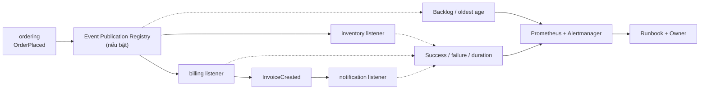
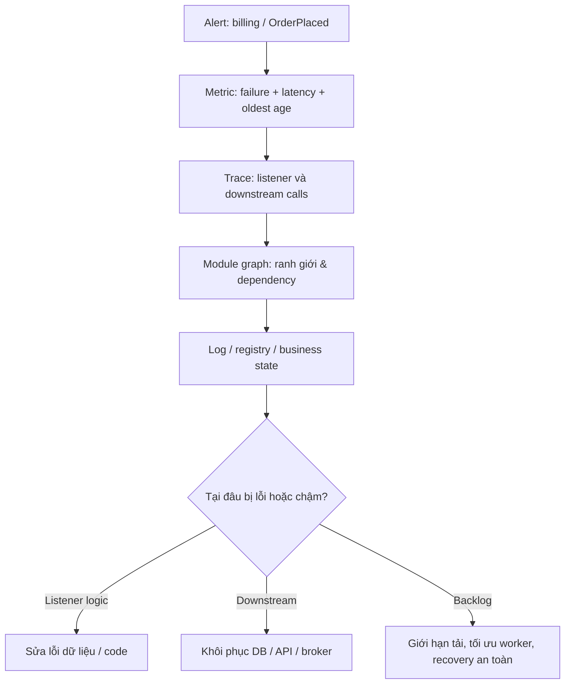

# Thiết kế alert theo module và event

## 1. Bài toán: phát hiện lỗi đúng module, đúng sự kiện

Trong **SPRING_MODULITH_DOCUMENTATION_OBSERVABILITY**, Spring Modulith được dùng để mô tả ranh giới application module và quan sát tương tác giữa các phần của ứng dụng Spring Boot bằng module graph, Actuator, event metrics, tracing và context propagation. Ở chương **Thiết kế thực tế**, bài này hướng dẫn thiết kế **alert theo module và event**: khi một luồng nghiệp vụ trục trặc, cảnh báo cần cho biết **module nào**, **sự kiện hoặc listener nào**, **ảnh hưởng nghiệp vụ ra sao** và **ai nên xử lý**.

Giả sử ứng dụng bán hàng có các module:

- `ordering`: tạo đơn, phát `OrderPlaced` sau khi lưu đơn.
- `inventory`: giữ hàng khi nhận `OrderPlaced`.
- `billing`: tạo hóa đơn khi nhận `OrderPlaced`.
- `notification`: gửi thông báo sau khi hóa đơn được tạo.

Luồng có thể chạy thành công ở `ordering` nhưng thất bại ở `billing` sau vài phút. HTTP request tạo đơn vẫn trả thành công, trong khi người mua không nhận hóa đơn. Alert chỉ dựa vào HTTP 5xx hoặc CPU sẽ bỏ sót tình huống này.

**Mục tiêu vận hành minh họa:** 99% đơn được tạo hóa đơn trong **2 phút** kể từ lúc sự kiện được công bố hợp lệ; không có publication quan trọng bị kẹt quá **5 phút**; lỗi listener phải được nhận diện theo từng module và event. Đây là **SLO giả định cho bài học**, cần điều chỉnh theo yêu cầu sản phẩm và SLA bên thứ ba.



Đây là các **nhánh tùy theo cấu hình thực tế**: không phải hệ thống nào cũng dùng Event Publication Registry, và việc sử dụng Spring application event không tự tạo hàng đợi bền vững. Không thiết kế alert cho một metric chưa thực sự được hạ tầng cung cấp.

## 2. Xác định nơi sự kiện được lưu và xử lý

Cần lập bản đồ hành trình sự kiện trước khi chọn metric. Với Spring Modulith, `@ApplicationModuleListener` là cách thuận tiện để xử lý sự kiện theo kiểu bất đồng bộ sau commit bằng transaction riêng. Khi dùng Event Publication Registry, hệ thống tạo publication cho mỗi transactional listener và ghi nhận hoàn tất khi listener thực hiện thành công.

| Cơ chế | Có thể quan sát gì? | Không được suy diễn |
|---|---|---|
| `ApplicationEventPublisher` + listener đồng bộ | Lần phát, lỗi và thời gian listener (khi được instrument) | Không có queue backlog bất đồng bộ mặc định |
| `@Async`/`@ApplicationModuleListener` | Executor active threads, queue depth nếu executor có instrumentation; thời gian listener | Queue depth không đồng nghĩa số publication chưa hoàn tất trong registry |
| Event Publication Registry | Publication chưa hoàn tất, tuổi lâu nhất, trạng thái/attempt nếu phiên bản hỗ trợ | Một publication tương ứng **một lần phát đến một listener**, không nhất thiết một domain event |
| Kafka | Consumer lag theo partition/group; handler latency riêng | Offset lag không tự bằng giây chậm trễ |
| RabbitMQ | Ready, unacknowledged, delivery rate | Ready ≠ unacked; không được cộng tuỳ tiện với registry backlog |
| Call trực tiếp giữa module | Duration, exception, error rate của method/HTTP | Không có event publication chỉ vì có cạnh trên module graph |

**Ví dụ:** một `OrderPlaced` gửi tới hai listener `billing` và `inventory` có thể sinh **hai publication**. Khi cả hai lỗi, registry có thể chứa hai bản ghi chưa hoàn tất nhưng chỉ có **một đơn hàng** liên quan. Dashboard phải đặt nhãn là “outstanding listener publications” thay vì “đơn hàng chưa xử lý”.

Trong Spring Modulith 2.0+, vòng đời publication phân biệt các trạng thái `PUBLISHED`, `PROCESSING`, `COMPLETED`, `FAILED` và `RESUBMITTED`; `ABANDONED` có từ 2.2. Dòng phiên bản cũ có thể không cung cấp cùng tập trạng thái. Cần kiểm tra đúng bản đang sử dụng trước khi thiết kế alert theo trạng thái hoặc tự động resubmit.

## 3. Chọn tín hiệu theo tác động nghiệp vụ

Một thiết kế tốt xuất phát từ hành vi người dùng và SLO rồi mới ánh xạ sang metric.

| Câu hỏi vận hành | SLI/metric đề xuất | Mục tiêu hoặc điều kiện cảnh báo ví dụ |
|---|---|---|
| Đơn đã tạo nhưng hóa đơn chưa có? | Phần trăm đơn có hóa đơn trong 2 phút, đo từ **trạng thái nghiệp vụ** | Dưới 99% trong cửa sổ đánh giá |
| Listener `billing` đang lỗi? | Tỷ lệ failed execution trên tổng execution, theo module/event | Lỗi trên 5% trong 10 phút và đủ lượng mẫu |
| Publication nào tồn đọng lâu? | Số outstanding + tuổi publication lâu nhất | Oldest age trên 5 phút và outstanding lớn hơn 0 |
| Xử lý chậm do dịch vụ phụ thuộc? | p95/p99 handler duration theo module/event | Vượt baseline và SLO tương ứng |
| Hàng đợi executor đầy? | Queue size + active threads + rejected tasks | Queue tăng bền vững và thread pool đạt giới hạn |
| Consumer broker có theo kịp? | Consumer lag/ready/unacked + tốc độ tiêu thụ | Tồn đọng tăng và độ trễ nghiệp vụ tăng |
| Dữ liệu giám sát bị đứt? | Exporter `up`, timestamp lần lấy mẫu thành công | Không thu được metric trong khoảng quan sát kỳ vọng |

**Phân tầng SLI:** “đã publish event” đo ý định xử lý; “listener chạy thành công” đo kết quả của một handler; “hóa đơn tồn tại và có thể truy xuất” mới phản ánh hoàn tất nghiệp vụ. Đừng dùng counter publish làm chỉ số xác nhận toàn bộ chuỗi đã hoàn thành.

### Thời gian cần phân biệt

Đặt các mốc `t0` = tạo event, `t1` = ghi vào registry/broker, `t2` = listener bắt đầu, `t3` = xử lý nghiệp vụ xong, `t4` = kết quả đã commit/hiển thị cho khách hàng:

- **Start lag:** `t2 - t1`, phản ánh thời gian chờ trước listener nếu có timestamp ở `t1`.
- **Handler duration:** `t3 - t2`, phản ánh thời gian chạy phần code listener.
- **Business completion latency:** `t4 - t0`, thường là SLI đáng tin hơn cho trải nghiệm người dùng.
- **Oldest outstanding age:** `now - t1` của publication chưa hoàn tất lâu nhất; có thể là publication lỗi tồn tại nhiều ngày.

Nếu event mang timestamp `occurredAt` được gắn trước transaction commit, `listenerStart - occurredAt` bao gồm cả thời gian trước commit. Trên nhiều tiến trình, thời gian từ hai đồng hồ máy khác nhau có thể bị sai bởi clock skew; duration đo trong một JVM nên dùng timer/đồng hồ đơn điệu.

## 4. Nguồn metric: có sẵn và cần bổ sung

### 4.1. Số liệu Spring Modulith cung cấp

Khi bật Spring Modulith observability, tài liệu mô tả hai nhóm counter phát domain event:

- `module.events.published`: counter tổng hợp số event phát, gắn các tag thấp cardinality như `module.identifier` và `module.event.type`.
- `module.events.published.<moduleIdentifier>.<simpleEventTypeName>`: counter riêng của từng loại event/module, có thể tùy biến bổ sung tag qua API tương ứng.

Spring Modulith cũng instrument lời gọi vào module API và có spans với thông tin như `module.identifier`, `module.name`, `module.method`, `module.invocation-type`. Những dữ liệu đó giúp liên kết biểu đồ module với luồng runtime.

**Giới hạn cốt lõi:** publication counter không cho biết listener đã hoàn thành hay thất bại, và endpoint `/actuator/modulith` chủ yếu công bố **cấu trúc module**, không phải dữ liệu queue backlog hoặc success rate. Không tự đặt tên “metric mặc định Spring Modulith” cho gauge hoặc timer do ứng dụng tự bổ sung.

### 4.2. Số liệu cần instrument ở ứng dụng

| Metric ứng dụng đề xuất | Kiểu | Tags thấp cardinality | Nguồn đo |
|---|---|---|---|
| `app.module.listener.executions` | Counter | `module`, `event`, `outcome` | Vòng `try/finally` tại listener |
| `app.module.listener.duration` | Timer, histogram | `module`, `event`, `outcome` | Thời gian thực thi listener |
| `app.module.publications.outstanding` | Gauge | `module` (hoặc `listener` nếu được quản lý) | Registry datastore/repository |
| `app.module.publications.oldest.age` | Gauge (giây) | `module` | Tuổi publication chưa hoàn tất cũ nhất |
| `app.module.publications.sample.time` | Gauge (epoch giây) | `module` | Lần làm mới sample thành công |
| `app.business.invoice.completion` | Timer, histogram | `flow`, `outcome` | Thành công nghiệp vụ tại `billing`/đối soát |
| `app.module.listener.rejected` | Counter | `module`, `executor` | Rejection từ executor nếu có |

Tên `app.*` ở đây là **quy ước cho bài thực hành**, không thuộc metric mặc định của Spring Modulith. Chỉ instrument đúng những công đoạn có dữ liệu đáng tin. Nếu chưa có cách truy vấn tuổi publication hoặc timestamp hoàn tất nghiệp vụ, ghi rõ là “chưa có SLI” và lập kế hoạch bổ sung instrumentation.

## 5. Thiết kế nhãn metric và quyền sở hữu

Nhãn phải giúp xác định nơi xử lý và tránh làm nổ số lượng time series.

| Nhãn | Ví dụ | Đặc điểm |
|---|---|---|
| `module` | `billing`, `inventory` | Tập giá trị hữu hạn theo module graph |
| `event` | `OrderPlaced`, `InvoiceCreated` | Tên loại sự kiện; thống nhất tên khi refactor |
| `listener` | `billing.createInvoice` | Chỉ dùng tập listener đã biết |
| `outcome` | `success`, `failure` | Giá trị hữu hạn, định nghĩa rõ |
| `environment` | `prod`, `staging` | Thường do exporter/scrape pipeline gắn |
| `service`, `cluster` | `shop-monolith`, `east` | Phân biệt ứng dụng/cluster và tránh tổng hợp nhầm |
| **Không dùng** `orderId`, `customerId`, `eventId`, `traceId` | UUID thay đổi theo mỗi request | Cardinality lớn, tốn bộ nhớ/cost, khó alert |

Mỗi module quan trọng nên có **owner**, SLO, runbook và lịch trực rõ ràng. Ví dụ `billing` do nhóm Payment/Finance Platform trực tiếp xử lý, còn `notification` thuộc nhóm Customer Messaging; mức độ khẩn cấp phụ thuộc ảnh hưởng, không chỉ tên module.

**Không gắn type Java lấy từ payload chưa kiểm soát** làm tag nếu type có thể được sinh động. Dùng tên event cố định đã được công bố trong contract; thay đổi tên class phải đi cùng việc cập nhật dashboard/alert.

## 6. Bật Actuator và đường xuất metrics

Ví dụ dùng Spring Boot và Spring Modulith được quản lý phiên bản qua BOM tương thích. Spring Modulith Insight starter cung cấp actuator và observability integration; Prometheus cần registry Micrometer phù hợp.

```groovy
dependencies {
    // BOM và version Spring Boot / Spring Modulith được quản lý ở build.
    implementation("org.springframework.boot:spring-boot-starter-actuator")
    runtimeOnly("org.springframework.modulith:spring-modulith-starter-insight")
    runtimeOnly("io.micrometer:micrometer-registry-prometheus")

    // Chỉ khi ứng dụng sử dụng Event Publication Registry lưu bằng JDBC:
    implementation("org.springframework.modulith:spring-modulith-starter-jdbc")
}
```

Tùy build thực tế, cần các dependency Spring Boot/JDBC và schema phù hợp. Không bổ sung starter persistence thứ hai nếu ứng dụng đã chọn registry store khác. Việc thêm `spring-modulith-starter-jdbc` là tùy chọn có điều kiện, **không bắt buộc** để đếm event publish.

```yaml
management:
  endpoints:
    web:
      exposure:
        include: health,info,metrics,prometheus,modulith
```

Đọc `/actuator/metrics/module.events.published` để kiểm tra tên Micrometer và tag; dùng `/actuator/prometheus` để thấy tên sau khi chuyển sang quy ước Prometheus. Với Prometheus, counter thường có hậu tố `_total` và tên `module.events.published` thường được export thành `module_events_published_total`. Nhãn có dấu chấm như `module.identifier` thường thành `module_identifier`. **Xác minh tên thực tế trên endpoint**, không chép PromQL sang production khi chưa thấy series.

`/actuator/modulith` có thể dùng để đối chiếu module identifiers và dependency graph, nhưng không phải endpoint cảnh báo số event còn chờ. Bảo vệ endpoint Actuator theo mạng nội bộ và phân quyền của tổ chức; không công khai topology và metrics nghiệp vụ nhạy cảm ngoài chủ đích.

## 7. Instrument listener: lỗi, thời gian chạy và trạng thái

Ví dụ module `ordering` cung cấp event typed trong public API:

```java
package com.acme.shop.order;

import java.time.Instant;
import java.util.UUID;

public record OrderPlaced(UUID orderId, Instant occurredAt) {}
```

Module `billing` đăng ký `@ApplicationModuleListener` và dùng Micrometer để đo. `InvoiceService` ở đây được giả định đã có trong nghiệp vụ, và cần idempotent vì event có thể được retry hoặc phát lại.

```java
package com.acme.shop.billing;

import com.acme.shop.order.OrderPlaced;
import io.micrometer.core.instrument.Counter;
import io.micrometer.core.instrument.MeterRegistry;
import io.micrometer.core.instrument.Timer;
import org.springframework.modulith.events.ApplicationModuleListener;
import org.springframework.stereotype.Component;

@Component
class InvoiceOnOrderPlaced {

    private final InvoiceService invoices;
    private final MeterRegistry registry;

    InvoiceOnOrderPlaced(InvoiceService invoices, MeterRegistry registry) {
        this.invoices = invoices;
        this.registry = registry;
    }

    @ApplicationModuleListener
    void on(OrderPlaced event) {
        Timer.Sample timer = Timer.start(registry);
        boolean success = false;

        try {
            // Phải bảo đảm không tạo hai hóa đơn cho cùng một orderId.
            invoices.createIfAbsent(event.orderId());
            success = true;
        } finally {
            String outcome = success ? "success" : "failure";

            Counter.builder("app.module.listener.executions")
                    .tag("module", "billing")
                    .tag("event", "OrderPlaced")
                    .tag("outcome", outcome)
                    .register(registry)
                    .increment();

            timer.stop(Timer.builder("app.module.listener.duration")
                    .description("Business handler execution duration")
                    .tag("module", "billing")
                    .tag("event", "OrderPlaced")
                    .tag("outcome", outcome)
                    .publishPercentileHistogram()
                    .register(registry));
        }
    }
}
```

Điểm cần chú ý:

1. Lỗi được để **lan ra ngoài listener** sau `finally`, để cơ chế quản lý publication biết listener thất bại. Nuốt exception rồi return bình thường có thể khiến registry coi publication đã hoàn tất dù nghiệp vụ lỗi.
2. `Timer.Sample` đo duration trong cùng tiến trình; metric này có thể **chưa bao gồm** thời gian transaction commit hoặc ghi trạng thái COMPLETED của registry sau khi method trả về.
3. `success=true` trong ví dụ có nghĩa method nghiệp vụ không ném exception. Nó chưa chắc chứng minh người dùng đã thấy hóa đơn; nếu cần SLO end-to-end, instrument ở điểm xác nhận nghiệp vụ.
4. Timer có histogram để truy vấn p95/p99 từ Prometheus. Histogram có chi phí lưu trữ; chỉ bật cho metric có nhu cầu SLO và kiểm soát bucket phù hợp.
5. `orderId` không được dùng làm metric tag. Có thể ghi ID này vào log/tracing với chính sách bảo vệ dữ liệu và liên kết tới một trace cụ thể.

Nếu `@ApplicationModuleListener` nằm trong transaction riêng, lỗi commit có thể xảy ra sau khi method kết thúc và vượt ra ngoài phạm vi `try/finally` ở ví dụ. Để đo **thành công sau commit**, cần quan sát trạng thái publication/transaction hoặc đặt metric tại bước xác nhận trạng thái nghiệp vụ. Không dùng số lần listener trả về thành công làm bảo đảm “exactly once”.

## 8. Đo publication tồn đọng: thiết kế adapter theo hạ tầng

Để alert backlog, cần phân biệt:

- **Outstanding publications**: các publication chưa được xác nhận hoàn tất, có thể bao gồm pending, đang xử lý hoặc failed tùy kho lưu và phiên bản.
- **Queue depth**: số task đang đợi executor hoặc broker, thường **không bao gồm** task đang xử lý.
- **Oldest age**: độ tuổi của publication cũ nhất chưa hoàn tất, hữu ích vì chỉ một sự kiện hỏng lâu ngày cũng ảnh hưởng SLO.

Khi dùng registry, nên truy vấn aggregate trực tiếp từ storage theo target listener/module hoặc trạng thái đã thống nhất. Với lưu trữ nhiều bản ghi, không nên đọc/deserialize toàn bộ payload mỗi khi Prometheus scrape. Việc lấy mẫu theo lịch giúp hạn chế tải truy vấn.

Ví dụ sau là **adapter minh họa của ứng dụng**. `PublicationBacklogReader` **không phải API của Spring Modulith**; dự án phải hiện thực adapter này dựa trên JDBC/JPA/MongoDB/Neo4j repository và schema của phiên bản đang dùng.

```java
package com.acme.shop.observability;

import java.time.Instant;
import java.util.concurrent.atomic.AtomicLong;

import io.micrometer.core.instrument.Gauge;
import io.micrometer.core.instrument.MeterRegistry;
import org.springframework.scheduling.annotation.Scheduled;
import org.springframework.stereotype.Component;

// Dự án hiện thực readForModule() bằng query aggregate của registry store.
interface PublicationBacklogReader {
    BacklogSnapshot readForModule(String module);
}

record BacklogSnapshot(long outstanding, long oldestAgeSeconds) {}

@Component
class BillingPublicationMetrics {

    private final PublicationBacklogReader reader;
    private final AtomicLong outstanding = new AtomicLong();
    private final AtomicLong oldestAge = new AtomicLong();
    private final AtomicLong lastSampleEpoch = new AtomicLong();

    BillingPublicationMetrics(
            PublicationBacklogReader reader, MeterRegistry registry) {
        this.reader = reader;

        Gauge.builder("app.module.publications.outstanding",
                        outstanding, AtomicLong::get)
                .tag("module", "billing")
                .description("Incomplete listener publications")
                .register(registry);

        Gauge.builder("app.module.publications.oldest.age",
                        oldestAge, AtomicLong::get)
                .baseUnit("seconds")
                .tag("module", "billing")
                .description("Age of oldest incomplete publication")
                .register(registry);

        Gauge.builder("app.module.publications.sample.time",
                        lastSampleEpoch, AtomicLong::get)
                .baseUnit("seconds")
                .tag("module", "billing")
                .description("Time of last successful registry sample")
                .register(registry);
    }

    @Scheduled(fixedDelay = 30_000)
    void sample() {
        BacklogSnapshot snapshot = reader.readForModule("billing");
        if (snapshot.outstanding() < 0 || snapshot.oldestAgeSeconds() < 0) {
            throw new IllegalStateException("Invalid backlog snapshot");
        }

        outstanding.set(snapshot.outstanding());
        oldestAge.set(snapshot.oldestAgeSeconds());
        lastSampleEpoch.set(Instant.now().getEpochSecond());
    }
}
```

Bật scheduling bằng `@EnableScheduling` trong một `@Configuration` của ứng dụng. Trong adapter thật, `readForModule("billing")` phải ánh xạ đúng các listener target của module `billing` và tránh đếm nhiều lần một publication khi join dữ liệu. Sử dụng trạng thái/column/index có sẵn của registry store và giới hạn chi phí truy vấn.

Các ràng buộc khi thiết kế adapter:

- Nếu nhiều instance cùng đọc **một registry database chung**, Gauge ở các instance có thể cùng đếm toàn hệ thống. Dashboard nên dùng `max` hoặc một collector duy nhất; dùng `sum` sẽ đếm trùng.
- Nếu mỗi instance giữ **partition độc lập**, cần gắn nhãn partition và `sum` đúng ownership; không dùng `max` thay thế.
- Khi job lấy mẫu lỗi, Gauge vẫn giữ số liệu cũ: metric `sample.time` (epoch giây) giúp phát hiện **staleness**. Cần thêm log/counter lỗi sampling nếu cần.
- Khi chưa có outstanding publication, thống nhất `oldestAge=0`. Khi registry không hoạt động hoặc query lỗi, **không** tự chuyển lỗi thành `0` vì điều đó tạo kết quả “an toàn giả”.
- Với Spring Modulith 2.x, có thể tách `PUBLISHED`, `PROCESSING`, `FAILED`, `RESUBMITTED`, `ABANDONED` thành các nhóm cảnh báo nếu nguồn lưu/phiên bản hỗ trợ. Không mặc định rằng tất cả cùng là queue pending.

Ngoài registry, nếu bottleneck nằm ở executor/broker, cần thêm queue depth, active threads, rejected count, consumer lag/ready/unacked tương ứng. Không lấy “outstanding + consumer lag” làm tổng đơn hàng tồn vì có thể đếm trùng nhiều chặng của một event.

## 9. PromQL từ SLI đến alert

Các truy vấn dưới đây dùng **tên metric ứng dụng đã khai báo trong ví dụ**; trước khi sử dụng, xác minh tên/tags exporter thực tế. `Timer` có histogram khi bật `publishPercentileHistogram()`; Prometheus thường xuất `_seconds_bucket`, `_seconds_count` và `_seconds_sum`.

### 9.1. Tốc độ phát sự kiện

```promql
# Counter có sẵn của Spring Modulith, nếu đã bật observability.
sum by (module_identifier, module_event_type) (
  rate(module_events_published_total[5m])
)
```

Đồ thị này giúp xác định tải nguồn phát nhưng **không tự chứng minh downstream xử lý xong**.

### 9.2. Tỷ lệ listener lỗi theo module/event

```promql
sum by (module, event) (
  rate(app_module_listener_executions_total{outcome="failure"}[10m])
)
/
clamp_min(
  sum by (module, event) (
    rate(app_module_listener_executions_total[10m])
  ),
  1e-9
)
```

Giá trị là tỷ lệ từ 0 đến 1. Nên kết hợp điều kiện đủ số mẫu, ví dụ `sum by (module,event)(increase(app_module_listener_executions_total[10m])) >= 50`, để một lỗi trong một request không tạo cảnh báo “100% lỗi” quá mức.

### 9.3. p95 thời gian handler

```promql
histogram_quantile(
  0.95,
  sum by (le, module, event) (
    rate(app_module_listener_duration_seconds_bucket[5m])
  )
)
```

Histogram này đo thời gian **handler**, chưa chắc là thời gian end-to-end. So sánh với latency của business outcome và khoảng chờ queue để tìm đúng nguyên nhân.

### 9.4. Backlog và publication cũ nhất

```promql
# Nếu mọi instance phản chiếu cùng một shared registry store:
max by (module) (app_module_publications_outstanding)

max by (module) (app_module_publications_oldest_age_seconds)

# Thời gian từ lần làm mới metric registry cuối tới hiện tại:
time() - max by (module) (app_module_publications_sample_time_seconds)
```

Ở production đa cluster, thêm `environment`/`cluster` vào nhãn và nhóm tính toán. Nếu series bị mất hoàn toàn, biểu thức dùng `max` không sinh giá trị; cần theo dõi exporter `up` hoặc sự tồn tại của metric riêng.

### 9.5. Ví dụ nhóm alert của Prometheus

Ví dụ này đưa ra **ngưỡng khởi đầu để kiểm thử**, không phải ngưỡng khuyến nghị áp dụng cho mọi hệ thống:

```yaml
groups:
  - name: modulith-event-alerts
    rules:
      - alert: ModulithPublicationStuck
        expr: |
          max by (module) (app_module_publications_oldest_age_seconds{module="billing"}) > 300
          and on (module)
          max by (module) (app_module_publications_outstanding{module="billing"}) > 0
        for: 5m
        labels:
          severity: page
          team: billing
        annotations:
          summary: "Publication chưa hoàn tất quá 5 phút: {{ $labels.module }}"
          description: "Kiểm tra trạng thái registry, listener, DB và retry."

      - alert: ModulithListenerErrorRateHigh
        expr: |
          (
            sum by (module, event) (
              rate(app_module_listener_executions_total{module="billing",outcome="failure"}[10m])
            )
            /
            clamp_min(
              sum by (module, event) (
                rate(app_module_listener_executions_total{module="billing"}[10m])
              ),
              1e-9
            )
          ) > 0.05
          and on (module, event)
          sum by (module, event) (
            increase(app_module_listener_executions_total{module="billing"}[10m])
          ) >= 50
        for: 5m
        labels:
          severity: warning
          team: billing
        annotations:
          summary: "Listener lỗi nhiều: {{ $labels.module }} / {{ $labels.event }}"
          description: "Đối chiếu traces, publication status và downstream dependencies."

      - alert: ModulithPublicationSampleStale
        expr: |
          time() - max by (module) (
            app_module_publications_sample_time_seconds{module="billing"}
          ) > 120
        for: 2m
        labels:
          severity: warning
          team: platform
        annotations:
          summary: "Dữ liệu backlog không được cập nhật: {{ $labels.module }}"
```

Ví dụ alert trên chỉ theo dõi `module="billing"` và route đến nhóm trực `billing`. Với các module khác, cần tạo rule tương ứng hoặc dùng ánh xạ `module → team` được quản lý. Rule mẫu cũng chỉ đo trên một môi trường/cluster; hãy thêm scope nhất quán vào biểu thức và labels khi triển khai đa môi trường.

**Điểm mù:** `ModulithPublicationSampleStale` chỉ hoạt động khi series đã xuất hiện ít nhất một lần. Nếu toàn bộ exporter hoặc ứng dụng không chạy, cần alert `up == 0`/`absent_over_time` và kiểm tra scrape target để nhận ra tình huống không có dữ liệu. Meter của listener có thể chưa tồn tại trước lần gọi đầu tiên; **không** cảnh báo “không có listener event” khi hệ thống đang hợp lệ ở trạng thái idle.

## 10. Mức độ ưu tiên, cửa sổ đánh giá và tránh alert fatigue

Một phương án phân tầng:

| Mức | Điều kiện minh họa | Đích nhận | Hành động |
|---|---|---|---|
| **P1 / page** | Invoicing SLO bị đe dọa, backlog quan trọng quá lâu hoặc nhiều đơn không thể hoàn tất | On-call `billing`/incident commander | Xác minh tác động, giới hạn lỗi, kích hoạt quy trình phục hồi |
| **P2 / warning** | Error rate listener vượt ngưỡng trong 10 phút với đủ số mẫu | Owner module | Kiểm tra downstream, deploy gần đây, retry và lỗi dữ liệu |
| **P3 / ticket** | p95 tăng so với baseline nhưng business SLO vẫn đạt | Owner module | Phân tích hiệu năng, chuẩn bị cải tiến |
| **Monitoring-health** | Exporter mất dữ liệu hoặc mẫu registry quá cũ | Platform/observability | Khôi phục instrumentation và pipeline trước khi tin dashboard |

Ngưỡng nên được hiệu chỉnh bằng đo đạc thực tế:

- **Dùng cửa sổ đủ dài** để tránh nhấp nháy do một lỗi lẻ, nhưng không dài đến mức vi phạm SLO rồi mới phát hiện. Ví dụ `for: 5m` yêu cầu điều kiện kéo dài liên tục.
- **Kết hợp ratio và volume** cho event hiếm: 1/1 lỗi là 100%, nhưng chưa đủ căn cứ page nếu nghiệp vụ cho phép xử lý lại thủ công.
- **Kết hợp backlog count với oldest age**: backlog tăng nhẹ trong đợt batch có thể là bình thường; một publication cũ 30 phút dù count=1 cũng có thể rất nghiêm trọng với hóa đơn.
- **Hạn chế lặp alert**: route theo owner, group theo `module,event` và ức chế cảnh báo triệu chứng khi đã có incident gốc (ví dụ database chung mất kết nối).
- **Có maintenance/silence có thời hạn**, có người duyệt và reason; tránh tắt toàn bộ cảnh báo lâu dài sau một lần nhiễu.

Với SLO thành công end-to-end, có thể dùng **multi-window burn-rate** thay vì chỉ xét lỗi trong 5 phút. Ví dụ cửa sổ ngắn phát hiện sự cố nhanh, cửa sổ dài xác nhận lượng error budget đang bị đốt; các hệ số burn-rate cần hiệu chỉnh theo SLO và lịch sử lưu lượng.

## 11. Gắn cảnh báo với module graph, tracing và context propagation

**Module graph** và `/actuator/modulith` giúp chỉ ra những module đang có dependency: ví dụ `billing` có dependency loại `EVENT_LISTENER` vào `ordering`. Tuy nhiên nó không thể xác định handler đã thành công lúc 14:00. Alert cần metric/runtime evidence.

Khi phát cảnh báo `billing / OrderPlaced`, runbook có thể:

1. Đọc dashboard metric: `app.module.listener.executions`, handler duration, outstanding và oldest age.
2. Tìm trace/span gắn module và method: `module.identifier`, `module.invocation-type`, `module.method`; lọc theo khoảng thời gian xảy ra lỗi.
3. Từ `billing`, xem dependency tới DB, HTTP client, Kafka hoặc các application module khác trong traces.
4. Dùng event/business identifier để đối soát **trong log hoặc truy vấn nghiệp vụ có phân quyền**; không gửi ID nhạy cảm thành label metric/Alertmanager.
5. Nếu thiếu span nối từ `ordering` sang `billing`, kiểm tra context propagation qua `@Async`/executor, sampling và exporter. Một trace bị đứt không chứng minh event chưa được gửi.



Context propagation là trách nhiệm của executor/tracing stack: khi dùng executor tự cấu hình, có thể cần `ContextPropagatingTaskDecorator` hoặc cấu hình tương đương của Spring Boot ở đúng phiên bản. Không giả định log correlation được truyền qua mọi nhánh async hoặc broker một cách tự động.

## 12. Runbook cho ba cảnh báo quan trọng

### 12.1. Publication bị kẹt quá tuổi

**Dấu hiệu:** oldest age > 5 phút và outstanding > 0 trong khi `ordering` vẫn tiếp tục publish.

**Kiểm tra:** publication target nào đang tồn đọng? Trạng thái `PUBLISHED`, `PROCESSING`, `FAILED` hay `ABANDONED`? DB registry còn kết nối không? Executor có queue đầy không? Listener có bị timeout downstream không? Có retry/resubmit được cấu hình không?

**Ứng phó:** xác định và xử lý nguyên nhân, khôi phục downstream, cân nhắc resubmit **có giới hạn** theo chức năng phiên bản đang chạy. Với operation có side effect, bảo đảm idempotency hoặc kiểm tra trạng thái giao dịch trước khi phát lại. Không tự động xóa bản ghi outstanding chỉ để làm Gauge về 0.

### 12.2. Listener error rate tăng mạnh

**Dấu hiệu:** trong 10 phút, nhiều `OrderPlaced` được listener `billing` xử lý lỗi; handler failure ratio > 5%.

**Kiểm tra:** exception type, lỗi validation, DB deadlock, downstream HTTP 429/503, vừa deploy gì, tỉ lệ lỗi theo event subtype, attempt count và tác động số hóa đơn bị thiếu.

**Ứng phó:** rollback/fix nếu lỗi từ deploy, giới hạn đồng thời hoặc bật circuit breaker phù hợp với downstream, khôi phục sau khi hệ thống ổn định. Retry phải theo chính sách event và hợp đồng nghiệp vụ.

### 12.3. Dữ liệu backlog đứng yên

**Dấu hiệu:** `sample.time` không đổi, trong khi publish event vẫn diễn ra hoặc `up` của exporter bị mất.

**Kiểm tra:** scheduled job có chạy không (`@EnableScheduling`)? Query registry timeout? Pool DB bị cạn? Quyền truy cập thay đổi? Prometheus đang scrape đúng instance/namespace không? Giá trị Gauge có bị stale mà vẫn vẽ đường thẳng không?

**Ứng phó:** sửa pipeline lấy mẫu; đánh dấu dashboard là **không đáng tin** cho tới khi dữ liệu cập nhật. Không ghi nhận “zero backlog” khi không có dữ liệu.

## 13. Bảo đảm tính đúng của cảnh báo trong hệ thống nhiều instance

Trong production, ứng dụng thường chạy nhiều instance nhưng dùng chung registry database và broker:

- Với **counter listener theo instance**, `sum by (module,event)` thường phù hợp sau khi Prometheus loại bỏ các series trùng; kiểm tra nhãn `instance` và cách gửi event có thể xảy ra nhiều lần.
- Với **Gauge outstanding từ một datastore chung**, dùng `max` hoặc thu từ một exporter duy nhất; không `sum` những lần đo cùng một tập publication.
- Với **broker lag**, luôn nhóm theo consumer group và partition phù hợp, tránh cộng dữ liệu của các consumer group khác nhau như thể là một backlog.
- Với **event handler duration**, dùng histogram aggregate được tạo cùng bucket schema để tính p95; không lấy trung bình các p95 của từng instance.
- Với **metric stale hoặc missing**, xác định phân biệt app down, scrape fail, mất series do không có event và lỗi job đọc registry.
- Với **resubmit**, kiểm tra cạnh tranh giữa nhiều instance và policy của registry; chỉ một retry thành công cũng có thể kích hoạt side effect thêm lần nữa nếu nghiệp vụ thiếu idempotency.

Các công thức còn phụ thuộc nhãn `environment`, `service`, `cluster`, `module`, `event`, `listener`. Cần thêm phép lọc nhất quán để không trộn staging với production hoặc hai ứng dụng dùng cùng tên `billing`.

## 14. Bài thực hành thiết kế và kiểm thử alert

Bài thực hành có thể thực hiện với `ordering` và `billing`, Prometheus và một registry tương thích:

1. **Baseline:** publish 20 `OrderPlaced` và tạo hóa đơn thành công. Xác nhận counter event publish tăng; listener execution success tăng; backlog về 0 sau khi hoàn tất. Kiểm tra một hóa đơn cho mỗi `orderId`.
2. **Slow handler:** cố tình thêm độ trễ 3–5 giây trong `InvoiceService` trên môi trường test. Gửi đủ lưu lượng để quan sát handler p95 tăng và backlog bắt đầu tích lũy. So sánh với business completion latency.
3. **Business failure:** cho `InvoiceService` ném exception với một nhóm sự kiện. Xác nhận listener failure counter tăng và registry giữ publication chưa hoàn tất/trạng thái lỗi theo phiên bản.
4. **Recovery:** khôi phục listener, chạy lại publication lỗi theo quy trình kiểm soát; xác nhận hóa đơn không bị tạo trùng, outstanding và oldest age giảm về mức kỳ vọng.
5. **Đứt pipeline quan sát:** dừng job sampling hoặc làm query adapter thất bại. Kiểm tra alert stale data có hoạt động, dashboard không hiển thị lỗi sampling thành zero backlog.
6. **Không có traffic:** dừng publish event nhưng giữ ứng dụng khỏe mạnh; xác minh không phát cảnh báo “counter listener biến mất” chỉ vì không có sự kiện mới.
7. **Nhiều instance:** khởi động hai instance cùng đọc một registry. Kiểm tra Gauge outstanding không bị cộng đúp và Counter listener được aggregate đúng.
8. **Trace context:** dùng một event cụ thể để đối chiếu log/trace qua `ordering` và `billing`; kiểm tra cấu hình truyền context nếu spans bị tách.
9. **Rà soát với owner:** mô phỏng alert P1 và P2; người trực phải chỉ ra được đúng module, event, runbook, tác động và thao tác phục hồi an toàn.

Các test này nên chạy ở môi trường tách biệt với đơn hàng/thanh toán thật. Nếu dùng message broker hoặc service ngoài, phải tạo test double hay sandbox có khả năng tái lập delay và lỗi.

### Tiêu chí nghiệm thu

Alert đạt yêu cầu khi:

- Được kích hoạt bằng **tín hiệu gắn với SLO hoặc lỗi thực**, không chỉ sự tồn tại của event.
- Hiển thị **module**, **event/listener**, **môi trường**, mức nghiêm trọng và **owner**.
- Không báo sai khi traffic bằng 0, snapshot thiếu dữ liệu hoặc nhiều instance báo cùng một Gauge.
- Có đường dẫn từ alert đến dashboard, trace, log có phân quyền và runbook xử lý.
- Có bằng chứng test cho success, failure, backlog, recovery, mất metrics và tình huống multi-instance.

## 15. Checklist triển khai thực tế

- [ ] Đã thống nhất SLO theo luồng nghiệp vụ và phân biệt publication, listener completion, business completion.
- [ ] Đã liệt kê các module và event quan trọng, ranh giới module graph cùng owner tương ứng.
- [ ] Đã kiểm tra nguồn dữ liệu có thật (Spring Modulith event counter, registry, executor, broker, business state).
- [ ] Đã phân biệt built-in metrics với các metric tự định nghĩa; có hợp đồng tên/nhãn/đơn vị rõ ràng.
- [ ] Tags chỉ dùng nhóm giá trị hữu hạn; không dùng event ID, order ID hoặc trace ID làm metric label.
- [ ] Lỗi listener được ghi nhận và propagate đúng, histogram duration đo đúng ranh giới thời gian.
- [ ] Backlog Gauge dùng nguồn aggregate phù hợp, không đếm trùng nhiều listener/instance và có metric đo freshness.
- [ ] PromQL/Alertmanager được xác minh với tên metric và labels exporter thực tế.
- [ ] Có ngưỡng, `for`, điều kiện sample volume, ưu tiên và routing theo module owner.
- [ ] Có alert cho mất dữ liệu quan sát; không biến missing metrics thành “0 lỗi”.
- [ ] Tracing và context propagation được kiểm tra qua ranh giới async; có runbook phục hồi theo registry/broker.
- [ ] Retry/resubmit có giới hạn, quan sát được và không tạo side effect trùng.
- [ ] Dashboard, alert, runbook và module graph được cập nhật khi module/event đổi tên hoặc nâng Spring Modulith.

### Tài liệu tham khảo

- [Spring Modulith — Production-ready Features: Actuator, Metrics và Tracing](https://docs.spring.io/spring-modulith/reference/production-ready.html)
- [Spring Modulith — Working with Application Events, Event Publication Registry và Lifecycle](https://docs.spring.io/spring-modulith/reference/events.html)
- [Spring Modulith — Fundamentals và Application Module Discovery](https://docs.spring.io/spring-modulith/reference/fundamentals.html)
- [Spring Boot — Metrics và Task Executor Instrumentation](https://docs.spring.io/spring-boot/reference/actuator/metrics.html)
- [Spring Boot — Observability](https://docs.spring.io/spring-boot/reference/actuator/observability.html)
- [Micrometer — Concepts: Timers, Counters và Gauges](https://docs.micrometer.io/micrometer/reference/concepts.html)
- [Prometheus — Alerting Rules](https://prometheus.io/docs/prometheus/latest/configuration/alerting_rules/)
- [Prometheus — PromQL Functions và Histogram Quantile](https://prometheus.io/docs/prometheus/latest/querying/functions/)
