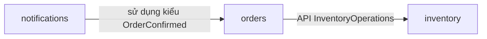
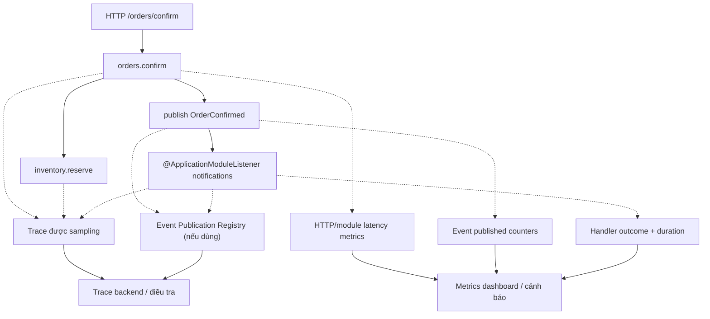
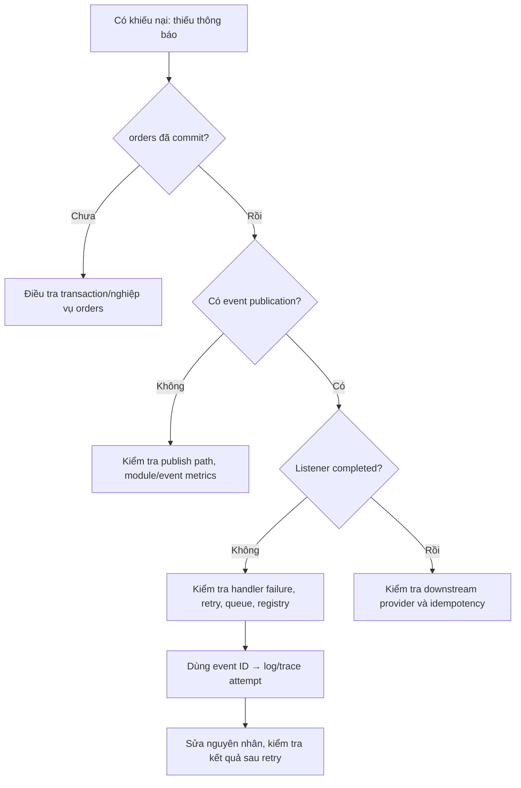

# Giữ telemetry hỗ trợ điều tra mà không tạo dữ liệu thừa

Ứng dụng Spring Boot được chia thành các **application module** bằng Spring Modulith cần đủ dữ liệu để trả lời những câu hỏi như: “đơn hàng bị chậm ở module nào?”, “sự kiện đã phát nhưng listener chưa chạy vì sao?”, hoặc “một lần thử lại có gửi thông báo hai lần không?”. Nếu thu thập toàn bộ payload, tạo span cho từng method, gắn mã đơn hàng vào mọi metric và lưu mọi log vô thời hạn, hệ thống quan sát có thể trở nên đắt đỏ, khó tìm kiếm và gây lộ dữ liệu mà vẫn không giúp điều tra nhanh hơn.

Bài học thuộc chương **Thiết kế thực tế** của **Spring Modulith Documentation & Observability**. Mục tiêu là **thiết kế lượng telemetry nhỏ nhất nhưng đủ bằng chứng để điều tra** tương tác giữa module: kết hợp **module graph**, **Actuator**, **event metrics**, **tracing**, **context propagation** và trạng thái xử lý event. Cách tiếp cận đặt câu hỏi vận hành và tiêu chí xác minh trước khi chọn metric, span hoặc trường log.

## 1. Bắt đầu từ câu hỏi điều tra, không bắt đầu từ số lượng log

Giả sử một ứng dụng quản lý đơn hàng gồm ba module:

```text
com.acme.shop
├── ShopApplication.java
├── orders
│   ├── OrderService.java
│   ├── OrderConfirmed.java
│   └── internal
│       └── OrderRepositoryAdapter.java
├── inventory
│   ├── InventoryOperations.java
│   └── internal
│       └── InventoryService.java
└── notifications
    └── internal
        └── OrderConfirmationListener.java
```

Một yêu cầu xác nhận đơn hàng đi theo luồng: `orders` gọi API của `inventory` để giữ hàng, ghi nhận đơn rồi publish `OrderConfirmed`. Module `notifications` nhận event và gửi thông báo. Luồng này chạy trong **cùng ứng dụng**, nhưng listener có thể chạy trên thread và transaction riêng.

Trước khi instrument thêm, lập bảng **câu hỏi → bằng chứng tối thiểu**:

| Câu hỏi điều tra | Bằng chứng cần thiết | Không cần thu mặc định |
| --- | --- | --- |
| Module nào phụ thuộc vào module nào? | Module graph và kiểm tra ranh giới | Log từng method gọi qua lại |
| Đặt đơn đang chậm ở bước nào? | Latency HTTP, span ở ranh giới module và dependency chậm | Span cho getter, mapper và helper nhỏ |
| Có bao nhiêu event được phát? | Counter theo tên event/module từ Modulith hoặc meter tương đương | Full JSON của mọi event |
| Listener xử lý thành công hay lỗi? | Duration, số attempt/success/failure, trạng thái publication | Đếm số lần publish như thể đã hoàn thành |
| Event của đơn X đang ở đâu? | Event ID/correlation ID được bảo vệ, trace hoặc log có ID đó | Đưa order ID vào metric tag |
| Có retry sau restart không? | Event Publication Registry, event ID bền và attempt/outcome | Giữ current `ThreadLocal` qua restart |
| Nâng cấp làm đứt trace ở đâu? | Sampling/exporter status, executor/context propagation và trace mẫu | Tăng toàn bộ logging lên DEBUG vô thời hạn |

**Quy tắc chọn tín hiệu:** metrics để biết **có vấn đề không và quy mô bao nhiêu**; traces để biết **đường xử lý của một lần gọi**; logs để biết **sự kiện/điều kiện cụ thể**; dữ liệu publication để biết **tiến độ xử lý event bền vững**. Tài liệu module bổ sung ranh giới kiến trúc tĩnh. Bốn loại bằng chứng có vai trò khác nhau, không cần sao chép cùng payload vào tất cả.

## 2. Dùng module graph làm bản đồ, runtime telemetry làm chứng cứ

Spring Modulith cho phép phân tích application module và kiểm tra vi phạm ranh giới:

```java
package com.acme.shop;

import org.junit.jupiter.api.Test;
import org.springframework.modulith.core.ApplicationModules;

class ModuleArchitectureTest {
    @Test
    void verifiesModuleBoundaries() {
        ApplicationModules.of(ShopApplication.class).verify();
    }
}
```

Có thể sinh biểu diễn module bằng `Documenter` (thư viện docs tương thích phiên bản):

```java
import org.junit.jupiter.api.Test;
import org.springframework.modulith.core.ApplicationModules;
import org.springframework.modulith.docs.Documenter;

class ModuleGraphTest {
    @Test
    void documentsModules() {
        var modules = ApplicationModules.of(ShopApplication.class);
        new Documenter(modules).writeModulesAsPlantUml();
    }
}
```

Sơ đồ mô tả **quan hệ tĩnh** trong ví dụ:



Lưu ý chiều phụ thuộc Java `notifications → orders` do listener tham chiếu kiểu sự kiện có thể **khác** chiều xử lý nghiệp vụ `orders → notifications` khi event được phát. Graph tĩnh không cho biết event đã thực sự được dispatch; trace một lần chạy cũng không chứng minh tất cả ranh giới đều hợp lệ. Chạy `verify()` và lưu graph theo commit khi xây dashboard hoặc runbook giúp đặt các span vào đúng ngữ cảnh.

Đừng tạo meter riêng cho từng cạnh phụ thuộc nếu chưa có câu hỏi điều tra cần nó. Với một số tương tác, số liệu được Spring Modulith/Micrometer cung cấp sẵn là đủ. Chỉ instrument thêm khi cần phân biệt kết quả nghiệp vụ hay độ trễ mà số liệu mặc định không thể hiện.

## 3. Thiết kế một bản đồ telemetry không đếm trùng



| Điểm quan sát | Nên thu | Ý nghĩa | Khi nào không thêm |
| --- | --- | --- | --- |
| HTTP controller | RPS, latency, error status; server span khi sampling | Người dùng thấy lỗi/chậm | Nếu Spring Boot đã instrument HTTP đúng |
| Cross-module API | Module nguồn/đích, lời gọi chậm hoặc thất bại | Xác định nút nghẽn giữa module | Nếu chỉ là helper nội bộ, không có tác dụng điều tra |
| Event publisher | Counter event được publish | Tần suất phát event | Nếu Modulith đã tạo cùng counter |
| Async handler | Processing duration, success/failure/attempt | Xác định event xử lý chậm hoặc retry | Nếu đã có observation cùng ngữ nghĩa |
| Registry bền | Outstanding/failed/completed nếu backend cung cấp | Tình trạng publication, replay | Nếu không dùng registry và không có công việc bền |
| Log sự kiện | Event ID, module, outcome, error category | Tìm một lần xử lý cụ thể | Không log toàn payload/mọi bước thành công |

Spring Modulith có khả năng tạo counter cho domain events được phát, ví dụ `module.events.published` và các counter theo module/event type trong những phiên bản hỗ trợ. Trước khi tạo metric riêng, hãy kiểm tra tên thực tế tại `/actuator/metrics` hoặc `MeterRegistry`. **Published count** không bằng **completed count**: một event có thể không có listener, có nhiều listener, transaction rollback hoặc listener được retry.

Tránh cả hai dạng đếm trùng:

1. Dùng `@Observed` hoặc custom `Observation` trên method đã được instrument tự động, khiến cùng một khoảng thời gian có hai observation không cần thiết.
2. Tạo `Counter.builder("module.events.published")` thủ công trong khi Spring Modulith đã đăng ký counter đó.

Khi cần metric nghiệp vụ riêng, đặt tên mới có nghĩa rõ ràng, ví dụ `shop.notification.handle`, gắn nhãn hữu hạn và ghi rõ loại tác vụ được đo.

## 4. Quản lý cardinality trước khi thêm tag

Mỗi **meter name + tổ hợp tag values** có thể tạo một time series riêng trong backend. Với một metric có các chiều nhãn có lần lượt 4 module, 6 loại event, 3 outcome và 2 môi trường, số tổ hợp **tối đa theo phép nhân** là:

\[
4 \times 6 \times 3 \times 2 = 144.
\]

Nếu thêm `orderId` với 50.000 giá trị khác nhau, số tổ hợp tiềm năng có thể lên tới:

\[
144 \times 50.000 = 7.200.000.
\]

Thực tế không phải mọi tổ hợp đều xuất hiện, nhưng ví dụ cho thấy **một nhãn có cardinality không giới hạn** có thể làm tăng rất mạnh bộ nhớ registry, dữ liệu lưu trữ và độ khó truy vấn.

| Giá trị | Dùng làm low-cardinality metric tag? | Nơi phù hợp hơn |
| --- | --- | --- |
| `module=orders|inventory|notifications` | Có | Metric, trace, log |
| `event.type=OrderConfirmed|OrderCancelled` | Có nếu danh sách loại event được kiểm soát | Metric, trace, log |
| `outcome=success|failure|rejected` | Có | Metric, trace, log |
| `error.category=validation|timeout|dependency` | Có, với taxonomy cố định | Metric, trace, log |
| `orderId` hoặc `eventId` | Không | Trace attribute/log có quyền truy cập, khi thực sự cần |
| `traceId`, `spanId` | Không | Trace backend và structured log |
| Email, số điện thoại, token, payload event | Không | Thông thường không ghi; phải tuân thủ chính sách dữ liệu |
| Exception message hoặc dynamic URL path | Không | Log được làm sạch, mã lỗi/tên route chuẩn hóa |

**Low cardinality** là các giá trị có tập hữu hạn, phù hợp nhóm và tổng hợp. **High cardinality** có thể hữu ích khi điều tra một request cụ thể nhưng cần đặt trong môi trường tìm kiếm và chính sách bảo vệ tương ứng. Trong Micrometer Observation, `lowCardinalityKeyValue` được dùng cho metric tags; `highCardinalityKeyValue` dành cho metadata chi tiết như trace, không mặc nhiên được đưa vào các meter.

Không nên tùy tiện dùng tên exception class làm tag nếu code có thể sinh class hay thông điệp động. Tốt hơn nên ánh xạ thành nhóm lỗi ổn định:

```text
error.category:
  validation
  business
  dependency
  timeout
  unexpected
```

Nếu phải dùng `MeterFilter.maximumAllowableTags(...)` để bảo vệ backend khỏi bùng nổ series, coi đây là **hàng rào cuối**. Khi vượt giới hạn, một số meter có thể bị từ chối; cần có tín hiệu phát hiện hành vi đó. Giải pháp chính vẫn là thiết kế tag đúng ngay từ đầu.

## 5. Instrument event handler chỉ tại ranh giới có ý nghĩa

Giả sử `orders` phát sự kiện có ID ổn định:

```java
package com.acme.shop.orders;

import java.time.Instant;
import java.util.UUID;

public record OrderConfirmed(
        UUID eventId,
        UUID orderId,
        Instant occurredAt
) {}
```

Module `notifications` cần quan sát **thời gian xử lý và outcome**, đồng thời tìm được một event cụ thể. Ví dụ dùng **một Observation** do ứng dụng sở hữu:

```java
package com.acme.shop.notifications.internal;

import com.acme.shop.orders.OrderConfirmed;
import io.micrometer.observation.Observation;
import io.micrometer.observation.ObservationRegistry;
import org.slf4j.Logger;
import org.slf4j.LoggerFactory;
import org.slf4j.MDC;
import org.springframework.modulith.events.ApplicationModuleListener;
import org.springframework.stereotype.Component;

@Component
class OrderConfirmationListener {
    private static final Logger log =
            LoggerFactory.getLogger(OrderConfirmationListener.class);

    private final NotificationSender sender;
    private final ObservationRegistry observations;

    OrderConfirmationListener(NotificationSender sender,
                              ObservationRegistry observations) {
        this.sender = sender;
        this.observations = observations;
    }

    @ApplicationModuleListener
    void on(OrderConfirmed event) {
        // Event ID đi vào log trong một scope có cleanup.
        try (var ignored = MDC.putCloseable(
                "eventId", event.eventId().toString())) {

            var observation = Observation.createNotStarted(
                    "shop.notification.handle", observations)
                .lowCardinalityKeyValue("module", "notifications")
                .lowCardinalityKeyValue("event.type", "OrderConfirmed")
                .highCardinalityKeyValue(
                    "event.id", event.eventId().toString());

            observation.observe(() -> {
                sender.sendForOrder(event.orderId());
            });
            log.info("notification completed");
        } catch (RuntimeException ex) {
            log.warn("notification failed, category=dependency");
            throw ex;
        }
    }
}
```

Đây là **mẫu minh họa**: cần implementation `NotificationSender`, hạ tầng event, database/transaction và tracing backend thật; exception cần được phân loại đúng thay vì mọi lỗi đều là `dependency`. `@ApplicationModuleListener` trong Spring Modulith kết hợp listener sau commit, xử lý async và transaction mới. Exception được ném ra để hạ tầng có thể nhận biết handler chưa hoàn thành; nuốt lỗi sau khi ghi log có thể đánh dấu publication thành công sai.

Giá trị `event.id` được khai báo là high cardinality, không trở thành một nhãn metric có vô số series. Nếu tracing backend chính sách không cho phép lưu event ID, có thể dùng correlation token đã kiểm soát hoặc chỉ lưu trong log/trang thái publication; không bắt buộc phải xuất mọi event ID ra trace.

**Tránh double instrumentation.** Khi Spring Modulith đã có observation cho ranh giới listener, cân nhắc xem có cần observation nghiệp vụ `shop.notification.handle` này không. Chỉ thêm nếu cần đo riêng thao tác gửi thông báo; nếu observation hiện hữu đã trả lời được câu hỏi, bỏ đoạn wrapper và dùng dữ liệu sẵn có.

**Không log mỗi event thành công ở lưu lượng lớn theo mặc định.** Dòng `log.info("notification completed")` trong ví dụ giúp học cơ chế; khi triển khai, có thể chuyển các success logs thành metric tổng hợp và chỉ log lỗi/transition đáng chú ý hoặc áp dụng sampling phù hợp.

### Khi thật sự cần outcome theo metric

Có thể tạo observation riêng cho handler và gắn outcome hữu hạn trước khi nó kết thúc, hoặc tạo Timer/Counter với nhóm tag cố định. Cần kiểm tra phiên bản Micrometer và cách observation được stop để bảo đảm tag outcome được exporter thu đúng; đừng tin rằng thêm tag **sau khi meter đã được đăng ký** sẽ luôn cập nhật mọi biểu diễn metrics.

Ví dụ alternative với `Timer.Sample` khi muốn một metric duration có nhãn kết quả rõ ràng:

```java
import io.micrometer.core.instrument.MeterRegistry;
import io.micrometer.core.instrument.Timer;

final class HandlerTimer {
    private final MeterRegistry meters;

    HandlerTimer(MeterRegistry meters) {
        this.meters = meters;
    }

    void run(Runnable work) {
        Timer.Sample sample = Timer.start(meters);
        String outcome = "success";
        try {
            work.run();
        } catch (RuntimeException ex) {
            outcome = "failure";
            throw ex;
        } finally {
            var timer = Timer.builder("shop.event.handler.duration")
                .tag("module", "notifications")
                .tag("event.type", "OrderConfirmed")
                .tag("outcome", outcome)
                .register(meters);
            sample.stop(timer);
        }
    }
}
```

Đây là **phương án thay thế cho mục đích đo duration**, không nhất thiết chạy song song với observation duration cùng ngữ nghĩa. Timer ghi nhận cả số lần và thời gian; nếu chỉ cần phân tích success/failure rate theo tag, không cần tạo counter thứ hai đếm cùng handler trừ khi có yêu cầu riêng. Khi tổng hợp dashboard, phải mô tả rõ denominator là **attempt** hay **event duy nhất**.

## 6. Tách định danh để giữ được khả năng điều tra qua retry

Một nghiệp vụ có nhiều loại ID với vòng đời khác nhau:

| ID | Ý nghĩa | Vòng đời | Vị trí sử dụng |
| --- | --- | --- | --- |
| `orderId` | Đơn hàng thuộc nghiệp vụ | Dài hạn | Database, API; hạn chế hiện trong telemetry |
| `eventId` | Một sự kiện cụ thể đã phát | Bền qua retry nếu giữ nguyên event | Publication record, log/correlation có kiểm soát |
| `traceId` | Một trace được thu thập | Theo lần/chuỗi thực thi; có thể bị sampling | Tracing backend và structured log |
| `spanId` | Đoạn công việc trong trace | Ngắn hạn | Tracing backend |
| `attempt` | Lần thử xử lý event | Mỗi lần xử lý | Log hoặc metadata có kiểm soát; không gắn ID động vào metric |

Luồng ví dụ:

```text
HTTP request R1
  trace=A
  orders.confirm(orderId=O1)
    publish OrderConfirmed(eventId=E1)
      notification attempt 1 -> lỗi

[restart ứng dụng]
  publication E1 được xử lý lại
  trace=B
  notification attempt 2 -> thành công
```

Sau restart, current `Observation`, MDC và các `ThreadLocal` cũ đã mất. Không thể trông chờ task decorator phục hồi trace A từ bộ nhớ. Dùng `eventId=E1` (hoặc correlation ID bền được lưu đúng chỗ) để nối bằng chứng giữa hai attempt, và dùng **span link** nếu tracing stack hỗ trợ, phù hợp chính sách. Không kéo dài span HTTP ban đầu đến tận khi event hoàn thành sau nhiều giờ.

Khi dùng Event Publication Registry, bản ghi publication cho listener giúp điều tra “đã publish, đang chờ, thất bại hay đã hoàn thành”. Trạng thái và API cụ thể thay đổi theo version, vì vậy đọc đúng tài liệu phiên bản đang chạy. Registry cũng không bảo đảm side effect bên ngoài có **exactly-once**: listener phải idempotent hoặc dùng cơ chế khử trùng lặp có kiểm chứng.

## 7. Context propagation: giữ mối liên hệ, tránh giữ dư dữ liệu

Với `@Async` hay `@ApplicationModuleListener`, một task có thể chạy trên thread trong pool. Trace/Observation thường cần **capture tại lúc schedule** và **restore trong scope xử lý**. Trên Spring Framework 6.1+ có thể dùng `ContextPropagatingTaskDecorator`:

```java
import org.springframework.context.annotation.Bean;
import org.springframework.context.annotation.Configuration;
import org.springframework.core.task.support.ContextPropagatingTaskDecorator;
import org.springframework.scheduling.concurrent.ThreadPoolTaskExecutor;

@Configuration
class EventExecutorConfiguration {

    @Bean("taskExecutor")
    ThreadPoolTaskExecutor taskExecutor() {
        var executor = new ThreadPoolTaskExecutor();
        executor.setCorePoolSize(4);
        executor.setMaxPoolSize(8);
        executor.setQueueCapacity(200);
        executor.setThreadNamePrefix("modulith-event-");
        executor.setTaskDecorator(
            new ContextPropagatingTaskDecorator());
        executor.initialize();
        return executor;
    }
}
```

Cấu hình trên chỉ có tác dụng khi listener thực sự sử dụng executor này. Nếu dự án có `AsyncConfigurer`, nhiều executor hoặc auto-configuration khác, cần kiểm chứng thread name, `ObservationRegistry.getCurrentObservation()` và trace được xuất. Trên một số dòng Spring Boot, context propagation cho auto-configured async executor có thể bật bằng cấu hình riêng; chọn đúng cơ chế của phiên bản đang dùng, tránh bọc lặp.

**Chỉ truyền context cần thiết**. Thông thường gồm trace/span context và một số giá trị correlation phù hợp. Không tự động truyền nguyên HTTP request, token truy cập, JPA `EntityManager`, transaction context hoặc mọi `ThreadLocal` sang listener. Bất kỳ code tự đặt MDC nào phải cleanup bằng `MDC.putCloseable` hoặc `try/finally` để không làm rò dữ liệu sang task tiếp theo trong thread pool.

Một trace khép kín **không phải tiêu chí duy nhất**. Với event chạy sau commit hoặc replay trễ, mối liên hệ bằng event ID/trace link và thời gian hoàn tất có thể phản ánh thực tế chính xác hơn một cây parent-child kéo dài giả tạo.

## 8. Xây chính sách metrics, traces và logs theo nhu cầu điều tra

### 8.1. Metrics: giữ tổng quan đầy đủ

**Mục tiêu:** dashboard vẫn phản ánh đúng tần suất, latency và lỗi ngay cả khi chỉ một phần traces được sampling.

- Dùng metric HTTP/JVM mặc định của Spring Boot cho tải và tài nguyên trước khi tạo bản sao riêng.
- Dùng counter event publish mà Spring Modulith cung cấp khi phiên bản hỗ trợ; chỉ bổ sung outcome/timer khi người vận hành cần biết listener hoàn thành hoặc mất bao lâu.
- Phân loại metric theo module, event type, outcome và environment bằng các tag có tập giá trị nhỏ.
- Theo dõi lỗi ở **tầng thực tế**: HTTP 500, handler failed, publication pending và downstream timeout không nên gộp chung thành một error counter thiếu ngữ nghĩa.
- Tùy backend, cân nhắc histogram/SLO buckets cho p95/p99; không tự thu raw latency của hàng triệu request vào mảng JVM.

### 8.2. Traces: chọn mẫu để tìm đường thực thi

**Mục tiêu:** có đủ trace của luồng điển hình, luồng chậm và lỗi để điều tra, trong ngân sách chấp nhận được.

| Chiến lược | Khi phù hợp | Rủi ro |
| --- | --- | --- |
| Tỷ lệ sampling cố định | Tải tương đối ổn định, cần baseline chi phí dễ dự báo | Có thể bỏ lỡ ca lỗi hiếm |
| Sampling khác nhau theo route/operation | Endpoint quan trọng cần nhiều dấu vết hơn | Phải hỗ trợ và cấu hình đúng trong tracer |
| Tail sampling ở collector (nếu có) | Muốn giữ traces lỗi/chậm sau khi thấy kết quả | Tốn bộ nhớ collector, phụ thuộc khả năng thu đủ spans |
| Tăng sampling ngắn hạn có kiểm soát | Điều tra một sự cố đang diễn ra | Có thể tạo spike lưu trữ/network; cần thời hạn và chủ sở hữu |

Không mặc định **“cứ lỗi là trace luôn được giữ”** khi dùng head sampling theo tỷ lệ; quyết định sampling có thể diễn ra trước lúc xuất hiện lỗi. Khi incident, metrics/log correlation và event registry vẫn phải đủ để nhận biết lỗi dù trace của attempt đó không được lưu.

Với môi trường thực hành ít traffic, có thể đặt:

```yaml
management:
  tracing:
    sampling:
      probability: 1.0
  endpoints:
    web:
      exposure:
        include: health,info,metrics
```

Mức `1.0` ở đây chỉ để xác minh hệ thống trong lab; production phải căn theo tải, quyền truy cập và chi phí. Cấu hình collector/exporter và tên property cần được kiểm tra theo phiên bản Spring Boot đang chạy.

### 8.3. Logs: ghi chuyển trạng thái quan trọng, loại payload dư

Gợi ý một **schema log có cấu trúc** cho event:

```json
{
  "timestamp": "2026-01-01T10:00:00Z",
  "service": "shop",
  "module": "notifications",
  "eventType": "OrderConfirmed",
  "eventId": "example-event-id",
  "phase": "handler_completed",
  "outcome": "success",
  "traceId": "example-trace-id"
}
```

Đây là ví dụ minh họa, không phải log đã thu. Các trường có ID chỉ nên xuất hiện khi chính sách cho phép lưu và truy vấn. Không dùng giá trị `eventId`/`traceId` làm **metric tags**. Nếu log backend hỗ trợ correlation với trace, tránh lặp bản sao của toàn bộ span attributes.

**Nên log:** handler thất bại, retry hoặc state transition bất thường, lỗi validation/vi phạm hợp đồng, timeout, thao tác khôi phục và các thay đổi cấu hình quan trọng.

**Không log mặc định:** raw event payload, email, token, JPA entity, stack trace giống nhau mỗi lần retry, toàn bộ request/response và một dòng cho từng method con. Khi thực sự cần mẫu dữ liệu để tái hiện lỗi, dùng môi trường được cấp quyền, cơ chế redaction, giới hạn kích thước và thời hạn lưu rõ ràng.

## 9. Đặt ngân sách telemetry theo luồng, không theo cảm tính

Một ngân sách tốt có số đo, owner và ngưỡng được kiểm tra định kỳ:

| Hạng mục | Cần quyết định | Ví dụ tiêu chí kiểm tra |
| --- | --- | --- |
| Metrics | Số series, số tag/giá trị, tần suất scrape | Không có `orderId`/`eventId` trong labels; series tăng có giới hạn |
| Traces | Tỷ lệ sampling, tốc độ tạo span, exporter throughput | Vẫn điều tra được lỗi mục tiêu; collector không backlog |
| Logs | Số dòng/giây, kích thước trung bình, mức DEBUG/INFO | Success flow không lặp nội dung; không log payload/secret |
| Retention | Thời hạn giữ logs, traces, metrics | Đủ thời gian điều tra theo SLA và chính sách dữ liệu |
| Cardinality | Tập giá trị cho module, event type, outcome | Thêm module/event mới không gây series explosion |
| Runtime overhead | CPU, allocation, GC, p95/p99 khi bật telemetry | Không vượt mức ngân sách hiệu năng của nhóm |
| An toàn | Quyền Actuator, truy cập trace/log, masking | Dữ liệu nhạy cảm không đi vào span/tag/log |

Không có một tỷ lệ sampling hay số ngày retention đúng cho mọi doanh nghiệp. Ví dụ quy mô nhỏ có thể giữ dữ liệu chi tiết ngắn hơn, trong khi nhóm vận hành sự cố hiếm cần khoảng tra cứu dài hơn. Hãy xác định từ **thời gian phát hiện sự cố, tần suất truy vấn và yêu cầu lưu trữ** rồi đo chi phí thực tế.

### Cách ước tính trước khi triển khai

Giả sử ứng dụng nhận `R` requests/giây, mỗi request tạo trung bình `S` span; tỷ lệ trace sampling là `p`. Ước lượng thô số span được xuất mỗi giây:

\[
\text{span/s} \approx R \times S \times p.
\]

Ví dụ giả định `R=200`, `S=8`, `p=0,1` cho khoảng `160 span/s`. Đây chỉ là **ước lượng sơ bộ**; async events, retries, background jobs, child spans, sampling tại nhiều nơi và collector tail sampling có thể làm kết quả thực tế khác. Khi đánh giá storage, cần đo **số byte/span đã xuất và sau nén**, không nhân một kích thước cố định tùy ý.

Tương tự, **metric series count** có thể được quan sát ở registry/exporter và backend để tìm sự tăng bất thường theo phiên bản/module/event mới. Khi thêm tag, chạy trên tập dữ liệu đủ đại diện trước khi phát hành.

## 10. Dashboard tối thiểu phục vụ điều tra giữa module

Đừng bắt đầu với hàng chục panel gần giống nhau. Một dashboard vận hành có thể ưu tiên:

| Mục | Panel/câu trả lời | Khi bất thường thì đi đâu? |
| --- | --- | --- |
| 1. Tình trạng hệ thống | HTTP success/error, RPS, latency p95 | Trace của route chậm hoặc error category |
| 2. Module interaction | Lời gọi cross-module quan trọng, latency/error nếu có instrumentation | Module graph, trace và dependency được gọi |
| 3. Event publish | Số/tốc độ event theo module và loại | Kiểm tra producer, `ApplicationEventPublisher` |
| 4. Event handling | Số attempt, success/failure, processing duration | Event ID trong log/trace, handler exceptions |
| 5. Publication backlog | Outstanding/failed/retry nếu có Event Publication Registry | Storage state, resubmission, lock/retry policy |
| 6. Async capacity | Executor active, queue, rejection, thread usage | Thread pool và downstream bottleneck |
| 7. Telemetry health | Scrape/collector health, missing series, exporter errors | Metrics/traces pipeline trước khi kết luận nghiệp vụ sai |

Trong một số phiên bản, Spring Modulith có event counters nhưng **không tự tạo tất cả metrics handler/backlog** trong bảng. Cần xác nhận bằng `/actuator/metrics` và tài liệu phiên bản; những meter chưa có chỉ được bổ sung khi có nhu cầu điều tra và nguồn dữ liệu đáng tin cậy.

Khi gắn link giữa panel và trace search, ưu tiên filter **module, operation, error category và time range**. Đối với một event cụ thể, đưa người vận hành từ warning → tìm event ID được bảo vệ trong log/registry → trace của attempt. Không làm dashboard phụ thuộc vào việc trace của **mọi** request đều được sampling.

## 11. Một runbook: “Event đã phát nhưng người nhận chưa có thông báo”

**Bối cảnh:** một đơn hàng đã được xác nhận trong `orders`, nhưng người dùng chưa nhận thông báo từ `notifications`.



Trình tự chi tiết:

1. **Xác nhận kết quả nghiệp vụ:** kiểm tra đơn ở trạng thái hợp lệ. Log HTTP 200 không tự chứng minh transaction DB đã commit như kỳ vọng.
2. **Kiểm tra counter event:** nếu tổng event của `orders` không tăng trong khoảng phát sinh, xác minh ứng dụng đã publish và instrumentation/runtime đúng; **counter là tổng hợp**, không tìm trực tiếp đơn cụ thể từ counter.
3. **Tra event ID qua nguồn bền:** khi cần xác định một event, truy bản ghi publication, audit nghiệp vụ hoặc log correlation đã được cho phép. Không dựa vào metric label theo order ID.
4. **Kiểm tra listener:** phân biệt chưa chạy, đang chờ executor, ném lỗi, retry hay hoàn thành. So attempt count, processing duration và trạng thái publication.
5. **Tra trace nếu có:** tìm đoạn `orders → notifications` và downstream call. Nếu trace vắng, kiểm tra sampling/context propagation trước khi nói event không được xử lý.
6. **Xử lý một lần:** sau khi xác định lỗi, retry theo chính sách và idempotency; không tự publish lại event tùy tiện gây nhân đôi side effect.
7. **Chốt điều tra:** bổ sung một tín hiệu thiếu có chủ đích nếu runbook không thể trả lời câu hỏi hiện tại, nhưng không biến incident thành lý do bật full payload logs vĩnh viễn.

### Ví dụ phân biệt hai loại thiếu dữ liệu

| Quan sát | Kết luận có căn cứ | Bước tiếp theo |
| --- | --- | --- |
| `module.events.published` tăng, registry có bản ghi chưa hoàn thành | Event đã được publish và có publication cần xử lý | Kiểm tra handler, retry, transaction và executor |
| Counter không xuất hiện trong dashboard, nhưng Actuator có số liệu | Đường xuất/ingest/query có vấn đề | Kiểm tra exporter, scrape, label, dashboard |
| Không có trace listener nhưng có log completion | Có thể do sampling hoặc instrumentation | Xem sampling/context, không kết luận listener mất |
| Trace liên tục nhưng email bị gửi trùng | Propagation đúng nhưng idempotency chưa đủ | Sửa xử lý side effect/retry |

## 12. Kiểm thử tính hữu ích và chi phí của telemetry

Tập kiểm thử nên có **hai mục tiêu**: chứng minh việc điều tra khả thi và chứng minh dữ liệu không thừa.

| ID | Ca thử | Bằng chứng cần có |
| --- | --- | --- |
| T01 | Xác minh cấu trúc module | `ApplicationModules.verify()` thành công, module graph đúng |
| T02 | Đặt đơn thành công | HTTP metric và trace mẫu (khi sampling) thể hiện đường xử lý |
| T03 | Phát một `OrderConfirmed` | Event counter tăng trong runtime/Actuator trên bản có hỗ trợ |
| T04 | Handler hoàn thành | Outcome/duration và publication completion quan sát được theo thiết kế |
| T05 | Handler ném lỗi | Error category, attempt và trạng thái publication được ghi đủ |
| T06 | Retry có kiểm soát | Cùng event ID, các attempt có bằng chứng, không gửi thông báo trùng |
| T07 | Transaction publisher rollback | Không nhận nhầm event đã commit và listener đã hoàn thành |
| T08 | Async listener đổi thread | Context/correlation đúng khi executor instrument; scope cleanup |
| T09 | Hai event xử lý trên cùng worker | Không rò MDC, traceId hoặc event ID giữa tác vụ |
| T10 | Restart/replay publication | Event ID nối các attempt dù trace cũ không tồn tại |
| T11 | Trace bị sampling | Metrics vẫn phản ánh toàn thể; runbook tìm được log/registry |
| T12 | Gửi nhiều event có ID khác nhau | Số time series theo meter/tag có giới hạn; không tăng theo từng event ID |
| T13 | Bật/tắt instrumentation bổ sung | So CPU, allocation, GC, latency p95 và exporter volume dưới cùng workload |
| T14 | Kiểm thử bảo mật | Không lộ token, PII hoặc payload nhạy cảm trong tag, span và log |
| T15 | Giả lập dashboard thiếu series | Runbook khoanh vùng registry, endpoint, exporter, query |

Không khẳng định T03 hay T04 PASS chỉ vì service trả HTTP 200. Cần kiểm tra **đúng nguồn tương ứng**. Test bất đồng bộ nên chờ bằng **điều kiện kết quả với timeout hữu hạn** thay vì ngủ cố định; test retry/restart chỉ áp dụng khi đã cấu hình cơ chế publication bền tương ứng.

### So sánh overhead một cách công bằng

Chạy cùng workload ở staging, ví dụ:

- **Baseline A:** telemetry đang có (HTTP/JVM/Modulith).
- **Candidate B:** thêm observation hoặc log vừa thiết kế.

Giữ nguyên JDK, bản build nghiệp vụ, dữ liệu, concurrency, database, tracing sampling và collector. Mỗi cấu hình chạy warm-up rồi đo nhiều lượt; ghi p50/p95/p99, CPU, allocation/GC, log bytes/s, exported spans/s và số series. Không gộp số đo khi exporter lỗi hoặc load generator không theo kịp.

Một phép so sánh hợp lệ có dạng: “Ở cùng tải N request/s và tỷ lệ sampling p, B thêm X% CPU, Y MiB log/ngày nhưng giúp xác định được lỗi listener trong Z phút”. Chỉ điền N/X/Y/Z bằng số đo; nếu không có số liệu thì ghi **chưa đo**.

## 13. Những sai lầm thường gặp

### 13.1. Dùng metric tag để tra theo từng order

Đưa `orderId` hoặc `eventId` vào tag tạo ra cardinality không giới hạn. Giữ metric để tổng hợp theo module/event/outcome; lưu định danh có kiểm soát ở log, trace hoặc bản ghi publication khi cần điều tra.

### 13.2. Ghi full payload rồi mới nghĩ đến masking

Payload event có thể chứa thông tin cá nhân, giá tiền, địa chỉ hoặc token. Một khi dữ liệu đã đến log backend hoặc collector, việc xóa/thu hồi phức tạp hơn nhiều. Thiết kế allowlist trường từ đầu; masking ở pipeline chỉ là lớp phòng vệ bổ sung.

### 13.3. Tạo span cho mọi method nhỏ

Điều này làm trace dài, tốn CPU/export và che mất critical path. Ưu tiên ranh giới module, lời gọi I/O chậm và đơn vị công việc cần chẩn đoán. Tránh đo chồng phương thức đã có instrumentation tự động.

### 13.4. Đếm event publish thành số event hoàn thành

`@ApplicationModuleListener` thường xử lý sau commit, bất đồng bộ và với transaction riêng. Publish count có thể tăng dù handler thất bại. Cần outcome/registry/attempt riêng, và event ID để đối chiếu qua retry.

### 13.5. Dùng một trace duy nhất làm toàn bộ sự thật

Trace có thể bị sampling; async task có thể mất context; replay sau restart tạo trace mới. Dùng metrics/registry/log correlation làm bằng chứng bổ sung. Không đặt runbook phụ thuộc vào 100% trace sampling trong production.

### 13.6. Giữ DEBUG vĩnh viễn sau incident

Tăng logging để điều tra có thể hợp lý trong thời gian ngắn, với scope, thời hạn, quyền truy cập và người chịu trách nhiệm rõ ràng. Sau sự cố, chuyển thành metric/cảnh báo có ngữ nghĩa hoặc xóa phần log không còn hữu ích.

### 13.7. Quên chính telemetry pipeline

Nếu `/actuator/metrics` có meter nhưng dashboard trống, vấn đề nằm ở exporter, scrape, label hoặc query. Không sửa code event khi chưa xác minh đường xuất. Cần theo dõi trạng thái collector, drop rate, queue và lỗi exporter theo năng lực của hệ thống sử dụng.

## 14. Bài thực hành: thiết kế gói telemetry tối thiểu cho shop

### Đề bài

Một đội vận hành ứng dụng Spring Boot có module `orders`, `inventory` và `notifications`. Họ đang có nhiều log trùng nhau; dashboard theo dõi tổng HTTP nhưng không giúp tìm event lỗi; mỗi thông điệp đều ghi full payload. Yêu cầu thiết kế lại telemetry sao cho **điều tra được event thất bại hoặc retry** mà không làm tăng đột biến series, trace hoặc log volume.

### Các bước

1. **Vẽ module graph.** Dùng `ApplicationModules.verify()` và `Documenter` để nhận diện ranh giới, public API và phụ thuộc giữa ba module.
2. **Lập ba câu hỏi điều tra chủ đạo.** Ví dụ “module nào chậm?”, “handler nào thất bại?”, “event nào được retry?”; chỉ định nguồn bằng chứng tối thiểu cho mỗi câu hỏi.
3. **Kiểm kê tín hiệu sẵn có.** Xem Actuator, `MeterRegistry`, tên event counters của phiên bản Modulith và trace hiện tại. Ghi tín hiệu nào dùng lại, tín hiệu nào thiếu.
4. **Thiết kế schema.** Chọn low-cardinality tags `module`, `event.type`, `outcome`; định nghĩa nơi lưu event ID/trace ID và chính sách redaction.
5. **Instrument một handler.** Chỉ thêm Observation hoặc Timer phù hợp; bảo đảm exception được báo đúng, log có correlation trong scope được cleanup, tránh double instrumentation.
6. **Kiểm chứng async/retry.** Phát event trong transaction thật, xác minh listener sau commit, context propagation qua executor và liên kết các attempt bằng event ID.
7. **Giới hạn telemetry.** Đặt sampling, retention, cardinality budget và danh sách sự kiện/đoạn code được log ở mức INFO/WARN.
8. **Chạy T01–T15.** Tập trung T05/T06/T09/T11/T12/T14: có đủ bằng chứng điều tra khi lỗi, kể cả lúc không còn trace; không phát sinh series theo từng đơn.
9. **Đo overhead.** So với baseline cùng workload, thu latency, CPU, lượng log, số series, exporter throughput; điều chỉnh nếu chi phí vượt ngân sách.
10. **Viết runbook.** Từ một cảnh báo handler failed, người trực vận hành phải tìm được module, nhóm lỗi, event ID và bước xử lý tiếp theo mà không cần raw payload.

### Mẫu bàn giao

| Sản phẩm | Nội dung cần có | Trạng thái |
| --- | --- | --- |
| Module graph | Ranh giới và phụ thuộc được phép | Chưa thực hiện |
| Telemetry contract | Câu hỏi điều tra, metric/trace/log/registry tương ứng | Chưa thực hiện |
| Schema và tag policy | Tập tag hữu hạn; định danh/correlation tách khỏi metric | Chưa thực hiện |
| Handler instrumentation | Code và lý do tránh instrumentation trùng | Chưa thực hiện |
| Test evidence | T01–T15, đặc biệt async, failure, retry và missing trace | Chưa thực hiện |
| Cost baseline | Số series, log bytes, spans/s, CPU/latency trước/sau | Chưa thực hiện |
| Runbook | Quy trình điều tra theo câu hỏi, không yêu cầu full payload | Chưa thực hiện |

**Tiêu chí hoàn thành:** khi nhận cảnh báo event handler thất bại, người học có thể xác định module, loại event, lỗi, trạng thái publication và các attempt bằng các nguồn telemetry được cho phép; đồng thời chứng minh **không có ID động trong metric tags**, **không log payload nhạy cảm**, không rò context giữa các task và chi phí thu thập ở mức chấp nhận được theo số đo.

## Tài liệu tham khảo

- [Spring Modulith — Production-ready Features](https://docs.spring.io/spring-modulith/reference/production-ready.html): module observability, event counters và khả năng tùy biến theo phiên bản.
- [Spring Modulith — Working with Application Events](https://docs.spring.io/spring-modulith/reference/events.html): transactional listeners và Event Publication Registry.
- [Spring Boot — Observability](https://docs.spring.io/spring-boot/reference/actuator/observability.html): Micrometer Observation, context propagation và tương tác với instrumentation sẵn có.
- [Spring Boot — Tracing](https://docs.spring.io/spring-boot/reference/actuator/tracing.html): tracing bridge, sampling, correlation và exporters.
- [Micrometer — Observation Components](https://docs.micrometer.io/micrometer/reference/observation/components.html): phân biệt high- và low-cardinality key values.
- [Micrometer — High Cardinality Tags Detector](https://docs.micrometer.io/micrometer/reference/concepts/high-cardinality-tags-detector.html): theo dõi và giới hạn cardinality.

Thiết kế telemetry hiệu quả cho Spring Modulith bắt đầu bằng **khả năng trả lời câu hỏi điều tra**, sau đó mới chọn lượng metric, span và log cần thiết. Module graph đặt tương tác trong cấu trúc kiến trúc; Actuator và metrics phát hiện bất thường ở quy mô tổng thể; traces giúp tìm đường thực thi; event ID, log correlation và publication state giữ tính liên tục qua xử lý async hoặc retry. Khi mỗi tín hiệu có mục đích rõ ràng, hệ thống vừa đủ khả năng điều tra, vừa hạn chế dữ liệu dư thừa và chi phí vận hành.
