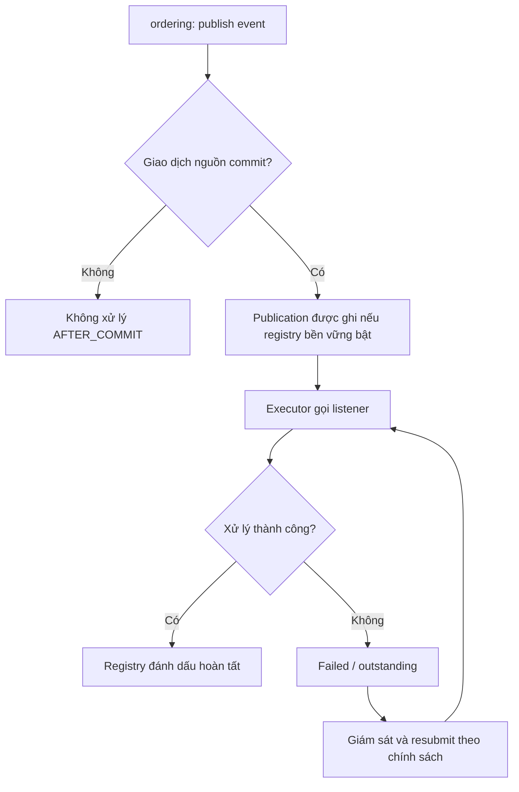

# Đánh giá trade-off giữa độ chi tiết và chi phí

> **Chương:** Thiết kế thực tế  
> **Học phần:** `SPRING_MODULITH_DOCUMENTATION_OBSERVABILITY` — dùng Spring Modulith để sinh tài liệu ranh giới application module và quan sát tương tác trong Spring Boot bằng module graph, Actuator, event metrics, tracing và context propagation.  
> **Vấn đề thiết kế:** Quan sát hệ thống tới mức nào để đủ tìm nguyên nhân sự cố, kiểm chứng kiến trúc và bảo vệ SLO mà không tạo chi phí vượt giá trị thu được?

## 1. Tình huống và câu hỏi thiết kế

Giả sử một ứng dụng thương mại điện tử Spring Boot gồm bốn application module:

- `ordering`: ghi nhận, xác nhận đơn hàng.
- `inventory`: giữ và trừ hàng sau khi nhận sự kiện đặt hàng.
- `billing`: thanh toán, hoàn tiền.
- `notification`: gửi email hoặc thông báo.

Spring Modulith có thể mô tả dependency giữa các module, công bố cấu trúc qua Actuator, instrument tương tác thành observations/spans và đếm event đã publish. Nhóm kỹ thuật muốn biết liệu ranh giới module có được tôn trọng, `OrderPlaced` có thực sự được xử lý, và tại sao nghiệp vụ thanh toán đôi khi chậm. Nhưng bật mọi log, metric, histogram và trace có thể tốn thêm CPU, RAM, network, đĩa, chi phí backend, công bảo trì dashboard và công điều tra tín hiệu nhiễu.

**Trade-off không chỉ là “có hay không có tracing”.** Nó còn nằm ở phạm vi tài liệu được sinh, số nhãn trên metrics, tần suất thu thập, chi tiết span và log, tỉ lệ sampling, thời gian lưu dữ liệu, cùng độ tin cậy của việc liên kết context qua tác vụ bất đồng bộ.

Kết quả học tập của bài:

1. Phân biệt chi tiết **kiến trúc tĩnh** (module graph/Module Canvas), **sức khỏe tổng thể** (metrics) và **ngữ cảnh một lần xử lý** (traces/logs).
2. Ước lượng chi phí của từng tín hiệu và nhận biết những khoản chi bị bỏ sót, đặc biệt là cardinality, histogram buckets, lưu trữ Event Publication Registry và công vận hành.
3. Chọn mức instrument và sampling dựa trên SLO, xác suất lỗi, lưu lượng, ngân sách và tính quan trọng của luồng nghiệp vụ.
4. Thiết kế cấu hình có thể kiểm chứng ở production và thí nghiệm A/B với baseline, giới hạn tài nguyên, tiêu chí chấp nhận và khả năng quay lại.
5. Giải thích vì sao giảm số trace **không được làm mất** khả năng cảnh báo event chưa xử lý, module chậm hoặc sai ranh giới.

## 2. Mô hình giá trị và chi phí

Một tín hiệu quan sát có giá trị nếu giúp trả lời một câu hỏi kỹ thuật/kinh doanh cụ thể hoặc rút ngắn thời gian phát hiện, khoanh vùng và khôi phục sự cố. Mỗi tín hiệu cũng tiêu thụ tài nguyên khi **tạo**, **chuyển**, **lưu**, **truy vấn** và **duy trì**.

| Lớp | Thông tin tạo ra | Giá trị cao nhất | Nhóm chi phí / rủi ro |
|---|---|---|---|
| Module graph, Module Canvas, dependency verification | Danh sách module, dependency hợp lệ, API công khai | Review kiến trúc, phát hiện coupling, onboarding | Thời gian CI/build, tài liệu lỗi thời, đồ thị khó đọc |
| Actuator module endpoint | Metadata cấu trúc module tại runtime | Kiểm tra ứng dụng đang chạy có layout nào | Startup/thu thập metadata, công bảo vệ endpoint và quyền truy cập |
| Published-event counters | Tần suất event phát theo module/loại | Phát hiện thay đổi traffic, mất cân đối luồng sự kiện | Cardinality tags, chi phí metric series |
| Custom counters, gauges, timers/histograms | Thành công/thất bại listener, độ trễ, số outstanding và tuổi backlog | SLO, cảnh báo, năng lực xử lý | Kết hợp nhãn, bucket, scrape, retention và query |
| Traces của module interaction | Quan hệ nhân quả và thời gian một lần đi qua modules | Phân tích latency, dependency chậm, path bất thường | CPU/heap, span creation, export, lưu trữ và sampling bias |
| Structured logs | Thông điệp sự cố, correlation ID, trạng thái nghiệp vụ | Điều tra một event/transaction cụ thể | Ingest/storage, dữ liệu nhạy cảm, chi phí tìm kiếm |
| Persistent Event Publication Registry | Publication chưa hoàn tất, hoàn tất, retry/failed theo phiên bản | Phục hồi khi xử lý bất đồng bộ thất bại | Database I/O, dung lượng bản ghi, chỉ mục, dọn dẹp/archiving |

Không có một mức chi tiết tối ưu cho mọi luồng. `billing` thường cần bằng chứng đủ để điều tra giao dịch lỗi; `notification` có thể chỉ cần cảnh báo backlog cùng trace mẫu, miễn có log/correlation ID khi retry.

### Bốn loại chi phí cần cộng đủ

\[
C_{\text{tổng}} \approx
C_{\text{ứng dụng}} +
C_{\text{truyền tải}} +
C_{\text{lưu trữ/truy vấn}} +
C_{\text{vận hành}}
\]

- **Ứng dụng:** thêm observation, lấy timestamp, tạo tag/span, serialize, đồng bộ histogram, GC và tốn tài nguyên thread.
- **Truyền tải:** network, batch processor, queue của exporter, CPU của OpenTelemetry Collector và lưu lượng cross-zone.
- **Lưu trữ/truy vấn:** số series metrics, số bytes logs/spans, index, compression, replication, retention, chi phí query.
- **Vận hành:** viết và bảo trì dashboard, alert ồn, redaction, review schema, nâng cấp thư viện, huấn luyện kỹ sư và công điều tra dữ liệu khó hiểu.

Chi phí phải được đo cả lúc **bình thường**, **cao điểm** và **collector/backend không sẵn sàng**. Một exporter có queue chưa giới hạn hoặc log quá nhiều ở thời điểm lỗi có thể khiến khả năng quan sát làm suy giảm chính ứng dụng đang cần được cứu.

## 3. Mức chi tiết của kiến trúc module: đồ thị nào là đủ?

Spring Modulith dùng package structure để nhận diện application modules, có thể kiểm tra các dependency giữa chúng bằng `ApplicationModules` và sinh tài liệu với `Documenter`. Các góc nhìn chi tiết khác nhau có những mục đích khác nhau:

| Mức tài liệu | Nội dung | Dùng khi nào | Khi nào nên tránh |
|---|---|---|---|
| **Toàn ứng dụng** | Mỗi application module là một nút, dependency chính là cạnh | Review kiến trúc, onboarding, kiến trúc tổng quan | Nếu quá nhiều module hoặc cạnh làm đồ thị mất khả năng đọc |
| **Theo module** | Module đang xét cùng các upstream/downstream phụ thuộc liên quan | Review thay đổi module, xác định coupling trước refactor | Nếu tạo quá nhiều hình mà không có người dùng |
| **Module Canvas/API** | API công khai, event, dependency, bean/package liên quan | Review contract, phân chia ownership | Nếu nội dung bị xuất tràn lan và không cập nhật khi code đổi |
| **Đồ thị theo lớp/phương thức** | Gọi từng bean/method, thông tin triển khai | Debugging có mục tiêu trong phiên ngắn | Không phải sơ đồ kiến trúc mặc định; dễ gây nhiễu và bị lỗi thời |

Một thực hành có thể tái hiện trong CI/test theo API Spring Modulith đang sử dụng:

```java
import org.junit.jupiter.api.Test;
import org.springframework.modulith.core.ApplicationModules;
import org.springframework.modulith.docs.Documenter;

class ArchitectureDocumentationTests {

    @Test
    void verifyAndDocumentModules() {
        var modules = ApplicationModules.of(ShopApplication.class);
        modules.verify();

        new Documenter(modules).writeDocumentation();
    }
}
```

Đoạn mẫu giả định `ShopApplication` là class gốc Spring Boot và test đã có dependency `spring-modulith-docs` phù hợp BOM. Đường dẫn output do `Documenter` và cấu hình build quy định. Có thể thay `writeDocumentation()` bằng API chỉ sinh overview, module riêng hoặc canvas tùy mục đích và version.

**Giải pháp giảm chi phí mà vẫn tăng chất lượng:** sinh overview cho mọi merge/release, sinh chi tiết theo module trong review khi cần, và xem kiểm tra kiến trúc ở CI như một **quality gate**. Thay vì xuất mỗi method thành một cạnh, giữ sơ đồ cấp module ổn định; khi có sự cố runtime mới mở trace hoặc code để kiểm tra method cụ thể.

Điểm quan trọng: chi phí tài liệu chủ yếu là công **duy trì và đọc hiểu**, không chỉ CPU sinh hình. Đồ thị đầy đủ nhưng khó dùng đôi khi có giá trị thấp hơn một sơ đồ có điểm nhấn cùng mô tả ownership rõ ràng.

## 4. Mức chi tiết cho dữ liệu runtime

Đánh giá từ câu hỏi thực tế rồi mới chọn tín hiệu:

| Câu hỏi vận hành | Dữ liệu tối thiểu đủ dùng | Khi nào tăng độ chi tiết |
|---|---|---|
| Bao nhiêu `OrderPlaced` đã publish? | Counter theo event/module | Cần so với completed hoặc failure theo listener |
| Đơn hàng được reserve kịp thời không? | Timer `publish_to_start`, backlog age và completed count | p95 chậm; cần span/trace để tìm nguyên nhân |
| Module nào bị gọi sai quan hệ? | `ApplicationModules.verify()`, module graph | Khi dependency ở runtime không rõ, dùng selected traces |
| Một giao dịch thanh toán bị lỗi ở đâu? | Error counter, structured log có correlation ID | Cần trace có span của DB/network/dependency |
| Bộ gửi email thỉnh thoảng lỗi? | Failure count, retry count và oldest outstanding age | Chỉ tăng trace/detail khi không tìm được nguyên nhân từ log |
| Event chưa từng handle có tồn tại không? | Event Publication Registry + age gauge/truy vấn | Cần kiểm tra dispatch/transaction/executor chuyên sâu |

**Nguyên tắc thiết kế:** dùng phép đo *rẻ và đầy đủ* để phát hiện bất thường; dùng phép quan sát *đắt và sâu* để tìm nguyên nhân theo vùng đã xác định. Trường hợp sự kiện mất hoàn toàn, trace được lấy mẫu thường không đủ bằng chứng; cần registry bền vững và phép kiểm tra trạng thái.

### Spring Modulith cung cấp gì và chưa cung cấp gì?

Theo tài liệu Spring Modulith, phần observability hỗ trợ span của tương tác xuyên application module và event publication metrics như:

- `module.events.published`: counter tổng hợp event đã publish, với nhóm tag nhận dạng module và loại event.
- `module.events.published.<moduleIdentifier>.<simpleEventTypeName>`: counter cho event cụ thể, có thể tùy biến theo API tương ứng.

Các meter này trả lời câu hỏi **phát bao nhiêu sự kiện**, nhưng không tự chứng minh event đã được listener xử lý thành công, độ trễ xử lý hoặc lượng outstanding. Khi cần các tín hiệu đó, hãy instrument listener/registry theo chính sách riêng. Chú ý tag động được thêm từ payload qua customizer có nguy cơ gây **bùng nổ số series**: không dùng `orderId`, `userId`, `eventId`, token hoặc email làm nhãn metric.

Trên Spring Boot, `/actuator/modulith`, `/actuator/metrics` và `/actuator/prometheus` còn phụ thuộc dependency, `access`, `exposure` và bảo mật. **Bật công khai thêm endpoint không đồng nghĩa có nhiều dữ liệu hữu ích hơn.** Với production, chỉ expose những endpoint cần cho vận hành, giới hạn mạng và phân quyền.

## 5. Chi phí của tracing: từ sampling đến số span

Sampling giúp giảm số trace được giữ lại và xuất. Với Spring Boot sử dụng Micrometer Tracing, một cấu hình điển hình là:

```yaml
management:
  tracing:
    sampling:
      probability: ${TRACE_SAMPLING_RATE:0.05}
```

Trong ví dụ này, `0.05` là **giá trị thiết kế lựa chọn**, tương đương 5% root traces đủ điều kiện theo sampler tương thích; không phải một hứa hẹn rằng chính xác 5% request bất kỳ sẽ có trace hoàn chỉnh. Khi incoming context có quyết định sampling từ upstream, chế độ parent-based thường tôn trọng quyết định đó; phải kiểm tra sampler thực tế trong stack đang dùng.

**Ba cách kiểm soát số trace:**

1. **Head-based probability:** lấy mẫu gần thời điểm tạo trace gốc, chi phí thấp ở nguồn; nhược điểm là không biết trước trace nào sẽ lỗi/chậm.
2. **Policy/rule-based:** ưu tiên một số operation hay luồng, hạn chế những endpoint nhiễu; cần review rule, kiểm soát nhãn và bảo đảm parent context hợp lệ.
3. **Tail sampling:** collector quyết định sau khi quan sát thêm kết quả trace, có thể chọn lỗi/slow trace; tiêu thụ tài nguyên lưu đệm và yêu cầu luồng dữ liệu đầu vào đủ đầy. Nếu ứng dụng đã loại span từ nguồn, collector không thể phục hồi phần bị loại.

Giá trị hữu dụng của trace phụ thuộc **khả năng nối span** xuyên application module và thread. `@ApplicationModuleListener` chạy async sau commit trên transaction riêng; mất context khi chuyển thread có thể tạo trace rời rạc dù tỷ lệ sampling cao. Với collector/exporter lỗi, số trace tới backend thấp cũng không có nghĩa sampler đang hoạt động như dự kiến. Cần đo số span được ghi/được xuất/bị drop tại các điểm tương ứng.

### Tại sao trace không phải bằng chứng duy nhất về lỗi hiếm?

Với head sampling độc lập ở xác suất \(p\), nếu có \(n\) lỗi hiếm và mỗi lỗi nằm trong một trace riêng, xác suất có ít nhất một trace lỗi được chọn là:

\[
P(\text{bắt được ít nhất một lỗi}) = 1 - (1-p)^n
\]

Ví dụ có **10 lỗi** trong một khoảng thời gian:

| Tỷ lệ sampling | Xác suất có ít nhất một trace lỗi |
|---|---:|
| 1% | khoảng 9,6% |
| 5% | khoảng 40,1% |
| 10% | khoảng 65,1% |
| 50% | khoảng 99,9% |

Ở mức 1%, khả năng bỏ lỡ cả 10 trace lỗi lên tới khoảng 90,4% trong mô hình giả định. Vì vậy alert lỗi nên dựa vào **metrics và logs được thiết kế ghi nhận đầy đủ**, còn traces hỗ trợ khoanh vùng khi có mẫu. Nếu sampling dựa vào quyết định upstream hoặc theo rule, công thức xác suất độc lập này không còn mô tả chính xác.

### Chọn span detail theo luồng

Một trace `POST /orders` có thể đủ ở mức module boundary và vài dependency quan trọng. Ghi thêm span cho từng getter, mapper hoặc vòng lặp nhỏ thường làm trace phình và khó đọc. Khi nghi vấn DB hoặc external API chậm, bật instrumentation cho các điểm đó theo phân vùng có chủ đích. **Không đưa payload nghiệp vụ, SQL bind values hoặc định danh cá nhân vào span name/tag** để tránh dữ liệu nhạy cảm và chi phí index.

## 6. Ước tính ngân sách tracing bằng dữ liệu định lượng

Giả định một hệ thống vận hành với:

- **120 root requests/giây** trung bình, liên tục 24 giờ.
- Mỗi root trace nếu được giữ đầy đủ có trung bình **8 spans**.
- Mỗi span chiếm khoảng **1.500 byte dữ liệu thô**; đây là giả định lập ngân sách, chưa gồm index, replica, compression, replication và phí truy vấn.
- Không tính thêm các traces độc lập từ scheduled job, consumer, batch, sự kiện retry hoặc traffic đột biến.

Công thức ước tính:

\[
N_{\text{spans/ngày}} \approx R \times 86\,400 \times S \times p
\]

\[
B_{\text{raw/ngày}} \approx N_{\text{spans/ngày}} \times b
\]

Với \(R=120\) root traces/s, \(S=8\) spans/trace, \(b=1.500\) byte/span, \(p\) là xác suất lấy mẫu:

| Sampling | Span/ngày (ước tính) | Dữ liệu thô/ngày | Thô sau 30 ngày |
|---|---:|---:|---:|
| `1.0` — 100% | 82.944.000 | 124,42 GB | 3.732,48 GB |
| `0.10` — 10% | 8.294.400 | 12,44 GB | 373,25 GB |
| `0.05` — 5% | 4.147.200 | 6,22 GB | 186,62 GB |
| `0.01` — 1% | 829.440 | 1,24 GB | 37,32 GB |
| `0.005` — 0,5% | 414.720 | 0,62 GB | 18,66 GB |

Đơn vị GB là **10⁹ byte**, không phải GiB. Tỷ lệ sample thực tế có thể khác do parent context, rule, lỗi exporter và tải không đồng đều. Bảng **không** phải báo giá của tracing backend; dữ liệu index/compression/retention tiers và số span lớn bất thường có thể làm chi phí thay đổi đáng kể.

Nếu ngân sách **ingest thô** là 2 GB/ngày, tỷ lệ tối đa theo giả định:

\[
p_{\max} \approx
\frac{2\,000\,000\,000}{120 \times 86\,400 \times 8 \times 1\,500}
\approx 0{,}0161
\]

Tức khoảng **1,61%**. Có thể bắt đầu ở `0.01` để còn headroom rồi đo bytes thực ingest, tỷ lệ span drop và giờ cao điểm. Nếu cần traces chi tiết hơn cho `billing`, một phương án là giảm spans ít giá trị, tối ưu retention, hoặc chỉ ưu tiên luồng nhạy cảm theo chính sách; không nên kết luận 1% phù hợp mọi lỗi chỉ vì đủ ngân sách.

Ví dụ cấu hình Spring Boot (profile production, giá trị đặt làm điểm xuất phát):

```yaml
management:
  tracing:
    sampling:
      probability: ${TRACE_SAMPLE_RATE:0.01}
```

`management.tracing.sampling.probability` điều chỉnh sampler của Spring Boot. Việc thay giá trị môi trường trên deployment thông thường đòi rollout/restart để JVM nhận cấu hình mới; nếu có sampler tự tùy chỉnh, phải xác minh giá trị hiệu lực thực tế.

**Không suy ra “giảm sampling 10 lần nghĩa là giảm tổng chi phí observability 10 lần”:** metrics, logs, registry persistence, chi phí CI tài liệu, vận hành và một phần overhead instrumentation có thể giữ nguyên.

## 7. Cardinality và histogram: chi phí ẩn của metrics

Số lần xảy ra event quyết định tần suất tăng counter; trong metrics backend, **số tổ hợp nhãn** thường tác động mạnh tới lượng series cần duy trì.

Giả sử một timer cho `app.module.operation.duration` mang ba nhãn:

```text
module    = 6 giá trị
operation = 4 giá trị
outcome   = 3 giá trị
```

Tối đa \(6 \times 4 \times 3 = 72\) tổ hợp nhãn. Nếu mỗi tổ hợp xuất histogram với khoảng 10 buckets cộng `_count`/`_sum`, số series xấp xỉ \(72 \times 12 = 864\), chưa tính `+Inf`, instance labels và biến thể exporter. Khi thêm nhãn `customerId` có 5.000 giá trị, số tổ hợp tiềm năng trở thành **360.000**; phần histogram có thể tăng lên hàng triệu series. **Trace sampling không giúp giảm cardinality metric.**

| Nhãn ổn định nên dùng | Nhãn không nên dùng trong metrics |
|---|---|
| `module=inventory` | `customerId`, `orderId` |
| `event=OrderPlaced` | `eventId`, `traceId` |
| `listener=InventoryEventListener` | Email, session ID, số điện thoại |
| `outcome=success/failure` | Exception message đầy đủ, raw URL có ID |
| `error_category=timeout/validation/...` với số loại giới hạn | Dynamic SQL, payload hoặc dữ liệu người dùng |

Micrometer có thể thu thập histogram, percentile và SLO buckets tùy cấu hình. Chỉ bật histogram cho latency quan trọng như HTTP critical path hoặc `publish_to_start` của event có SLO. Nếu một operation không có yêu cầu phân vị, counter hoặc timer count/sum có thể đủ. Tăng số bucket cải thiện độ phân giải nhưng kéo theo số series và chi phí query.

Thay scrape interval từ 15 giây sang 60 giây có thể giảm số mẫu xuất trên mỗi series xấp xỉ bốn lần trong một số thiết kế, nhưng giảm độ nhạy với sự cố ngắn; **scrape interval** và **cardinality** là hai trục khác nhau.

Một số vendor tính tiền theo ingestion/series thay vì dung lượng thô. Vì vậy cần đo **series active, series mới/ngày, samples/giây, bytes ingest, query latency và khả năng lưu giữ** trước khi kết luận đã tối ưu.

## 8. Instrument đúng chỗ: ví dụ event quan trọng

Giả sử event công khai thuộc module `ordering`:

```java
package com.example.shop.ordering;

import java.time.Instant;
import java.util.UUID;

public record OrderPlaced(
        UUID eventId,
        UUID orderId,
        Instant publishedAt) {}
```

Publisher gắn `publishedAt = clock.instant()` ngay trước `publishEvent(...)` trong giao dịch nguồn. `inventory` xử lý sau commit bằng `@ApplicationModuleListener`. Hai chỉ số cần đo là thời gian từ publish đến khi handler bắt đầu và thời gian handler thực hiện nghiệp vụ.

```java
package com.example.shop.inventory;

import com.example.shop.ordering.OrderPlaced;
import io.micrometer.core.instrument.MeterRegistry;
import io.micrometer.core.instrument.Timer;
import java.time.Clock;
import java.time.Duration;
import org.springframework.modulith.events.ApplicationModuleListener;
import org.springframework.stereotype.Component;

@Component
public class InventoryEventListener {
    private final Clock clock;
    private final MeterRegistry metrics;
    private final InventoryService inventory;

    public InventoryEventListener(
            Clock clock, MeterRegistry metrics,
            InventoryService inventory) {
        this.clock = clock;
        this.metrics = metrics;
        this.inventory = inventory;
    }

    @ApplicationModuleListener
    public void on(OrderPlaced event) {
        Duration age = Duration.between(
            event.publishedAt(), clock.instant());

        if (age.isNegative()) {
            metrics.counter("app.module.event.clock_anomaly",
                "event", "OrderPlaced").increment();
        } else {
            metrics.timer("app.module.event.publish_to_start",
                "event", "OrderPlaced",
                "listener", "InventoryEventListener").record(age);
        }

        Timer.Sample sample = Timer.start(metrics);
        String outcome = "success";
        try {
            inventory.reserveOnce(event.orderId(), event.eventId());
        } catch (RuntimeException ex) {
            outcome = "failure";
            throw ex;
        } finally {
            sample.stop(Timer.builder("app.module.event.handle_duration")
                .tag("event", "OrderPlaced")
                .tag("listener", "InventoryEventListener")
                .tag("outcome", outcome)
                .register(metrics));
        }
    }
}
```

Đây là mã minh họa Java 17+/Micrometer, giả định `InventoryService.reserveOnce` được triển khai **idempotent** theo event ID và `Clock`/`MeterRegistry` được đăng ký đúng. Metric trên **là custom metrics**, không phải toàn bộ metric tự động được Spring Modulith tạo ra.

Cần định nghĩa chính xác phép đo:

- `publish_to_start` bao gồm thời gian còn lại của transaction nguồn, commit, dispatch và chờ executor; **không thể dùng nó làm thước đo queue wait thuần túy** khi chưa biết các mốc khác.
- `handle_duration` đo thân xử lý nghiệp vụ trong ví dụ, không bao gồm mọi bước transaction completion/registry mà framework thực hiện ngoài method.
- Tag `outcome=success` có nghĩa logic method không throw; không đủ chứng minh registry đã đánh dấu hoàn tất hay external side effect được commit.
- Event retry sau 20 phút có `publish_to_start` lớn, dù executor lúc retry không chậm. Muốn đo riêng first-start lag phải dùng attempt metadata ở registry hoặc cơ chế riêng.
- Nếu handler **không bao giờ được gọi**, timer không xuất sample. Cần thêm **outstanding publication count**, tuổi bản ghi cũ nhất và kết quả handler/recovery.

`eventId` và `orderId` hỗ trợ idempotency/correlation; không đưa chúng vào metric tag. Nếu muốn tra cứu một event cụ thể, dùng structured log và event registry ở phạm vi có quyền, với chính sách dữ liệu cá nhân phù hợp.

## 9. Chi phí lưu trữ Event Publication Registry và chính sách giữ lịch sử

`@ApplicationModuleListener` kết hợp xử lý async sau commit cùng transaction riêng. Với các event nghiệp vụ quan trọng, Event Publication Registry bền vững giúp ghi lại publication theo transactional listener, phát hiện trạng thái chưa xử lý và hỗ trợ khôi phục. Nó cần **persistence starter/store và cấu hình giao dịch** phù hợp; annotation không tự bảo đảm “exactly once”.



Để dự báo chi phí, tính **publication per listener**, không chỉ event tổng. Ví dụ 50 events/giây, mỗi event có hai listener được theo dõi:

\[
50 \times 2 \times 86\,400 = 8\,640\,000
\]

Tức khoảng **8,64 triệu publication records/ngày**. Nếu giữ completed records 30 ngày ở chế độ update, có thể lên đến **259,2 triệu records** trước purge, chưa tính index và dung lượng payload. Đây là giả định định lượng, không phải thống kê mặc định của Spring Modulith.

| Completion mode (theo nhánh hỗ trợ) | Tác động | Đánh đổi |
|---|---|---|
| `UPDATE` | Đánh dấu bản ghi completed, giữ lịch sử trong registry | Cần purge định kỳ và kiểm soát table/index growth |
| `DELETE` | Xóa bản ghi khi xử lý thành công | Giảm dung lượng completed records, ít bằng chứng lịch sử trong registry |
| `ARCHIVE` | Chuyển completed publication sang kho lưu trữ lịch sử theo cơ chế framework | Giữ lịch sử nhưng thêm I/O và công quản trị |

API và trạng thái chi tiết có khác giữa Spring Modulith 1.x/2.x; đối chiếu BOM dự án khi chọn completion mode, staleness và resubmission. **Không xóa publication chưa hoàn tất** chỉ để giải phóng dung lượng. Lịch dọn dẹp phải phân biệt completed/failed/in-flight, theo nhu cầu audit, retry và giữ thông tin sự cố.

Chi phí phải đo cả **write rate**, hiệu năng query tìm outstanding, index bloat, database lock, backlog tuổi lớn nhất và tốc độ purge/archive. Registry dùng để bảo vệ tính đúng đắn của hệ thống; nó không phải một log tùy ý có thể bật/tắt theo tỷ lệ trace sampling.

## 10. Context propagation: chi tiết trace phải đi cùng khả năng nối luồng

Một trace hữu ích khi những spans liên quan được nối đúng bằng trace context. Nếu `ordering` phát event và `inventory` chạy `@ApplicationModuleListener` trên executor khác, context có thể bị mất khi đổi thread. Trong trường hợp này, tăng sampling từ 5% lên 100% **không sửa được trace bị tách do mất context**.

Với Spring Framework 6.1+ và Micrometer Context Propagation tương thích, có thể dùng `ContextPropagatingTaskDecorator` ở executor thực sự chạy các method `@Async`:

```java
import java.util.concurrent.Executor;
import org.springframework.context.annotation.Bean;
import org.springframework.context.annotation.Configuration;
import org.springframework.core.task.support.ContextPropagatingTaskDecorator;
import org.springframework.scheduling.annotation.AsyncConfigurer;
import org.springframework.scheduling.annotation.EnableAsync;
import org.springframework.scheduling.concurrent.ThreadPoolTaskExecutor;

@Configuration
@EnableAsync
public class ModuleExecutorConfig implements AsyncConfigurer {

    @Bean
    public ThreadPoolTaskExecutor moduleEventExecutor() {
        ThreadPoolTaskExecutor pool = new ThreadPoolTaskExecutor();
        pool.setCorePoolSize(4);
        pool.setMaxPoolSize(8);
        pool.setQueueCapacity(100);
        pool.setThreadNamePrefix("module-event-");
        pool.setTaskDecorator(new ContextPropagatingTaskDecorator());
        pool.initialize();
        return pool;
    }

    @Override
    public Executor getAsyncExecutor() {
        return moduleEventExecutor();
    }
}
```

Cần thử ở context thực tế: các dự án có nhiều executor có thể đang chọn executor khác, còn sự kiện được **resubmit sau restart** không thể tự khôi phục `ThreadLocal` hoặc parent span của tiến trình cũ. Hãy giữ `eventId` hoặc correlation ID bền vững trong payload/metadata phù hợp để nối structured logs và trạng thái Event Publication Registry. Không gắn các ID đó thành metrics tags.

Đây là ví dụ trade-off có giá trị: đầu tư một lần vào propagation và correlation ID thường có hiệu quả điều tra **cao hơn** việc nhân số trace phải lưu. Tuy nhiên, task decorator cũng có overhead; benchmark khi workload rất nhiều tác vụ ngắn, tránh áp dụng mù quáng lên mọi executor.

## 11. Logs: lọc nhiễu, giữ chứng cứ nghiệp vụ

Dù chi phí từng dòng log có vẻ thấp, tổng số dòng khi có hàng nghìn event/giây có thể rất lớn. Ví dụ:

- 100 events/giây.
- Mỗi event sinh 2 dòng INFO cho trạng thái bắt đầu/kết thúc.
- Một dòng sau serialize trung bình 600 byte.

\[
100 \times 2 \times 600 \times 86\,400
=10\,368\,000\,000 \text{ byte/ngày}
\]

Tức khoảng **10,37 GB log thô/ngày**; 30 ngày tương đương khoảng **311 GB** chưa gồm index/replica. Ghi cả payload và stack trace ở INFO sẽ còn tăng hơn.

Đề xuất phân tầng:

| Loại log | Chính sách | Lý do |
|---|---|---|
| Lỗi nghiệp vụ quan trọng | Ghi có cấu trúc, rate limit hợp lý nhưng không làm mất dấu hiệu lỗi | Điều tra và alert |
| Retry/failed publication | Ghi event type, listener, attempt, correlation ID, outcome | Ghép với registry và cơ chế phục hồi |
| Sự kiện thành công thông thường | Counter + một lượng log chọn lọc, hoặc chỉ giữ audit record bắt buộc | Tránh log noise khổng lồ |
| Audit pháp lý/tài chính | Lưu ở hệ thống audit có bảo đảm riêng theo chính sách | Không dùng trace sampling thay thế audit |
| Payload nhạy cảm và token | Không ghi nguyên văn | Giảm nguy cơ lộ dữ liệu và chi phí index |

Logs có `eventId` là công cụ nối lần xử lý cụ thể, nhưng vẫn phải tránh thông tin cá nhân hoặc bí mật. Nếu giảm success logs để tiết kiệm, phải **có counters và lịch sử nghiệp vụ/registry đủ dùng**, không để một lần xử lý thất bại trở thành điều không thể phát hiện.

## 12. Thiết kế ba mức quan sát phù hợp rủi ro

Thay vì áp một chính sách cho cả ứng dụng, chia theo **nhu cầu điều tra**, luồng nghiệp vụ và độ quan trọng.

| Mức | Khi dùng | Dữ liệu luôn giữ | Dữ liệu tăng khi cần |
|---|---|---|---|
| **Cơ bản** | Module ít rủi ro, ít thay đổi, lỗi dễ phát hiện | Module overview, health, counters lỗi/thành công, logs lỗi | Trace mẫu tỉ lệ thấp |
| **Tiêu chuẩn** | Các module nghiệp vụ chính | Module graph + Canvas, event counters, handler latency histogram, backlog, trace mẫu vừa | Span chi tiết ở phụ thuộc chậm |
| **Điều tra chuyên sâu** | Billing/payment, incident đang diễn ra hoặc luồng có yêu cầu kiểm toán | Metrics đầy đủ, registry trạng thái, correlation logs và audit độc lập | Trace chi tiết, sampling nâng cao/tail sampling, retention ngắn nhưng tập trung |

Không nhất thiết chọn một mức **cho cả module**. Trong `billing`, thao tác đọc bảng giá có thể ở mức cơ bản còn `capturePayment` cần tiêu chuẩn hoặc chuyên sâu. Sử dụng nhãn có tập giá trị hữu hạn (`operation=capture`) để phân biệt mà không tăng cardinality theo từng đơn hàng.

### Ma trận quyết định theo câu hỏi

| Nhu cầu | Quyết định hợp lý | Lỗi thiết kế nên tránh |
|---|---|---|
| Xác nhận module không phụ thuộc implementation nội bộ của nhau | `ApplicationModules.verify()` và tài liệu module ở CI | Chờ traces production mới phát hiện coupling tĩnh |
| Phát hiện event không được xử lý trong 30 giây | Outstanding count/age từ registry, listener metrics | Dựa vào histogram `publish_to_start` khi handler chưa bao giờ chạy |
| Chẩn đoán p99 của `capturePayment` | Histogram đầy đủ và trace mẫu có span DB/API | Gắn mã giao dịch làm label hoặc ghi mọi SQL parameter |
| Điều tra một lỗi hiếm có ID cụ thể | Structured log + event ID, trace nếu có, error metric | Tin rằng 1% sampling luôn giữ lại lỗi hiếm |
| Giảm chi phí backend mà SLO không đổi | Giảm nhãn vô hạn, span thừa, success log và tối ưu retention | Tắt counters lỗi hoặc xóa outstanding publications |
| CI chạy quá lâu vì tài liệu | Sinh overview mặc định, detail theo phạm vi review | Bỏ luôn verification của ranh giới |
| Rất nhiều sự kiện bị retry | Kiểm tra handler idempotency và registry lifecycle | Chỉ tăng kích thước executor hoặc sampling |

Đặt **chất lượng điều tra** lên cùng bàn cân với **chi phí**. Tối ưu đúng nghĩa là giảm những dữ liệu ít tạo ra quyết định mà vẫn duy trì khả năng phát hiện vấn đề quan trọng.

## 13. Cấu hình production khởi điểm, đủ an toàn và có thể đo

Ví dụ dưới đây dùng profile `application-production.yml` cho Spring Boot 3.x và cần điều chỉnh theo phiên bản trong BOM:

```yaml
management:
  tracing:
    sampling:
      probability: ${TRACE_SAMPLE_RATE:0.05}

  endpoints:
    web:
      exposure:
        include: "health,info,prometheus"

  endpoint:
    health:
      probes:
        enabled: true
      show-details: never

  metrics:
    tags:
      application: ${spring.application.name}
      environment: production
```

`0.05` minh họa điểm xuất phát **khi đã biết backend chịu được tải**. Nếu Prometheus chưa được cấu hình, không expose `prometheus` chỉ để có thêm URL; muốn scrape cần dependency `micrometer-registry-prometheus` và chính sách truy cập phù hợp. Nếu muốn xem `/actuator/modulith`, phải có Spring Modulith actuator hoặc Insight starter, cho phép access/exposure và cấp role chuyên biệt.

Có thể kích hoạt hỗ trợ module graph/observability bằng starter phù hợp BOM, ví dụ trong Gradle Kotlin DSL:

```kotlin
dependencies {
    implementation("org.springframework.boot:spring-boot-starter-actuator")
    runtimeOnly("org.springframework.modulith:spring-modulith-starter-insight")
    runtimeOnly("io.micrometer:micrometer-registry-prometheus")

    // Cấu hình tracing bridge/exporter theo phiên bản Spring Boot thực tế.
}
```

Starter Insight bao gồm phần Actuator module và observability Spring Modulith, còn tracing backend cần bridge/exporter của hệ sinh thái Spring Boot/Micrometer tương ứng. Spring Boot 3 và Spring Boot 4 có khác biệt dependency/property exporter; kiểm tra hướng dẫn chính thức theo BOM thay vì chép URL/property từ các nhánh khác.

Trên production, `/actuator/prometheus` thường chỉ cho phép Prometheus scraper/service account truy cập qua mạng nội bộ với transport phù hợp. Các endpoint `env`, `heapdump`, `configprops`, `loggers` và các endpoint có thể ghi **không** được mở chỉ để tiện quan sát. Sampling không cung cấp cơ chế bảo mật cho dữ liệu span/log: phải che dữ liệu nhạy cảm ngay tại instrumentation/export.

### Dashboard tối thiểu

Một dashboard đủ dùng nên có:

1. **Luồng:** requests/giây, error rate, latency (metric đầy đủ), tỷ lệ giao dịch thành công.
2. **Modules/events:** events published, listener handled success/failure, `publish_to_start` và `handle_duration`, số/tuổi outstanding từ registry.
3. **Hạ tầng:** CPU, heap/GC, thread pool active/queue/rejected, DB pool và độ trễ dependency.
4. **Telemetry:** span export success/error/drop, collector health, lượng ingest và active metric series.
5. **Bằng chứng kiến trúc:** link sang module graph/Canvas của đúng release và các trace mẫu khi incident.

Không phải chỉ số nào cũng do Spring Modulith tự sinh. Published-event counters và module observation là khả năng sẵn có khi bật đúng thành phần; **completed/failed listener, backlog age, exporter drop và business SLO** có thể cần meter, collector hoặc query riêng.

## 14. Thử nghiệm có kiểm soát: đo hiệu quả trước khi đổi chính sách

Đặt một giả thuyết cụ thể, ví dụ: “Giảm sampling từ 10% xuống 5%, loại các span nội bộ không có giá trị và giữ metrics backlog đầy đủ sẽ giảm ingestion mà không làm tăng thời gian chẩn đoán sự cố”.

**Thiết lập baseline** ở cùng traffic profile, khoảng thời gian tương đương và version ứng dụng:

| Chỉ số | Cần đo trước và sau |
|---|---|
| Business SLA/SLO | Error rate, p95/p99 latency theo HTTP và event |
| Hệ thống | CPU, heap, GC pause, thread pool, DB pool |
| Traces | Root traces/s, spans/trace, spans exported/s, drop/rejection, bytes/day |
| Metrics | Active series, samples/s, histogram bucket count, query latency |
| Logs | Log lines/s, bytes/day, retention và truy vấn sự cố |
| Registry | Outstanding age, failed/retry count, table/index size, purge latency |
| Chất lượng điều tra | Tỉ lệ incident có chứng cứ đủ, MTTR/MTTD, số lần thiếu trace/ID |

Với thí nghiệm đã có canary phù hợp, tiến hành:

1. **Định nghĩa điều kiện chấp nhận:** không mất metric lỗi/backlog, không tăng error rate/latency do instrumentation, ingestion giảm đo được và trace thiết yếu vẫn đủ dùng.
2. **Kiểm tra cấu hình đang có hiệu lực:** profile, sampler, tracing bridge/exporter, metrics registry, security Actuator, đúng runtime versions.
3. **Chạy canary hoặc staging với tải đại diện:** baseline `p=0.10`, rồi thử `p=0.05` trong phạm vi kiểm soát; so sánh số liệu cùng loại.
4. **Kiểm tra các ca xấu:** executor đầy, listener throw, event retry sau restart, collector unavailable và một dependency chậm.
5. **Đánh giá điều tra:** có tìm được nguyên nhân từ metrics, log có ID và một trace phù hợp không? Nếu trace lỗi hiếm biến mất, tăng tính chọn lọc/đổi thiết kế thay vì mù quáng hạ tỷ lệ.
6. **Quyết định và ghi nhận:** giữ thay đổi hoặc revert, cập nhật chính sách sampling, budget, runbook và chủ sở hữu dashboard.

**Đừng dùng số trace thu được ít hơn làm bằng chứng ứng dụng khỏe hơn.** Traces có thể giảm do sampling, exporter drop, collector outage hoặc người dùng truy cập ít đi; phải đối chiếu traffic/counters độc lập.

### Kịch bản kiểm thử thực tế

| Tình huống | Quan sát mong đợi | Điều cần chứng minh |
|---|---|---|
| Module graph được tạo ở CI | Bản tài liệu đúng version, `verify()` đạt | Không thay thế bằng trace sampling |
| Luồng `OrderPlaced` thành công | Published và handled counters tăng, latency sample xuất hiện | Traces chỉ là một phần chứng cứ |
| Listener chưa bắt đầu | Outstanding age tăng, có thể chưa có timer sample | Phát hiện lag khi metric tại handler chưa được ghi |
| Listener throw và retry | Failed/retry được quan sát, hiệu ứng nghiệp vụ không lặp | Idempotency và registry hoạt động |
| Đổi từ 10% xuống 5% | Traces được giữ ít đi theo xác suất, metrics vẫn đủ | Không gây suy giảm SLO/alerting |
| Collector bị ngắt | Có tín hiệu exporter/drop, nghiệp vụ không bị treo | Telemetry pipeline an toàn khi lỗi |
| Tracing qua `@Async` | Trace/correlation giữ được khi cùng tiến trình | Decorator/bridge/config đúng |
| Retry sau restart | Event ID liên hệ được giữa lần xử lý | Không kỳ vọng thread context cũ tồn tại |
| Tăng 5.000 giá trị nhãn thử trong test | Series growth lớn hoặc filter chặn | Không cho dynamic ID đi vào metric tags |
| Operation `billing` hiếm lỗi | Error counters vẫn báo đủ | Tracing 1% không làm mất cảnh báo lỗi |

Các kiểm thử về module verification và logic meter có thể tự động hóa; các phép đo ingest/overhead cần load test hoặc canary, không nên đưa ngưỡng CPU/GC cố định vào unit test.

## 15. Bài tập áp dụng và tiêu chí đánh giá

### Bài tập 1 — Tính ngân sách

Một ứng dụng chạy 300 root requests/giây, trung bình 10 spans/trace, mỗi span tạm tính 1.000 byte. Hãy ước lượng dữ liệu trace thô mỗi ngày ở các mức 100%, 10% và 1%. Sau đó chọn sampling phù hợp nếu ngân sách chỉ cho phép 5 GB/ngày, có headroom cho traffic tăng 2 lần; trình bày các giả định còn thiếu trước khi đưa ra con số production.

**Gợi ý:** ở 10%, \(300 \times 10 \times 86\,400 \times 0{,}1 = 25{,}92\) triệu spans/ngày, tương đương **25,92 GB thô/ngày**. Còn phải xét traffic burst, retention, index và span từ các nguồn khác.

### Bài tập 2 — Giảm cardinality

Một meter `event_handle_duration` có nhãn `module`, `eventType`, `status`, `orderId`, `customerEmail`. Đề xuất cách giữ được khả năng tính p95 theo module/event mà giảm số series; xác định dữ liệu nào chuyển sang structured log/correlation ID.

### Bài tập 3 — Chọn chi tiết theo mục tiêu

Với `inventory` có event volume cao, `billing` có giao dịch ít nhưng quan trọng và `notification` có lỗi retry, hãy lựa chọn module graph, counters, histogram, tracing sampling, logs và Event Publication Registry cho từng module. Giải thích lựa chọn bằng SLO, chi phí và khả năng phát hiện lỗi, không chỉ bằng độ “tiện” khi debug.

### Bài tập 4 — Kiểm tra thông tin bị thiếu

Dashboard có `publish_to_start p95 = 80 ms`, nhưng 300 outstanding publication đã tồn tại 20 phút. Vì sao timer có thể trông bình thường khi hệ thống đang gặp sự cố? Cần thêm tín hiệu nào để biết những event chưa hề bắt đầu?

### Bài tập 5 — Đánh giá trade-off

Một đề xuất giảm sampling từ `0.20` xuống `0.01` và tắt toàn bộ listener error logs. Hãy xác định khoản tiết kiệm kỳ vọng, rủi ro khó điều tra lỗi hiếm và phương án thay thế để giữ tín hiệu lỗi đầy đủ.

### Tiêu chí hoàn thành

Bạn đạt bài học khi có thể:

- So sánh **mức chi tiết tài liệu tĩnh**, metrics, tracing, logs và registry bằng cùng một khung giá trị–chi phí.
- Tính được dự báo span/bytes, hiểu sampling probability và giới hạn của phép ước lượng.
- Nhận biết cardinality/histogram là chi phí **khác** với trace sampling.
- Thiết kế monitoring sự kiện bất đồng bộ không bỏ sót backlog hoặc failed publication, tôn trọng idempotency và retention.
- Chọn được mức chi tiết theo rủi ro/SLO, xây dashboard tối thiểu và kế hoạch kiểm nghiệm có số liệu trước/sau.
- Giải thích vì sao module verification, Actuator access/security, context propagation và correlation ID vẫn cần thiết dù số trace được giữ rất thấp.

### Tài liệu tham khảo

1. [Spring Modulith — Production-ready Features](https://docs.spring.io/spring-modulith/reference/production-ready.html): module Actuator, observability spans và published-event metrics.
2. [Spring Modulith — Documenting Application Modules](https://docs.spring.io/spring-modulith/reference/documentation.html): Module Canvas, module diagram và `Documenter`.
3. [Spring Modulith — Working with Application Events](https://docs.spring.io/spring-modulith/reference/events.html): `@ApplicationModuleListener`, registry, lifecycle và completion modes.
4. [Spring Modulith — Documenter API](https://docs.spring.io/spring-modulith/docs/current/api/org/springframework/modulith/docs/Documenter.html): các lựa chọn sinh documentation.
5. [Spring Boot — Tracing](https://docs.spring.io/spring-boot/reference/actuator/tracing.html): Micrometer Tracing và `management.tracing.sampling.probability`.
6. [Spring Boot — Metrics](https://docs.spring.io/spring-boot/reference/actuator/metrics.html): Micrometer và registry.
7. [OpenTelemetry — Sampling](https://opentelemetry.io/docs/concepts/sampling/): head/tail sampling và giới hạn chi phí.
8. [OpenTelemetry — Metrics](https://opentelemetry.io/docs/concepts/signals/metrics/): views, aggregations và cardinality.

> **Tương thích phiên bản:** Nội dung áp dụng nguyên tắc chung của Spring Modulith và Spring Boot. Tên package, starter, API registry, tracing exporter và lựa chọn completion mode có thể thay đổi giữa các nhánh Spring Boot/Modulith. Khi triển khai, phải dùng tài liệu tương ứng với BOM dự án và kiểm chứng qua telemetry thực tế.
