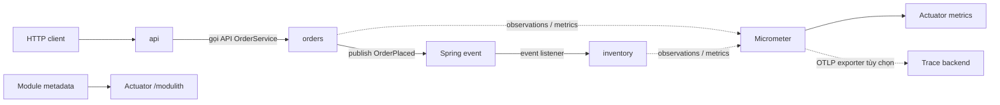
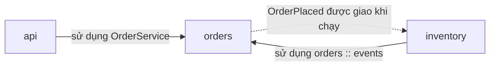
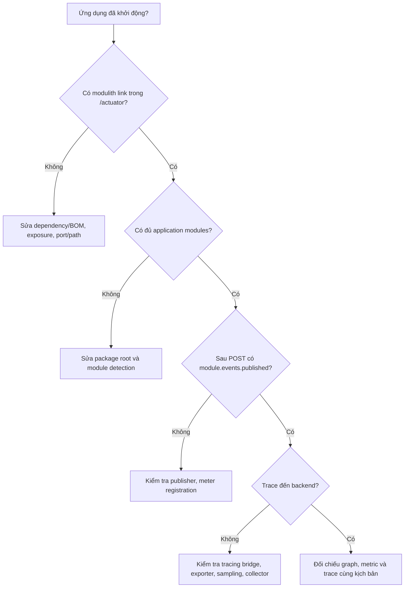

# Thực hành tổng hợp: Thêm Insight starter vào ứng dụng Spring Modulith

Một ứng dụng Spring Boot có thể chia package thành các **application module** đúng về mặt kiến trúc nhưng vẫn khó trả lời câu hỏi vận hành: module nào phụ thuộc module nào, request đi qua những ranh giới nào, event nào đã được phát và vì sao trace của listener bị tách. Bài này hướng dẫn thêm **Spring Modulith Insight starter**, công bố metadata module qua Actuator, quan sát event metrics và kết nối tracing để biến các ranh giới kiến trúc thành bằng chứng có thể kiểm tra.

Bài thuộc chương **Thực hành tổng hợp** của module `SPRING_MODULITH_DOCUMENTATION_OBSERVABILITY`. Mục tiêu là kết hợp **module graph**, Actuator, event metrics, tracing và context propagation khi chạy một ứng dụng nhỏ có ba module `api`, `orders` và `inventory`. Các ví dụ sử dụng Spring Modulith **2.2.0** và Spring Boot **4.2.0** để minh họa; khi đưa vào ứng dụng hiện có, hãy chọn BOM phù hợp với phiên bản Spring Boot của dự án.

> **Phân biệt quan trọng:** Trong Spring Modulith 2.2, endpoint Actuator công bố mô hình module có ID `modulith`, tức `GET /actuator/modulith`. Một số tài liệu hoặc API rất cũ dùng tên endpoint khác. Hãy xác minh endpoint thực sự được công bố qua `GET /actuator` trên phiên bản đang chạy.

## 1. Hiểu đúng năng lực của Insight starter

`spring-modulith-starter-insight` là starter chính thức gom các khả năng quan sát và Actuator của Spring Modulith. Theo tài liệu Spring Modulith 2.2, nó bao gồm `spring-modulith-actuator`, `spring-modulith-observability-api`, `spring-modulith-observability-core` và `spring-boot-starter-actuator` trong dependency graph.

| Bạn muốn làm gì? | Insight starter cung cấp | Phần cần chuẩn bị thêm |
|---|---|---|
| Xem mô hình application module | Hạ tầng Actuator endpoint `modulith` | Bật exposure, kiểm soát truy cập, package module đúng |
| Quan sát gọi qua ranh giới module | Instrumentation tạo Micrometer observation/spans tại các API module được hỗ trợ | Tracing bridge, exporter, backend xem trace |
| Đếm domain event được publish | Event publication metrics | Dashboard, phân biệt publish với xử lý thành công |
| Xem metric trên HTTP | Spring Boot Actuator | Bật `metrics`; thêm Prometheus registry nếu cần `prometheus` |
| Kiểm chứng graph trước khi chạy | Model module có thể được đọc từ runtime | `ApplicationModules.verify()` và `Documenter` ở test scope |
| Theo dõi event async/retry | Nền tảng observability để quan sát đường đi | Transaction, event registry bền vững, idempotency, context propagation |

Chỉ thêm Insight **chưa đủ** để có Zipkin, Grafana Tempo, Prometheus hay một hệ thống lưu trữ event bền vững. Đó là các thành phần tùy nhu cầu. Ví dụ khởi đầu dùng event đồng bộ, để kiểm tra Insight trước khi mở rộng sang transaction và listener bất đồng bộ.

### Sơ đồ mục tiêu



Trong module graph, `api` phụ thuộc `orders`; `inventory` phụ thuộc named interface sự kiện `orders :: events`. Sự kiện do `orders` publish dẫn đến xử lý ở `inventory` nhưng **không** tạo phụ thuộc mã nguồn ngược từ `orders` sang `inventory`.

## 2. Preflight: ghi nhận trạng thái dự án

Nếu làm trên một ứng dụng đang có, trước khi thay đổi build file cần biết:

- Phiên bản thực của Java, Spring Boot, Spring Modulith, Micrometer và hệ build.
- Các dependency sẵn có: `spring-boot-starter-actuator`, `spring-modulith-actuator`, `spring-modulith-observability-core`, tracing bridge và registry.
- Những endpoint Actuator hiện được expose; cổng và quyền truy cập của management server.
- Cách phân chia application module (package mặc định, nested module hay custom detection strategy).
- Những tên metric, tag và trace mà dashboard/alert đang sử dụng.

Với Maven, xem dependency tree:

```bash
./mvnw dependency:tree
```

Lệnh trên dành cho người thực hành chạy trên project của mình; với Windows có thể dùng `mvnw.cmd`. Trong dự án có nhiều dependency Modulith trực tiếp, kiểm tra chúng cùng một dòng version trước khi thêm starter tổng hợp.

## 3. Thêm starter qua Maven hoặc Gradle

### 3.1. Maven: quản lý version bằng BOM

Đối với dự án Spring Boot 4.2.0 mới, có thể dùng ví dụ `pom.xml` rút gọn nhưng đủ các phần thiết yếu:

```xml
<project xmlns="http://maven.apache.org/POM/4.0.0"
         xmlns:xsi="http://www.w3.org/2001/XMLSchema-instance"
         xsi:schemaLocation="http://maven.apache.org/POM/4.0.0
           https://maven.apache.org/xsd/maven-4.0.0.xsd">
    <modelVersion>4.0.0</modelVersion>

    <parent>
        <groupId>org.springframework.boot</groupId>
        <artifactId>spring-boot-starter-parent</artifactId>
        <version>4.2.0</version>
        <relativePath/>
    </parent>

    <groupId>com.example</groupId>
    <artifactId>modulith-insight-lab</artifactId>
    <version>0.0.1-SNAPSHOT</version>

    <properties>
        <java.version>17</java.version>
    </properties>

    <dependencyManagement>
        <dependencies>
            <dependency>
                <groupId>org.springframework.modulith</groupId>
                <artifactId>spring-modulith-bom</artifactId>
                <version>2.2.0</version>
                <type>pom</type>
                <scope>import</scope>
            </dependency>
        </dependencies>
    </dependencyManagement>

    <dependencies>
        <dependency>
            <groupId>org.springframework.boot</groupId>
            <artifactId>spring-boot-starter-webmvc</artifactId>
        </dependency>

        <dependency>
            <groupId>org.springframework.modulith</groupId>
            <artifactId>spring-modulith-starter-core</artifactId>
        </dependency>

        <!-- Dependency chính của bài -->
        <dependency>
            <groupId>org.springframework.modulith</groupId>
            <artifactId>spring-modulith-starter-insight</artifactId>
            <scope>runtime</scope>
        </dependency>

        <dependency>
            <groupId>org.springframework.modulith</groupId>
            <artifactId>spring-modulith-starter-test</artifactId>
            <scope>test</scope>
        </dependency>
        <dependency>
            <groupId>org.springframework.boot</groupId>
            <artifactId>spring-boot-starter-test-classic</artifactId>
            <scope>test</scope>
        </dependency>
    </dependencies>

    <build>
        <plugins>
            <plugin>
                <groupId>org.springframework.boot</groupId>
                <artifactId>spring-boot-maven-plugin</artifactId>
            </plugin>
        </plugins>
    </build>
</project>
```

Trong một dự án có sẵn parent/BOM, **giữ cấu hình đang dùng** và chỉ thêm dependency còn thiếu. Không đặt version riêng trên Insight nếu Spring Modulith BOM đã quản lý nó. Dòng 2.2.0 dùng Spring Boot 4.2; với ứng dụng Boot 3.x, không sao chép bộ version này. Chọn dòng Spring Modulith tương thích và kiểm tra release notes.

**Vì sao scope runtime?** Theo thiết kế của starter, phần Actuator và instrumentation chủ yếu cần khi ứng dụng chạy. Mã ứng dụng nào trực tiếp import API tùy biến observability phải khai báo riêng dependency compile phù hợp (ví dụ `spring-modulith-observability-api` nếu cần).

### 3.2. Gradle tương đương

Ví dụ dành cho Gradle Groovy DSL có plugin `io.spring.dependency-management`:

```groovy
dependencyManagement {
    imports {
        mavenBom "org.springframework.modulith:spring-modulith-bom:2.2.0"
    }
}

dependencies {
    implementation "org.springframework.boot:spring-boot-starter-webmvc"
    implementation "org.springframework.modulith:spring-modulith-starter-core"
    runtimeOnly "org.springframework.modulith:spring-modulith-starter-insight"

    testImplementation "org.springframework.modulith:spring-modulith-starter-test"
    testImplementation "org.springframework.boot:spring-boot-starter-test-classic"
}
```

Nếu dự án dùng Kotlin DSL hoặc native Gradle platform, điều chỉnh cú pháp quản lý BOM. Người học chỉ cần chọn một hệ build.

### 3.3. Kiểm tra dependency

```bash
./mvnw dependency:tree -Dincludes=org.springframework.modulith:*
```

Kiểm tra bản resolve của `spring-modulith-starter-insight` và các thành phần `actuator`, `observability`. Một lỗi version ở classpath có thể khiến auto-configuration không được kích hoạt dù Maven/Gradle đã tải JAR thành công.

## 4. Viết ứng dụng mẫu có ranh giới module thực sự

Đặt `@SpringBootApplication` ở package cha; Spring Modulith mặc định xác định package con trực tiếp là application module.

```text
src/main/java/com/example/insightlab/
├── InsightLabApplication.java
├── api/
│   ├── package-info.java
│   └── CheckoutController.java
├── orders/
│   ├── OrderService.java
│   └── events/
│       ├── package-info.java
│       └── OrderPlaced.java
└── inventory/
    ├── package-info.java
    └── InventoryListener.java
```

### 4.1. Ứng dụng gốc

```java
package com.example.insightlab;

import org.springframework.boot.SpringApplication;
import org.springframework.boot.autoconfigure.SpringBootApplication;

@SpringBootApplication
public class InsightLabApplication {
    public static void main(String[] args) {
        SpringApplication.run(InsightLabApplication.class, args);
    }
}
```

### 4.2. Module `orders` và sự kiện công khai

`src/main/java/com/example/insightlab/orders/events/OrderPlaced.java`:

```java
package com.example.insightlab.orders.events;

public record OrderPlaced(String orderId) {
}
```

`src/main/java/com/example/insightlab/orders/events/package-info.java`:

```java
@org.springframework.modulith.NamedInterface("events")
package com.example.insightlab.orders.events;
```

`src/main/java/com/example/insightlab/orders/OrderService.java`:

```java
package com.example.insightlab.orders;

import com.example.insightlab.orders.events.OrderPlaced;
import org.springframework.context.ApplicationEventPublisher;
import org.springframework.stereotype.Service;

@Service
public class OrderService {

    private final ApplicationEventPublisher events;

    public OrderService(ApplicationEventPublisher events) {
        this.events = events;
    }

    public void place(String orderId) {
        events.publishEvent(new OrderPlaced(orderId));
    }
}
```

Đây là ví dụ đơn giản để quan sát **event publication**; chưa lưu đơn vào database. Trả về từ `place` chỉ có nghĩa publisher đã gửi event vào cơ chế Spring events trong JVM, chưa chứng minh business transaction thành công.

### 4.3. Module `api` gọi public API của `orders`

`src/main/java/com/example/insightlab/api/package-info.java`:

```java
@org.springframework.modulith.ApplicationModule(
    allowedDependencies = "orders"
)
package com.example.insightlab.api;
```

`src/main/java/com/example/insightlab/api/CheckoutController.java`:

```java
package com.example.insightlab.api;

import com.example.insightlab.orders.OrderService;
import java.util.Map;
import org.springframework.http.ResponseEntity;
import org.springframework.web.bind.annotation.PathVariable;
import org.springframework.web.bind.annotation.PostMapping;
import org.springframework.web.bind.annotation.RequestMapping;
import org.springframework.web.bind.annotation.RestController;

@RestController
@RequestMapping("/demo")
public class CheckoutController {

    private final OrderService orders;

    public CheckoutController(OrderService orders) {
        this.orders = orders;
    }

    @PostMapping("/checkout/{orderId}")
    public ResponseEntity<Map<String, String>> checkout(
            @PathVariable String orderId) {
        orders.place(orderId);
        return ResponseEntity.accepted().body(
            Map.of("orderId", orderId, "result", "EVENT_PUBLISHED"));
    }
}
```

Có một lời gọi qua ranh giới `api → orders` tới public service `OrderService`. Đây là điểm có thể đối chiếu module graph với invocation observation. Trả HTTP 202 trong ví dụ chỉ báo event đã publish.

### 4.4. Module `inventory` tiêu thụ named interface

`src/main/java/com/example/insightlab/inventory/package-info.java`:

```java
@org.springframework.modulith.ApplicationModule(
    allowedDependencies = "orders :: events"
)
package com.example.insightlab.inventory;
```

`src/main/java/com/example/insightlab/inventory/InventoryListener.java`:

```java
package com.example.insightlab.inventory;

import com.example.insightlab.orders.events.OrderPlaced;
import org.slf4j.Logger;
import org.slf4j.LoggerFactory;
import org.springframework.context.event.EventListener;
import org.springframework.stereotype.Component;

@Component
class InventoryListener {

    private static final Logger log =
        LoggerFactory.getLogger(InventoryListener.class);

    @EventListener
    void on(OrderPlaced event) {
        log.info("inventory received OrderPlaced, orderId={}",
                 event.orderId());
    }
}
```

Trong bước khởi đầu này, `@EventListener` xử lý **đồng bộ**, tránh phụ thuộc vào transaction manager và database. `@ApplicationModuleListener` dùng cho xử lý bất đồng bộ theo ngữ nghĩa giao dịch; nếu thay annotation ngay trong ứng dụng không có transaction, listener sau commit có thể không chạy như dự kiến. Phần mở rộng ở mục 9 giải thích những điều kiện cần có.

### 4.5. Quan hệ kiến trúc và luồng event



Mũi tên liền mô tả dependency trong mã nguồn; mũi tên nét đứt mô tả event delivery runtime. `orders` không import bean của `inventory`, do đó module graph không tạo chu trình chỉ vì listener tiêu thụ sự kiện.

## 5. Xác minh kiến trúc và sinh module graph

Tạo `src/test/java/com/example/insightlab/ArchitectureTest.java`:

```java
package com.example.insightlab;

import org.junit.jupiter.api.Test;
import org.springframework.modulith.core.ApplicationModules;
import org.springframework.modulith.docs.Documenter;

class ArchitectureTest {

    @Test
    void verifyDependencies() {
        ApplicationModules.of(InsightLabApplication.class).verify();
    }

    @Test
    void generateDocumentation() {
        var modules = ApplicationModules.of(InsightLabApplication.class);
        modules.verify();

        new Documenter(modules)
            .writeModulesAsPlantUml()
            .writeIndividualModulesAsPlantUml()
            .writeModuleCanvases();
    }
}
```

Chạy:

```bash
./mvnw test
```

Tài liệu module có thể được sinh trong thư mục build (thường là `target/modulith-docs` với Maven). Kiểm tra tên module, các dependency `api → orders` và `inventory → orders`, named interface `orders :: events`, không có truy cập `orders.internal` từ module khác.

**Thử nghiệm:** thêm tạm một import `orders.internal.OrderRepository` từ `inventory` khi có lớp nội bộ tương ứng. `ApplicationModules.verify()` phải phát hiện vi phạm. Sau đó loại bỏ import. Việc test graph không chứng minh metrics hoặc traces hoạt động, nhưng xác lập ranh giới kiến trúc mà observability sẽ theo dõi.

## 6. Bật Actuator và xem metadata module ở runtime

Thêm `src/main/resources/application.yml`:

```yaml
spring:
  application:
    name: modulith-insight-lab

management:
  endpoints:
    web:
      exposure:
        include: health,info,metrics,modulith
  tracing:
    sampling:
      probability: 1.0
```

Đây là cấu hình dành cho **local/lab**. `sampling.probability=1.0` giúp nhìn dấu vết khi có exporter; ở production cần chọn sampling theo lưu lượng và chi phí. Endpoint `modulith` cung cấp metadata cấu trúc và không nên expose ra Internet công khai.

Khởi động:

```bash
./mvnw spring-boot:run
```

Từ terminal khác:

```bash
curl -i http://localhost:8080/actuator/health
curl -i http://localhost:8080/actuator
curl -i http://localhost:8080/actuator/modulith
```

Kiểm tra `GET /actuator` có link `modulith` (khi endpoint được expose), rồi đọc `GET /actuator/modulith`. Metadata theo tài liệu Spring Modulith 2.2 có tên module ở top-level, `basePackage`, `displayName` và danh sách `dependencies` với `target`, `types`.

Ví dụ **rút gọn và chỉ mang tính minh họa**:

```json
{
  "api": {
    "displayName": "API",
    "basePackage": "com.example.insightlab.api",
    "dependencies": [
      { "target": "orders", "types": ["USES_COMPONENT"] }
    ]
  },
  "orders": {
    "displayName": "Orders",
    "basePackage": "com.example.insightlab.orders",
    "dependencies": []
  },
  "inventory": {
    "displayName": "Inventory",
    "basePackage": "com.example.insightlab.inventory",
    "dependencies": [
      { "target": "orders", "types": ["EVENT_LISTENER"] }
    ]
  }
}
```

Các loại quan hệ có thể là `DEFAULT`, `USES_COMPONENT`, `EVENT_LISTENER`. Tên hiển thị/loại dependency thực tế do model phát hiện; không yêu cầu JSON trả về khớp từng ký tự của ví dụ. Quan trọng là **các module và quan hệ** phù hợp test kiến trúc.

Nếu dùng custom module detection, hãy bảo đảm cách phát hiện đó cũng có mặt ở **production sources**, vì Actuator chạy trong runtime; cấu hình chỉ tồn tại trong test có thể làm sơ đồ từ `Documenter` khác với endpoint.

## 7. Kích hoạt traffic và đọc event metrics

Gửi request:

```bash
curl -i -X POST http://localhost:8080/demo/checkout/order-101
```

Dự kiến nhận response `EVENT_PUBLISHED` và một log tương tự:

```text
inventory received OrderPlaced, orderId=order-101
```

Sau khi gửi event, kiểm tra metric:

```bash
curl -s http://localhost:8080/actuator/metrics
curl -s http://localhost:8080/actuator/metrics/module.events.published
```

Spring Modulith 2.2 ghi nhận domain event publication bằng những meter được tài liệu hóa:

| Tên metric logic | Ý nghĩa |
|---|---|
| `module.events.published` | Counter tổng các event được publish; tag gồm `module.event.type`, `module.identifier` và `module.name`. |
| `module.events.published.$moduleIdentifier.$simpleEventTypeName` | Counter riêng cho event type của một module; có thể tùy biến thêm tag theo API hỗ trợ. |

Các tên trên là tên **Micrometer logic**; khi xuất sang Prometheus tên có thể được chuẩn hóa thành dấu gạch dưới và có hậu tố `_total`. Chỉ thêm Insight không tự có `/actuator/prometheus`; cần bổ sung Prometheus registry thích hợp nếu muốn scrape.

Ví dụ kiểm tra tag values:

```bash
curl -s http://localhost:8080/actuator/metrics/module.events.published \
  | jq '{name, measurements, availableTags}'
```

Nếu meter chưa xuất hiện, xác nhận publisher đã chạy trước khi kết luận observability không hoạt động. Trong một số cấu hình, meter chỉ đăng ký khi event thực sự được publish; một request lỗi trước khi gọi publisher không tạo meter tương ứng.

### 7.1. Phân biệt event metrics và business metrics

| Chỉ số | Đơn vị chính xác | Điều không suy ra được |
|---|---|---|
| `module.events.published` | Event publication được ghi nhận | Consumer đã hoàn thành thành công |
| `inventory.listener.attempts` (tự định nghĩa) | Số lần listener bắt đầu, gồm retry | Số đơn duy nhất đã giữ hàng |
| `inventory.reservations.confirmed` (tự định nghĩa) | Số kết quả nghiệp vụ đã commit theo khóa duy nhất | Số lần listener được gọi |
| `module invocation duration` | Thời gian một operation được quan sát | Toàn bộ latency end-to-end nếu có retry và hàng đợi |

Ví dụ một `OrderPlaced(orderId=O1)` được publish một lần, listener thất bại lần đầu, retry rồi thành công và sau đó nhận lại duplicate: **một publication, ba attempts nhưng chỉ một reservation nghiệp vụ**. Không đổi tên counter publish thành “orders confirmed”, cũng không dùng eventId, orderId hoặc correlationId làm metric tag vì các giá trị này có cardinality cao.

## 8. Kết nối tracing backend

Insight đã thêm khả năng instrument tương tác module, nhưng để thấy spans trên backend cần tracing bridge và exporter. Với **Spring Boot 4.2**, một lựa chọn chính thức là:

```xml
<dependency>
    <groupId>org.springframework.boot</groupId>
    <artifactId>spring-boot-starter-opentelemetry</artifactId>
</dependency>
```

Dependency này bổ sung support OpenTelemetry/OTLP theo Spring Boot; cấu hình nơi xuất traces theo property của phiên bản Boot đang dùng và endpoint collector thực tế. Ví dụ kiểm tra bằng biến môi trường hoặc cấu hình `management.opentelemetry.*` theo tài liệu Boot 4.2, đồng thời bảo đảm collector/trace backend đã chạy. **Không** giả định Actuator hoặc Insight tự dựng collector, và không trộn các property OTLP giữa các dòng Boot khác nhau.

Nếu vẫn dùng Boot 3.x, lựa chọn Micrometer bridge/exporter có thể khác. Giữ một tracing bridge chính cho ứng dụng, không đưa đồng thời các bridge không tương thích chỉ để “có thêm spans”.

Khi gửi `POST /demo/checkout/order-101`, hãy tìm trong trace backend:

- Span HTTP server từ Spring Boot (nếu được instrument).
- Lời gọi vào `orders.OrderService` qua ranh giới module (nếu được Spring Modulith instrument ở cấu trúc và phiên bản này).
- Các thuộc tính Modulith được tài liệu hóa như `module.identifier`, `module.name`, `module.method`, `module.invocation-type`.
- Quan hệ parent–child hợp lệ khi trace context ở đúng scope.

**Module graph không phải trace graph**: một mũi tên dependency không buộc có một span. Ngoài ra, thiếu span trong giao diện có thể do sampling/exporter/collector; không vội sửa package structure.

### 8.1. Context propagation nếu chuyển listener sang async

Trong demo `@EventListener` đồng bộ, event xử lý cùng luồng publish. Khi mở rộng sang `@ApplicationModuleListener` hoặc `@Async`, listener thường dùng executor khác, nên trace/MDC context cần được capture/restore qua đúng executor.

Một cấu hình minh họa (Spring Framework có `ContextPropagatingTaskDecorator`):

```java
package com.example.insightlab;

import java.util.concurrent.Executor;
import org.springframework.context.annotation.Bean;
import org.springframework.context.annotation.Configuration;
import org.springframework.core.task.support.ContextPropagatingTaskDecorator;
import org.springframework.scheduling.annotation.EnableAsync;
import org.springframework.scheduling.concurrent.ThreadPoolTaskExecutor;

@Configuration
@EnableAsync
class AsyncTracingConfig {

    @Bean(name = "taskExecutor")
    Executor taskExecutor() {
        var executor = new ThreadPoolTaskExecutor();
        executor.setCorePoolSize(2);
        executor.setMaxPoolSize(4);
        executor.setThreadNamePrefix("module-events-");
        executor.setTaskDecorator(new ContextPropagatingTaskDecorator());
        executor.initialize();
        return executor;
    }
}
```

Kiểm tra **listener thực sự chạy trên executor này**; nếu Spring chọn một executor khác, decorator sẽ không tác dụng. Custom MDC keys có thể cần context accessor riêng; `ContextPropagatingTaskDecorator` không mặc nhiên sao chép mọi biến tùy ý. Khi event được replay sau restart, parent HTTP span ban đầu đã kết thúc: một trace mới cùng `correlationId` nghiệp vụ có thể là kết quả đúng.

Để nối các lần retry độc lập, mang `eventId` và `correlationId` trong event payload/metadata, dùng logs/traces để tra cứu; không dùng các ID này làm tag của time-series metrics.

## 9. Mở rộng sang event publication registry và idempotency

Insight starter **không phải** event publication persistence starter. Muốn dùng `@ApplicationModuleListener` sau commit và kiểm tra retry bền vững, bạn cần:

1. Cấu hình datasource, transaction manager và starter lưu publication phù hợp (`spring-modulith-starter-jdbc`, `spring-modulith-starter-jpa` hoặc giải pháp hỗ trợ khác theo BOM).
2. Lưu đơn hàng và publish `OrderPlaced` trong giao dịch nhất quán.
3. Đổi `@EventListener` thành `@ApplicationModuleListener` khi listener chạy trên hạ tầng transaction đã sẵn sàng.
4. Bảo vệ tác động inventory bằng unique constraint hoặc durable inbox theo business key (`orderId`/reservation ID), để duplicate không giảm tồn kho hai lần.
5. Quan sát publication chưa hoàn tất, failed/abandoned và chiến lược resubmission theo phiên bản đang sử dụng.
6. Tách attempt metric khỏi committed business result.

Trong Spring Modulith 2.2, event publication completion có thể được đánh dấu trong transaction của listener theo cấu hình mặc định; hãy đọc property `spring.modulith.events.completion` của phiên bản đang chạy. Điều đó không loại bỏ nhu cầu idempotency cho các API hoặc broker bên ngoài transaction.

Với một event duy nhất được consumer gọi ba lần, hãy xác minh bằng database: `attempts=3` có thể đúng nhưng `confirmed=1` vẫn phải đúng. Insight giúp quan sát luồng xử lý; tính toàn vẹn dữ liệu thuộc về transaction và khóa nghiệp vụ.

## 10. Chẩn đoán khi thêm Insight nhưng không thấy dữ liệu

| Hiện tượng | Nguyên nhân thường gặp | Hướng xác minh |
|---|---|---|
| `GET /actuator/modulith` 404 | Thiếu starter, endpoint chưa expose, sai base path/port hoặc khác dòng Modulith | Đọc dependency tree và `GET /actuator`, xem link được công bố |
| `GET /actuator/modulith` 401/403 | Actuator được bảo vệ | Kiểm tra quyền tài khoản/mạng quản trị |
| Thiếu module `inventory` trong metadata | Package ngoài root, custom module detection khác runtime | Kiểm tra cấu trúc package và configuration production |
| `ApplicationModules.verify()` thất bại | Vi phạm allowed dependencies, phụ thuộc vòng, gọi API nội bộ | Sửa module boundary hoặc named interface |
| Metric `module.events.published` không xuất hiện | Publisher chưa chạy, registry chưa đăng ký hoặc instrumentation bị filter | Gửi request demo, xem log và Actuator metrics |
| Có metrics nhưng không thấy trace | Thiếu tracing bridge/exporter/collector hoặc sampling | Kiểm tra Boot tracing, exporter, collector và log |
| Trace mất parent ở listener | Đổi thread không propagate, hoặc replay sau scope cũ | Kiểm tra executor và event correlation metadata |
| Count event tăng nhưng số đơn không tăng | Đếm publish/attempt thay vì business commits | Truy vấn dữ liệu giao dịch, kiểm tra retry/dedup |
| Metadata runtime khác graph test | Chiến lược phát hiện chỉ cấu hình ở test sources | Đồng bộ cấu hình production/test |
| Nhiều version Modulith trong tree | Override BOM hoặc khai báo dependency trực tiếp không nhất quán | Chuẩn hóa BOM và cấu hình build |

**Chú ý:** `/actuator/modulith` là endpoint cho Spring Modulith 2.2, còn `/actuator/metrics` là endpoint Actuator của Spring Boot. Không tự giả định tất cả phiên bản đều có endpoint `/actuator/applicationmodules`.

### Quy trình kiểm tra theo lớp



## 11. Ma trận kiểm thử và bằng chứng nghiệm thu

| Mã | Kịch bản | Kỳ vọng |
|---|---|---|
| INS-01 | Xem dependency tree sau khi thêm starter | Có `spring-modulith-starter-insight` và thành phần Actuator/observability cần thiết |
| INS-02 | Chạy `ApplicationModules.verify()` | Không có dependency trái quy tắc |
| INS-03 | Sinh sơ đồ `Documenter` | Có `api`, `orders`, `inventory` và các quan hệ phù hợp |
| INS-04 | Gọi `GET /actuator` | Có link `modulith` với cấu hình exposure phù hợp |
| INS-05 | Gọi `GET /actuator/modulith` | JSON metadata có base package, dependencies, types |
| INS-06 | Gửi `POST /demo/checkout/order-101` | HTTP response phù hợp; listener ghi log |
| INS-07 | Đọc `/actuator/metrics/module.events.published` | Có dữ liệu publication sau khi chạy kịch bản |
| INS-08 | Gửi hai `orderId` khác nhau | Metric không tạo tag có giá trị orderId động |
| INS-09 | Thêm tracing bridge và collector | Quan sát được span của HTTP/module interaction nếu được instrument |
| INS-10 | Chuyển listener sang async trong lab có transaction | Kiểm tra propagation trên đúng executor |
| INS-11 | Retry cùng event trong lab có persistence | Attempt có thể tăng, business commit không bị trùng |
| INS-12 | Người dùng ngoài phạm vi quản trị truy cập Actuator | Bị từ chối theo chính sách bảo mật |
| INS-13 | Tạo tạm dependency vào `orders.internal` | `verify()` báo lỗi trước khi bỏ import vi phạm |
| INS-14 | Tắt exporter trong môi trường thử | Phân biệt metrics nội bộ với spans chưa đến backend |

### Smoke test từng bước

```bash
# Chạy kiểm thử kiến trúc:
./mvnw test

# Khởi động ở terminal thứ nhất:
./mvnw spring-boot:run

# Khi server đã sẵn sàng, kiểm tra từ terminal thứ hai:
curl -i http://localhost:8080/actuator/health
curl -i http://localhost:8080/actuator/modulith
curl -i -X POST http://localhost:8080/demo/checkout/order-101
curl -i http://localhost:8080/actuator/metrics/module.events.published
```

Những lệnh này là hướng dẫn chạy trong **project lab**, không phải kết quả kiểm thử đã được thực thi cho bài viết. Với phần mở rộng async/retry, cần chuẩn bị transaction/persistence trước khi chạy INS-10/11.

Sản phẩm cần nộp là cấu hình dependency, mã mẫu theo module, kết quả test graph, response `/actuator/modulith`, thông tin meter và (nếu có exporter) một trace đã kiểm chứng. Báo cáo rõ testcase nào chạy được và testcase nào cần thêm hạ tầng.

## 12. Câu hỏi tự đánh giá

1. Insight starter kéo vào những nhóm dependency nào và vì sao vẫn cần tracing exporter?
2. `/actuator/modulith` của Spring Modulith 2.2 cung cấp thông tin gì khác với `/actuator/metrics`?
3. Vì sao phải chạy `ApplicationModules.verify()` dù đã xem được metadata runtime?
4. Tại sao `orders` phát `OrderPlaced` cho `inventory` nhưng không cần import module `inventory`?
5. Vì sao một mũi tên trong module graph không bắt buộc có đúng một span trong trace?
6. Khi meter `module.events.published` tăng, có thể kết luận đặt hàng đã hoàn tất thành công không?
7. Những bước nào cần kiểm tra nếu `/actuator/metrics` có dữ liệu nhưng tracing backend không thấy spans?
8. Vì sao demo dùng `@EventListener` trước khi triển khai `@ApplicationModuleListener`?
9. Tại sao một sự kiện retry ba lần có thể làm attempt metric bằng ba nhưng business outcome chỉ bằng một?
10. Nếu cấu hình module detection chỉ có trong test, runtime Actuator có thể hiển thị khác sơ đồ như thế nào?
11. `ContextPropagatingTaskDecorator` giúp gì khi chạy async và vì sao phải xác minh executor thực sự?
12. Vì sao không gắn `orderId`, `eventId` hay `correlationId` làm metric tags?

**Tiêu chí hoàn thành:** bạn xác minh được starter đã nạp đúng, module graph hợp lệ, endpoint Actuator trả metadata đúng và event metrics phản ánh sự kiện được phát; khi có exporter, traces cung cấp bằng chứng tương tác module. Bạn cũng giải thích được các giới hạn: Insight không tự bảo đảm transaction, idempotency, context propagation qua mọi biên hoặc công bố endpoint quản trị một cách an toàn.

## Tham khảo chính thức

- [Spring Modulith — Production-ready Features: Insight, Actuator và Observability](https://docs.spring.io/spring-modulith/reference/production-ready.html)
- [Spring Modulith — Tổng quan và BOM](https://docs.spring.io/spring-modulith/reference/)
- [Spring Modulith — Danh sách starter, artifact và cấu hình](https://docs.spring.io/spring-modulith/reference/appendix.html)
- [Spring Boot — Tracing và OpenTelemetry](https://docs.spring.io/spring-boot/reference/actuator/tracing.html)

Đối chiếu tài liệu đúng phiên bản Spring Boot/Spring Modulith và xác minh bằng dữ liệu thực từ application runtime trước khi áp dụng các ví dụ vào production.
