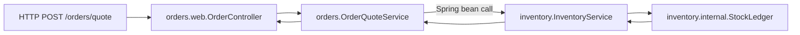
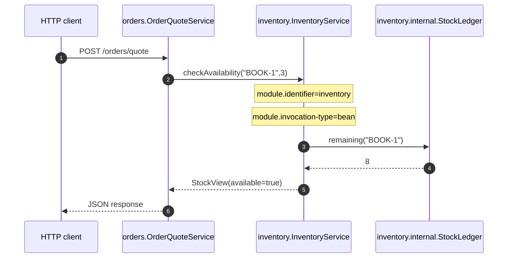

# Quan sát một lời gọi bean qua hai module

> **Chương:** Thực hành tổng hợp  
> **Phạm vi:** `SPRING_MODULITH_DOCUMENTATION_OBSERVABILITY` — sử dụng Spring Modulith để sinh tài liệu ranh giới application module, quan sát tương tác giữa các phần của ứng dụng Spring Boot bằng module graph, Actuator, tracing, event metrics và context propagation.  
> **Bài thực hành:** Tạo một modular monolith đơn giản gồm `orders` và `inventory`. `OrderQuoteService` gọi public Spring bean `InventoryService`. Sau đó kiểm tra cấu trúc dependency, lời gọi thực tế và dữ liệu quan sát.

Đối với một modular monolith, hai bean có thể được gọi trong cùng một JVM nhưng thuộc hai **application module** khác nhau. Khi quan sát, điều quan trọng là phân biệt **cấu trúc có thể gọi** (module graph) với **lần gọi đã xảy ra** (trace). Bài này tập trung vào invocation đồng bộ `orders → inventory`, chưa có transaction ghi CSDL hay phát domain event.

**Phiên bản của ví dụ:** Java 17+, Spring Boot **4.2.0**, Spring Modulith **2.2.0**, Maven. Đây là cặp phiên bản cùng release train đã được công bố chính thức tháng 11/2026. Mọi đoạn mã dưới đây là hướng dẫn **để thực hành trong project riêng**; không yêu cầu sửa những file ngoài bài Markdown hiện tại.

## 1. Mục tiêu và tiêu chí đạt

Hoàn thành khi có đủ ba bằng chứng:

1. **Kiến trúc:** `ApplicationModules.verify()` chạy qua, module graph và `/actuator/modulith` xác nhận `orders` phụ thuộc API công khai của `inventory`.
2. **Chức năng:** `POST /orders/quote` gọi `OrderQuoteService`, tiếp đến `InventoryService`, trả đúng `available` và `remaining`.
3. **Quan sát:** trace của request có module-entry span mang `module.identifier=inventory` và `module.invocation-type=bean`. Log và trace có thể được liên kết qua trace ID khi tracing hoạt động.

Sau bài, bạn phải lý giải được vì sao một lời gọi bean **không làm tăng** `module.events.published`, vì sao `inventory.internal` không cần một module-entry span riêng và cách chẩn đoán thiếu span do exporter, sampling hoặc Spring proxy.

## 2. Thiết kế kiến trúc mẫu



Spring Modulith mặc định nhận diện các subpackage trực tiếp của package chứa `@SpringBootApplication` thành những application module. Trong từng module, **base package** là giao diện công khai mặc định; các subpackage con như `inventory.internal` là chi tiết nội bộ.

| Class | Package | Vai trò và khả năng truy cập |
|---|---|---|
| `ShopApplication` | `com.acme.shop` | Root package để phát hiện module |
| `OrderQuoteService` | `com.acme.shop.orders` | Spring bean công khai của module `orders` |
| `OrderController` | `com.acme.shop.orders.web` | HTTP adapter nội bộ `orders` |
| `InventoryService` | `com.acme.shop.inventory` | Spring bean công khai để module khác gọi |
| `StockView` | `com.acme.shop.inventory` | DTO public, cho phép `orders` tham chiếu |
| `StockLedger` | `com.acme.shop.inventory.internal` | Hạ tầng nội bộ; `orders` không được import |

Lời gọi từ `orders` tới `inventory` đi qua một Spring-managed bean, không qua HTTP hay message broker. Truy cập `StockLedger` từ nội bộ `InventoryService` vẫn là hoạt động trong cùng module `inventory`.

## 3. Dependency và tracing backend

Mẫu `pom.xml` sau sử dụng Boot parent quản lý dependency nền và Modulith BOM quản lý các artifact Modulith. Mã dùng `spring-boot-starter-webmvc` và `spring-boot-starter-opentelemetry` của **Boot 4**, vì tên starter có thể khác ở Boot 3.

```xml
<project xmlns="http://maven.apache.org/POM/4.0.0"
         xmlns:xsi="http://www.w3.org/2001/XMLSchema-instance"
         xsi:schemaLocation="http://maven.apache.org/POM/4.0.0
           https://maven.apache.org/xsd/maven-4.0.0.xsd">
    <modelVersion>4.0.0</modelVersion>
    <parent>
        <groupId>org.springframework.boot</groupId>
        <artifactId>spring-boot-starter-parent</artifactId>
        <version>4.2.0</version>
        <relativePath/>
    </parent>
    <groupId>com.acme</groupId>
    <artifactId>module-call-lab</artifactId>
    <version>0.1.0-SNAPSHOT</version>
    <properties>
        <java.version>17</java.version>
        <spring-modulith.version>2.2.0</spring-modulith.version>
    </properties>
    <dependencyManagement>
        <dependencies>
            <dependency>
                <groupId>org.springframework.modulith</groupId>
                <artifactId>spring-modulith-bom</artifactId>
                <version>${spring-modulith.version}</version>
                <type>pom</type>
                <scope>import</scope>
            </dependency>
        </dependencies>
    </dependencyManagement>
    <dependencies>
        <dependency>
            <groupId>org.springframework.boot</groupId>
            <artifactId>spring-boot-starter-webmvc</artifactId>
        </dependency>
        <dependency>
            <groupId>org.springframework.modulith</groupId>
            <artifactId>spring-modulith-starter-core</artifactId>
        </dependency>
        <dependency>
            <groupId>org.springframework.modulith</groupId>
            <artifactId>spring-modulith-starter-insight</artifactId>
            <scope>runtime</scope>
        </dependency>
        <dependency>
            <groupId>org.springframework.boot</groupId>
            <artifactId>spring-boot-starter-opentelemetry</artifactId>
        </dependency>
        <dependency>
            <groupId>io.micrometer</groupId>
            <artifactId>micrometer-registry-prometheus</artifactId>
            <scope>runtime</scope>
        </dependency>
        <dependency>
            <groupId>org.springframework.modulith</groupId>
            <artifactId>spring-modulith-starter-test</artifactId>
            <scope>test</scope>
        </dependency>
        <dependency>
            <groupId>org.springframework.boot</groupId>
            <artifactId>spring-boot-starter-test</artifactId>
            <scope>test</scope>
        </dependency>
    </dependencies>
</project>
```

| Dependency | Chức năng |
|---|---|
| `spring-modulith-starter-core` | Xây application module model và xác minh kiến trúc |
| `spring-modulith-starter-insight` | Tích hợp Modulith Actuator và observability cho API bean |
| `spring-boot-starter-opentelemetry` | Micrometer Tracing + OTLP export, nối span với trace backend |
| `micrometer-registry-prometheus` | Xuất metric qua `/actuator/prometheus`; tùy chọn |
| `spring-modulith-starter-test` | `@ApplicationModuleTest`, `Documenter`, các tiện ích test Modulith |

Để có trace ở backend cần chạy **OTLP/HTTP receiver** (ví dụ OpenTelemetry Collector hoặc Jaeger/Tempo được cấu hình nhận OTLP). Starter Insight chỉ instrument module; nó **không tự cung cấp tracing backend**.

### `src/main/resources/application.yml`

```yaml
spring:
  application:
    name: module-call-lab

management:
  endpoints:
    web:
      exposure:
        include: health,info,modulith,metrics,prometheus
  tracing:
    sampling:
      probability: 1.0
  opentelemetry:
    otlp:
      endpoint: ${OTLP_ENDPOINT:http://localhost:4318}
    resource-attributes:
      deployment.environment.name: local
```

Trong Boot 4.2, `management.opentelemetry.otlp.endpoint` là URL **gốc**; khi xuất traces qua HTTP, đường dẫn `/v1/traces` được ghép tự động. Đảm bảo collector thực sự nghe cổng 4318 và đã có pipeline xuất dữ liệu sang backend xem trace. `sampling.probability: 1.0` chỉ để lab dễ nhìn thấy từng request; production phải tính chi phí.

Các Actuator endpoint hiển thị thông tin nội bộ: chỉ mở trong môi trường lab hoặc bảo vệ bằng mạng quản trị/xác thực. Nếu backend chưa chạy, các bước kiểm tra kiến trúc và chức năng vẫn thực hiện được nhưng chưa thể kết luận trace export thành công.

## 4. Tạo cấu trúc package

```text
src/
  main/
    java/com/acme/shop/
      ShopApplication.java
      orders/
        package-info.java
        OrderQuote.java
        OrderQuoteService.java
        web/
          OrderController.java
      inventory/
        package-info.java
        StockView.java
        InventoryService.java
        internal/
          StockLedger.java
    resources/
      application.yml
  test/
    java/com/acme/shop/
      ArchitectureDocumentationTest.java
      orders/
        OrderQuoteModuleTest.java
```

### `ShopApplication.java`

```java
package com.acme.shop;

import org.springframework.boot.SpringApplication;
import org.springframework.boot.autoconfigure.SpringBootApplication;

@SpringBootApplication
public class ShopApplication {
    public static void main(String[] args) {
        SpringApplication.run(ShopApplication.class, args);
    }
}
```

### Hai file `package-info.java`

`orders/package-info.java`:

```java
@org.springframework.modulith.ApplicationModule(
    id = "orders",
    displayName = "Orders",
    allowedDependencies = "inventory"
)
package com.acme.shop.orders;
```

`inventory/package-info.java`:

```java
@org.springframework.modulith.ApplicationModule(
    id = "inventory",
    displayName = "Inventory"
)
package com.acme.shop.inventory;
```

Dùng module ID cố định `orders` và `inventory` làm khóa liên kết giữa graph, Actuator và span tags. `allowedDependencies` chỉ cho phép gọi API công khai của inventory; nó không mở quyền truy cập `inventory.internal.*`.

## 5. Viết module `inventory`

### `inventory/internal/StockLedger.java`

```java
package com.acme.shop.inventory.internal;

import java.util.Map;
import org.springframework.stereotype.Component;

@Component
public class StockLedger {
    private final Map<String, Integer> stock = Map.of(
        "BOOK-1", 8,
        "PEN-2", 20
    );

    public int remaining(String sku) {
        return stock.getOrDefault(sku, 0);
    }
}
```

Số lượng tồn được giữ trong `Map` cố định để thao tác có thể lặp lại mà không cần CSDL. Bài này không giữ chỗ hay trừ hàng.

### `inventory/StockView.java`

```java
package com.acme.shop.inventory;

public record StockView(
    String sku,
    int requested,
    boolean available,
    int remaining
) {}
```

### `inventory/InventoryService.java`

```java
package com.acme.shop.inventory;

import com.acme.shop.inventory.internal.StockLedger;
import org.slf4j.Logger;
import org.slf4j.LoggerFactory;
import org.springframework.stereotype.Service;

@Service
public class InventoryService {
    private static final Logger log =
        LoggerFactory.getLogger(InventoryService.class);

    private final StockLedger ledger;

    public InventoryService(StockLedger ledger) {
        this.ledger = ledger;
    }

    public StockView checkAvailability(String sku, int requested) {
        int remaining = ledger.remaining(sku);
        boolean available = requested <= remaining;

        log.info("Inventory check sku={} requested={} available={}",
            sku, requested, available);
        return new StockView(sku, requested, available, remaining);
    }
}
```

Đặt `InventoryService` trực tiếp ở base package `inventory`, gắn `@Service` và để Spring quản lý bean. Spring Modulith Insight decorates các Spring component được công bố ở module API để đo invocation, vì vậy đây là điểm quan sát mà bài cần. `StockLedger` ở subpackage `internal` là chi tiết thực thi, không bắt buộc có module-entry span riêng.

## 6. Viết module `orders` và HTTP endpoint

### `orders/OrderQuote.java`

```java
package com.acme.shop.orders;

public record OrderQuote(
    String sku,
    int quantity,
    boolean available,
    int remaining
) {}
```

### `orders/OrderQuoteService.java`

```java
package com.acme.shop.orders;

import com.acme.shop.inventory.InventoryService;
import com.acme.shop.inventory.StockView;
import org.springframework.stereotype.Service;

@Service
public class OrderQuoteService {
    private final InventoryService inventory;

    public OrderQuoteService(InventoryService inventory) {
        this.inventory = inventory;
    }

    public OrderQuote quote(String sku, int quantity) {
        StockView stock = inventory.checkAvailability(sku, quantity);
        return new OrderQuote(
            stock.sku(),
            stock.requested(),
            stock.available(),
            stock.remaining()
        );
    }
}
```

Chìa khóa của bài là `inventory.checkAvailability(sku, quantity)`. Dependency được tiêm qua constructor để lời gọi tới Spring-managed bean có thể qua proxy. Nếu dùng `new InventoryService(new StockLedger())`, code có thể vẫn chạy nhưng không đi qua instrumentation của Spring container.

### `orders/web/OrderController.java`

```java
package com.acme.shop.orders.web;

import com.acme.shop.orders.OrderQuote;
import com.acme.shop.orders.OrderQuoteService;
import org.springframework.http.HttpStatus;
import org.springframework.web.bind.annotation.PostMapping;
import org.springframework.web.bind.annotation.RequestBody;
import org.springframework.web.bind.annotation.RequestMapping;
import org.springframework.web.bind.annotation.RestController;
import org.springframework.web.server.ResponseStatusException;

@RestController
@RequestMapping("/orders")
public class OrderController {
    private final OrderQuoteService quotes;

    public OrderController(OrderQuoteService quotes) {
        this.quotes = quotes;
    }

    @PostMapping("/quote")
    public OrderQuote quote(@RequestBody QuoteRequest input) {
        if (input == null || input.sku() == null
                || input.sku().isBlank() || input.quantity() <= 0) {
            throw new ResponseStatusException(
                HttpStatus.BAD_REQUEST, "Invalid sku or quantity");
        }
        return quotes.quote(input.sku(), input.quantity());
    }

    public record QuoteRequest(String sku, int quantity) {}
}
```

Controller được đặt trong `orders.web` vì nó chỉ là HTTP adapter nội bộ module `orders`. Kiểm tra dữ liệu mẫu: `BOOK-1` còn 8 chiếc, yêu cầu 3 thì đủ; yêu cầu 12 thì thiếu. Không có event, ghi dữ liệu hay transaction trong ví dụ này.

## 7. Xác minh module boundaries và sinh tài liệu

`src/test/java/com/acme/shop/ArchitectureDocumentationTest.java`:

```java
package com.acme.shop;

import org.junit.jupiter.api.Test;
import org.springframework.modulith.core.ApplicationModules;
import org.springframework.modulith.docs.Documenter;

class ArchitectureDocumentationTest {

    @Test
    void verifyAndGenerateDocumentation() {
        var modules = ApplicationModules.of(ShopApplication.class);
        modules.verify();
        new Documenter(modules).writeDocumentation();
    }
}
```

Chạy `mvn test` trong project lab. `verify()` kiểm tra ranh giới và phụ thuộc module, `Documenter` sinh component diagrams và Application Module Canvas (thông thường dưới `target/spring-modulith-docs` khi dùng Maven). Tìm cạnh **`orders → inventory`**. Diagram chứng minh code có dependency; nó không đo được request thực tế.

Một thử nghiệm âm tính: tạm cho `OrderQuoteService` import trực tiếp `com.acme.shop.inventory.internal.StockLedger` rồi chạy `verify()`. Đây là truy cập nội bộ trái phép theo module model và phải được phát hiện. Hoàn tác thay đổi sau khi quan sát lỗi; không chuyển module sang `Type.OPEN` chỉ để bỏ qua ranh giới.

## 8. Kiểm tra bean call qua `@ApplicationModuleTest`

`src/test/java/com/acme/shop/orders/OrderQuoteModuleTest.java`:

```java
package com.acme.shop.orders;

import static org.junit.jupiter.api.Assertions.assertEquals;
import static org.junit.jupiter.api.Assertions.assertFalse;
import static org.junit.jupiter.api.Assertions.assertTrue;

import org.junit.jupiter.api.Test;
import org.springframework.beans.factory.annotation.Autowired;
import org.springframework.modulith.test.ApplicationModuleTest;
import org.springframework.modulith.test.ApplicationModuleTest.BootstrapMode;

@ApplicationModuleTest(mode = BootstrapMode.DIRECT_DEPENDENCIES)
class OrderQuoteModuleTest {
    @Autowired
    OrderQuoteService quotes;

    @Test
    void callsInventoryPublicApi() {
        OrderQuote available = quotes.quote("BOOK-1", 3);
        assertTrue(available.available());
        assertEquals(8, available.remaining());

        OrderQuote unavailable = quotes.quote("BOOK-1", 12);
        assertFalse(unavailable.available());
        assertEquals(8, unavailable.remaining());
    }
}
```

`DIRECT_DEPENDENCIES` cho phép slice test nạp module `orders` và module `inventory` mà nó phụ thuộc trực tiếp. Mode `STANDALONE` chỉ nạp module `orders`, nên có thể thiếu bean `InventoryService`; nếu muốn cô lập hoàn toàn cần mock dependency. Ở bài này cần bean thật để kiểm tra **wiring qua module API**.

Test có thể pass trong khi trace exporter chưa hoạt động: Spring Boot thường không tự bật reporter mạng trong `@SpringBootTest`. Muốn chứng minh trace, phải kiểm tra backend hoặc thiết lập test exporter chuyên dụng.

## 9. Chạy request và kiểm tra Actuator

Trong thư mục project lab:

```bash
mvn test
mvn spring-boot:run
```

Trong terminal thứ hai (Bash):

```bash
curl -sS -X POST http://localhost:8080/orders/quote \
  -H 'Content-Type: application/json' \
  -d '{"sku":"BOOK-1","quantity":3}'
```

Với Windows PowerShell có thể dùng một dòng:

```powershell
Invoke-RestMethod -Method POST -Uri 'http://localhost:8080/orders/quote' -ContentType 'application/json' -Body '{"sku":"BOOK-1","quantity":3}'
```

Kết quả minh họa:

```json
{
  "sku": "BOOK-1",
  "quantity": 3,
  "available": true,
  "remaining": 8
}
```

Gọi lại quantity `12` để nhận `available=false`. Xem log để biết method `InventoryService.checkAvailability` đã chạy.

Tiếp theo:

```bash
curl -sS http://localhost:8080/actuator/modulith
```

Tìm response có hai module. Một **đoạn rút gọn minh họa**:

```json
{
  "orders": {
    "basePackage": "com.acme.shop.orders",
    "displayName": "Orders",
    "dependencies": [
      {"target": "inventory", "types": ["USES_COMPONENT"]}
    ]
  },
  "inventory": {
    "basePackage": "com.acme.shop.inventory",
    "displayName": "Inventory",
    "dependencies": []
  }
}
```

JSON thực có thể chứa thêm dependency types, chẳng hạn `DEFAULT`, vì mã còn tham chiếu kiểu `StockView`. Cần xác nhận `orders.dependencies[*].target` có `inventory`, không kiểm tra nguyên văn cả response. Nếu endpoint trả 404, kiểm tra Insight/Actuator starter, exposure, management path và quyền truy cập trước khi kết luận module discovery sai.

## 10. Xem module-entry span của `inventory`

Khi `POST /orders/quote` chạy, Spring Boot có thể tạo HTTP server span; Spring Modulith Insight bổ sung observation tại API bean được gọi. Luồng đồng bộ mẫu:



**Quy trình quan sát:**

1. Đảm bảo collector OTLP/HTTP thật sự chạy tại `OTLP_ENDPOINT`, backend nhận được trace từ một request thử. Nếu chưa có backend, chỉ có thể kiểm tra kiến trúc và HTTP.
2. Để `management.tracing.sampling.probability=1.0` trong lab, gọi `POST /orders/quote`. Ghi lại thời điểm và tìm trace của `service.name=module-call-lab`.
3. Mở trace HTTP, tìm span với tag **`module.identifier=inventory`**. Kiểm tra thêm **`module.invocation-type=bean`** và `module.method` liên quan `checkAvailability`.
4. Kiểm tra quan hệ parent-child: module-entry span của inventory nằm trong trace liên quan đến request đang xét. Có thể còn một span của `OrderQuoteService` trong module orders tùy các bean được instrument.
5. Gọi lại với `quantity=12`. Kết quả nghiệp vụ chuyển từ `available=true` sang `false` nhưng định danh module và loại invocation phải giữ nguyên.

Theo reference Modulith, module-entry span có các trường:

| Tag | Giá trị trong lab | Mục đích |
|---|---|---|
| `module.identifier` | `inventory` | Xác định module được đi vào |
| `module.name` | `Inventory` | Tên hiển thị module |
| `module.invocation-type` | `bean` | Phân biệt gọi bean với event listener |
| `module.method` | Thông tin `checkAvailability` | Tìm method API đã được thực thi |

**Không cố định literal span name** trong assertion, vì `ModulithObservationConvention` và bản framework có thể quyết định contextual name khác nhau. Tên và số span của toàn trace cũng có thể phụ thuộc HTTP instrumentation, AOP interception và exporter.

Một span chỉ chứng minh invocation đã được quan sát, **không** tự xác nhận nghiệp vụ có transaction thành công hay dữ liệu đã lưu. Ví dụ này chỉ đọc `Map` trong bộ nhớ.

## 11. Khi nào có metrics, khi nào có trace?

Bài này **gọi Spring bean đồng bộ**, không có `ApplicationEventPublisher.publishEvent(...)` và không có domain event. Vì vậy:

```text
OrderController -> OrderQuoteService
                -> InventoryService
                -> StockLedger

Domain event published trong bài: 0
```

`module.events.published` của Spring Modulith là **counter các lần phát domain event**. Nó có thể chưa được khởi tạo hoặc không tăng sau `/orders/quote`. Đây là hành vi bình thường, không phải lỗi module observability.

Có thể quan sát các tín hiệu khác:

| Tín hiệu | Ý nghĩa |
|---|---|
| HTTP request metrics | Thông lượng, thời gian phản hồi, HTTP status |
| Module-entry span | Invocation tại API module với tags |
| Module graph / Canvas | Phụ thuộc tĩnh và interface module |
| Log `InventoryService` | Bằng chứng method đã chạy; có thể nối trace qua MDC |
| Event publication counters | Chỉ có ý nghĩa khi ứng dụng phát domain event |

Lệnh kiểm tra trong lab:

```bash
curl -sS http://localhost:8080/actuator/metrics
curl -sS http://localhost:8080/actuator/metrics/http.server.requests
curl -sS http://localhost:8080/actuator/prometheus
```

Tên metric sau khi xuất ra Prometheus có thể khác tên meter trong Micrometer. Đọc tên thực tế trước khi viết truy vấn. Không mặc định có một meter tương ứng **mỗi** module-entry span.

## 12. Thí nghiệm đối chứng về instrumentation

Các thí nghiệm sau chỉ dùng trong bản lab thử nghiệm; hoàn tác để trở về chương trình đúng:

| Thí nghiệm | Kết quả dự đoán | Giải thích |
|---|---|---|
| Giữ `InventoryService` là `@Service` thuộc API `inventory`, gọi qua constructor injection | Có thể thấy module-entry span inventory nếu tracer và exporter hoạt động | Lời gọi qua Spring-managed bean và Aspect |
| Đặt sampling `0.0` | HTTP vẫn trả đúng, span sampled không xuất ở backend | **Không thấy trace** không đồng nghĩa **không có lời gọi** |
| Ngắt collector | HTTP có thể vẫn hoạt động nhưng export lỗi | Instrumentation và đường truyền trace là hai phần khác nhau |
| Tạo `new InventoryService(new StockLedger())` bên ngoài container | Lời gọi trực tiếp có thể bỏ qua module-entry interception | Object không do Spring AOP proxy quản lý |
| Chuyển `InventoryService` vào `inventory.internal` rồi để orders import | Có thể vi phạm ranh giới và không còn cơ chế instrument như API bean | Vị trí lớp công khai quyết định module boundary |
| Gọi method bean bằng `this.otherMethod()` | Advice proxy cho method được gọi nội bộ có thể bị bỏ qua | Self-invocation không đi qua proxy ngoài |
| Chuyển xử lý sang executor khác thread không propagate context | Span của công việc có thể tách khỏi trace HTTP | Cần context propagation ngoài việc giữ tên span |

**Cách điều tra khoa học:** chỉ đổi một yếu tố, gọi lại cùng payload, so HTTP result, log, Actuator model, span tags và exporter error. Tránh sửa đồng thời package, tracing config và dependency vì sẽ khó xác định nguyên nhân.

## 13. Context propagation: mở rộng sau lời gọi đồng bộ

Trong bài chính, cả `OrderQuoteService` và `InventoryService` được gọi trong cùng request thread. Observation context thường được duy trì trong phạm vi request. Nếu thay bằng `@Async`, `Executor` hoặc event listener ở thread khác, `ThreadLocal` không tự bảo đảm context theo sang thread mới.

Ví dụ cấu hình executor trên Spring Framework có hỗ trợ `ContextPropagatingTaskDecorator`:

```java
import org.springframework.context.annotation.Bean;
import org.springframework.context.annotation.Configuration;
import org.springframework.core.task.support.ContextPropagatingTaskDecorator;
import org.springframework.scheduling.concurrent.ThreadPoolTaskExecutor;

@Configuration(proxyBeanMethods = false)
class AsyncTracingConfiguration {

    @Bean
    ThreadPoolTaskExecutor observedTaskExecutor() {
        var executor = new ThreadPoolTaskExecutor();
        executor.setCorePoolSize(2);
        executor.setThreadNamePrefix("observed-");
        executor.setTaskDecorator(new ContextPropagatingTaskDecorator());
        return executor;
    }
}
```

Bean decorator chỉ có tác dụng nếu tác vụ **thật sự được thực thi** bởi executor này. Với Boot auto-configured executor, có thể dùng cấu hình propagation phù hợp bản Boot; với broker hoặc tiến trình khác, cần mang context qua message headers. Đây là **bài tập mở rộng**, không thêm vào code chính nếu chưa thiết kế lại hợp đồng HTTP đồng bộ.

## 14. Xác minh kết quả bằng ba lớp bằng chứng

| Lớp | Cách kiểm tra | Bằng chứng cần có |
|---|---|---|
| **Kiến trúc tĩnh** | `mvn test`, `modules.verify()`, `Documenter` | Hai module đúng, diagram `orders → inventory`, không phụ thuộc nội bộ trái phép |
| **Runtime bean wiring** | `@ApplicationModuleTest(DIRECT_DEPENDENCIES)` và HTTP | Đủ hàng: `true/8`; thiếu hàng: `false/8` |
| **Runtime module model** | `GET /actuator/modulith` | `orders.dependencies.target` bao gồm `inventory` |
| **Observed execution** | Xem trace backend | Span với `module.identifier=inventory` và `module.invocation-type=bean` gắn cùng HTTP request |
| **Log correlation** | Xem log và tracing MDC | Có thể đối chiếu log inventory với thời điểm/trace ID khi context bật |

Khi làm báo cáo, ghi version Boot/Modulith, payload, HTTP status, module graph, trace ID (nội bộ) và tag thực tế; đừng chỉ ghi “đã bật tracing”.

### Checklist nghiệm thu

- [ ] Package root và hai module đúng định dạng.
- [ ] `orders` chỉ gọi API `inventory`, không import `inventory.internal`.
- [ ] `ApplicationModules.verify()` pass và `Documenter` sinh graph/Canvas.
- [ ] `@ApplicationModuleTest` kiểm tra wiring và hai tình huống tồn kho.
- [ ] `POST /orders/quote` trả JSON như dự kiến.
- [ ] `/actuator/modulith` chứa dependency `orders → inventory`.
- [ ] Trace backend nhận được span của module `inventory`, có tag invocation type `bean`.
- [ ] Người học giải thích được vì sao `module.events.published` không tăng.
- [ ] Đã thử ít nhất một tình huống thiếu span và xác định đúng nguyên nhân.

## 15. Chẩn đoán nhanh

| Triệu chứng | Nguyên nhân ưu tiên kiểm tra | Hành động |
|---|---|---|
| `verify()` lỗi | Có import class `inventory.internal` từ `orders`, hoặc cấu hình module sai | Đưa giao tiếp về public API module |
| Module test thiếu bean | Mode `STANDALONE` không nạp inventory | Dùng `DIRECT_DEPENDENCIES` hoặc mock phụ thuộc nếu test cô lập |
| `/actuator/modulith` trả 404 | Thiếu Insight/Actuator hoặc chưa expose | Kiểm tra dependency và Actuator path |
| Có HTTP 200 nhưng không có trace | Exporter, collector, sampling, proxy instrumentation | Kiểm tra pipeline, sampling 1.0 và vị trí bean |
| Trace có HTTP span nhưng thiếu module span | `InventoryService` không nằm trong module API hoặc thiếu Insight | Kiểm tra class package, `@Service` và DI |
| `module.identifier` không đúng | Module ID thay đổi hoặc xem nhầm span | So `@ApplicationModule(id)` với Actuator graph |
| `/actuator/prometheus` 404 | Thiếu registry Prometheus hoặc exposure | Thêm registry, cấu hình endpoint |
| Event meter không xuất hiện | Không có event được phát | Đây là kết quả bình thường của bài |
| Trace bị đứt khi dùng async | Thiếu propagation ở executor | Gắn decorator / dùng cơ chế propagation đúng version |

## 16. Bài tập mở rộng

**Bài A:** thêm module `pricing` có bean `PriceService` công khai. Cho `orders` gọi thêm bean này, cập nhật allowed dependencies, sinh graph và quan sát hai module-entry spans trong cùng HTTP trace.

**Bài B:** thêm lỗi kỹ thuật mô phỏng ở `StockLedger`, kiểm tra HTTP 500/log/span. Phân biệt lỗi hạ tầng với `available=false` — một kết quả nghiệp vụ hợp lệ. Không đưa exception message hay SKU nhạy cảm thành metric label.

**Bài C:** chạy một tác vụ không ảnh hưởng response qua executor; đối chiếu trace trước và sau `ContextPropagatingTaskDecorator`. Khi đưa nghiệp vụ chính sang async, phải thay đổi hợp đồng API cho đúng.

**Bài D:** lưu module graph trong báo cáo code review. Nếu dependency giữa module thay đổi, giải thích nguyên nhân và kiểm tra `verify()` trước khi merge; trace runtime chỉ bổ sung bằng chứng đường chạy.

## 17. Tài liệu tham khảo

1. [Spring Modulith 2.2 — Production-ready Features](https://docs.spring.io/spring-modulith/reference/2.2/production-ready.html): Insight starter, Modulith Actuator, module-entry span tags, event counters.
2. [Spring Modulith — Fundamentals](https://docs.spring.io/spring-modulith/reference/fundamentals.html): module discovery, API công khai, `@ApplicationModule`.
3. [Spring Modulith — Documenting Application Modules](https://docs.spring.io/spring-modulith/reference/documentation.html): `Documenter`, component diagram, Canvas.
4. [Spring Modulith — Integration Testing Application Modules](https://docs.spring.io/spring-modulith/reference/testing.html): `@ApplicationModuleTest` và bootstrap modes.
5. [Spring Boot 4.2 — Tracing](https://docs.spring.io/spring-boot/4.2/reference/actuator/tracing.html): OpenTelemetry starter, trace sampling, MDC correlation.
6. [Spring Boot — Observability](https://docs.spring.io/spring-boot/reference/actuator/observability.html): Micrometer Observation, resource attributes, context propagation.
7. [Spring Boot 4.2 — Build Systems](https://docs.spring.io/spring-boot/4.2/reference/using/build-systems.html): starter WebMVC và test.
8. [Spring Modulith 2.2 GA](https://spring.io/blog/2026/11/19/spring-modulith-2-2-ga-2-1-3-and-2-0-10-released/) và [Spring Boot 4.2 GA](https://spring.io/blog/2026/11/19/spring-boot-4-2-0-available-now/): cặp phiên bản thực hành.

**Điều cần nhớ:** module graph xác nhận **quyền phụ thuộc** giữa hai module; test và HTTP xác nhận **kết quả**; module-entry span xác nhận **một lời gọi Spring bean thực tế** đã đi vào public API của `inventory`. Kết hợp cả ba mới kiểm chứng được kiến trúc và quan sát vận hành.
