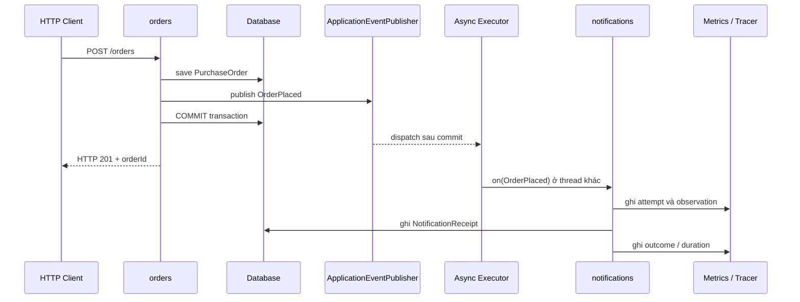
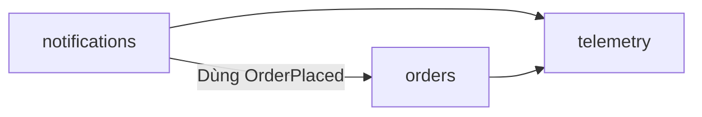
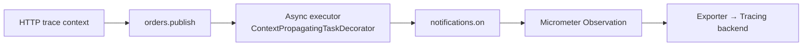
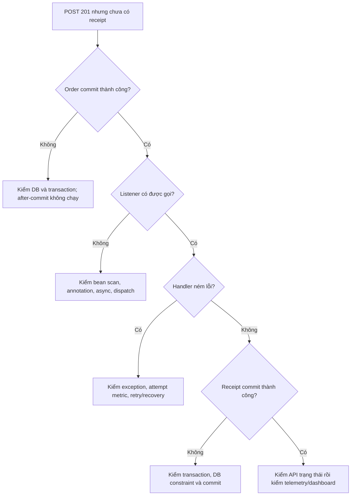

# Quan sát một domain event bất đồng bộ

Trong ứng dụng Spring Boot được tổ chức theo Spring Modulith, **domain event** cho phép module phát thông báo về một sự kiện nghiệp vụ mà không phải gọi trực tiếp implementation của module nhận. Khi listener chạy **bất đồng bộ**, HTTP request có thể trả kết quả trước lúc event được xử lý xong. Vì vậy, thông báo “publish thành công”, kết quả nghiệp vụ đã hoàn tất và dấu vết telemetry xuất hiện trên dashboard là ba sự thật khác nhau.

Bài thuộc chương **Thực hành tổng hợp** của **SPRING_MODULITH_DOCUMENTATION_OBSERVABILITY**: dùng Spring Modulith để sinh tài liệu ranh giới application module và quan sát tương tác trong ứng dụng Spring Boot qua module graph, Actuator, event metrics, tracing và context propagation. Bạn sẽ xây dựng một lab `orders → notifications` với event `OrderPlaced`, tạo kết quả xử lý có thể truy vấn, đo attempts/latency, quan sát trace xuyên thread và chẩn đoán một sự cố listener.

> Ví dụ dùng hệ Spring Boot dựa trên Jakarta Persistence và phiên bản Spring Modulith tương thích với `@ApplicationModuleListener`. Kiểm tra BOM/dependencies theo phiên bản dự án. Lab giả lập thông báo bằng bản ghi H2, không gửi email thật. Mã được trình bày để người học tạo trong dự án mẫu; các lệnh/test minh họa chưa được thực thi trong bài viết.

## 1. Mục tiêu và tiêu chí nghiệm thu

Sau bài học, bạn có thể:

1. Định nghĩa domain event công khai tại ranh giới module và xác minh dependency với `ApplicationModules.verify()`.
2. Phát event trong transaction và hiểu cách listener kiểu after-commit chạy qua executor bất đồng bộ.
3. Phân biệt *publish call*, *handling attempt*, xử lý thành công ở method và kết quả đã commit.
4. Dùng Micrometer Counter, Timer, Observation để theo dõi outcome, độ trễ mà không gây bùng nổ cardinality.
5. Kiểm tra module graph, Actuator, event metrics, tracing và context propagation trên một luồng thật.
6. Tái hiện lỗi, phân loại thiếu listener với lỗi telemetry, và kiểm thử async bằng điều kiện có deadline.

**Kết quả cần có:** một request tạo order, một `NotificationReceipt` xuất hiện sau khi listener xử lý, kiểm tra module boundary đạt, metrics có ít nhất một success attempt và một phép thử lỗi có bằng chứng rõ ràng. Trace có thể kiểm ở backend khi đã bật bridge/exporter thích hợp.

## 2. Luồng nghiệp vụ và các mốc cần đo



Đây là sơ đồ logic. Listener có thể bắt đầu rất nhanh sau commit, đôi khi trước khi client nhận hết HTTP response; không nên dựa vào thời điểm response để suy luận thứ tự chính xác của hai thread.

| Mốc | Chứng minh được | Chưa chứng minh được |
|---|---|---|
| `publishEvent()` trả về | Lời gọi publisher đã hoàn thành | Transaction đã commit |
| Transaction của order commit | Đơn hàng đã được lưu | Listener đã chạy |
| Listener bắt đầu | Một *handling attempt* xảy ra | Xử lý thành công |
| Body listener trả về | Attempt không ném lỗi trong body | Transaction listener đã commit nếu commit xảy ra sau body |
| Có receipt trong DB | Kết quả lab được ghi bền vững | Email thật đã tới người dùng |
| Meter trong JVM tăng | Instrumentation được thực thi | Backend lưu thành công hoặc panel nhìn thấy |
| Có trace ở backend | Một đường xử lý đã được quan sát | Mọi event đều được trace (sampling có thể bỏ bớt) |

Một event có thể có nhiều consumer; khi retry, một consumer có nhiều attempts. Không dùng số attempts để báo số domain events duy nhất.

## 3. Cấu trúc package và module graph

```text
com.example.shop
├── ShopApplication.java
├── AsyncConfiguration.java
├── orders/
│   ├── OrderPlaced.java
│   └── internal/
│       ├── PurchaseOrder.java
│       ├── PurchaseOrders.java
│       ├── OrderService.java
│       └── OrderHttpController.java
├── notifications/
│   └── internal/
│       ├── NotificationReceipt.java
│       ├── NotificationReceipts.java
│       ├── LabNotificationSender.java
│       ├── NotificationListener.java
│       └── NotificationHttpController.java
└── telemetry/
    └── EventMeasurements.java
```

Theo detection mặc định, Spring Modulith nhận diện các package con trực tiếp dưới package chứa `ShopApplication` thành application modules. `orders.OrderPlaced` ở base package là API công khai; `orders.internal` chứa implementation. `notifications` tham chiếu type công khai của `orders`, không import `orders.internal`. Cấu hình executor đặt ở root để không vô tình tạo module `config` riêng.



Đồ thị phụ thuộc code đi từ `notifications` tới `orders` vì consumer import event type; **luồng event tại runtime** lại đi từ publisher ở `orders` tới listener ở `notifications`. Hai mũi tên mô tả hai khái niệm khác nhau.

## 4. Chuẩn bị môi trường và dependencies

Tạo ứng dụng Spring Boot có Web, Spring Data JPA, Actuator, Spring Modulith core và module test. Dùng H2 để có transaction thực mà không cần database bên ngoài. Phần dependency Maven minh họa:

```xml
<!-- Chọn Spring Modulith BOM tương thích với Spring Boot của dự án.
     Đoạn sau chỉ là phần dependencies, chưa phải pom.xml hoàn chỉnh. -->
<dependencies>
  <dependency>
    <groupId>org.springframework.boot</groupId>
    <artifactId>spring-boot-starter-web</artifactId>
  </dependency>
  <dependency>
    <groupId>org.springframework.boot</groupId>
    <artifactId>spring-boot-starter-data-jpa</artifactId>
  </dependency>
  <dependency>
    <groupId>org.springframework.boot</groupId>
    <artifactId>spring-boot-starter-actuator</artifactId>
  </dependency>
  <dependency>
    <groupId>org.springframework.modulith</groupId>
    <artifactId>spring-modulith-starter-core</artifactId>
  </dependency>
  <dependency>
    <groupId>com.h2database</groupId>
    <artifactId>h2</artifactId>
    <scope>runtime</scope>
  </dependency>
  <dependency>
    <groupId>org.springframework.modulith</groupId>
    <artifactId>spring-modulith-starter-test</artifactId>
    <scope>test</scope>
  </dependency>
  <dependency>
    <groupId>org.springframework.boot</groupId>
    <artifactId>spring-boot-starter-test</artifactId>
    <scope>test</scope>
  </dependency>
</dependencies>
```

Các phần mở rộng cần chọn theo bản Spring Modulith đang dùng:

| Nhu cầu | Thành phần |
|---|---|
| Module graph và canvas | Spring Modulith docs/`Documenter` |
| Runtime module metadata | Spring Modulith Actuator/Insight + Spring Boot Actuator |
| Event Publication Registry bền vững | Starter JDBC/JPA hoặc store được bản hiện tại hỗ trợ |
| Prometheus metrics | Micrometer Prometheus registry, scrape target |
| OpenTelemetry tracing | Micrometer Tracing bridge, OTLP exporter và collector/backend |
| Chuyển context qua executor | Spring Framework `ContextPropagatingTaskDecorator` và Micrometer Context Propagation phù hợp |
| Test chờ async | JUnit, Spring Boot Test và Awaitility (nếu chưa có dependency) |

Chỉ có `@ApplicationModuleListener` không đồng nghĩa đã có event queue bền vững và tự retry sau crash; cần Event Publication Registry cùng cấu hình lưu trữ/recovery nếu bài toán yêu cầu.

Cấu hình lab trong `application-lab.yml`:

```yaml
spring:
  datasource:
    url: jdbc:h2:mem:modulith-lab;DB_CLOSE_DELAY=-1
    driver-class-name: org.h2.Driver
    username: sa
    password: ""
  jpa:
    hibernate:
      ddl-auto: create-drop

lab:
  notification:
    fail: false

management:
  endpoints:
    web:
      exposure:
        include: health,info,metrics,modulith,prometheus
  tracing:
    sampling:
      probability: 1.0
```

Cấu hình `create-drop`, H2 và sampling 100% chỉ dùng cho lab. Các endpoint `modulith`/`prometheus` cần đúng dependency và quản lý truy cập; cấu hình exposure không tự tạo endpoint chưa có. Trong production cần migration schema, kiểm soát secrets và sampling theo ngân sách/retention.

Khởi động khi đã có Maven wrapper:

```bash
./mvnw spring-boot:run -Dspring-boot.run.profiles=lab
```

Trên Windows có thể dùng `mvnw.cmd`.

## 5. Tạo event và module `orders`

### 5.1. Lớp khởi động và event công khai

```java
// File: com/example/shop/ShopApplication.java
package com.example.shop;

import org.springframework.boot.SpringApplication;
import org.springframework.boot.autoconfigure.SpringBootApplication;

@SpringBootApplication
public class ShopApplication {
    public static void main(String[] args) {
        SpringApplication.run(ShopApplication.class, args);
    }
}
```

```java
// File: com/example/shop/orders/OrderPlaced.java
package com.example.shop.orders;

import java.time.Instant;
import java.util.UUID;

public record OrderPlaced(UUID orderId, Instant occurredAt) {}
```

Event chứa dữ liệu tối thiểu, bất biến. `orderId` được dùng để tra cứu/idempotency; không dùng làm metric tag. Khi nhiều consumer cùng dùng event, phải kiểm soát khả năng tương thích khi đổi schema hoặc package.

### 5.2. Entity và repository

```java
// File: com/example/shop/orders/internal/PurchaseOrder.java
package com.example.shop.orders.internal;

import jakarta.persistence.Entity;
import jakarta.persistence.Id;
import jakarta.persistence.Table;
import java.util.UUID;

@Entity
@Table(name = "purchase_orders")
public class PurchaseOrder {
    @Id
    private UUID id;

    protected PurchaseOrder() {}

    public PurchaseOrder(UUID id) {
        this.id = id;
    }

    public UUID getId() {
        return id;
    }
}
```

```java
// File: com/example/shop/orders/internal/PurchaseOrders.java
package com.example.shop.orders.internal;

import java.util.UUID;
import org.springframework.data.jpa.repository.JpaRepository;

interface PurchaseOrders extends JpaRepository<PurchaseOrder, UUID> {}
```

Entity đơn giản chỉ có ID để minh họa, không thay thế một aggregate nghiệp vụ thực.

### 5.3. Ghi đơn hàng và publish event trong transaction

```java
// File: com/example/shop/orders/internal/OrderService.java
package com.example.shop.orders.internal;

import com.example.shop.orders.OrderPlaced;
import com.example.shop.telemetry.EventMeasurements;
import java.time.Instant;
import java.util.UUID;
import org.springframework.context.ApplicationEventPublisher;
import org.springframework.stereotype.Service;
import org.springframework.transaction.annotation.Transactional;

@Service
class OrderService {
    private final PurchaseOrders orders;
    private final ApplicationEventPublisher publisher;
    private final EventMeasurements metrics;

    OrderService(PurchaseOrders orders,
                 ApplicationEventPublisher publisher,
                 EventMeasurements metrics) {
        this.orders = orders;
        this.publisher = publisher;
        this.metrics = metrics;
    }

    @Transactional
    public UUID place() {
        UUID id = UUID.randomUUID();
        orders.save(new PurchaseOrder(id));
        publisher.publishEvent(new OrderPlaced(id, Instant.now()));
        metrics.publishCall("orders", "order_placed");
        return id;
    }
}
```

`@Transactional` quan trọng: transactional event listener thông thường thực hiện sau commit. Phát event ngoài transaction có thể khiến listener kiểu `@TransactionalEventListener` không chạy theo cấu hình mặc định. Counter `publishCall` ở đây chỉ đếm lời gọi, không phải số order đã commit; transaction có thể rollback sau khi counter tăng.

### 5.4. HTTP endpoint để tái hiện

```java
// File: com/example/shop/orders/internal/OrderHttpController.java
package com.example.shop.orders.internal;

import java.net.URI;
import java.util.Map;
import java.util.UUID;
import org.springframework.http.ResponseEntity;
import org.springframework.web.bind.annotation.PostMapping;
import org.springframework.web.bind.annotation.RequestMapping;
import org.springframework.web.bind.annotation.RestController;

@RestController
@RequestMapping("/orders")
public class OrderHttpController {
    private final OrderService service;

    OrderHttpController(OrderService service) {
        this.service = service;
    }

    @PostMapping
    public ResponseEntity<Map<String, String>> place() {
        UUID id = service.place();
        return ResponseEntity.created(URI.create("/orders/" + id))
                .body(Map.of("orderId", id.toString()));
    }
}
```

HTTP 201 xác nhận service tạo đơn trả về thành công, **không** đồng nghĩa listener đã xử lý xong. Endpoint chỉ dành cho lab; ứng dụng thực cần authentication, authorization và validation.

## 6. Lưu receipt ở module `notifications`

Để kiểm bằng chứng nghiệp vụ, consumer lưu một bản ghi `NotificationReceipt` thay cho việc gửi email thật.

```java
// File: com/example/shop/notifications/internal/NotificationReceipt.java
package com.example.shop.notifications.internal;

import jakarta.persistence.Column;
import jakarta.persistence.Entity;
import jakarta.persistence.Id;
import jakarta.persistence.Table;
import java.time.Instant;
import java.util.UUID;

@Entity
@Table(name = "notification_receipts")
public class NotificationReceipt {
    @Id
    @Column(name = "order_id", nullable = false)
    private UUID orderId;

    @Column(name = "processed_at", nullable = false)
    private Instant processedAt;

    protected NotificationReceipt() {}

    public NotificationReceipt(UUID orderId, Instant processedAt) {
        this.orderId = orderId;
        this.processedAt = processedAt;
    }

    public UUID getOrderId() { return orderId; }
    public Instant getProcessedAt() { return processedAt; }
}
```

```java
// File: com/example/shop/notifications/internal/NotificationReceipts.java
package com.example.shop.notifications.internal;

import java.util.UUID;
import org.springframework.data.jpa.repository.JpaRepository;

interface NotificationReceipts
        extends JpaRepository<NotificationReceipt, UUID> {}
```

Khóa chính `orderId` giúp ngăn nhiều receipt cho cùng order. Nhưng việc `existsById()` rồi `save()` không phải thao tác nguyên tử khi có hai listener đồng thời; production cần xử lý unique constraint/race và side effect idempotent.

Sender thử nghiệm đọc property qua `Environment`, tránh phụ thuộc vào cú pháp binding của framework trong ví dụ:

```java
// File: com/example/shop/notifications/internal/LabNotificationSender.java
package com.example.shop.notifications.internal;

import java.util.UUID;
import org.springframework.context.annotation.Profile;
import org.springframework.core.env.Environment;
import org.springframework.stereotype.Component;

@Component
@Profile("lab")
class LabNotificationSender {
    private final Environment environment;

    LabNotificationSender(Environment environment) {
        this.environment = environment;
    }

    void send(UUID orderId) {
        boolean fail = environment.getProperty(
                "lab.notification.fail", Boolean.class, false);

        if (fail) {
            throw new IllegalStateException(
                    "Simulated notification failure");
        }
        // Không gọi API gửi thư hay hệ thống ngoài.
    }
}
```

Cờ `lab.notification.fail` chỉ phục vụ thử nghiệm. Bean có `@Profile("lab")` nên ứng dụng chưa có adapter production sẽ không khởi động ngoài profile lab, đó là hành vi có chủ đích của mẫu này.

### 6.1. Listener xử lý event

```java
// File: com/example/shop/notifications/internal/NotificationListener.java
package com.example.shop.notifications.internal;

import com.example.shop.orders.OrderPlaced;
import com.example.shop.telemetry.EventMeasurements;
import java.time.Instant;
import org.springframework.modulith.events.ApplicationModuleListener;
import org.springframework.stereotype.Component;

@Component
class NotificationListener {
    private final NotificationReceipts receipts;
    private final LabNotificationSender sender;
    private final EventMeasurements metrics;

    NotificationListener(NotificationReceipts receipts,
                         LabNotificationSender sender,
                         EventMeasurements metrics) {
        this.receipts = receipts;
        this.sender = sender;
        this.metrics = metrics;
    }

    @ApplicationModuleListener
    void on(OrderPlaced event) {
        metrics.handlingAttempt("notifications", "order_placed", () -> {
            if (receipts.existsById(event.orderId())) {
                return;
            }

            sender.send(event.orderId());
            receipts.save(new NotificationReceipt(
                    event.orderId(), Instant.now()));
        });
    }
}
```

`@ApplicationModuleListener` kết hợp semantics transactional event listener và xử lý bất đồng bộ theo Spring Modulith. Listener thường được gọi sau commit của transaction phát event và thực hiện trong transaction riêng. Nếu body lỗi, wrapper ở phần sau ném lại exception để event/error handling biết attempt thất bại.

**Giới hạn đo:** counter success tăng khi body trả về, trong khi lỗi commit của transaction listener có thể xảy ra sau đó. Receipt đã commit mới là bằng chứng bền vững hơn. Nếu một event được retry, metric attempt sẽ đếm lại; đó là ý nghĩa đúng của metric này.

### 6.2. HTTP endpoint xem kết quả

```java
// File: com/example/shop/notifications/internal/NotificationHttpController.java
package com.example.shop.notifications.internal;

import java.util.Map;
import java.util.UUID;
import org.springframework.http.ResponseEntity;
import org.springframework.web.bind.annotation.GetMapping;
import org.springframework.web.bind.annotation.PathVariable;
import org.springframework.web.bind.annotation.RequestMapping;
import org.springframework.web.bind.annotation.RestController;

@RestController
@RequestMapping("/notifications")
public class NotificationHttpController {
    private final NotificationReceipts receipts;

    NotificationHttpController(NotificationReceipts receipts) {
        this.receipts = receipts;
    }

    @GetMapping("/{orderId}")
    public ResponseEntity<Map<String, String>> status(
            @PathVariable UUID orderId) {
        return receipts.findById(orderId)
                .map(receipt -> ResponseEntity.ok(Map.of(
                        "orderId", orderId.toString(),
                        "status", "PROCESSED",
                        "processedAt",
                        receipt.getProcessedAt().toString())))
                .orElseGet(() -> ResponseEntity.notFound().build());
    }
}
```

Trong lab, 404 nghĩa là chưa có receipt. Nó không phân biệt event đang chờ hay bị lỗi; khi dùng production nên có trạng thái riêng dựa trên publication registry/nguồn nghiệp vụ.

## 7. Instrument một attempt bằng Micrometer

Class này là public API của module `telemetry`, các module khác gọi để ghi nhận **mỗi lần thử xử lý**. Tên metric của lab do dự án quản lý, không khẳng định Spring Modulith tạo sẵn.

```java
// File: com/example/shop/telemetry/EventMeasurements.java
package com.example.shop.telemetry;

import io.micrometer.core.instrument.Counter;
import io.micrometer.core.instrument.MeterRegistry;
import io.micrometer.core.instrument.Timer;
import io.micrometer.observation.Observation;
import io.micrometer.observation.ObservationRegistry;
import org.springframework.stereotype.Component;

@Component
public class EventMeasurements {
    private final MeterRegistry registry;
    private final ObservationRegistry observations;

    public EventMeasurements(
            MeterRegistry registry, ObservationRegistry observations) {
        this.registry = registry;
        this.observations = observations;
    }

    public void publishCall(String sourceModule, String eventType) {
        Counter.builder("lab.domain.event.publish.calls")
                .description("Publisher calls, not committed events")
                .tag("source_module", sourceModule)
                .tag("event_type", eventType)
                .register(registry).increment();
    }

    public void handlingAttempt(
            String consumerModule, String eventType, Runnable body) {
        Timer.Sample sample = Timer.start(registry);
        String outcome = "success";

        Observation observation = Observation
                .createNotStarted("lab.domain.event.handle", observations)
                .lowCardinalityKeyValue("consumer.module", consumerModule)
                .lowCardinalityKeyValue("event.type", eventType);

        try {
            observation.observe(body);
        } catch (RuntimeException | Error error) {
            outcome = "failure";
            throw error;
        } finally {
            Counter.builder("lab.domain.event.handler.attempts")
                    .description("Event handler execution attempts")
                    .tag("consumer_module", consumerModule)
                    .tag("event_type", eventType)
                    .tag("outcome", outcome)
                    .register(registry).increment();

            sample.stop(Timer
                    .builder("lab.domain.event.handler.duration")
                    .description("Duration of one handler attempt")
                    .tag("consumer_module", consumerModule)
                    .tag("event_type", eventType)
                    .tag("outcome", outcome)
                    .register(registry));
        }
    }
}
```

Bộ đo có ba semantics khác nhau:

| Tín hiệu | Điểm ghi | Cách diễn giải |
|---|---|---|
| `publish.calls` Counter | Sau khi gọi `publishEvent` không ném lỗi | Số lời gọi, chưa chứng minh commit |
| `handler.attempts` Counter | Sau mỗi callback thành công/thất bại | Một event có thể có nhiều attempts khi retry |
| `handler.duration` Timer | Quanh body callback | Thời gian xử lý attempt, chưa tính thời gian chờ |
| `lab.domain.event.handle` Observation | Quanh cùng body | Có thể sinh span và timer qua observation handlers |

Khi bật instrumentation của Spring Modulith, một số metrics/spans tích hợp cũng có thể được tạo. **Không cộng trùng** hai bộ đếm hoặc hai Timer có cùng ngữ nghĩa. Chỉ dùng tags hữu hạn như module, event type, outcome; không gắn order ID, event ID, email, trace ID hay exception message vào metrics.

## 8. Cấu hình executor và context propagation

Khi listener được xử lý bởi `@Async` trên thread khác, context theo thread của Micrometer Tracing có thể không được mang theo. Cần xác minh **executor thực sự được annotation sử dụng** và trang trí nó bằng cơ chế context propagation tương thích.

Ví dụ đặt cấu hình ở root package:

```java
// File: com/example/shop/AsyncConfiguration.java
package com.example.shop;

import org.springframework.context.annotation.Bean;
import org.springframework.context.annotation.Configuration;
import org.springframework.core.task.support.ContextPropagatingTaskDecorator;
import org.springframework.scheduling.annotation.EnableAsync;
import org.springframework.scheduling.concurrent.ThreadPoolTaskExecutor;

@Configuration
@EnableAsync
public class AsyncConfiguration {

    @Bean(name = "taskExecutor")
    public ThreadPoolTaskExecutor taskExecutor() {
        ThreadPoolTaskExecutor executor = new ThreadPoolTaskExecutor();
        executor.setCorePoolSize(2);
        executor.setMaxPoolSize(6);
        executor.setQueueCapacity(100);
        executor.setThreadNamePrefix("module-event-");
        executor.setTaskDecorator(
                new ContextPropagatingTaskDecorator());
        executor.initialize();
        return executor;
    }
}
```

Trong cấu hình Spring `@Async` thông dụng, bean `taskExecutor` được dùng làm executor mặc định khi không chỉ định tên khác. Tuy nhiên, nếu có nhiều `TaskExecutor`, `AsyncConfigurer` riêng, event multicaster được tùy biến hoặc thay đổi cơ chế dispatch của Spring Modulith, phải kiểm **executor nào đã chạy callback**. Không kết luận propagation hoạt động chỉ vì bean TaskDecorator tồn tại trong context.



Để span thực sự xuất hiện trên backend, cần tracing bridge, exporter, collector, sampling và credentials phù hợp. Khi event được gửi qua broker hoặc tiến trình khác, TaskDecorator trong một JVM không thể tự truyền context qua network; phải cấu hình propagation vào message headers theo trust boundary.

Với xử lý async, trace có thể biểu diễn bằng quan hệ parent-child hoặc span links tùy instrumentation. Mục tiêu là **có thể tương quan và giải thích luồng thực thi**, không ép mọi listener thành con trực tiếp của HTTP span trong mọi trường hợp.

## 9. Xác minh kiến trúc bằng Spring Modulith

Viết test xác minh ranh giới:

```java
package com.example.shop;

import org.junit.jupiter.api.Test;
import org.springframework.modulith.core.ApplicationModules;

class ArchitectureTests {

    @Test
    void verifiesApplicationModules() {
        ApplicationModules.of(ShopApplication.class).verify();
    }
}
```

Test này phát hiện dependency vòng hoặc truy cập implementation không hợp lệ, ví dụ một class trong `notifications` import `orders.internal.PurchaseOrders`. Nó không chạy event thật và không kiểm pipeline telemetry.

Khi đã có dependency docs tương thích, sinh module graph và canvas:

```java
package com.example.shop;

import org.junit.jupiter.api.Test;
import org.springframework.modulith.core.ApplicationModules;
import org.springframework.modulith.docs.Documenter;

class ModuleDocumentationTests {

    @Test
    void generateArchitectureDocs() {
        ApplicationModules modules =
                ApplicationModules.of(ShopApplication.class);
        modules.verify();

        new Documenter(modules)
                .writeModulesAsPlantUml()
                .writeIndividualModulesAsPlantUml()
                .writeModuleCanvases();
    }
}
```

Module graph mô tả **quan hệ phụ thuộc tĩnh**, không biểu diễn event thực sự xảy ra mỗi giây. Để xem model ở runtime, nếu có Spring Modulith Actuator và endpoint đã được expose ở môi trường cho phép:

```bash
curl --fail --silent http://localhost:8080/actuator/modulith
```

Kết quả cần mô tả đúng các module và dependencies dự kiến. Endpoint không tồn tại có thể do dependency, exposure, security hoặc management path; không chứng minh không có module. Không công khai metadata kiến trúc hoặc các endpoint Actuator nhạy cảm lên Internet.

## 10. Chạy luồng thành công

Khởi động ứng dụng profile `lab` với `lab.notification.fail=false`. Tạo một đơn:

```bash
curl -i -X POST http://localhost:8080/orders
```

Response minh họa:

```http
HTTP/1.1 201 Created
Content-Type: application/json

{"orderId":"a1cf8232-30ca-4e4f-b084-22caa8f94e19"}
```

Dùng **ID thật** từ response để kiểm result:

```bash
curl -i \
  http://localhost:8080/notifications/a1cf8232-30ca-4e4f-b084-22caa8f94e19
```

Khi listener đã hoàn tất và receipt commit, response tương tự:

```json
{
  "orderId": "a1cf8232-30ca-4e4f-b084-22caa8f94e19",
  "status": "PROCESSED",
  "processedAt": "2026-11-27T04:00:00Z"
}
```

ID và timestamp chỉ là mẫu minh họa. Lần GET đầu tiên có thể trả 404 vì listener chưa xử lý xong; đó chưa phải bằng chứng lỗi. Kiểm lại trong khoảng giới hạn, rồi đối chiếu listener log và DB nếu vẫn không có receipt.

**Dấu hiệu thành công** gồm: POST 201, order đã commit, receipt theo đúng ID xuất hiện, counter `outcome=success` được ghi. Khi bật tracing/exporter, có thể đối chiếu span để xem mối liên hệ với request gốc.

## 11. Đọc metrics trên Actuator và dashboard

Sau khi có request thật, đọc meter logic:

```bash
curl --fail --silent http://localhost:8080/actuator/metrics

curl --fail --silent \
  http://localhost:8080/actuator/metrics/lab.domain.event.handler.attempts
```

Nếu có registry Prometheus và endpoint được expose:

```bash
curl --fail --silent \
  http://localhost:8080/actuator/prometheus
```

Tên Micrometer có dấu chấm có thể được chuẩn hóa khi xuất sang Prometheus, ví dụ:

| Meter logic | Tên Prometheus có thể gặp |
|---|---|
| `lab.domain.event.publish.calls` Counter | `lab_domain_event_publish_calls_total` |
| `lab.domain.event.handler.attempts` Counter | `lab_domain_event_handler_attempts_total` |
| `lab.domain.event.handler.duration` Timer | `lab_domain_event_handler_duration_seconds_count` và `_sum` |

Đây là tên minh họa có tính phổ biến, **không phải bảo đảm cho mọi registry**. Phải đọc output thực để xác nhận tên series và labels; có meter ở JVM không chứng minh collector/backend đã lưu.

Giả sử backend tương thích Prometheus thật sự có các tên series trên, thử những truy vấn sau:

**Handling attempts theo kết quả:**

```promql
sum by (consumer_module, event_type, outcome) (
  increase(lab_domain_event_handler_attempts_total[15m])
)
```

**Tốc độ attempts trên giây:**

```promql
sum by (consumer_module, outcome) (
  rate(lab_domain_event_handler_attempts_total[5m])
)
```

**Thời gian xử lý trung bình của attempt (giây):**

```promql
sum by (consumer_module, event_type) (
  rate(lab_domain_event_handler_duration_seconds_sum[5m])
)
/
on (consumer_module, event_type)
sum by (consumer_module, event_type) (
  rate(lab_domain_event_handler_duration_seconds_count[5m])
)
```

**Tỷ lệ thất bại theo attempts:**

```promql
100 *
sum by (consumer_module, event_type) (
  rate(lab_domain_event_handler_attempts_total{
    outcome="failure"
  }[5m])
)
/
on (consumer_module, event_type)
sum by (consumer_module, event_type) (
  rate(lab_domain_event_handler_attempts_total[5m])
)
```

Các tỷ lệ trên **không** phải tỷ lệ đơn hàng không được giao: một event có thể lỗi lần đầu rồi retry thành công. Nếu không có traffic, mẫu số bằng 0/không có series; dashboard cần hiển thị “No traffic” hoặc “Insufficient data” thay vì suy thành 100% thành công. Counter thưa, scrape interval dài hoặc chỉ có một sample có thể khiến `rate()` rỗng.

### 11.1. Đọc module metadata và metrics cùng nhau

| Nguồn | Trả lời |
|---|---|
| `ApplicationModules.verify()` | Kiến trúc ranh giới hợp lệ? |
| Documenter/module graph | Module nào phụ thuộc vào module nào? |
| `/actuator/modulith` | Runtime nhận diện module nào? |
| `/actuator/metrics` | Meter nào có trong JVM, giá trị bao nhiêu? |
| Exporter/scrape/collector | Telemetry có rời khỏi JVM? |
| Backend query | Dữ liệu thực sự đã lưu và có thể truy vấn? |
| Dashboard | Panel dùng đúng metric, labels, tenant, time range? |

Một sự cố **“backend nhận telemetry nhưng dashboard No data”** có thể chỉ do panel lọc nhầm `service.name` thành tên module hoặc chọn sai data source/tenant. Spring Modulith module graph đúng không bảo đảm query dashboard đúng.

## 12. Quan sát trace qua event bất đồng bộ

Một số phiên bản Spring Boot 3.x cho phép cấu hình OTLP tracing theo dạng:

```yaml
management:
  tracing:
    sampling:
      probability: 1.0
  otlp:
    tracing:
      endpoint: http://localhost:4318/v1/traces
```

Đây là endpoint collector minh họa, cần bổ sung Micrometer tracing bridge và exporter tương thích. `localhost` trong container Java không phải container collector; nếu chạy Docker, dùng tên service hoặc IP trong mạng phù hợp.

Sau khi tạo đơn, kiểm trace:

1. Trace ID hoặc correlation của HTTP request `POST /orders`.
2. Span xử lý ở `orders` nếu instrumentation được bật.
3. Span/observation `lab.domain.event.handle` ở `notifications`.
4. Resource attribute như `service.name` và các attributes module/loại event mà backend thật sự lưu.
5. Trace ID hoặc span links có tiếp nối qua thread bất đồng bộ hay không.
6. Kết quả receipt và thời điểm xử lý khớp với thông tin trace ở mức mong đợi.

Một ứng dụng Modulith có nhiều module trong **cùng JVM**, vì vậy `orders` và `notifications` không mặc định là hai microservices có hai `service.name` khác nhau. Thường phải lọc theo resource service của ứng dụng rồi theo thuộc tính module trên span.

Nếu không thấy span listener, kiểm listener có thực sự chạy (receipt), instrumentation/ObservationRegistry, sampling, TaskDecorator, exporter/collector, query/tenant/time range. Không sửa dependency module khi nguyên nhân là missing trace context.

## 13. Tái hiện lỗi và quan sát failure

Đổi cờ trong lab:

```yaml
lab:
  notification:
    fail: true
```

Khởi động lại ứng dụng lab, rồi tạo **order mới**. `LabNotificationSender` sẽ ném exception. Bằng chứng dự kiến:

| Tín hiệu | Hành vi |
|---|---|
| POST /orders | Có thể vẫn trả 201 do xử lý event bất đồng bộ |
| Bản ghi purchase_orders | Có order đã commit |
| NotificationReceipt | Không xuất hiện cho event lỗi |
| Handler attempts | Counter có `outcome=failure` tăng |
| Handler duration | Timer vẫn ghi duration của attempt lỗi |
| Trace/Observation | Có thể ghi lỗi nếu pipeline Observation/Tracing hoạt động |
| Event Publication Registry | Có thể giữ publication chưa hoàn tất **nếu** đã bật store thích hợp |

**Lưu ý về recovery:** `@ApplicationModuleListener` không tự bảo đảm retry vô hạn hay persistence của event sau crash. Muốn kiểm khả năng phục hồi, cần Event Publication Registry/broker hoặc cơ chế tương đương được cấu hình, cùng chính sách resubmission theo phiên bản. Không suy “đã tự retry” từ counter attempts nếu chưa xác minh.

Sau khi trả `fail=false` và khởi động lại, tạo một **order mới** để kiểm nhánh thành công. Điều đó **không chứng minh order lỗi cũ đã được phục hồi**. Muốn chứng minh recovery, hãy kích hoạt resubmission publication cũ bằng cơ chế hỗ trợ, chờ receipt của **cùng orderId** và xác nhận trạng thái hoàn tất trong nguồn registry.

### 13.1. Sơ đồ chẩn đoán khi không có receipt



**Phân biệt lỗi nghiệp vụ và lỗi quan sát:** một receipt có thật nhưng trace thiếu dẫn tới pipeline telemetry; một receipt không có và listener ném exception dẫn tới handler/recovery.

## 14. Kiểm thử async bằng polling thay vì ngủ cố định

Không dùng `Thread.sleep(1000)` rồi dự đoán listener chắc đã hoàn tất. Trên CI, lịch chạy thread và tốc độ database thay đổi. Dùng Awaitility hoặc polling có deadline và một điều kiện từ trạng thái thật.

### 14.1. Integration test HTTP → event → receipt

Ví dụ dùng Spring Boot Test, MockMvc, JdbcTemplate và Awaitility tương thích:

```java
package com.example.shop;

import static org.assertj.core.api.Assertions.assertThat;
import static org.awaitility.Awaitility.await;
import static org.springframework.test.web.servlet.request.MockMvcRequestBuilders.post;
import static org.springframework.test.web.servlet.result.MockMvcResultMatchers.status;

import com.fasterxml.jackson.databind.ObjectMapper;
import java.time.Duration;
import java.util.UUID;
import org.junit.jupiter.api.Test;
import org.springframework.beans.factory.annotation.Autowired;
import org.springframework.boot.test.autoconfigure.web.servlet.AutoConfigureMockMvc;
import org.springframework.boot.test.context.SpringBootTest;
import org.springframework.jdbc.core.JdbcTemplate;
import org.springframework.test.context.ActiveProfiles;
import org.springframework.test.web.servlet.MockMvc;

@SpringBootTest(properties = "lab.notification.fail=false")
@AutoConfigureMockMvc
@ActiveProfiles("lab")
class AsyncEventIntegrationTest {

    @Autowired MockMvc mvc;
    @Autowired ObjectMapper json;
    @Autowired JdbcTemplate jdbc;

    @Test
    void eventuallyCreatesReceipt() throws Exception {
        String response = mvc.perform(post("/orders"))
                .andExpect(status().isCreated())
                .andReturn().getResponse().getContentAsString();

        UUID id = UUID.fromString(
                json.readTree(response).path("orderId").asText());

        await().atMost(Duration.ofSeconds(10))
                .untilAsserted(() -> {
                    Integer rows = jdbc.queryForObject(
                            "select count(*) from notification_receipts " +
                            "where order_id = ?",
                            Integer.class, id);
                    assertThat(rows).isEqualTo(1);
                });
    }
}
```

Test xác minh HTTP request và event listener cuối cùng tạo đúng receipt. Nó không chứng minh event vẫn được xử lý sau crash hoặc trace đã tới collector. Các yêu cầu đó cần bài test riêng với event publication store/observability backend.

### 14.2. Test semantics của wrapper metrics

Dùng `SimpleMeterRegistry` và `ObservationRegistry.create()` để gọi một lần success và một lần failure:

```java
var registry =
        new io.micrometer.core.instrument.simple.SimpleMeterRegistry();
var observations =
        io.micrometer.observation.ObservationRegistry.create();
var telemetry =
        new com.example.shop.telemetry.EventMeasurements(
                registry, observations);

telemetry.handlingAttempt(
        "notifications", "order_placed", () -> {});

try {
    telemetry.handlingAttempt(
            "notifications", "order_placed",
            () -> { throw new IllegalStateException("simulated"); });
} catch (IllegalStateException expected) {
    // Exception phải tiếp tục lan ra ngoài.
}

double success = registry
        .get("lab.domain.event.handler.attempts")
        .tags("consumer_module", "notifications",
              "event_type", "order_placed",
              "outcome", "success")
        .counter().count();

double failure = registry
        .get("lab.domain.event.handler.attempts")
        .tags("consumer_module", "notifications",
              "event_type", "order_placed",
              "outcome", "failure")
        .counter().count();

// Cả hai phải bằng 1 trong một test độc lập.
```

Khi biến đoạn trên thành JUnit test, thêm assertions và đóng registry. Test này chỉ kiểm bộ đo; không thay thế integration test có transaction/event thật.

### 14.3. Test bền vững và context propagation

Nếu bật Event Publication Registry, test thêm chuỗi: listener thất bại → publication còn tồn → sửa lỗi/resubmit → receipt cho **chính ID cũ** → publication hoàn tất. API registry và cơ chế re-publication phụ thuộc dòng Spring Modulith nên cần đối chiếu phiên bản.

Nếu bật tracing, kiểm span/correlation của một request thử khi handler chạy trên executor, không chỉ dựa vào thread name. Có thể dùng backend thử nghiệm hoặc in-memory span exporter phù hợp.

## 15. Các lỗi thường gặp

| Triệu chứng | Điểm kiểm tra |
|---|---|
| POST 201, listener không chạy | Transaction, `@ApplicationModuleListener`, bean scan, executor |
| Thiếu bean sender | Profile `lab` và bean conditions |
| Listener chạy trên thread HTTP | Async proxy/executor đang dùng |
| Counter publish tăng, success không tăng | Listener không chạy hoặc attempt lỗi |
| Receipt chưa có nhưng success counter tăng | Counter ghi trước listener transaction commit |
| Receipt bị ghi trùng | Idempotency và transaction/concurrency |
| Trace HTTP có nhưng listener span thiếu | Observation instrumentation, sampling, context, exporter |
| Listener tạo trace riêng | Context propagation hoặc semantics span links |
| Metric trong JVM có, dashboard No data | Registry, scrape/OTLP, backend, labels, tenant, time range |
| `/actuator/modulith` trả 404 | Thiếu dependency/exposure hoặc management security |
| Test lúc PASS lúc FAIL | Sleep cố định, thiếu await condition |
| Không có retry sau lỗi | Thiếu registry persistence/resubmission policy |

## 16. Checklist nghiệm thu

- [ ] `OrderPlaced` nằm trong API công khai của module phát.
- [ ] Dependency graph hợp lệ và không truy cập `orders.internal` từ consumer.
- [ ] Order được lưu trong transaction trước khi listener after-commit xử lý.
- [ ] Listener thực thi bất đồng bộ và tạo receipt có thể kiểm tra.
- [ ] Event type và module được đặt nhãn ổn định, ít cardinality.
- [ ] Counter phân biệt publish calls và handler attempts theo outcome.
- [ ] Timer đo attempt duration và không bị diễn giải nhầm là end-to-end latency.
- [ ] Observation/tracing và executor context propagation được kiểm khi bật.
- [ ] Module graph/Actuator nhất quán với bản code đang chạy.
- [ ] Đã kiểm success và failure case, hiểu giới hạn retry và trạng thái publication.
- [ ] Integration test chờ trạng thái với deadline, không dùng sleep cố định.
- [ ] Đã kiểm metrics/trace ở JVM, pipeline và backend trước khi đánh giá dashboard.
- [ ] Không đưa secret, payload nhạy cảm hoặc ID giao dịch vào metric tags.

## 17. Mở rộng sau khi hoàn thành lab

**Thêm consumer thứ hai:** ví dụ `inventory` cũng nhận `OrderPlaced`; một lần publish có hai consumers, mỗi consumer có attempts riêng. Không tổng hợp attempts thành số events duy nhất.

**Thêm Event Publication Registry:** lưu publication theo store được hỗ trợ và đo outstanding/oldest pending từ trạng thái bền vững, không tính bằng phép trừ counter.

**Thêm end-to-end latency:** phân biệt thời điểm event xảy ra, lúc transaction commit, lúc consumer bắt đầu và hoàn tất. Handler Timer chỉ đo execution time.

**Thêm dashboard/cảnh báo:** theo dõi failure-attempt ratio, handler duration, backlog và lỗi exporter. Khi có histogram mới tính P95/P99; kiểm cardinality trước khi bật buckets rộng.

**Đưa notification thật vào:** thay sender lab bằng port/adapter có timeout, authentication và idempotency. Phân biệt nhà cung cấp chấp nhận request với người nhận thực sự nhận thông báo.

## Tài liệu tham khảo

- [Spring Modulith — Application Events](https://docs.spring.io/spring-modulith/reference/events.html): `@ApplicationModuleListener` và Event Publication Registry.
- [Spring Modulith — Fundamentals](https://docs.spring.io/spring-modulith/reference/fundamentals.html): ranh giới application module và API công khai.
- [Spring Modulith — Verification](https://docs.spring.io/spring-modulith/reference/verification.html): `ApplicationModules.verify()`.
- [Spring Modulith — Documentation](https://docs.spring.io/spring-modulith/reference/documentation.html): module graph/canvas.
- [Spring Modulith — Production-ready Features](https://docs.spring.io/spring-modulith/reference/production-ready.html): Actuator và observability.
- [Spring Boot — Metrics](https://docs.spring.io/spring-boot/reference/actuator/metrics.html): Micrometer metrics.
- [Spring Boot — Tracing](https://docs.spring.io/spring-boot/reference/actuator/tracing.html): tracing, sampling và exporter.
- [Micrometer — Observation](https://docs.micrometer.io/micrometer/reference/observation.html): observation handlers và points of instrumentation.

**Ghi nhớ:** với domain event bất đồng bộ, phải trả lời ba câu hỏi riêng: **đã phát chưa, đã xử lý chưa và đã quan sát được chưa?** Spring Modulith kiểm chứng ranh giới module và tổ chức listener sau transaction; receipt chứng minh kết quả nghiệp vụ; metrics, Actuator và tracing chứng minh đường vận hành. Chỉ khi kết hợp với test có deadline và bằng chứng ở đúng tầng mới có thể kết luận đáng tin cậy về một event bất đồng bộ.
