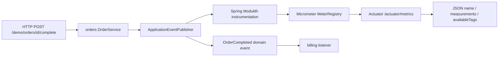

# Đọc module.events.published qua metrics endpoint

## 1. Mục tiêu và bối cảnh thực hành

Trong ứng dụng Spring Boot chia thành nhiều application module, người phát triển thường muốn trả lời những câu hỏi rất cụ thể: *Module nào đang phát sự kiện? Mỗi loại sự kiện đã được phát bao nhiêu lần? Sau một thao tác nghiệp vụ, counter có tăng đúng như dự kiến không?* Spring Modulith cung cấp metric `module.events.published` để quan sát lượt **domain event được phát**, còn Spring Boot Actuator cung cấp HTTP endpoint `/actuator/metrics` để xem những meter đang đăng ký trong ứng dụng.

Bài **Đọc module.events.published qua metrics endpoint** thuộc chương **Thực hành tổng hợp** của học phần **SPRING_MODULITH_DOCUMENTATION_OBSERVABILITY**. Học phần này dùng Spring Modulith để tài liệu hóa ranh giới application module và quan sát tương tác bằng module graph, Actuator, event metrics, tracing và context propagation.

Bài sẽ dẫn dắt từ một ứng dụng mẫu có hai module đến kết quả đọc metric qua HTTP. Bạn không cần dựng Prometheus hoặc hệ thống tracing để hoàn thành mục tiêu chính; chỉ cần một ứng dụng Spring Boot, Spring Modulith observability và Actuator với endpoint metrics được mở trong môi trường thực hành.

**Sau khi hoàn thành, bạn phải làm được:**

1. Tạo một event phát sinh từ module `orders` và phân biệt lượt **publish** với lượt **listener xử lý**.
2. Bật hỗ trợ metrics của Spring Modulith và expose endpoint `/actuator/metrics`.
3. Dùng `GET /actuator/metrics` tìm tên meter, đọc `GET /actuator/metrics/module.events.published` và giải thích `measurements`, `COUNT`, `availableTags`.
4. Lọc metric theo `module.identifier` và `module.event.type` để xem đúng một nhóm sự kiện.
5. Đọc số liệu **trước và sau** một hành động kiểm soát, tính delta, giải thích vì sao counter có thể cao hơn dự đoán.
6. Phân biệt tên Micrometer với tên metric được xuất qua Prometheus; biết cách kiểm tra module graph khi module identifier không đúng kỳ vọng.

> Phạm vi: tập trung vào metric domain event đã **phát**. Để theo dõi event publication registry (`FAILED`, `COMPLETED`, retry), lỗi listener, latency, span hay context propagation, cần các tín hiệu khác và cấu hình bổ sung; `module.events.published` không thay thế chúng.

## 2. Hiểu chính xác metric cần đọc

Theo tài liệu Spring Modulith Production-ready Features, observability hỗ trợ hai nhóm counter:

| Tên meter Micrometer | Đo điều gì? | Mục đích |
|---|---|---|
| `module.events.published` | Tổng lượt domain event được phát, phân nhóm bằng tags | Xem số lượng theo module/loại event |
| `module.events.published.$moduleIdentifier.$simpleEventTypeName` | Lượt phát của một loại event thuộc module cụ thể | Quan sát một event cụ thể và có thể bổ sung tags chuyên biệt |

Các ký hiệu `$moduleIdentifier` và `$simpleEventTypeName` trong dòng thứ hai là **vị trí thay thế**; ví dụ tên có thể là `module.events.published.orders.OrderCompleted`. Không gửi nguyên ký hiệu có dấu `$` lên Actuator.

Counter tổng `module.events.published` có các low-cardinality tag keys do Spring Modulith định nghĩa:

| Tag key | Ý nghĩa | Ví dụ giá trị minh họa |
|---|---|---|
| `module.identifier` | Định danh application module phát event | `orders` |
| `module.name` | Tên hiển thị của module | `Orders` |
| `module.event.type` | Loại event được phát | `OrderCompleted` hoặc tên kiểu khác theo convention thực tế |

**Giá trị của `module.event.type` phải được đọc từ `availableTags` trong ứng dụng đang chạy**, không suy đoán là tên đơn giản hay tên lớp đầy đủ. Spring Modulith có thể được tùy biến bằng `ModulithObservationConvention`, còn common tags của Spring Boot cũng có thể thêm các chiều phân nhóm khác.

Sơ đồ luồng:



Việc listener có chạy thành công hay không là vấn đề riêng. Nếu listener xử lý thất bại sau khi event được phát, counter publish đã tăng vẫn có thể hoàn toàn đúng.

## 3. Chuẩn bị ứng dụng hai module

### 3.1. Bố cục package mẫu

Trong bài, giả sử có một ứng dụng Spring Boot tên `ModulithDemoApplication` và hai application module là `orders` và `billing`:

```text
src/main/java/com/example/modulithdemo/
  ModulithDemoApplication.java
  orders/
    OrderCompleted.java
    OrderService.java
    OrderDemoController.java
  billing/
    BillingListener.java
src/main/resources/
  application.properties
```

Với kiểu phát hiện application module mặc định, các package con trực tiếp dưới package gốc của ứng dụng thường tạo thành module. Ở đây `orders` phát sự kiện và `billing` nhận sự kiện; sự phụ thuộc kiến trúc có thể được quan sát qua Spring Modulith module graph.

### 3.2. Khai báo dependency

Đoạn Gradle minh họa bên trong một dự án **đã cấu hình** Spring Boot plugin và Spring Modulith BOM/dependency management tương thích:

```groovy
dependencies {
    implementation 'org.springframework.boot:spring-boot-starter-web'
    implementation 'org.springframework.modulith:spring-modulith-starter-core'

    // Có actuator và Spring Modulith observability/insight ở runtime.
    runtimeOnly 'org.springframework.modulith:spring-modulith-starter-insight'

    testImplementation 'org.springframework.boot:spring-boot-starter-test'
}
```

Cần dùng một tổ hợp Spring Boot, Spring Framework, Spring Modulith và JDK tương thích được quản lý bằng BOM của dự án. Không chọn ngẫu nhiên số version riêng cho từng artifact. Với Spring Modulith 2.2.0, tài liệu chính thức mô tả `spring-modulith-starter-insight` là cách tiện lợi để kích hoạt cả Actuator module và observability.

Có thể cấu hình thủ công bằng các artifact `spring-modulith-actuator`, `spring-modulith-observability-core` và Spring Boot Actuator thay cho starter, nhưng bài sử dụng starter để giảm số bước. Nếu dự án đã có starter/observability support, chỉ cần kiểm tra dependency thực tế, tránh bổ sung instrumentation tùy biến đếm lại một metric sẵn có.

### 3.3. Cấu hình endpoint cho môi trường thực hành

Trong `src/main/resources/application.properties`:

```properties
spring.application.name=modulith-metrics-lab
management.endpoints.web.exposure.include=health,info,metrics,modulith
```

Giải thích:

- `metrics`: cho phép truy cập `GET /actuator/metrics` và `GET /actuator/metrics/{metricName}`.
- `modulith`: cho phép kiểm tra module graph qua `GET /actuator/modulith` khi có Spring Modulith Actuator/Insight.
- `health,info`: phục vụ kiểm tra cơ bản.

Các endpoint Actuator phải được **expose** và người gọi phải có **quyền truy cập**. Nếu ứng dụng dùng Spring Security hoặc cấu hình management access riêng, có thể cần điều chỉnh quyền trong môi trường lab. Không mở toàn bộ endpoint quản trị ra internet chỉ để kiểm thử. `/actuator/prometheus` là endpoint khác và cần Prometheus registry dependency; bài chính **không đòi** bật nó.

### 3.4. Tạo application class

```java
package com.example.modulithdemo;

import org.springframework.boot.SpringApplication;
import org.springframework.boot.autoconfigure.SpringBootApplication;

@SpringBootApplication
public class ModulithDemoApplication {
    public static void main(String[] args) {
        SpringApplication.run(ModulithDemoApplication.class, args);
    }
}
```

Ứng dụng quét bean dưới `com.example.modulithdemo`, bao gồm hai package module.

## 4. Tạo một domain event có thể đếm được

### 4.1. Định nghĩa `OrderCompleted`

```java
package com.example.modulithdemo.orders;

import java.util.UUID;

public record OrderCompleted(UUID orderId) {}
```

Đặt event trong module `orders` để Spring Modulith có thể quy nó về module phát event. `UUID` ở đây để nhận diện thao tác nghiệp vụ trong log; **không đưa orderId vào tag metric** vì mỗi đơn hàng có giá trị mới và có thể gây high cardinality.

### 4.2. Publisher trong module `orders`

```java
package com.example.modulithdemo.orders;

import java.util.UUID;
import org.springframework.context.ApplicationEventPublisher;
import org.springframework.stereotype.Service;

@Service
public class OrderService {

    private final ApplicationEventPublisher events;

    public OrderService(ApplicationEventPublisher events) {
        this.events = events;
    }

    public void complete(UUID orderId) {
        // Bản lab tối giản: một lời gọi phương thức phát đúng một event.
        events.publishEvent(new OrderCompleted(orderId));
    }
}
```

Trong hệ thống thực, `complete()` thường có `@Transactional`, thay đổi trạng thái đơn hàng và phát sự kiện như một phần quy trình nghiệp vụ. Bài lab giữ service tối giản, không cần database hay transaction manager, vì mục tiêu là **đọc số lượt publish**, không thử event publication registry hoặc retry.

### 4.3. Tạo endpoint kích hoạt đúng một lần publish

```java
package com.example.modulithdemo.orders;

import java.util.UUID;
import org.springframework.http.ResponseEntity;
import org.springframework.web.bind.annotation.PathVariable;
import org.springframework.web.bind.annotation.PostMapping;
import org.springframework.web.bind.annotation.RequestMapping;
import org.springframework.web.bind.annotation.RestController;

@RestController
@RequestMapping("/demo/orders")
public class OrderDemoController {

    private final OrderService orders;

    public OrderDemoController(OrderService orders) {
        this.orders = orders;
    }

    @PostMapping("/{orderId}/complete")
    public ResponseEntity<Void> complete(@PathVariable UUID orderId) {
        orders.complete(orderId);
        return ResponseEntity.noContent().build();
    }
}
```

Một HTTP request hợp lệ đến đường dẫn trên gọi `orders.complete()` một lần, phương thức đó gọi `publishEvent()` một lần. Không thêm retry HTTP hoặc logic phát nhiều sự kiện vào bài lab cơ bản.

### 4.4. Thêm listener trong module `billing`

```java
package com.example.modulithdemo.billing;

import com.example.modulithdemo.orders.OrderCompleted;
import org.slf4j.Logger;
import org.slf4j.LoggerFactory;
import org.springframework.context.event.EventListener;
import org.springframework.stereotype.Component;

@Component
public class BillingListener {

    private static final Logger log =
        LoggerFactory.getLogger(BillingListener.class);

    @EventListener
    public void on(OrderCompleted event) {
        log.info("Billing received OrderCompleted, orderId={}",
                 event.orderId());
    }
}
```

`@EventListener` trong ví dụ là listener đồng bộ để người học dễ xác minh event đã được gửi. Khi thay bằng `@ApplicationModuleListener`, hãy cấu hình transaction manager, async executor và event publication registry nếu muốn kiểm thử transactional delivery/khôi phục. Những thay đổi đó làm bài toán rộng hơn và không cần để đọc metric publish.

Lưu ý: một số sự kiện hạ tầng và framework cũng đi qua Spring `ApplicationEventPublisher`. Khi đối chiếu số liệu, **lọc đúng domain event `OrderCompleted`**, không lấy tổng các loại event khác nhau làm số đơn hàng hoàn tất.

## 5. Chạy ứng dụng và khám phá metrics endpoint

Khởi động bằng công cụ build của dự án:

```bash
./gradlew bootRun
```

Trên PowerShell/Windows, nếu dự án có Gradle Wrapper:

```powershell
.\gradlew.bat bootRun
```

Các lệnh sau dùng `curl` chuẩn. Trong Windows PowerShell 5.1, dùng `curl.exe` thay vì alias `curl` của PowerShell. Người dùng Windows có thể thay `curl` bằng `curl.exe` trong từng lệnh.

### 5.1. Xác minh Actuator đang phản hồi

```bash
curl -i http://localhost:8080/actuator/health
curl -i http://localhost:8080/actuator/metrics
```

Kết quả mong đợi: HTTP thành công (thường 200 nếu được phép truy cập) và body JSON của `/actuator/metrics` có khóa `names`:

```json
{
  "names": [
    "application.ready.time",
    "http.server.requests",
    "jvm.memory.used"
  ]
}
```

JSON là **mẫu rút gọn**, không phải danh sách cố định của mọi hệ thống. Mỗi ứng dụng có số meter khác nhau tùy dependency, hoạt động đã thực hiện và cấu hình.

**Nếu chưa có `module.events.published` trong `names`:** chưa vội kết luận instrumentation lỗi. Nhiều meter được đăng ký khi có hoạt động thực tế. Hãy phát một domain event trước, rồi gọi lại endpoint.

### 5.2. Phát một sự kiện thử

```bash
curl -i -X POST \
  http://localhost:8080/demo/orders/123e4567-e89b-42d3-a456-426614174000/complete
```

Với ví dụ, mong đợi `HTTP 204 No Content`. Log sẽ có `Billing received OrderCompleted`; điều này cho biết listener đồng bộ đã được gọi.

Lặp lại `GET /actuator/metrics` để tìm các tên bắt đầu bằng `module.events.published`:

```bash
curl -sS http://localhost:8080/actuator/metrics
```

Tùy phiên bản/cấu hình, bạn có thể thấy:

```json
{
  "names": [
    "module.events.published",
    "module.events.published.orders.OrderCompleted"
  ]
}
```

Ví dụ trên chỉ hiển thị hai tên liên quan, nhằm minh họa; danh sách thật sẽ dài hơn. Nếu version hoặc convention tạo tên khác, **dùng tên thực tế tìm thấy**, tránh hard-code tên không tồn tại.

## 6. Đọc `module.events.published` và giải thích JSON

### 6.1. Gọi metric cụ thể

```bash
curl -i http://localhost:8080/actuator/metrics/module.events.published
```

Ví dụ response minh họa sau khi phát một event:

```json
{
  "name": "module.events.published",
  "description": "Published application module events",
  "baseUnit": null,
  "measurements": [
    {
      "statistic": "COUNT",
      "value": 1.0
    }
  ],
  "availableTags": [
    {
      "tag": "module.event.type",
      "values": ["com.example.modulithdemo.orders.OrderCompleted"]
    },
    {
      "tag": "module.identifier",
      "values": ["orders"]
    },
    {
      "tag": "module.name",
      "values": ["Orders"]
    }
  ]
}
```

**Đây là response giả lập để học cách đọc**, không phải dữ liệu đã chạy và không cam kết `description` hay biểu diễn `module.event.type` giống mọi phiên bản. Những phần cần quan tâm:

| Trường JSON | Ý nghĩa |
|---|---|
| `name` | Tên meter Micrometer mà Actuator đang truy vấn |
| `description` | Diễn giải metric, có thể null hoặc thay đổi |
| `baseUnit` | Đơn vị cơ sở; với Counter thường không cần đơn vị |
| `measurements[]` | Các thống kê của meter, ví dụ `COUNT` |
| `measurements[].statistic` | Loại thống kê (`COUNT` với Counter) |
| `measurements[].value` | Giá trị số của thống kê ở thời điểm đọc |
| `availableTags[]` | Các chiều tag và giá trị còn có thể chọn để lọc dữ liệu |

Điểm cần hiểu: `measurements[].value=1` là giá trị **tích lũy trong instance/registry hiện tại**, không phải tốc độ “1 sự kiện mỗi giây” và cũng không chứng minh listener đã hoàn tất nghiệp vụ.

### 6.2. Vì sao COUNT có thể lớn hơn 1?

Ngay khi endpoint chưa có filter, Actuator tổng hợp các meter cùng tên khớp điều kiện hiện tại. Nếu module `orders` đã phát hai `OrderCompleted` và module `customers` phát một `CustomerCreated`, truy vấn tổng có thể trả `COUNT=3`. Điều đó không nhất thiết là lỗi.

Trong Spring Boot, HTTP metrics endpoint báo số đo tổng hợp từ các meter cùng tên và cùng tập điều kiện tag lọc. Nếu muốn phân loại chính xác, dùng tham số `tag=KEY:VALUE`.

### 6.3. Đọc và lọc theo `module.identifier`

Sau khi xác nhận `availableTags` chứa `module.identifier=orders`:

```bash
curl -sS "http://localhost:8080/actuator/metrics/module.events.published?tag=module.identifier:orders"
```

Kết quả sẽ chỉ tổng hợp các event thuộc module `orders` theo giá trị tag đó. Nếu `orders` phát nhiều loại event, kết quả vẫn là **tổng tất cả loại event** trong module đó.

### 6.4. Lọc tiếp theo `module.event.type`

Giả sử `availableTags` thực tế hiển thị `module.event.type=com.example.modulithdemo.orders.OrderCompleted`, sử dụng hai tham số tag:

```bash
curl -sS -G \
  --data-urlencode "tag=module.identifier:orders" \
  --data-urlencode "tag=module.event.type:com.example.modulithdemo.orders.OrderCompleted" \
  "http://localhost:8080/actuator/metrics/module.events.published"
```

Ở đây `-G` đặt các tham số vào query string, `--data-urlencode` bảo đảm giá trị được mã hóa đúng. Nếu `availableTags` của môi trường bạn dùng giá trị khác, thay đúng giá trị được trả về. Mỗi tham số `tag` bổ sung một điều kiện lọc; không thay tất cả thành một chuỗi tag.

Điểm quan trọng: hãy xem **giá trị COUNT sau khi lọc**. Các tag đã chọn có thể không còn xuất hiện trong `availableTags` vì không còn lựa chọn phân nhóm tiếp theo; điều đó là hành vi hợp lệ.

### 6.5. Đọc counter chuyên biệt

Nếu `GET /actuator/metrics` có tên `module.events.published.orders.OrderCompleted`, bạn có thể xem:

```bash
curl -sS \
  http://localhost:8080/actuator/metrics/module.events.published.orders.OrderCompleted
```

Tên đó chứa module identifier và simple event type, nên đây là một counter **khác** với counter tổng. Spring Modulith cung cấp cả hai góc nhìn về cùng hoạt động publish; **không cộng COUNT của hai meter để suy ra số event**, vì sẽ đếm cùng hành động hai lần.

Counter chuyên biệt có thể được mở rộng tag qua `ModulithEventMetricsCustomizer`, nhưng không cần customizer cho bài đọc counter tổng.

## 7. Đọc delta trước và sau một lượt publish

Một bài thực hành tốt không chỉ chụp ảnh một con số. Nó chứng minh **một hành động kiểm soát dẫn đến một thay đổi đo được**.

### 7.1. Quy trình thủ công

Giả sử chỉ có một instance, không có background job phát `OrderCompleted` và request HTTP không bị gửi lặp:

1. Gọi metric đã lọc theo `module.identifier=orders` và `module.event.type` đúng với `OrderCompleted`. Ghi giá trị `COUNT_before`.
2. Gửi đúng **một** `POST /demo/orders/{orderId}/complete` với một UUID mới.
3. Gọi lại **chính metric với cùng bộ lọc**. Ghi `COUNT_after`.
4. Tính `delta = COUNT_after - COUNT_before` và so với số lời gọi `publishEvent()` thực tế.

```text
Trước:
  module.events.published{module.identifier=orders,
    module.event.type=OrderCompleted} = 7

Thực hiện:
  POST /demo/orders/<uuid>/complete -> HTTP 204

Sau:
  module.events.published{cùng bộ lọc} = 8

delta = 8 - 7 = 1
```

Số liệu trên chỉ là ví dụ. Với ứng dụng thực tế, giá trị tag `module.event.type` có thể là tên lớp đầy đủ; tên hiển thị giản lược trong khối text chỉ để minh họa phép tính.

### 7.2. Phép tính đúng cần những giả định nào?

| Giả định | Nếu không đúng |
|---|---|
| Đọc trước/sau từ cùng instance hoặc cùng registry | Counter có thể reset hoặc lấy từ pod khác |
| Không có publish khác xen giữa trên cùng bộ tags | Delta lớn hơn 1 nhưng không phải do request đang kiểm thử |
| POST chỉ gọi `publishEvent()` một lần | Event count tăng theo số lần phát thực tế |
| Không có HTTP retry từ client/proxy | Một thao tác người dùng có thể trở thành nhiều request |
| Meter đã tồn tại hoặc xử lý trạng thái chưa có meter hợp lý | Trước khi phát sự kiện, endpoint có thể trả 404 |
| Đọc đúng tag `module.event.type` | Có thể vô tình gộp nhiều loại event |

**Nếu endpoint metric chưa tồn tại ở thời điểm “trước”:** trong một test kiểm soát có thể xem baseline là 0, sau đó phát event và đọc meter vừa tạo. Nhưng trong production, 404 có thể còn do không có instrumentation/endpoint; phải phân biệt hai nguyên nhân trước khi kết luận.

### 7.3. Counter tăng có chứng minh nghiệp vụ thành công?

Không. `module.events.published` đo việc domain event được phát. Nó không xác nhận listener đã commit transaction, không đảm bảo tất cả subscriber xử lý thành công, và không phải số event “đã gửi đi broker”. Với Spring Modulith Event Publication Registry (khi đã cấu hình bền vững), một event có thể còn publication `FAILED` dù counter publish đã tăng.

Một event được phát một lần cho hai listener thì counter publish tăng theo số lần **phát**, không tự cộng hai chỉ vì có hai listener. Nếu listener lỗi và registry retry **lượt xử lý**, điều đó không nhất thiết tạo thêm một lượt phát domain event mới. Chỉ khi nghiệp vụ thực sự publish lại mới cần đếm thêm.

## 8. Phân biệt Actuator metrics với Prometheus và tracing

### 8.1. Metrics endpoint là công cụ chẩn đoán

Spring Boot mô tả `/actuator/metrics` là endpoint phục vụ kiểm tra meter hiện có, tag và tác động của một hành động kiểm soát. Không nên dùng nó làm nguồn scrape liên tục ở production.

Nếu cần dashboard/alert dài hạn, ứng dụng thường xuất metrics sang Prometheus hoặc một backend khác. Cần bổ sung registry phù hợp, ví dụ với Prometheus:

```groovy
dependencies {
    runtimeOnly 'io.micrometer:micrometer-registry-prometheus'
}
```

Và expose endpoint `prometheus` trong môi trường quản trị:

```properties
management.endpoints.web.exposure.include=health,info,metrics,modulith,prometheus
```

Sau đó có thể kiểm tra raw exporter:

```bash
curl -sS http://localhost:8080/actuator/prometheus
```

Đừng gửi `/actuator/metrics/module.events.published` trực tiếp cho Prometheus làm endpoint scrape thay cho `/actuator/prometheus`.

### 8.2. Tên và loại thống kê có thể khác nhau sau exporter

| Môi trường | Ví dụ minh họa |
|---|---|
| Micrometer/Actuator `/actuator/metrics` | `module.events.published` |
| Prometheus exporter | Có thể là `module_events_published_total` |
| Actuator thống kê | `measurements: [{statistic: COUNT, value: ...}]` |
| Prometheus sample | Một counter series, có labels đã chuẩn hóa |

**Không dùng tên Prometheus đã chuẩn hóa** như `module_events_published_total` trong URL `/actuator/metrics/{metric.name}`; Actuator dùng tên Micrometer gốc.

Nếu exporter tạo tên/labels khác theo version hoặc cấu hình, đọc raw output rồi mới xây query. Khi làm dashboard nhiều module, lọc theo nhãn thật như module identifier/event type và quy tắc mapping exporter. Ví dụ PromQL dưới đây chỉ dùng khi raw output xác nhận có series và labels tương ứng:

```promql
sum by (module_identifier) (
  rate(module_events_published_total[5m])
)
```

`rate` là tốc độ trung bình theo giây, khác với COUNT tích lũy hiển thị ở Actuator. Ở hệ thống ít event, dùng `increase(...[10m])` cũng có thể hữu ích; cần chú ý counter reset khi ứng dụng khởi động lại.

### 8.3. Trace và module graph có vai trò riêng

- `GET /actuator/modulith`: cho biết module và quan hệ phụ thuộc kiến trúc. Nếu module `orders` không nằm trong graph, kiểm tra cách đặt package và module detection.
- Module entry spans: giúp nhìn thấy tương tác runtime qua API/listener. Cần tracing bridge, exporter và context propagation nếu chạy `@Async`; chưa bật exporter có thể không thấy span ở backend.
- Event publication registry: theo dõi publication cho các listener và khả năng phục hồi; là nguồn dữ liệu khác với counter publish.

Do đó bài thực hành **không yêu cầu** trace ID hay span status để xác nhận `module.events.published`. Sự có mặt của meter không chứng minh trace đã được cấu hình.

## 9. Tự động kiểm chứng metric bằng integration test

Một kiểm thử hồi quy hữu ích là kiểm tra delta counter khi service phát một event. Nó tránh gắn kỳ vọng vào giá trị COUNT tuyệt đối có thể đã được ghi bởi test khác.

Dưới đây là khung `@SpringBootTest`. Nó giả định app `ModulithDemoApplication` có cấu hình runtime Spring Modulith Insight đang hoạt động và Spring Boot cung cấp `MeterRegistry` thực sự nhận metric. Trước khi áp dụng, bảo đảm dependencies observability được nạp trong profile test.

```java
package com.example.modulithdemo;

import static org.junit.jupiter.api.Assertions.assertEquals;

import com.example.modulithdemo.orders.OrderService;
import io.micrometer.core.instrument.Counter;
import io.micrometer.core.instrument.MeterRegistry;
import java.util.UUID;
import org.junit.jupiter.api.Test;
import org.springframework.beans.factory.annotation.Autowired;
import org.springframework.boot.test.context.SpringBootTest;

@SpringBootTest
class PublishedEventMetricTest {

    @Autowired OrderService orderService;
    @Autowired MeterRegistry meterRegistry;

    @Test
    void publishingOneOrderEventIncrementsCounterOnce() {
        double before = publishedOrders();

        orderService.complete(UUID.randomUUID());

        double after = publishedOrders();
        assertEquals(1.0, after - before, 0.00001);
    }

    private double publishedOrders() {
        return meterRegistry.getMeters().stream()
            .filter(m -> m instanceof Counter)
            .filter(m -> "module.events.published"
                .equals(m.getId().getName()))
            .filter(m -> "orders"
                .equals(m.getId().getTag("module.identifier")))
            .filter(m -> {
                String type = m.getId().getTag("module.event.type");
                return type != null && type.endsWith("OrderCompleted");
            })
            .mapToDouble(m -> ((Counter) m).count())
            .sum();
    }
}
```

**Giải thích lựa chọn:**

- Trước event đầu tiên, meter có thể chưa tồn tại. Hàm `publishedOrders()` trả 0 khi không có meter khớp.
- Lọc theo tên Micrometer gốc và module `orders`, rồi kiểm tra event type kết thúc bằng `OrderCompleted` để minh họa cách xử lý đơn giản/full-qualified type. Trong dự án thực, nên so đúng **giá trị tag đã xác minh** để tránh khớp nhầm một lớp khác trùng tên.
- Kiểm thử giả định không có luồng test khác phát cùng loại event vào registry trong cùng thời điểm. Nếu chạy test song song, cần cách ly context hoặc chọn mô hình event/test registry riêng.
- Đo `Counter.count()` là kiểm tra trực tiếp trong process. Nếu mục tiêu là kiểm thử toàn bộ HTTP serialization, thêm bài test gọi `/actuator/metrics/module.events.published` và assert response JSON, với Actuator được expose/cho phép truy cập trong môi trường test.

Nếu Spring Modulith observation chưa được kích hoạt trong test, bài test trên có thể thất bại dù `OrderService` vẫn phát sự kiện bình thường. Điều này là tín hiệu cần kiểm tra starter, runtime/test classpath và auto-configuration; không nên tạo một counter thủ công cùng tên chỉ để làm test pass.

## 10. Chẩn đoán khi đọc metric không như kỳ vọng

### 10.1. Trả HTTP 404 khi gọi `/actuator/metrics`

Kiểm tra:

1. Spring Boot Actuator có trên runtime classpath.
2. `management.endpoints.web.exposure.include` có chứa `metrics`.
3. Management port và base path có bị thay đổi không, ví dụ `management.server.port` hoặc `management.endpoints.web.base-path`.
4. Endpoint có bị tắt bằng access/configuration riêng theo phiên bản Spring Boot không.
5. URL path đúng: `/actuator/metrics`, không phải `/metrics` trừ khi base path được thay đổi.

Nếu HTTP 401/403, đó là vấn đề quyền truy cập; dùng tài khoản/role được cấp trong môi trường nội bộ, không tắt security của production để chẩn đoán.

### 10.2. `/actuator/metrics` hoạt động nhưng không thấy `module.events.published`

Kiểm tra theo thứ tự:

- Starter `spring-modulith-starter-insight` hoặc Modulith observability support có thực sự trên runtime classpath.
- Spring Modulith có phát hiện package `orders` là application module hay không (xem `/actuator/modulith`).
- Đã phát một domain event **sau khi ứng dụng khởi động** hay chưa; meter có thể được tạo lười.
- Event có thuộc application module mà instrumentation theo dõi không; package của loại event có nằm đúng vị trí không.
- Có `MeterFilter` hoặc cấu hình `management.metrics.enable` nào vô hiệu hóa metric không.
- Phiên bản Spring Modulith/Boot có tương thích và naming convention có thay đổi không.
- Có custom `ModulithObservationConvention` làm đổi tên/metadata metric không.

Không tự tạo `Counter("module.events.published")` ngay lập tức: như vậy có thể tạo một meter “giả” che việc Spring Modulith chưa instrument event.

### 10.3. Meter tồn tại nhưng COUNT không tăng

Nếu đã kiểm tra request HTTP thực sự đến controller và `OrderService.complete()` gọi `publishEvent()` một lần, xem log listener, bean `ApplicationEventPublisher`, thời điểm đọc và tag filter. Nếu lệnh lọc dùng `module.event.type=OrderCompleted` nhưng runtime hiển thị tên lớp đầy đủ, phép lọc sẽ không tìm đúng meter.

Hãy gọi metric **không filter** trước, rồi so `availableTags` và thêm từng tag một. Ngoài ra nếu request rơi vào instance A nhưng metric đọc từ instance B sau load balancer, hai lần đọc có thể khác nhau; khi thử delta, luôn cố định instance.

### 10.4. COUNT tăng hai hoặc nhiều đơn vị sau một POST

Có thể do:

- HTTP client/proxy gửi request lặp; endpoint bị gọi nhiều lần.
- Service phát nhiều event hoặc có aspect/custom listener phát lại.
- Có background task khác phát cùng event type.
- Custom instrumentation tự tăng counter cùng ý nghĩa với Spring Modulith.
- Bạn đang xem count **không lọc theo event type**, nên nhiều loại event được cộng.
- Dashboard Prometheus tổng hợp hai scrape targets của cùng một instance; trường hợp này giá trị Actuator trong ứng dụng có thể vẫn đúng.

Dùng log theo `orderId` để kiểm chứng số lần thực sự gọi `publishEvent()`. Đọc delta tại Actuator **trước** rồi mới kiểm tra exporter/backend. Spring Modulith có cả counter tổng và counter chuyên biệt; không cộng hai nhóm vào một “tổng sự kiện”.

### 10.5. Metric biến mất sau khi restart

Counter chỉ lưu số tích lũy trong vòng đời của registry/process, không phải cơ sở dữ liệu sự kiện vĩnh viễn. Sau restart, Counter có thể về 0 hoặc chưa xuất hiện cho đến lần publish mới; đây là hành vi bình thường. Nếu cần lịch sử lâu dài và các biểu đồ qua restart, dùng metrics backend có lưu time series và query `rate`/`increase` xử lý counter reset.

### 10.6. `availableTags` không có đủ tag mong đợi

Nếu bạn đã filter theo `module.identifier=orders`, Actuator có thể chỉ hiển thị **những tag còn có khả năng drill-down**; tag đã lọc không cần được lặp lại. Nếu không filter mà vẫn thiếu `module.event.type`, kiểm tra đúng tên meter: counter chuyên biệt không có cùng danh sách tags với counter tổng. Ngoài ra, version và convention tùy chỉnh có thể tạo các tag khác nhau.

### 10.7. Số event đã phát khác số listener hoàn tất

Đây thường không phải lỗi metric. Một event có thể có nhiều listener; listener có thể lỗi, retry hoặc bị bỏ qua; metric `module.events.published` không đại diện cho `COMPLETED` trong Event Publication Registry. Muốn quan sát listener failures/retry, cần metrics/registry riêng và đối chiếu log, tracing.

## 11. Ma trận kiểm thử cho bài thực hành

| Trường hợp | Thao tác | Kết quả mong đợi |
|---|---|---|
| 1. Khởi động ứng dụng | `GET /actuator/health` | Ứng dụng sẵn sàng, truy cập theo đúng quyền |
| 2. Kiểm tra endpoint | `GET /actuator/metrics` | JSON có `names` |
| 3. Tạo event đầu tiên | POST complete một UUID mới | Có event `OrderCompleted`, listener nhận event |
| 4. Đọc counter tổng | `GET /actuator/metrics/module.events.published` | `measurements` có `COUNT` khi meter được tạo |
| 5. Xem tags | Đọc `availableTags` | Biết module và loại event thực tế |
| 6. Lọc module | `?tag=module.identifier:orders` | Chỉ thống kê event phát từ module `orders` |
| 7. Lọc event | Thêm `tag=module.event.type:<giá trị thực>` | COUNT của đúng loại `OrderCompleted` |
| 8. Đếm delta | Đọc trước, POST một lần, đọc sau | Delta bằng 1 khi không có publish khác |
| 9. Kiểm tra counter chuyên biệt | Lấy tên có suffix từ `/actuator/metrics` | Hiểu đó là góc nhìn riêng của cùng event |
| 10. Sai tag | Dùng giá trị không tồn tại | Truy vấn không khớp hoặc không có meter, không kết luận mất instrumentation |
| 11. Restart | Khởi động lại app rồi đọc | Counter có thể reset/chưa tồn tại đến event mới |
| 12. So module graph | `GET /actuator/modulith` | Có module `orders` và `billing` nếu discovery đúng |
| 13. Tracing tùy chọn | Bật bridge/exporter rồi phát event | Có thể quan sát module spans, độc lập với COUNT |
| 14. Listener thất bại (mở rộng) | Cố ý làm lỗi listener trong môi trường phù hợp | Phân biệt published count với trạng thái xử lý/registry |

Không chạy case listener thất bại bằng ví dụ `@EventListener` đồng bộ trong môi trường lab nếu điều đó làm HTTP request thất bại ngoài dự kiến; muốn mô phỏng lỗi bất đồng bộ cần xây dựng riêng transaction, executor và event publication registry.

## 12. Bài tập mở rộng theo kiến trúc mô-đun

**Bài 1 – Thêm loại event:** Định nghĩa `OrderCancelled` trong `orders`, phát riêng khi gọi một endpoint khác. Kiểm tra tổng `module.events.published` và filter `module.event.type` để thấy cùng module có hai loại event. Giải thích tại sao tổng bằng tổng số lần publish của từng event type khi không có hoạt động khác chen vào.

**Bài 2 – Thêm module:** Tạo module `customers`, phát `CustomerRegistered`. Đọc `availableTags`, lọc theo `module.identifier` và xác minh module graph. Sự phân loại có phản ánh package/module detection thực tế không?

**Bài 3 – Xuất Prometheus:** Thêm `micrometer-registry-prometheus`, bật `/actuator/prometheus` trong lab, kiểm tra tên series/labels. Viết một PromQL tính `rate` theo module, so với delta thủ công trong khoảng thời gian có event.

**Bài 4 – Kết hợp tracing:** Thêm Micrometer Tracing bridge và exporter phù hợp, bật observability cho module API. So module entry span với `module.events.published`: span đo lượt tương tác với module, counter đo event publish; hai số không bắt buộc bằng nhau.

**Bài 5 – Context propagation:** Thay listener đồng bộ bằng `@ApplicationModuleListener` trong một ứng dụng đã có transaction manager và publication repository. Cấu hình executor và context propagation, kiểm tra trace khi xử lý bất đồng bộ, sau đó so lỗi listener với counter publish. Lưu ý retry có thể tạo trace mới; liên kết qua event ID bền vững.

**Bài 6 – Phòng tránh instrument trùng:** Thêm một `Counter` custom cùng tên/tags với `module.events.published` rồi quan sát delta thay đổi. Gỡ counter tự viết; ghi lại bằng chứng rằng nhiều lời gọi `increment()` vào cùng `Meter.Id` vẫn có thể đếm trùng. Chỉ thực hiện trong ứng dụng lab.

## 13. Bằng chứng nghiệm thu

Lưu một bảng kết quả cho lần thực hành:

```text
Ứng dụng: modulith-metrics-lab
Spring Boot / Spring Modulith: <resolved versions>
Module phát: orders
Loại event: <giá trị module.event.type lấy từ availableTags>
Metric name tại Actuator: module.events.published
Bộ lọc: module.identifier=orders; module.event.type=<giá trị thực>

COUNT trước: ...
HTTP POST: 204 / lỗi ...
COUNT sau: ...
Delta: ...
Log listener: ...
Tên counter chuyên biệt: ...
Module graph: ...
Giải thích được COUNT != số listener COMPLETED: PASS / FAIL
```

Đây là mẫu ghi chép, không phải kết quả đã chạy. Bài đạt yêu cầu khi người học chứng minh được một lần phát `OrderCompleted` làm counter tương ứng tăng đúng 1 trong điều kiện kiểm soát; đọc được tags từ JSON thật; biết cách lọc nhiều tags; phân biệt counter tổng và counter chuyên biệt; có thể lần theo triệu chứng 404, thiếu meter hoặc delta sai bằng bằng chứng Actuator.

## 14. Tài liệu chính thức để đối chiếu

- [Spring Modulith – Production-ready Features](https://docs.spring.io/spring-modulith/reference/production-ready.html): `spring-modulith-starter-insight`, `/actuator/modulith`, `module.events.published`, low-cardinality tags và counter chuyên biệt.
- [Spring Boot – Metrics](https://docs.spring.io/spring-boot/reference/actuator/metrics.html): cách expose metrics endpoint, đọc meter name gốc, dùng tham số `tag=KEY:VALUE` và hiểu phép tổng hợp measurements.
- [Spring Boot – Actuator Metrics REST API](https://docs.spring.io/spring-boot/api/rest/actuator/metrics.html): cấu trúc `names`, `measurements`, `availableTags` và truy vấn drill-down.
- [Spring Boot – Actuator Endpoints](https://docs.spring.io/spring-boot/reference/actuator/endpoints.html): cấu hình expose, access và bảo vệ endpoint quản trị.
- [Micrometer – Counters](https://docs.micrometer.io/micrometer/reference/concepts/counters.html): `Counter.count()`, số đếm tích lũy và `rate`.
- [Spring Modulith – Working with Application Events](https://docs.spring.io/spring-modulith/reference/events.html): `@ApplicationModuleListener`, publication registry và phân biệt publish với lifecycle xử lý.
- [Prometheus – Query Functions](https://prometheus.io/docs/prometheus/latest/querying/functions/): `rate`, `increase` và cách xử lý counter reset.

Tại thời điểm áp dụng trong dự án của bạn, hãy xác minh **tổ hợp version** của Spring Boot và Spring Modulith cùng response thực tế từ Actuator. Những đoạn JSON và tên series trong bài chỉ là minh họa cho quy trình chẩn đoán; kết luận phải dựa trên meter đang được ứng dụng xuất ra.
