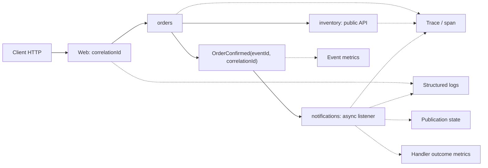
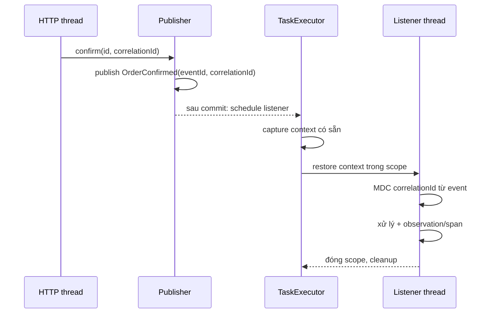
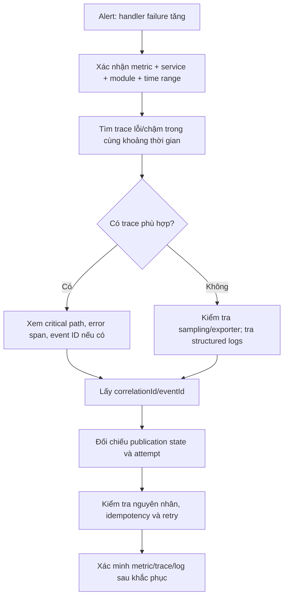

# Liên kết log, metric và trace bằng correlation id

Khi một người dùng xác nhận đơn hàng trong ứng dụng Spring Boot có nhiều **application module**, yêu cầu có thể đi từ `orders` sang `inventory`, phát `OrderConfirmed` và kích hoạt `notifications` ở thread khác. Đội vận hành cần trả lời: “Tại sao đơn này chưa có thông báo?”, “Độ trễ tăng ở module nào?” và “Một lần retry đã tạo thêm tác dụng phụ hay chưa?”. Chỉ nhìn vào mã HTTP hoặc một dòng log riêng lẻ không đủ để nối các sự kiện này.

Bài **Thực hành tổng hợp** thuộc **Spring Modulith Documentation & Observability** xây dựng cách **liên kết log, metric và trace bằng correlation ID**. Người học sẽ tổ chức ranh giới module, phát event có định danh bền, gắn correlation ID vào log, truyền tracing context qua xử lý bất đồng bộ, dùng Actuator/Micrometer để quan sát tổng hợp và kiểm chứng mối liên hệ bằng một ca lỗi thật. Ví dụ chạy trong **một ứng dụng Spring Boot**, không yêu cầu tách thành microservices.

> **Nguyên tắc:** Correlation ID giúp *tìm các dấu vết cùng một nghiệp vụ*. Metric phục vụ *thống kê tổng hợp*, nên **không đưa correlation ID vào nhãn metric**. Trace ID phục vụ *theo dõi một đường thực thi*; một nghiệp vụ có thể trải qua nhiều trace, nhất là khi event được retry hoặc phát lại sau restart.

## 1. Kết quả học tập và phạm vi thực hành

Sau bài này, người học có thể:

1. Tạo hoặc xác nhận `X-Correlation-ID` tại ranh giới HTTP, đưa giá trị đã kiểm tra vào MDC và phản hồi.
2. Truyền correlation ID vào **event contract** của `orders`, thay vì chỉ phụ thuộc `ThreadLocal` của request.
3. Kết nối log của publisher và listener, phân biệt `correlationId`, `eventId`, `traceId` và `spanId`.
4. Xem một trace của `HTTP → orders → inventory` và tìm listener bất đồng bộ khi có context propagation; vẫn điều tra được khi trace bị sampling hoặc sau restart.
5. Đối chiếu `module.events.published`, metric xử lý listener và trạng thái Event Publication Registry mà không đếm trùng.
6. Chạy một bộ ca thử end-to-end chứng minh log, metrics và trace hỗ trợ **cùng câu hỏi điều tra**, đồng thời không lộ dữ liệu nhạy cảm hoặc tạo cardinality quá lớn.

Các đoạn mã bên dưới là **khung ứng dụng thực hành**; để chạy cần có implementation repository, notification sender, database, Spring Boot/Spring Modulith và tracing backend tương thích. Những kết quả bảng biểu được để trống cho môi trường thử nghiệm, không phải số liệu đã đo.

## 2. Phân biệt các định danh được dùng trong điều tra

| Định danh | Ai tạo? | Phạm vi và vòng đời | Nơi nên dùng |
| --- | --- | --- | --- |
| `correlationId` | Ranh giới tin cậy của ứng dụng hoặc hệ thống upstream | Một hành trình nghiệp vụ; có thể trải qua nhiều request/event/trace | Log có cấu trúc, event metadata, truy vấn điều tra |
| `eventId` | Publisher khi tạo một event | Ổn định qua các attempt xử lý cùng event | Event contract, publication record, idempotency/audit |
| `traceId` | Tracer hoặc hệ thống upstream theo chuẩn trace context | Một distributed trace; có thể thay đổi khi replay | Span, trace backend, log correlation |
| `spanId` | Tracer | Một đoạn công việc trong trace | Trace backend và log |
| `orderId` | Nghiệp vụ đơn hàng | Dài hạn | Database/API; chỉ dùng có kiểm soát trong telemetry |
| `attempt` | Bộ điều phối retry/handler | Mỗi lần thử thực thi một event | Log và metadata sự kiện; metric chỉ tổng hợp |

**Correlation ID không phải bằng chứng xác thực hay phân quyền.** Nếu nhận ID từ HTTP header do client cung cấp, phải kiểm tra định dạng, độ dài và phạm vi tin cậy; client có thể tự chọn giá trị trùng với người khác. Với luồng cần bảo đảm tính duy nhất nội bộ, có thể **luôn tạo ID mới ở biên tin cậy** và chỉ giữ mã upstream trong trường riêng đã được kiểm soát.

**Không dùng `traceId` làm khóa idempotency của event.** Một event có thể được gửi lại sau thời gian dài và có trace mới. Nếu hai lần xử lý có cùng `eventId` nhưng khác `traceId`, chúng vẫn có thể là hai attempt của cùng một event.

## 3. Kiến trúc ứng dụng mẫu

Ứng dụng `shop` có ba module, với lời gọi đồng bộ từ `orders` tới public API `inventory`, và luồng event từ `orders` tới `notifications`:

```text
com.acme.shop
├── ShopApplication.java
├── web
│   ├── CorrelationIdFilter.java
│   └── OrderController.java
├── orders
│   ├── OrderConfirmed.java
│   ├── OrderService.java
│   └── internal
│       └── OrderStatePort.java
├── inventory
│   ├── InventoryOperations.java
│   └── internal
│       └── InventoryService.java
└── notifications
    └── internal
        ├── OrderConfirmationListener.java
        └── NotificationSender.java
```

**Lưu ý về package:** Theo mô hình mặc định của Spring Modulith, các package con trực tiếp bên dưới package gốc ứng dụng có thể được xem là application module. Vì vậy `web` trong ví dụ cũng có thể được nhận diện thành một module; trong dự án thật, hãy chọn cách tổ chức controller/adapters và quy tắc phát hiện module phù hợp rồi **kiểm tra bằng `ApplicationModules`**. Các kiểu sự kiện đặt ở public API của `orders`, tránh để `notifications` import `orders.internal`.



Trong sơ đồ, `orders → notifications` thể hiện **dòng sự kiện nghiệp vụ**. Ở đồ thị phụ thuộc Java tĩnh, `notifications` có thể phụ thuộc vào public event type của `orders`, nên chiều cạnh do `Documenter` sinh có thể ngược lại. **Graph tĩnh và trace runtime là hai bằng chứng khác nhau.**

## 4. Chuẩn bị hạ tầng observability

Sử dụng BOM/phiên bản Spring Boot và Spring Modulith **tương thích**. Ví dụ nhóm dependency cho ứng dụng dùng Actuator, OpenTelemetry và Prometheus:

```xml
<dependencies>
    <!-- Chọn starter Modulith có observability phù hợp với release. -->
    <dependency>
        <groupId>org.springframework.modulith</groupId>
        <artifactId>spring-modulith-starter-insight</artifactId>
    </dependency>

    <dependency>
        <groupId>io.micrometer</groupId>
        <artifactId>micrometer-tracing-bridge-otel</artifactId>
    </dependency>
    <dependency>
        <groupId>io.opentelemetry</groupId>
        <artifactId>opentelemetry-exporter-otlp</artifactId>
    </dependency>
    <dependency>
        <groupId>io.micrometer</groupId>
        <artifactId>micrometer-registry-prometheus</artifactId>
    </dependency>
</dependencies>
```

Ví dụ này dùng `spring-modulith-starter-insight` để gom các thành phần production-ready ở dòng hỗ trợ starter đó; nếu dùng release khác, chọn **starter/artifact thực có của phiên bản tương ứng** và bổ sung `spring-boot-starter-actuator` hoặc thành phần observability cần thiết. Không tự ghép các artifact thuộc những dòng Spring Modulith khác nhau. Dự án có thể dùng **Brave** thay vì OpenTelemetry; chỉ cấu hình một tracing bridge phù hợp.

Ví dụ `application.yml` cho lab:

```yaml
management:
  tracing:
    sampling:
      probability: 1.0
  otlp:
    tracing:
      endpoint: http://localhost:4318/v1/traces
  endpoints:
    web:
      exposure:
        include: health,info,metrics,prometheus

logging:
  pattern:
    level: "%5p [cid:%X{correlationId:-},trace:%X{traceId:-},span:%X{spanId:-}]"
```

Property exporter phụ thuộc phiên bản Spring Boot; kiểm tra tài liệu phiên bản và log khởi động để biết exporter có hoạt động. `probability: 1.0` phù hợp **môi trường thực hành lưu lượng ít**; production cần sampling policy và ngân sách chi phí riêng. `/actuator/prometheus` cần Prometheus registry và endpoint được enable/expose. Quản lý quyền truy cập management endpoints, không phơi mọi endpoint công khai chỉ để chạy bài.

Trong Spring Boot hiện đại, tracing bridge có thể tự bổ sung `traceId`/`spanId` vào MDC khi span hiện hành. Cấu hình pattern minh họa cách hiển thị chúng **cùng `correlationId`**. Nếu dự án đã có structured JSON logging, nên bổ sung các field vào schema JSON hiện hữu thay vì tạo hai dòng log cho mỗi request.

## 5. Tạo correlation ID ở ranh giới HTTP

Đối với Servlet-based Spring MVC, đặt một `OncePerRequestFilter` trước controller. Filter nhận `X-Correlation-ID` có định dạng hợp lệ hoặc tạo UUID mới, gắn ID vào request attribute, response header và MDC **trong scope của request**:

```java
package com.acme.shop.web;

import jakarta.servlet.FilterChain;
import jakarta.servlet.ServletException;
import jakarta.servlet.http.HttpServletRequest;
import jakarta.servlet.http.HttpServletResponse;
import java.io.IOException;
import java.util.UUID;
import java.util.regex.Pattern;
import org.slf4j.MDC;
import org.springframework.stereotype.Component;
import org.springframework.web.filter.OncePerRequestFilter;

@Component
public class CorrelationIdFilter extends OncePerRequestFilter {
    public static final String HEADER = "X-Correlation-ID";
    public static final String ATTRIBUTE = "correlationId";
    private static final Pattern SAFE_ID =
            Pattern.compile("[A-Za-z0-9_-]{8,64}");

    @Override
    protected void doFilterInternal(
            HttpServletRequest request,
            HttpServletResponse response,
            FilterChain chain)
            throws ServletException, IOException {

        String incoming = request.getHeader(HEADER);
        String id = incoming != null && SAFE_ID.matcher(incoming).matches()
                ? incoming : UUID.randomUUID().toString();

        request.setAttribute(ATTRIBUTE, id);
        response.setHeader(HEADER, id);

        try (MDC.MDCCloseable scope = MDC.putCloseable(ATTRIBUTE, id)) {
            chain.doFilter(request, response);
        }
    }
}
```

Trong lab, cách chấp nhận header có kiểm tra định dạng giúp thấy ID từ client đi qua ứng dụng. Trong production, **header bên ngoài không đáng tin chỉ vì hợp lệ về cú pháp**: có thể cần tạo ID nội bộ bất kể giá trị client gửi, whitelist proxy tin cậy hoặc giới hạn tốc độ/tần suất truy vấn theo ID. Regex hạn chế ký tự lạ và injection vào log nhưng **không ngăn giả mạo ID**.

`MDC.putCloseable` khôi phục trạng thái khi rời scope để giảm rò context trên servlet thread được tái sử dụng. Filter trên chỉ quản lý dispatch đồng bộ theo mô hình Spring MVC; nếu request dùng Servlet async, WebFlux hoặc callback chạy ở thread khác, cần propagation phù hợp thay vì giả định MDC tự xuất hiện ở mọi thread.

Thử gửi request có/không có header và quan sát response:

```bash
curl -i -H "X-Correlation-ID: lab-order-123" \
  -X POST http://localhost:8080/orders/00000000-0000-0000-0000-000000000001/confirm

curl -i -X POST \
  http://localhost:8080/orders/00000000-0000-0000-0000-000000000001/confirm
```

ID đơn hàng ở đây là dữ liệu minh họa: endpoint phải được triển khai, có bản ghi test thật và quyền gọi tương ứng. Với request thứ hai, response nên có `X-Correlation-ID` do server tạo.

## 6. Truyền ID qua controller, service và event contract

**Đừng để module nghiệp vụ phụ thuộc vào MDC.** MDC là tiện ích logging theo thread; publisher nên nhận correlation ID như **dữ liệu đầu vào được xác nhận** và đặt vào event khi nghiệp vụ có nhu cầu tra cứu xuyên retry.

Controller minh họa:

```java
package com.acme.shop.web;

import com.acme.shop.orders.OrderService;
import java.util.UUID;
import org.springframework.http.ResponseEntity;
import org.springframework.web.bind.annotation.PathVariable;
import org.springframework.web.bind.annotation.PostMapping;
import org.springframework.web.bind.annotation.RequestAttribute;
import org.springframework.web.bind.annotation.RequestMapping;
import org.springframework.web.bind.annotation.RestController;

@RestController
@RequestMapping("/orders")
public class OrderController {
    private final OrderService orders;

    public OrderController(OrderService orders) {
        this.orders = orders;
    }

    @PostMapping("/{id}/confirm")
    ResponseEntity<Void> confirm(
            @PathVariable UUID id,
            @RequestAttribute("correlationId") String correlationId) {
        orders.confirm(id, correlationId);
        return ResponseEntity.accepted().build();
    }
}
```

Định nghĩa sự kiện **public** thuộc module `orders`:

```java
package com.acme.shop.orders;

import java.time.Instant;
import java.util.UUID;

public record OrderConfirmed(
        UUID eventId,
        UUID orderId,
        String correlationId,
        Instant occurredAt
) {}
```

Phương thức nghiệp vụ xử lý transaction và phát event:

```java
package com.acme.shop.orders;

import com.acme.shop.orders.internal.OrderStatePort;
import java.time.Clock;
import java.time.Instant;
import java.util.UUID;
import org.springframework.context.ApplicationEventPublisher;
import org.springframework.stereotype.Service;
import org.springframework.transaction.annotation.Transactional;

@Service
public class OrderService {
    private final OrderStatePort state;
    private final ApplicationEventPublisher events;
    private final Clock clock;

    public OrderService(OrderStatePort state,
                        ApplicationEventPublisher events,
                        Clock clock) {
        this.state = state;
        this.events = events;
        this.clock = clock;
    }

    @Transactional
    public void confirm(UUID orderId, String correlationId) {
        state.markConfirmed(orderId);
        events.publishEvent(new OrderConfirmed(
                UUID.randomUUID(),
                orderId,
                correlationId,
                Instant.now(clock)));
    }
}
```

`OrderStatePort` là interface/bean nội bộ cần người học triển khai để ghi dữ liệu; một bean `Clock` có thể được cung cấp bằng `Clock.systemUTC()`. Ở bản thật còn phải kiểm tra trạng thái hợp lệ, quyền xác nhận đơn và **không phát trùng event** khi một yêu cầu được gửi lại. Ví dụ đặt việc publish trong transaction để listener sau commit có thể quan sát đúng luồng.

Một event được phát có **`eventId` riêng**, còn `correlationId` được giữ từ request. Khi listener bị retry, xử lý **cùng event** phải giữ cùng `eventId`; không tạo event ID mới cho từng attempt.

## 7. Xử lý event trong module khác và giữ correlation ở log

Module `notifications` đăng ký `@ApplicationModuleListener` để xử lý sau commit, bất đồng bộ và trong transaction riêng (theo cơ chế của Spring Modulith). Nó chỉ import `com.acme.shop.orders.OrderConfirmed`, không truy cập `orders.internal`.

```java
package com.acme.shop.notifications.internal;

import com.acme.shop.orders.OrderConfirmed;
import io.micrometer.observation.Observation;
import io.micrometer.observation.ObservationRegistry;
import org.slf4j.Logger;
import org.slf4j.LoggerFactory;
import org.slf4j.MDC;
import org.springframework.modulith.events.ApplicationModuleListener;
import org.springframework.stereotype.Component;

@Component
class OrderConfirmationListener {
    private static final Logger log =
            LoggerFactory.getLogger(OrderConfirmationListener.class);

    private final NotificationSender sender;
    private final ObservationRegistry observations;

    OrderConfirmationListener(NotificationSender sender,
                              ObservationRegistry observations) {
        this.sender = sender;
        this.observations = observations;
    }

    @ApplicationModuleListener
    void on(OrderConfirmed event) {
        try (var cid = MDC.putCloseable(
                    "correlationId", event.correlationId());
             var eid = MDC.putCloseable(
                    "eventId", event.eventId().toString())) {

            try {
                Observation.createNotStarted(
                        "shop.notification.handle", observations)
                    .lowCardinalityKeyValue("module", "notifications")
                    .lowCardinalityKeyValue("event.type", "OrderConfirmed")
                    .highCardinalityKeyValue(
                        "event.id", event.eventId().toString())
                    .observe(() -> sender.sendForOrder(event.orderId()));
                log.info("order confirmation completed");
            } catch (RuntimeException ex) {
                log.warn("order confirmation handler failed", ex);
                throw ex;
            }
        }
    }
}
```

`NotificationSender` là bean thực hiện tác vụ gửi thông báo mà người học phải triển khai/giả lập. `Observation` ở đây phục vụ **đo một công việc nghiệp vụ có ý nghĩa**. Nếu phiên bản/ứng dụng đã instrument đúng đoạn handler với cùng tên và ngữ nghĩa, cần bỏ wrapper trùng để tránh double instrumentation.

Hai scope `MDC.putCloseable` đảm bảo mỗi lần xử lý dùng đúng ID của event hiện tại, không để lẫn ID khi pool tái sử dụng thread. Log success/error nằm **bên trong scope MDC** để giữ correlation ID ngay khi lỗi xảy ra. Exception được ném lại cho hạ tầng nhận biết listener thất bại. Nếu catch và chỉ ghi log, Event Publication Registry có thể đánh dấu việc xử lý đã hoàn thành dù side effect không thành công.

**Một lỗi thường gặp:** cố gắng truyền toàn bộ `HttpServletRequest` hoặc security token trong event để listener lấy correlation ID. Event có thể tồn tại lâu hơn request và được lưu để replay; chỉ đưa vào event metadata cần thiết, đã kiểm soát độ nhạy cảm.

## 8. Truyền tracing context sang thread bất đồng bộ

Đặt correlation ID vào event bảo đảm khả năng liên kết **log khi retry/restart**, nhưng **không tự liên kết các span thành cùng trace**. Để truyền Micrometer Observation/tracing context khi một task được gửi qua `@Async` executor trong cùng JVM, có thể dùng `ContextPropagatingTaskDecorator` trên Spring Framework 6.1+:

```java
package com.acme.shop;

import org.springframework.context.annotation.Bean;
import org.springframework.context.annotation.Configuration;
import org.springframework.core.task.support.ContextPropagatingTaskDecorator;
import org.springframework.scheduling.annotation.EnableAsync;
import org.springframework.scheduling.concurrent.ThreadPoolTaskExecutor;

@Configuration(proxyBeanMethods = false)
@EnableAsync
class EventExecutorConfiguration {

    @Bean("taskExecutor")
    ThreadPoolTaskExecutor taskExecutor() {
        var executor = new ThreadPoolTaskExecutor();
        executor.setCorePoolSize(4);
        executor.setMaxPoolSize(8);
        executor.setQueueCapacity(100);
        executor.setThreadNamePrefix("modulith-event-");
        executor.setTaskDecorator(
                new ContextPropagatingTaskDecorator());
        executor.initialize();
        return executor;
    }
}
```

Kiểm tra **executor thực tế được `@ApplicationModuleListener` sử dụng**. Nếu ứng dụng có `AsyncConfigurer`, executor riêng hoặc auto-configuration khác, chỉ khai báo bean tên `taskExecutor` chưa bảo đảm listener dùng bean đó. Task decorator chỉ capture những context có `ThreadLocalAccessor` phù hợp được đăng ký; task phải được schedule khi Observation/tracer context nguồn **còn hiện hành**.



Trong một số trường hợp callback sau commit xảy ra khi observation gốc đã kết thúc; decorator **không thể phục hồi context không còn tồn tại tại thời điểm capture**. Vì vậy bài thực hành kiểm tra hai điều riêng: **context trace khi xử lý gần thời điểm publish** và **correlation ID bền** có trong event để tra cứu khi tracing không liên tục.

Một listener chạy lại sau restart là **lần thực thi mới**; task decorator không thể lấy `ThreadLocal` của process đã dừng. Khi đó trace mới có thể được liên hệ bằng `eventId`/`correlationId` lưu có chủ đích, hoặc bằng span link nếu tracing stack hỗ trợ. Không kéo dài span HTTP ban đầu nhiều giờ chỉ để nối với replay.

## 9. Thiết kế log có thể tìm kiếm được

Trong log, các định danh cần xuất hiện cùng những thông tin **nhỏ, ổn định và có ngữ nghĩa**. Ví dụ sau thể hiện ba dòng thuộc một hành trình nghiệp vụ, dữ liệu **minh họa**:

```json
{"ts":"2026-11-27T01:00:00Z","level":"INFO","module":"web","action":"confirm_requested","correlationId":"lab-order-123","traceId":"trace-A"}
{"ts":"2026-11-27T01:00:00Z","level":"INFO","module":"orders","action":"event_published","eventType":"OrderConfirmed","correlationId":"lab-order-123","eventId":"E-42","traceId":"trace-A"}
{"ts":"2026-11-27T01:00:01Z","level":"INFO","module":"notifications","action":"handler_completed","correlationId":"lab-order-123","eventId":"E-42","traceId":"trace-A"}
```

Đây là **ba bản ghi JSON Lines**, mỗi dòng là một object JSON riêng; không phải một tài liệu JSON array. Tên field phải được chuẩn hóa theo hệ thống log thực tế. Trường `traceId` minh họa; trong runtime giá trị thật được tracer cấp, và có thể không xuất hiện ở một số event listener do sampling/propagation.

Một schema tối thiểu:

| Field | Vai trò | Nguyên tắc |
| --- | --- | --- |
| `timestamp`, `level`, `service` | Xác định thời gian/nguồn/độ quan trọng | Chuẩn hóa giữa các module |
| `module`, `action`, `outcome` | Lọc theo workflow | Dùng tên hữu hạn, không ghép giá trị tùy ý |
| `correlationId` | Truy một hành trình | Kiểm tra định dạng; đặt retention/quyền truy cập |
| `eventId` | Truy một event qua attempt | Chỉ ở các log cần tra cứu event |
| `traceId`, `spanId` | Nhảy từ log sang trace | Do tracer cung cấp, không tự bịa |
| `error.category` | Phân biệt lỗi validation/timeout/dependency | Dùng taxonomy hữu hạn |

Không log full event payload, HTTP request body, access token, credential hoặc thông tin cá nhân để thuận tiện debug. Với tải lớn, chỉ ghi **chuyển trạng thái quan trọng**, lỗi, retry và những success logs cần audit; giữ các số liệu tổng hợp bằng metrics. Log backend cần có retention và kiểm soát truy cập tương ứng.

## 10. Metric gắn với module và outcome, không gắn correlation ID

Để nhận biết lỗi phổ biến ở `notifications`, người vận hành cần số attempt, success/failure và độ trễ xử lý **theo module và loại sự kiện**. Micrometer `Timer` có thể ghi duration và count. Một lựa chọn đơn giản:

```java
package com.acme.shop.notifications.internal;

import io.micrometer.core.instrument.MeterRegistry;
import io.micrometer.core.instrument.Timer;

final class HandlerMetrics {
    private final MeterRegistry registry;

    HandlerMetrics(MeterRegistry registry) {
        this.registry = registry;
    }

    void measure(Runnable action) {
        Timer.Sample sample = Timer.start(registry);
        String outcome = "success";
        try {
            action.run();
        } catch (RuntimeException ex) {
            outcome = "failure";
            throw ex;
        } finally {
            Timer timer = Timer.builder("shop.notification.handle")
                .tag("module", "notifications")
                .tag("event.type", "OrderConfirmed")
                .tag("outcome", outcome)
                .register(registry);
            sample.stop(timer);
        }
    }
}
```

Đây là **phương án thay thế** cho việc tự đo duration bằng `Observation` ở mục 7; chỉ chọn **một** cơ chế nếu chúng đo cùng công việc và có thể tạo metric trùng nghĩa. Handler thành công/thất bại không được suy từ `module.events.published` vì counter publish không phải count hoàn thành của listener.

Ví dụ các tag hợp lý: `module=notifications`, `event.type=OrderConfirmed`, `outcome=success|failure`. Không dùng:

```java
// KHÔNG LÀM: mỗi eventId tạo một tập time series riêng.
Timer.builder("shop.notification.handle")
    .tag("eventId", event.eventId().toString());
```

Lý do: số giá trị `eventId` tăng cùng số event, gây bùng nổ cardinality. Với một metric có 3 module × 5 event type × 2 outcome, số tổ hợp nhãn tiềm năng chỉ là **30**; nếu thêm 100.000 event ID thì có thể lên đến **3.000.000** tổ hợp. Không phải mọi tổ hợp đều xuất hiện, nhưng việc thêm ID động là một rủi ro lưu trữ và hiệu năng rõ ràng.

Khi cần truy một event cụ thể, lấy `correlationId` hoặc `eventId` từ log/trace, sau đó dùng metric **tổng hợp cùng thời gian/module** để hiểu liệu có sự cố lan rộng. Kết nối metrics với trace theo **mốc thời gian, service, module, outcome** và **exemplars nếu exporter/backend hỗ trợ**; không ép metric có một series cho từng trace ID.

## 11. Kiểm chứng dữ liệu qua Actuator, exporter và trace backend

Ví dụ các phép kiểm tra **sau khi chạy một request có kiểm soát**:

```bash
# Health và danh sách meter đã đăng ký.
curl -fsS http://localhost:8080/actuator/health
curl -fsS http://localhost:8080/actuator/metrics

# Counter event, nếu dòng Spring Modulith và cấu hình hỗ trợ.
curl -fsS http://localhost:8080/actuator/metrics/module.events.published

# Metric duration nghiệp vụ, nếu đã instrument ở mục 10.
curl -fsS http://localhost:8080/actuator/metrics/shop.notification.handle

# Chỉ khi có Prometheus registry và endpoint đã được cấu hình.
curl -fsS http://localhost:8080/actuator/prometheus
```

Spring Modulith ở những phiên bản hỗ trợ có thể tạo counter `module.events.published` và những counter theo event type. **Hãy đọc danh sách meter ở runtime** và đối chiếu tài liệu phiên bản thay vì hardcode tên metric cho mọi release.

Khi xuất sang Prometheus, metric Micrometer có thể được đổi tên và thêm hậu tố đơn vị. Ví dụ counter được trình bày dạng `module_events_published_total`, còn `Timer` được xuất thành các series `_seconds_count`/`_seconds_sum` hoặc histogram nếu đã bật. Chỉ viết PromQL sau khi kiểm tra tên/labels **thực có ở `/actuator/prometheus`**.

Ví dụ truy vấn minh họa:

```promql
sum by (module_identifier) (rate(module_events_published_total[5m]))
```

```promql
sum by (outcome) (rate(shop_notification_handle_seconds_count[5m]))
```

Hai truy vấn này chỉ dùng khi raw exporter thực sự có các tên metric và nhãn tương ứng. Nếu metric/tag đã được exporter chuẩn hóa khác, sửa theo output thực tế. `rate(...[5m])` thể hiện tốc độ trung bình, có thể gần bằng 0 khi lab chỉ gửi một event; đọc **counter delta** trực tiếp để kiểm tra phép đo đầu tiên.

**Phân biệt vị trí mất dữ liệu:**

| Nguồn có dữ liệu | Nguồn không có | Nơi điều tra tiếp |
| --- | --- | --- |
| Log publish | `MeterRegistry` | Event thực sự đi qua publisher được instrument? Modulith version, module detection, observability |
| MeterRegistry | `/actuator/metrics` | Management port/path, registry tương ứng, endpoint exposure/security |
| Actuator metrics | `/actuator/prometheus` | Prometheus registry/exporter, filter, endpoint |
| Prometheus endpoint | Dashboard | Scrape target, nhãn, datasource, time range, query |
| Log listener | Trace listener | Sampling, tracer/exporter, executor/context propagation |
| Counter publish | Log listener/registry completion | Transaction commit, listener registration, async executor, handler failure/retry |

Gửi request vào **pod A** nhưng đọc `/actuator/metrics` của **pod B** có thể thấy số liệu không tăng, vì counter process-local. Mọi phép kiểm tra phải ghi rõ build ID, instance và khoảng thời gian.

## 12. Runbook điều tra từ metric sang trace rồi tới log

Giả sử dashboard cảnh báo tỷ lệ lỗi xử lý `OrderConfirmed` tăng. Không bắt đầu bằng việc dump toàn bộ event payload; dùng các bước:



Quy trình từng bước:

1. **Từ metrics:** xác nhận `module=notifications`, loại event, outcome, khoảng thời gian, p95 duration và instance. Metric chỉ cho biết xu hướng, không chứa ID một đơn.
2. **Sang traces:** lọc theo service/time range, exception, operation/module; nếu trace mẫu tồn tại, xem span handler và downstream call. Trace có thể thiếu do sampling.
3. **Sang logs:** theo `traceId` của span tìm log; hoặc theo `correlationId`/`eventId` tìm các lần publish, begin/complete/fail của cùng sự kiện.
4. **Sang Event Publication Registry:** nếu có lưu publication bền, kiểm tra listener target, trạng thái xử lý, attempt/retry và thời gian hoàn thành. Không coi counter publish là số hoàn thành.
5. **Kết luận:** xác định lỗi ở sender, queue/executor, transaction, context propagation hay đường telemetry. Dựa vào số liệu để chứng minh, không chọn một nguyên nhân chỉ vì thấy hai timestamp gần nhau.
6. **Khắc phục và kiểm chứng:** chạy lại event có kiểm soát, xem success/outcome và kiểm tra tác dụng phụ không xảy ra hai lần.

Một log có correlation ID hợp lệ vẫn có thể là **dữ liệu giả mạo từ client** nếu ứng dụng chấp nhận header không kiểm soát nguồn. Đừng dùng một chuỗi tương quan đơn lẻ làm bằng chứng quyền sở hữu hay nguồn gốc request. Khi cần audit bảo mật, kết hợp principal đáng tin, audit record và dữ liệu nghiệp vụ có kiểm tra.

## 13. Xử lý retry, restart và trường hợp trace bị đứt

Với `@ApplicationModuleListener`, listener xử lý sau commit và trong transaction riêng. Nếu sender lỗi, listener nên ném exception để hạ tầng nhận thất bại. **Event Publication Registry**, khi được bật với storage tương thích, có thể theo dõi publication cho transactional listener; khả năng tự resubmit sau restart hoặc cách đánh dấu trạng thái **phụ thuộc phiên bản và cấu hình**.

```text
Lần 1:
  HTTP request, trace A, correlationId C-101
    orders.publish(OrderConfirmed(eventId E-1, correlationId C-101))
    notifications attempt 1 -> lỗi / chưa complete

Ứng dụng restart; không còn ThreadLocal của lần 1.

Lần 2:
  Registry resubmit E-1 theo chính sách
    notifications attempt 2 -> trace B, correlationId C-101
    listener hoàn thành

Tra cứu C-101 hoặc E-1 -> thấy cả trace A và trace B (nếu được lưu).
```

Những mã `C-101`, `E-1`, trace A/B chỉ là minh họa. Tác dụng của correlation ID bền là giữ mối liên kết **ngay cả khi không cùng một trace**. Với hai attempt dùng cùng event ID, cần bảo đảm handler **idempotent** hoặc side effect có cơ chế loại trùng.

Đừng viết log “gửi thông báo thành công” trước khi downstream thực sự xác nhận. Nếu handler gửi email thành công rồi ứng dụng chết trước khi publication được đánh dấu complete, replay có thể gửi lại. Tracing không tạo bảo đảm exactly-once; cần kiểm soát idempotency ở mức nghiệp vụ.

## 14. Kiểm thử tích hợp: chứng minh ba tín hiệu liên kết

Thay vì chỉ unit test filter, hãy chạy một ca đầy đủ trên môi trường có tracing backend, metrics registry và event infrastructure thực sự:

| ID | Ca thử | Kết quả cần quan sát |
| --- | --- | --- |
| T01 | HTTP không có header | Server tạo ID hợp lệ và trả `X-Correlation-ID` |
| T02 | HTTP có ID hợp lệ | Filter dùng ID theo chính sách đã thiết kế; response/log cùng ID |
| T03 | Header dài hoặc chứa ký tự không cho phép | Giá trị bị từ chối/thay mới an toàn; log không chứa payload gây injection |
| T04 | Đơn thành công | Event có `eventId` riêng và `correlationId` đúng |
| T05 | Listener sau commit | Log listener có cùng `correlationId`/`eventId`, có outcome |
| T06 | Cross-module synchronous call | Module graph hợp lệ và trace có thông tin ranh giới được instrument |
| T07 | Async propagation | Trace/correlation giữa publisher và handler đúng trong điều kiện context còn active |
| T08 | Sampling thấp | Counter vẫn quan sát tổng hợp; event tra được bằng log/registry nếu trace không có |
| T09 | Handler lỗi | Metric outcome failure, log lỗi, publication chưa được đánh dấu thành công sai |
| T10 | Retry một event | Các attempt giữ `eventId`; không nhân đôi side effect |
| T11 | Restart/replay | Correlation ID/event ID vẫn tra được dù trace runtime thay đổi |
| T12 | Hai task liên tiếp cùng worker | Không rò MDC/Observation của task trước sang task sau |
| T13 | Truy xuất Actuator và dashboard | Meter/exporter/query nhất quán trên đúng instance |
| T14 | Nhiều ID khác nhau | Cardinality không tăng theo từng ID trong metric labels |
| T15 | Kiểm tra an toàn và overhead | Không có secret/PII trong telemetry; CPU/log volume/traces trong ngân sách |

### Test filter và module graph

Một test controller dùng `MockMvc` có thể xác minh header, chẳng hạn:

```java
import static org.springframework.test.web.servlet.request.MockMvcRequestBuilders.post;
import static org.springframework.test.web.servlet.result.MockMvcResultMatchers.header;
import static org.springframework.test.web.servlet.result.MockMvcResultMatchers.status;

// Khi fixture đã có order hợp lệ và filter hoạt động:
mockMvc.perform(post("/orders/{id}/confirm", orderId)
        .header("X-Correlation-ID", "lab-order-123"))
    .andExpect(status().isAccepted())
    .andExpect(header().string("X-Correlation-ID", "lab-order-123"));
```

Đoạn trên là **phần thân của một test**; cần đặt trong lớp kiểm thử đã cấu hình `MockMvc`, database fixture và `orderId` hợp lệ. Một test kiểm tra module boundaries riêng:

```java
import org.junit.jupiter.api.Test;
import org.springframework.modulith.core.ApplicationModules;

class ModuleStructureTest {
    @Test
    void modulesRespectBoundaries() {
        ApplicationModules.of(ShopApplication.class).verify();
    }
}
```

### Test async và log correlation

Ở integration test, gọi API xác nhận đơn và **đợi điều kiện handler hoàn tất với timeout hữu hạn**. Không dùng `Thread.sleep(5000)` như một bảo đảm async đã xong. Đối chiếu các trường `correlationId` và `eventId` từ log/registry hoặc test sink có kiểm soát, sau đó tra trace từ exporter/collector.

Khi thử propagation, kiểm tra hai trường hợp:

1. **Cùng quá trình chạy:** listener sử dụng executor đã decorate, context còn active lúc schedule; quan hệ trace/observation phù hợp kỳ vọng.
2. **Replay hoặc sampling:** trace có thể khác hoặc không được lưu; event ID/correlation ID vẫn nối các log/publication records.

Không kiểm thử async bằng cách gọi trực tiếp `listener.on(event)` rồi kết luận propagation hoạt động: lời gọi trực tiếp bỏ qua `@Async`, transaction listener và event infrastructure của Spring.

### Kiểm tra MeterRegistry trong test

Đối với meter handler do dự án sở hữu, có thể đọc tổng count theo những tag cố định:

```java
import io.micrometer.core.instrument.MeterRegistry;
import io.micrometer.core.instrument.Timer;

double totalAttempts(MeterRegistry registry) {
    return registry.find("shop.notification.handle")
        .timers().stream()
        .mapToDouble(Timer::count)
        .sum();
}
```

Đây là helper minh họa, chỉ có dữ liệu nếu ứng dụng đã dùng Timer ở mục 10. So giá trị **trước/sau** ca thử thay vì assert tổng cố định bằng 1 vì meter có thể chứa lượt chạy trước. Để tránh nhiễu, cô lập test hoặc lọc theo tag. Nếu chọn Observation thay Timer, hãy xác minh meter được tạo theo Observation conventions thực tế thay vì dùng helper này nguyên xi.

## 15. Đánh giá tính đúng và chi phí dữ liệu

Telemetry tốt phải trả lời được câu hỏi điều tra, đồng thời giữ chi phí ở mức dự báo:

| Hạng mục | Bằng chứng phải thu | Cách giới hạn |
| --- | --- | --- |
| Metric cardinality | Số meter/series theo module, event type, outcome | Nhãn hữu hạn, không dùng ID động |
| Trace completeness | Tỷ lệ trace tìm được dưới sampling, relation giữa spans | Instrument ở boundary, dùng correlation cho event lâu dài |
| Log usefulness | Một ID tìm được publish, failure/complete và retry | Log chuyển trạng thái, tránh dòng thành công trùng |
| Security | Kiểm tra span attributes, MDC, logs và Actuator exposure | Redaction, access control, retention phù hợp |
| Runtime overhead | CPU, heap/GC, p95/p99, log bytes/s, spans/s | Cân sampling/retention/độ chi tiết |
| Event reliability | Publication status, attempts, idempotency | Không coi trace là cơ chế bảo đảm xử lý |

Lấy số đo với **cùng workload** trước và sau khi instrument thêm. Ví dụ giả định:

\[
\text{Mức tăng CPU (\%)} =
\frac{CPU_{\text{sau}}-CPU_{\text{trước}}}{CPU_{\text{trước}}}\times 100.
\]

Khi đọc kết quả, ghi rõ CPU là phần trăm tổng hay CPU time/request; không trộn các đơn vị. Nếu có thể dùng exemplar để từ metric chuyển sang trace mẫu, hãy xác minh exporter và backend thực sự hỗ trợ; không mặc định mọi hệ thống Prometheus/OTLP đều xuất exemplar.

Một thiết kế không đạt yêu cầu nếu chỉ tìm được event bằng cách bật full payload logs ở production, nếu không phát hiện được listener thất bại khi trace bị sampling, hoặc nếu số time series tăng theo số đơn hàng.

## 16. Bài thực hành tổng kết

### Yêu cầu

Hệ thống `shop` nhận request xác nhận đơn từ HTTP, gọi `inventory` rồi publish `OrderConfirmed`. Listener ở `notifications` chạy async. Trên dashboard, số lỗi gửi thông báo tăng nhưng người trực không biết những request nào liên quan. Hãy thêm correlation ID đúng cách để điều tra từ **metric tổng hợp → trace mẫu → log và event publication cụ thể**.

### Các bước thực hiện

1. **Chuẩn bị project:** có ba module, public API hợp lệ, `ApplicationModules.verify()` đạt và module graph được sinh ra từ đúng build.
2. **Bật telemetry:** cấu hình Actuator, Micrometer metrics, một tracing bridge/exporter và collector; xác minh HTTP/JVM metrics và trace mẫu đã tới backend.
3. **Thêm HTTP filter:** nhận/kiểm tra hoặc tạo `X-Correlation-ID`, gắn MDC trong scope và gửi response header; xử lý ID do nguồn không tin cậy gửi theo chính sách.
4. **Truyền qua event:** đưa `correlationId` và `eventId` vào `OrderConfirmed`, không để module `orders` lấy ID từ MDC.
5. **Instrument handler:** dùng Observation hoặc Timer ở đúng ranh giới nghiệp vụ; log outcome và event ID khi cần; trả exception cho hệ thống retry.
6. **Kiểm tra async:** gắn `ContextPropagatingTaskDecorator` vào executor thực tế của listener, thu trace và xác nhận không rò MDC giữa hai task.
7. **Tạo lỗi có kiểm soát:** cho sender thất bại một lần, ghi metric failure và publication status; retry cùng event ID, kiểm tra idempotency.
8. **Điều tra theo runbook:** xuất phát từ alert failure, xem module/outcome, tìm trace nếu có, tìm `correlationId` và `eventId` trong log/registry, xác định nguyên nhân.
9. **Thử trường hợp mất trace:** giảm sampling hoặc replay sau restart; kiểm tra vẫn tìm được event qua ID bền và log/publication.
10. **Kiểm soát chi phí:** chạy các ca T01–T15, xác nhận metric tags không chứa ID động và đo CPU, số series, log bytes, exported spans trước/sau.

### Mẫu bảng bàn giao

| Bằng chứng | Kết quả thực tế | Trạng thái |
| --- | --- | --- |
| Module graph và kết quả `verify()` | Chưa đo | Chưa kiểm tra |
| Correlation ID trong HTTP header và MDC | Chưa đo | Chưa kiểm tra |
| Event ID/correlation ID trong event và log listener | Chưa đo | Chưa kiểm tra |
| Trace qua `orders`, `inventory`, `notifications` | Chưa đo | Chưa kiểm tra |
| Counter event publish và Timer/Observation handler | Chưa đo | Chưa kiểm tra |
| Publication failure/retry/idempotency | Chưa đo | Chưa kiểm tra |
| Đường Actuator/exporter/dashboard | Chưa đo | Chưa kiểm tra |
| Cardinality/security/overhead | Chưa đo | Chưa kiểm tra |

Không điền kết quả suy đoán vào bảng. Nên đính kèm build ID, phiên bản Spring Boot/Spring Modulith/Micrometer, cấu hình sampling, collector, log/trace đã làm sạch và trạng thái registry để người khác tái lập.

### Tiêu chí hoàn thành

Một học viên hoàn thành bài khi có thể **từ một metric lỗi tổng hợp lần ra một event có ID cụ thể**, chỉ ra log publisher và listener thuộc cùng correlation ID, đọc được trace liên module khi tracing được thu, và vẫn điều tra được retry/restart khi trace không còn. Đồng thời, metric không có correlation/event/order ID trong labels, dữ liệu nhạy cảm không bị ghi tràn và các ranh giới module vẫn hợp lệ.

## Tài liệu tham khảo

- [Spring Modulith — Reference Documentation](https://docs.spring.io/spring-modulith/reference/): mô hình module, documentation và observability.
- [Spring Modulith — Working with Application Events](https://docs.spring.io/spring-modulith/reference/events.html): `@ApplicationModuleListener` và Event Publication Registry.
- [Spring Modulith — Production-ready Features](https://docs.spring.io/spring-modulith/reference/production-ready.html): Actuator, module observability và event metrics.
- [Spring Boot — Observability](https://docs.spring.io/spring-boot/reference/actuator/observability.html): Micrometer Observation và context propagation.
- [Spring Boot — Tracing](https://docs.spring.io/spring-boot/reference/actuator/tracing.html): trace/span IDs, sampling, logging correlation và exporters.
- [Micrometer — Observation Components](https://docs.micrometer.io/micrometer/reference/observation/components.html): phân biệt low-cardinality và high-cardinality key values.
- [Spring Framework — ContextPropagatingTaskDecorator](https://docs.spring.io/spring-framework/docs/current/javadoc-api/org/springframework/core/task/support/ContextPropagatingTaskDecorator.html): propagation qua executor.

**Liên kết log, metric và trace bằng correlation ID** là thiết kế có chủ đích về định danh và ranh giới thực thi: metrics phát hiện sự cố ở quy mô tổng thể, traces chỉ ra đường thực thi được lấy mẫu, log và publication records xác định một event cụ thể. Với Spring Modulith, việc kết hợp module graph, Actuator, event metrics và context propagation giúp điều tra được cả luồng đồng bộ lẫn bất đồng bộ, kể cả khi một event được xử lý lại sau lần chạy ban đầu.
