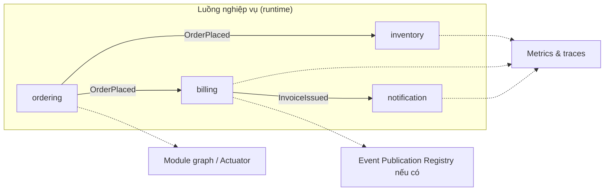
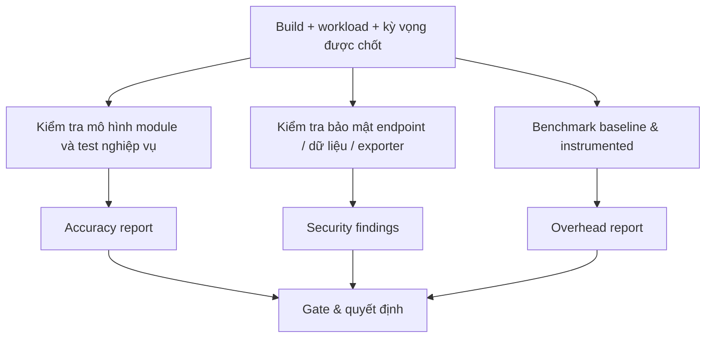

# Đánh giá solution bằng độ chính xác, bảo mật và overhead

## 1. Mục tiêu bài thực hành

Trong **SPRING_MODULITH_DOCUMENTATION_OBSERVABILITY**, một solution dùng Spring Modulith thường gồm nhiều phần: mô hình application module, tài liệu module graph/canvas, endpoint Actuator, metrics của sự kiện, tracing và cơ chế truyền context giữa các luồng. Ở chương **Thực hành tổng hợp**, câu hỏi không chỉ là “đã bật quan sát được chưa?” mà còn là **thông tin có đúng không, dữ liệu có an toàn không và chi phí vận hành thêm là bao nhiêu?**

Bài học hướng dẫn đánh giá solution theo ba trục:

1. **Độ chính xác (accuracy):** graph/canvas phản ánh ranh giới mã nguồn đến đâu, metrics phản ánh đúng sự kiện và listener nào, traces có giúp tái dựng hành trình nghiệp vụ không.
2. **Bảo mật (security):** việc công khai cấu trúc module, log, metrics, traces và thông tin event có tiết lộ dữ liệu nhạy cảm hoặc mở rộng quyền truy cập ngoài dự kiến không.
3. **Overhead:** instrumentation làm tăng latency, CPU, memory, GC, kích thước telemetry, lưu trữ và áp lực lên hạ tầng như thế nào.

**Đầu ra của bài thực hành** là một bảng nghiệm thu có số đo, bằng chứng và kết luận `PASS`, `CONDITIONAL PASS` hoặc `FAIL`. Các ngưỡng trong ví dụ là **giả định phục vụ bài học**, phải điều chỉnh theo SLO/SLA và nguồn lực thực tế.

> **Phân biệt phạm vi:** Spring Modulith hỗ trợ phân tích kiến trúc, tài liệu hóa và quan sát tương tác trong ứng dụng Spring Boot. Module graph phần lớn là **mô hình tĩnh được suy ra từ code**; event metrics và traces mới cho thấy một phần hành vi tại runtime. Không dùng riêng một nguồn để tuyên bố toàn bộ solution “đúng”.

## 2. Kịch bản thống nhất để đánh giá

Giả sử ứng dụng `shop` là modular monolith với bốn module:

| Module | Trách nhiệm | Hợp đồng/quan hệ chính |
|---|---|---|
| `ordering` | Tạo đơn, phát `OrderPlaced` sau khi lưu | Domain event cung cấp cho các module khác |
| `inventory` | Giữ tồn kho khi có đơn | Listener nhận `OrderPlaced` |
| `billing` | Lập hóa đơn cho đơn hợp lệ | Listener nhận `OrderPlaced`; phát `InvoiceIssued` |
| `notification` | Gửi thông báo khi hóa đơn sẵn sàng | Listener nhận `InvoiceIssued` |



**Điểm dễ nhầm về hướng cạnh:** trong module dependency graph, nếu `inventory` dùng Java type `ordering.OrderPlaced`, quan hệ kiến trúc được hiểu là **inventory phụ thuộc ordering**. Trong business event flow, hướng phát sự kiện là **ordering → inventory**. Hai sơ đồ mô tả hai sự thật khác nhau; đánh giá accuracy phải dùng đúng kỳ vọng cho từng loại.

Định nghĩa hành vi nghiệp vụ mong đợi:

- Một đơn hợp lệ được tạo thành công có thể dẫn tới các công việc inventory, billing và notification đã được chấp nhận hoặc lên lịch theo thiết kế.
- Hóa đơn cuối cùng phải khớp với đơn; với một `orderId` chỉ có một hóa đơn hiệu lực, kể cả khi listener được gọi lại.
- Khi listener lỗi, hệ thống phải thể hiện lỗi/đang chờ trong nguồn dữ liệu thích hợp, có cách phục hồi và không giả báo “đã xử lý”.
- Khi flow hoàn tất, metrics và traces phải giúp tìm đúng điểm chậm hoặc thất bại trong giới hạn sampling và context propagation đã công bố.

## 3. Chốt tiêu chí chấp nhận trước khi đo

Một bộ tiêu chí đầu vào giúp tránh việc thấy biểu đồ đẹp rồi tự suy diễn rằng solution đạt chuẩn.

| Trục | Kiểm chứng bắt buộc | Ví dụ tiêu chí chấp nhận |
|---|---|---|
| Accuracy kiến trúc | `ApplicationModules.verify()` và danh sách module/cạnh chủ đích | Không có vi phạm ranh giới; không thiếu module hoặc cạnh nghiệp vụ bắt buộc |
| Accuracy event | So sánh dữ liệu nghiệp vụ, event publication và listener outcome | Không mất kết quả nghiệp vụ trong test; retry không tạo side effect trùng |
| Accuracy quan sát | Metrics có đúng nghĩa; traces/context đủ để chẩn đoán | Phân biệt publish với complete; trace mô tả đúng hành trình trong mẫu được lấy |
| Security endpoint | Truy cập Actuator theo vai trò, môi trường | Người ngoài không lấy được module topology/metrics chi tiết |
| Security dữ liệu | Payload, tags, logs, spans, exporter, storage | Không lộ token, PII, secrets hoặc dữ liệu nghiệp vụ nhạy cảm |
| Security vận hành | Quyền truy cập, TLS, retention, audit | Có kiểm soát tương ứng mức nhạy cảm và chính sách tổ chức |
| Overhead ứng dụng | Δ p95/p99, throughput, CPU, memory/GC | Nằm trong ngân sách hiệu năng đã chốt |
| Overhead telemetry | Số series, spans/s, bytes/s, lưu trữ | Không vượt quota và không tạo cardinality vô hạn |
| Độ bền quan sát | Collector/exporter down, exporter chậm | Không làm hỏng flow nghiệp vụ chỉ vì hệ thống telemetry gặp sự cố |

Ví dụ ngân sách ban đầu để thực hành: p95 latency tăng **không quá 10%**, CPU trung bình tăng **không quá 5 điểm phần trăm**, RSS tăng **không quá 15%**, và không làm mất trace/metric quan trọng do cấu hình sai. Đây **không phải ngưỡng mặc định của Spring Modulith**. Với hệ thống độ trễ thấp hoặc nhiều PII, có thể cần chặt hơn.

**Nguyên tắc quyết định:** lỗ hổng bảo mật nghiêm trọng hoặc sai lệch nghiệp vụ trọng yếu là điều kiện **FAIL độc lập**; không được lấy điểm accuracy hoặc overhead cao để bù trừ.

## 4. Chuẩn bị một bộ dữ liệu và môi trường tái lập

Dùng cùng commit, cấu hình nghiệp vụ, dữ liệu thử và định nghĩa workload cho các biến thể cần so sánh. Ghi vào phiếu đo:

| Thành phần | Giá trị cần ghi |
|---|---|
| Mã nguồn | Git commit và artifact hash của bản đang test |
| Nền tảng | Java/JVM, Spring Boot, Spring Modulith, Micrometer/OTel version |
| Môi trường | CPU/RAM limit, container/VM, số instance, vùng mạng |
| Dữ liệu | Số đơn, tỉ lệ thành công/lỗi, tính duy nhất của ID |
| Workload | Arrival rate/RPS, concurrency, thời gian warm-up và steady state |
| Hạ tầng | DB, event publication store, broker, collector, exporter |
| Quan sát | Sampling probability, danh sách metric, histogram buckets, tracing exporter |
| Chính sách | AuthN/AuthZ Actuator, data masking, TLS, retention và quyền truy vấn |

Nên chuẩn bị ít nhất bốn tập tình huống độc lập:

1. **Normal:** tạo 1.000 đơn hợp lệ với tốc độ ổn định; tất cả listener dự kiến xử lý thành công.
2. **Failure:** khoảng 5% sự kiện khiến `billing` ném exception được kiểm soát; đo khả năng phát hiện và tình trạng publication.
3. **Slow downstream:** tăng độ trễ giả lập của `billing` và `notification`; kiểm tra queue/registry backlog và cảnh báo.
4. **Recovery:** phục hồi listener, thử resubmit theo tính năng đang dùng; xác nhận không có hóa đơn hoặc thông báo ngoài chính sách do xử lý trùng.

Các con số chỉ minh họa kích thước tập test; kết quả phải xuất phát từ **dữ liệu đo thật**, không lấy các tỷ lệ giả định làm kết quả.

Sơ đồ thu thập bằng chứng:



## 5. Đánh giá accuracy của module graph

### 5.1. Tạo chuẩn đối chiếu có người duyệt

Trước khi so với graph sinh tự động, người phụ trách kiến trúc cần định nghĩa **bộ module** và **cạnh dependency kỳ vọng**. Không xây ground truth bằng cách sao chép nguyên kết quả Spring Modulith đang kiểm tra, vì khi đó bài đo không thể phát hiện lỗi.

Ví dụ:

| Cạnh kỳ vọng trong **module dependency graph** | Bằng chứng source |
|---|---|
| `inventory → ordering` | Listener dùng type `OrderPlaced` của `ordering` |
| `billing → ordering` | Listener dùng type `OrderPlaced` của `ordering` |
| `notification → billing` | Listener dùng type `InvoiceIssued` của `billing` |

Đây là các cạnh dependency từ consumer đến module cung cấp type; luồng business event theo hướng ngược lại. Nếu tương tác giữa hai bộ phận chỉ thông qua HTTP/broker với payload không chứa Java type tham chiếu rõ ràng, không bắt module graph tĩnh phải tạo một cạnh không có trong source.

### 5.2. Kiểm tra ranh giới tự động

Với Spring Modulith core và JUnit, test cơ bản:

```java
package com.acme.shop;

import org.junit.jupiter.api.Test;
import org.springframework.modulith.core.ApplicationModules;

class ArchitectureVerificationTests {

    @Test
    void moduleBoundariesAreValid() {
        ApplicationModules.of(ShopApplication.class).verify();
    }
}
```

`verify()` kiểm tra vòng phụ thuộc module, truy cập internal package sai ranh giới và ràng buộc `allowedDependencies` nếu được khai báo. Đây là **điều kiện cần**, chưa đủ để chứng minh tất cả cạnh mong đợi tồn tại. Cần assertion riêng hoặc kiểm chứng graph so với bộ ground truth đã duyệt.

Tạo tài liệu kiến trúc (ví dụ với dependency test `spring-modulith-docs`):

```java
package com.acme.shop;

import org.junit.jupiter.api.Test;
import org.springframework.modulith.core.ApplicationModules;
import org.springframework.modulith.docs.Documenter;

class ModuleDocumentationTests {

    @Test
    void generateModuleDocumentation() {
        var modules = ApplicationModules.of(ShopApplication.class);

        new Documenter(modules)
                .writeModulesAsPlantUml()
                .writeIndividualModulesAsPlantUml()
                .writeModuleCanvases();
    }
}
```

Sinh tài liệu trên đúng build/version cần test và đánh giá cả file PlantUML gốc cùng hình render. Nếu ảnh chỉ khác bố cục hoặc do `DiagramOptions` lọc dependency, hãy phân biệt thay đổi **trình bày** với thay đổi **mô hình kiến trúc**.

### 5.3. Đo độ chính xác khi đối chiếu cạnh

Có thể tính:

- **True positive (TP):** cạnh có trong ground truth và graph phát hiện đúng.
- **False positive (FP):** cạnh có trong graph nhưng không thuộc tập mong đợi sau khi rà soát.
- **False negative (FN):** cạnh mong đợi nhưng graph không thể hiện.

Các thước đo:

\[
\text{Precision}=\frac{TP}{TP+FP},\qquad
\text{Recall}=\frac{TP}{TP+FN}
\]

\[
F_1=\frac{2\,\text{Precision}\,\text{Recall}}
{\text{Precision}+\text{Recall}}
\]

Ví dụ giả định: đội kiến trúc chốt 8 cạnh; mô hình báo 7 cạnh; trong đó 6 cạnh đúng, 1 cạnh ngoài kỳ vọng và 2 cạnh kỳ vọng còn thiếu. Khi đó:

- Precision = `6/7 ≈ 85,7%`.
- Recall = `6/8 = 75%`.
- F1 = `80%`.

**Cách diễn giải:** precision/recall là công cụ kiểm tra **mức khớp với bộ kỳ vọng đã duyệt**, không phải thông số chất lượng có sẵn của Spring Modulith. Một FP có thể là dependency thực sự đang tồn tại nhưng kiến trúc không mong muốn; một FN có thể xuất phát từ ground truth sai hoặc do quan hệ runtime động không thuộc phạm vi phân tích tĩnh. Rà soát từng sai khác trước khi quyết định sửa code.

Với graph nhỏ, một cạnh thiếu làm tỷ lệ thay đổi mạnh; nên báo **danh sách edge cụ thể** cùng TP/FP/FN, tránh chỉ đưa phần trăm.

## 6. Đánh giá accuracy của event, metrics và tracing

### 6.1. Phân biệt bốn loại bằng chứng

| Bằng chứng | Chứng minh được | Không tự chứng minh |
|---|---|---|
| `module.events.published` | Domain event được publish qua cơ chế có instrumentation | Listener đã thành công |
| Event Publication Registry | Publication gửi đến transactional listener được lưu/trạng thái hoàn tất, tùy store/phiên bản | Business state sau cùng đã đúng trong mọi trường hợp |
| Metrics listener tự định nghĩa | Thời gian thực thi và số lần outcome được code ghi nhận | Commit của transaction phía sau luôn thành công |
| Trace/span | Một số lời gọi đã được quan sát trên luồng có instrumentation, trong giới hạn sampling | Toàn bộ sự kiện đã xảy ra khi tracing lấy mẫu dưới 100% |
| Dữ liệu nghiệp vụ | Hóa đơn/đơn hàng/tồn kho đã ở trạng thái mong đợi | Nguyên nhân chậm/lỗi nếu không có telemetry hỗ trợ |

Tài liệu Spring Modulith mô tả `module.events.published` và metric riêng theo loại sự kiện. Chúng là **counter phát sự kiện**; nếu muốn đo backlog, failure rate của listener hoặc business completion latency thì phải bổ sung nguồn dữ liệu phù hợp. Không đặt tên metric tự viết thành “metric mặc định Spring Modulith”.

### 6.2. Bảng kiểm tra event theo dữ liệu nghiệp vụ

| Kịch bản | Kỳ vọng theo contract | Cần đối chiếu |
|---|---|---|
| `OrderPlaced` hợp lệ | Inventory và billing xử lý đúng; invoice duy nhất | Bảng đơn, tồn kho, hóa đơn, listener status |
| Billing ném exception | Hóa đơn chưa được xác nhận, lỗi được phát hiện | Exception, registry outstanding/failed, error metric |
| Notification chậm | Thời gian end-to-end tăng, publish vẫn có thể thành công | Listener latency, tuổi publication, business state |
| Retry/resubmit | Có cơ chế phục hồi; side effect không bị nhân đôi | Attempt count, invoice uniqueness, idempotency |
| App restart giữa xử lý | Trạng thái còn tồn đọng được phục hồi theo thiết kế | Registry store, recovery log, thực tế xử lý sau khởi động |
| Không có sự kiện mới | Metric throughput có thể bằng 0 hợp lệ | `up`/freshness, tránh alert sai do idle |

Nếu sử dụng `@ApplicationModuleListener` và Event Publication Registry, một domain event có thể tạo nhiều publication cho nhiều listener. Vì vậy tổng `incomplete publications` **không đồng nghĩa** số domain event hay số đơn chưa xử lý.

### 6.3. Đo độ phủ và tính đúng của telemetry

Đánh giá mỗi luồng test theo hai lớp:

- **Coverage về instrumentation:** bao nhiêu loại module/event và đoạn xử lý bắt buộc có metric/span phù hợp? Ví dụ: `3/3` listener quan trọng có duration metric, `2/3` listener có failure metric là thiếu một loại.
- **Tính đúng semantics:** counter có đếm mỗi lần handler được gọi không, timer có đo đúng ranh giới không, status `success` có đồng nghĩa phương thức trả về hay transaction đã commit, và event timestamp có được gắn đúng thời điểm không?

Với tracing có sampling dưới 100%, **không lấy số trace chia số order** rồi kết luận mất sự kiện. Đánh giá bằng những request được chọn để trace trong test kiểm soát sampling; business outcome phải được kiểm tra độc lập với hệ thống trace.

Nếu async listener làm mất trace context, có thể cần `spring.task.execution.propagate-context` với auto-configured executor hoặc `ContextPropagatingTaskDecorator` khi tự tạo executor, tùy phiên bản Spring Boot và cơ chế chạy thực tế. Truyền được trace context là một điều kiện kiểm chứng, không nên chỉ nhìn có span là đủ.

## 7. Bảo mật: xác định bề mặt tấn công trước khi bật quan sát

Một solution quan sát module có thể làm lộ những thông tin mà API nghiệp vụ không công bố. Hãy lập threat model tối thiểu:

| Bề mặt | Thông tin có thể lộ | Biện pháp kiểm soát |
|---|---|---|
| `/actuator/modulith` | Tên module, Java packages, các dependency nội bộ | Chỉ mở trên mạng quản trị, authentication và authorization |
| `/actuator/metrics`, `/actuator/prometheus` | Tên nghiệp vụ, thước đo và nhãn có thể suy ra luồng giao dịch | Cấp quyền riêng cho monitoring; lọc hoặc giảm tags nhạy cảm |
| Trace exporter/collector/UI | URLs, tham số, IDs, exception messages, đôi khi headers/payload | Mask/sanitize, TLS, RBAC, hạn chế dữ liệu thu thập |
| Logs | Stack trace, event payload, token, dữ liệu cá nhân | Redaction, phân loại log, retention, audit truy cập |
| Event Publication Registry | Event payload và trạng thái xử lý, có thể bao gồm PII | Quyền DB tối thiểu, mã hóa, thời hạn lưu và xóa dữ liệu |
| Telemetry storage | Dấu vết vận hành và metadata qua nhiều ngày | Retention, phân quyền theo environment/tenant và chính sách xuất dữ liệu |
| CI artifacts | Graph JSON, module canvas, reports mô tả hạ tầng | Artifact riêng tư; không đưa dữ liệu nội bộ lên kho công khai |

**Security gate bắt buộc:** endpoint monitoring phải có biện pháp bảo vệ độc lập với việc chỉ “expose endpoint”. Ví dụ:

```yaml
# Minh họa cho môi trường đánh giá nội bộ.
management:
  server:
    port: 9001
  endpoints:
    web:
      exposure:
        include: health,info,metrics,prometheus,modulith
  endpoint:
    health:
      show-details: when_authorized
```

Port quản trị riêng giúp tách vùng mạng nhưng **không tự bật authentication**. Cần Spring Security hoặc cơ chế bảo vệ tương đương ở gateway/sidecar/network policy, giới hạn địa chỉ truy cập và tài khoản kỹ thuật. Với `/actuator/health`, đặt `show-details: when_authorized` chỉ có ý nghĩa khi chính sách `roles`/authorization được cấu hình đúng.

Đối với production, chỉ expose những endpoint thật sự dùng. Không mở `env`, `configprops`, `heapdump`, `logfile` hoặc `threaddump` cho người dùng bên ngoài; chúng có rủi ro tiết lộ thông tin. Nếu dùng trace UI ngoài ứng dụng, kiểm tra riêng quyền truy cập của UI và exporter.

## 8. Thực hành kiểm thử bảo mật

### 8.1. Kiểm tra quyền truy cập theo vai trò

Thiết kế ba nhóm người dùng để kiểm tra:

1. **Anonymous/Internet client:** không thể đọc graph hoặc metric chi tiết.
2. **Người dùng nghiệp vụ có đăng nhập:** được gọi API nghiệp vụ nhưng không mặc nhiên xem telemetry nội bộ.
3. **Monitoring service / on-call được cấp quyền:** chỉ được truy cập endpoint và tập dữ liệu cần thiết.

Ví dụ kiểm tra response code ở cổng quản trị trong **môi trường test**:

```bash
# 401/403, hoặc không thể kết nối từ mạng không được phép,
# đều có thể là kết quả phù hợp tùy cơ chế phòng vệ.
curl -sS -o /dev/null -w '%{http_code}\n' \
  http://localhost:9001/actuator/modulith

curl -sS -o /dev/null -w '%{http_code}\n' \
  http://localhost:9001/actuator/prometheus
```

Đối với kiểm thử từ đúng mạng monitoring với credentials hợp lệ, phải thu được response đúng loại dữ liệu; không được tắt bảo mật toàn bộ chỉ để làm metric exporter hoạt động. Kiểm tra thêm cross-environment: token của staging không có quyền đọc production.

### 8.2. Kiểm tra dữ liệu nhạy cảm

Phát một event thử có dữ liệu giả đặc trưng (không dùng PII thật) và tìm dấu vết trong log, metric, span, dashboard, registry, report CI. Chọn một bộ canary như:

```text
customerEmail = "probe@example.invalid"
accessToken = "test-secret-never-export"
orderId = "test-order-0001"
```

Tiêu chí đánh giá:

- `accessToken` **không xuất hiện** trong logs, metrics, traces hay export ngoài phạm vi cho phép.
- Email và `orderId` không trở thành **metric label** có cardinality cao; nếu cần đối soát bằng log hoặc trace, phải theo chính sách dữ liệu và quyền truy cập.
- Nếu event được lưu trong publication registry, vị trí lưu, quyền đọc và thời hạn retention được kiểm soát.
- Exception message và stack trace không vô tình in toàn bộ event payload nhạy cảm.
- Các khóa/credentials cho collector, database, tracing exporter được cấp qua secret management, không nằm trong source/config được commit.

**Lưu ý:** masking ở log không đồng nghĩa masking ở trace hoặc metric. Phải kiểm tra riêng từng pipeline.

## 9. Thiết kế phép đo overhead có đối chứng

Telemetry luôn tiêu thụ tài nguyên: CPU, heap, network, storage và thời gian xử lý. Không thể lấy một con số overhead chung áp dụng cho mọi JVM/workload; tài liệu OpenTelemetry khuyến nghị đo trực tiếp trên môi trường cụ thể.

### 9.1. Các cấu hình cần so sánh

| Biến thể | Nội dung | Mục đích |
|---|---|---|
| **A — baseline** | App hoạt động đúng, không bật phần instrumentation bổ sung đang đánh giá | Đường cơ sở p95/p99, throughput, CPU, RAM |
| **B — module metadata + metrics** | Bật Spring Modulith Insight/Actuator, metrics exporter; tracing exporter tắt hoặc sampling 0 theo bản dùng | Đo overhead của metrics, metadata, exporter |
| **C — B + tracing sampling** | Thêm tracing với xác suất ví dụ 10%, context propagation và collector | Đo chi phí tăng do traces và truyền context |
| **D — C + sampling cao** | Sampling 100% trong test có tải kiểm soát | Xác định cận trên thực nghiệm, stress exporter |

**Cảnh báo về đối chứng:** nếu từ A sang B còn **bật Event Publication Registry**, thay đổi không chỉ là observability; registry thêm I/O và semantics lưu/khôi phục sự kiện. Hãy thực hiện **một cặp benchmark riêng** “có registry / không registry” nếu cần đánh giá chi phí của registry. Không quy toàn bộ overhead cho tracing khi ở cùng lúc thay đổi cơ chế lưu publication.

Trong phép thử A/B/C/D, giữ nguyên số instance, cấu hình DB, JVM heap, JIT warm-up, business code, input data, traffic và môi trường mạng. Chỉ điều chỉnh instrumentation/sampling theo thiết kế.

### 9.2. Cách chạy đo có độ tin cậy

Một quy trình thực hành:

1. Chạy warm-up để giảm ảnh hưởng JIT, connection pool cold-start và cache; xác định rõ khoảng warm-up trước khi chốt số.
2. Đặt tải ổn định bằng công cụ như k6, Gatling hoặc JMeter. Đánh giá ít nhất ba mức tải: thấp, gần mức vận hành bình thường và đỉnh tải dự kiến.
3. Đo tối thiểu 10–15 phút ở steady state cho từng mức tải; với ứng dụng có chu kỳ batch, cần thời gian đại diện chu kỳ đó.
4. Chạy luân phiên A/B/C/D nhiều lần hoặc đảo thứ tự để giảm thiên lệch do môi trường; không so một lần A buổi sáng với một lần D giờ cao điểm.
5. Ghi dữ liệu thô, confidence range hoặc độ biến thiên giữa các lần đo; xem latency p95/p99 cùng throughput và error rate.
6. Lặp lại khi collector bị chậm/mất kết nối để kiểm tra backpressure, retry queue, dropped telemetry và tác động lên business flow.
7. Giữ nguyên tệp cấu hình và metadata khi tổng hợp, tránh so sánh sai bản deploy.

Thời lượng và số lần chạy ở trên là **gợi ý thực hành**, không phải chuẩn bắt buộc cho mọi hệ thống. Nếu p99 biến động mạnh, cần kéo dài thời gian hoặc tăng mẫu đủ lớn.

## 10. Các chỉ số overhead và cách tính

Nên đo đồng thời chi phí **trên ứng dụng** và **trên hệ thống quan sát**.

| Chỉ số | Nguồn | Cách diễn giải |
|---|---|---|
| RPS/throughput | Load generator, business counters | Giảm throughput khi giữ cùng mức concurrency là dấu hiệu chi phí tăng |
| p50/p95/p99 latency | Load generator và business timer | Tail latency quan trọng hơn chỉ nhìn mean |
| Error/timeout rate | Request và listener outcome | Instrumentation không được làm tăng lỗi nghiệp vụ |
| CPU usage | Container/JVM/host metrics | Phân biệt phần trăm CPU, percentage points và relative delta |
| Heap/RSS, GC pause | JVM, container metrics | Histogram, span buffer và high-cardinality có thể tăng RAM |
| Span throughput | Tracer/exporter/collector | Spans/s và bytes/s giúp dự báo ingest |
| Time-series cardinality | Prometheus/TSDB | Số series có thể tăng theo tích số lượng nhãn |
| Export queue và dropped spans | Collector/exporter | Khả năng tiếp tục hoạt động khi backend chậm |
| Registry I/O | DB latency, query/transaction rate | Khi bật publication store, chi phí bền vững tách khỏi metrics/tracing |

Công thức tính thay đổi tương đối:

\[
\Delta_{\mathrm{latency}}(\%)=
\frac{p95_{\mathrm{instrumented}}-p95_{\mathrm{baseline}}}
{p95_{\mathrm{baseline}}}\times 100
\]

\[
\Delta_{\mathrm{throughput}}(\%)=
\frac{RPS_{\mathrm{instrumented}}-RPS_{\mathrm{baseline}}}
{RPS_{\mathrm{baseline}}}\times 100
\]

\[
\Delta_{\mathrm{RSS}}(\%)=
\frac{RSS_{\mathrm{instrumented}}-RSS_{\mathrm{baseline}}}
{RSS_{\mathrm{baseline}}}\times 100
\]

Ví dụ **giả định**, ở cùng một workload:

| Chỉ số | A: baseline | C: metrics + trace 10% | Thay đổi |
|---|---:|---:|---:|
| p95 latency | 180 ms | 198 ms | +10,0% |
| p99 latency | 410 ms | 455 ms | +11,0% |
| CPU trung bình | 70% | 75% | +5 **điểm phần trăm** (≈ +7,1% tương đối) |
| RSS | 600 MiB | 660 MiB | +10,0% |
| Throughput tối đa bền vững | 500 RPS | 475 RPS | -5,0% |

Không dùng bảng này như kết quả benchmark thật. Nó chỉ minh họa cách tính: nếu ngân sách đặt p95 tăng **không quá 10%** thì C chạm ngưỡng; cần kiểm tra độ biến thiên và các metric khác trước khi quyết định.

### Đừng để metric tạo chi phí không giới hạn

Giả sử có 8 module × 12 loại sự kiện × 3 outcome × 5 instance = **1.440 tổ hợp time series** trước khi tính thêm labels khác, histogram buckets hoặc nhãn của exporter. Khi gắn `orderId` ngẫu nhiên cho từng request, cardinality tăng theo số đơn và có thể làm quá tải TSDB. Quy ước:

- Metric tags chỉ dùng `module`, `event`, `outcome`, `environment` và một số nhãn hữu hạn khác.
- Không gắn customer ID, email, request ID, event UUID vào metric labels.
- Chỉ bật histogram cho duration cần SLO; kiểm soát số buckets và số dimension.
- Chọn trace sampling theo nhu cầu điều tra và budget; với nhiều lỗi hiếm cần chính sách quan sát lỗi phù hợp, không chỉ giảm sampling bừa bãi.
- Đặt giới hạn batch/queue exporter và kiểm thử ứng dụng khi collector không phản hồi.

## 11. Ví dụ cấu hình quan sát để làm benchmark

Dùng cùng BOM tương thích của Spring Boot và Spring Modulith cho mọi biến thể. Ví dụ dependencies Gradle để bật quan sát trên bản có actuator và Prometheus:

```groovy
dependencies {
    implementation("org.springframework.boot:spring-boot-starter-actuator")
    runtimeOnly("org.springframework.modulith:spring-modulith-starter-insight")
    runtimeOnly("io.micrometer:micrometer-registry-prometheus")

    testImplementation("org.springframework.modulith:spring-modulith-starter-test")
    testImplementation("org.springframework.modulith:spring-modulith-docs")
}
```

Khi muốn export tracing tới backend, thêm tracing bridge/exporter phù hợp **dòng Spring Boot đang dùng**; `spring-modulith-starter-insight` không mặc định là đủ để xuất traces ra backend cụ thể. Tránh lắp đồng thời nhiều bridge/exporter không tương thích.

Cấu hình minh họa cho môi trường benchmark có bảo vệ:

```yaml
management:
  server:
    port: 9001
  endpoints:
    web:
      exposure:
        include: health,info,metrics,prometheus,modulith
  tracing:
    sampling:
      probability: 0.10

spring:
  task:
    execution:
      propagate-context: true
```

Ý nghĩa:

- `management.tracing.sampling.probability` điều chỉnh tỉ lệ trace được sample trong stack tương thích; nó **không làm giảm số event nghiệp vụ**, và không được dùng để ước tính trực tiếp tỷ lệ listener thành công.
- `spring.task.execution.propagate-context` áp dụng khi Spring Boot auto-configure executor hỗ trợ; với executor tự khai báo, có thể phải dùng `ContextPropagatingTaskDecorator`. Đặt property không bảo đảm mọi con đường async/broker đều tự động truyền context.
- `management.server.port` tách cổng quản trị; vẫn cần security policy để bảo vệ.
- Khi thay xác suất sampling, ghi rõ version và restart/reload theo cơ chế được hỗ trợ; xác minh qua spans thực tế vì tracing backend có thể còn sampling riêng.

## 12. Kiểm thử tác động của observability khi xảy ra sự cố

Overhead bình thường chỉ là một nửa bài toán. Cần xem solution có duy trì hoạt động nghiệp vụ khi telemetry trục trặc không.

| Sự cố giả lập | Điều cần đo | Tiêu chí đánh giá |
|---|---|---|
| Collector tạm mất kết nối | Latency, error rate, exporter queue/drop, memory | Business flow vẫn theo SLO; telemetry không chiếm hết tài nguyên |
| Trace backend phản hồi chậm | Thread, CPU, queue size, network timeout | Không chặn request/thread nghiệp vụ quá budget |
| Prometheus scrape dày | CPU và thời gian expose metrics | Scrape không tạo truy vấn DB nặng theo từng request |
| Metric tags phát sinh liên tục | Active meter count, TSDB series, RSS | Có giới hạn cardinality và cơ chế chặn nhãn động |
| Registry datastore lỗi | Publish/commit behavior, độ bền event, retry | Ứng dụng phản hồi theo contract; không đánh dấu thành công sai |
| App restart giữa event handling | Outstanding publications, business state | Phục hồi phù hợp store và version; không có side effect trùng |
| Mất trace context qua `@Async` | Correlation, trace/span relationship | Khoanh vùng được bằng kiểm thử, không nhầm với event thất lạc |

Phải phân biệt **failure của telemetry exporter** với **failure của event publication registry**: exporter metrics/traces thường không nên trở thành phụ thuộc đồng bộ thiết yếu cho nghiệp vụ; registry có thể là một phần transaction/bảo đảm phát event nên lỗi registry ảnh hưởng trực tiếp tới contract và cần quyết định thiết kế riêng.

Khi test, không tạo tải phá hoại hoặc tắt hệ thống thật. Dùng môi trường sandbox, chaos proxy hoặc test double với dữ liệu giả.

## 13. Xây ma trận đánh giá có bằng chứng

Ví dụ phiếu chấm điểm cho một lần nghiệm thu:

| ID | Trục | Tiêu chí | Bằng chứng | Kết quả |
|---|---|---|---|---|
| A1 | Accuracy | `verify()` PASS và module/edge khớp ground truth | Test output, JSON graph, diff đã review | PASS / FAIL |
| A2 | Accuracy | Event normal/failure/retry tạo trạng thái nghiệp vụ đúng | DB assertions, registry status | PASS / FAIL |
| A3 | Accuracy | Metrics/trace có đúng nghĩa và correlation | Prometheus sample, trace IDs đã ẩn dữ liệu | PASS / FAIL |
| S1 | Security | Endpoint nội bộ không public | HTTP 401/403, network policy, RBAC audit | PASS / FAIL |
| S2 | Security | Không lộ secrets/PII; retention và quyền dữ liệu phù hợp | Canary audit, log/trace/storage review | PASS / FAIL |
| S3 | Security | Exporter/TLS và secret management phù hợp | Config/traffic policy review | PASS / FAIL |
| O1 | Overhead | p95/p99 và throughput trong ngân sách | Load test A/B/C theo cùng điều kiện | PASS / FAIL |
| O2 | Overhead | CPU/RSS/GC trong ngân sách | Container và JVM metrics | PASS / FAIL |
| O3 | Overhead | Exporter/cardinality/collector outage ổn định | Collector telemetry, fault injection | PASS / FAIL |

Nên ghi **giá trị thực đo** cùng pass/fail: `p95 190 ms so với baseline 180 ms, +5,6%` có giá trị kiểm chứng hơn câu “overhead thấp”. Mỗi ô nên có liên kết artifact/build ID, người thực hiện và ngày đo.

### Mô hình quyết định

Có thể dùng hard gates trước khi đánh giá điểm tổng:

1. **Security gate:** không có lỗ hổng high/critical chưa được xử lý hoặc chấp nhận theo quy trình rủi ro; quyền truy cập và data masking được kiểm chứng.
2. **Correctness gate:** không có sai lệch kết quả nghiệp vụ hoặc mất ranh giới module nghiêm trọng; các test bắt buộc PASS.
3. **Overhead gate:** không vượt budget p95/p99, error rate, CPU/memory hoặc có kế hoạch kiểm soát được chấp nhận trước rollout.

Chỉ sau khi qua hard gates mới tính điểm tổng (nếu tổ chức cần xếp hạng nhiều phương án). Ví dụ trọng số **Accuracy 50% – Security 30% – Overhead 20%**, với từng trục 0–100 được chấm theo rubric riêng:

\[
\text{Score}=0.5A+0.3S+0.2O
\]

Nếu `A=90`, `S=100` và `O=80` thì điểm = `91`. Tuy nhiên **91 điểm không thể cứu một solution** nếu có secret bị lộ hoặc event retry tạo hóa đơn trùng. Hard gates luôn có quyền phủ quyết.

Phân loại quyết định đề xuất:

- **PASS:** hard gates đạt; số đo và tài liệu đủ để triển khai theo kế hoạch.
- **CONDITIONAL PASS:** không còn vấn đề mức chặn nhưng có khoản khắc phục đã được duyệt, owner và thời hạn rõ; chỉ rollout trong phạm vi kiểm soát.
- **FAIL:** thiếu bằng chứng quan trọng, hard gate không đạt hoặc overhead vượt ngân sách mà chưa có phương án xử lý.

## 14. Những hiểu nhầm thường gặp khi đánh giá

**“`ApplicationModules.verify()` PASS, vậy graph chính xác 100%.”** `verify()` kiểm tra các dependency hiện có có hợp lệ hay không. Nó không biết tất cả cạnh đội thiết kế mong muốn phải có, và không nhận diện mọi tương tác runtime động. Phải có baseline kiến trúc được duyệt và test riêng.

**“Counter `module.events.published` tăng, nghĩa là event đã xử lý.”** Counter này đo việc publish; listener có thể còn pending, đang chạy hoặc thất bại. Đối chiếu registry, handler outcome và business state.

**“Có trace cho một lần chạy thì toàn bộ flow đã được theo dõi.”** Sampling, context propagation và instrumentation coverage quyết định span nào xuất hiện. Một số thao tác async có thể sinh trace riêng hoặc không có trace.

**“Không có PII trong log là bảo mật xong.”** Traces, metrics tags, registry database, exception messages, collector và CI artifacts là các điểm lộ dữ liệu độc lập.

**“Port Actuator riêng là đủ bảo mật.”** Port riêng chỉ tách bề mặt mạng. Cần authentication, authorization, network policy, TLS và giới hạn endpoint.

**“Overhead chỉ là thêm vài mili giây.”** CPU, memory, GC, network, storage, cardinality, truy vấn registry và sự cố collector có thể ảnh hưởng nhiều hơn thời gian response trung bình.

**“100% sampling sẽ cho accuracy cao nhất.”** Tăng sampling giúp có nhiều traces hơn nhưng tốn tài nguyên và có thể làm quá tải exporter/collector. Kết quả nghiệp vụ phải được kiểm tra bằng nguồn dữ liệu gốc, còn tracing là công cụ điều tra có ngân sách.

**“Không có metric nghĩa là không có lỗi.”** Một series có thể chưa xuất hiện vì không có traffic, exporter bị down hoặc snapshot bị stale. Cần metric freshness, `up` và test khả năng phân biệt “không có sự kiện” với “mất dữ liệu giám sát”.

## 15. Kế hoạch thực hành từ đầu đến nghiệm thu

### Giai đoạn 1 — Chốt expected behavior

1. Liệt kê module, public APIs, event contract và các cạnh dependency kỳ vọng; phân biệt static graph với event flow.
2. Chốt test data, success state, failure state, idempotency requirement và retry semantics.
3. Xác định SLO nghiệp vụ (ví dụ thời gian có hóa đơn), security policy và overhead budget.

### Giai đoạn 2 — Thu bằng chứng accuracy

1. Chạy `ApplicationModules.of(ShopApplication.class).verify()` và sinh graph/module canvas.
2. Đối chiếu JSON `/actuator/modulith` với source và ground truth theo phiên bản đang chạy.
3. Chạy normal, failure, slow, recovery; đối chiếu DB, registry và listener metrics.
4. Xác minh trace/context propagation trên các luồng được chọn; ghi rõ tỷ lệ sampling.

### Giai đoạn 3 — Kiểm chứng security

1. Kiểm tra truy cập Actuator từ anonymous, tài khoản nghiệp vụ và monitoring account.
2. Phát canary event với dữ liệu giả; kiểm tra log, metric, trace, registry và exporter.
3. Rà soát TLS, RBAC, retention, secrets, artifact sharing và phân tách staging/production.
4. Ghi finding với mức nghiêm trọng, owner, fix và bằng chứng retest.

### Giai đoạn 4 — Đo overhead có đối chứng

1. Chốt cấu hình benchmark A/B/C/D, ghi version/dependency và thời gian chạy.
2. Warm-up, tạo tải ổn định, chạy nhiều lần ở cùng mức tải; đo p95/p99, RPS, CPU/RSS/GC.
3. Đo số series, spans/s, bytes/s, queue/drop; quan sát hành vi khi collector down.
4. Tách riêng chi phí Event Publication Registry nếu có thay đổi semantics lưu trữ.
5. Tính delta so baseline và so với budget đã chốt, lưu raw data/đồ thị.

### Giai đoạn 5 — Ra quyết định

Tạo báo cáo:

```text
Solution: shop-modulith-observability
Build: <commit/hash>       Environment: <profile/cluster>
Spring Boot: <version>     Spring Modulith: <version>

ACCURACY:
  module boundary tests: <pass/fail>
  expected edges TP/FP/FN: <numbers>
  event correctness / idempotency: <evidence>
  trace coverage & context propagation: <evidence>

SECURITY:
  Actuator access: <evidence>
  sensitive data canary: <evidence>
  exporter/storage RBAC & retention: <evidence>

OVERHEAD:
  p95/p99 delta: <measured %>
  RPS delta: <measured %>
  CPU/RSS/GC delta: <measured values>
  telemetry ingest/cardinality: <measured values>
  collector failure test: <result>

GATES: Accuracy <...>; Security <...>; Overhead <...>
DECISION: PASS / CONDITIONAL PASS / FAIL
OWNER / ACTIONS / RE-TEST: <...>
```

Không điền các trường này bằng con số giả định. Khi chưa đủ dữ liệu để ra quyết định, ghi `NOT MEASURED` và yêu cầu phép thử tương ứng.

## 16. Checklist nghiệm thu solution

- [ ] Có ground truth cho danh sách module và dependency, được duyệt độc lập với graph sinh tự động.
- [ ] `verify()` PASS và các cạnh bắt buộc/vi phạm được kiểm tra riêng; không nhầm hướng dependency với event flow.
- [ ] Event correctness được kiểm chứng bằng business state, không chỉ publication counter hoặc trace.
- [ ] Có test failure, delay, retry, restart và idempotency theo cơ chế registry/broker thực tế.
- [ ] Metrics có đúng semantics, nhãn thấp cardinality, đơn vị rõ và nguồn dữ liệu có độ tin cậy.
- [ ] Tracing/context propagation được kiểm chứng với sampling đã công bố; không suy luận sai từ trace bị thiếu.
- [ ] Endpoint Actuator và giao diện quan sát được bảo vệ bằng mạng, xác thực, phân quyền phù hợp.
- [ ] Không có secrets/PII không được phép xuất hiện ở logs, metrics, traces, registry, dashboard, CI artifacts.
- [ ] Có kiểm soát TLS, retention, audit, secrets và quyền truy cập collector/telemetry storage.
- [ ] Có phép đo baseline/instrumented trên cùng workload và điều kiện môi trường; dùng p95/p99, throughput, CPU, RSS/GC.
- [ ] Có số liệu ingest/cardinality và thử nghiệm collector/exporter lỗi.
- [ ] Chi phí Event Publication Registry được tách khỏi chi phí instrumentation nếu cần.
- [ ] Ngưỡng nghiệm thu được thống nhất trước phép thử; hard gates về correctness và security có quyền phủ quyết.
- [ ] Báo cáo lưu evidence, commit/version, dữ liệu đo thật, owner, việc cần sửa và quyết định rollout.

### Tài liệu tham khảo

- [Spring Modulith — Fundamentals và application module detection](https://docs.spring.io/spring-modulith/reference/fundamentals.html)
- [Spring Modulith — Verifying Application Module Structure](https://docs.spring.io/spring-modulith/reference/verification.html)
- [Spring Modulith — Documenting Application Modules](https://docs.spring.io/spring-modulith/reference/documentation.html)
- [Spring Modulith — Production-ready Features, Actuator, Metrics, Tracing](https://docs.spring.io/spring-modulith/reference/production-ready.html)
- [Spring Modulith — Working with Application Events, Publication Registry](https://docs.spring.io/spring-modulith/reference/events.html)
- [Spring Boot — Actuator Endpoints and Security](https://docs.spring.io/spring-boot/reference/actuator/endpoints.html)
- [Spring Boot — Observability and Context Propagation](https://docs.spring.io/spring-boot/reference/actuator/observability.html)
- [Micrometer — Observations, Metrics and Tracing](https://docs.micrometer.io/micrometer/reference/observation.html)
- [OpenTelemetry — Performance overhead của Java agent](https://opentelemetry.io/docs/zero-code/java/agent/performance/)
- [Prometheus — Instrumentation and naming best practices](https://prometheus.io/docs/practices/instrumentation/)
