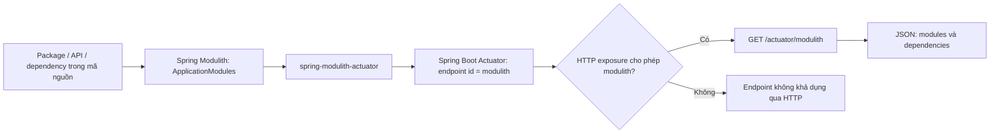

# Cấu hình expose endpoint modulith

## 1. Endpoint `modulith` dùng để làm gì?

Trong chương **Module Actuator** của **SPRING_MODULITH_DOCUMENTATION_OBSERVABILITY**, chúng ta học cách công bố mô hình application module từ một ứng dụng Spring Boot qua **Spring Boot Actuator**. Khi được cấu hình đúng, endpoint HTTP:

```http
GET /actuator/modulith
```

trả về thông tin cấu trúc module: tên module, base package, các module phụ thuộc và kiểu phụ thuộc. Nhờ đó, nhóm phát triển/vận hành có thể đối chiếu module graph đang có trong phiên bản ứng dụng chạy thực tế với thiết kế đã thống nhất.

Điểm quan trọng: **expose endpoint `modulith` là công bố metadata kiến trúc**, không đồng nghĩa tự động bật trace, xuất metric sự kiện hay tạo trang web đồ họa. Tracing, event metrics và context propagation dùng hạ tầng quan sát tương ứng, nhưng endpoint `modulith` chủ yếu trả về **mô hình cấu trúc tĩnh** mà Spring Modulith nhận diện.

Sau bài này, bạn sẽ:

- Chọn đúng dependency để đăng ký Modulith Actuator.
- Phân biệt **đăng ký**, **cho phép truy cập** và **expose qua HTTP**.
- Cấu hình `application.yml`/`application.properties` để truy cập endpoint.
- Hiểu cách URL thay đổi khi chỉnh cổng, context path hoặc management base path.
- Kiểm tra JSON trả về và xử lý trường hợp `404`, `401`, `403`, sai module graph.
- Áp dụng cách công bố an toàn trong môi trường production.

## 2. Luồng hoạt động: từ code đến HTTP endpoint



Ba lớp cấu hình cần phân biệt:

| Lớp | Câu hỏi | Điều kiện |
| --- | --- | --- |
| **Đăng ký endpoint** | Ứng dụng có `ApplicationModulesEndpoint` không? | Có `spring-modulith-actuator` cùng hỗ trợ Spring Boot Actuator, hoặc dùng `spring-modulith-starter-insight` |
| **Quyền truy cập endpoint** | Endpoint có được phép hoạt động? | Các thuộc tính `management.endpoint.*.access` và `management.endpoints.access.*` nếu phiên bản Spring Boot hỗ trợ, cộng các cơ chế bảo vệ khác |
| **Exposing qua HTTP** | Có tuyến HTTP đến endpoint này không? | `management.endpoints.web.exposure.include` chứa `modulith`, không bị `exclude` loại trừ, ứng dụng có HTTP server |

Đăng ký được bean endpoint chưa đủ để gọi được URL. Tương tự, thêm `modulith` vào `include` cũng không tạo ra endpoint nếu thiếu dependency Modulith Actuator.

## 3. Thêm dependency để kích hoạt Modulith Actuator

### Cách A — Chỉ cần endpoint cấu trúc module

Nếu mục tiêu chỉ là xem application module graph qua Actuator, thêm **hai dependency runtime**:

```groovy
// build.gradle (Groovy DSL)
// Ví dụ dùng Spring Modulith 2.1.1; chọn phiên bản tương thích
// với Spring Boot đang dùng trong dự án.
dependencies {
    implementation platform('org.springframework.modulith:spring-modulith-bom:2.1.1')

    runtimeOnly 'org.springframework.modulith:spring-modulith-actuator'
    runtimeOnly 'org.springframework.boot:spring-boot-starter-actuator'
}
```

Nếu dự án sử dụng Maven, cần quản lý phiên bản bằng Spring Modulith BOM:

```xml
<!-- pom.xml: đặt trong <dependencyManagement> -->
<dependencyManagement>
    <dependencies>
        <dependency>
            <groupId>org.springframework.modulith</groupId>
            <artifactId>spring-modulith-bom</artifactId>
            <version>2.1.1</version>
            <type>pom</type>
            <scope>import</scope>
        </dependency>
    </dependencies>
</dependencyManagement>

<!-- Đặt trong <dependencies> -->
<dependencies>
    <dependency>
        <groupId>org.springframework.modulith</groupId>
        <artifactId>spring-modulith-actuator</artifactId>
        <scope>runtime</scope>
    </dependency>
    <dependency>
        <groupId>org.springframework.boot</groupId>
        <artifactId>spring-boot-starter-actuator</artifactId>
    </dependency>
</dependencies>
```

Ví dụ này giả định dự án đã cấu hình Spring Boot, ứng dụng web và quản lý phiên bản dependency của Spring Boot theo cách thông thường. Dùng **một dòng Spring Modulith phù hợp với dòng Spring Boot**; không tự ý dùng phiên bản mới nhất khi dự án vẫn đang ở một dòng Boot cũ. Phiên bản `2.1.1` ở đây là ví dụ theo tài liệu Spring Modulith, không phải yêu cầu cố định cho mọi dự án.

### Cách B — Đã dùng Spring Modulith observability

Nếu hệ thống cần cả module Actuator và instrumentation cho tương tác giữa các module, dùng starter:

```groovy
dependencies {
    implementation platform('org.springframework.modulith:spring-modulith-bom:2.1.1')
    runtimeOnly 'org.springframework.modulith:spring-modulith-starter-insight'
}
```

`spring-modulith-starter-insight` đã kéo theo Modulith Actuator, observability và Spring Boot Actuator. Vì vậy **không cần thêm lại** `spring-modulith-actuator` nếu starter trên đã có trong ứng dụng. Để gửi traces/metrics tới hệ thống giám sát thực tế, vẫn cần thiết lập tracer, exporter hoặc registry riêng.

> **Phân biệt:** Cài dependency là thao tác xây dựng ứng dụng; `management.endpoints.web.exposure.include` là thao tác quyết định endpoint nào có thể được gọi qua HTTP khi ứng dụng đang chạy.

## 4. Cấu hình `application.yml` để expose `modulith`

### 4.1. Cấu hình tối thiểu

Spring Boot chỉ expose endpoint `health` qua HTTP theo mặc định. Muốn expose Modulith Actuator, khai báo:

```yaml
# src/main/resources/application.yml
management:
  endpoints:
    web:
      exposure:
        include: "health,info,modulith"
```

Hoặc dùng `application.properties` tương đương:

```properties
management.endpoints.web.exposure.include=health,info,modulith
```

Với cấu hình này, nếu ứng dụng chạy tại `http://localhost:8080` và giữ nguyên management base path mặc định:

| URL | Mục đích |
| --- | --- |
| `GET http://localhost:8080/actuator` | Endpoint discovery, thường liệt kê các liên kết actuator khả dụng |
| `GET http://localhost:8080/actuator/health` | Trạng thái sức khỏe ứng dụng |
| `GET http://localhost:8080/actuator/info` | Thông tin ứng dụng nếu có nguồn thông tin được cấu hình |
| **`GET http://localhost:8080/actuator/modulith`** | **Mô hình application module và dependency** |

Không cần expose `metrics`, `prometheus` hoặc `traces` chỉ để truy cập cấu trúc module. Những endpoint/registry này phục vụ nhu cầu giám sát khác.

### 4.2. `include` và `exclude` tương tác thế nào?

`management.endpoints.web.exposure.include` là danh sách ID được công bố qua web; `exclude` là danh sách loại trừ, có ưu tiên cao hơn `include`.

```yaml
management:
  endpoints:
    web:
      exposure:
        include: "health,info,modulith"
        exclude: "modulith"
```

Trong ví dụ trên, `modulith` **không được expose** vì có mặt trong `exclude`. Khi kiểm tra cấu hình, cần xét cả cấu hình chung, biến môi trường và các profile đang kích hoạt.

Không nên dùng `include: "*"` như một lựa chọn mặc định cho production. Dấu `*` trong YAML còn phải đặt trong dấu nháy, và việc expose tất cả endpoint có thể mở ra nhiều thông tin vận hành nhạy cảm không cần thiết.

### 4.3. Khác biệt giữa exposure và access

Ở các phiên bản Spring Boot có cơ chế **endpoint access**, ví dụ Spring Boot 4.x, có thể giới hạn endpoint ở chế độ chỉ đọc:

```yaml
management:
  endpoint:
    modulith:
      access: read-only
  endpoints:
    web:
      exposure:
        include: "health,modulith"
```

Vì `modulith` chỉ cung cấp thao tác đọc cấu trúc, `read-only` phù hợp với mục đích này. Tuy nhiên, cấu hình access **không thay thế xác thực và phân quyền HTTP**. Nếu `management.endpoints.access.default=none` hoặc mức access tối đa cấm endpoint, thêm ID vào `include` vẫn không đủ; cần xem quy tắc access đang áp dụng.

Thuộc tính `management.endpoint.<id>.access` thuộc các phiên bản Spring Boot mới; với Spring Boot 3.x, hãy tham khảo đúng tài liệu phiên bản đang dùng thay vì sao chép nguyên cấu hình này.

## 5. Tùy chỉnh cổng và đường dẫn endpoint

### 5.1. Dùng cùng cổng với ứng dụng

Giả sử:

```yaml
server:
  port: 8080
  servlet:
    context-path: "/shop"

management:
  endpoints:
    web:
      exposure:
        include: "health,modulith"
```

Với ứng dụng **Spring MVC/Servlet**, endpoint nằm tại:

```text
http://localhost:8080/shop/actuator/modulith
```

Do cùng cổng, `/actuator` được đặt tương đối với `server.servlet.context-path`. Nếu dùng Spring WebFlux, cần xét `spring.webflux.base-path` tương ứng.

### 5.2. Đổi management base path

```yaml
management:
  endpoints:
    web:
      base-path: "/manage"
      exposure:
        include: "health,modulith"
```

Khi ứng dụng dùng cổng 8080, không có context path bổ sung, endpoint chuyển thành:

```text
http://localhost:8080/manage/modulith
```

`base-path` là prefix chung cho các endpoint Actuator, không phải tên module. Nếu có ingress, reverse proxy hoặc URL rewrite, hãy đối chiếu đường dẫn người dùng thực sự truy cập qua hạ tầng đó.

### 5.3. Tách cổng quản trị khỏi cổng ứng dụng

Một cấu hình dành cho phát triển hoặc hệ thống có mạng vận hành riêng:

```yaml
server:
  port: 8080

management:
  server:
    port: 9090
    address: "127.0.0.1"
  endpoints:
    web:
      base-path: "/manage"
      exposure:
        include: "health,modulith"
```

Khi đó:

```text
Ứng dụng nghiệp vụ: http://localhost:8080/
Module Actuator:  http://127.0.0.1:9090/manage/modulith
```

`management.server.address` chỉ được cấu hình địa chỉ bind riêng khi cổng management khác cổng chính. Giá trị `127.0.0.1` có nghĩa chỉ có thể truy cập trong cùng host/network namespace; khi chạy trong container, Kubernetes hoặc cần một hệ thống giám sát từ bên ngoài, cần lựa chọn bind address và chính sách mạng phù hợp. Cấu hình này **không tự động bảo vệ endpoint khỏi mọi truy cập trong cùng host**.

### Bảng tra cứu nhanh URL

| Điều kiện | URL ví dụ |
| --- | --- |
| Mặc định, cổng ứng dụng `8080` | `http://localhost:8080/actuator/modulith` |
| `server.servlet.context-path=/shop`, cùng cổng | `http://localhost:8080/shop/actuator/modulith` |
| `management.endpoints.web.base-path=/manage`, cùng cổng | `http://localhost:8080/manage/modulith` |
| `management.server.port=9090` | `http://localhost:9090/actuator/modulith` |
| Cổng quản trị `9090`, base path `/manage` | `http://localhost:9090/manage/modulith` |

## 6. Gọi thử endpoint và đọc dữ liệu trả về

Khởi động ứng dụng, rồi dùng trình duyệt hoặc dòng lệnh:

```bash
# Xem HTTP status, header và nội dung (môi trường local).
curl -i http://localhost:8080/actuator/modulith

# Xem những endpoint được liên kết từ discovery.
curl -i http://localhost:8080/actuator
```

Nếu được expose và người gọi có quyền truy cập, `GET /actuator/modulith` thường trả `200 OK` cùng JSON có dạng:

```json
{
  "order": {
    "displayName": "Order",
    "basePackage": "com.example.shop.order",
    "dependencies": [
      {
        "target": "payment",
        "types": ["USES_COMPONENT"]
      }
    ]
  },
  "payment": {
    "displayName": "Payment",
    "basePackage": "com.example.shop.payment",
    "dependencies": []
  },
  "inventory": {
    "displayName": "Inventory",
    "basePackage": "com.example.shop.inventory",
    "dependencies": [
      {
        "target": "order",
        "types": ["EVENT_LISTENER"]
      }
    ]
  }
}
```

Đây là dữ liệu **minh họa** cho ứng dụng có ba module `order`, `payment` và `inventory`. Kết quả thực tế phụ thuộc package, API và dependency của từng hệ thống.

| Đường JSON | Ý nghĩa |
| --- | --- |
| `$.order`, `$.payment` | Định danh kỹ thuật của module |
| `$.order.displayName` | Tên hiển thị |
| `$.order.basePackage` | Package gốc của module |
| `$.order.dependencies[]` | Các dependency **đi ra từ** module `order` |
| `$.order.dependencies[].target` | Module đích được phụ thuộc, ví dụ `payment` |
| `$.order.dependencies[].types[]` | Loại phụ thuộc, thường gặp `DEFAULT`, `USES_COMPONENT` hoặc `EVENT_LISTENER` |
| `parent`, `nested` nếu có | Cấu trúc module lồng nhau |

`order` phụ thuộc `payment` qua Spring bean, còn `inventory` phụ thuộc `order` do lắng nghe một event được `order` công bố. Hướng dependency ở đây phản ánh **quan hệ mã nguồn/module**, có thể khác hướng lan truyền sự kiện khi chạy.

### Khi nào có thể tin vào dữ liệu?

Endpoint cho thấy **cấu trúc mà Spring Modulith phát hiện từ phiên bản ứng dụng đang chạy**. Nó không chứng minh rằng mỗi dependency đều được gọi trong một request cụ thể, hoặc event listener đã xử lý thành công. Nếu cần dữ liệu thực thi, phải dùng module observations/traces, metrics sự kiện, log và trạng thái event publication phù hợp.

Đặc biệt, nếu bạn đã tùy chỉnh cách Spring Modulith phát hiện module trong code dành cho test, cần chuyển những tùy chỉnh dùng cho production vào **production sources** để Actuator phản ánh cùng cấu trúc dự kiến.

## 7. Phân quyền và bảo vệ `/actuator/modulith`

JSON module graph tiết lộ các khối nghiệp vụ, package và quan hệ phụ thuộc. Dù endpoint chỉ đọc, đây vẫn là thông tin kiến trúc nội bộ, nên mặc định chỉ cho những người/công cụ vận hành thích hợp truy cập.

### 7.1. Ba vòng bảo vệ

1. **Exposure tối thiểu:** Chỉ đưa `modulith` cùng vài endpoint cần thiết vào `include`.
2. **Network boundary:** Có thể đặt management trên cổng quản trị riêng, mạng nội bộ, firewall hoặc ingress chỉ dành cho ops.
3. **HTTP authentication/authorization:** Dùng Spring Security hoặc lớp xác thực tại gateway. Nếu ứng dụng tự khai báo `SecurityFilterChain`, cần tự kiểm soát quyền đối với actuator vì cấu hình bảo mật tự động của Spring Boot có thể rút lui.

Ví dụ dưới đây minh họa một chính sách bảo vệ endpoint trong **Spring Boot 3.x / Spring Security 6**; cần điều chỉnh package import của `EndpointRequest` khi chuyển sang Spring Boot 4:

```java
import org.springframework.boot.actuate.autoconfigure.security.servlet.EndpointRequest;
import org.springframework.context.annotation.Bean;
import org.springframework.context.annotation.Configuration;
import org.springframework.core.annotation.Order;
import org.springframework.security.config.annotation.web.builders.HttpSecurity;
import org.springframework.security.web.SecurityFilterChain;

import static org.springframework.security.config.Customizer.withDefaults;

@Configuration(proxyBeanMethods = false)
class HttpSecurityConfiguration {

    @Bean
    @Order(1)
    SecurityFilterChain actuatorSecurity(HttpSecurity http) throws Exception {
        http.securityMatcher(EndpointRequest.toAnyEndpoint());
        http.authorizeHttpRequests(auth -> auth
            .requestMatchers(EndpointRequest.to("health")).permitAll()
            .requestMatchers(EndpointRequest.to("modulith")).hasRole("OPS")
            .anyRequest().denyAll());
        http.httpBasic(withDefaults());
        return http.build();
    }

    @Bean
    @Order(2)
    SecurityFilterChain applicationSecurity(HttpSecurity http) throws Exception {
        http.authorizeHttpRequests(auth -> auth.anyRequest().authenticated());
        http.httpBasic(withDefaults());
        return http.build();
    }
}
```

Đoạn code minh họa **cách áp chính sách**, chưa tạo tài khoản/quyền `OPS`. Cần tích hợp nguồn danh tính thực tế; khi dùng OAuth2, SSO hoặc gateway, thay phương thức xác thực cho phù hợp. Chỉ thêm chain dành cho Actuator mà bỏ toàn bộ quy tắc bảo mật ứng dụng còn lại có thể tạo lỗ hổng.

Trong môi trường sản phẩm, hạn chế bật endpoint ở nơi công cộng. Đặt nó sau xác thực và phân quyền theo vai trò, TLS, cũng như giám sát truy cập. Không lưu thông tin đăng nhập trực tiếp trong `application.yml` hoặc commit credentials vào repository.

## 8. Xử lý lỗi thường gặp

Việc endpoint không truy cập được thường liên quan đến dependency, exposure, đường dẫn hoặc bảo mật. Hãy đọc **mã HTTP trước**, sau đó kiểm tra theo thứ tự.

| Triệu chứng | Nguyên nhân thường gặp | Cách kiểm tra/xử lý |
| --- | --- | --- |
| `404 Not Found` | Thiếu Modulith Actuator; không expose `modulith`; `exclude` phủ định `include`; gọi sai cổng/path | Kiểm tra dependency runtime, `include/exclude`, `management.server.port`, `management.endpoints.web.base-path`, context path |
| `401 Unauthorized` | Endpoint đã được bảo vệ, request chưa có thông tin xác thực hợp lệ | Gửi credentials/token đúng cơ chế, kiểm tra identity provider và security filter |
| `403 Forbidden` | Người gọi đã xác thực nhưng thiếu quyền; policy web/gateway chặn | Kiểm tra vai trò, `SecurityFilterChain`, ACL/ingress policy |
| Không thấy link `modulith` trong `/actuator` | Endpoint chưa được expose hoặc discovery bị tắt | Gọi thẳng `/actuator/modulith` để phân biệt, kiểm tra `management.endpoints.web.discovery.enabled` |
| Endpoint trả `200` nhưng graph không đúng | Module detection khác dự kiến; cấu hình phát hiện chỉ nằm ở test; ứng dụng chạy artifact cũ | Kiểm tra cấu trúc package, `@ApplicationModule`/named interfaces và production source; xác minh phiên bản deploy |
| Endpoint có URL nhưng kết nối bị từ chối | Ứng dụng chưa chạy; cổng không lắng nghe; bind `127.0.0.1`; firewall/network namespace | Kiểm tra cổng và bind address của management server, logs khởi động và chính sách mạng |

### Quy trình kiểm tra từng bước

**Bước 1 — Xác định endpoint có được đăng ký không.** Kiểm tra `spring-modulith-actuator` hoặc `spring-modulith-starter-insight` thực sự nằm trên runtime classpath. Spring Boot Actuator cũng phải có mặt.

**Bước 2 — Xem cấu hình có hiệu lực.** Đối chiếu `management.endpoints.web.exposure.include` và `exclude`; nhớ rằng profile riêng và biến môi trường có thể ghi đè `application.yml`. Với Spring Boot hỗ trợ cơ chế endpoint access, kiểm tra thêm các quy tắc `management.endpoint.modulith.access` và mức access tối đa.

**Bước 3 — Xác định URL chính xác.** Bắt đầu từ cổng management (hoặc cổng ứng dụng nếu dùng chung), tiếp theo là context path/base path và cuối cùng là `modulith`.

**Bước 4 — Phân biệt lỗi mạng và lỗi phân quyền.** `curl -i` giúp nhận diện `404`, `401`, `403`; lỗi kết nối trước HTTP lại gợi ý bind address, cổng hoặc proxy.

**Bước 5 — Xác minh nội dung.** Khi trả `200`, kiểm tra tên module và cạnh dependency với kiến trúc mong đợi. Dùng test kiến trúc của Spring Modulith để xác minh ranh giới; không kết luận chỉ từ JSON của một lần chạy.

## 9. Bài tập thực hành

Một ứng dụng đặt hàng có các module `order`, `payment`, `inventory`. Ứng dụng dùng cổng nghiệp vụ `8080`; đội vận hành muốn xem module graph qua cổng `9090`, URL `/manage/modulith` và không expose toàn bộ Actuator.

**Yêu cầu:**

1. Thêm dependency Actuator phù hợp trong dự án Spring Modulith.
2. Cấu hình chỉ expose `health` và `modulith` qua HTTP management.
3. Thử `GET http://localhost:9090/manage/modulith`; xác nhận graph có ba module.
4. Mô tả cách bảo vệ endpoint để chỉ nhóm vận hành được phép xem.
5. Giải thích vì sao JSON của endpoint không thay thế được traces hoặc event metrics.

**Cấu hình tham khảo:**

```yaml
server:
  port: 8080

management:
  server:
    port: 9090
  endpoints:
    web:
      base-path: "/manage"
      exposure:
        include: "health,modulith"
```

Đối với production, hãy bổ sung chính sách xác thực/phân quyền và network boundary phù hợp. Có thể kiểm tra nhanh với `curl -i http://localhost:9090/manage/modulith` sau khi khởi động và có quyền truy cập.

## 10. Ghi nhớ

- **Muốn có endpoint:** dùng `spring-modulith-actuator` cùng Spring Boot Actuator hoặc `spring-modulith-starter-insight`.
- **Muốn gọi qua HTTP:** thêm `modulith` vào `management.endpoints.web.exposure.include` và bảo đảm endpoint được phép hoạt động.
- **Muốn gọi đúng URL:** xét cổng, context path, management base path và path mapping.
- **Muốn vận hành an toàn:** expose tối thiểu, bảo vệ bằng xác thực/phân quyền và giới hạn mạng.
- **Muốn kiểm chứng kiến trúc:** đối chiếu JSON với mô hình module và bài test `ApplicationModules.verify()`; dùng metrics/traces cho hành vi runtime.

## Tài liệu tham khảo

- [Spring Modulith – Production-ready Features: Application Module Actuator](https://docs.spring.io/spring-modulith/reference/production-ready.html)
- [Spring Modulith – Appendix: Starter và artifacts](https://docs.spring.io/spring-modulith/reference/appendix.html)
- [Spring Modulith – Fundamentals: ApplicationModules và module detection](https://docs.spring.io/spring-modulith/reference/fundamentals.html)
- [Spring Boot – Actuator Endpoints: access, exposure, security](https://docs.spring.io/spring-boot/reference/actuator/endpoints.html)
- [Spring Boot – Monitoring and Management Over HTTP](https://docs.spring.io/spring-boot/reference/actuator/monitoring.html)
