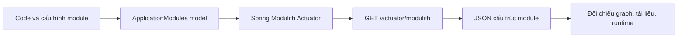
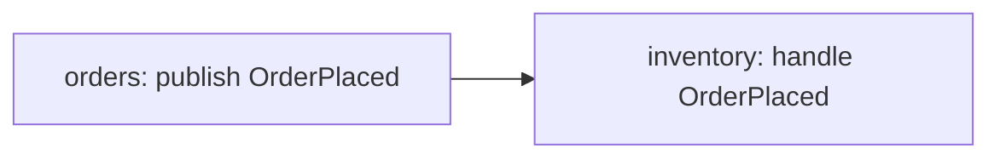
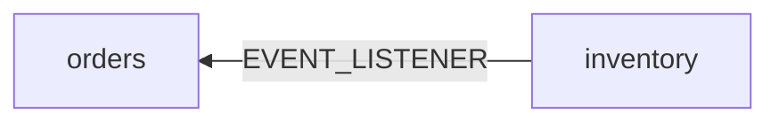

# Đọc cấu trúc module qua HTTP

## 1. Mục tiêu và bối cảnh

Một ứng dụng **Spring Boot modular monolith** thường chạy nhiều *application module* trong cùng một tiến trình. Ví dụ `orders` xử lý đơn hàng, `inventory` quản lý tồn kho và `notifications` gửi thông báo. Khi ứng dụng được triển khai, nhóm phát triển cần trả lời: bản chạy hiện tại nhận diện những module nào, mỗi module nằm ở package nào, và các module có quan hệ phụ thuộc ra sao?

Trong Spring Modulith, **Application Module Actuator** cung cấp cấu trúc module đã được framework nhận diện qua một **HTTP management endpoint**. Đây là một công cụ quan trọng trong phạm vi **SPRING_MODULITH_DOCUMENTATION_OBSERVABILITY**: dùng Spring Modulith để sinh tài liệu ranh giới application module và quan sát tương tác khi hệ thống chạy, kết hợp module graph, Actuator, event metrics, tracing và context propagation.

Sau bài học này, bạn có thể:

1. Bật và truy cập endpoint module qua HTTP trong môi trường phát triển.
2. Đọc JSON để tìm module ID, package gốc, tên hiển thị và các dependency.
3. Giải thích chiều phụ thuộc và ý nghĩa các kiểu `DEFAULT`, `USES_COMPONENT`, `EVENT_LISTENER`.
4. Trích xuất dữ liệu bằng `curl`, `jq` hoặc PowerShell, rồi đối chiếu với sơ đồ module và các trace.
5. Phân biệt thông tin kiến trúc tĩnh từ Actuator với dữ liệu hoạt động runtime; cấu hình quyền truy cập an toàn.

Điểm cốt lõi: **endpoint `modulith` trả về mô hình kiến trúc của ứng dụng đang chạy, không phải một danh sách request hay trace theo thời gian thực**.

## 2. Luồng từ mô hình module đến phản hồi HTTP

Spring Modulith xác định application module từ cấu trúc package và các quy tắc/cấu hình module của dự án. Thành phần Actuator làm cho thông tin đó có thể được truy vấn thông qua hạ tầng quản trị của Spring Boot.



Ba thành phần đóng vai trò riêng:

| Thành phần | Vai trò | Không nên nhầm với |
| --- | --- | --- |
| Spring Modulith Core | Phân tích và biểu diễn cấu trúc application module | API HTTP dành cho người dùng cuối |
| Spring Modulith Actuator | Đưa metadata cấu trúc module ra endpoint quản trị | Distributed tracing hoặc event monitor |
| Spring Boot Actuator | Quản lý các endpoint và khả năng expose qua HTTP/JMX | Bộ kiểm chứng đầy đủ mọi quy tắc kiến trúc |

Ở một số phiên bản, mô hình module cũng có thể dùng metadata đã được tạo sẵn trong quá trình build. Vì vậy, cần chú ý rằng endpoint phản ánh **cấu trúc mà bản ứng dụng đang chạy sử dụng**, không phải tệp source vừa được sửa trên máy cá nhân sau khi ứng dụng đã khởi động.

## 3. Chuẩn bị dependency

Ví dụ Maven dưới đây giả định ứng dụng đã có Spring Boot và các dependency Spring Modulith cơ bản. Để expose cấu trúc qua HTTP, thêm hai artifact:

```xml
<dependencies>
    <!-- Spring Modulith application module endpoint -->
    <dependency>
        <groupId>org.springframework.modulith</groupId>
        <artifactId>spring-modulith-actuator</artifactId>
        <scope>runtime</scope>
    </dependency>

    <!-- Hạ tầng HTTP management endpoint của Spring Boot -->
    <dependency>
        <groupId>org.springframework.boot</groupId>
        <artifactId>spring-boot-starter-actuator</artifactId>
    </dependency>
</dependencies>
```

Ví dụ Gradle Kotlin DSL tương ứng:

```kotlin
dependencies {
    runtimeOnly("org.springframework.modulith:spring-modulith-actuator")
    implementation("org.springframework.boot:spring-boot-starter-actuator")
}
```

Quản lý phiên bản bằng BOM/cấu hình dependency tương thích với phiên bản Spring Boot và Spring Modulith của dự án. Nếu đã dùng **`spring-modulith-starter-insight`**, starter này bao gồm hỗ trợ Actuator và observability, vì vậy không cần thêm trùng `spring-modulith-actuator` chỉ để có cùng tính năng.

Lưu ý: dependency cho Actuator **không tự cài đặt tracing exporter, hệ thống metric hay backend quan sát**. Các khả năng đó dùng để theo dõi runtime và có cấu hình riêng.

## 4. Expose endpoint `modulith` qua HTTP

Spring Boot Actuator không nhất thiết expose mọi endpoint trên web theo mặc định. Trong môi trường phát triển, bạn có thể cấu hình:

```yaml
# application.yml — cấu hình minh họa cho môi trường phát triển
management:
  endpoints:
    web:
      exposure:
        include: health,info,modulith
```

Nếu ứng dụng chạy trên `localhost:8080`, đường dẫn thường dùng là:

```http
GET /actuator/modulith HTTP/1.1
Host: localhost:8080
Accept: application/json
```

ID của endpoint trong các phiên bản Spring Modulith hiện đại là **`modulith`**. Đường dẫn thực tế còn phụ thuộc `management.endpoints.web.base-path`, `management.server.port`, `server.servlet.context-path` và cách triển khai ứng dụng. Chẳng hạn, nếu management chạy ở cổng riêng:

```yaml
management:
  server:
    port: 8081
  endpoints:
    web:
      exposure:
        include: health,info,modulith
```

Lúc này hãy truy cập `http://localhost:8081/actuator/modulith` thay vì cổng HTTP nghiệp vụ `8080`. Đường dẫn ví dụ chỉ đúng khi bạn chưa thay đổi base path hoặc các thiết lập định tuyến liên quan.

**Trong production**, chỉ expose endpoint này ở mạng quản trị được kiểm soát và áp dụng xác thực/phân quyền phù hợp. Dữ liệu trả về có thể làm lộ tên package và các quan hệ nội bộ của ứng dụng; không nên công khai endpoint cho mọi người dùng Internet.

## 5. Bước 1: kiểm tra discovery endpoint

Trước khi truy vấn trực tiếp `modulith`, bạn có thể kiểm tra Actuator discovery resource:

```bash
curl -i http://localhost:8080/actuator
```

Nếu discovery được bật và bạn có quyền truy cập, phản hồi thường chứa phần `_links`. Ví dụ rút gọn:

```json
{
  "_links": {
    "self": {
      "href": "http://localhost:8080/actuator",
      "templated": false
    },
    "health": {
      "href": "http://localhost:8080/actuator/health",
      "templated": false
    },
    "modulith": {
      "href": "http://localhost:8080/actuator/modulith",
      "templated": false
    }
  }
}
```

Nếu `_links.modulith` xuất hiện, bạn có thể dùng trực tiếp URL của nó. Tuy nhiên, một số hệ thống **tắt discovery, cấu hình bảo mật hoặc thay đổi đường dẫn**, vì vậy việc không thấy link ở `/actuator` chưa đủ để kết luận ứng dụng không có endpoint. Hãy thử URL đã cấu hình và kiểm tra quyền truy cập trước khi suy ra nguyên nhân.

## 6. Bước 2: gọi `GET /actuator/modulith`

Chạy:

```bash
curl -sS -H 'Accept: application/json' \
  http://localhost:8080/actuator/modulith
```

Phản hồi từ Spring Modulith sử dụng một **JSON object**, trong đó **mỗi key ở cấp gốc là tên kỹ thuật của một application module**. Ví dụ minh họa cho cửa hàng:

```json
{
  "orders": {
    "basePackage": "com.example.shop.orders",
    "displayName": "Orders",
    "dependencies": []
  },
  "inventory": {
    "basePackage": "com.example.shop.inventory",
    "displayName": "Inventory",
    "dependencies": [
      {
        "target": "orders",
        "types": ["EVENT_LISTENER"]
      }
    ]
  },
  "notifications": {
    "basePackage": "com.example.shop.notifications",
    "displayName": "Notifications",
    "dependencies": [
      {
        "target": "orders",
        "types": ["EVENT_LISTENER"]
      }
    ]
  }
}
```

**Đây là dữ liệu giả lập để học cách đọc JSON**, không phải phản hồi lấy từ một ứng dụng thực tế. Hai module `inventory` và `notifications` trong ví dụ có listener nhận kiểu sự kiện do `orders` công bố. Vì vậy, từ góc nhìn **phụ thuộc mã nguồn**, hai module đó phụ thuộc vào hợp đồng sự kiện trong `orders`.

Khi có nested module, phiên bản Spring Modulith hỗ trợ có thể bổ sung các trường `parent` và `nested`. Một module không nhất thiết có toàn bộ trường tùy chọn; tránh viết parser giả định mọi object đều có các trường đó.

## 7. Bước 3: hiểu chính xác schema JSON

| JSONPath / trường | Kiểu | Cách hiểu |
| --- | --- | --- |
| `$.{moduleName}` | Object | Tên kỹ thuật module; là key ở cấp gốc, ví dụ `orders` |
| `$.orders.displayName` | String | Tên hiển thị dễ đọc của module |
| `$.orders.basePackage` | String | Package gốc được module quản lý |
| `$.orders.dependencies` | Array | Danh sách quan hệ phụ thuộc **đi ra từ** module này |
| `$.inventory.dependencies[0].target` | String | Tên module đích mà `inventory` phụ thuộc vào |
| `$.inventory.dependencies[0].types` | Array | Các kiểu phụ thuộc được phát hiện đến cùng module đích |
| `$.{moduleName}.parent` | String, tùy chọn | Tên module cha, khi dùng nested module |
| `$.{moduleName}.nested` | Collection, tùy phiên bản | Các module lồng bên trong, nếu có |

Một vài điều dễ đọc nhầm:

- **Key ở cấp gốc là module ID**, không phải một danh sách `modules: []`. Ví dụ dùng `json.orders`, không phải `json.modules[0]`.
- `dependencies` mô tả **outgoing dependencies** từ module được chọn. Dòng `inventory.dependencies[].target = orders` nghĩa là `inventory` có phụ thuộc đến `orders`, không mang nghĩa `orders` gọi `inventory` ở runtime.
- `types` là một **mảng**. Có thể có nhiều kiểu phụ thuộc giữa cùng một cặp module; không nên giả định chỉ có một giá trị.
- `displayName` phục vụ hiển thị; nên dùng key module kỹ thuật để nối với `dependencies.target`.
- `dependencies: []` chỉ nói mô hình không ghi nhận outgoing dependencies thuộc phạm vi phân tích, không chứng minh module chưa từng chạy hoặc không phát domain event.

### 7.1. Ba loại dependency thường gặp

| Giá trị trong `types` | Diễn giải | Ví dụ |
| --- | --- | --- |
| `DEFAULT` | Phụ thuộc kiểu dữ liệu / tham chiếu thông thường | Class trong module A tham chiếu một type thuộc module B |
| `USES_COMPONENT` | Phụ thuộc thông qua Spring bean/component | Service A sử dụng bean công khai của module B |
| `EVENT_LISTENER` | Phụ thuộc phát sinh từ listener theo hợp đồng sự kiện | Module B lắng nghe event class do module A định nghĩa |

Không nên coi ba loại này là mức độ lỗi hoặc mức độ nghiêm trọng. Chúng phân loại **cơ chế phụ thuộc**, chứ không tự kết luận phụ thuộc được phép hay không. Để kiểm chứng quy tắc ranh giới, dùng các bài test `ApplicationModules.verify()` với quy tắc module đang áp dụng.

### 7.2. Chiều dependency khác chiều domain event

Giả sử `orders` phát `OrderPlaced`; `inventory` lắng nghe event và dự trữ hàng. Luồng **event runtime** thường được mô tả:



Nhưng vì source code trong `inventory` phải tham chiếu class `OrderPlaced` do `orders` khai báo, cạnh **dependency tĩnh** tương ứng có thể là:



Hai mũi tên không mâu thuẫn: một mũi tên là **sự kiện được phân phối đến đâu**, mũi tên còn lại là **module nào phụ thuộc vào hợp đồng mã nguồn của module nào**. Đây là khác biệt đặc biệt quan trọng khi đọc `dependencies[].target` rồi so sánh với distributed trace.

## 8. Bước 4: lọc, trích xuất và đối chiếu dữ liệu

### 8.1. Dùng `curl` và `jq`

Nếu môi trường có `jq`, bạn có thể xem JSON đã định dạng:

```bash
curl -sS http://localhost:8080/actuator/modulith | jq .
```

Liệt kê module ID:

```bash
curl -sS http://localhost:8080/actuator/modulith \
  | jq -r 'keys[]'
```

Xem một module cụ thể **bằng cách lọc JSON phía client**:

```bash
curl -sS http://localhost:8080/actuator/modulith \
  | jq '.inventory'
```

In tên module và base package:

```bash
curl -sS http://localhost:8080/actuator/modulith \
  | jq -r 'to_entries[] | "\(.key) => \(.value.basePackage)"'
```

In danh sách cạnh phụ thuộc:

```bash
curl -sS http://localhost:8080/actuator/modulith \
  | jq -r 'to_entries[] as $module
      | ($module.value.dependencies // [])[]
      | "\($module.key) -> \(.target): \((.types // []) | join(","))"'
```

Với JSON minh họa ở trên, kết quả cạnh có thể là:

```text
inventory -> orders: EVENT_LISTENER
notifications -> orders: EVENT_LISTENER
```

Các câu lệnh này giả định endpoint trả về JSON đúng schema và HTTP request thành công. Khi có xác thực, hãy cung cấp credentials theo cơ chế đã triển khai; tránh hardcode mật khẩu hoặc token vào shell history.

### 8.2. Dùng PowerShell

Trên Windows PowerShell, có thể gọi endpoint và xử lý JSON dưới dạng object:

```powershell
$url = 'http://localhost:8080/actuator/modulith'
$modules = Invoke-RestMethod -Method Get -Uri $url

# Tên các application module
$modules.PSObject.Properties.Name

# Thông tin module inventory
$modules.inventory

# Các module đích mà inventory phụ thuộc vào
$modules.inventory.dependencies | Select-Object target, types
```

`Invoke-RestMethod` chuyển đổi JSON sang đối tượng PowerShell, giúp truy vấn từng property. Ví dụ được viết cho một endpoint thử nghiệm mở trong môi trường phát triển. Với endpoint có security, cần sử dụng cơ chế xác thực tương ứng đã được tổ chức cho phép.

### 8.3. Có thể truy cập `/actuator/modulith/inventory` không?

Không nên mặc định **có API chi tiết theo từng module**. Endpoint chính thức mô tả phản hồi toàn bộ cấu trúc tại `GET /actuator/modulith`; muốn lấy riêng `inventory`, hãy lấy JSON rồi lọc ở phía client. Các subpath hay query parameter khác chỉ dùng nếu phiên bản/framework hoặc dự án thực sự công bố rõ API đó.

## 9. Đối chiếu dữ liệu HTTP với module graph

Endpoint có thể được dùng để kiểm tra nhanh rằng bản triển khai đang dùng đúng cấu trúc kỳ vọng. Quy trình gợi ý:

1. **Sinh và kiểm tra graph trong build/test:** dùng `ApplicationModules.of(ShopApplication.class)`, `modules.verify()` và `Documenter` để tạo tài liệu kiến trúc từ code.
2. **Triển khai một bản ứng dụng xác định:** ghi nhận version/build để biết graph và endpoint thuộc cùng một bản.
3. **Truy vấn `GET /actuator/modulith`:** lấy module ID, `basePackage`, danh sách dependencies và loại cạnh.
4. **So sánh ở mức module:** tìm module bị thiếu, tên module thay đổi, module mới được thêm, hoặc cạnh phụ thuộc khác với tài liệu đã duyệt.
5. **Điều tra sai khác bằng code:** kiểm tra cấu hình nhận diện module, đặc biệt nếu tùy biến chỉ tồn tại trong test mà không nằm trong production sources.

Ví dụ: tài liệu đã duyệt hiển thị `orders` và `inventory` độc lập qua hợp đồng event. Nếu JSON phiên bản triển khai có thêm `orders.dependencies` trỏ đến `inventory` với `USES_COMPONENT`, điều đó đáng được kiểm tra: có thể đã xuất hiện một phụ thuộc bean mới, hoặc build đang khác phiên bản mong đợi.

**Actuator cho biết module model mà ứng dụng công bố; `verify()` mới là bước chuyên biệt để phát hiện các vi phạm kiến trúc được hỗ trợ**. Một quan hệ `USES_COMPONENT` được trả về không mặc nhiên là lỗi. Cần đối chiếu với giao diện công khai và chính sách phụ thuộc của module.

## 10. Kết nối Actuator với metrics, traces và event observability

Trong phạm vi observability của Spring Modulith, các công cụ bổ sung cho nhau:

| Nguồn | Trả lời câu hỏi | Ví dụ |
| --- | --- | --- |
| `GET /actuator/modulith` | Bản chạy gồm những module và cạnh phụ thuộc nào? | `inventory` phụ thuộc `orders` qua `EVENT_LISTENER` |
| Module graph/tài liệu sinh từ build | Kiến trúc dự kiến ở phiên bản source/build ra sao? | Các module và ranh giới đã kiểm tra |
| Metrics | Hoạt động nào nhiều lỗi, chậm hoặc tăng đột biến? | Độ trễ xử lý event của `inventory` |
| Traces | Một request đã thực sự đi qua bước nào? | HTTP → `orders` → listener `inventory` |
| Event publication/registry | Publication đến listener đã hoàn tất hay đang chờ xử lý? | Event `OrderPlaced` còn publication chưa hoàn thành |
| Context propagation | Các bước async có thể liên hệ về cùng luồng nghiệp vụ không? | `traceId` hoặc correlation được duy trì phù hợp |

Ví dụ, HTTP Actuator trả `inventory -> orders: EVENT_LISTENER` là quan hệ **phụ thuộc tĩnh**, trong khi trace có thể cho thấy event đi từ `orders` đến `inventory`. Hai góc nhìn bổ sung cho nhau để phân tích tương tác. Nhưng endpoint **không trả số lượng event đã publish, không đo latency và không lưu lịch sử span**.

Nếu một module không xuất hiện trên trace, chưa chắc module đó không tồn tại: request kiểm thử có thể chưa đi qua module hoặc instrumentation/sampling không ghi nhận. Nếu module có mặt trên endpoint nhưng không nằm trong tài liệu local, hãy kiểm tra trước tiên rằng đang so sánh cùng build và cùng cấu hình phát hiện module.

## 11. Sự cố thường gặp khi gọi HTTP

| Hiện tượng | Nguyên nhân thường gặp | Cách xử lý |
| --- | --- | --- |
| `404 Not Found` tại `/actuator/modulith` | Thiếu artifact, endpoint chưa expose, URL/cổng/base path sai, endpoint bị vô hiệu hóa | Kiểm tra dependency, cấu hình web exposure và management URL |
| `401 Unauthorized` | Endpoint yêu cầu authentication | Sử dụng thông tin xác thực hợp lệ của môi trường quản trị |
| `403 Forbidden` | Đã xác thực nhưng thiếu quyền, hoặc bị chính sách security từ chối | Kiểm tra quyền và cấu hình Spring Security |
| Không kết nối được | Ứng dụng/cổng management chưa chạy, firewall/network | Kiểm tra cổng, readiness và kết nối đến đúng host |
| `/actuator` có `health` nhưng thiếu `modulith` | Endpoint không expose hoặc không có trong runtime, hoặc discovery/visibility khác cấu hình | Kiểm tra thư viện, exposure và thử URL endpoint trực tiếp |
| JSON không có module mong đợi | Package root, metadata hoặc quy tắc nhận diện module khác kỳ vọng | Đối chiếu cấu hình model, artifact và build đang chạy |
| `dependencies` rỗng dù event có chạy | Chưa có phụ thuộc tĩnh được nhận diện hoặc cách phát event không tạo cạnh như giả định | Kiểm tra code và phạm vi phát hiện; đừng đồng nhất graph với event log |
| Parser lỗi với `parent`/`nested` | Khác biệt schema hoặc nested module tùy phiên bản | Xử lý field tùy chọn, đối chiếu version tài liệu |

Phân biệt hai tình huống khi debug: **không truy cập được HTTP endpoint** là vấn đề cấu hình/bảo mật/định tuyến; **truy cập được nhưng JSON khác dự đoán** là vấn đề module model, version, hoặc cách hiểu schema. Không sửa quy tắc nghiệp vụ chỉ để khắc phục lỗi HTTP 404.

## 12. Bảo mật và cách dùng trong vận hành

Module endpoint là một **management interface**. Một số nguyên tắc vận hành:

- Không expose tự do trên public Internet. Giới hạn ở cổng hoặc mạng quản trị, áp dụng cơ chế authentication/authorization phù hợp.
- Chỉ cấp quyền đọc cho người hoặc hệ thống giám sát cần metadata kiến trúc. Endpoint này có nhiệm vụ trả thông tin; nó không phải API để thay đổi module.
- Tránh ghi toàn bộ JSON kiến trúc ra log công khai hoặc trả lại từ API người dùng thông thường.
- Khi tạo snapshot để so sánh, gắn metadata phiên bản triển khai, môi trường và thời điểm lấy dữ liệu; cùng một module có thể đổi base package sau refactor.
- Nếu automation sử dụng JSON, hãy kiểm tra HTTP status và validate schema trước khi cập nhật dashboard. Không dùng endpoint làm nguồn metrics thời gian thực bằng cách polling quá thường xuyên.

Đối với hệ thống có nhiều môi trường, nên so sánh cùng tên service và đúng phiên bản build. Một thay đổi dependency giữa staging và production có thể chỉ là do hai môi trường đang chạy các bản khác nhau.

## 13. Bài thực hành: xác nhận cấu trúc ba module

Giả sử ứng dụng có package gốc `com.example.shop` và ba module `orders`, `inventory`, `notifications`.

**Nhiệm vụ:** cấu hình Actuator, đọc JSON và xác nhận cả ba module có mặt, đồng thời giải thích đúng quan hệ `EVENT_LISTENER`.

| Bước | Thao tác | Tiêu chí hoàn thành |
| --- | --- | --- |
| 1 | Thêm Spring Modulith Actuator và Spring Boot Actuator phù hợp phiên bản | Ứng dụng khởi động với endpoint module được đăng ký |
| 2 | Expose `modulith` cho môi trường dev | Truy cập HTTP đúng host/cổng và có quyền |
| 3 | `GET /actuator` | Tìm thấy `modulith` link nếu discovery được bật |
| 4 | `GET /actuator/modulith` | Nhận HTTP 200 và JSON object |
| 5 | Truy xuất các key cấp gốc | Có `orders`, `inventory`, `notifications` theo mô hình ví dụ |
| 6 | Xem `basePackage`, `displayName` | Các tên và package khớp với bản chạy |
| 7 | Đọc `inventory.dependencies` | Diễn giải đúng `target` và `types` nếu có cạnh |
| 8 | So với module graph được sinh | Không có thay đổi ngoài dự kiến giữa build và runtime |

Một số câu hỏi tự kiểm tra:

1. Nếu `inventory.dependencies[].target` là `orders`, module nào là bên **phụ thuộc**? (Đáp án: `inventory`.)
2. Nếu `orders` phát event được `inventory` xử lý, tại sao cạnh `EVENT_LISTENER` lại có thể trỏ từ `inventory` tới `orders`? (Vì listener tham chiếu hợp đồng event của `orders`.)
3. Nếu JSON không có trường `parent`, điều đó nhất thiết là lỗi không? (Không; đây là trường tùy chọn cho mô hình module lồng nhau ở các phiên bản hỗ trợ.)
4. Có thể dùng endpoint này để kết luận một event đã được xử lý thành công không? (Không; cần quan sát event publication, log, metrics/traces hoặc trạng thái nghiệp vụ.)
5. Vì sao nên lưu version khi chụp snapshot endpoint? (Để đối chiếu đúng mô hình của bản triển khai, tránh so sánh hai build khác nhau.)

## 14. Ghi nhớ

**`GET /actuator/modulith` là cửa sổ HTTP để đọc cấu trúc application module của Spring Modulith.** Phản hồi JSON có key cấp gốc là module ID; các trường quan trọng gồm `displayName`, `basePackage`, `dependencies[].target` và `dependencies[].types`, cùng các trường tùy chọn cho nested module ở phiên bản hỗ trợ.

Khi phân tích, hãy đọc đúng **chiều phụ thuộc tĩnh** và phân biệt nó với chiều xử lý domain event tại runtime. Dùng Actuator để đối chiếu bản triển khai với module graph, dùng verification để kiểm tra quy tắc kiến trúc và dùng metrics/tracing/event monitoring để hiểu hành vi vận hành. Bảo vệ endpoint vì metadata kiến trúc là thông tin nội bộ của hệ thống.

### Tài liệu tham khảo

- [Spring Modulith — Production-ready Features / Application Module Actuator](https://docs.spring.io/spring-modulith/reference/production-ready.html): hướng dẫn bật endpoint, ví dụ JSON và các loại dependency.
- [Spring Modulith — ApplicationModulesEndpoint API](https://docs.spring.io/spring-modulith/docs/current/api/org/springframework/modulith/actuator/ApplicationModulesEndpoint.html): API endpoint với ID `modulith`.
- [Spring Boot — Actuator Endpoints](https://docs.spring.io/spring-boot/reference/actuator/endpoints.html): cấu hình exposure, management URL và quyền truy cập.
