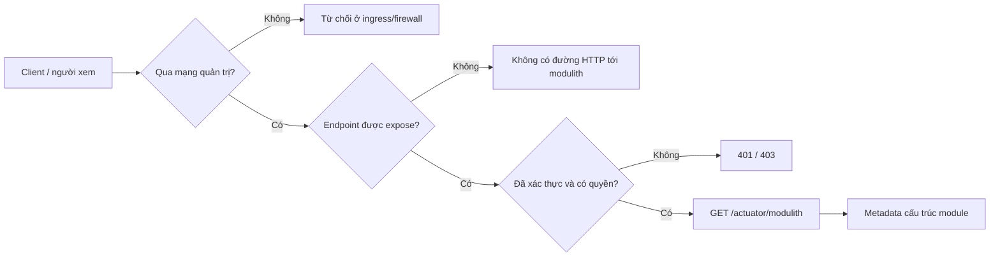

# Quyền truy cập và bảo vệ dữ liệu kiến trúc

## 1. Vì sao Module Actuator cần được bảo vệ?

Trong hệ thống Spring Boot dùng **Spring Modulith**, ứng dụng có thể chia thành các application module như `orders`, `inventory`, `payments` và `notifications`. Spring Modulith cho phép xuất cấu trúc module qua **Spring Boot Actuator** tại endpoint `/actuator/modulith`. Đây là công cụ hữu ích để kiểm tra ranh giới module và các quan hệ phụ thuộc khi hệ thống đang vận hành.

Tuy nhiên, cùng dữ liệu giúp kỹ sư hiểu hệ thống cũng có thể tiết lộ thông tin nội bộ cho người không có quyền: tên module, package Java, những vùng nghiệp vụ đang tồn tại và cách chúng kết nối. Vì thế, việc bật Module Actuator cần đi cùng một chính sách **ai được truy cập, truy cập bằng đường nào, trong môi trường nào và dữ liệu được lưu/chia sẻ ra sao**.

Trong module học **SPRING_MODULITH_DOCUMENTATION_OBSERVABILITY**, chủ đề này nối việc **sinh tài liệu ranh giới application module** với **kiểm chứng kiến trúc trong vận hành**: module graph giúp thấy cấu trúc, còn event metrics/tracing/logging giúp thấy hoạt động. Cả hai nhóm dữ liệu đều có thể chứa ngữ cảnh nội bộ và đều phải được bảo vệ tương xứng.

### Mục tiêu học tập

- Nhận diện thông tin kiến trúc được trả về từ `/actuator/modulith` và mức nhạy cảm của chúng.
- Phân biệt **có dependency**, **cho phép Actuator operation**, **expose qua HTTP/JMX**, **xác thực**, **phân quyền** và **kiểm soát mạng**.
- Cấu hình quyền đọc theo nguyên tắc **least privilege**, không dựa vào tính chất read-only của endpoint để xem nó là công khai.
- Kiểm tra quyền truy cập với tài khoản chưa đăng nhập, tài khoản không có quyền và tài khoản quản trị kiến trúc.
- Vận dụng kiểm soát tương tự khi xuất module graph thành tài liệu, lưu log/trace và chia sẻ dữ liệu thiết kế.

## 2. Endpoint tiết lộ những thông tin gì?

Khi thư viện `spring-modulith-actuator` (hoặc `spring-modulith-starter-insight`) được cấu hình cùng Spring Boot Actuator, endpoint có **ID** là `modulith`. Đường HTTP thường gặp là:

```http
GET /actuator/modulith
```

Đường dẫn thực tế còn phụ thuộc base path, port quản trị và cấu hình path mapping của Spring Boot. Ví dụ dữ liệu được rút gọn dưới đây mang tính minh họa:

```json
{
  "orders": {
    "basePackage": "com.example.shop.orders",
    "displayName": "Orders",
    "dependencies": []
  },
  "inventory": {
    "basePackage": "com.example.shop.inventory",
    "displayName": "Inventory",
    "dependencies": [
      {
        "target": "orders",
        "types": ["EVENT_LISTENER"]
      }
    ]
  }
}
```

Các thành phần trong cấu trúc JSON chính thức:

| Trường | Ý nghĩa | Thông tin có thể bị suy ra |
| --- | --- | --- |
| Tên khóa module, ví dụ `orders` | Định danh kỹ thuật của application module | Bề mặt nghiệp vụ hiện có; ranh giới chức năng |
| `displayName` | Tên dễ đọc của module | Thuật ngữ, khả năng nghiệp vụ nội bộ |
| `basePackage` | Package gốc của module | Quy ước cấu trúc mã nguồn, tên miền/đội phát triển nếu được mã hóa trong package |
| `parent`, `nested` (nếu có) | Quan hệ module cha/con | Cách tổ chức các phần hệ thống |
| `dependencies[].target` | Module mà module hiện tại phụ thuộc | Hướng ghép nối giữa các phần nghiệp vụ |
| `dependencies[].types` | Kiểu phụ thuộc: `DEFAULT`, `USES_COMPONENT`, `EVENT_LISTENER` | Các điểm tích hợp bằng kiểu dữ liệu, Spring bean hoặc sự kiện |

Endpoint thông thường **không được thiết kế để trả password, mã truy cập hay toàn bộ dữ liệu khách hàng**. Dù vậy, **metadata kiến trúc vẫn là tài sản nội bộ**. Người ngoài có thể dùng sơ đồ này để thu thập thông tin về các thành phần quan trọng, định hướng thử nghiệm không được phép hoặc kết hợp với thông tin rò rỉ khác.

Ví dụ, đồ thị xuất hiện `payments` và `refunds` cho biết hệ thống có những năng lực nghiệp vụ liên quan; tên package hoặc dependencies có thể giúp hình dung luồng xử lý. Điều đó không đồng nghĩa bản thân endpoint có lỗ hổng khai thác, nhưng là lý do đủ để giới hạn người được xem.

## 3. Mô hình đe dọa và nguyên tắc phân quyền

Một chính sách bảo vệ cần trả lời ba câu hỏi: **dữ liệu là gì, ai cần dùng và nguy cơ nếu bị xem hoặc phát tán sai phạm vi là gì**.

| Vai trò | Nhu cầu hợp lệ | Quyền phù hợp |
| --- | --- | --- |
| Người dùng cuối hoặc client gọi API nghiệp vụ | Đặt hàng, xem đơn hàng | Không truy cập `modulith` |
| Hệ thống cân bằng tải/health probe | Xem trạng thái sống/sẵn sàng | Chỉ endpoint health cần thiết, với mức chi tiết được giới hạn |
| Kỹ sư phát triển có nhiệm vụ kiểm tra kiến trúc | Đọc module graph để đối chiếu dependency | Chỉ đọc `modulith` trong phạm vi môi trường được cấp |
| Nhóm SRE/Operations được phân quyền | Chẩn đoán production | Quyền đọc endpoint cần thiết, truy cập qua mạng quản trị và có ghi nhận truy cập |
| Bên thứ ba hoặc tài khoản không được giao quyền | Không có nhu cầu | Từ chối |

Các rủi ro cần xem xét:

1. **Lộ topology/metadata:** tên module, package, dependency bị công bố qua public ingress.
2. **Phân quyền quá rộng:** tài khoản bất kỳ đã đăng nhập đều có thể xem graph.
3. **Lộ từ kênh phụ:** endpoint HTTP bị khóa nhưng JMX, proxy, tài liệu xuất hoặc bản sao JSON vẫn truy cập được.
4. **Thiếu kiểm soát sau khi tải xuống:** file JSON, sơ đồ PlantUML và ảnh chụp dashboard được đăng lên nơi công khai.
5. **Hiểu nhầm cấu trúc với runtime:** dùng module graph như bằng chứng rằng một event đã hoàn tất hoặc rằng dữ liệu production không bị truy cập trái phép.

Nguyên tắc phù hợp: **deny by default**, **least privilege**, **chỉ expose endpoint thật sự dùng**, **tách luồng quản trị khỏi luồng người dùng** và **theo dõi truy cập**.

## 4. Phân biệt năm lớp kiểm soát

Trong Spring Boot, một endpoint có mặt trên classpath **chưa chắc** có thể truy cập từ bên ngoài. Năm lớp sau phục vụ các mục đích khác nhau:

| Lớp | Ví dụ | Ý nghĩa |
| --- | --- | --- |
| 1. Dependency/auto-configuration | `spring-modulith-actuator`, `spring-boot-starter-actuator` | Cung cấp và đăng ký endpoint khi các điều kiện phù hợp. |
| 2. Access của Actuator | `management.endpoint.modulith.access=read-only` | Cho phép các operation của endpoint ở cấp Spring Boot; `none` có thể loại endpoint khỏi application context. |
| 3. Exposure | `management.endpoints.web.exposure.include=health,modulith` | Quyết định endpoint nào được xuất qua **HTTP**. HTTP và JMX có cấu hình exposure riêng. |
| 4. Authentication/authorization | Spring Security, role `ARCHITECTURE_READER` | Xác định người gọi là ai và có được xem endpoint không. |
| 5. Giới hạn mạng | Internal ingress, private IP, firewall, VPN, mTLS | Giới hạn những máy/tuyến mạng có thể tới cổng quản trị. |

Ví dụ, đặt `access: read-only` **không yêu cầu người gọi đăng nhập**. Nó chỉ nói endpoint được phép thực hiện thao tác đọc; cần thêm lớp 3–5 để kiểm soát ai có thể gọi thao tác ấy.

Ngược lại, có `hasRole("ARCHITECTURE_READER")` trong SecurityFilterChain nhưng cũng expose HTTP endpoint lên Internet vẫn để lại bề mặt truy cập không cần thiết. Cách bảo vệ tốt là nhiều lớp phối hợp.



Sơ đồ diễn giải các lớp kiểm soát; thứ tự xử lý thực tế phụ thuộc cấu hình proxy, container, Spring Security và Actuator.

## 5. Cấu hình Actuator với phạm vi tối thiểu

### 5.1. Chỉ expose endpoint cần thiết

Mặc định, Spring Boot chỉ expose `health` qua HTTP (và JMX ở cấu hình thông thường). Muốn sử dụng module graph qua HTTP, phải chủ động đưa `modulith` vào danh sách exposure. Ví dụ cho Spring Boot 3.5+/4.x:

```yaml
management:
  endpoints:
    access:
      default: none
    web:
      exposure:
        include: "health,modulith"
  endpoint:
    health:
      access: read-only
    modulith:
      access: read-only
```

Giải thích:

- `management.endpoints.access.default: none` là cách **opt-in** access ở các phiên bản hỗ trợ: các endpoint khác bị từ chối từ cấp Actuator.
- `management.endpoint.modulith.access: read-only` cho phép operation đọc của `modulith`, **không phải** cấu hình xác thực.
- `management.endpoints.web.exposure.include` chỉ xuất `health` và `modulith` qua HTTP, nếu chúng đã được tạo và có quyền access.
- Dùng tên **ID** `modulith`; không điền nguyên URL `/actuator/modulith` vào danh sách `include`.

**Lưu ý phiên bản:** cơ chế `management.endpoints.access.*` được hỗ trợ trong các dòng Spring Boot mới, ví dụ Spring Boot 3.5/4.x. Với các phiên bản cũ, kiểm tra tài liệu tương ứng và dùng cấu hình exposure cùng Spring Security; không giả định property mới có hiệu lực ở mọi phiên bản.

Không dùng:

```yaml
management:
  endpoints:
    web:
      exposure:
        include: "*"
```

trong môi trường vận hành chỉ cần xem module graph. Wildcard có thể công khai các endpoint khác như `beans`, `env`, `configprops`, `mappings` hoặc `loggers` nếu chúng được đăng ký và bảo mật không đầy đủ. Một số endpoint có khả năng đọc cấu hình chi tiết hoặc thay đổi trạng thái. Mỗi endpoint cần chính sách riêng, không cấp quyền theo nhóm quá rộng chỉ vì tiện debug.

### 5.2. Bảo vệ cả HTTP và JMX

Hai kênh exposure khác nhau:

```yaml
management:
  endpoints:
    web:
      exposure:
        include: "health,modulith"
    jmx:
      exposure:
        include: "health"
```

Với cấu hình này, `modulith` được cho phép qua HTTP nhưng không được expose qua JMX. Nếu không dùng JMX, có thể cấu hình `management.endpoints.jmx.exposure.exclude: "*"` theo yêu cầu vận hành. Việc khóa URL HTTP **không thay thế** kiểm soát JMX và cũng không ngăn việc dữ liệu đã được sao chép ra một file khác.

### 5.3. Port và địa chỉ quản trị

Trong môi trường phát triển hoặc một tiến trình vận hành cục bộ, có thể giới hạn management server chỉ nghe ở loopback:

```yaml
management:
  server:
    port: 8081
    address: "127.0.0.1"
  endpoints:
    web:
      exposure:
        include: "health,modulith"
```

Khi đó đường đi mặc định thường là `http://127.0.0.1:8081/actuator/modulith` **trên chính máy/namespace chạy ứng dụng**. Spring Boot chỉ cho phép đặt `management.server.address` khác địa chỉ chính khi `management.server.port` khác cổng ứng dụng. Không nên chép nguyên `127.0.0.1` vào môi trường container/Kubernetes khi probe hay monitoring ở container khác cần truy cập; hãy chọn private interface, internal Service và NetworkPolicy phù hợp.

Cổng riêng hoặc mạng riêng **không đồng nghĩa đã xác thực người gọi**. Nếu truy cập qua các nút mạng khác, cần HTTPS/TLS hoặc mTLS ở tầng thích hợp, chính sách ingress/firewall và xác thực/phân quyền.

## 6. Ví dụ Spring Security: chỉ người có quyền xem kiến trúc

Ví dụ này áp dụng cho **ứng dụng servlet dùng Spring Boot 3.5.x/Spring Security 6**, có cơ chế xác thực người dùng sẵn và sử dụng role `ARCHITECTURE_READER`. Nếu dùng Spring Boot 4.x, package import của `EndpointRequest` thay đổi; nếu dùng WebFlux, cần dùng `SecurityWebFilterChain` và matcher tương ứng.

```java
import org.springframework.boot.actuate.autoconfigure.security.servlet.EndpointRequest;
import org.springframework.context.annotation.Bean;
import org.springframework.context.annotation.Configuration;
import org.springframework.core.annotation.Order;
import org.springframework.security.config.Customizer;
import org.springframework.security.config.annotation.web.builders.HttpSecurity;
import org.springframework.security.web.SecurityFilterChain;

@Configuration(proxyBeanMethods = false)
class ActuatorSecurityConfiguration {

    @Bean
    @Order(1)
    SecurityFilterChain actuatorChain(HttpSecurity http) throws Exception {
        http
            .securityMatcher(EndpointRequest.toAnyEndpoint())
            .authorizeHttpRequests(auth -> auth
                .requestMatchers(EndpointRequest.to("health")).permitAll()
                .requestMatchers(EndpointRequest.to("modulith"))
                    .hasRole("ARCHITECTURE_READER")
                .anyRequest().denyAll())
            .httpBasic(Customizer.withDefaults());
        return http.build();
    }

    @Bean
    @Order(2)
    SecurityFilterChain applicationChain(HttpSecurity http) throws Exception {
        http
            .authorizeHttpRequests(auth -> auth
                .anyRequest().authenticated())
            .httpBasic(Customizer.withDefaults());
        return http.build();
    }
}
```

Điểm mấu chốt:

- `EndpointRequest.toAnyEndpoint()` nhận diện Actuator endpoint, bao gồm endpoint có base path tùy chỉnh; không nên tự viết matcher chuỗi URL nếu Spring Boot đã hỗ trợ matcher theo endpoint.
- `EndpointRequest.to("modulith")` giới hạn quyền xem module graph cho người có role `ARCHITECTURE_READER` (Spring Security kiểm tra authority `ROLE_ARCHITECTURE_READER` cho `hasRole`).
- `anyRequest().denyAll()` ở chain Actuator chặn những endpoint quản trị khác dù vô tình được expose.
- Chain thứ hai bảo vệ request của ứng dụng vì khi đã tự định nghĩa một `SecurityFilterChain`, Spring Boot **không tiếp tục áp dụng bảo mật Actuator mặc định**. Trong hệ thống thật, chain ứng dụng phải được điều chỉnh theo mô hình đăng nhập/API hiện có.
- `httpBasic` chỉ là phương thức xác thực minh họa; cần hệ thống quản lý tài khoản/role sẵn, kết nối qua **HTTPS** nếu truy cập qua mạng và không hardcode mật khẩu vào mã nguồn hoặc YAML. Có thể thay bằng OIDC/JWT/mTLS theo kiến trúc của ứng dụng.

**Giới hạn ví dụ:** mẫu chỉ tập trung vào phân quyền Actuator và nguyên tắc không bỏ hở ứng dụng; không thiết kế đầy đủ chính sách CSRF, CORS, session, API token, tài khoản và firewall. Với cổng quản trị riêng, cần kiểm tra chính sách Spring Security có hiệu lực trên management context và đường truy cập thực tế ở môi trường chạy. Đừng coi cấu hình mẫu là bằng chứng đã bảo mật production nếu chưa thử nghiệm các trường hợp từ chối truy cập.

### Điều dễ bỏ sót khi thêm custom SecurityFilterChain

Spring Boot có thể tự bảo vệ các Actuator endpoint khác `health` nếu Spring Security tồn tại **và** ứng dụng chưa cung cấp SecurityFilterChain riêng. Khi ứng dụng tự khai báo chain để bảo vệ API nghiệp vụ, cấu hình tự động này nhường quyền; vì vậy phải **khai báo rõ** chính sách cho Actuator. Chỉ dựa vào giả định “có Spring Security dependency nên mọi URL đều an toàn” là không đủ.

Ngoài ra, `management.endpoint.modulith.access=read-only` không phải cơ chế phân quyền theo người dùng. Một endpoint read-only vẫn có thể làm lộ metadata nếu HTTP exposure và rules cho phép mọi người gọi.

## 7. Kiểm chứng quyền truy cập bằng các ca thử

Sau khi chạy ứng dụng với endpoint và bảo mật đã cấu hình, đánh giá **từng đường truy cập thực tế** (trực tiếp, qua reverse proxy hoặc management port). Các HTTP status dưới đây mô tả kỳ vọng phổ biến; proxy và cách xử lý ngoại lệ có thể trả mã khác, nên cần đối chiếu với policy mong muốn.

| Ca kiểm thử | Request | Kỳ vọng |
| --- | --- | --- |
| Chưa đăng nhập | `GET /actuator/modulith` không có credential | `401 Unauthorized`, hoặc bị chặn sớm ở network layer |
| Đã đăng nhập, thiếu role | Tài khoản thông thường gọi `modulith` | `403 Forbidden` |
| Đã đăng nhập, có role đọc kiến trúc | Tài khoản được cấp `ARCHITECTURE_READER` | `200 OK` và JSON module nếu endpoint khả dụng |
| Bất kỳ người dùng thông thường | `GET /actuator/health` | Theo chính sách health, thường cho phép phản hồi trạng thái tối thiểu |
| Endpoint quản trị không được duyệt | `GET /actuator/env`, `GET /actuator/beans` | Không truy cập được: `404` nếu không đăng ký/expose; hoặc `403` nếu bị phân quyền từ chối |
| Truy cập từ mạng ngoài | Gọi cổng quản trị qua public ingress | Kết nối không tới được, hoặc bị từ chối theo NetworkPolicy/firewall |
| JMX | Dùng JMX client truy vấn endpoint | Chỉ các endpoint được cho phép qua JMX mới hiện diện |

Thử nghiệm cục bộ bằng lệnh minh họa (điều chỉnh cổng, tài khoản, không chép thông tin bí mật vào lịch sử shell):

```bash
# Gọi không có credential: dự kiến bị từ chối.
curl -i http://localhost:8080/actuator/modulith

# Gọi health: kiểm tra mức thông tin thực sự trả về.
curl -i http://localhost:8080/actuator/health

# Gọi endpoint quản trị khác: dự kiến không được expose.
curl -i http://localhost:8080/actuator/env
```

Để thử người có/không có quyền, sử dụng credential thử nghiệm được cấp bởi hệ thống xác thực của dự án. Trong kiểm thử tự động, có thể dùng `MockMvc` với `spring-security-test` và tài khoản giả lập có/không có role; khẳng định cả status code **và** việc nội dung kiến trúc không xuất hiện trong phản hồi bị từ chối. Với production, kiểm thử qua đúng ingress/host thực tế, không chỉ gọi `localhost` bên trong container.

### Phân biệt lỗi cấu hình với lỗi quyền

| Triệu chứng | Nguyên nhân có thể | Cách kiểm tra |
| --- | --- | --- |
| `404 Not Found` | Thiếu Modulith Actuator, endpoint không được tạo/expose, base path khác hoặc bị proxy che dấu | Kiểm tra dependency, Actuator endpoint discovery, `management.*` và route ở proxy |
| `401 Unauthorized` | Chưa có credential hoặc credential không hợp lệ | Kiểm tra cơ chế đăng nhập, bearer token, HTTP Basic, middleware |
| `403 Forbidden` | Đã xác thực nhưng thiếu quyền; cũng có thể do policy Spring Security/CSRF ở operation khác | Kiểm tra role/authority thực tế và rule đang match |
| Có thể gọi ở `localhost` nhưng không gọi được từ dashboard | Port quản trị chỉ bind loopback, firewall, container networking, ingress | Kiểm tra tuyến mạng và nơi chạy probe/monitoring |
| Đổi `access=read-only` nhưng người bất kỳ vẫn đọc được | `access` điều khiển operation, không thực hiện authentication | Bổ sung Spring Security/ingress authorization |
| Đã khóa HTTP nhưng vẫn có người xem được graph | Dữ liệu còn ở JMX hoặc bản JSON/sơ đồ đã phát tán | Rà soát kênh exposure và nơi lưu artifact |

## 8. Bảo vệ dữ liệu sau khi lấy từ Actuator

Endpoint có thể được khóa chặt nhưng thông tin vẫn bị lộ nếu sao chép sang tài liệu không được quản lý. Khi nhóm phát triển chụp sơ đồ/module graph hoặc xuất JSON để đối chiếu kiến trúc:

1. **Phân loại dữ liệu:** xem package, module names và dependencies là thông tin nội bộ, trừ khi tổ chức đã phê duyệt công khai.
2. **Giới hạn nơi lưu:** đưa JSON/sơ đồ vào repository hoặc kho tài liệu có ACL phù hợp; tránh paste nguyên dữ liệu production vào issue công khai hoặc trang chia sẻ không có quyền truy cập.
3. **Giảm lượng dữ liệu:** báo cáo cho đối tác hoặc tài liệu public chỉ đưa mức trừu tượng cần thiết (ví dụ “Order Processing” thay vì package nội bộ); loại thông tin không liên quan.
4. **Kiểm soát vòng đời:** biết ai tạo snapshot, thời điểm/vùng môi trường nào, khi nào cần cập nhật hoặc xóa. Kiến trúc thay đổi theo bản phát hành nên graph cũ có thể gây hiểu nhầm.
5. **Theo dõi truy cập:** lưu dấu truy cập endpoint quản trị hoặc hệ thống phân phối tài liệu với mức thông tin hợp lý; tránh ghi credential và toàn bộ JSON nhạy cảm vào log truy cập.
6. **Áp dụng cho observability khác:** logs có thể chứa thông tin đơn hàng; traces có URL, span attributes hoặc correlation IDs; metric tags không nên chứa mã khách hàng/đơn hàng. Dùng quyền truy cập và chính sách retention thích hợp cho từng backend.

### Module graph và telemetry phục vụ mục đích khác nhau

| Dữ liệu | Nội dung | Câu hỏi giải quyết | Cần bảo vệ điều gì? |
| --- | --- | --- | --- |
| Module graph/Actuator | Module, package, dependency | “Hệ thống được tổ chức ra sao?” | Sơ đồ kiến trúc, tên nội bộ |
| Logs | Sự kiện và lỗi cụ thể | “Điều gì đã xảy ra với đơn hàng này?” | Dữ liệu nghiệp vụ, thông tin người dùng, token nếu ghi sai |
| Event metrics | Tần suất phát event, thời lượng và kết quả nếu có instrument | “Có sự cố trên diện rộng không?” | Tập tag, quy mô/nhịp vận hành, cardinality |
| Traces | Đường đi/span, thời gian xử lý | “Đoạn nào trong luồng bị chậm?” | Metadata và thuộc tính span, correlation ID |

Ví dụ, `/actuator/modulith` cho thấy `notifications` phụ thuộc `orders` qua `EVENT_LISTENER`; event metrics cho biết `OrderPlaced` được phát; traces/logs giúp kiểm tra listener có thực sự chạy và có lỗi không. **Module graph không tự chứng minh một listener đã thành công**, và một trace bị sampling cũng không tự chứng minh module không được gọi.

## 9. Tình huống thực tế: triển khai Module Actuator an toàn

Giả sử một nhóm vận hành hệ thống thương mại điện tử muốn kiểm tra vì sao một thay đổi ở `inventory` ảnh hưởng đến `orders`. Họ cần xem module graph trên môi trường staging, đôi khi cần đối chiếu với production.

Phương án triển khai:

1. **Staging:** thêm Insight starter/Modulith Actuator, expose `health,modulith` qua management service nội bộ; cấp role đọc kiến trúc cho nhóm phát triển.
2. **Production:** giữ endpoint ở mạng quản trị; chỉ nhóm trực vận hành và người được phân quyền mới được xem. Có thể không expose `modulith` ở những môi trường không có nhu cầu đọc graph.
3. **SecurityFilterChain:** tách rule của actuator; áp dụng điều kiện xác thực và role; từ chối endpoint quản trị còn lại; kiểm tra chain của API nghiệp vụ.
4. **Kiểm chứng:** chạy bộ ca thử không credential, thiếu role, đủ role, route public và JMX; xác minh trả về đúng metadata mong muốn.
5. **Chia sẻ kết quả:** lưu snapshot vào khu vực tài liệu nội bộ, ghi tên môi trường và phiên bản phát hành; chỉ công bố phiên bản đã lược bỏ thông tin nhạy cảm khi có phê duyệt.

Khi cần điều tra lỗi giao tiếp module, mới kết hợp module graph với logs, event metrics và traces. Mỗi backend cần chính sách truy cập riêng, không cấp quyền xem toàn bộ telemetry chỉ vì người dùng có quyền xem graph.

## 10. Checklist trước khi đưa vào môi trường thật

| Hạng mục | Câu hỏi kiểm tra | Đạt khi nào? |
| --- | --- | --- |
| Dependency | Ứng dụng có đúng Modulith Actuator và Boot Actuator không? | Endpoint chỉ tồn tại nơi chủ động bật. |
| Endpoint access | Có dùng `none` hoặc `read-only` theo yêu cầu ở bản Boot hỗ trợ không? | Chỉ operation cần thiết được đăng ký. |
| HTTP exposure | Có whitelist `health,modulith` thay vì `*` không? | Chỉ endpoint cần thiết có route. |
| HTTP authorization | Có role riêng để đọc kiến trúc không? | Người không có role bị từ chối. |
| Custom SecurityFilterChain | Actuator và API nghiệp vụ có rule đầy đủ không? | Không có khoảng trống do Boot auto-configuration nhường quyền. |
| Network | Quản trị có tách mạng/ingress và TLS phù hợp không? | Không thể truy cập ngoài phạm vi được phép. |
| JMX | JMX exposure có được rà soát riêng không? | Không còn đường truy cập ngoài ý muốn. |
| Bản sao dữ liệu | Sơ đồ, JSON, log và trace có nơi lưu/ACL/retention không? | Người không có quyền không xem được artifact. |
| Kết quả thử nghiệm | Đã kiểm tra 401/403/200 và đường public thực tế chưa? | Rule hoạt động đúng trên môi trường đã triển khai. |

## 11. Ghi nhớ

- `/actuator/modulith` là **endpoint đọc cấu trúc module**. Dù read-only, dữ liệu tên module, package và dependency vẫn cần bảo vệ.
- **Actuator access**, **HTTP/JMX exposure**, **Spring Security authorization** và **network policy** là các lớp khác nhau. Cần kết hợp để kiểm soát quyền đọc.
- Chỉ expose `modulith` khi có nhu cầu; dùng danh sách endpoint tường minh, role riêng, quản lý cổng/ingress và kiểm thử từ các loại tài khoản.
- Khi tự cấu hình `SecurityFilterChain`, phải bảo vệ rõ ràng cả actuator lẫn API khác, vì cơ chế bảo mật Actuator mặc định của Boot có thể nhường quyền.
- Bảo vệ cả **bản sao** của graph và telemetry (logging, metrics, tracing), đồng thời phân biệt cấu trúc dependency với hành trình runtime.

## Tài liệu tham khảo

- [Spring Modulith — Production-ready Features](https://docs.spring.io/spring-modulith/reference/production-ready.html): cấu trúc `/actuator/modulith`, dependency types và tích hợp Insight starter.
- [Spring Boot — Actuator Endpoints](https://docs.spring.io/spring-boot/reference/actuator/endpoints.html): access, exposure, HTTP/JMX, Spring Security và bảo vệ endpoint.
- [Spring Boot 3.5 — Actuator Endpoints](https://docs.spring.io/spring-boot/3.5/reference/actuator/endpoints.html): cú pháp access/exposure và import `EndpointRequest` của dòng Boot 3.5.
- [Spring Boot — Monitoring and Management Over HTTP](https://docs.spring.io/spring-boot/reference/actuator/monitoring.html): base path, cổng riêng và địa chỉ bind của management server.
- [Spring Modulith — Verifying Application Module Structure](https://docs.spring.io/spring-modulith/reference/verification.html): kiểm chứng dependency kiến trúc khi phát triển, khác với quyền đọc graph ở runtime.

> **Giới hạn ví dụ:** Mã cấu hình bảo mật minh họa theo Spring Boot 3.5/Spring Security 6; tùy phiên bản và kiến trúc triển khai, tên package, API, môi trường servlet/WebFlux, mạng và cách xác thực có thể khác. Cần thử quyền truy cập trong môi trường thực trước khi sử dụng.
