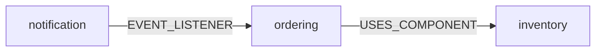

# Định dạng JSON của Module Actuator trong Spring Modulith

## 1. JSON của Module Actuator dùng để làm gì?

Spring Modulith giúp tổ chức một ứng dụng Spring Boot thành các **application module** với ranh giới API và các quan hệ phụ thuộc rõ ràng. Khi chạy ứng dụng, **Application Module Actuator** cung cấp mô hình module qua endpoint HTTP `GET /actuator/modulith`. Nhờ đó, công cụ vận hành hoặc lập tài liệu có thể đọc cùng một cấu trúc module mà Spring Modulith nhận diện từ mã nguồn.

Ví dụ, hệ thống bán hàng có ba module:

- `ordering`: nhận và xử lý đơn hàng.
- `inventory`: quản lý tồn kho.
- `notification`: lắng nghe sự kiện đặt hàng để gửi thông báo.

JSON từ Module Actuator giúp trả lời: hệ thống nhận diện module nào, package gốc của chúng nằm ở đâu, và module nào đang **phụ thuộc** module nào. Đây là một **biểu diễn cấu trúc**, không phải nhật ký từng lần gọi hoặc kết quả đo độ trễ lúc chạy.

> **Mục tiêu:** đọc được cấu trúc response JSON, phân biệt hướng và loại dependency, truy vấn dữ liệu bằng công cụ thông dụng, và biết khi nào cần dùng module graph kết hợp metrics/tracing để kiểm chứng kiến trúc.

## 2. Phân biệt hai response JSON thường gặp

### 2.1. `GET /actuator`: tài liệu khám phá endpoint

Khi Spring Boot Actuator được bật và endpoint `modulith` được expose, một response từ `GET /actuator` có thể chứa đoạn sau (rút gọn):

```json
{
  "_links": {
    "self": {
      "href": "http://localhost:8080/actuator",
      "templated": false
    },
    "modulith": {
      "href": "http://localhost:8080/actuator/modulith",
      "templated": false
    }
  }
}
```

Đây là **discovery document** của Actuator: `_links.modulith.href` cho biết URL để truy cập endpoint. Nó **không phải dữ liệu module graph**. Các link khác như `health`, `metrics` có thể cùng tồn tại; URL thực tế thay đổi theo management port, base path, proxy hoặc cấu hình bảo mật.

### 2.2. `GET /actuator/modulith`: JSON cấu trúc module

Response chính của Module Actuator là một **JSON object**. Mỗi **key cấp cao nhất** là tên kỹ thuật của một application module. Giá trị tại key đó là object chứa metadata và các dependency của module.

```text
{
  "<module-identifier>": {
    "displayName": "...",
    "basePackage": "...",
    "dependencies": [
      {
        "target": "<another-module-identifier>",
        "types": ["DEFAULT" | "USES_COMPONENT" | "EVENT_LISTENER"]
      }
    ],
    "parent": "...",  // có thể không có
    "nested": ["..."]  // có thể không có
  },
  "<another-module-identifier>": { ... }
}
```

Khối trên **diễn tả schema**, không phải JSON hợp lệ để copy vào chương trình: chú thích `//`, dấu `...` và ký hiệu `|` chỉ là cách ghi chú. Xem ví dụ JSON hợp lệ ngay dưới để thử với parser.

**Điểm cần nhớ:** response không mặc định có `modules: []`, `items: []` hoặc `data: {}` bao ngoài. Công cụ đọc JSON phải duyệt **các key động tại root**, thay vì tìm một array `modules` không tồn tại.

## 3. Ví dụ JSON hợp lệ và cách đọc

Giả sử `ordering` sử dụng Spring bean thuộc API `inventory`, còn `notification` nghe domain event `OrderPlaced` do `ordering` công bố. Response **minh họa, có thể parse trực tiếp**:

```json
{
  "inventory": {
    "basePackage": "com.example.shop.inventory",
    "displayName": "Inventory",
    "dependencies": []
  },
  "ordering": {
    "basePackage": "com.example.shop.ordering",
    "displayName": "Ordering",
    "dependencies": [
      {
        "target": "inventory",
        "types": ["USES_COMPONENT"]
      }
    ]
  },
  "notification": {
    "basePackage": "com.example.shop.notification",
    "displayName": "Notification",
    "dependencies": [
      {
        "target": "ordering",
        "types": ["EVENT_LISTENER"]
      }
    ]
  }
}
```

Đọc JSON từ **ngoài vào trong**:

1. Key `inventory`, `ordering`, `notification` là **module identifiers** dùng để tham chiếu lẫn nhau.
2. `ordering.basePackage` là package gốc của module ordering: `com.example.shop.ordering`.
3. `ordering.displayName` là tên dễ đọc, dùng trong UI/tài liệu; không nhất thiết bằng key `ordering`.
4. `ordering.dependencies[0].target = "inventory"` nghĩa là **ordering phụ thuộc inventory**. Hướng phụ thuộc đi **từ module đang chứa mảng `dependencies` đến module được nêu trong `target`**.
5. `ordering.dependencies[0].types = ["USES_COMPONENT"]` mô tả kiểu phụ thuộc là sử dụng Spring component.
6. `notification.dependencies[0].target = "ordering"` cho biết notification có dependency đến ordering do lắng nghe event do ordering định nghĩa/công bố.
7. `inventory.dependencies = []` nghĩa là **không phát hiện outgoing dependency nào ở đây**, không có nghĩa không module nào gọi inventory.

Sơ đồ hướng phụ thuộc tương ứng:



Chú ý: sơ đồ này là **module dependency graph**, không phải thứ tự một request chạy từ HTTP đến database. Nếu muốn theo dõi đường đi của một request cụ thể, cần tracing và các spans phù hợp.

## 4. Giải thích từng trường JSON bằng JSONPath

Theo tài liệu chính thức Spring Modulith, các đường dẫn sau mô tả cấu trúc response:

| JSONPath / trường | Kiểu dữ liệu | Ý nghĩa |
| --- | --- | --- |
| `$.{moduleName}` | Object | Module ứng với **tên kỹ thuật** `moduleName`; key này cũng là đích của `dependencies[].target` |
| `$.{moduleName}.displayName` | String | Tên hiển thị thân thiện với người đọc |
| `$.{moduleName}.basePackage` | String | Tên đầy đủ của base package xác định module |
| `$.{moduleName}.dependencies` | Array | Danh sách các quan hệ **đi ra** từ module này |
| `$.{moduleName}.dependencies[*].target` | String | Key kỹ thuật của module đích, ví dụ `inventory` |
| `$.{moduleName}.dependencies[*].types` | Array of strings | Một hoặc nhiều loại dependency đến cùng target |
| `$.{moduleName}.parent` | String, tùy chọn | Định danh module cha nếu đây là nested module |
| `$.{moduleName}.nested` | Danh sách tên, tùy chọn | Các nested module của module hiện tại, nếu có |

Ở bảng này, `{moduleName}` là **biến thay thế**; đây không phải tên trường cố định trong JSON. Ví dụ đường dẫn thực tế:

- `$.ordering.displayName` → `"Ordering"`.
- `$.ordering.basePackage` → `"com.example.shop.ordering"`.
- `$.ordering.dependencies[0].target` → `"inventory"`.
- `$.notification.dependencies[0].types[0]` → `"EVENT_LISTENER"`.

### 4.1. Tại sao `dependencies` là array?

Một module có thể phụ thuộc nhiều module, nên `dependencies` là mảng các **edge**. Mỗi edge nêu đích `target` và tập `types`. Ví dụ một module `checkout` vừa sử dụng bean vừa lắng nghe event của module `payment`:

```json
{
  "checkout": {
    "basePackage": "com.example.shop.checkout",
    "displayName": "Checkout",
    "dependencies": [
      {
        "target": "payment",
        "types": ["USES_COMPONENT", "EVENT_LISTENER"]
      }
    ]
  },
  "payment": {
    "basePackage": "com.example.shop.payment",
    "displayName": "Payment",
    "dependencies": []
  }
}
```

Ở đây **một target** có **nhiều loại quan hệ**. Đừng viết parser chỉ lấy `types[0]` rồi coi như đã đọc hết. Thứ tự phần tử trong `types` không phải thông tin về thứ tự lời gọi; hãy xử lý nó như một tập nhãn dependency.

### 4.2. Ba giá trị `types` có nghĩa gì?

| Giá trị | Ý nghĩa cấu trúc | Ví dụ |
| --- | --- | --- |
| `DEFAULT` | Phụ thuộc kiểu Java thông thường; module này tham chiếu một type thuộc module khác | Một DTO hoặc interface từ module khác được sử dụng trong mã |
| `USES_COMPONENT` | Phụ thuộc có sử dụng Spring bean/component của module khác | Bean `OrderService` gọi bean `InventoryManagement` |
| `EVENT_LISTENER` | Quan hệ được phát hiện qua việc lắng nghe application/domain event | `notification` lắng nghe `OrderPlaced` do `ordering` khai báo |

`EVENT_LISTENER` không có nghĩa “event listener xử lý thành công trong runtime”; nó là **loại phụ thuộc trong cấu trúc module**. Tương tự, `USES_COMPONENT` không cho biết số lần bean được gọi hoặc tốc độ gọi.

### 4.3. `parent` và `nested`: hai trường tùy chọn

Với module lồng nhau, Spring Modulith hiện hỗ trợ biểu diễn module cha và danh sách module con. Trong mô hình có module `inventory` và nested module `inventory.reservation`:

- Object của nested module có thể mang `parent` trỏ về module cha.
- Object của module cha có thể mang `nested` chứa tên các nested modules.
- Các trường này **không bắt buộc** xuất hiện trong mọi module hoặc mọi phiên bản Spring Modulith; không có trường không có nghĩa JSON bị lỗi.

Nested application module là khái niệm kiến trúc của Spring Modulith, **khác** với Java package con thông thường. Không tự suy rằng mọi thư mục `internal` hoặc mọi subpackage đều là một nested module.

## 5. Bật endpoint và lấy JSON trong Spring Boot

### 5.1. Dependencies cần có

Nếu dự án đã dùng `spring-modulith-starter-insight`, nó có thể bao gồm support cho Module Actuator. Nếu chỉ cần endpoint mô hình module, sử dụng Spring Modulith Actuator cùng Spring Boot Actuator theo dependency management của dự án.

Ví dụ với Gradle Kotlin DSL:

```kotlin
dependencies {
    runtimeOnly("org.springframework.modulith:spring-modulith-actuator")
    runtimeOnly("org.springframework.boot:spring-boot-starter-actuator")
}
```

Hoặc Maven:

```xml
<dependency>
    <groupId>org.springframework.modulith</groupId>
    <artifactId>spring-modulith-actuator</artifactId>
    <scope>runtime</scope>
</dependency>
<dependency>
    <groupId>org.springframework.boot</groupId>
    <artifactId>spring-boot-starter-actuator</artifactId>
    <scope>runtime</scope>
</dependency>
```

Các đoạn trên giả định dự án đã quản lý các version Spring Boot và Spring Modulith tương thích; nếu chưa, phải cấu hình BOM/version tương ứng. Không cần khai báo đồng thời `spring-modulith-starter-insight` với `spring-modulith-actuator` chỉ để kích hoạt cùng chức năng.

### 5.2. Expose endpoint qua HTTP

`modulith` là ID của endpoint, còn URL mặc định của Spring Boot Actuator thường có prefix `/actuator`. Ví dụ cấu hình môi trường học tập:

```yaml
management:
  endpoints:
    web:
      exposure:
        include: health, modulith
```

Thử:

```bash
curl -i http://localhost:8080/actuator
curl -sS http://localhost:8080/actuator/modulith
```

Kỳ vọng response thứ hai là một JSON object có các key tương ứng application modules. Nếu dùng `management.server.port`, `management.endpoints.web.base-path` hoặc reverse proxy, URL cần thay cho đúng. Quyền truy cập endpoint và HTTP exposure là hai lớp điều kiện riêng: endpoint phải có trên classpath, được phép hoạt động, được expose và request phải qua security.

**Lưu ý bảo mật:** JSON công khai base package và dependency nội bộ; nên giới hạn truy cập endpoint ở vùng quản trị/đội vận hành. Việc expose `modulith` không đồng nghĩa phải mở mọi endpoint Actuator.

## 6. Khai thác JSON để trả lời câu hỏi kiến trúc

### 6.1. Với `jq` trong terminal

Giả sử endpoint trả JSON đúng cấu trúc ở mục 3. Trên hệ có `jq`:

**Liệt kê các định danh module:**

```bash
curl -sS http://localhost:8080/actuator/modulith \
  | jq -r 'keys[]'
```

Kết quả minh họa:

```text
inventory
notification
ordering
```

**Đọc package của một module:**

```bash
curl -sS http://localhost:8080/actuator/modulith \
  | jq -r '.ordering.basePackage'
```

Kết quả: `com.example.shop.ordering`.

**Xuất danh sách cạnh phụ thuộc và loại quan hệ:**

```bash
curl -sS http://localhost:8080/actuator/modulith \
  | jq -r 'to_entries[] as $m | $m.value.dependencies[]? |
      "\($m.key) -> \(.target) [\(.types | join(", "))]"'
```

Kết quả minh họa:

```text
notification -> ordering [EVENT_LISTENER]
ordering -> inventory [USES_COMPONENT]
```

Biểu thức `[]?` cho phép bỏ qua dependency array không có phần tử. Kết quả câu lệnh phụ thuộc vào các module thực tế và thứ tự duyệt JSON; tên module không phải do `jq` tự suy từ package.

### 6.2. Với Jackson trong Java

Nếu muốn sinh báo cáo module graph, có thể parse JSON thành cây `JsonNode` và duyệt dynamic keys. Giả sử biến `json` chứa **response body** của `GET /actuator/modulith`:

```java
import com.fasterxml.jackson.databind.JsonNode;
import com.fasterxml.jackson.databind.ObjectMapper;
import java.util.Iterator;
import java.util.Map;

public class ModulithDependencyReader {

    public static void printDependencies(String json) throws Exception {
        JsonNode root = new ObjectMapper().readTree(json);

        if (!root.isObject()) {
            throw new IllegalArgumentException("Expected module map JSON");
        }

        Iterator<Map.Entry<String, JsonNode>> modules = root.fields();
        while (modules.hasNext()) {
            var module = modules.next();
            String source = module.getKey();

            for (JsonNode dependency : module.getValue().path("dependencies")) {
                String target = dependency.path("target").asText();
                String types = dependency.path("types").toString();
                System.out.printf("%s -> %s %s%n", source, target, types);
            }
        }
    }
}
```

Ưu điểm là không cần giả định một danh sách module cố định. Khi chương trình cần tính độ sâu module hoặc dựng graph, có thể gom các cạnh `(source, target, types)` rồi xây mô hình riêng. Nếu cần tương thích nhiều phiên bản, parser nên chấp nhận các trường tùy chọn và không phụ thuộc vào thứ tự key của object.

### 6.3. Đọc incoming dependency

Trong ví dụ mục 3, `inventory.dependencies = []` nhưng module `inventory` **vẫn có incoming dependency** từ `ordering`. Muốn biết “những module nào phụ thuộc inventory”, cần duyệt **mọi module** và tìm các edge có `target == "inventory"`. Không thể lấy danh sách incoming trực tiếp bằng cách đọc `inventory.dependencies`.

Một truy vấn `jq` minh họa:

```bash
curl -sS http://localhost:8080/actuator/modulith \
  | jq -r 'to_entries[] as $m | $m.value.dependencies[]? |
      select(.target == "inventory") | $m.key'
```

Kết quả: `ordering`. Đây là phép tra cứu **ngược hướng** so với cách đọc `dependencies` mặc định.

## 7. Những gì JSON **không** cung cấp

JSON Module Actuator mô tả mô hình kiến trúc mà framework nhận diện. Nó **không tự ghi lại một lịch sử tương tác runtime**:

| Câu hỏi | JSON `/actuator/modulith` trả lời? | Công cụ/bằng chứng phù hợp |
| --- | --- | --- |
| “Ứng dụng có các module nào?” | **Có** | Root keys trong JSON |
| “Module ordering phụ thuộc inventory theo loại nào?” | **Có** | `ordering.dependencies[].target/types` |
| “Inventory có package gốc nào?” | **Có** | `inventory.basePackage` |
| “HTTP request vừa rồi thực sự đi qua những method nào?” | **Không** | Traces/spans khi đã instrument |
| “Lời gọi inventory mất bao lâu, lỗi bao nhiêu lần?” | **Không** | Timer, Counter và trace backend |
| “Domain event OrderPlaced đã đến và được listener hoàn tất?” | **Không** | Event publication registry, logs và metrics/traces liên quan |
| “Mọi dependency đều tuân thủ ranh giới công bố?” | **Không tự chứng minh** | `ApplicationModules.verify()` và kiểm thử kiến trúc |

Trong hệ thống Spring Modulith có tích hợp **Insight**, **Actuator Module** và **observability** bổ sung cho nhau. Endpoint cung cấp **graph mô-đun được phát hiện**; module spans và trace cho biết **tương tác được instrument** khi chạy; event metrics cho biết **số liệu publish**. Không nên dùng một trong các nguồn trên để suy kết quả của nguồn khác mà chưa kiểm chứng.

## 8. Vòng thực hành: kiểm tra JSON đúng như thiết kế

Với giả thiết có ba module `ordering`, `inventory`, `notification`:

1. **Xác nhận endpoint được expose.** Gọi `GET /actuator`, quan sát `_links.modulith.href`; nếu không có link, kiểm tra dependency, exposure và quyền truy cập.
2. **Lấy response module.** Gọi `GET /actuator/modulith`; kiểm tra root là object, không phải `modules` array.
3. **Đối chiếu module identifiers.** Đảm bảo có key `ordering`, `inventory` và `notification` cùng đúng `basePackage`.
4. **Đối chiếu hướng cạnh.** Kiểm tra `ordering -> inventory` với `USES_COMPONENT`; nếu notification nghe event của ordering thì có thể thấy `notification -> ordering` với `EVENT_LISTENER`.
5. **Kiểm tra thay đổi cấu trúc.** Thêm hoặc bỏ phụ thuộc mã nguồn trong môi trường thử nghiệm, rebuild/restart ứng dụng và so sánh JSON. Đừng mong JSON tự thay đổi giữa chừng chỉ vì một request khác đi qua ứng dụng.
6. **Kiểm chứng quy tắc kiến trúc độc lập.** Chạy kiểm thử sử dụng `ApplicationModules.verify()` để phát hiện phụ thuộc sai ranh giới; dùng trace/metrics khi muốn điều tra lời gọi thực tế.

### 8.1. Khi kết quả khác kỳ vọng

| Triệu chứng | Nguyên nhân có thể | Hướng kiểm tra |
| --- | --- | --- |
| `GET /actuator/modulith` trả 404 | Chưa có dependency, chưa expose, endpoint không khả dụng hoặc URL/port khác | Kiểm tra Actuator discovery, runtime classpath, management config |
| Trả 401/403 | Bảo mật chặn endpoint | Kiểm tra Spring Security và quyền của tài khoản vận hành |
| Key module không đúng kỳ vọng | Package structure hoặc custom module detection khác thiết kế | Kiểm tra `@SpringBootApplication` root package, `@ApplicationModule`, chiến lược detection |
| Dependency có hướng “ngược” | Đã hiểu nhầm `target` là module gọi sang module hiện tại | Đọc từ owner của `dependencies[]` đến `target` |
| Có nhiều `types` trên một dependency | Một cặp module có nhiều dạng phụ thuộc | Duyệt toàn bộ array `types` |
| `parent` hoặc `nested` không có | Không dùng nested modules hoặc version/schema không xuất trường | Xem cách cấu hình nested và phiên bản đang sử dụng |
| JSON có dependency nhưng trace không thấy | Dependency mô tả cấu trúc, không bảo đảm request đã chạy hoặc được tracing | Gửi request đi qua điểm instrument; kiểm tra sampling/exporter |

## 9. Khác biệt phiên bản và các lưu ý khi xây công cụ

- Tài liệu Spring Modulith hiện hành gọi endpoint là **`modulith`**; các bản rất cũ từng dùng ID **`applicationmodules`**. Khi duy trì dự án cũ, kiểm tra đúng tài liệu của phiên bản đang dùng.
- Các bản mới mô tả thêm `parent` và `nested` cho nested modules. Những công cụ tự viết nên xem đây là trường tùy chọn, tránh hardcode schema thiếu khả năng mở rộng.
- Nếu cần xuất metadata thành JSON ở build/test, Spring Modulith còn có `ApplicationModulesExporter`. API `toJson()` và `toFullJson()` phục vụ những nhu cầu khác nhau; output chi tiết của `toFullJson()` không nên được mặc nhiên coi là schema chuẩn của `/actuator/modulith`.
- **JSON object không có thứ tự key mang ý nghĩa nghiệp vụ**. Không suy thứ tự khởi chạy module, thứ tự event hay chuỗi gọi method từ thứ tự các key trong response.
- Khi lưu JSON snapshot để so sánh phiên bản, nên chuẩn hóa thứ tự key và loại bỏ chi tiết chỉ khác cách serialize; đồng thời theo dõi dependency types, module identifiers và base packages để nhận diện thay đổi thật.

## 10. Tổng kết

Để đọc JSON của Module Actuator chính xác, hãy nhớ bốn quy tắc:

1. `GET /actuator` cho biết **link endpoint**; `GET /actuator/modulith` mới trả về **module map**.
2. Mỗi **key root** là một **module identifier**; metadata gồm `displayName`, `basePackage` và mảng `dependencies`.
3. Dependency có hướng **module hiện tại → `target`**; `types` có thể chứa nhiều loại gồm `DEFAULT`, `USES_COMPONENT` và `EVENT_LISTENER`.
4. JSON phản ánh **cấu trúc application module**. Muốn đo tương tác khi chạy, kết hợp tracing, metrics và việc kiểm thử ranh giới module.

Khi đọc đúng cấu trúc này, đội phát triển có thể sinh module graph, tạo báo cáo phụ thuộc, phát hiện thay đổi giữa các bản triển khai và đối chiếu dữ liệu runtime với kiến trúc kỳ vọng.

### Tài liệu tham khảo

- [Spring Modulith — Production-ready Features, Application Module Actuator](https://docs.spring.io/spring-modulith/reference/production-ready.html): định nghĩa các JSONPath, ý nghĩa `dependencies` và ví dụ response.
- [Spring Modulith — Fundamentals](https://docs.spring.io/spring-modulith/reference/fundamentals.html): cách xác định application module, module API và nested modules.
- [Spring Boot — Actuator Endpoints](https://docs.spring.io/spring-boot/reference/actuator/endpoints.html): quy tắc exposure và giới hạn truy cập endpoint.
- [Spring Modulith — ApplicationModulesExporter API](https://docs.spring.io/spring-modulith/docs/current/api/org/springframework/modulith/core/util/ApplicationModulesExporter.html): phân biệt xuất JSON qua API với endpoint runtime.
