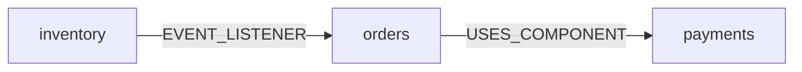
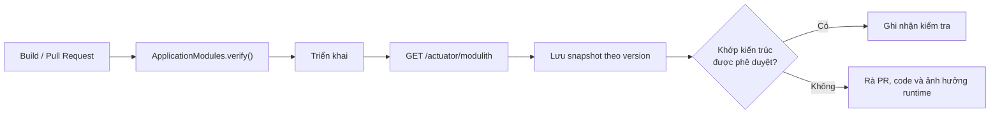
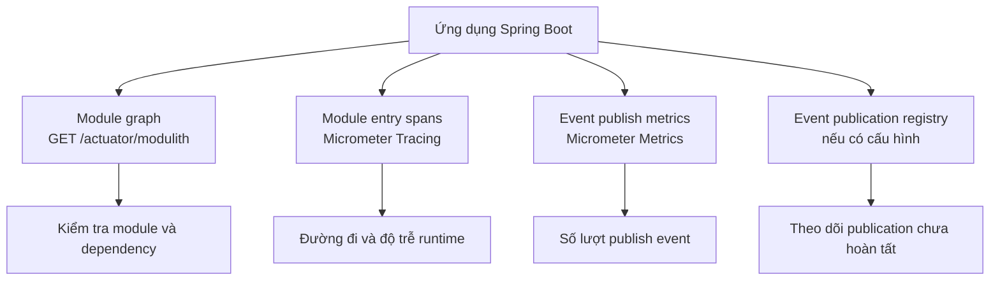

# Đưa endpoint vào tài liệu vận hành

> **Chương:** Module Actuator  
> **Bối cảnh:** Spring Modulith giúp mô tả ranh giới application module của một ứng dụng Spring Boot; Actuator cho phép nhóm vận hành truy xuất mô hình đó. Bài học hướng dẫn cách ghi endpoint vào runbook để kiểm tra kiến trúc khi triển khai và khi điều tra sự cố.

## Mục tiêu học tập

Sau bài này, bạn có thể:

1. Giải thích endpoint `/actuator/modulith` cung cấp dữ liệu gì và dữ liệu đó khác với trace, metrics, health check thế nào.
2. Kích hoạt, expose và bảo vệ endpoint một cách có kiểm soát trong ứng dụng Spring Boot.
3. Đọc danh sách application module, package gốc và phụ thuộc trong response để xác nhận sơ đồ kiến trúc.
4. Viết một mục **tài liệu vận hành** có URL, quyền truy cập, cách kiểm tra, kết quả mong đợi, cách xử lý lỗi và người chịu trách nhiệm.
5. Lấy bản chụp mô hình module theo phiên bản triển khai, nhận diện thay đổi ranh giới và kết hợp bằng chứng runtime để điều tra.

## 1. Vì sao endpoint kiến trúc phải có mặt trong runbook?

Một ứng dụng Spring Boot theo kiến trúc modular monolith có thể chứa nhiều application module như `orders`, `payments` và `inventory`. Khi triển khai, những module này vẫn chạy trong **cùng tiến trình ứng dụng**, vì vậy dashboard chỉ nhìn thấy một service có thể chưa đủ để biết:

- Phiên bản đang chạy thực sự có những module nghiệp vụ nào.
- Module nào đang phụ thuộc vào module nào, và phụ thuộc theo loại nào.
- Ranh giới package/module có thay đổi sau một lần release không.
- Liệu một cảnh báo về dependency vòng hoặc tham chiếu sai API module có liên quan đến bản phát hành mới không.

Spring Modulith cho phép trình bày mô hình application module qua một endpoint Actuator, thường có đường dẫn:

```http
GET /actuator/modulith
```

Đây là nguồn dữ liệu **kiến trúc do ứng dụng đang chạy công bố**. Nhóm vận hành cần biết cách truy cập, diễn giải và so sánh thông tin này với bản thiết kế được phê duyệt.

Tuy nhiên, `/actuator/modulith` không thay thế:

- `/actuator/health`: tình trạng sức khỏe/liveness/readiness theo cấu hình.
- `/actuator/metrics`: các số đo trong quá trình chạy.
- Trace của Micrometer/OpenTelemetry/Brave: đường đi của request, span và độ trễ.
- Kiểm thử kiến trúc `ApplicationModules.verify()`: xác minh các ràng buộc mô-đun trước khi phát hành.

Một endpoint trả `200 OK` có nghĩa là request tới endpoint đó thành công; điều này **không tự chứng minh** mọi module xử lý nghiệp vụ đúng, event listener hoạt động thành công hay ứng dụng đáp ứng các chỉ tiêu hiệu năng.

## 2. Mô hình ví dụ dùng xuyên suốt

Giả sử ứng dụng `shop-service` có ba application module:

```text
com.example.shop
├── ShopApplication.java
├── orders
│   ├── OrderPlaced.java
│   └── internal
│       └── CheckoutService.java
├── payments
│   ├── PaymentService.java
│   └── internal
│       └── DefaultPaymentService.java
└── inventory
    └── internal
        └── InventoryOnOrderPlaced.java
```

Quy tắc nghiệp vụ dự kiến:

- `orders` gọi API `payments.PaymentService` để xử lý thanh toán; đây là một phụ thuộc component giữa hai module.
- `orders` công bố event `OrderPlaced`; `inventory` đăng ký listener cho kiểu event này.
- Module `payments` không phụ thuộc trở lại `orders`.

Sơ đồ sau ghi **hướng phụ thuộc tĩnh**:



Lưu ý: event đi từ `orders` đến listener của `inventory`, nhưng dependency trong sơ đồ lại là `inventory → orders`, bởi vì listener sử dụng **kiểu event** do `orders` khai báo. Tài liệu vận hành phải ghi rõ quy ước hướng mũi tên để tránh diễn giải ngược khi so sánh graph.

## 3. Kích hoạt endpoint Module Actuator

### 3.1. Dependency

Trong dự án dùng Spring Modulith với BOM/dependency management tương thích:

```groovy
dependencies {
    runtimeOnly 'org.springframework.modulith:spring-modulith-starter-insight'
}
```

Insight starter tập hợp khả năng quan sát module, trong đó có tích hợp Actuator để công bố mô hình module. Nếu không dùng starter tổng hợp, có thể cấu hình các phần riêng như `spring-modulith-actuator` và Spring Boot Actuator, tùy nhu cầu.

Không tự điền phiên bản artifact độc lập nếu dự án đã sử dụng BOM. Chỉ dùng phiên bản Spring Modulith tương thích với dòng Spring Boot đã chọn.

### 3.2. Expose endpoint

Trong `application.yml` của môi trường thực hành:

```yaml
spring:
  application:
    name: shop-service

management:
  endpoints:
    web:
      exposure:
        include: health,info,modulith
```

Với base path mặc định `/actuator` và cổng ứng dụng `8080`, có thể truy cập:

```http
GET http://localhost:8080/actuator/modulith
Accept: application/json
```

Việc **có bean endpoint** và việc **endpoint được expose qua HTTP** là hai điều kiện khác nhau. Khi nhận `404`, trước tiên kiểm tra dependency, cấu hình exposure, base path và management port, không kết luận ngay rằng ứng dụng không có application module.

### 3.3. Endpoint ở cổng management riêng

Trong một số hệ thống, Actuator phục vụ trên cổng nội bộ tách khỏi cổng API nghiệp vụ:

```yaml
management:
  server:
    port: 8081
  endpoints:
    web:
      base-path: /actuator
      exposure:
        include: health,info,modulith
```

Khi đó URL thường là `http://<host>:8081/actuator/modulith`. Cấu hình port riêng giúp định tuyến quyền truy cập thuận tiện hơn, nhưng **không tự động bảo mật**. Hệ thống vẫn cần kiểm soát mạng, xác thực và phân quyền.

Nếu tổ chức đã thay đổi `management.endpoints.web.base-path` hoặc `management.endpoints.web.path-mapping`, hãy ghi **URL hiệu lực** vào runbook thay vì chỉ sao chép đường dẫn mặc định.

## 4. Đọc response để hiểu kiến trúc

Ví dụ JSON **minh họa về mặt khái niệm** cho ba module ở trên:

```json
{
  "orders": {
    "displayName": "Orders",
    "basePackage": "com.example.shop.orders",
    "dependencies": [
      {
        "target": "payments",
        "types": ["USES_COMPONENT"]
      }
    ]
  },
  "payments": {
    "displayName": "Payments",
    "basePackage": "com.example.shop.payments",
    "dependencies": []
  },
  "inventory": {
    "displayName": "Inventory",
    "basePackage": "com.example.shop.inventory",
    "dependencies": [
      {
        "target": "orders",
        "types": ["EVENT_LISTENER"]
      }
    ]
  }
}
```

**Đây không phải hợp đồng JSON cố định áp dụng cho mọi phiên bản.** Response thật có thể bổ sung metadata hoặc thay đổi cấu trúc biểu diễn theo phiên bản Spring Modulith. Khi xây dựng chương trình đọc tự động, nhóm vận hành phải ghi rõ phiên bản thư viện được hỗ trợ và kiểm tra response mẫu từ chính ứng dụng.

Ý nghĩa của các thành phần cần đưa vào hướng dẫn:

| Thành phần | Cách đọc | Ví dụ |
| --- | --- | --- |
| Khóa module hoặc identifier | Định danh của application module | `orders` |
| `displayName` | Tên dễ đọc cho người vận hành | `Orders` |
| `basePackage` | Package nền tạo ranh giới module | `com.example.shop.orders` |
| `dependencies` | Những module mà module hiện tại phụ thuộc vào | `orders` có dependency tới `payments` |
| `target` | Module **đích của phụ thuộc tĩnh** | `payments` |
| `types` | Loại phụ thuộc được phát hiện | `USES_COMPONENT`, `EVENT_LISTENER`, `DEFAULT` |

Các loại phụ thuộc tiêu biểu:

| Loại | Cách hiểu |
| --- | --- |
| `USES_COMPONENT` | Module đang xét phụ thuộc vào component/bean thuộc module đích. |
| `EVENT_LISTENER` | Module đang xét có listener tham chiếu kiểu event được định nghĩa tại module đích. |
| `DEFAULT` | Phụ thuộc mã nguồn không thuộc các trường hợp chuyên biệt trên. |

Loại phụ thuộc mô tả **cấu trúc phát hiện được**, không phải cam kết rằng một request cụ thể đã đi qua quan hệ đó. Muốn biết chuyện gì xảy ra trong một lần xử lý, phải đối chiếu với trace và log.

### 4.1. Ví dụ diễn giải cho ca trực

Đọc thấy:

```text
orders -> payments      [USES_COMPONENT]
inventory -> orders     [EVENT_LISTENER]
```

Diễn giải:

1. Module `orders` sử dụng API/component mà `payments` cung cấp.
2. Module `inventory` đăng ký xử lý kiểu event thuộc `orders`.
3. Không có cạnh `payments → orders` trong mẫu; chỉ từ dữ liệu này chưa thể kết luận *mọi hành vi runtime* của `payments` độc lập với `orders`.

Nếu sau release xuất hiện một cạnh mới `payments → orders`, cần mở phiếu đánh giá kiến trúc: cạnh đó có được phê duyệt hay tạo vòng `orders ↔ payments`? Để xác nhận vi phạm kiến trúc, dùng kiểm thử `ApplicationModules.verify()` và mã nguồn thay đổi, không dựa chỉ vào nhận xét bằng mắt từ response.

## 5. Tài liệu vận hành cần ghi những thông tin nào?

Một tài liệu bàn giao chỉ ghi "xem `/actuator/modulith`" là chưa đủ. Người trực hệ thống cần biết **khi nào dùng, dùng ở đâu, được quyền nào, xem kết quả ra sao và khi nào phải chuyển cấp**.

| Nhóm thông tin | Trường nên ghi trong runbook | Mục đích |
| --- | --- | --- |
| Định danh | Service, môi trường, owner, phiên bản ứng dụng, version Spring Modulith | Biết đang kiểm tra hệ thống nào và cách đọc JSON nào áp dụng. |
| Truy cập | URL nội bộ, HTTP method, Accept, management port/base path | Không mất thời gian dò đường dẫn khi có sự cố. |
| Bảo mật | Vai trò được đọc, phương thức xác thực, mạng cho phép | Tránh lộ sơ đồ kiến trúc ra Internet. |
| Kết quả mong đợi | HTTP code, module dự kiến, base package, dependency quan trọng | So sánh bản chạy với bản thiết kế. |
| Hành động kiểm tra | Câu lệnh gọi API, cách lưu snapshot, cách đối chiếu | Giúp mọi người làm cùng một thao tác. |
| Xử lý bất thường | 401/403, 404, 5xx, module biến mất, dependency mới | Có đường chẩn đoán cụ thể. |
| Vận hành thay đổi | Mốc snapshot, link release/commit, người duyệt lệch graph | Tìm nguyên nhân của thay đổi ranh giới. |
| Liên hệ runtime | Dashboard trace/metrics, log theo correlation ID, event registry | Không nhầm dữ liệu tĩnh với tình trạng xử lý. |

Nếu service có nhiều instance, cần ghi rõ endpoint trả mô hình **của instance nào**. Các instance đồng nhất về binary/configuration thường cho cùng cấu trúc; trong thời điểm rolling deployment, có thể đồng thời tồn tại hai phiên bản graph.

## 6. Mẫu runbook có thể áp dụng

Mẫu dưới đây dùng tên và địa chỉ **giả định**; khi áp dụng phải thay các placeholder bằng thông tin thực tế của đội vận hành.

> ### Runbook — Application module graph của shop-service
>
> **Mục đích:** Xác minh ranh giới module và dependency kiến trúc trên phiên bản đang chạy khi triển khai, rollback hoặc điều tra thay đổi bất thường.
>
> **Service:** `shop-service`  
> **Môi trường:** `staging` / `production`  
> **Owner:** nhóm phát triển shop-service; ca trực SRE/Operations  
> **URL nội bộ:** `https://<management-host>/actuator/modulith`  
> **Phương thức:** `GET`, Accept: `application/json`  
> **Phân quyền:** chỉ tài khoản/máy trạm thuộc nhóm vận hành được phép đọc graph; truy cập qua mạng quản trị được kiểm soát.  
> **Kỳ vọng:** `200 OK`, JSON chứa `orders`, `payments`, `inventory` cùng base package và dependency như thiết kế được phê duyệt.  
> **Thời điểm kiểm tra:** sau mỗi deployment/rollback và khi sự cố có dấu hiệu liên quan ranh giới module.  
> **Nguồn chuẩn để đối chiếu:** snapshot JSON gắn với release đã được duyệt và kiểm thử kiến trúc trong CI.  
> **Điều kiện chuyển cấp:** thiếu module dự kiến, xuất hiện dependency không được phê duyệt, không truy cập được endpoint sau xác nhận cấu hình hợp lệ hoặc response thay đổi cấu trúc gây lỗi bộ phân tích.
>
> **Các bước thao tác:** truy cập endpoint bằng danh tính vận hành; xác nhận status code và nội dung JSON; so module identifiers/base package/dependencies với snapshot đúng version; lập biên bản thay đổi và liên kết mã release nếu có chênh lệch.
>
> **Chẩn đoán bước đầu:** xem bảng xử lý sự cố ở mục 10; khi cần đối chiếu hành vi runtime, dùng trace/log/metrics thay vì suy diễn từ graph.

Trong hệ thống thật, runbook nên nằm cạnh tài liệu release, kiến trúc module và quy trình trực sự cố; người đọc cần mở được runbook ngay cả khi dịch vụ nghiệp vụ đang lỗi.

## 7. Cách lấy dữ liệu và lưu snapshot theo release

### 7.1. Truy vấn thủ công

Ví dụ gọi endpoint nội bộ trong lab:

```bash
curl -fsS \
  -H 'Accept: application/json' \
  'http://localhost:8080/actuator/modulith'
```

Ở môi trường có bảo vệ, sử dụng cơ chế cấp token/chứng chỉ được tổ chức quy định; **không nhúng token thật** trong tài liệu, script chia sẻ hoặc bản snapshot.

Cách lưu snapshot để đính kèm biên bản phát hành:

```bash
# Chạy trong môi trường được phép truy cập endpoint.
curl -fsS \
  -H 'Accept: application/json' \
  'http://localhost:8080/actuator/modulith' \
  -o 'shop-service-module-graph-release-2026-11.json'
```

Tên file chỉ để minh họa. Trong vận hành thực tế, định danh bằng **version/build SHA và môi trường**, không lấy ngày làm bằng chứng duy nhất vì có thể phát hành nhiều lần trong ngày.

### 7.2. Snapshot phải đi kèm metadata

Nên lưu đồng thời:

- Service và môi trường, instance hoặc deployment revision.
- Thời điểm thu thập theo UTC.
- Git commit/build version của binary đang chạy.
- Phiên bản Spring Boot và Spring Modulith.
- Đường dẫn endpoint thực tế, HTTP status, nội dung response.
- Người/phần mềm thực hiện thu thập và dấu vết phê duyệt thay đổi.

Với hệ thống nhiều instance, có thể kiểm tra một instance cho **mỗi phiên bản binary/configuration** hiện diện trong rollout; không mặc định rằng mọi instance đang ở cùng version.

Snapshot chứa thông tin package, dependency và tên module. Hãy cất trong kho nội bộ có quyền đọc phù hợp; không đưa nguyên snapshot production vào nguồn công khai nếu chưa rà soát.

### 7.3. So sánh cấu trúc, không so sánh thứ tự JSON

Khi cần phát hiện thay đổi qua các release, nên chuẩn hóa:

1. Danh sách module identifier và `basePackage`.
2. Tập cạnh `(source, target, sorted dependency types)`.
3. Các thuộc tính kiến trúc quan trọng khác được quy định bởi chính phiên bản response.

**Không dùng** diff chuỗi thô làm tiêu chí duy nhất: thứ tự object/array có thể thay đổi dù kiến trúc không đổi. Nếu xây dựng parser tự động, phải kiểm tra schema của response thực tế và xử lý trường bổ sung một cách an toàn.

Ví dụ kết quả so sánh dễ đọc:

```diff
  orders -> payments      USES_COMPONENT
  inventory -> orders     EVENT_LISTENER
+ payments -> orders      DEFAULT
```

Dòng thêm mới là tín hiệu cần xem xét; nó không tự chứng minh bug trong production. Đối chiếu PR, thay đổi code và yêu cầu kiến trúc. Nếu không được phê duyệt, nhóm phát triển cần sửa dependency và bổ sung kiểm thử trước lần phát hành tiếp theo.

### 7.4. Dùng CI để chặn vi phạm trước khi có endpoint

Endpoint giúp quan sát kiến trúc của **binary đang chạy**. Để phát hiện sớm hơn, dùng kiểm thử:

```java
import org.junit.jupiter.api.Test;
import org.springframework.modulith.core.ApplicationModules;

class ApplicationModuleArchitectureTests {

    @Test
    void verifiesModuleBoundaries() {
        ApplicationModules.of(ShopApplication.class).verify();
    }
}
```

`ShopApplication` là class bootstrap giả định của ví dụ. `verify()` kiểm tra các ràng buộc module theo cơ chế của Spring Modulith, trong đó có phụ thuộc vòng và truy cập vượt ranh giới API không hợp lệ.

Vì vậy, quy trình trưởng thành thường có cả hai tầng:



## 8. Bảo vệ endpoint trong production

Thông tin trả về có thể tiết lộ cấu trúc package, tên module và quan hệ giữa các phần hệ thống. Đó là dữ liệu hữu ích cho người vận hành nhưng cũng là thông tin nội bộ cần hạn chế công bố.

Biện pháp nên ghi trong tài liệu vận hành:

1. Expose `modulith` ở **mạng quản trị** hoặc qua đường truy cập được kiểm soát; không đặt công khai chỉ vì endpoint dùng phương thức GET.
2. Yêu cầu xác thực và quyền **chỉ đọc dành cho vận hành**; giới hạn người dùng, hệ thống automation có quyền lấy snapshot.
3. Ghi nhận lịch sử truy cập phù hợp với hệ thống log nội bộ.
4. Chỉ expose các Actuator endpoint cần thiết, không cấu hình `include: "*"` theo thói quen.
5. Rà soát URL và chính sách bảo mật sau khi đổi management port, base path, gateway hoặc Spring Security filter chain.

Một ví dụ Spring Security **minh họa cách yêu cầu vai trò OPS** cho endpoint (giả sử ứng dụng đã có cơ chế xác thực trả về authority `ROLE_OPS`):

```java
import org.springframework.boot.actuate.autoconfigure.security.servlet.EndpointRequest;
import org.springframework.context.annotation.Bean;
import org.springframework.context.annotation.Configuration;
import org.springframework.core.annotation.Order;
import org.springframework.security.config.Customizer;
import org.springframework.security.config.annotation.web.builders.HttpSecurity;
import org.springframework.security.web.SecurityFilterChain;

@Configuration(proxyBeanMethods = false)
class ActuatorSecurityConfiguration {

    @Bean
    @Order(1)
    SecurityFilterChain actuatorSecurity(HttpSecurity http) throws Exception {
        http
            .securityMatcher(EndpointRequest.toAnyEndpoint())
            .authorizeHttpRequests(auth -> auth
                .requestMatchers(EndpointRequest.to("health")).permitAll()
                .requestMatchers(EndpointRequest.to("modulith")).hasRole("OPS")
                .anyRequest().authenticated())
            .httpBasic(Customizer.withDefaults());

        return http.build();
    }
}
```

Đoạn trên thể hiện **chính sách**, chưa cung cấp user store và chưa thay thế cấu hình SecurityFilterChain cho API nghiệp vụ. Trong ứng dụng thực, dùng SSO/OAuth2/mTLS hoặc chính sách của tổ chức, đồng thời xác minh security chain của cả endpoint và ứng dụng. Nếu tự định nghĩa SecurityFilterChain, Spring Boot có thể không áp dụng cấu hình bảo mật Actuator mặc định như trước; phải thử cả request được phép và bị từ chối.

Khi phục vụ quản trị qua HTTPS, tránh lưu credential trong URL, log và lệnh shell chia sẻ. Với production, `localhost` trong ví dụ lab phải được thay bằng địa chỉ nội bộ thật, phù hợp cách các mạng/container định tuyến.

## 9. Tích hợp endpoint vào quy trình vận hành

### 9.1. Trước khi triển khai

Người phụ trách release xác nhận build đã chạy kiểm thử `ApplicationModules.verify()`. Nếu PR thay đổi package/module API hoặc event contract, nên ghi rõ ảnh hưởng lên graph dự kiến. Snapshot chuẩn phải gắn với **mã phiên bản** sẽ phát hành.

### 9.2. Ngay sau triển khai

Người trực hệ thống xác nhận:

- Có thể truy cập `/actuator/modulith` qua đường quản trị.
- Response hợp lệ cho phiên bản thư viện đang chạy.
- Danh sách module và dependency đúng với release được phê duyệt.
- Các kiểm tra khác như health, log startup và smoke test nghiệp vụ cũng đạt yêu cầu.

Nếu triển khai dạng rolling, ghi nhận version mà request đang chạm tới. Không so snapshot của instance cũ với snapshot của phiên bản mới rồi vội báo có drift.

### 9.3. Khi có sự cố

Ví dụ người dùng báo “đặt hàng thành công nhưng không cập nhật tồn kho”.

1. Dùng module graph xác nhận `inventory` còn là application module và listener theo thiết kế đang phụ thuộc vào kiểu `OrderPlaced` của `orders`.
2. Đối chiếu code/event contract nếu graph thay đổi sau release.
3. Chuyển sang **dữ liệu runtime**: có publish event không, transaction producer có commit không, có span vào listener không, registry có publication chưa hoàn tất không, log có lỗi không.
4. Kiểm tra trạng thái dữ liệu nghiệp vụ và cơ chế xử lý lại/idempotency.

Sự hiện diện của cạnh `EVENT_LISTENER` trong graph **không xác nhận** event đã được xử lý thành công. Đây là lý do runbook phải liên kết Module Actuator với dashboard tracing/metrics và nguồn kiểm tra kết quả nghiệp vụ.

### 9.4. Khi rollback

Sau rollback, lấy lại graph của instance đã trở về phiên bản cũ và so với snapshot tương ứng **của phiên bản cũ**, không dùng đồ thị mới làm chuẩn. Ghi lại lý do rollback, ảnh hưởng dependency và các kiểm tra nghiệp vụ cần thực hiện sau rollback.

## 10. Xử lý sự cố truy cập endpoint

| Triệu chứng | Nguyên nhân có thể | Kiểm tra/khắc phục |
| --- | --- | --- |
| `404 Not Found` | Chưa có starter/Actuator cần thiết; endpoint chưa expose; sai base path/cổng; proxy không chuyển tiếp đường dẫn | Đối chiếu dependency, `management.endpoints.web.exposure.include`, port, gateway route; xem danh sách endpoint đã công bố. |
| `401 Unauthorized` | Chưa gửi credential hoặc credential không hợp lệ | Dùng phương thức xác thực do runbook quy định; xác minh token/chứng chỉ hết hạn. |
| `403 Forbidden` | Danh tính có xác thực nhưng không có quyền đọc module graph | Kiểm tra role/scope, SecurityFilterChain và chính sách gateway. |
| `5xx` | Ứng dụng/Actuator gặp lỗi khi xử lý request hoặc proxy tới upstream lỗi | Đối chiếu log ứng dụng, health, proxy và cấu hình phiên bản tương thích. |
| Timeout, không kết nối được | Sai host/cổng, firewall, network policy hoặc instance chưa sẵn sàng | Kiểm tra DNS, mạng quản trị, readiness và địa chỉ management thực tế. |
| Response có ít module hơn kỳ vọng | Thay đổi package, cấu hình discovery hoặc đang truy vấn instance/version khác | Xác định build SHA, cấu trúc mã và metadata module của phiên bản đó. |
| Graph khác sau rollout | Có thay đổi code hợp lệ, instance chạy lệch version hoặc module boundary thay đổi không chủ ý | Đối chiếu snapshot, PR và version; chạy lại kiểm thử kiến trúc trên đúng source/build. |
| Parser tự động báo schema lỗi | JSON thay đổi theo phiên bản hoặc parser gắn cứng field chưa được đảm bảo | Lưu response thực, kiểm tra release notes và cập nhật parser/test theo đúng schema hỗ trợ. |
| Endpoint trả 200 nhưng không thấy event/trace | Endpoint chỉ cung cấp mô hình module, không tự bảo đảm instrumentation/exporter/event listener đã hoạt động | Kiểm tra Micrometer, backend tracing, sampling, event publication và nghiệp vụ riêng. |

Không khắc phục 401/403 bằng cách tắt toàn bộ bảo mật Actuator. Nếu thiếu quyền truy cập, dùng quy trình cấp quyền hoặc đường quản trị đã được duyệt.

## 11. Phân biệt bằng chứng kiến trúc với bằng chứng runtime

Trong Spring Modulith, nội dung mô hình quan sát có nhiều lớp:



Ví dụ báo cáo vận hành:

| Bằng chứng | Có thể kết luận | Chưa thể kết luận |
| --- | --- | --- |
| `GET /actuator/modulith` hiển thị `orders → payments` | Ứng dụng có một dependency tĩnh được phát hiện | Request vừa rồi đã gọi `payments` hoặc thanh toán thành công. |
| Module entry span vào `payments` | Có tương tác runtime được instrument trong request được lấy mẫu | Toàn bộ quá trình thanh toán đã đạt trạng thái nghiệp vụ mong muốn. |
| `module.events.published` tăng | Có event được publish theo cơ chế đo lường | Listener đã nhận và commit thành công. |
| Publication registry còn mục chưa hoàn tất | Có publication cần kiểm tra/xử lý theo cấu hình registry | Mọi nguyên nhân gây thất bại đã được xác định. |
| Kết quả smoke test nghiệp vụ đạt | Đường đi được kiểm thử đã trả kết quả đúng cho ca thử | Mọi trường hợp biên và mọi instance đều hoạt động đúng. |

Runbook có chất lượng phải đặt dữ liệu Actuator vào **đúng phạm vi chứng minh**. Khi điều tra hiệu năng hoặc độ trễ giữa các module, dùng span và metric; khi kiểm tra ranh giới, dùng module graph và kiểm thử kiến trúc.

## 12. Checklist bàn giao cho đội vận hành

Đội phát triển nên hoàn thành các ô sau trước khi coi endpoint đã sẵn sàng phục vụ vận hành:

- [ ] Ghi rõ service name, owner, môi trường, build SHA và phiên bản Spring Boot/Spring Modulith.
- [ ] Xác nhận `/actuator/modulith` hoạt động ở đường dẫn/cổng quản trị đã ghi.
- [ ] Kiểm tra role được phép đọc và role không được phép đọc; xác nhận endpoint không công khai ngoài phạm vi dự kiến.
- [ ] Đính kèm JSON mẫu của phiên bản đang phát hành và sơ đồ phụ thuộc module được phê duyệt.
- [ ] Ghi cách phân biệt `USES_COMPONENT`, `EVENT_LISTENER` và `DEFAULT`.
- [ ] Ghi quy trình so sánh snapshot sau deployment và rollback; tính đến rolling upgrade.
- [ ] Định nghĩa ngưỡng chuyển cấp khi xuất hiện module/dependency ngoài thiết kế.
- [ ] Liên kết đến dashboard trace, event metric, log và event publication registry (nếu có).
- [ ] Đưa `ApplicationModules.verify()` vào bộ kiểm thử phù hợp trước release.
- [ ] Có hướng dẫn cho 401/403, 404, timeout, 5xx và thay đổi schema.

## 13. Bài tập tình huống

### Tình huống A: endpoint có trên máy phát triển nhưng mất ở production

Khi gọi `/actuator/modulith` tại `localhost:8080`, bạn nhận `200 OK`. Production lại trả `404` sau khi đưa Actuator sang cổng nội bộ.

**Câu hỏi:** Nêu ba nhóm kiểm tra đầu tiên và lý do không nên kết luận ngay rằng module graph đã biến mất.

**Gợi ý:** Kiểm tra `management.server.port`, base path/path mapping và route gateway; kiểm tra exposure cùng dependency; sau đó xác định instance/version đang gọi. `404` là kết quả định tuyến/đăng ký endpoint, chưa phải bằng chứng module không tồn tại.

### Tình huống B: graph thay đổi sau khi phát hành

Snapshot release trước có:

```text
orders -> payments      USES_COMPONENT
inventory -> orders     EVENT_LISTENER
```

Snapshot release mới thêm:

```text
payments -> orders      DEFAULT
```

**Câu hỏi:** Ai cần được thông báo, cần lấy bằng chứng nào và có nên kết luận đây là lỗi runtime không?

**Gợi ý:** Báo nhóm sở hữu service/kiến trúc; lấy build SHA, snapshot được phê duyệt, diff PR và kết quả `ApplicationModules.verify()`. Cạnh mới có thể vi phạm kiến trúc hoặc là thay đổi được duyệt; chưa thể khẳng định đã gây lỗi runtime chỉ từ graph.

### Tình huống C: inventory listener không chạy

`/actuator/modulith` vẫn cho thấy `inventory → orders` với `EVENT_LISTENER`, nhưng sau một số đơn đặt hàng, tồn kho không cập nhật.

**Câu hỏi:** Graph xác nhận điều gì? Phải mở thêm dữ liệu nào?

**Gợi ý:** Graph xác nhận mối phụ thuộc tĩnh giữa listener module và kiểu event. Cần thêm trace/log của listener, việc publish event, trạng thái commit, metric, publication registry (nếu bật) và dữ liệu thực tế của đơn hàng/tồn kho.

### Tình huống D: sai lệch khi rolling deployment

Trong 5 phút triển khai, hai instance của cùng service lần lượt trả về 6 và 7 module.

**Câu hỏi:** Có thể coi là kiến trúc lệch ngay không?

**Gợi ý:** Kiểm tra build SHA và version từng instance trước. Nếu hai phiên bản đang cùng phục vụ trong rolling update thì khác biệt có thể là tạm thời và hợp lệ; chỉ so với snapshot tương ứng từng version. Sau rollout, xác minh các instance cùng revision theo trạng thái triển khai mong muốn.

## 14. Ghi nhớ

- `/actuator/modulith` là **điểm tra cứu mô hình application module của ứng dụng đang chạy**. Nó bổ sung bằng chứng vận hành cho kiến trúc đã thiết kế, không thay thế health check hoặc tracing.
- Runbook phải cung cấp cả **đường truy cập, quyền đọc, kết quả kỳ vọng, cách lưu snapshot, cách so sánh và quy trình xử lý bất thường**.
- Cạnh dependency có hướng từ module đang xét đến module mà nó phụ thuộc; `EVENT_LISTENER` có thể ngược hướng event đi trong runtime.
- So sánh graph theo **version/revision thực tế**, không theo thứ tự trường JSON hoặc ngày phát hành đơn thuần.
- Bảo vệ endpoint như thông tin kiến trúc nội bộ; khi gặp sự cố nghiệp vụ, kết hợp module graph với trace, metrics, log và trạng thái dữ liệu.

### Tài liệu tham khảo

- [Spring Modulith — Production-ready Features](https://docs.spring.io/spring-modulith/reference/production-ready.html): mô hình application module qua Actuator, Insight starter, observability.
- [Spring Modulith — Fundamentals](https://docs.spring.io/spring-modulith/reference/fundamentals.html): ranh giới module, API và phụ thuộc.
- [Spring Modulith — Verifying Application Module Structure](https://docs.spring.io/spring-modulith/reference/verification.html): kiểm tra ràng buộc kiến trúc.
- [Spring Boot — Actuator Endpoints](https://docs.spring.io/spring-boot/reference/actuator/endpoints.html): exposure, bảo mật và endpoint Actuator.
- [Spring Boot — Monitoring and Management over HTTP](https://docs.spring.io/spring-boot/reference/actuator/monitoring.html): base path và management port.
- [Spring Modulith — Working with Application Events](https://docs.spring.io/spring-modulith/reference/events.html): event listener và publication registry.
