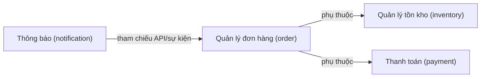

# Technical name và display name của module

Trong Spring Modulith, một **application module** là ranh giới kiến trúc của một phần ứng dụng Spring Boot: nó nhóm mã nguồn, API công khai và các quan hệ phụ thuộc. Khi sinh **module graph** để trao đổi với nhóm phát triển, chúng ta thường muốn ô trên sơ đồ mang tên dễ hiểu như **“Quản lý đơn hàng”** thay vì một tên ngắn dành cho công cụ như `order`.

Spring Modulith phân biệt hai cách gọi một module:

- **Technical name (tên kỹ thuật)**: trong API hiện đại, nên hiểu là **module identifier** — định danh logic mà Spring Modulith dùng để nhận diện và tham chiếu module.
- **Display name (tên hiển thị)**: tên dễ đọc cho con người, dùng khi mô tả module trong tài liệu và có thể xuất hiện trên biểu đồ được sinh.

Ví dụ, module nằm trong Java package `com.example.shop.inventory` có thể có identifier `inventory` nhưng display name là **“Quản lý tồn kho”**. Hai tên mô tả **cùng một module**, với mục đích sử dụng khác nhau.

Bài thuộc chương **Module graph** của học phần `SPRING_MODULITH_DOCUMENTATION_OBSERVABILITY`. Mục tiêu của học phần là kết hợp tài liệu về ranh giới application module với Actuator, event metrics, tracing và context propagation để hiểu kiến trúc mô-đun khi ứng dụng vận hành. Phân biệt hai loại tên là bước nền tảng để đọc module graph và đối chiếu nó với các dấu vết runtime.

## 1. Technical name: định danh logic của application module

Spring Modulith phát hiện application module từ cấu trúc package và cấu hình phát hiện module. Trong cách tổ chức mặc định, các package con trực tiếp bên dưới package chứa lớp ứng dụng Spring Boot thường được coi là các module.

Ví dụ:

```text
src/main/java/
└── com/example/shop/
    ├── ShopApplication.java
    ├── order/
    │   ├── OrderManagement.java
    │   └── internal/
    ├── inventory/
    │   ├── InventoryManagement.java
    │   └── internal/
    └── notification/
        └── NotificationService.java
```

Trong trường hợp mặc định này, các identifier thường tương ứng với phần cuối của tên package:

| Module base package | Technical name / identifier mặc định | Trách nhiệm giả định |
| --- | --- | --- |
| `com.example.shop.order` | `order` | Nhận và xử lý đơn hàng |
| `com.example.shop.inventory` | `inventory` | Quản lý số lượng và giữ hàng |
| `com.example.shop.notification` | `notification` | Xử lý thông báo |

Identifier **không nhất thiết là tên Java class**, tên bean, tên service triển khai hoặc nguyên chuỗi package đầy đủ. Cách tạo identifier có thể thay đổi theo cấu hình phát hiện module, việc bật tên module đủ điều kiện và metadata tùy chỉnh. Vì vậy, khi cần chính xác, hãy đọc mô hình `ApplicationModules` của chính dự án thay vì suy đoán từ sơ đồ thư mục.

Identifier có vai trò quan trọng khi:

1. Mô tả các phụ thuộc module được cho phép, chẳng hạn `allowedDependencies`.
2. Tra cứu module trong mô hình kiến trúc Spring Modulith.
3. Phân biệt các module khi xuất tài liệu hoặc tổ chức kiểm thử theo ranh giới module.
4. Gắn liên kết hoặc đối chiếu với các bản ghi quan sát có thông tin module, nếu instrumentation cung cấp.

**Lưu ý về thuật ngữ:** một số tài liệu hoặc API cũ gọi identifier là *logical name* hay sử dụng phương thức `getName()`. Từ Spring Modulith **1.3**, API `ApplicationModule.getIdentifier()` trả về `ApplicationModuleIdentifier`; `getName()` được đánh dấu deprecated trong các dòng có API mới. Khi đọc ví dụ trên Internet, phải kiểm tra version trước khi sao chép.

## 2. Display name: tên để con người đọc tài liệu

Display name là nhãn mô tả module cho người đọc. Thường nên đặt theo **ngôn ngữ nghiệp vụ** để product owner, kiến trúc sư và lập trình viên đều hiểu được vai trò của module.

Ví dụ:

| Identifier | Display name gợi ý | Tại sao tên hiển thị hữu ích? |
| --- | --- | --- |
| `order` | Quản lý đơn hàng | Trình bày mục đích thay vì chỉ nhắc một package |
| `inventory` | Tồn kho | Ngắn, rõ trách nhiệm |
| `payment` | Thanh toán | Phù hợp với sơ đồ luồng nghiệp vụ |
| `notification` | Thông báo khách hàng | Phân biệt với các loại thông báo kỹ thuật khác |

Spring Modulith cung cấp thuộc tính `displayName` trong annotation `@ApplicationModule` để khai báo tên hiển thị. Khi không khai báo, `ApplicationModule.getDisplayName()` vẫn trả về tên phục vụ hiển thị theo quy tắc mặc định của phiên bản framework, nhưng nhãn đó có thể chưa thể hiện tốt thuật ngữ nghiệp vụ.

Điểm cốt lõi: **đổi display name không có nghĩa là đổi identifier, đổi package hay đổi phụ thuộc module**. Nếu hiện tại module `inventory` hiển thị “Inventory” và bạn muốn đổi thành “Tồn kho”, đó là thay đổi cách diễn đạt trong tài liệu; định danh logic có thể giữ nguyên.

## 3. Đặt display name bằng `@ApplicationModule`

Với Java, nơi thông dụng để khai báo metadata module là `package-info.java` ở **package gốc của module**.

Ví dụ file `src/main/java/com/example/shop/inventory/package-info.java`:

```java
@org.springframework.modulith.ApplicationModule(
    displayName = "Quản lý tồn kho"
)
package com.example.shop.inventory;
```

Và file `src/main/java/com/example/shop/order/package-info.java`:

```java
@org.springframework.modulith.ApplicationModule(
    displayName = "Quản lý đơn hàng",
    allowedDependencies = "inventory"
)
package com.example.shop.order;
```

Ở cấu hình phát hiện module mặc định, kết quả kỳ vọng là:

| Thuộc tính | Module `order` | Module `inventory` |
| --- | --- | --- |
| Base package | `com.example.shop.order` | `com.example.shop.inventory` |
| Identifier | `order` | `inventory` |
| Display name | “Quản lý đơn hàng” | “Quản lý tồn kho” |
| Định nghĩa `allowedDependencies` trong ví dụ | `inventory` | Không khai báo hạn chế riêng |

Trong `allowedDependencies`, ta dùng **identifier `inventory`**, không dùng chuỗi hiển thị **“Quản lý tồn kho”**. Đây là khác biệt mang ý nghĩa chức năng: giá trị tham chiếu phải xác định đúng module trong mô hình.

> Ví dụ `allowedDependencies = "inventory"` chỉ diễn tả module `order` được phép phụ thuộc vào `inventory` trong phạm vi kiểm tra của Spring Modulith. Nó **không tự tạo** lời gọi Java từ order sang inventory, cũng **không khẳng định** rằng luồng đặt hàng hiện tại đã sử dụng kho.

Có thể khai báo annotation ở cấp type trong một số ngữ cảnh/phiên bản (đặc biệt để hỗ trợ ngôn ngữ không dùng `package-info.java`), nhưng ví dụ Java này chọn `package-info.java` để metadata nằm ngay tại ranh giới package.

## 4. Technical name và display name xuất hiện thế nào trên module graph?

Module graph là sơ đồ biểu diễn các application module cùng quan hệ phụ thuộc phát hiện được từ ứng dụng. Trong một sơ đồ hướng nghiệp vụ, **display name** phù hợp làm nhãn ở ô module; **identifier** phù hợp để tham chiếu chính xác trong mã và kiểm tra kiến trúc.

Ví dụ quan hệ **minh họa**:



Trong sơ đồ trên, phần trước dấu ngoặc là **display name**, phần trong ngoặc là **identifier**. Đây là quy ước minh họa giúp người học thấy cùng lúc hai loại tên; giao diện sơ đồ sinh ra từ Spring Modulith **không bắt buộc** hiển thị cả hai theo đúng kiểu ngoặc này.

Module graph phản ánh **quan hệ phụ thuộc cấu trúc** mà Spring Modulith phát hiện, không phải đồ thị trace của một request. Việc xuất hiện một mũi tên `order → inventory` cho thấy một phụ thuộc được phân tích trong mã; nó không chứng minh lời gọi đó đã xảy ra khi xử lý một request cụ thể.

### Vì sao display name có giá trị trong tài liệu sinh tự động?

Các package `order` và `inventory` dễ hiểu đối với lập trình viên, nhưng khi kiến trúc lớn lên có thể xuất hiện các tên kỹ thuật như `billing`, `fulfillment`, `customerprofile`. Display name giúp tài liệu sử dụng thuật ngữ thống nhất với nghiệp vụ:

- `billing` → **Lập hóa đơn**
- `fulfillment` → **Thực hiện đơn hàng**
- `customerprofile` → **Hồ sơ khách hàng**

Nhờ đó, một module graph có thể dùng trong trao đổi thiết kế, onboarding, đánh giá tác động và review ranh giới module mà người đọc không cần biết cấu trúc Java package chi tiết.

### Không đánh đồng tên đẹp với ranh giới đúng

Một module có tên “Xử lý thanh toán” vẫn có thể phụ thuộc trực tiếp vào class `internal` của module khác. Display name **không bảo vệ** API hay che giấu những phụ thuộc không hợp lệ. Muốn đánh giá ranh giới, phải kết hợp `ApplicationModules.verify()`, các quy tắc kiểm tra module và cách tổ chức API công khai.

## 5. Đọc identifier và display name bằng API

Spring Modulith xây dựng mô hình `ApplicationModules` từ lớp ứng dụng Spring Boot. Có thể duyệt các module trong một bài test để xem **framework thực sự nhận ra tên nào**.

```java
import org.junit.jupiter.api.Test;
import org.springframework.modulith.core.ApplicationModules;

class ModuleNamesTests {

    @Test
    void printModuleNames() {
        ApplicationModules modules =
                ApplicationModules.of(ShopApplication.class);

        modules.forEach(module -> System.out.printf(
                "id=%s | display=%s | package=%s%n",
                module.getIdentifier(),
                module.getDisplayName(),
                module.getBasePackage()
        ));
    }
}
```

`ShopApplication` là tên lớp `@SpringBootApplication` giả định của ví dụ. Khi áp dụng trong dự án khác, thay bằng lớp ứng dụng thực tế và đặt test ở package có thể truy cập lớp đó.

Với các module ví dụ ở phần 3, nội dung tương tự sau là hợp lý:

```text
id=order     | display=Quản lý đơn hàng | package=com.example.shop.order
id=inventory | display=Quản lý tồn kho  | package=com.example.shop.inventory
```

Đây là **kết quả kỳ vọng minh họa**, không phải log thu được từ dự án thực. Cách in `JavaPackage` trong output cũng có thể khác nhau giữa các phiên bản, nên không viết test phụ thuộc vào cách format log này.

Quan trọng hơn, test giúp phát hiện các sai lệch như:

- Module dự tính tên `inventory` nhưng cấu hình nhận diện lại sinh identifier khác.
- Module bị phát hiện từ package không mong muốn.
- Annotation được đặt nhầm package nên display name chưa được áp dụng.
- Hai module có nhãn trông giống nhau và gây hiểu nhầm khi xuất tài liệu.

Nếu dự án sử dụng Spring Modulith đời cũ chưa có `getIdentifier()`, tham khảo API tương ứng của dòng đó thay vì áp dụng nguyên xi đoạn code trên.

## 6. Sinh module graph để kiểm tra tên hiển thị

Spring Modulith cung cấp `Documenter` trong thư viện tài liệu của nó. Một ví dụ test đơn giản:

```java
import org.junit.jupiter.api.Test;
import org.springframework.modulith.core.ApplicationModules;
import org.springframework.modulith.docs.Documenter;

class ArchitectureDocumentationTests {

    @Test
    void generateModuleGraph() {
        ApplicationModules modules =
                ApplicationModules.of(ShopApplication.class);

        new Documenter(modules)
                .writeModulesAsPlantUml()
                .writeIndividualModulesAsPlantUml();
    }
}
```

Ví dụ cần dependency **`spring-modulith-docs`** với version tương thích với Spring Boot/Spring Modulith, thường được khai báo ở scope test khi chỉ sinh tài liệu trong test. Ở cấu hình mặc định, các đoạn tài liệu sinh ra thường nằm trong thư mục `spring-modulith-docs` bên dưới output build, chẳng hạn `target/spring-modulith-docs` với Maven hoặc `build/spring-modulith-docs` với Gradle. Chi tiết API, đường dẫn và kiểu sơ đồ có thể thay đổi theo dòng phiên bản.

Sau khi chạy test, hãy xem sơ đồ được sinh:

1. Có đủ những module bạn trông đợi không?
2. Nhãn của `order` có hiện “Quản lý đơn hàng” như metadata không?
3. Các cạnh giữa những module có đúng theo phụ thuộc hiện có?
4. Nhãn có rõ nghĩa cho người đọc nghiệp vụ hay bị trùng/khó hiểu?

Trong API `Documenter.DiagramOptions` của Spring Modulith còn có `withDefaultDisplayName(Function<ApplicationModule, String>)` để điều chỉnh cách chọn nhãn mặc định khi dựng sơ đồ. Cơ chế này **thuộc lớp trình bày của Documenter**; nó không phải cách đổi identifier của module trong mô hình kiến trúc. Ưu tiên khai báo `displayName` ngay trên module khi tên cần dùng nhất quán cho nhiều đầu ra tài liệu.

### Sơ đồ được sinh không phải tài liệu nguồn duy nhất

Sơ đồ là kết quả của **mã nguồn + metadata + quy tắc phát hiện + tùy chọn Documenter** tại thời điểm tạo. Một ảnh PNG, SVG hoặc đoạn PlantUML đã sinh trước đó có thể trở nên cũ khi package hoặc quan hệ module thay đổi. Nên sinh lại tài liệu trong quy trình kiểm thử/build theo quy định của nhóm.

## 7. Khi nào nên đặt lại technical name?

Ở phần lớn ứng dụng, nên giữ identifier ngắn gọn, ổn định và phản ánh trách nhiệm module. Dù tên package có thể quyết định identifier mặc định, **identifier không nhất thiết phải biến động theo mỗi lần sửa tên kỹ thuật trong code**, nếu phiên bản framework có hỗ trợ chỉ định tường minh.

Ở các phiên bản Spring Modulith hỗ trợ thuộc tính `id` của `@ApplicationModule`, có thể khai báo identifier riêng:

```java
// com/example/shop/inventory/package-info.java
@org.springframework.modulith.ApplicationModule(
    id = "stock",
    displayName = "Quản lý tồn kho"
)
package com.example.shop.inventory;
```

Khi ấy, giá trị `stock` mới là identifier logic mong muốn của module này. Package vẫn là `com.example.shop.inventory` và display name vẫn là “Quản lý tồn kho”. Đoạn khai báo `id` **chỉ áp dụng cho dòng Spring Modulith có hỗ trợ thuộc tính đó**; các bản cũ chỉ có `displayName` và `allowedDependencies` sẽ không biên dịch được đoạn ví dụ.

Nếu module `order` muốn chỉ cho phép phụ thuộc vào module vừa đổi định danh, phần khai báo phải dùng định danh mới:

```java
// com/example/shop/order/package-info.java
@org.springframework.modulith.ApplicationModule(
    displayName = "Quản lý đơn hàng",
    allowedDependencies = "stock"
)
package com.example.shop.order;
```

Sự khác biệt:

| Khái niệm | Trước khi định danh tùy chỉnh | Sau khi đặt `id = "stock"` |
| --- | --- | --- |
| Java package | `com.example.shop.inventory` | `com.example.shop.inventory` |
| Identifier | `inventory` | `stock` |
| Display name | “Quản lý tồn kho” | “Quản lý tồn kho” |
| Chuỗi tham chiếu ở `allowedDependencies` | `inventory` | `stock` |

Không nên đổi identifier chỉ để cải thiện vẻ ngoài sơ đồ. **Display name** đã giải quyết phần đó. Việc đổi identifier có thể tác động tới các nơi tham chiếu module bằng tên kỹ thuật, chẳng hạn `allowedDependencies`, cấu hình liên quan và test/đầu ra tài liệu có dùng identifier.

### Hệ quả khi đổi package

Nếu identifier được suy ra mặc định từ package, đổi `com.example.shop.inventory` thành `com.example.shop.stock` có thể khiến identifier thay đổi theo. Trước khi refactor nên:

1. Kiểm tra module identifier hiện hành qua API.
2. Tìm mọi chỗ tham chiếu đến identifier, đặc biệt `allowedDependencies`.
3. Quyết định identifier có cần ổn định hay sẽ đổi đồng bộ với package.
4. Chạy lại kiểm tra kiến trúc và sinh lại module graph.
5. Cập nhật các tài liệu hoặc bảng đối chiếu module dùng ở hệ thống quan sát.

Việc đổi **display name** thường có tác động nhỏ hơn, nhưng vẫn có thể ảnh hưởng liên kết/ảnh chụp tài liệu và cách người vận hành tìm kiếm nhãn trên dashboard nếu hệ thống đã dùng chính display name làm thông tin hiển thị.

## 8. Đặt tên tốt cho module graph

Một quy ước hợp lý giúp module graph dễ đọc và tránh những mâu thuẫn trong công cụ:

| Tiêu chí | Technical name / identifier | Display name |
| --- | --- | --- |
| Độc nhất | Phải phân biệt được các module trong phạm vi mô hình | Nên đủ khác biệt để tránh nhầm trên sơ đồ |
| Ổn định | Ưu tiên ổn định vì được dùng làm khóa tham chiếu | Có thể cải thiện ngôn từ để phục vụ người đọc |
| Ngôn ngữ | Ngắn, không dấu, dễ dùng trong mã/cấu hình | Theo thuật ngữ nghiệp vụ của nhóm, có thể là tiếng Việt |
| Độ dài | Thường gọn như `order`, `payment` | Vừa đủ rõ như “Quản lý đơn hàng”, “Xử lý thanh toán” |
| Mục tiêu sử dụng | Tra cứu, kiểm chứng phụ thuộc, liên kết metadata | Tài liệu, module graph, giải thích kiến trúc |
| Thay đổi | Cần đánh giá mọi nơi dùng identifier | Chủ yếu đánh giá tác động tới tài liệu và dashboard |

Khuyến nghị thực hành:

- Một identifier tương ứng với **một ranh giới chức năng** đã xác định; tránh tái sử dụng cùng một tên cho các module khác.
- Display name diễn đạt **trách nhiệm** của module; tránh nhãn chung chung như “Common”, “Service” nếu không phản ánh đúng nội dung.
- Đừng viết display name thành câu quá dài khiến các node trên module graph khó đọc.
- Nếu hai module liên quan nhưng khác vai trò, đặt nhãn phân biệt, ví dụ “Tính phí vận chuyển” và “Theo dõi vận chuyển”.
- Duy trì **bảng mapping identifier ↔ display name ↔ base package** khi tài liệu kiến trúc được sử dụng bởi nhiều nhóm.

Ví dụ, bảng mapping dưới đây rõ ràng hơn một danh sách tên tự do:

| Identifier | Display name | Base package |
| --- | --- | --- |
| `order` | Quản lý đơn hàng | `com.example.shop.order` |
| `inventory` | Quản lý tồn kho | `com.example.shop.inventory` |
| `payment` | Xử lý thanh toán | `com.example.shop.payment` |

## 9. Kết nối module graph với Actuator, metrics và tracing

Mục đích của học phần documentation/observability là dùng tài liệu kiến trúc làm **điểm tựa để giải thích dữ liệu vận hành**. Tên module thường xuất hiện trong ba ngữ cảnh khác nhau:

1. **Module graph / tài liệu:** biểu diễn ranh giới và phụ thuộc ở mức mã nguồn.
2. **Thông tin mô hình/module do Spring Modulith xuất ra:** mô tả những module framework phát hiện được, có thể tra cứu qua API và các tích hợp Actuator phù hợp.
3. **Log, metrics và traces:** mô tả hoạt động thực thi, đôi khi gắn thông tin module nếu có instrumentation tương ứng.

Đây là ba góc nhìn bổ sung cho nhau. Không phải mọi span hay metric của Spring Boot đều tự có attribute “module”, và không nên giả định tên tag hoặc endpoint Actuator giống nhau ở mọi version.

### Ví dụ đối chiếu

Giả sử module graph mô tả:

```text
order (Quản lý đơn hàng) ──> inventory (Quản lý tồn kho)
```

Khi có một yêu cầu `POST /orders`, trace đã được instrument có thể cho thấy span đặt hàng trong `order` rồi span giữ hàng trong `inventory`. Để đối chiếu đúng:

- Dùng **identifier** để biết chính xác span/tag hoặc log đang ám chỉ module nào khi dữ liệu quan sát có chứa thông tin module.
- Dùng **display name** để trình bày kết quả dễ hiểu cho người xem dashboard.
- Dùng **traceId/spanId** để theo dõi một lần thực thi, không thay thế chúng bằng tên module.
- Dùng **mã nghiệp vụ** như `orderId` để liên hệ các lần xử lý lại bất đồng bộ nếu trace context không nối tiếp.
- Dùng **module graph + kiểm chứng cấu trúc** để xem phụ thuộc module có hợp lệ; dùng **traces, metrics và logs** để xem hành vi thực tế.

Chú ý khi xử lý sự kiện bất đồng bộ: `order` có thể phát sự kiện cho `notification` nhưng listener chạy ở thời điểm hoặc thread khác. Tùy cách cấu hình context propagation, thao tác nhận sự kiện có thể ở cùng trace, trace khác, hoặc không xuất hiện trong trace. Điều này **không làm thay đổi identifier và display name** của hai module.

### Có cần dùng display name làm tag metric không?

Thông thường, nếu muốn gắn module vào metric, hãy cân nhắc dùng một **identifier kỹ thuật có tập giá trị nhỏ và ổn định**. Display name có thể được chỉnh sửa để phục vụ cách diễn đạt trên tài liệu; dùng nó làm khóa phân nhóm dài hạn có thể khiến biểu đồ lịch sử bị tách khi đổi nhãn. Dù chọn cách nào, cần kiểm tra các tag thực tế được instrumentation hỗ trợ và tránh tự tạo metric có cardinality cao.

## 10. Những nhầm lẫn thường gặp

| Nhầm lẫn | Giải thích đúng |
| --- | --- |
| “Technical name và display name luôn giống nhau.” | Chúng có thể giống khi dùng mặc định, nhưng có thể tách biệt qua metadata module. |
| “Đổi `displayName` sẽ đổi module được `allowedDependencies` tham chiếu.” | Phụ thuộc dùng identifier logic, không dùng nhãn hiển thị. |
| “Tên package luôn là identifier đầy đủ.” | Identifier mặc định thường được suy ra từ package, có thể còn chịu ảnh hưởng của cách phát hiện/tùy chỉnh. |
| “Đổi tên hiển thị giúp sửa phụ thuộc module sai.” | Chỉ thay nhãn; cần sửa phụ thuộc thật và chạy kiểm tra kiến trúc. |
| “Đồ thị module chính là cây trace.” | Module graph là cấu trúc phụ thuộc; trace phản ánh một lần thực thi có instrumentation. |
| “Mọi version đều hỗ trợ `@ApplicationModule(id = ...)`.” | Khả năng tùy chỉnh `id` phụ thuộc phiên bản; cần đối chiếu API đang dùng. |
| “Mọi span đều có tên module để tra cứu.” | Cần kiểm tra observability instrumentation và cấu hình xuất trace. |
| “Đổi `displayName` không bao giờ có tác động.” | Tài liệu và dashboard dùng nhãn có thể cần cập nhật; tác động nhỏ hay lớn phụ thuộc cách tích hợp. |

## 11. Bài thực hành

Hãy tưởng tượng ứng dụng Spring Boot có ba package:

```text
com.example.shop.order
com.example.shop.inventory
com.example.shop.notification
```

Thực hiện theo thứ tự:

1. **Khai báo metadata:** thêm `package-info.java` cho `order` và `inventory` với display name lần lượt “Quản lý đơn hàng” và “Quản lý tồn kho”. Giữ identifier mặc định.
2. **Kiểm tra định danh:** dùng `ApplicationModules.of(ShopApplication.class)` và in `getIdentifier()`, `getDisplayName()`, `getBasePackage()` cho từng module.
3. **Giới hạn phụ thuộc:** trong module `order`, thử `allowedDependencies = "inventory"` khi mã thực tế được thiết kế cho phụ thuộc đó. Giải thích vì sao chuỗi này dùng `inventory`, không dùng “Quản lý tồn kho”.
4. **Sinh sơ đồ:** chạy test `Documenter` để tạo module graph. Xem nhãn trên sơ đồ và đối chiếu các cạnh với mã đang có.
5. **Đổi display name:** đổi “Quản lý tồn kho” thành “Kho hàng”, sinh lại tài liệu và so sánh. Identifier có thay đổi không?
6. **Thử đổi identifier có kiểm soát:** nếu version dự án hỗ trợ thuộc tính `id`, đặt `id = "stock"` cho module kho và cập nhật tham chiếu phù hợp. Dùng API và verification để xác nhận tên logic mới.
7. **Đối chiếu runtime:** nếu đã cấu hình Actuator/tracing, thực thi một luồng đặt hàng và xem trace/log có cung cấp thông tin module hay không. Giải thích tại sao vẫn cần kiểm tra module graph.

**Kết quả mong đợi:** lập được bảng mapping giữa package, identifier và display name; biết sửa nhãn tài liệu mà không làm đổi tham chiếu logic; biết khi nào thay đổi identifier phải cập nhật những phần phụ thuộc; và phân biệt được giá trị của module graph so với dữ liệu quan sát runtime.

## Tài liệu tham khảo

- [Spring Modulith — Fundamentals](https://docs.spring.io/spring-modulith/reference/fundamentals.html): cách phát hiện application module, khai báo `@ApplicationModule` và `allowedDependencies`.
- [Spring Modulith — Documenting Application Modules](https://docs.spring.io/spring-modulith/reference/documentation.html): dùng `ApplicationModules` và `Documenter` để sinh biểu đồ và Module Canvas.
- [`ApplicationModule` annotation API](https://docs.spring.io/spring-modulith/docs/current/api/org/springframework/modulith/ApplicationModule.html): các thuộc tính `displayName`, `id` và `allowedDependencies` ở API hiện hành.
- [`ApplicationModule` core API](https://docs.spring.io/spring-modulith/docs/current/api/org/springframework/modulith/core/ApplicationModule.html): `getIdentifier()`, `getDisplayName()` và `getBasePackage()`.
- [`Documenter.DiagramOptions` API](https://docs.spring.io/spring-modulith/docs/current/api/org/springframework/modulith/docs/Documenter.DiagramOptions.html): tùy chọn trình bày tên trên sơ đồ.

Các URL API `current` thay đổi theo phiên bản hiện hành. Khi đem ví dụ áp dụng vào dự án thực, hãy chọn tài liệu tương ứng với **version Spring Modulith đã khóa trong dependency management**, đặc biệt đối với `id` và các phương thức API mới.
