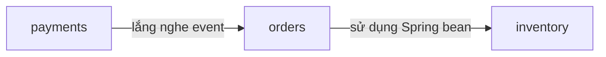
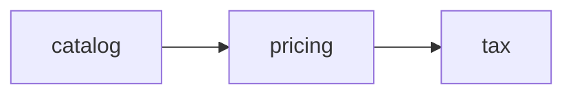
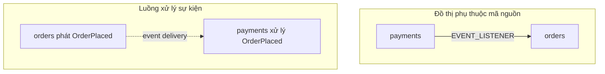
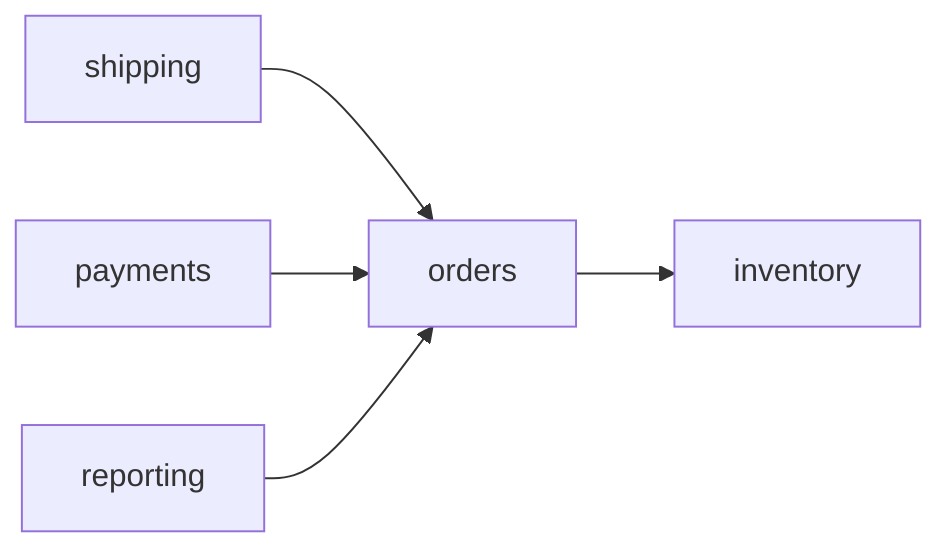
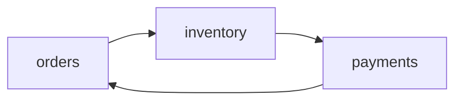

# Dependencies và target module

## 1. Bối cảnh: đọc đúng một cạnh trong module graph

Trong ứng dụng Spring Boot theo kiến trúc **modular monolith**, các package nghiệp vụ được tổ chức thành **application module**. Spring Modulith phân tích mã nguồn để nhận diện module, API được công bố, các phần triển khai nội bộ và những quan hệ phụ thuộc giữa module. Những thông tin này có thể dùng để sinh tài liệu module graph và kiểm chứng kiến trúc. Khi bật tích hợp Actuator, ứng dụng còn có thể công bố metadata module qua endpoint `/actuator/modulith`.

Bài học thuộc chương **Module graph** của học phần **SPRING_MODULITH_DOCUMENTATION_OBSERVABILITY**: sử dụng Spring Modulith để tạo tài liệu ranh giới module và quan sát tương tác giữa các phần trong ứng dụng Spring Boot. Trọng tâm ở đây là hai khái niệm nền tảng của đồ thị:

- **Dependencies:** Những quan hệ cho biết module nguồn phụ thuộc vào module nào khác, theo kiểu nào.
- **Target module:** Module **đích được tham chiếu** bởi một quan hệ phụ thuộc; trong JSON của Actuator, nó được ghi ở trường `dependencies[].target`.

Hiểu đúng hai khái niệm này giúp trả lời các câu hỏi kiến trúc:

1. Module nào đang phụ thuộc module nào, và **chiều mũi tên** đi về đâu?
2. Một module được những module khác sử dụng nhiều đến mức nào?
3. Quan hệ là tham chiếu kiểu Java, sử dụng Spring bean hay lắng nghe sự kiện?
4. Việc một listener xử lý event do module khác phát ra có tạo dependency theo cùng chiều với luồng sự kiện không?
5. Những cạnh nào vi phạm ranh giới module, tạo chu trình hoặc không phù hợp với thiết kế?
6. Khi hệ thống đang chạy, nên đối chiếu module graph với **Actuator, event metrics và tracing** như thế nào?

Sau bài này, người học phải đọc được một dependency record, xác định chính xác **source → target**, dựng lại đồ thị, phân biệt quan hệ cấu trúc và luồng thực thi, rồi dùng Spring Modulith để xác minh các ràng buộc mong muốn.

## 2. Mô hình tư duy: đồ thị có hướng

### 2.1. Node, edge, source và target

Một **module graph** có thể biểu diễn như một đồ thị có hướng `G = (V, E)`:

| Ký hiệu | Ý nghĩa | Ví dụ |
| --- | --- | --- |
| `V` | Tập các application module (node/đỉnh) | `orders`, `inventory`, `payments` |
| `E` | Tập các quan hệ phụ thuộc giữa module (edge/cạnh) | `orders → inventory` |
| **Source** | Module đứng ở **đầu xuất phát** của một dependency | `orders` |
| **Target** | Module đứng ở **đầu được tham chiếu** của dependency | `inventory` |
| **Type** | Phân loại cách phụ thuộc được phát hiện | `USES_COMPONENT` |

Viết `A → B` nghĩa là **A phụ thuộc B**. Đây là một quan hệ **outgoing** đối với A và **incoming** đối với B.

Không nên đọc ngược thành “B phụ thuộc A”. Cũng không được tự hiểu `A → B` là “A gửi HTTP đến B” hay “mọi request đều chạy qua B”. Đồ thị của Spring Modulith chủ yếu là **đồ thị phụ thuộc cấu trúc mã nguồn**, không phải bản đồ lời gọi mạng hay số lượt gọi runtime.

Ví dụ:



Đọc lần lượt:

- `orders → inventory`: module `orders` cần một API/thành phần thuộc `inventory`.
- `payments → orders`: module `payments` phụ thuộc kiểu event/API do `orders` công bố để đăng ký listener.
- Trong đồ thị trên **không có cạnh `orders → payments`**. Dù nghiệp vụ đặt hàng có thể gây ra xử lý thanh toán thông qua event, điều đó không tự tạo một dependency Java ngược từ publisher sang listener.

### 2.2. Incoming và outgoing dependencies

Hai góc nhìn trên cùng một cạnh:

| Từ module | Quan hệ | Đối với module đích |
| --- | --- | --- |
| `orders` | **Outgoing**: `orders → inventory` | **Incoming** vào `inventory` từ `orders` |
| `payments` | **Outgoing**: `payments → orders` | **Incoming** vào `orders` từ `payments` |

**Outgoing dependency** giúp đánh giá module cần những gì để biên dịch và hoạt động. **Incoming dependency** giúp nhận diện những module đang sử dụng API của một module; đây là thông tin hữu ích khi cân nhắc sửa hợp đồng công khai. Việc nhiều module cùng phụ thuộc vào một module chưa đủ kết luận thiết kế xấu; cần xét vai trò, API và mức độ ổn định của module đích.

### 2.3. Phụ thuộc trực tiếp và phụ thuộc gián tiếp

Giả sử:



Đồ thị có hai **cạnh trực tiếp**: `catalog → pricing` và `pricing → tax`. Từ đó tồn tại đường đi gián tiếp `catalog ⇒ tax`. Tuy nhiên, **không vì thế mà tự thêm cạnh trực tiếp `catalog → tax`** vào JSON Actuator. Một dependency record được hiểu là mối phụ thuộc mà trình phân tích phát hiện giữa hai module, không phải mọi module có thể đi tới bằng thuật toán đồ thị.

Phân biệt phụ thuộc trực tiếp và phụ thuộc bắc cầu đặc biệt quan trọng khi xác định phạm vi thay đổi, phân tầng kiến trúc và tránh phóng đại số lượng cạnh.

## 3. Spring Modulith xác định application module như thế nào?

### 3.1. Ranh giới package mặc định

Với cấu hình phát hiện mặc định, các package con trực tiếp của package chứa lớp `@SpringBootApplication` thường là ứng viên application module:

```text
com.example.shop
├── ShopApplication.java
├── orders
│   ├── OrderManagement.java
│   ├── OrderPlaced.java
│   └── internal
│       └── JpaOrderRepository.java
├── inventory
│   ├── InventoryOperations.java
│   └── internal
│       └── JpaStockRepository.java
└── payments
    ├── OrderPaymentListener.java
    └── internal
        └── PaymentGatewayAdapter.java
```

Trong ví dụ này:

- `orders`, `inventory` và `payments` là ba module.
- Các kiểu công khai đặt trực tiếp trong package gốc của từng module thường nằm trong **API module** (unnamed interface).
- Package con `internal` chứa chi tiết triển khai, mặc định **không được module khác truy cập trực tiếp** khi module ở chế độ đóng.
- `@NamedInterface` có thể được dùng để công bố thêm các nhóm API trong package con.
- Module lồng nhau và chiến lược phát hiện tùy chỉnh có thể khiến mô hình khác cấu trúc mặc định; không suy đoán identifier chỉ từ tên thư mục.

Spring Modulith còn hỗ trợ module mở (`Type.OPEN`), cho phép một số truy cập mà module đóng sẽ từ chối. Tính năng này hỗ trợ quá trình chuyển đổi từ hệ thống cũ, nhưng không nên coi nó là thiết kế ranh giới mặc định cho mọi module.

### 3.2. Ví dụ tạo một cạnh bằng Spring bean dependency

API của module `inventory`:

```java
package com.example.shop.inventory;

import java.util.UUID;

public interface InventoryOperations {
    void reserve(UUID orderId, String sku, int quantity);
}
```

Module `orders` phụ thuộc API đó:

```java
package com.example.shop.orders;

import java.util.UUID;

import com.example.shop.inventory.InventoryOperations;
import org.springframework.stereotype.Service;

@Service
public class OrderManagement {

    private final InventoryOperations inventory;

    public OrderManagement(InventoryOperations inventory) {
        this.inventory = inventory;
    }

    public void place(UUID orderId, String sku, int quantity) {
        inventory.reserve(orderId, sku, quantity);
        // Lưu đơn, công bố event... theo nghiệp vụ thực tế.
    }
}
```

Do `OrderManagement` trong `orders` phụ thuộc vào `InventoryOperations` được công bố bởi `inventory`, Spring Modulith có thể nhận diện quan hệ `orders → inventory` với loại `USES_COMPONENT`. Đây là **sự phụ thuộc của Spring bean**, được nhận diện từ cấu trúc/injection point; số lần thực sự chạy `reserve()` lại là câu hỏi thuộc runtime observability.

Mã ví dụ chỉ minh họa quan hệ giữa module; để chạy được cần một Spring bean triển khai `InventoryOperations`, cơ chế lưu đơn và cấu hình dự án phù hợp.

## 4. Đọc dependencies và target module từ Actuator JSON

### 4.1. Nguồn dữ liệu

Với `spring-modulith-actuator` (hoặc `spring-modulith-starter-insight`) và Spring Boot Actuator được cấu hình thích hợp, endpoint `/actuator/modulith` cung cấp cấu trúc module dưới dạng JSON.

Ví dụ cấu hình local chỉ công bố các endpoint cần cho bài thực hành:

```yaml
management:
  endpoints:
    web:
      exposure:
        include: "health,modulith,metrics"
```

Sau khi ứng dụng khởi động ở cổng 8080:

```bash
curl -i http://localhost:8080/actuator
curl -i http://localhost:8080/actuator/modulith
```

Endpoint thực sự truy cập được còn tùy dependency, cấu hình access/exposure, port, base path và chính sách bảo mật. Không nên mở công khai những thông tin về package/module graph khi triển khai production.

### 4.2. Một response minh họa

```json
{
  "orders": {
    "displayName": "Orders",
    "basePackage": "com.example.shop.orders",
    "dependencies": [
      {
        "target": "inventory",
        "types": ["DEFAULT", "USES_COMPONENT"]
      }
    ]
  },
  "inventory": {
    "displayName": "Inventory",
    "basePackage": "com.example.shop.inventory",
    "dependencies": []
  },
  "payments": {
    "displayName": "Payments",
    "basePackage": "com.example.shop.payments",
    "dependencies": [
      {
        "target": "orders",
        "types": ["EVENT_LISTENER"]
      }
    ]
  }
}
```

**Đây là JSON giả lập để minh họa cách đọc**, không phải dữ liệu lấy từ một dịch vụ thật. Các trường và mảng thực tế phụ thuộc cấu trúc mã nguồn, kiểu dependency được phát hiện và phiên bản Spring Modulith.

### 4.3. Ý nghĩa chính xác của từng đường dẫn

| JSONPath | Ý nghĩa |
| --- | --- |
| `$.orders` | Đối tượng metadata của module có **technical identifier** là `orders` |
| `$.orders.displayName` | Tên hiển thị dành cho người đọc |
| `$.orders.basePackage` | Package gốc của module |
| `$.orders.dependencies[]` | **Toàn bộ dependency outgoing** được trình bày cho `orders` |
| `$.orders.dependencies[0].target` | Identifier của module đích: `inventory` |
| `$.orders.dependencies[0].types[]` | Các phân loại của quan hệ `orders → inventory` |
| `$.inventory.dependencies` | Mảng rỗng: không có dependency outgoing được biểu diễn cho `inventory` |
| `$.payments.dependencies[0].target` | Đích của cạnh `payments → orders` |

**Quy tắc đọc quan trọng:** Trong JSON này, **source không nằm trong trường `target`**. Source chính là **khóa đối tượng bao ngoài** chứa mảng `dependencies`. Vì record `{"target": "inventory", ...}` nằm bên trong `"orders".dependencies` nên cạnh là `orders → inventory`.

Khóa top-level `orders` và `inventory` là **technical identifiers**, khác với `displayName`. Trong cấu trúc endpoint, `target` tham chiếu một identifier module, **không phải URL, bean name, tên class Java, tên bảng CSDL hoặc tên service trong hệ thống tracing**.

### 4.4. Chuyển JSON thành danh sách cạnh

Từ response minh họa:

| Source | Target | Types |
| --- | --- | --- |
| `orders` | `inventory` | `DEFAULT`, `USES_COMPONENT` |
| `payments` | `orders` | `EVENT_LISTENER` |

Từ bảng trên, bạn có thể vẽ sơ đồ hoặc thực hiện các thao tác phân tích đồ thị. Một cách đọc JSON bằng `jq`:

```bash
curl -s http://localhost:8080/actuator/modulith \
  | jq -r 'to_entries[] as $module
           | $module.value.dependencies[]?
           | "\($module.key) -> \(.target) [\(.types | join(","))]"'
```

Kết quả **kỳ vọng trên JSON ví dụ**:

```text
orders -> inventory [DEFAULT,USES_COMPONENT]
payments -> orders [EVENT_LISTENER]
```

Biểu thức `to_entries[]` biến khóa module thành giá trị để truy cập; `dependencies[]?` bỏ qua module không có phần tử dependency. Trong dữ liệu thật, cú pháp và thứ tự phần tử có thể khác, nhưng ý nghĩa `source → target` giữ nguyên.

### 4.5. Một target có thể có nhiều types

Mảng `types` không phải danh sách nhiều module đích. Nó là danh sách các **lý do/loại** phụ thuộc giữa **một cặp module**. Ví dụ:

```json
{
  "target": "inventory",
  "types": ["DEFAULT", "USES_COMPONENT"]
}
```

Nghĩa là cùng quan hệ `orders → inventory` được phát hiện ở nhiều hình thức, ví dụ vừa tham chiếu kiểu Java vừa sử dụng Spring component. Không nên vẽ thành hai module `inventory` khác nhau, cũng không nên tự cộng thành hai lượt gọi runtime.

Nếu phân tích **số module khác nhau** mà source phụ thuộc, hãy đếm các target phân biệt; nếu phân tích **loại coupling**, hãy xét tập `types` trên từng cạnh.

## 5. Phân biệt các dependency types

Spring Modulith Actuator phân loại những quan hệ giữa application module theo các kiểu chính sau:

| Type | Ý nghĩa | Ví dụ | Điều không thể suy ra |
| --- | --- | --- | --- |
| `DEFAULT` | Tham chiếu kiểu Java thông thường tới một module khác | Kiểu tham số, field, return type, import được dùng trong mã | Đã có lệnh gọi thật ở runtime |
| `USES_COMPONENT` | Sử dụng Spring component/bean được cung cấp bởi module khác | Constructor injection `InventoryOperations` | Đã gọi phương thức bao nhiêu lần |
| `EVENT_LISTENER` | Module chứa listener phụ thuộc loại event/API của module khác | `payments` lắng nghe `OrderPlaced` của `orders` | Listener đã xử lý thành công một event nào đó |

Các loại này mô tả **mối phụ thuộc trong mô hình**, không phải trạng thái vận hành. Cạnh `EVENT_LISTENER` cũng không chứng minh một event đã từng được phát; nó chỉ cho biết code listener có quan hệ với event của module kia.

### 5.1. DEFAULT: sử dụng một kiểu được công bố

Ví dụ module `shipping` dùng kiểu dữ liệu `OrderReference` từ `orders`:

```java
package com.example.shop.shipping;

import com.example.shop.orders.OrderReference;

public record ShipmentRequest(OrderReference order) {
}
```

Đây là sự phụ thuộc kiểu Java từ `shipping` đến `orders`. Nó có thể tạo cạnh `shipping → orders` loại `DEFAULT`, ngay cả khi không có một lời gọi Spring bean trực tiếp.

Tham chiếu tới **API công khai** là điều bình thường nếu được chính sách cho phép. Ngược lại, việc code `shipping` tham chiếu `orders.internal.JpaOrderRepository` là dấu hiệu xâm phạm chi tiết triển khai của module đóng.

### 5.2. USES_COMPONENT: phụ thuộc Spring bean

Constructor injection, tham số Spring component hoặc các mối quan hệ bean được nhận diện có thể tạo dependency kiểu `USES_COMPONENT`. Điều cần kiểm tra là **module nào sở hữu bean/API mà module nguồn sử dụng**.

Trong ví dụ `OrderManagement(InventoryOperations inventory)`:

- Source: `orders`.
- Target: `inventory`.
- Type: `USES_COMPONENT`.
- API mong muốn: `com.example.shop.inventory.InventoryOperations`.

Việc Spring dependency injection thành công không đủ đảm bảo ranh giới mô-đun đúng. Java có thể cho phép một kiểu `public` trong package `internal` được import, nhưng Spring Modulith có thể xem đó là vi phạm kiến trúc.

### 5.3. EVENT_LISTENER: chiều cạnh dễ bị hiểu sai nhất

Giả sử `orders` công bố sự kiện:

```java
package com.example.shop.orders;

import java.util.UUID;

public record OrderPlaced(UUID orderId) {
}
```

Module `payments` khai báo listener:

```java
package com.example.shop.payments;

import com.example.shop.orders.OrderPlaced;
import org.springframework.context.event.EventListener;
import org.springframework.stereotype.Component;

@Component
public class PaymentOrderListener {

    @EventListener
    public void on(OrderPlaced event) {
        // Khởi tạo bước xử lý thanh toán cho đơn hàng vừa tạo.
    }
}
```

Trong **dependency graph**, `payments` biết kiểu `OrderPlaced` của `orders`. Vì vậy, quan hệ là **`payments → orders`**, có thể được phân loại là `EVENT_LISTENER`.

Nhưng trong **luồng nghiệp vụ**, dữ liệu đi theo hướng khác: `orders` **phát** event, và listener trong `payments` **nhận/xử lý** event.



Hai sơ đồ không mâu thuẫn: **cái thứ nhất** diễn tả module nào tham chiếu API/event type của module khác; **cái thứ hai** diễn tả sự kiện được công bố và listener nào có thể được kích hoạt.

Điểm này đặc biệt quan trọng khi phân tích coupling. Giao tiếp sự kiện giúp publisher không cần import trực tiếp listener, nhưng subscriber vẫn có thể phụ thuộc vào hợp đồng event của publisher. Bản thân event-driven architecture không có nghĩa là “không tồn tại dependency”.

## 6. Phân tích target module có chủ đích

### 6.1. Đếm incoming và outgoing edges

Cho đồ thị:



Từ biểu đồ:

| Module | Outgoing (module đích mà nó phụ thuộc) | Incoming (module nguồn phụ thuộc vào nó) |
| --- | --- | --- |
| `orders` | `inventory` | `shipping`, `payments`, `reporting` |
| `inventory` | *(không có)* | `orders` |
| `shipping` | `orders` | *(không có)* |
| `payments` | `orders` | *(không có)* |
| `reporting` | `orders` | *(không có)* |

`orders` có nhiều **incoming edges**, có thể cho biết nhiều module khác sử dụng hợp đồng công khai của nó. Nếu thay đổi các event/API của `orders`, phải đánh giá ảnh hưởng đến những module sử dụng. Tuy nhiên, chỉ số bậc vào/bậc ra **không tự xác định chất lượng kiến trúc**: một module “shared kernel” hoặc module cung cấp hợp đồng lõi có thể có nhiều consumer một cách có chủ đích.

### 6.2. Target module không phải dependency ngoài hệ thống

Ví dụ `orders` dùng `java.time.Instant` hoặc thư viện bên thứ ba, các kiểu đó **không tự tạo application module node** trong Spring Modulith. Một cạnh được mô tả ở `dependencies[].target` tham chiếu **module được Spring Modulith nhận diện trong mô hình ứng dụng**, chứ không đại diện cho mọi Maven/Gradle dependency, JDBC connection, API gateway hoặc remote service.

Để đánh giá phụ thuộc tới hạ tầng bên ngoài, cần phối hợp với sơ đồ tích hợp, cấu hình Spring, kiểm thử và dữ liệu tracing tương ứng; Actuator module graph một mình không cung cấp topology toàn mạng.

### 6.3. Module được nhóm và module lồng nhau

Một số hệ thống sử dụng **nested application modules**. Endpoint có thể chứa trường `parent` (module cha) và `nested` (các module con), tùy mô hình. Khi đó:

- Xác định identifier chính xác của module nguồn/đích từ **khóa top-level** và cấu trúc JSON.
- Không suy diễn rằng một cạnh tới module cha cũng tự động là cạnh trực tiếp tới mọi module con.
- Kiểm tra chính sách truy cập đặc thù của nested modules theo cách tổ chức hiện tại.
- Không lấy `displayName` thay cho identifier khi đối chiếu `target`.

Quy tắc thực hành: dùng **technical identifier** làm khóa xử lý; dùng `displayName` để trình bày cho con người.

### 6.4. Thay đổi target có thể làm đảo chiều kiến trúc

Giả sử mục tiêu thiết kế là:

```text
api -> application -> domain
```

Nếu module `domain` bắt đầu phụ thuộc `api` để lấy DTO của controller, đồ thị xuất hiện cạnh ngược `domain → api`. Dù code vẫn biên dịch, thiết kế phân tầng đã bị đảo hướng. Cần xem lại vị trí đặt DTO, hợp đồng công khai và cách dịch dữ liệu giữa các tầng.

Một module graph có hướng cho phép thảo luận bằng bằng chứng: **module nào** tạo cạnh, **module nào** là target, **kiểu phụ thuộc nào** và **có phù hợp quy tắc kiến trúc không**.

## 7. Kiểm chứng dependencies bằng Spring Modulith

### 7.1. Lấy application module model và gọi verify()

Spring Modulith cung cấp `ApplicationModules` để tạo mô hình từ một Spring Boot application class:

```java
import org.junit.jupiter.api.Test;
import org.springframework.modulith.core.ApplicationModules;

class ModuleArchitectureTests {

    @Test
    void verifyDependenciesAndBoundaries() {
        ApplicationModules modules = ApplicationModules.of(ShopApplication.class);
        modules.verify();
    }
}
```

Kiểm chứng mặc định của `verify()` bao gồm:

1. **Không có phụ thuộc vòng** giữa các application module.
2. **Không truy cập trái phép** vào kiểu thuộc package nội bộ của module đóng.
3. **Chỉ phụ thuộc module được phép**, nếu tác giả đã khai báo `allowedDependencies`.

Kiểm thử trên giúp phát hiện vi phạm kiến trúc ở thời điểm build/test, thay vì chỉ dựa vào việc ứng dụng đã chạy. Endpoint `/actuator/modulith` hỗ trợ **quan sát**, còn `verify()` kiểm tra **quy tắc kiến trúc**.

### 7.2. Không được có vòng phụ thuộc

Ví dụ:



Chuỗi `orders → inventory → payments → orders` là một **cycle**. Khi xác minh kiến trúc, Spring Modulith có thể báo vi phạm vì graph không còn là đồ thị có hướng phi chu trình (DAG).

Tách vòng phụ thuộc thường cần chỉnh lại trách nhiệm và hợp đồng giữa module: di chuyển API/event type về module có trách nhiệm phù hợp, sử dụng cách phối hợp nghiệp vụ khác hoặc loại bỏ một cạnh không cần thiết. Chỉ đổi tên module hoặc ẩn một dòng trong sơ đồ không xử lý nguyên nhân.

### 7.3. Khai báo allowedDependencies theo chiều source → target

Có thể giới hạn module `orders` chỉ được phụ thuộc vào `inventory` bằng `package-info.java`:

```java
@org.springframework.modulith.ApplicationModule(
    allowedDependencies = "inventory"
)
package com.example.shop.orders;
```

Và module `payments` được phép tham chiếu `orders` để lắng nghe `OrderPlaced`:

```java
@org.springframework.modulith.ApplicationModule(
    allowedDependencies = "orders"
)
package com.example.shop.payments;
```

Với các khai báo này:

- `orders → inventory` được cho phép; `orders → payments` sẽ không hợp lệ nếu tạo một phụ thuộc mà không được khai báo.
- `payments → orders` được cho phép do listener phụ thuộc kiểu event `OrderPlaced`.
- Giá trị `allowedDependencies` là các **module mà source được phép phụ thuộc**, **không phải** các module được phép phụ thuộc **vào** source.
- Những dependency khác do shared-module policy hoặc phạm vi ngoài application module có thể được xử lý theo quy tắc riêng; không diễn giải cấu hình trên như firewall runtime.

**Lưu ý:** Không khai báo `allowedDependencies` có nghĩa là **chưa giới hạn danh sách target bằng quy tắc này**; nó không có nghĩa “cấm phụ thuộc tất cả”. Một danh sách rỗng được khai báo rõ là tình huống khác, cần hiểu theo chính xác quy tắc Spring Modulith của phiên bản đang dùng.

### 7.4. Giới hạn phụ thuộc tới Named Interface

Không phải lúc nào cũng nên cho phép module nguồn dùng **mọi** API của module đích. Giả sử `inventory` có named interface `stock`:

```java
@org.springframework.modulith.NamedInterface("stock")
package com.example.shop.inventory.stock;
```

Khi đó `orders` có thể giới hạn:

```java
@org.springframework.modulith.ApplicationModule(
    allowedDependencies = "inventory :: stock"
)
package com.example.shop.orders;
```

Ý nghĩa là `orders` chỉ được phép phụ thuộc vào phần API công bố dưới named interface `stock` của `inventory` (ngoại trừ các trường hợp shared-module policy tương ứng). Đây là mức kiểm soát **chi tiết hơn quan hệ module-to-module**.

Cần phân biệt: trong `allowedDependencies`, cú pháp `module :: namedInterface` kiểm soát phần API được phép dùng; còn trong JSON Actuator, `dependencies[].target` chỉ định **module đích**. Trường `target` không nhất thiết biểu diễn trực tiếp named interface đang được sử dụng.

### 7.5. Giữ internal implementation ở sau ranh giới

Không nên viết:

```java
package com.example.shop.orders;

// Ví dụ một tham chiếu sai ranh giới của module đóng:
import com.example.shop.inventory.internal.JpaStockRepository;
```

Một lớp `public` vẫn có thể được Java cho phép import, nhưng `inventory.internal` không phải API công bố mặc định của `inventory`. `verify()` giúp phát hiện kiểu coupling này. Cách sửa là công bố một hợp đồng phù hợp ở API module, chẳng hạn `InventoryOperations`, rồi phụ thuộc vào hợp đồng đó.

## 8. Từ graph đến tài liệu kiến trúc và quan sát runtime

### 8.1. Biểu diễn đồ thị khi sinh tài liệu

Spring Modulith có `Documenter` để tạo sơ đồ module và **Application Module Canvas** từ mô hình `ApplicationModules`. Sơ đồ này hỗ trợ đọc dependency ở cấp kiến trúc, thảo luận về ranh giới và xem những thành phần được công bố.

Ví dụ trong một bài test/generator có dependency `spring-modulith-docs` phù hợp:

```java
import org.junit.jupiter.api.Test;
import org.springframework.modulith.core.ApplicationModules;
import org.springframework.modulith.docs.Documenter;

class ModuleGraphDocumentationTests {

    @Test
    void writeModuleGraph() {
        ApplicationModules modules = ApplicationModules.of(ShopApplication.class);

        new Documenter(modules)
                .writeModulesAsPlantUml()
                .writeIndividualModulesAsPlantUml();
    }
}
```

Mục đích là tạo **ảnh chụp kiến trúc tại phiên bản mã đang phân tích**. Đường nối trong sơ đồ phụ thuộc là quan hệ cấu trúc, không biểu diễn trực tiếp tần suất lời gọi hay latency.

Khi so sánh tài liệu và endpoint Actuator, phải xác nhận cả hai xuất phát từ **cùng phiên bản build và cùng cấu hình phát hiện module**; nếu không, một cạnh mới/cũ có thể do sai khác phiên bản, không nhất thiết là lỗi phân tích.

### 8.2. Kết hợp event metrics để xem hoạt động

Với Insight starter và instrumentation thích hợp, Spring Modulith có thể công bố counter `module.events.published` để ghi nhận các lần phát domain event, kèm các tag như module identifier hoặc event type.

Ví dụ:

```bash
curl http://localhost:8080/actuator/metrics
curl http://localhost:8080/actuator/metrics/module.events.published
```

Chỉ đọc được counter khi meter phù hợp đã được đăng ký và thực sự có event/hoạt động phát sinh. Counter publication **không xác nhận listener trong module target đã hoàn tất thành công**.

Nếu đồ thị hiển thị `payments → orders` thuộc `EVENT_LISTENER` nhưng không có metric công bố `OrderPlaced`, các khả năng gồm: nghiệp vụ chưa tạo event, instrumentation chưa bật, meter chưa xuất hiện hoặc bộ lọc truy vấn không đúng. Không tự suy ra listener bị lỗi.

### 8.3. Kết hợp tracing để xem tương tác

Spring Modulith Observability và Micrometer có thể tạo spans tại các điểm vào API module được instrument. Trace backend có thể giúp thấy hoạt động như:

```text
HTTP POST /orders
└── orders.OrderManagement.place
    ├── inventory.InventoryOperations.reserve
    └── [publish OrderPlaced]
        └── payments.PaymentOrderListener.on
```

Đây là sơ đồ **khả năng quan sát**, không phải cam kết mọi lời gọi Java/event đều có span. Sự hiện diện của span phụ thuộc instrumentation, Spring bean/proxy, sampling và cấu hình exporter.

Với listener bất đồng bộ (ví dụ `@Async`), ngữ cảnh tracing có thể cần **context propagation** qua executor để tiếp tục được trace cha–con. Nếu thiếu span hoặc trace bị tách, cần kiểm tra propagation, sampling và exporter, trước khi kết luận code không chạy.

Tóm lại:

| Nguồn dữ liệu | Trả lời được | Không khẳng định được nếu chỉ có nguồn này |
| --- | --- | --- |
| Module graph / `/actuator/modulith` | Quan hệ source → target và dependency types | Lời gọi chạy bao nhiêu lần, mất bao lâu |
| `ApplicationModules.verify()` | Quan hệ có thỏa ràng buộc cấu trúc không | Nghiệp vụ có thành công ngoài thực tế không |
| Event publication metrics | Event đã được công bố bao nhiêu lần theo phạm vi instrument | Listener đã xử lý thành công không |
| Traces | Một luồng xử lý được instrument đi qua các bước nào, kéo dài bao lâu | Toàn bộ luồng xử lý nếu bị sampling/thiếu instrumentation |
| Logs / trạng thái nghiệp vụ | Chi tiết kết quả, lỗi hoặc trạng thái cụ thể | Toàn bộ module graph nếu không có phân tích mã |

## 9. Thực hành: tìm source, target và xác minh kiến trúc

Giả sử một cửa hàng trực tuyến có ba module `orders`, `inventory`, `payments`.

**Mục tiêu thiết kế:** `orders` sử dụng API `inventory` để giữ hàng; `payments` lắng nghe `OrderPlaced` do `orders` công bố. Thiết kế chủ ý không cho `orders` gọi trực tiếp API của `payments`.

### Bước 1 — Xác nhận module được phát hiện

Chạy hoặc chuẩn bị test `ApplicationModules.of(ShopApplication.class)`. Kiểm tra các package dưới package gốc và những customizations có liên quan. Cần xác nhận ba identifier module được nhận diện đúng.

### Bước 2 — Đọc JSON graph

Gọi `/actuator/modulith` trên bản chạy phù hợp. Tìm `orders.dependencies` và `payments.dependencies`:

- Kỳ vọng một record trong `orders.dependencies` có `target = "inventory"`.
- Kỳ vọng một record trong `payments.dependencies` có `target = "orders"`.
- Không kỳ vọng có `orders.dependencies` record với `target = "payments"` khi publisher chỉ phát event.

Nếu có một cạnh ngoài dự kiến, hãy truy từ **source** tới kiểu/bean/event của **target** bị tham chiếu trong mã, thay vì suy đoán từ tên nghiệp vụ.

### Bước 3 — Kiểm tra dependency type

Đối với `orders → inventory`, xác minh record có `USES_COMPONENT` nếu `OrderManagement` được injection một `InventoryOperations`. Đối với `payments → orders`, xác minh type `EVENT_LISTENER` phù hợp với cách listener được nhận diện.

Nếu một cặp có nhiều `types`, giữ chúng trên **cùng một cạnh** và phân tích từng loại coupling.

### Bước 4 — Thêm chính sách allowedDependencies

Trong package `orders`, đặt `allowedDependencies = "inventory"`. Trong `payments`, đặt `allowedDependencies = "orders"`. Thực thi test `ApplicationModules.verify()`.

Điều cần đạt: không có dependency vòng, không có tham chiếu trái phép tới implementation package và không có target vượt danh sách cho phép.

### Bước 5 — Tạo một vi phạm có kiểm soát (trên nhánh thử nghiệm)

Để hiểu cách kiểm chứng hoạt động, tưởng tượng có người thay `InventoryOperations` bằng tham chiếu trực tiếp tới `inventory.internal.JpaStockRepository`. Test cấu trúc cần phát hiện việc truy cập API nội bộ nếu module đóng; cách sửa là quay về API công bố. Tương tự, nếu `orders` import `payments.PaymentManagement`, quy tắc `allowedDependencies = "inventory"` sẽ không cho phép cạnh `orders → payments`.

Không cần cố tình phá mã nguồn production để luyện tập: có thể mô phỏng bằng một dự án sandbox.

### Bước 6 — Đối chiếu với runtime observability

Phát một `OrderPlaced` thực tế. Kiểm tra:

- Counter công bố event có tăng hay không.
- Traces có biểu diễn những lần đi vào module được instrument không.
- Nếu event được xử lý async, mối liên hệ trace có được tiếp tục không.
- Nếu xử lý thất bại, kết quả nghiệp vụ/logs có nhất quán với các tín hiệu trên không.

Qua đó, module graph chứng minh **điểm phụ thuộc của mã**, còn metrics/traces giúp **quan sát hoạt động** của các điểm phối hợp đó.

### Bước 7 — Ghi nhận bằng bảng kiểm

| Điều cần kiểm chứng | Bằng chứng | Kết quả mong muốn |
| --- | --- | --- |
| Module được nhận diện | JSON `/actuator/modulith` | Có `orders`, `inventory`, `payments` |
| Chiều source → target | `dependencies[].target` của từng module | `orders → inventory`, `payments → orders` |
| Phân loại coupling | `dependencies[].types[]` | Bean và listener phản ánh thiết kế |
| Không có dependency vòng | `ApplicationModules.verify()` | PASS |
| Không truy cập internals trái phép | `ApplicationModules.verify()` | PASS |
| Chính sách target module được tuân thủ | `allowedDependencies` + `verify()` | PASS |
| Event đã công bố | Metric `module.events.published` | Có dữ liệu khi thực sự publish |
| Dấu vết liên module | Trace backend | Span phù hợp khi instrumentation/exporter hoạt động |

## 10. Các lỗi hiểu sai và cách xử lý

| Lỗi hiểu sai | Cách diễn giải đúng |
| --- | --- |
| “`target` là module đang gọi” | `target` là **module bị phụ thuộc**; module nguồn là khóa bên ngoài chứa `dependencies` |
| “`orders → inventory` nghĩa là inventory gọi orders” | Chiều mũi tên đi từ **source** đến **module mà source phụ thuộc** |
| “Event từ orders đến payments phải tạo `orders → payments`” | Với listener nhập `OrderPlaced` của orders, **payments → orders** có thể là dependency loại `EVENT_LISTENER` |
| “Hai `types` nghĩa là hai module target” | Đây là nhiều **kiểu quan hệ** cho cùng một cặp source–target |
| “Không có incoming edge nghĩa là module chưa được dùng ở runtime” | Graph cấu trúc không phản ánh mọi call/event đã diễn ra hoặc các tác nhân ngoài mô hình |
| “`displayName` dùng làm `target`” | `target` tham chiếu **technical identifier** của module |
| “Cứ import một class public là hợp lệ” | Kiểm tra class thuộc API công bố hay internal package và có nằm trong `allowedDependencies` không |
| “Cạnh trong graph = HTTP request” | Quan hệ ứng dụng module chủ yếu là coupling trong code; không nhất thiết có giao tiếp mạng |
| “`verify()` PASS là runtime an toàn và nhanh” | `verify()` kiểm tra kiến trúc; hiệu năng, lỗi nghiệp vụ và tracing cần công cụ quan sát riêng |
| “Có metric publication nghĩa là listener hoàn tất” | Counter publication chỉ xác nhận ghi nhận việc **phát** event |

## 11. Câu hỏi tự kiểm tra

1. Trong JSON `{"orders":{"dependencies":[{"target":"inventory","types":["USES_COMPONENT"]}]}}`, module nào là source, module nào là target?
2. Nếu `payments` lắng nghe `OrderPlaced` của `orders`, tại sao dependency graph có thể chứa `payments → orders` dù event được phát từ orders?
3. `DEFAULT`, `USES_COMPONENT` và `EVENT_LISTENER` khác nhau ở đâu?
4. Một record có hai `types` có tạo hai target module không? Nên đếm incoming/outgoing như thế nào?
5. Vì sao tham chiếu kiểu trong `inventory.internal` có thể làm `verify()` thất bại dù Java vẫn biên dịch?
6. `@ApplicationModule(allowedDependencies = "inventory")` viết trong module `orders` giới hạn chiều cạnh nào?
7. Nếu muốn chỉ sử dụng API `stock` của module `inventory`, cú pháp named interface trong `allowedDependencies` là gì?
8. Tại sao cạnh gián tiếp `catalog ⇒ tax` không tự động là record dependency trực tiếp?
9. Muốn xác nhận một listener đã xử lý thành công, vì sao JSON module graph và event publication counter chưa đủ?
10. Trong trường hợp thiếu trace xuyên qua `@Async`, cần kiểm tra cơ chế nào để tiếp tục ngữ cảnh?

## 12. Tài liệu tham khảo chính thức

- [Spring Modulith — Fundamentals](https://docs.spring.io/spring-modulith/reference/fundamentals.html): application module, API, internal packages, nested modules, named interfaces và `allowedDependencies`.
- [Spring Modulith — Production-ready Features](https://docs.spring.io/spring-modulith/reference/production-ready.html): JSON schema của `/actuator/modulith`; `dependencies[].target`; `DEFAULT`, `USES_COMPONENT`, `EVENT_LISTENER`; event metrics/traces.
- [Spring Modulith — Verifying Application Module Structure](https://docs.spring.io/spring-modulith/reference/verification.html): ràng buộc dependency vòng, ranh giới API và allowed dependencies.
- [Spring Modulith — Documenting Application Modules](https://docs.spring.io/spring-modulith/reference/documentation.html): `Documenter` và sơ đồ module.
- [Spring Boot — Actuator Endpoints](https://docs.spring.io/spring-boot/reference/actuator/endpoints.html): điều kiện truy cập endpoint, exposure và bảo mật.
- [Spring Boot — Observability](https://docs.spring.io/spring-boot/reference/actuator/observability.html): Micrometer Observation và context propagation.

> **Ghi nhớ:** Một dependency record trả lời **“module nguồn phụ thuộc module đích nào, theo kiểu nào?”**. Trong JSON Actuator, **source** là khóa module chứa `dependencies[]`, **target** là `dependencies[].target`, còn `types[]` mô tả hình thức coupling. Đọc đúng chiều cạnh là tiền đề để kiểm chứng ranh giới bằng Spring Modulith, dựng tài liệu module graph và đối chiếu với metrics/traces khi ứng dụng vận hành.
