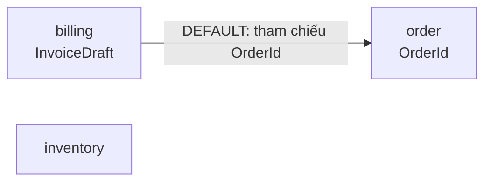
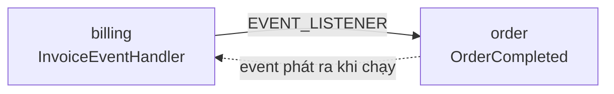
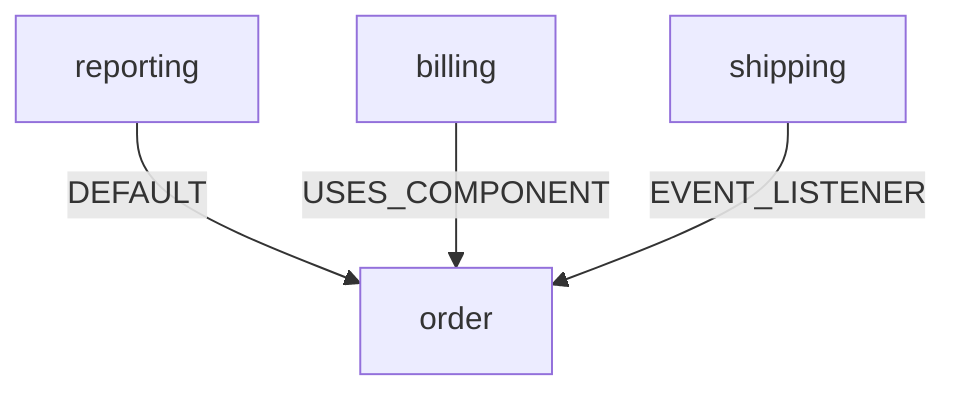
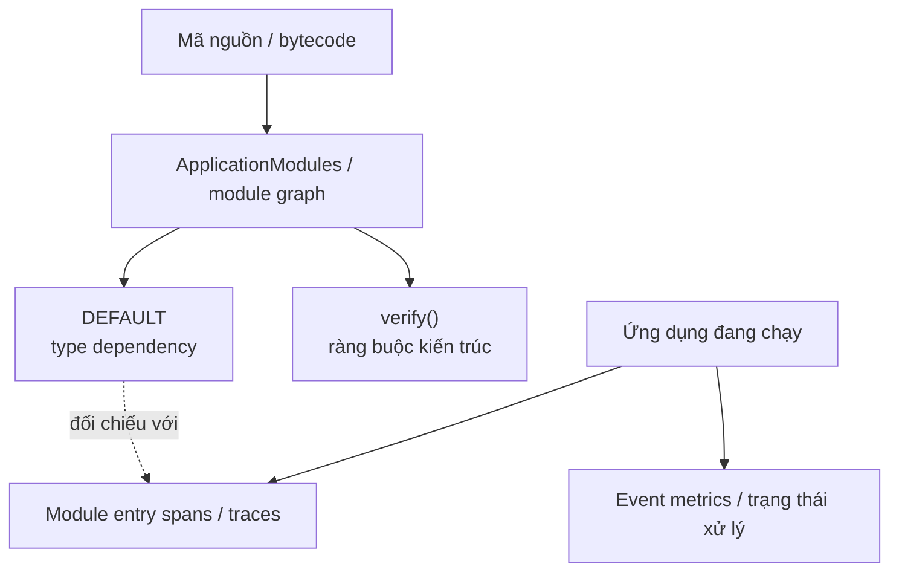
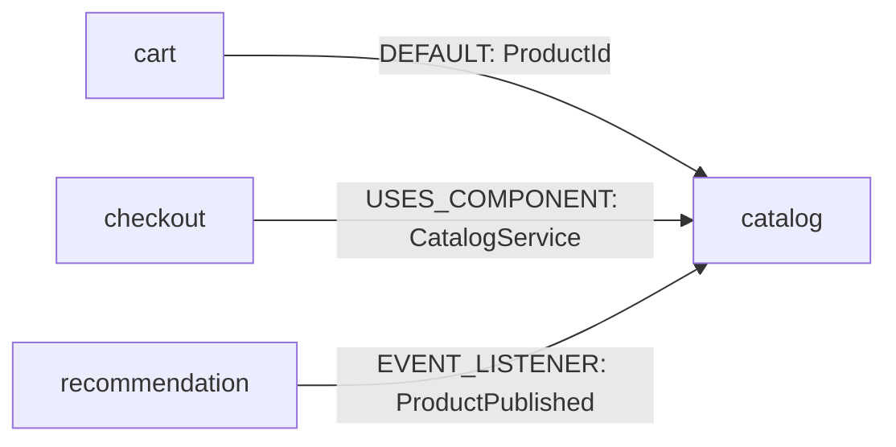

# Dependency type DEFAULT

## 1. Vị trí của DEFAULT trong Module graph

Trong chương **Module graph** của mô-đun học **SPRING_MODULITH_DOCUMENTATION_OBSERVABILITY**, chúng ta tìm hiểu cách Spring Modulith mô tả **quan hệ phụ thuộc giữa các application module** trong ứng dụng Spring Boot. Mục tiêu là dùng sơ đồ và metadata kiến trúc để kiểm chứng ranh giới module, sau đó đối chiếu với Actuator, event metrics và tracing khi hệ thống vận hành.

Giả sử hệ thống bán hàng chia thành các module `order`, `billing` và `inventory`. Module `order` công bố một kiểu dữ liệu đại diện cho mã đơn hàng. Module `billing` dùng kiểu đó trong mô hình hóa đơn. Dù hai module **không gọi Spring bean của nhau**, giữa chúng vẫn có một phụ thuộc ở cấp mã nguồn. Spring Modulith có thể báo cáo quan hệ này là **`DEFAULT`**.

Theo tài liệu Modulith Actuator, `DEFAULT` có nghĩa là **simple type dependency**: một module tham chiếu đến một kiểu Java thuộc module khác, không được phân loại là quan hệ Spring bean hoặc event listener đặc thù. Đây là một loại **dependency tĩnh** của kiến trúc.

Sau bài này, bạn sẽ có thể:

1. Nhận diện `DEFAULT` trong `dependencies[].types[]` của Modulith Actuator.
2. Phân biệt `DEFAULT`, `USES_COMPONENT` và `EVENT_LISTENER` bằng các ví dụ mã Java.
3. Xác định **chiều phụ thuộc** trên module graph và đánh giá liệu phụ thuộc đó có phù hợp API module.
4. Dùng `ApplicationModules.verify()`, `@ApplicationModule` và named interface để kiểm soát dependency.
5. Hiểu các giới hạn của `DEFAULT` khi quan sát traces, metrics và luồng xử lý runtime.

## 2. Một application module phụ thuộc kiểu của module khác như thế nào?

Trong ứng dụng Spring Modulith, application module là phần chức năng logic nằm trong ứng dụng Spring Boot. Theo chiến lược phát hiện mặc định, các package trực tiếp bên dưới package gốc của ứng dụng có thể được nhận diện thành module.

```text
com.acme.shop
├── ShopApplication.java
├── order
│   ├── OrderId.java                 # Public API của order
│   ├── OrderOperations.java         # Bean API (nếu cần)
│   └── internal
│       └── OrderRepository.java     # Chi tiết nội bộ
├── billing
│   ├── InvoiceDraft.java            # Có tham chiếu OrderId
│   └── internal
│       └── InvoicePersistence.java
└── inventory
    └── InventoryOperations.java
```

Ở cấu trúc này:

- `order` là module **sở hữu** kiểu `OrderId`.
- `billing` là module **tham chiếu** kiểu đó.
- `order.internal` là implementation nội bộ; module khác không nên phụ thuộc trực tiếp vào các lớp ở đây.
- Việc tách thành module là **ranh giới logic**; cả ba vẫn có thể chạy trong một JVM.

### Ví dụ 1 — Chỉ tham chiếu kiểu dữ liệu

Module `order` khai báo một kiểu API công khai:

```java
// src/main/java/com/acme/shop/order/OrderId.java
package com.acme.shop.order;

import java.util.UUID;

public record OrderId(UUID value) {
    public OrderId {
        if (value == null) {
            throw new IllegalArgumentException("Order ID must not be null");
        }
    }
}
```

Module `billing` dùng `OrderId` làm trường dữ liệu trong hóa đơn nháp:

```java
// src/main/java/com/acme/shop/billing/InvoiceDraft.java
package com.acme.shop.billing;

import com.acme.shop.order.OrderId;
import java.math.BigDecimal;

public record InvoiceDraft(
        OrderId orderId,
        BigDecimal amount
) {
}
```

Dòng `import com.acme.shop.order.OrderId;` và kiểu trường `OrderId orderId` thể hiện **liên kết kiểu dữ liệu** từ `billing` đến `order`. `InvoiceDraft` không inject `OrderOperations`, không gọi method trên Spring bean ở module `order` và cũng không đăng ký listener cho event của `order`.

Vì vậy, trong mô hình lý tưởng chỉ có những tham chiếu trên, Modulith Actuator có thể báo cáo cạnh sau:



**Chiều mũi tên là `billing → order`.** Module chứa code tham chiếu là **source**; module sở hữu kiểu bị tham chiếu là **target**. Chiều mũi tên không diễn tả dữ liệu chạy từ module nào đến module nào tại runtime.

Nếu sau này bỏ toàn bộ tham chiếu tới `OrderId` khỏi `billing` mà không còn kiểu hoặc thành phần nào khác của `order` được dùng, dependency này có thể biến mất khỏi graph khi tạo lại mô hình module.

### Những dạng tham chiếu có thể tạo dependency kiểu dữ liệu

Không chỉ câu lệnh `import` mới tạo phụ thuộc. Về mặt kiến trúc, điều quan trọng là **mã Java của module này tham chiếu kiểu được định nghĩa trong module khác**, chẳng hạn:

| Cách tham chiếu | Ví dụ ở `billing` | Ý nghĩa |
| --- | --- | --- |
| Kiểu trường dữ liệu | `private OrderId orderId;` | Cấu trúc dữ liệu phụ thuộc kiểu của `order` |
| Tham số phương thức | `createInvoice(OrderId id)` | Hợp đồng phương thức dùng API của `order` |
| Kiểu trả về | `OrderId getSourceOrderId()` | API/implementation trả về kiểu do `order` sở hữu |
| Record component | `record InvoiceDraft(OrderId id) {}` | Record có thành phần thuộc module khác |
| Tạo instance | `new OrderId(uuid)` | Code dùng trực tiếp constructor của kiểu ở module đích |
| Generic type argument | `List<OrderId>` | Hợp đồng kiểu tham chiếu `OrderId` |

Đây là các **dạng liên kết Java cần quan tâm khi phân tích**, không phải cam kết rằng mọi cách ghi trong mọi vị trí hoặc mọi phiên bản Spring Modulith sẽ hiện thành đúng một cạnh `DEFAULT`. Kết quả phụ thuộc vào phạm vi phân tích bytecode và cách Modulith phân loại quan hệ. Ví dụ, tham chiếu Spring bean hoặc entity có thể được nhận diện chuyên biệt.

## 3. Đọc DEFAULT trên Modulith Actuator

Spring Modulith có endpoint `/actuator/modulith` để công bố metadata về các module và quan hệ phụ thuộc. Khi ứng dụng đã có Spring Boot Actuator và Modulith Actuator, cần cho phép expose endpoint này qua HTTP theo cấu hình management phù hợp.

Ví dụ cấu hình:

```yaml
management:
  endpoints:
    web:
      exposure:
        include: "health,modulith"
```

Để đăng ký endpoint, có thể dùng các dependency `spring-modulith-actuator` và `spring-boot-starter-actuator`; hoặc `spring-modulith-starter-insight` nếu dự án cũng cần hỗ trợ observability. Cần chọn phiên bản tương thích giữa Spring Boot và Spring Modulith.

Kiểm tra khi chạy local:

```bash
curl -i http://localhost:8080/actuator/modulith
```

Ví dụ JSON **rút gọn, minh họa** cho các module `order`, `billing`, `inventory`:

```json
{
  "order": {
    "displayName": "Order",
    "basePackage": "com.acme.shop.order",
    "dependencies": []
  },
  "billing": {
    "displayName": "Billing",
    "basePackage": "com.acme.shop.billing",
    "dependencies": [
      {
        "target": "order",
        "types": ["DEFAULT"]
      }
    ]
  },
  "inventory": {
    "displayName": "Inventory",
    "basePackage": "com.acme.shop.inventory",
    "dependencies": []
  }
}
```

Cách đọc chính xác:

| Phần JSON | Cách hiểu |
| --- | --- |
| `$.billing` | Node nguồn, module `billing` |
| `$.billing.dependencies[]` | Danh sách các dependency **đi ra** từ `billing` |
| `$.billing.dependencies[0].target` | Target là module `order` |
| `$.billing.dependencies[0].types[0]` | Loại quan hệ là `DEFAULT` |
| `$.order.dependencies: []` | Ví dụ này không có dependency **đi ra** từ `order`; không có nghĩa không module nào phụ thuộc vào `order` |

Tên trường `types` ở dạng **mảng** vì một cặp module có thể có nhiều loại quan hệ. Ví dụ, cùng `billing → order` có thể có tham chiếu kiểu dữ liệu và gọi Spring bean; tùy các tham chiếu được phát hiện, `types[]` có thể chứa hơn một giá trị. Không nên giả định mỗi cặp module chỉ có một kiểu dependency.

> **Lưu ý quan trọng:** `DEFAULT` không có nghĩa “Spring Modulith cho phép truy cập theo mặc định”, “không có dependency” hay “lời gọi runtime mặc định”. Đây là **nhãn phân loại quan hệ tham chiếu kiểu**.

## 4. Phân biệt DEFAULT với USES_COMPONENT và EVENT_LISTENER

Spring Modulith sử dụng các nhãn khác nhau để diễn đạt **loại tương tác được suy ra từ code**. Trong tài liệu Modulith Actuator, ba nhãn thường gặp là:

| Loại | Bản chất | Ví dụ | Điều KHÔNG thể tự suy ra |
| --- | --- | --- | --- |
| **`DEFAULT`** | Phụ thuộc kiểu dữ liệu Java thông thường | `billing.InvoiceDraft` có trường `order.OrderId` | Không chứng minh Spring bean của `order` đã được gọi |
| **`USES_COMPONENT`** | Phụ thuộc vào Spring component/bean do module khác cung cấp | `billing` inject `order.OrderOperations` | Không cho biết số lần gọi, latency hay lỗi runtime |
| **`EVENT_LISTENER`** | Module đăng ký listener cho sự kiện do module khác công bố | `billing` lắng nghe `order.OrderCompleted` | Không chứng minh event đã được phát hoặc listener xử lý thành công |

API `DependencyType` của Spring Modulith còn có hằng `ENTITY` cho trường hợp tham chiếu entity ở các phiên bản hỗ trợ. Trong thực hành đọc `/actuator/modulith`, nên dựa vào **schema của phiên bản đang dùng**, tránh diễn giải mọi `types[]` theo giả định chỉ có đúng ba giá trị.

### Ví dụ 2 — Khi dependency chuyển thành USES_COMPONENT

Giả sử module `order` công bố một Spring bean:

```java
// com/acme/shop/order/OrderOperations.java
package com.acme.shop.order;

import org.springframework.stereotype.Service;

@Service
public class OrderOperations {

    public boolean exists(OrderId id) {
        // Minh họa: logic tra cứu đơn hàng nằm ở module order.
        return true;
    }
}
```

Một Spring component bên `billing` inject bean này:

```java
// com/acme/shop/billing/BillingService.java
package com.acme.shop.billing;

import com.acme.shop.order.OrderId;
import com.acme.shop.order.OrderOperations;
import org.springframework.stereotype.Service;

@Service
public class BillingService {

    private final OrderOperations orders;

    public BillingService(OrderOperations orders) {
        this.orders = orders;
    }

    public boolean mayBill(OrderId orderId) {
        return orders.exists(orderId);
    }
}
```

Ở đây `billing` không chỉ tham chiếu `OrderId` mà còn **cần một Spring bean của `order`** để hoạt động. Quan hệ được phân loại `USES_COMPONENT` đối với dependency đến Spring component đó. Trường hợp dùng đồng thời nhiều kiểu tham chiếu, `types[]` có thể thể hiện nhiều loại cạnh sau khi tổng hợp.

**Không hiểu sai:** `USES_COMPONENT` xuất phát từ quan hệ thành phần trong mã và dependency injection, không phải số lần gọi thực tế được ghi trong trace. Một bean có thể được inject mà trong một request cụ thể không gọi phương thức nào của bean đó.

### Ví dụ 3 — Khi dependency là EVENT_LISTENER

Module `order` định nghĩa event công khai:

```java
// com/acme/shop/order/OrderCompleted.java
package com.acme.shop.order;

import java.util.UUID;

public record OrderCompleted(UUID orderId) {}
```

Module `billing` đăng ký một listener:

```java
// com/acme/shop/billing/InvoiceEventHandler.java
package com.acme.shop.billing;

import com.acme.shop.order.OrderCompleted;
import org.springframework.context.event.EventListener;
import org.springframework.stereotype.Component;

@Component
class InvoiceEventHandler {

    @EventListener
    public void on(OrderCompleted event) {
        // Tiếp nhận sự kiện và lập hóa đơn.
    }
}
```

Khi đó `billing` **phụ thuộc kiểu sự kiện** do `order` công bố, và Modulith có thể nhận ra quan hệ chuyên biệt `EVENT_LISTENER`. Trong module graph, chiều dependency vẫn là:



**Cảnh báo về chiều:** Đường liền `billing → order` là dependency **tĩnh** vì listener bên billing biết kiểu event bên order. Đường đứt `order → billing` minh họa hướng **phân phối sự kiện runtime**. Hai chiều này phục vụ hai câu hỏi khác nhau.

### Một đồ thị tổng hợp

Giả sử `reporting` cần kiểu `OrderId`; `billing` inject `OrderOperations`; `shipping` lắng nghe `OrderCompleted`:



Một module có nhiều incoming dependencies không nhất thiết là thiết kế sai. Tuy nhiên, đây có thể là **dấu hiệu module trung tâm** cần kiểm tra sự ổn định của API và xu hướng phụ thuộc chéo.

## 5. DEFAULT có vi phạm ranh giới module hay không?

**Không tự động.** Một quan hệ `DEFAULT` đến **API công khai** của module khác có thể là thiết kế hợp lệ. Điều cần đánh giá là **kiểu được tham chiếu nằm ở đâu**, và dependency đó có nằm trong tập phụ thuộc được phép hay không.

### Hợp lệ: tham chiếu kiểu API

```java
// billing/InvoiceDraft.java
import com.acme.shop.order.OrderId;

record InvoiceDraft(OrderId sourceOrderId) {}
```

`OrderId` đặt trong package gốc `com.acme.shop.order`, thuộc API mặc định của module `order`. Với cấu hình module thông thường và không có chính sách cấm `billing → order`, đây là dependency hợp lệ.

### Có vấn đề: tham chiếu implementation nội bộ

```java
// billing/internal/BillingRepository.java
import com.acme.shop.order.internal.OrderJpaEntity;

class BillingRepository {
    private OrderJpaEntity persistedOrder;
}
```

Cho dù Java cho phép import vì lớp được khai báo `public`, Spring Modulith có thể coi đây là **xâm phạm ranh giới** nếu `order.internal` không được công bố như một API/named interface. Loại dependency được báo cáo không khiến hành vi truy cập nội bộ trở nên hợp lệ.

Để tránh phụ thuộc nội bộ, có thể:

1. Công bố một value object/DTO hoặc API đọc dữ liệu ở package API của `order`.
2. Cho phép một named interface rõ ràng khi thật sự cần cung cấp nhóm kiểu ở subpackage.
3. Thiết kế event mang dữ liệu phù hợp nếu yêu cầu có tính bất đồng bộ và không cần truy vấn trực tiếp.

Không nên chuyển toàn bộ JPA entity ra public API chỉ để “làm mất” lỗi ranh giới; điều đó khiến module khác gắn chặt vào persistence model của `order`.

## 6. Kiểm chứng dependency với ApplicationModules

Trong dự án có `spring-modulith-starter-test`, tạo một kiến trúc test:

```java
package com.acme.shop;

import org.junit.jupiter.api.Test;
import org.springframework.modulith.core.ApplicationModules;

class ArchitectureTests {

    @Test
    void modulesFollowDeclaredBoundaries() {
        ApplicationModules.of(ShopApplication.class).verify();
    }
}
```

`verify()` kiểm tra các quy tắc module mà Spring Modulith hỗ trợ, gồm tránh vòng phụ thuộc, không truy cập phần internal của module khác và tôn trọng allowed dependencies nếu đã khai báo. Nó kiểm tra **cấu trúc code**; không cần giả lập request hoặc chạy HTTP endpoint.

### Giới hạn dependency theo kiến trúc đã thống nhất

Ví dụ module `billing` chỉ được phụ thuộc module `order`:

```java
// src/main/java/com/acme/shop/billing/package-info.java
@org.springframework.modulith.ApplicationModule(
    allowedDependencies = "order"
)
package com.acme.shop.billing;
```

Khi chạy test, phụ thuộc từ `billing` sang một module khác không được phép có thể làm verification thất bại. Dù một cạnh có nhãn `DEFAULT`, nếu nó vượt quá chính sách `allowedDependencies` thì vẫn là lỗi kiến trúc.

### Named interface cho nhóm kiểu cần công bố

Nếu muốn đặt `OrderId` cùng các DTO trong `order.api`, không nên mặc nhiên coi mọi subpackage là public. Có thể khai báo:

```java
// src/main/java/com/acme/shop/order/api/package-info.java
@org.springframework.modulith.NamedInterface("api")
package com.acme.shop.order.api;
```

Sau đó, module `billing` có thể giới hạn tham chiếu:

```java
// src/main/java/com/acme/shop/billing/package-info.java
@org.springframework.modulith.ApplicationModule(
    allowedDependencies = "order::api"
)
package com.acme.shop.billing;
```

Với cấu hình này, `billing` được phép tham chiếu nhóm API `order::api`, còn các phần khác của `order` không tự động được phép. Cách này tạo **contract có chủ đích** cho dependency `DEFAULT`.

**Lưu ý:** Nếu đã dùng `order::api` để giới hạn dependency, ví dụ trong phần 2 cần di chuyển `OrderId` từ package gốc sang `order.api` và cập nhật import cho tương ứng. Đây là **hai phương án tổ chức API khác nhau**, không nên trộn hai mẫu mà không chỉnh code.

## 7. Mối liên hệ giữa DEFAULT, tài liệu graph và observability

Hệ thống có thể có một cạnh `billing → order` loại `DEFAULT` dù trong một request không có lời gọi `billing` → `order`. Để không diễn giải nhầm, hãy phân biệt:

| Câu hỏi | Nên dùng | DEFAULT trả lời được không? |
| --- | --- | --- |
| `billing` có tham chiếu kiểu của `order` không? | Module graph/`/actuator/modulith` | **Có** |
| Tham chiếu đó nằm trong API cho phép không? | `ApplicationModules.verify()` và quy tắc module | **Không tự trả lời** |
| `billing` có gọi một Spring bean `order` không? | `USES_COMPONENT` trong graph; đối chiếu code | **Không** |
| Một request đã gọi qua module nào? | Module entry spans/Micrometer Tracing | **Không** |
| Event đã được publish bao nhiêu lần? | Event metrics, ví dụ `module.events.published` | **Không** |
| Listener xử lý thành công chưa? | Event publication registry/log/metrics xử lý | **Không** |
| Trace bị tách khi chuyển async không? | Tracing và context propagation | **Không** |

Sơ đồ phụ thuộc và trace phục vụ mục đích bổ trợ:



Nếu module `billing` chỉ cất giữ `OrderId` trong một record, sẽ **không có lý do** để mặc nhiên mong đợi một span “billing gọi order”. Nếu sau này `billing` inject `OrderOperations` thì đường runtime mới có khả năng đi qua điểm vào của module `order` và được instrumentation ghi nhận. Ngay cả khi có lời gọi, trace vẫn phụ thuộc cấu hình tracing, sampling, proxy và đường code thật sự chạy.

## 8. Chẩn đoán khi graph hiện DEFAULT ngoài dự kiến

### Tình huống A — Một module phụ thuộc module khác dù không gọi service

**Triệu chứng:** `reporting → order` xuất hiện là `DEFAULT`, nhưng không thấy HTTP request hay Spring bean injection giữa hai module.

**Cách đọc:** Có thể `reporting` dùng `OrderId`, `OrderSummary` hoặc một kiểu dữ liệu thuộc `order` trong trường, tham số hoặc chữ ký phương thức. Kiểm tra import và các tham chiếu kiểu; không cần tìm ngay một lời gọi runtime.

### Tình huống B — DEFAULT dẫn tới lỗi verify()

**Triệu chứng:** `ApplicationModules.verify()` thông báo một phụ thuộc không hợp lệ dù API vẫn biên dịch.

**Cách đọc:** Kiểm tra package sở hữu kiểu là root API, named interface hay internal. Kiểm tra `allowedDependencies` của source module. Nếu dependency cần thiết về mặt nghiệp vụ, hãy công bố contract rõ ràng; nếu không, giảm coupling bằng mô hình dữ liệu riêng hoặc event phù hợp.

### Tình huống C — Cùng một module đích có nhiều types

**Triệu chứng:** Trong `dependencies[].types[]` xuất hiện hơn một nhãn.

**Cách đọc:** Một source module có thể phụ thuộc cùng target qua nhiều cơ chế: tham chiếu kiểu, Spring bean và event listener. Không coi đó là lỗi JSON. Kiểm tra từng loại để đánh giá đúng mức độ phụ thuộc.

### Tình huống D — Module graph có cạnh, tracing không có span

**Triệu chứng:** Graph có `DEFAULT` nhưng trace của giao dịch không thể hiện module đích.

**Cách đọc:** Quan hệ kiểu tĩnh **không buộc runtime gọi vào module đích**. Đây là trạng thái bình thường nếu chỉ dùng DTO, value object hoặc chữ ký API. Nếu cũng có Spring bean call, kiểm tra instrumentation và sampling cho luồng cụ thể.

### Tình huống E — Thay đổi source nhưng graph ở Actuator vẫn cũ

**Triệu chứng:** Bạn đã sửa import, song endpoint vẫn trả dependency cũ.

**Cách đọc:** Kiểm tra đã build và restart **đúng phiên bản ứng dụng** chưa, có đang gọi nhầm cổng/environment không, và có còn tham chiếu ở nơi khác không. Actuator mô tả mô hình module của ứng dụng hiện chạy, không tự cập nhật theo file đang sửa trong IDE.

## 9. Bài thực hành: nhận diện và kiểm soát DEFAULT

Giả sử hệ thống có:

- `catalog` công bố `ProductId` tại `com.acme.shop.catalog.ProductId`.
- `cart` có record `CartLine(ProductId productId, int quantity)`.
- `checkout` inject bean `CatalogService` để lấy thông tin sản phẩm.
- `recommendation` lắng nghe `ProductPublished` do `catalog` phát.

### Yêu cầu

1. Vẽ chiều phụ thuộc của `cart`, `checkout` và `recommendation` đến `catalog`.
2. Xác định kiểu quan hệ được kỳ vọng cho từng trường hợp.
3. Thêm `@ApplicationModule(allowedDependencies = "catalog")` vào module `cart` và dự đoán `verify()` sẽ thế nào nếu `cart` còn tham chiếu `pricing.DiscountCode`.
4. Đề xuất cách đặt `ProductId` trong named interface `catalog::api` nếu không muốn dùng root package làm API.
5. Giải thích vì sao số cạnh `DEFAULT` không thể dùng làm chỉ số tải hoặc độ trễ hệ thống.

### Gợi ý lời giải



- `cart → catalog` dự kiến là `DEFAULT` nếu chỉ dùng value object `ProductId`.
- `checkout → catalog` có `USES_COMPONENT` do inject `CatalogService`.
- `recommendation → catalog` có `EVENT_LISTENER` vì listener phụ thuộc vào kiểu event của `catalog`.
- Nếu `cart` chỉ được phép phụ thuộc `catalog`, tham chiếu `pricing.DiscountCode` có thể khiến `verify()` báo vi phạm allowed dependencies.
- Đặt kiểu trong `catalog.api` và khai báo `@NamedInterface("api")`, rồi giới hạn `allowedDependencies = "catalog::api"` là một cách công bố contract rõ ràng.
- Module graph là quan hệ **tĩnh**. Để đo tải và thời gian thực thi, phải thu thập metrics/traces đúng điểm đo.

## 10. Ghi nhớ và lỗi hiểu nhầm cần tránh

| Hiểu nhầm | Cách hiểu chính xác |
| --- | --- |
| “DEFAULT nghĩa là không có dependency.” | **Sai.** Đây là một loại dependency: tham chiếu kiểu dữ liệu Java thông thường. |
| “DEFAULT là một lời gọi service mặc định.” | **Sai.** Lời gọi tới Spring bean được mô tả bằng quan hệ chuyên biệt `USES_COMPONENT` khi được nhận diện. |
| “Có DEFAULT thì phải thấy span ở trace.” | **Sai.** Truy vết runtime không tương đương dependency tĩnh. |
| “DEFAULT luôn là lỗi thiết kế.” | **Sai.** Dùng type public API là hợp lệ khi không vi phạm quy tắc module. |
| “Cho Java biên dịch là đủ để cho phép phụ thuộc.” | **Sai.** Spring Modulith kiểm tra ranh giới API, vòng phụ thuộc và chính sách `allowedDependencies`. |
| “Chiều mũi tên là chiều event chạy.” | **Sai.** Module graph chỉ chiều code phụ thuộc; chiều event runtime có thể ngược lại. |

Như vậy, **`DEFAULT` là dấu hiệu module đang dùng kiểu dữ liệu do module khác sở hữu**. Hãy dùng nó để phát hiện coupling, kiểm tra tính ổn định của API và làm rõ ranh giới module. Khi đánh giá vận hành, bổ sung Modulith Actuator, module spans, event metrics và context propagation theo đúng câu hỏi cần trả lời; không suy luận hoạt động runtime chỉ từ một nhãn dependency tĩnh.

## Tài liệu tham khảo

1. [Spring Modulith – Production-ready Features, Application Module Actuator](https://docs.spring.io/spring-modulith/reference/production-ready.html): định nghĩa `DEFAULT` là *simple type dependency*, định dạng `dependencies[].types[]`.
2. [Spring Modulith – DependencyType API](https://docs.spring.io/spring-modulith/docs/current/api/org/springframework/modulith/core/DependencyType.html): các hằng `DEFAULT`, `USES_COMPONENT`, `EVENT_LISTENER`, `ENTITY`.
3. [Spring Modulith – Fundamentals](https://docs.spring.io/spring-modulith/reference/fundamentals.html): module API/internal, named interfaces, `allowedDependencies`.
4. [Spring Modulith – Verifying Application Module Structure](https://docs.spring.io/spring-modulith/reference/verification.html): `ApplicationModules.verify()` và quy tắc kiểm chứng.
