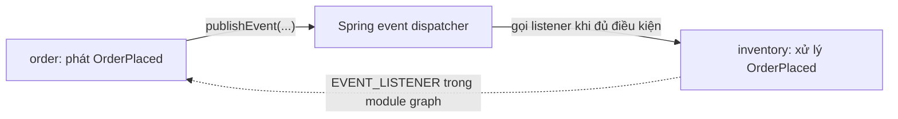
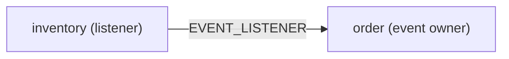

# Dependency type EVENT_LISTENER

## 1. Bối cảnh: một mũi tên có thể bị hiểu ngược

Trong một ứng dụng Spring Boot dùng **Spring Modulith**, giả sử module `order` phát sự kiện `OrderPlaced` sau khi tạo đơn hàng, còn module `inventory` đăng ký một listener để giữ tồn kho. Nếu xem **module graph** do Spring Modulith phân tích, bạn có thể gặp cạnh:

```text
inventory ── EVENT_LISTENER ──> order
```

Điều này không có nghĩa `inventory` đã phát sự kiện sang `order`. Cạnh trên diễn tả **phụ thuộc kiến trúc**: module `inventory` khai báo một listener cho kiểu sự kiện do module `order` cung cấp. Luồng phát và xử lý sự kiện lúc chạy có thể theo hướng ngược lại, từ `order` tới listener tại `inventory`.

Trong chủ đề **Module graph** của **SPRING_MODULITH_DOCUMENTATION_OBSERVABILITY**, việc đọc đúng `EVENT_LISTENER` giúp:

- Sinh tài liệu ranh giới application module chính xác, không nhầm producer với consumer.
- Kiểm tra phụ thuộc module bằng `ApplicationModules` và sơ đồ Documenter.
- Đọc trường `dependencies[].types` trong endpoint Actuator Modulith.
- Đối chiếu kiến trúc tĩnh với event metrics, trace và context propagation trong quá trình vận hành.

**Định nghĩa cốt lõi:** `DependencyType.EVENT_LISTENER` trong `org.springframework.modulith.core.DependencyType` biểu thị rằng **module nguồn phụ thuộc vào module đích vì nó khai báo một event listener cho sự kiện được module đích công khai**. “Nguồn” và “đích” ở đây là hai đầu của **cạnh dependency**, không phải hai đầu luồng truyền sự kiện.

## 2. Ba vai trò cần xác định

| Vai trò | Ví dụ | Trách nhiệm |
| --- | --- | --- |
| Module công bố kiểu sự kiện (*event owner*) | `order` | Định nghĩa kiểu `OrderPlaced` trong API module; có thể phát sự kiện khi nghiệp vụ diễn ra |
| Module khai báo listener (*consumer*) | `inventory` | Định nghĩa method xử lý `OrderPlaced`, vì vậy tham chiếu kiểu được module `order` công khai |
| Spring event infrastructure | `ApplicationEventPublisher` và các cơ chế dispatch của Spring | Chuyển một sự kiện đã phát đến listener phù hợp theo cách được cấu hình |

Lưu ý: “công bố kiểu sự kiện” và “phát một instance sự kiện” là hai hành vi khác nhau. Spring Modulith có thể nhận diện loại phụ thuộc qua **cấu trúc mã nguồn** khi chưa có request nào chạy và chưa có event nào thực sự được phát.

### 2.1. Hai chiều mũi tên khác nhau



- **Mũi tên liền**: luồng xử lý sự kiện lúc chạy (publisher → dispatcher → listener).
- **Mũi tên đứt**: phụ thuộc tĩnh trong module graph (listener module → module sở hữu kiểu event).

Vì thế, khi nhìn JSON `inventory.dependencies = [{target: "order", types: ["EVENT_LISTENER"]}]`, hãy đọc: “`inventory` có listener cho event do `order` cung cấp”. Không đọc thành “`inventory` phát event cho `order`”.

### 2.2. “Phụ thuộc” không đồng nghĩa “phải khởi tạo module đích”

Spring Modulith phân biệt `EVENT_LISTENER` với `USES_COMPONENT`. Với `USES_COMPONENT`, module nguồn có dependency thông qua Spring component của module đích, nên phần khởi tạo module đích có thể cần thiết khi chạy module nguồn. Với `EVENT_LISTENER`, phụ thuộc cho biết module nguồn **biết kiểu sự kiện** của module đích; theo ý nghĩa của loại dependency này, bản thân quan hệ lắng nghe không bắt buộc module đích phải được bootstrap chỉ để module nguồn chạy.

Đây là cơ sở của cách tích hợp module qua sự kiện: module phát sự kiện không cần biết danh sách module lắng nghe. Tuy nhiên, khi kiểm thử thực tế, các bean, cơ sở dữ liệu hoặc cấu hình khác của từng module vẫn có thể có dependency riêng; không suy từ một cạnh `EVENT_LISTENER` rằng toàn bộ module hoàn toàn độc lập.

## 3. Ví dụ Java tối giản

Giả sử application class nằm tại `com.example.shop.ShopApplication` và Spring Modulith nhận diện các package con trực tiếp là application module:

```text
com.example.shop
├── ShopApplication.java
├── order/
│   ├── OrderPlaced.java
│   └── OrderService.java
└── inventory/
    └── InventoryOnOrderPlaced.java
```

### 3.1. Module `order` sở hữu contract sự kiện

File `com/example/shop/order/OrderPlaced.java`:

```java
package com.example.shop.order;

import java.util.UUID;

// Nằm trong package API của module order, được module khác tham chiếu.
public record OrderPlaced(UUID orderId) {}
```

File `com/example/shop/order/OrderService.java`:

```java
package com.example.shop.order;

import java.util.UUID;
import org.springframework.context.ApplicationEventPublisher;
import org.springframework.stereotype.Service;

@Service
public class OrderService {

    private final ApplicationEventPublisher events;

    public OrderService(ApplicationEventPublisher events) {
        this.events = events;
    }

    public void placeOrder(UUID orderId) {
        // Ví dụ tối giản: việc lưu đơn, xác thực và giao dịch đã lược bỏ.
        events.publishEvent(new OrderPlaced(orderId));
    }
}
```

`OrderService` chỉ biết `OrderPlaced` và `ApplicationEventPublisher`. Nó **không import** lớp listener ở `inventory`, cũng không gọi trực tiếp API inventory. Đây là lợi ích cốt lõi của giao tiếp hướng sự kiện ở ranh giới module.

### 3.2. Module `inventory` đăng ký listener

File `com/example/shop/inventory/InventoryOnOrderPlaced.java`:

```java
package com.example.shop.inventory;

import com.example.shop.order.OrderPlaced;
import org.springframework.context.event.EventListener;
import org.springframework.stereotype.Component;

@Component
class InventoryOnOrderPlaced {

    @EventListener
    void on(OrderPlaced event) {
        // Ví dụ: cập nhật tồn kho dựa trên event.orderId().
    }
}
```

Đây là listener Spring đồng bộ đơn giản để minh họa. Trong ví dụ mặc định, nó được gọi khi event được phát. **Điểm quyết định đối với module graph** là:

1. Listener được khai báo tại `inventory`.
2. Tham số của method listener có kiểu `OrderPlaced`, thuộc API module `order`.
3. Vì vậy `inventory` có dependency loại `EVENT_LISTENER` hướng tới `order`.

Spring Modulith cũng cung cấp `@ApplicationModuleListener`:

```java
import org.springframework.modulith.events.ApplicationModuleListener;

// Thay annotation ở method on(OrderPlaced event):
@ApplicationModuleListener
void on(OrderPlaced event) {
    // Công việc xử lý sau commit trong một giao dịch riêng.
}
```

`@ApplicationModuleListener` là shortcut cho listener **transactional + asynchronous**, chạy trong giao dịch riêng sau khi giao dịch phát event hoàn tất thành công. Vì vậy, nếu chuyển ví dụ sang annotation này thì phần nghiệp vụ phát event phải có **giao dịch được commit**; không nên dùng đoạn `placeOrder()` tối giản ở trên làm bằng chứng rằng listener giao dịch sẽ luôn chạy. Khi áp dụng trong dự án thật, kết hợp Event Publication Registry nếu cần theo dõi và khôi phục lần xử lý chưa hoàn tất.

Đổi từ listener đồng bộ sang listener bất đồng bộ làm thay đổi **ngữ nghĩa thực thi và transaction**, nhưng bản chất cạnh `EVENT_LISTENER` vẫn là quan hệ module lắng nghe kiểu event của module khác.

## 4. So sánh EVENT_LISTENER với các dependency type khác

Một application module có thể liên hệ với module khác bằng nhiều kiểu dependency. Các giá trị thường thấy trong module actuator gồm:

| Dependency type | Đặc điểm | Ví dụ |
| --- | --- | --- |
| `EVENT_LISTENER` | Module nguồn khai báo listener cho event được module đích công khai | `inventory` lắng nghe `OrderPlaced` của `order` |
| `USES_COMPONENT` | Module nguồn có dependency qua Spring component của module đích | `order` inject `PaymentOperations` từ `payment` |
| `DEFAULT` | Tham chiếu kiểu/mã nguồn khác, không được phân loại thành các trường hợp trên | Một kiểu trong module nguồn tham chiếu DTO/API type của module đích |

API `DependencyType` ở các dòng Spring Modulith mới còn có `ENTITY` để mô tả tham chiếu tới entity của module khác. Danh sách type được xuất trên Actuator và các tùy chọn tài liệu có thể thay đổi theo phiên bản; khi viết code lọc dependency, dùng enum của phiên bản đang chạy.

**Quan trọng:** Hai module có thể có **nhiều loại dependency cùng lúc**. Nếu `inventory` vừa lắng nghe `OrderPlaced`, vừa inject một Spring bean công khai từ `order`, thông tin tổng hợp trong Actuator có thể có:

```json
{
  "target": "order",
  "types": ["EVENT_LISTENER", "USES_COMPONENT"]
}
```

Đây không phải dữ liệu mâu thuẫn. Nó có nghĩa cùng một cặp module tồn tại ít nhất hai kiểu kết nối; cần xem mã nguồn nếu muốn loại bỏ coupling qua bean và chỉ giữ giao tiếp event.

## 5. Đọc đúng EVENT_LISTENER trong module graph và Actuator

### 5.1. Bức tranh kiến trúc tĩnh

Ví dụ graph chỉ xét hai module:



Đọc đồ thị từ trái sang phải: **inventory phụ thuộc vào kiểu sự kiện thuộc order**. Nếu dự án có thêm `payment` và `order` inject `PaymentOperations`, sẽ có thêm cạnh `order → payment` thuộc nhóm `USES_COMPONENT`. Không gộp nhầm hai cạnh vì mỗi cạnh phản ánh lý do phụ thuộc khác nhau.

### 5.2. JSON của endpoint Modulith

Khi ứng dụng đã có Spring Modulith Actuator (ví dụ qua `spring-modulith-starter-insight`) và expose endpoint, gọi:

```http
GET /actuator/modulith
```

Một đoạn phản hồi **minh họa**:

```json
{
  "order": {
    "displayName": "Order",
    "basePackage": "com.example.shop.order",
    "dependencies": []
  },
  "inventory": {
    "displayName": "Inventory",
    "basePackage": "com.example.shop.inventory",
    "dependencies": [
      {
        "target": "order",
        "types": ["EVENT_LISTENER"]
      }
    ]
  }
}
```

Trong cấu trúc này:

- Khóa `inventory` là định danh **module nguồn** được mô tả.
- `dependencies[]` chứa các phụ thuộc đi ra từ `inventory`.
- `target: "order"` là **module đích của dependency**, đồng thời là module khai báo kiểu event.
- `types: ["EVENT_LISTENER"]` cho biết *lý do* có cạnh module.

Không đảo chiều hai đầu chỉ vì khi chạy event được phát từ `order`. JSON chứa **mô hình kiến trúc**, không phải lịch sử các event đã được gửi và xử lý.

Ví dụ cấu hình Actuator trong `application.yml`:

```yaml
management:
  endpoints:
    web:
      exposure:
        include: "health,info,modulith"
```

Lưu ý URL thực tế còn tùy `management.server.port`, base path, Spring Security và cấu hình endpoint; production nên giới hạn quyền xem thông tin nội bộ.

### 5.3. Có EVENT_LISTENER trong graph chứng minh điều gì?

| Quan sát | Kết luận hợp lệ |
| --- | --- |
| Có cạnh `inventory → order` với `EVENT_LISTENER` | Spring Modulith đã phát hiện listener của inventory cho event được order cung cấp |
| Không có event nào được phát | Cạnh **vẫn có thể tồn tại** vì mô hình được suy ra từ cấu trúc mã |
| Có cạnh nhưng listener không chạy khi test | Cần kiểm tra có thực sự phát event, Spring bean/transaction/async, lỗi xử lý, điều kiện cấu hình |
| Một số trace không hiện listener | Có thể do sampling, thiếu instrumentation hoặc context propagation bất đồng bộ |
| Counter publish event tăng | Có lần phát event được instrument; chưa kết luận listener đã xử lý thành công |

Đặc biệt với `@ApplicationModuleListener`: vì đây là listener sau commit và bất đồng bộ, một request HTTP kết thúc thành công không chứng minh listener đã hoàn tất. Có thể cần theo dõi Event Publication Registry, metric riêng cho trạng thái xử lý và trace của task bất đồng bộ.

## 6. Lọc EVENT_LISTENER bằng API ApplicationModules

Spring Modulith cung cấp API phân tích kiến trúc độc lập với việc khởi động server HTTP. Ví dụ sau lấy trực tiếp các dependency `EVENT_LISTENER` từ module `inventory`:

```java
package com.example.shop;

import org.junit.jupiter.api.Test;
import org.springframework.modulith.core.ApplicationModules;
import org.springframework.modulith.core.DependencyType;

class ModuleGraphTests {

    @Test
    void printInventoryEventListenerDependencies() {
        ApplicationModules modules =
            ApplicationModules.of(ShopApplication.class);

        var inventory = modules.getModuleByName("inventory")
            .orElseThrow();

        inventory.getDirectDependencies(
                modules, DependencyType.EVENT_LISTENER)
            .stream()
            .forEach(dependency -> System.out.printf(
                "%s -> %s : %s -> %s%n",
                inventory.getIdentifier(),
                dependency.getTargetModule().getIdentifier(),
                dependency.getSourceType().getName(),
                dependency.getTargetType().getName()
            ));
    }
}
```

Các thành phần đáng chú ý:

- `ApplicationModules.of(ShopApplication.class)` phân tích các module dưới package ứng dụng.
- `getModuleByName("inventory")` lấy module listener; nếu cấu hình định danh tùy chỉnh thì dùng tên module thực tế.
- `getDirectDependencies(modules, DependencyType.EVENT_LISTENER)` lọc **phụ thuộc trực tiếp** theo type; không lấy lẫn phụ thuộc bắc cầu.
- `getSourceType()` và `getTargetType()` giúp truy về các kiểu Java liên quan để giải thích **vì sao** có cạnh.

Nếu muốn một kiểm thử kiến trúc có kết quả PASS/FAIL rõ ràng thay cho in ra console, dùng AssertJ:

```java
package com.example.shop;

import static org.assertj.core.api.Assertions.assertThat;

import org.junit.jupiter.api.Test;
import org.springframework.modulith.core.ApplicationModules;
import org.springframework.modulith.core.DependencyType;

class EventListenerDependencyTests {

    @Test
    void inventoryListensToEventOwnedByOrder() {
        var modules = ApplicationModules.of(ShopApplication.class);
        modules.verify();

        var inventory = modules.getModuleByName("inventory")
            .orElseThrow();

        var targets = inventory
            .getDirectDependencies(modules, DependencyType.EVENT_LISTENER)
            .stream()
            .map(it -> it.getTargetModule().getIdentifier().toString())
            .toList();

        assertThat(targets).contains("order");
    }
}
```

Test này cố ý kiểm tra **cạnh dependency**; nó không thay thế test gửi event và xác nhận listener xử lý đúng dữ liệu. Ngoài ra, `modules.verify()` kiểm tra các quy tắc ranh giới module có trong mô hình; nó không tự áp đặt “chỉ được phép có đúng cạnh `EVENT_LISTENER` này”. Muốn chặn cạnh mới không mong đợi, cần kiểm tra thêm danh sách module đích và type theo thiết kế.

## 7. Tạo tài liệu và kiểm tra ranh giới module

Từ cùng instance `ApplicationModules`, có thể dùng `org.springframework.modulith.docs.Documenter` để xuất sơ đồ module, ví dụ trong một test sinh tài liệu:

```java
import org.junit.jupiter.api.Test;
import org.springframework.modulith.core.ApplicationModules;
import org.springframework.modulith.docs.Documenter;

class ArchitectureDocumentationTests {

    @Test
    void writeModuleDiagram() {
        var modules = ApplicationModules.of(ShopApplication.class);

        new Documenter(modules)
            .writeModulesAsPlantUml()
            .writeIndividualModulesAsPlantUml();
    }
}
```

Phần import cần đặt trong lớp test có package phù hợp và thêm `spring-modulith-docs` vào test classpath theo phiên bản BOM của dự án. Chạy test sẽ xuất sơ đồ, từ đó kiểm tra cạnh `EVENT_LISTENER` và những quan hệ còn lại. Cách ghi nhãn/cấp chi tiết trên sơ đồ phụ thuộc phiên bản và tùy chọn Documenter; khi cần kiểm tra **đúng type** của một cạnh, API lọc `DependencyType.EVENT_LISTENER` hoặc JSON `dependencies[].types` từ Actuator là nguồn rõ ràng hơn.

Một lỗi kiến trúc điển hình: thay vì chỉ sử dụng kiểu `OrderPlaced` công khai, listener `inventory` import `com.example.shop.order.internal.OrderRepository`. Khi đó ngoài `EVENT_LISTENER` có thể xuất hiện dependency tới phần nội bộ của `order` và `modules.verify()` có thể phát hiện vi phạm ranh giới. Cần điều chỉnh contract event hoặc API giữa module, không “sửa” graph bằng cách giấu cạnh trong tài liệu.

Nếu dùng `@ApplicationModule(allowedDependencies = "...")` để giới hạn các module có thể tham chiếu, hãy đảm bảo module `inventory` được phép phụ thuộc vào API của `order` theo thiết kế. Sự kiện là phương thức giảm coupling nhưng không miễn trừ các quy tắc module đã khai báo.

## 8. EVENT_LISTENER, event metrics và trace: kết hợp thế nào?

Ở thời điểm vận hành, ba lớp quan sát trả lời ba loại câu hỏi:

| Nguồn dữ liệu | Câu hỏi trả lời | Giới hạn |
| --- | --- | --- |
| Module graph: `EVENT_LISTENER` | “Module nào đăng ký listener cho event của module nào?” | Quan hệ tĩnh; không xác nhận event đã được phát |
| Event metrics | “Trong khoảng thời gian này có bao nhiêu event được công bố?” | Counter phát sự kiện không bảo đảm listener thành công |
| Distributed traces | “Một lần xử lý thực tế đi qua các span nào, mất bao lâu?” | Phụ thuộc instrumentation, sampling và context propagation |

Ví dụ khi có `inventory → order (EVENT_LISTENER)` trong graph nhưng đơn hàng không được giữ tồn kho:

1. Xác minh `OrderService` có gọi `publishEvent(new OrderPlaced(...))` trong nhánh nghiệp vụ thực sự chạy không.
2. Nếu có Micrometer/Actuator, kiểm tra meter công bố event ở module `order`. Metric phát tăng chỉ chứng minh đã công bố, không khẳng định listener đã xử lý.
3. Với listener đồng bộ `@EventListener`, kiểm tra exception tại thời điểm publish và cấu hình listener.
4. Với `@ApplicationModuleListener`, kiểm tra transaction gốc **commit thành công**, cấu hình executor async, lỗi listener và Event Publication Registry khi được bật.
5. Nếu mở trace, kiểm tra span của listener, trace sampling và việc context có được truyền qua task async hay không.
6. Sau khi sửa, dùng một test tích hợp để chứng minh nghiệp vụ giữ hàng hoàn thành; không chỉ dựa vào sự tồn tại của cạnh trong graph.

Ví dụ giả định về kết quả kiểm tra:

| Dấu hiệu | Nhận định | Hành động tiếp |
| --- | --- | --- |
| Graph có `EVENT_LISTENER`, counter publish bằng 0 | Có đăng ký listener, chưa thấy publish trong khung thời gian đo | Kiểm tra nhánh code phát event và thời điểm thu metric |
| Counter publish tăng, listener báo lỗi | Event đã phát nhưng xử lý thất bại | Đọc log, trạng thái publication, lỗi phụ thuộc tại listener |
| Event được ghi nhận, trace của listener không có | Trace không đầy đủ hoặc bị sampling | Kiểm tra instrumentation và propagation trước khi kết luận |
| Listener đã xử lý nhưng graph lại có `USES_COMPONENT` | Ngoài nghe event còn có phụ thuộc bean giữa hai module | Tìm chỗ inject/gọi trực tiếp để đánh giá coupling |

**Bảo mật và cardinality:** Khi đo event metrics, tránh dùng `orderId` hay UUID làm nhãn vì sẽ tạo rất nhiều time series. Dùng module/type event làm nhãn hữu hạn; thông tin nhận dạng giao dịch có thể nằm trong log/trace theo chính sách bảo vệ dữ liệu phù hợp.

## 9. Những nhầm lẫn cần tránh

| Phát biểu sai | Cách hiểu đúng |
| --- | --- |
| “`inventory → order (EVENT_LISTENER)` nghĩa là inventory phát event cho order.” | Hướng cạnh là **module listener → module sở hữu kiểu event**. |
| “Đã có EVENT_LISTENER thì event chắc chắn từng được phát.” | Graph được phân tích từ mã, không phải lịch sử runtime. |
| “Có EVENT_LISTENER tức module listener cần gọi bean của module phát.” | Listener có thể chỉ tham chiếu kiểu sự kiện; `USES_COMPONENT` mới mô tả coupling qua component. |
| “Một cặp module chỉ có một dependency type.” | Có thể có nhiều type trong `dependencies[].types`. |
| “Event listener đồng bộ và @ApplicationModuleListener chạy giống nhau.” | `@ApplicationModuleListener` liên quan giao dịch, sau commit và bất đồng bộ. |
| “Meter publish tăng chứng minh listener thành công.” | Phát event và hoàn tất listener là các trạng thái riêng. |
| “Không thấy span listener nên không tồn tại EVENT_LISTENER.” | Sampling/instrumentation/propagation có thể khiến trace không thể hiện listener. |
| “modules.verify() PASS bảo đảm không có dependency thiết kế ngoài ý muốn.” | Verification theo các quy tắc hiện hành; vẫn phải so graph với contract kiến trúc mong đợi. |

## 10. Checklist thực hành

- [ ] Nêu chính xác ý nghĩa của `DependencyType.EVENT_LISTENER` và phân biệt **source/target dependency** với **publisher/consumer runtime**.
- [ ] Tạo kiểu sự kiện công khai `order.OrderPlaced` và listener ở `inventory`.
- [ ] Dùng `ApplicationModules.of(...).getModuleByName(...)` để tìm module listener.
- [ ] Lọc bằng `getDirectDependencies(modules, DependencyType.EVENT_LISTENER)`, xác nhận target là `order`.
- [ ] Chạy `modules.verify()` và kiểm tra module API không bị tham chiếu sai.
- [ ] Đối chiếu sơ đồ Documenter hoặc endpoint `/actuator/modulith`; đọc `dependencies[].target` và `dependencies[].types` đúng hướng.
- [ ] Thử phát event thật và kiểm tra listener hoàn thành riêng với dependency graph.
- [ ] Nếu dùng `@ApplicationModuleListener`, kiểm tra transaction, async executor, registry và trace propagation khi phù hợp.
- [ ] Không nhầm `EVENT_LISTENER` với `USES_COMPONENT` hay với dấu vết truyền event trên trace.

## Tài liệu tham khảo

- [Spring Modulith — DependencyType Javadoc](https://docs.spring.io/spring-modulith/docs/current/api/org/springframework/modulith/core/DependencyType.html): định nghĩa `EVENT_LISTENER`, `USES_COMPONENT` và các dependency type.
- [Spring Modulith — ApplicationModule Javadoc](https://docs.spring.io/spring-modulith/docs/current/api/org/springframework/modulith/core/ApplicationModule.html): `getDirectDependencies()` và `getEventsListenedTo()`.
- [Spring Modulith — ApplicationModuleDependency Javadoc](https://docs.spring.io/spring-modulith/docs/current/api/org/springframework/modulith/core/ApplicationModuleDependency.html): truy xuất source/target type và dependency type.
- [Spring Modulith — Production-ready Features](https://docs.spring.io/spring-modulith/reference/production-ready.html): cấu trúc JSON từ Actuator Modulith và hỗ trợ observability.
- [Spring Modulith — Working with Application Events](https://docs.spring.io/spring-modulith/reference/events.html): `@ApplicationModuleListener`, giao dịch và Event Publication Registry.
- [Spring Modulith — Documenting Application Modules](https://docs.spring.io/spring-modulith/reference/documentation.html): sinh sơ đồ và tài liệu module.
