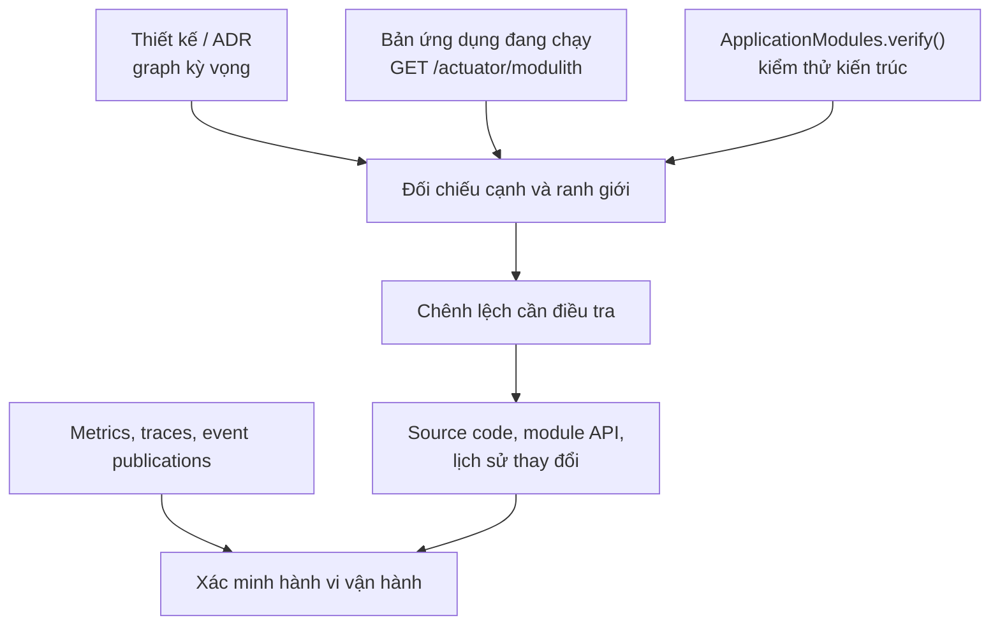
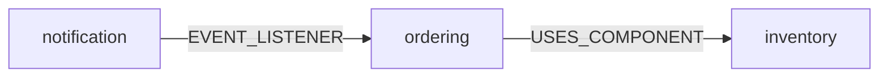
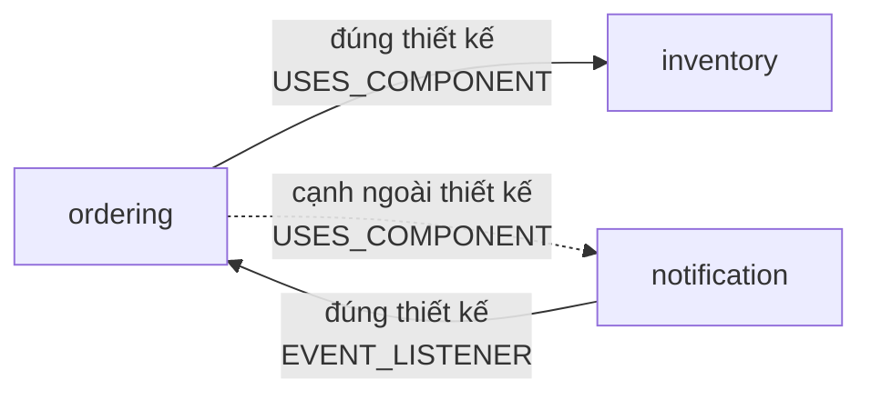
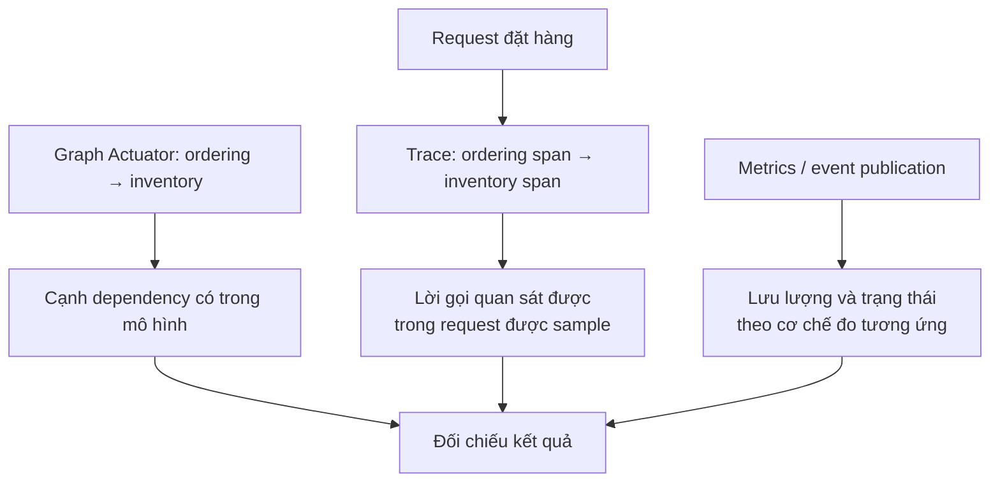

# Đối chiếu graph runtime với thiết kế kiến trúc trong Spring Modulith

## 1. Bài toán: ứng dụng đang chạy có còn đúng kiến trúc đã thiết kế?

Một hệ thống Spring Boot áp dụng **Spring Modulith** có thể chia thành các application module như `ordering` (đơn hàng), `inventory` (tồn kho) và `notification` (thông báo). Trong buổi thiết kế, nhóm phát triển thống nhất:

- `ordering` được phép sử dụng API của `inventory` để giữ hàng.
- `notification` được phép lắng nghe sự kiện `OrderPlaced` do `ordering` công bố.
- `ordering` không được gọi trực tiếp bean của `notification`; tương tác này phải đi qua sự kiện để giảm kết dính.

Nhưng sau một số đợt phát triển, một lập trình viên có thể vô tình inject `NotificationService` vào `OrderService`. Ứng dụng vẫn có khả năng chạy và trả kết quả đúng, song ranh giới module đã khác quyết định thiết kế. Làm thế nào phát hiện sự sai lệch trước hoặc sau khi triển khai?

**Đối chiếu graph runtime với thiết kế kiến trúc** là quá trình lấy mô hình module mà Spring Modulith nhận diện trong **bản ứng dụng đang chạy**, chuẩn hóa thành các đỉnh/cạnh phụ thuộc và so với graph kỳ vọng. Sau đó, sử dụng kiểm thử kiến trúc và telemetry runtime để đánh giá cả **tính hợp lệ của cấu trúc** lẫn **hành vi vận hành**.

> **Phân biệt quan trọng:** Graph “runtime” từ Spring Modulith Actuator là **mô hình cấu trúc được công bố khi ứng dụng chạy**; nó không phải đồ thị tự ghi lại mọi lời gọi method đang diễn ra. Muốn xem đường đi của một request, cần traces/spans; muốn đếm và đo xu hướng, cần metrics.

## 2. Ba lớp bằng chứng phải đặt cạnh nhau

Trong thực tế, chữ “graph” có thể chỉ các đối tượng khác nhau:

| Lớp bằng chứng | Nguồn | Mô tả | Trả lời tốt câu hỏi |
| --- | --- | --- | --- |
| **Graph kiến trúc kỳ vọng** | ADR, sơ đồ thiết kế, quy ước module, `@ApplicationModule(allowedDependencies=…)` | Ranh giới và **các cạnh được cho phép** | “Module nào được phụ thuộc module nào?” |
| **Graph module của bản triển khai** | `ApplicationModules`, `/actuator/modulith`, tài liệu từ `Documenter` của đúng build | Các module và **phụ thuộc được framework phát hiện** từ mã của ứng dụng | “Bản đang chạy đang có những phụ thuộc nào?” |
| **Graph thực thi quan sát được** | Tracing backend, module entry spans, HTTP/database spans, logs tương quan | Các bước thực sự được instrument trong những request/event được quan sát | “Request này đã đi qua đâu, bước nào chậm hoặc lỗi?” |

Một **cạnh phụ thuộc** trong graph module có thể tồn tại dù không có request nào thực thi lời gọi tương ứng hôm nay. Ngược lại, một trace thiếu span không đủ kết luận ứng dụng không chạy qua module đó: có thể do sampling, thiếu instrumentation hoặc mất context.

Spring Modulith bổ sung góc nhìn kiến trúc cho Spring Boot: module graph cho biết **cấu trúc**, Actuator công bố cấu trúc trong bản chạy, event metrics giúp nhìn **lưu lượng sự kiện**, còn tracing và context propagation giúp nối **chuỗi công việc quan sát được**.



## 3. Mô hình hóa graph để có thể so sánh

### 3.1. Đỉnh, cạnh, hướng và loại phụ thuộc

Có thể biểu diễn graph ứng dụng dạng:

\[
G=(V,E)
\]

Trong đó:

- `V` là tập **application module identifiers** như `ordering`, `inventory`, `notification`.
- `E` là tập **cạnh phụ thuộc có hướng**, có thể gắn thêm loại tương tác. Ta viết `(source, target, type)`; ví dụ `(ordering, inventory, USES_COMPONENT)`.
- Cạnh `ordering → inventory` nghĩa là **ordering có dependency đến inventory**, không có nghĩa inventory gọi ngược lại ordering.

Trong JSON của Module Actuator, cạnh được lưu dưới `dependencies[]` **của module nguồn**. Mỗi phần tử có `target` và mảng `types`; một cặp module có thể có nhiều loại phụ thuộc.

Các loại được Spring Modulith mô tả gồm:

| `types[]` | Ý nghĩa | Cách hiểu trong đối chiếu kiến trúc |
| --- | --- | --- |
| `DEFAULT` | Tham chiếu kiểu Java thông thường | Kiểm tra việc sử dụng type của module khác có đúng API công khai không |
| `USES_COMPONENT` | Sử dụng Spring component/bean thuộc module khác | Kiểm tra hướng gọi và coupling qua bean |
| `EVENT_LISTENER` | Phụ thuộc do lắng nghe application event | Kiểm tra sự liên kết kiểu event/listener giữa các module |

**Quan trọng:** `EVENT_LISTENER` là **quan hệ trong mô hình phụ thuộc**, không chứng minh listener đã xử lý event thành công. Hai loại `DEFAULT` và `USES_COMPONENT` cũng không mang thông tin số lần gọi, độ trễ hoặc lỗi.

### 3.2. Thiết kế kỳ vọng

Giả sử nhóm thống nhất graph sau (mũi tên biểu thị dependency):



Ta có tập cạnh kỳ vọng:

```text
ordering      inventory      USES_COMPONENT
notification  ordering       EVENT_LISTENER
```

Đây là bản thiết kế giản lược để học cách so sánh; trong hệ thống thật, **cùng một cặp module có thể có nhiều `types`**, nên cần thống nhất rõ: kiểm tra *cặp source-target* hay kiểm tra cả *source-target-type*.

### 3.3. Graph nhận diện trong bản chạy

Sau khi triển khai, `GET /actuator/modulith` trả JSON minh họa:

```json
{
  "inventory": {
    "basePackage": "com.example.shop.inventory",
    "displayName": "Inventory",
    "dependencies": []
  },
  "ordering": {
    "basePackage": "com.example.shop.ordering",
    "displayName": "Ordering",
    "dependencies": [
      {
        "target": "inventory",
        "types": ["USES_COMPONENT"]
      },
      {
        "target": "notification",
        "types": ["USES_COMPONENT"]
      }
    ]
  },
  "notification": {
    "basePackage": "com.example.shop.notification",
    "displayName": "Notification",
    "dependencies": [
      {
        "target": "ordering",
        "types": ["EVENT_LISTENER"]
      }
    ]
  }
}
```

Ngoài hai cạnh kỳ vọng, graph này còn có **`ordering → notification [USES_COMPONENT]`**.



Nếu `ordering` cần giữ quy tắc chỉ giao tiếp bất đồng bộ qua event với notification, đây là **sai lệch cần điều tra**. Tuy nhiên, JSON **chỉ cho biết mô hình phát hiện được**; muốn biết class hoặc method gây ra cạnh, phải kiểm tra mã nguồn hay kết quả phân tích phụ thuộc chi tiết.

## 4. Đọc dữ liệu đúng từ Module Actuator

### 4.1. Bật endpoint

Khi dự án dùng `spring-modulith-starter-insight` hoặc `spring-modulith-actuator` cùng Spring Boot Actuator phù hợp, endpoint có ID `modulith` có thể được cung cấp qua web. Trong môi trường thực hành:

```yaml
management:
  endpoints:
    web:
      exposure:
        include: health, modulith, metrics
```

Chạy:

```bash
curl -sS http://localhost:8080/actuator
curl -sS http://localhost:8080/actuator/modulith
```

`GET /actuator` là tài liệu khám phá các link Actuator; `GET /actuator/modulith` mới là **module map**. Base path, port và quyền truy cập có thể khác tùy cấu hình ứng dụng. Trong production, endpoint có thể bộc lộ package và phụ thuộc nội bộ, vì vậy cần giới hạn truy cập theo chính sách vận hành.

### 4.2. JSON không phải danh sách các lời gọi đã chạy

Theo schema Spring Modulith, root JSON là object với **key động theo tên module**:

| Trường | Vai trò khi dựng graph |
| --- | --- |
| `$.{moduleName}` | Tên kỹ thuật/định danh của một module, tương ứng một đỉnh |
| `displayName` | Nhãn hiển thị, không nên dùng làm khóa định danh so sánh |
| `basePackage` | Hỗ trợ kiểm tra package gốc hoặc việc thay đổi module detection |
| `dependencies[].target` | Tên module đích của một cạnh đi ra |
| `dependencies[].types[]` | Một hoặc nhiều loại dependency cho cạnh đó |
| `parent`, `nested` | Metadata bổ sung khi có nested module; tùy trường hợp có thể vắng mặt |

Ví dụ `inventory.dependencies = []` nghĩa là **inventory không có outgoing dependencies được phát hiện ở response này**. Điều đó không phủ nhận việc `ordering` phụ thuộc inventory. Muốn tìm **incoming dependencies** đến inventory, phải duyệt dependencies của tất cả module khác.

Không sử dụng `displayName` hay thứ tự key trong JSON để xác định module identity. Key module, `target` và kiểu phụ thuộc mới là những trường phù hợp cho phép so sánh cấu trúc.

## 5. Quy trình đối chiếu từng bước

### Bước 1 — Chốt phạm vi và phiên bản đối chiếu

Trước khi kết luận graph khác nhau, cần biết:

- Thiết kế kỳ vọng áp dụng cho **phiên bản kiến trúc** nào (ADR/release).
- Bản đang chạy sử dụng **artifact/build** nào; nếu triển khai nhiều instance, đang hỏi instance nào.
- Base package Spring Boot và cấu hình **module detection** có giống nhau giữa test, build và production không.
- Có dùng `@ApplicationModule`, named interface, nested module, open module hoặc package detection tùy chỉnh không.

Nếu cấu hình phát hiện module được khai báo **chỉ trong source test**, ứng dụng chạy production có thể nhận diện module khác so với các bài kiểm thử. Những customization dùng cho Actuator/observability cần tồn tại ở runtime classpath.

Một thay đổi tên module từ `sales` sang `ordering` có thể gây diff lớn, ngay cả khi ý định kiến trúc vẫn gần tương đương. Khi so sánh qua nhiều release, phải ghi lại **mapping đổi tên** được phê duyệt; không tự coi mọi tên mới là cùng một module chỉ vì package tương tự.

### Bước 2 — Chuẩn hóa graph kỳ vọng thành các cạnh

Thiết kế có thể đang lưu trong sơ đồ Mermaid, PlantUML, ADR hoặc tài liệu Canvas. Để đối chiếu tự động, hãy chuyển phần cần kiểm soát thành danh sách cạnh **source → target → type**, ví dụ:

```text
notification    ordering      EVENT_LISTENER
ordering        inventory     USES_COMPONENT
```

Đây là dữ liệu minh họa ở dạng bảng phân cách bằng tab. Trong công việc thật, cần nêu rõ **chính sách so sánh**:

- **Exact graph:** các module và cạnh phải khớp đầy đủ với snapshot đã duyệt, thích hợp phát hiện mọi thay đổi.
- **Allowed-edge policy:** không chấp nhận cạnh ngoài tập cho phép, nhưng có thể chấp nhận **cạnh thiết kế dự kiến chưa xuất hiện** nếu tính năng chưa được triển khai.
- **Boundary policy:** kiểm tra các giới hạn như không có chu kỳ, không phụ thuộc vào package internal và tuân thủ `allowedDependencies`, dù graph cụ thể được phép phát triển thêm.

Đừng gọi mọi cạnh “thiếu” là lỗi kiến trúc nếu sơ đồ thiết kế chỉ diễn tả những quan hệ **được phép**, vì “được phép” không đồng nghĩa “bắt buộc phải tồn tại”.

### Bước 3 — Chuẩn hóa graph trong bản chạy

Với hệ có `jq`, có thể trích xuất các cạnh từ JSON Module Actuator. Ví dụ câu lệnh sau dành cho Bash hoặc shell tương thích:

```bash
curl -fsS http://localhost:8080/actuator/modulith |
  jq -r '
    to_entries[]
    | .key as $source
    | .value.dependencies[]?
    | .target as $target
    | .types[]?
    | [$source, $target, .] | @tsv
  ' | LC_ALL=C sort -u
```

Với JSON ở mục 3, kết quả là:

```text
notification    ordering      EVENT_LISTENER
ordering        inventory     USES_COMPONENT
ordering        notification  USES_COMPONENT
```

Cách xử lý này:

1. Duyệt từng **key module nguồn** bằng `to_entries[]`.
2. Duyệt từng phần tử `dependencies[]`, lấy `target`.
3. **Trải phẳng** mọi giá trị `types[]` thành một dòng riêng.
4. Sắp xếp và bỏ dòng trùng để việc so sánh không phụ thuộc thứ tự JSON.

Đây là một ví dụ trích xuất **cạnh có kiểu**. Nếu chỉ quan tâm coupling giữa hai module, có thể so sánh duy nhất `source-target`; nếu mục tiêu là bảo vệ quyết định “gọi bean hay lắng nghe event”, **phải giữ `type`**, như tình huống ordering/notification.

### Bước 4 — Tính tập cạnh thừa và cạnh thiếu

Gọi `E_design` là tập cạnh thiết kế kỳ vọng và `E_runtime` là tập cạnh từ bản chạy. Có thể tính:

\[
E_{\text{unexpected}} = E_{\text{runtime}} \setminus E_{\text{allowed}}
\]

\[
E_{\text{missing}} = E_{\text{required}} \setminus E_{\text{runtime}}
\]

Trong đó:

- `E_allowed` là các cạnh **được phép**.
- `E_required` là các cạnh **bắt buộc phải xuất hiện**, nếu thiết kế có quy định.
- `E_unexpected` phát hiện dependency ngoài thiết kế.
- `E_missing` chỉ có ý nghĩa nếu thiết kế yêu cầu một quan hệ thực sự phải tồn tại.

Với ví dụ, cạnh ngoài thiết kế là `(ordering, notification, USES_COMPONENT)`. Hai cạnh thiết kế còn lại vẫn tồn tại.

| Cạnh | Kiến trúc kỳ vọng | Graph bản chạy | Nhận xét |
| --- | --- | --- | --- |
| ordering → inventory [USES_COMPONENT] | Được phép | Có | Khớp |
| notification → ordering [EVENT_LISTENER] | Được phép | Có | Khớp |
| ordering → notification [USES_COMPONENT] | Không được phép | Có | **Sai lệch cần xử lý** |

Nếu muốn dùng `diff` với hai file cạnh đã chuẩn hóa, cả hai file phải có cùng format, cùng thứ tự sắp xếp và cùng quy ước về tên module:

```bash
diff -u expected-edges.tsv runtime-edges.tsv
```

Lệnh so sánh ở đây là **ví dụ thao tác trong dự án**, không đòi hỏi phải tạo các file TSV khi chỉ đọc bài học. Trong CI, nên tạo hai tập cạnh từ nguồn đã thống nhất rồi để job thất bại khi có cạnh bị cấm.

### Bước 5 — Điều tra và phân loại từng sai lệch

Không phải mọi sai khác đều được xử lý theo cùng một cách:

| Trường hợp | Câu hỏi điều tra | Hướng xử lý |
| --- | --- | --- |
| Có cạnh ngoài danh sách cho phép | Class nào phụ thuộc module đích? Có gọi vào internal API không? | Sửa coupling, chuyển qua API/event, hoặc cập nhật quyết định thiết kế sau review |
| Xuất hiện chu kỳ `A → B → A` | Hai module đang trộn trách nhiệm hoặc gọi nhau vì lý do gì? | Tách module, đảo chiều phụ thuộc, trích xuất API hoặc dùng sự kiện phù hợp |
| Mất một module sau triển khai | Code/package có nằm trong artifact đang chạy? Module detection khác môi trường? | Kiểm tra root package, build artifact và cấu hình module detection |
| Đổi `USES_COMPONENT` sang `EVENT_LISTENER` | Có chủ đích chuyển synchronous sang asynchronous không? | Xác nhận contract, transaction và yêu cầu nhất quán dữ liệu |
| Thay đổi `basePackage` hoặc module identifier | Refactor/rename có được phê duyệt không? | Cập nhật mapping, tài liệu và các chính sách phụ thuộc |
| Graph giống thiết kế nhưng nghiệp vụ vẫn chậm | Có điểm nghẽn bên trong module hoặc trong giao tiếp với DB/broker không? | Dùng metrics/traces/logs để điều tra runtime |

**Quy tắc ưu tiên:** xác minh artifact đang chạy trước khi kết luận mã nguồn trên nhánh hiện tại tương đương với production; nếu chúng là hai bản build khác nhau, graph khác là điều có thể xảy ra.

## 6. Kiểm chứng bằng chính cơ chế của Spring Modulith

### 6.1. Kiểm thử `ApplicationModules.verify()`

Spring Modulith cung cấp API kiểm tra những ràng buộc quan trọng của mô hình module, gồm:

1. Không tạo **dependency cycle** giữa các application module.
2. Phụ thuộc ra ngoài module thông qua các **API package** hợp lệ (với lưu ý riêng cho open modules).
3. Tuân thủ danh sách phụ thuộc cho phép nếu đã khai báo `@ApplicationModule(allowedDependencies = …)`.

Ví dụ kiểm thử JUnit 5:

```java
package com.example.shop;

import org.junit.jupiter.api.Test;
import org.springframework.modulith.core.ApplicationModules;

class ModuleArchitectureTest {

    @Test
    void modulesFollowBoundaries() {
        ApplicationModules.of(ShopApplication.class).verify();
    }
}
```

Ở đây `ShopApplication` là Spring Boot application class nằm ở package gốc hợp lý. Test giả định dự án đã cấu hình dependencies Spring Modulith test/core cần thiết. Nếu quy tắc phát hiện module được tùy biến, bảo đảm cấu hình đó được áp dụng tương thích ở môi trường chạy thật.

**Phạm vi của `verify()`:** xác minh những **quy tắc kiến trúc mà Spring Modulith biết**. Nếu nhóm chỉ có một quyết định không thành văn như “ordering tuyệt đối không gọi notification”, nhưng chưa biểu diễn nó dưới dạng ràng buộc, việc `verify()` pass **không đảm bảo** graph khớp thiết kế riêng của nhóm.

### 6.2. Dùng `allowedDependencies` để mã hóa quyết định thiết kế

Tại package của module `ordering`, có thể khai báo danh sách module mà nó được phép phụ thuộc:

```java
@org.springframework.modulith.ApplicationModule(
    allowedDependencies = "inventory"
)
package com.example.shop.ordering;
```

Đoạn trên là nội dung của `package-info.java`. Khi `ordering` vô tình phụ thuộc vào `notification`, kiểm thử `ApplicationModules.verify()` sẽ có cơ sở để báo vi phạm danh sách đã cho phép.

Trong dự án lớn có **named interfaces**, cú pháp khai báo dependency có thể có dạng `moduleName::namedInterface`. Cần kiểm tra đúng contract của named interface và không tự coi tham chiếu vào internal package là hợp lệ.

`allowedDependencies` là **chính sách quyền phụ thuộc**, không phải danh sách “cạnh nhất định xuất hiện”. Module có thể được phép gọi inventory nhưng không thực sự có dependency đến inventory tại một bản build nào đó.

### 6.3. Dùng `Documenter` để kiểm tra chênh lệch với sơ đồ thiết kế

Spring Modulith `Documenter` có thể dựng tài liệu từ `ApplicationModules`, chẳng hạn sơ đồ PlantUML của toàn bộ module và Module Canvas. Ví dụ thực thi trong test/luồng build (giả định đã thêm `spring-modulith-docs` vào test classpath):

```java
import org.junit.jupiter.api.Test;
import org.springframework.modulith.core.ApplicationModules;
import org.springframework.modulith.docs.Documenter;

class ModuleDocumentationTest {

    @Test
    void generateModuleDiagram() {
        var modules = ApplicationModules.of(ShopApplication.class);
        new Documenter(modules).writeModulesAsPlantUml();
    }
}
```

Sơ đồ được sinh từ **mô hình phát hiện từ code của build chạy test**; JSON Actuator lấy từ **mô hình của build đang chạy**. Chúng nên nhất quán nếu dùng cùng artifact và cùng quy tắc detection. Nếu khác, phải xem version, classpath, package scanning, configuration và phạm vi deploy trước khi quy về lỗi kiến trúc.

Sơ đồ `Documenter` là một dạng **tài liệu được sinh tự động**, còn sơ đồ trong ADR là **thiết kế mong muốn**. Nên review sự khác biệt và cập nhật ADR khi có quyết định kiến trúc mới, thay vì tự động chấp nhận mọi cạnh mới chỉ vì công cụ vẽ ra.

## 7. Xác nhận hành vi runtime bằng telemetry

Giả sử graph module của bản chạy cho thấy `ordering → inventory`. Đây là dependency **có thể hiện diện trong mã nguồn**, nhưng chưa chứng minh lời gọi đó đã xảy ra trong request đặt hàng vừa qua. Để kiểm tra thực thi:

1. Tạo một request đặt hàng có định danh tương quan.
2. Trong hệ thống đã bật Spring Modulith observability và tracing exporter, tìm trace tương ứng.
3. Kiểm tra module entry spans, tên module, thời lượng và quan hệ parent/child.
4. Theo dõi Timer/Counter hoặc metrics về event để biết xu hướng tổng hợp.
5. Nếu tương tác qua event bất đồng bộ, kiểm tra **context propagation**, trạng thái event publication và kết quả listener trước khi kết luận luồng xử lý hoàn tất.

Những trường như `module.identifier`, `module.name`, `module.invocation-type` hoặc `module.method` có thể giúp liên hệ module spans với graph kiến trúc khi instrumentation tương ứng được bật.



Các hạn chế cần nắm:

- **Không có span** không đồng nghĩa **không có lời gọi**: có thể thiếu tracing bridge, exporter, sampling hoặc instrumentation tại điểm đó.
- **Có span** không chứng minh mọi dependency khác đều hợp lệ: chỉ nhìn thấy những thao tác đã được quan sát.
- **Event publish counter tăng** không chứng minh tất cả listeners đã xử lý thành công; muốn xác minh completion cần theo dõi event publication/handler tương ứng.
- **Trace context qua `@Async`, executor hoặc broker** không phải lúc nào cũng được tự động truyền. Nếu trace bị đứt, cần capture/restore hoặc inject/extract theo stack đang dùng.
- Đừng gắn `orderId`/`customerId` làm metric tags: cardinality lớn sẽ tạo quá nhiều series; các giá trị nhạy cảm cũng không nên truyền vô tội vạ qua trace attributes/baggage.

Sự kết hợp này đặc biệt hữu ích khi **graph đúng kiến trúc nhưng runtime vẫn lỗi**: test kiến trúc chỉ xác minh ranh giới, còn trace/metric hỗ trợ xác định phần chậm hoặc thất bại.

## 8. Thiết kế một quy trình kiểm tra liên tục

### 8.1. Trong pull request và CI

Ở mỗi thay đổi có ảnh hưởng đến application module:

1. Chạy `ApplicationModules.verify()` với quy tắc `allowedDependencies`/named interfaces đã khai báo.
2. Sinh tài liệu module graph bằng `Documenter` hoặc xuất metadata từ `ApplicationModules` cho đúng build.
3. So sánh graph với chính sách/các cạnh kỳ vọng do nhóm kiến trúc quản lý.
4. Nếu thêm một cạnh, yêu cầu giải thích: đây là chủ ý thiết kế hay là coupling vô tình?
5. Cập nhật ADR/sơ đồ kỳ vọng nếu kiến trúc mới đã được review và chấp thuận.

Để tránh nhiễu, không so sánh bằng thứ tự phần tử JSON hoặc hình ảnh pixel của sơ đồ; hãy chuẩn hóa **module IDs, directed edges và dependency types**.

### 8.2. Sau triển khai

Với bản release đang vận hành:

1. Xác nhận revision/build để biết **đúng đối tượng so sánh**.
2. Đọc `GET /actuator/modulith` qua endpoint đã được bảo vệ.
3. Đối chiếu với graph đã duyệt cho cùng release; báo cáo **module mới/mất, cạnh mới/mất, thay đổi type**.
4. Gửi các sai khác về nhóm sở hữu module để kiểm tra mã nguồn và quyết định thiết kế.
5. Khi điều tra sự cố, liên kết graph với module spans, metrics và log correlation của các request liên quan.

Việc đánh giá **một instance** không chứng minh tất cả instance khác giống hệt nó. Ở môi trường rolling deployment, nhiều version có thể chạy song song; cần so theo cùng phiên bản artifact hoặc tách báo cáo theo version.

## 9. Các lỗi thường gặp khi so sánh graph

| Hiện tượng | Sai lầm dễ gặp | Cách xử lý |
| --- | --- | --- |
| `inventory.dependencies=[]` | Kết luận inventory không được ai dùng | Duyệt dependencies của toàn bộ module để tìm incoming edges |
| Thấy `EVENT_LISTENER` | Kết luận listener đã hoàn tất xử lý event | Kiểm tra event publication registry, logs và event metrics riêng |
| Thấy module graph đúng thiết kế | Kết luận không có lỗi runtime hoặc sai giới hạn API | Chạy `verify()` và đối chiếu trace/metrics với kịch bản thực tế |
| Không thấy module span trong trace | Kết luận dependency không tồn tại | Kiểm tra instrumentation, sampling, propagation và endpoint graph |
| Có thêm `USES_COMPONENT` ngoài thiết kế | Bỏ qua vì mã vẫn biên dịch và chạy | Rà soát injection/call sites, mã hóa `allowedDependencies` |
| Đọc module tên theo `displayName` | Graph diff báo rename giả | So key kỹ thuật của module; lưu mapping rename có chủ đích |
| So hai bản chạy khác release | Đánh giá diff là lỗi bất thường | Cố định build/revision, version Spring Modulith và module detection |
| So hình ảnh sơ đồ PlantUML | Thấy diff do layout dù cạnh không đổi | So tập cạnh chuẩn hóa, dùng sơ đồ để người đọc review |
| Thiết kế cho phép cạnh nhưng runtime không có | Gọi mọi cạnh thiếu là lỗi | Phân biệt edge *allowed* và edge *required* |
| Cạnh có nhiều loại `types` | Bỏ qua phần tử thứ hai, đánh giá sai coupling | Trải phẳng `types[]` hoặc xử lý cả tập giá trị |

## 10. Bài tập tự kiểm tra

Giả sử bản thiết kế yêu cầu:

```text
ordering       inventory       USES_COMPONENT
notification   ordering        EVENT_LISTENER
payment        ordering        EVENT_LISTENER
```

Graph bản chạy chứa:

```text
ordering       inventory       USES_COMPONENT
ordering       payment         USES_COMPONENT
notification   ordering        EVENT_LISTENER
payment        ordering        EVENT_LISTENER
```

Hãy tự trả lời:

1. Cạnh nào ngoài thiết kế? Vì sao hướng của cạnh đó có ý nghĩa?
2. Nếu thiết kế chỉ liệt kê các cạnh được phép, có cạnh “required” nào bị thiếu không?
3. Nếu `ApplicationModules.verify()` vẫn pass, cần thêm khai báo hoặc chính sách gì để bắt được cạnh ngoài thiết kế?
4. Nếu request thanh toán thất bại nhưng graph module hoàn toàn khớp thiết kế, telemetry nào giúp điều tra nguyên nhân?

**Gợi ý đáp án:** `ordering → payment [USES_COMPONENT]` là cạnh ngoài danh sách cho phép. `payment → ordering [EVENT_LISTENER]` là hướng ngược với cạnh mới và là một loại tương tác khác; không nên nhập nhằng hai cạnh. Chỉ được kết luận có cạnh *required* bị thiếu khi chính sách đã nêu rõ cạnh bắt buộc. Có thể mã hóa `allowedDependencies` cho ordering hoặc so graph với danh sách allowed edges trong CI. Khi xảy ra lỗi thanh toán, nên đọc logs/traces/spans và metrics thay vì chỉ kiểm tra graph.

## 11. Kết luận

Đối chiếu graph runtime với thiết kế kiến trúc trong Spring Modulith là thao tác **so sánh mô hình phụ thuộc của bản Spring Boot đang chạy với những quy tắc module đã được thống nhất**, sau đó kiểm tra chênh lệch bằng code, kiểm thử và dữ liệu vận hành.

Cách làm bền vững gồm bốn lớp:

- **Thiết kế:** ghi rõ module, dependency được phép/cấm/bắt buộc và ranh giới API.
- **Phát hiện:** lấy graph từ `ApplicationModules` hoặc `/actuator/modulith` của đúng artifact, chuẩn hóa các cạnh có hướng và `types`.
- **Kiểm chứng:** dùng `ApplicationModules.verify()`, `allowedDependencies` và so graph với chính sách đã duyệt.
- **Quan sát vận hành:** dùng spans/traces, Actuator metrics, event publication và context propagation để xác minh những tương tác thực sự được quan sát.

**Kết quả cần hướng tới:** biết chính xác graph thay đổi ở đâu, thay đổi ấy có được cho phép không, và khi hệ thống đang chạy thì tương tác nào đang gây lỗi hoặc độ trễ. Không thay thế kiểm chứng cấu trúc bằng trace của một vài request, cũng không thay thế điều tra runtime bằng một module graph đẹp.

### Tài liệu tham khảo

- [Spring Modulith — Production-ready Features](https://docs.spring.io/spring-modulith/reference/production-ready.html): `/actuator/modulith`, cấu trúc JSON, phân loại dependency, observability trong runtime.
- [Spring Modulith — Verifying Application Module Structure](https://docs.spring.io/spring-modulith/reference/verification.html): `ApplicationModules.verify()`, chu kỳ phụ thuộc, internal API, danh sách dependency cho phép.
- [Spring Modulith — Fundamentals](https://docs.spring.io/spring-modulith/reference/fundamentals.html): `@ApplicationModule`, named interfaces, nested modules và quy tắc phát hiện.
- [Spring Modulith — Documenter API](https://docs.spring.io/spring-modulith/docs/current/api/org/springframework/modulith/docs/Documenter.html): sinh PlantUML diagrams và tài liệu module.
