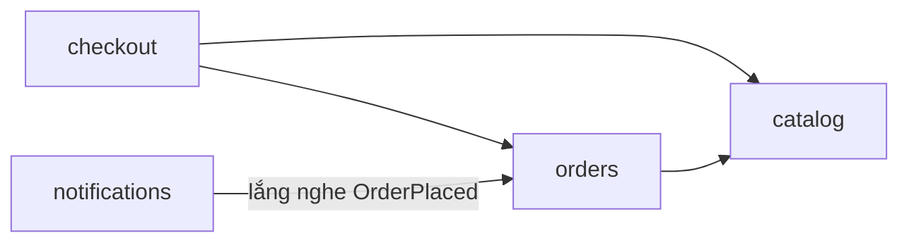
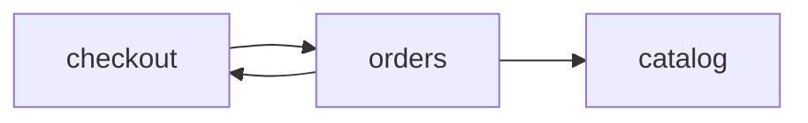
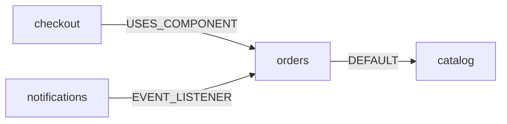
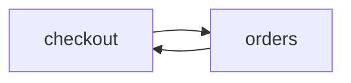
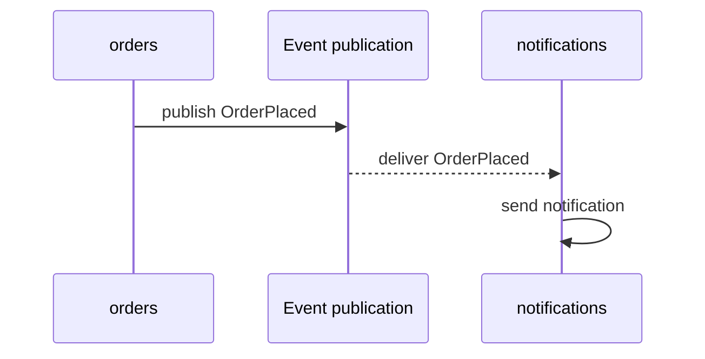
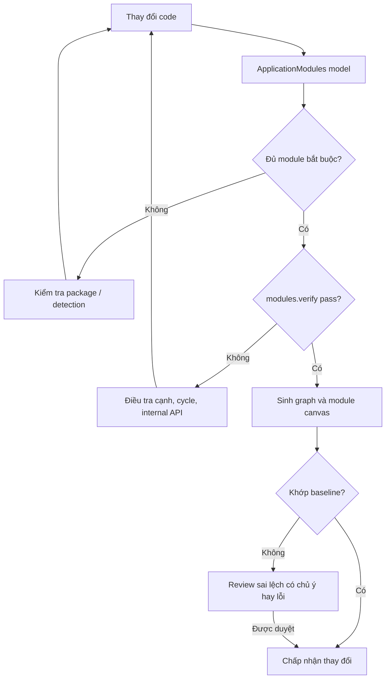

# Phát hiện module thiếu hoặc dependency ngoài dự kiến

## 1. Mục tiêu: biến module graph thành công cụ phát hiện sai lệch

Trong một ứng dụng Spring Boot tổ chức theo **Spring Modulith**, *module graph* là đồ thị biểu diễn các **application module** và những **phụ thuộc được nhận diện** giữa chúng. Nó giúp nhóm phát triển trả lời hai câu hỏi quan trọng sau một lần refactor, thêm tính năng hoặc nâng cấp hệ thống:

1. **Có module nào đáng lẽ phải tồn tại nhưng không được Spring Modulith nhận diện?**
2. **Có cạnh phụ thuộc nào mới xuất hiện, đi sai hướng, đi vào API nội bộ hoặc tạo chu trình?**

Đây là bài học thuộc chương **Module graph** của `SPRING_MODULITH_DOCUMENTATION_OBSERVABILITY`. Đích đến là sử dụng sơ đồ được sinh từ mã nguồn, kiểm chứng cấu trúc, metadata của Actuator và dữ liệu runtime (metrics, tracing, event/correlation) để giữ ranh giới module đúng với thiết kế.

Giả sử hệ thống bán hàng mong đợi có bốn module:



Mỗi mũi tên ở sơ đồ trên biểu diễn **phụ thuộc mã nguồn** từ module bên trái sang module bên phải, không phải thứ tự thực thi của một request. Chẳng hạn, `notifications` tham chiếu event `OrderPlaced` thuộc `orders`, vì vậy phụ thuộc tĩnh có thể có chiều `notifications -> orders` dù event runtime đi từ `orders` tới listener `notifications`.

Sau một thay đổi, graph sinh được lại cho thấy:



Hai dấu hiệu cần điều tra là **module `notifications` không còn xuất hiện trong sơ đồ mới** và **cạnh `orders -> checkout` mới xuất hiện**, khiến `checkout <-> orders` tạo chu trình. Cần xem danh sách module thực tế và nguyên nhân sinh graph trước khi kết luận `notifications` đã mất khỏi mô hình: một module không có cạnh vẫn có thể tồn tại như một node độc lập, và một loại sơ đồ có thể lọc bớt node/cạnh để dễ đọc.

## 2. Phân biệt hai loại sai lệch

| Dấu hiệu | Định nghĩa | Cách kiểm chứng chính |
| --- | --- | --- |
| **Module thiếu** | Module thuộc kiến trúc mong đợi nhưng không có trong mô hình `ApplicationModules` thực tế | Đối chiếu tập module kỳ vọng với danh sách từ `ApplicationModules` hoặc Actuator |
| **Module chỉ thiếu trên hình** | Module có trong mô hình nhưng không thấy trong sơ đồ được render | Kiểm tra loại sơ đồ, tùy chọn render và dữ liệu gốc |
| **Dependency phát sinh** | Cạnh `A -> B` có trong mô hình mới nhưng không có trong graph chuẩn | So sánh tập cạnh có hướng giữa hai bản cùng phạm vi |
| **Dependency vi phạm ranh giới** | Code từ A truy cập phần nội bộ của B, trái quy tắc module | `ApplicationModules.verify()` |
| **Dependency vượt danh sách cho phép** | A phụ thuộc B dù `allowedDependencies` của A không cho phép | `@ApplicationModule(allowedDependencies = …)` và `verify()` |
| **Chu trình dependency** | Có đường đi `A -> … -> A` | Kiểm chứng đồ thị bằng `verify()` |
| **Không thấy module trong trace** | Chưa quan sát được hoạt động runtime của module | Kiểm tra kịch bản chạy, sampling và instrumentation; chưa đủ chứng minh module thiếu |

**Một đồ thị không có cạnh bất thường chưa chắc đầy đủ module.** `verify()` kiểm tra các quy tắc trên **tập module đã nhận diện**; nó không tự biết rằng nghiệp vụ còn đòi một module `billing` nhưng package tương ứng đã bị cấu hình loại khỏi mô hình. Vì thế, kiểm tra module tồn tại và kiểm tra tính hợp lệ của dependency phải là **hai lớp kiểm tra riêng**.

## 3. Nguồn dữ liệu dùng để phát hiện

| Nguồn | Cung cấp gì? | Ưu tiên khi nào? |
| --- | --- | --- |
| `ApplicationModules.of(...)` | Danh sách module và mô hình phụ thuộc từ code | Test, CI, xác định một module có được phát hiện không |
| `ApplicationModules.verify()` | Kết quả kiểm tra các quy tắc kiến trúc được hỗ trợ | Chặn merge khi có chu trình hoặc vi phạm API/dependency |
| `Documenter` | Sơ đồ tổng thể, sơ đồ từng module và module canvas | Review thay đổi kiến trúc giữa hai commit |
| `GET /actuator/modulith` | Metadata module của bản ứng dụng đang chạy | Đối chiếu build đã triển khai với kỳ vọng |
| Git/CI baseline | Tập node/cạnh được duyệt ở một phiên bản | Nhận diện module/cạnh mới, mất hoặc bị đổi tên |
| Metrics, traces, event monitoring | Bằng chứng về những tương tác đã thực sự chạy và được instrument | Ưu tiên điều tra cạnh ảnh hưởng nhiều tới vận hành |

Trong Spring Modulith, `ApplicationModules` là mô hình trung tâm. Các công cụ khác nhìn cùng kiến trúc dưới những góc khác nhau: **Documenter trình bày cấu trúc**, **Actuator cung cấp metadata lúc chạy**, còn **observability cho biết các thao tác thực sự xảy ra** trong phạm vi được instrument.

## 4. Bước 1: tạo module model và kiểm chứng trong test

Ví dụ cấu trúc dự án:

```text
src/main/java/com/example/shop/
├── ShopApplication.java
├── checkout/
│   ├── CheckoutService.java
│   └── internal/
├── orders/
│   ├── OrderService.java
│   ├── OrderPlaced.java
│   └── internal/
├── catalog/
│   ├── CatalogService.java
│   └── internal/
└── notifications/
    ├── OrderNotificationListener.java
    └── internal/
```

Theo chiến lược mặc định, các package con **trực tiếp** bên dưới package chứa `ShopApplication` là các ứng viên application module. Package `orders.internal` là phần bên trong `orders`, không mặc định tạo thành module ngang hàng với `orders`. Những cấu hình module lồng nhau hoặc chiến lược phát hiện tùy chỉnh có thể thay đổi kết quả này.

Viết bài test kiểm tra kiến trúc:

```java
package com.example.shop;

import org.junit.jupiter.api.Test;
import org.springframework.modulith.core.ApplicationModules;

class ModuleStructureTests {

    @Test
    void moduleDependenciesMustBeValid() {
        var modules = ApplicationModules.of(ShopApplication.class);
        modules.verify();
    }
}
```

Test trên yêu cầu dependency Spring Modulith Core trong test classpath. Các quy tắc mặc định được kiểm chứng gồm:

- Không có **chu trình dependency ở cấp application module**.
- Module không tham chiếu type trong **package nội bộ** của module khác nếu không được phép theo mô hình module (chẳng hạn tùy chọn *open module*).
- Nếu một module đã khai báo **`allowedDependencies`**, các dependency của nó phải nằm trong danh sách được cho phép.

Ví dụ khi `orders -> checkout` tạo chiều phụ thuộc ngược với `checkout -> orders`, `verify()` có thể báo chu trình. Không cần chờ hệ thống vận hành mới phát hiện được loại lỗi cấu trúc này.

### 4.1. Đừng chỉ gọi `verify()` khi muốn phát hiện module thiếu

Giả sử sản phẩm phải có `checkout`, `orders`, `catalog`, `notifications`. Bổ sung kiểm tra danh sách tên module:

```java
package com.example.shop;

import static org.assertj.core.api.Assertions.assertThat;

import org.junit.jupiter.api.Test;
import org.springframework.modulith.core.ApplicationModules;

class ExpectedModulesTests {

    @Test
    void requiredModulesMustBeDetected() {
        var modules = ApplicationModules.of(ShopApplication.class);

        for (var name : new String[] {
                "checkout", "orders", "catalog", "notifications"
        }) {
            assertThat(modules.getModuleByName(name))
                .as("Expected application module: %s", name)
                .isPresent();
        }

        modules.verify();
    }
}
```

`getModuleByName(String)` trả về `Optional<ApplicationModule>` trong API Spring Modulith tương ứng. Test này kiểm tra **mỗi module bắt buộc phải tồn tại**, rồi chạy verification. Nếu chiến lược đặt tên của dự án dùng tên khác, danh sách kỳ vọng phải là **module ID thực tế**; không dựa tùy tiện vào tên hiển thị hoặc tên class Java.

Kiểm tra chỉ những module bắt buộc xuất hiện sẽ **không phát hiện module thừa**. Nếu kiến trúc yêu cầu tập module chính xác, hãy bổ sung kiểm tra tập module thực tế hoặc so sánh snapshot danh sách module từ metadata đã sinh. Lựa chọn đó phù hợp hơn với các dự án có module được tạo động hoặc nested module, vì không phải mọi thay đổi module đều là vi phạm.

## 5. Bước 2: sinh graph và kiểm tra bản thay đổi

Spring Modulith `Documenter` có thể sinh diagram từ cùng mô hình module:

```java
package com.example.shop;

import org.junit.jupiter.api.Test;
import org.springframework.modulith.core.ApplicationModules;
import org.springframework.modulith.docs.Documenter;

class ModuleGraphDocumentationTests {

    @Test
    void generateModuleGraph() {
        var modules = ApplicationModules.of(ShopApplication.class);
        modules.verify();

        new Documenter(modules)
            .writeModulesAsPlantUml()
            .writeIndividualModulesAsPlantUml();
    }
}
```

Đặt dependency `org.springframework.modulith:spring-modulith-docs` ở test classpath và dùng phiên bản tương thích với Spring Boot. `writeModulesAsPlantUml()` tạo hình thức biểu diễn tổng thể; `writeIndividualModulesAsPlantUml()` tạo các hình nhìn từ từng module. Có thể chọn `writeDocumentation()` khi muốn sinh bộ tài liệu rộng hơn gồm module canvas. Nếu muốn xem hình ảnh trực tiếp, cần trình render PlantUML tương ứng; **file nguồn PlantUML khác với file SVG/PNG đã render**.

Khi review đồ thị, thực hiện hai lượt:

1. **Kiểm tra node:** các module cần có còn xuất hiện trong danh sách module và sơ đồ tổng thể không? Có module mới hoặc module bị gộp vào package khác không?
2. **Kiểm tra edge:** hướng phụ thuộc, loại quan hệ và những cạnh mới có khớp với hợp đồng đã được chấp nhận không?

Sơ đồ tổng thể thích hợp để xem mạng lưới quan hệ. Sơ đồ theo module giúp khoanh vùng cụ thể, nhưng **không dùng một sơ đồ con để kết luận toàn hệ thống thiếu module**: nó có thể chỉ hiển thị module đang xét và các module liên quan trực tiếp.

### 5.1. Baseline mô hình cần biểu diễn những gì?

Để so sánh ổn định, lưu hai tập dữ liệu logic:

```text
EXPECTED MODULES:
checkout
orders
catalog
notifications

EXPECTED OUTGOING DEPENDENCIES:
checkout -> orders
checkout -> catalog
orders -> catalog
notifications -> orders
```

Đây là mẫu baseline minh họa. Tùy tổ chức, baseline có thể nằm trong tài liệu thiết kế, file được kiểm soát phiên bản hoặc quy tắc test. **Không dùng tên module được suy ra tùy ý từ folder chứa tài liệu**; baseline phải được nhóm phát triển xác nhận với mô hình thực tế và chính sách kiến trúc.

Nếu graph mới có thêm `orders -> checkout`, đó là cạnh mới đáng kiểm tra. Nếu `catalog` biến mất khỏi node list, đó là module thiếu. Nếu `catalog` vẫn còn nhưng không có cạnh nào, đó là module **độc lập trong đồ thị**, cần điều tra theo yêu cầu kiến trúc nhưng không phải mất module.

## 6. Bước 3: xác định vì sao module không được nhận diện

Các nguyên nhân thường gặp:

| Tình huống | Dấu hiệu | Cách xác định |
| --- | --- | --- |
| Class ứng dụng nằm sai package gốc | Một nhóm package không được đưa vào model | Xem package của `@SpringBootApplication` và vị trí module |
| Module nằm ngoài cây package gốc | Logic có trong code nhưng không được quét vào `ApplicationModules` mặc định | Kiểm tra cấu hình root/additional packages hoặc extension module source |
| Bật phát hiện module theo annotation | Package thiếu `@ApplicationModule` | Xem `spring.modulith.detection-strategy` và metadata trên package |
| Module bị di chuyển vào `internal` của module khác | Node cũ biến mất, code trở thành phần nội bộ | So sánh cấu trúc package trước/sau refactor |
| Tùy biến chiến lược phát hiện không đồng nhất | Test thấy module nhưng Actuator lại không thấy, hoặc ngược lại | Đối chiếu classpath, nguồn cấu hình và custom strategy |
| Cấu hình loại trừ package/class | Module hoặc các type liên quan bị bỏ khỏi phân tích | Kiểm tra filter/exclusion của lời gọi tạo `ApplicationModules` |
| Nested module không được khai báo như dự kiến | Package con chỉ là internal package | Kiểm tra quy ước nested module theo phiên bản framework |
| Đang so sánh hai build khác nhau | Local graph có module mới nhưng endpoint runtime chưa có | Đối chiếu commit/build version và artifact đang chạy |

Ví dụ khi chỉ muốn xét những package có annotation module, Spring Modulith cho phép cấu hình:

```properties
spring.modulith.detection-strategy=explicitly-annotated
```

Với chiến lược này, package ứng viên cần được khai báo phù hợp bằng `@ApplicationModule` (hoặc annotation module được hỗ trợ). Nếu nhóm bật cấu hình nhưng quên đánh dấu `catalog`, `catalog` có thể biến mất khỏi mô hình mặc dù class của nó vẫn compile và chạy.

Ví dụ khai báo cho package `catalog`:

```java
@org.springframework.modulith.ApplicationModule
package com.example.shop.catalog;
```

Đoạn trên là nội dung `package-info.java`, đặt trong package `com.example.shop.catalog`. Hãy kiểm tra lại graph sau khi cập nhật cấu hình hoặc annotation. Không tự tạo annotation mới chỉ để “làm đẹp sơ đồ” nếu module đó thật ra đã được nhóm chủ ý gộp hoặc đổi phạm vi.

**Lưu ý về test và runtime:** nếu custom module detection strategy chỉ có trong test sources, `Documenter` chạy khi test có thể thấy mô hình khác với Spring Modulith Actuator trên bản production. Khi cần dùng cùng chiến lược cho runtime Actuator/observability, đưa cấu hình và thành phần hỗ trợ cần thiết vào production sources theo hướng dẫn phiên bản đang sử dụng.

## 7. Bước 4: phát hiện dependency ngoài dự kiến

Một **cạnh phụ thuộc ngoài dự kiến** là cạnh được phát hiện trong mô hình nhưng không thuộc thiết kế hoặc chính sách đã chấp nhận. Không đồng nhất **cạnh mới** với **cạnh sai**: đôi khi việc bổ sung phụ thuộc là hợp lý sau một thay đổi nghiệp vụ.

### 7.1. Đọc đúng hướng mũi tên

Cho graph:



Diễn giải:

- `checkout -> orders`: code trong `checkout` phụ thuộc một component/API của `orders`.
- `orders -> catalog`: code trong `orders` tham chiếu type của `catalog`.
- `notifications -> orders`: listener của `notifications` phụ thuộc hợp đồng sự kiện do `orders` định nghĩa.

Không đảo ngược chiều phụ thuộc chỉ vì `orders` là module chủ động *publish* event sang `notifications` lúc chạy. Luồng event và phụ thuộc biên dịch mô tả hai góc nhìn khác nhau.

### 7.2. Dùng quy tắc `allowedDependencies` khi cần hàng rào rõ ràng

Giả sử `inventory` chỉ được tham chiếu API công khai của `orders`:

```java
@org.springframework.modulith.ApplicationModule(
    allowedDependencies = "orders"
)
package com.example.shop.inventory;
```

Đây là `package-info.java` của `inventory`. Nếu sau đó mã nguồn trong `inventory` phụ thuộc `notifications`, `modules.verify()` có thể phát hiện vì quan hệ đó nằm ngoài danh sách cho phép. Với một named interface như `orders :: spi`, có thể khai báo cụ thể hơn khi module chỉ được sử dụng hợp đồng SPI đã công bố:

```java
@org.springframework.modulith.ApplicationModule(
    allowedDependencies = "orders :: spi"
)
package com.example.shop.inventory;
```

Điều kiện là `orders` đã khai báo named interface `spi` phù hợp. Khi thay đổi `allowedDependencies`, hãy kiểm tra kỹ nhu cầu giao tiếp nghiệp vụ; nới quyền truy cập chỉ để test xanh có thể che khuất việc thiết kế đã bị lệch.

### 7.3. Các mức độ cần chú ý

| Cạnh hoặc hành vi | Dấu hiệu | Cách xử lý phù hợp |
| --- | --- | --- |
| `A -> B` mới nhưng chỉ đến API được công khai | Có thể là thay đổi hợp lệ | Review lý do và cập nhật baseline nếu được duyệt |
| `A -> B.internal` | Có thể vi phạm ranh giới encapsulation | Di chuyển sang API/named interface hoặc thiết kế lại cộng tác |
| `A -> B -> A` | Chu trình ở cấp module | Thiết kế lại hướng phụ thuộc hoặc tách hợp đồng thích hợp |
| `A -> shared` được thêm cho nhiều module | Rủi ro module shared phình to | Xem nội dung shared, ownership và lý do dùng chung |
| `A -> B` xuất hiện chỉ do event listener | Có thể là dependency trên event contract | Kiểm tra kiểu quan hệ; đừng nhầm với gọi trực tiếp |
| Không có cạnh nhưng runtime có tương tác | Đồ thị và tracing mô tả các mặt khác nhau | Xem reflection, dynamic dispatch, event wiring và instrumentation |

## 8. Bước 5: đọc graph từ Actuator qua HTTP

Trong ứng dụng có `spring-modulith-actuator` và Spring Boot Actuator được cấu hình expose endpoint, có thể đọc metadata của **bản đang chạy**:

```yaml
# Ví dụ cho môi trường phát triển
management:
  endpoints:
    web:
      exposure:
        include: health,info,modulith
```

```bash
curl -sS http://localhost:8080/actuator/modulith | jq .
```

Kết quả JSON minh họa:

```json
{
  "orders": {
    "basePackage": "com.example.shop.orders",
    "displayName": "Orders",
    "dependencies": [
      { "target": "catalog", "types": ["USES_COMPONENT"] }
    ]
  },
  "catalog": {
    "basePackage": "com.example.shop.catalog",
    "displayName": "Catalog",
    "dependencies": []
  },
  "checkout": {
    "basePackage": "com.example.shop.checkout",
    "displayName": "Checkout",
    "dependencies": [
      { "target": "orders", "types": ["USES_COMPONENT"] },
      { "target": "catalog", "types": ["DEFAULT"] }
    ]
  },
  "notifications": {
    "basePackage": "com.example.shop.notifications",
    "displayName": "Notifications",
    "dependencies": [
      { "target": "orders", "types": ["EVENT_LISTENER"] }
    ]
  }
}
```

Đây là **dữ liệu minh họa**, không phải phản hồi từ hệ thống thật. Trong schema này:

- Mỗi key gốc như `orders`, `catalog` là một **module ID**.
- `basePackage` là package gốc của module.
- `dependencies[]` mô tả các **outgoing dependencies** từ module hiện tại đến `target`.
- `types` có thể chứa `DEFAULT`, `USES_COMPONENT`, `EVENT_LISTENER` và có thể gồm nhiều giá trị cho cùng một module đích.
- Trường `parent` và `nested` có thể xuất hiện khi dùng nested modules trong phiên bản hỗ trợ.

**Không mặc định** endpoint hỗ trợ URL `/actuator/modulith/{moduleName}` để truy vấn từng module. Với endpoint HTTP trả mô hình tổng thể, lọc JSON ở client là cách đơn giản và dễ kiểm soát.

### 8.1. Liệt kê module và cạnh phụ thuộc bằng `jq`

```bash
# Danh sách module, không phụ thuộc thứ tự JSON
curl -sS http://localhost:8080/actuator/modulith | jq -r 'keys[]'

# Các cạnh có hướng: source -> target, kèm loại phụ thuộc
curl -sS http://localhost:8080/actuator/modulith \
  | jq -r 'to_entries[] as $module
    | ($module.value.dependencies // [])[]
    | "\($module.key) -> \(.target): \((.types // []) | join(","))"'
```

Nếu muốn ghi nhận snapshot, hãy lấy phản hồi của **bản build xác định**, lưu nó vào vị trí được tổ chức cho phép và dùng cùng cách chuẩn hóa node/cạnh giữa các bản. Một phản hồi `404`, `401`, `403` hoặc JSON lỗi không được xem như một graph rỗng; phải xử lý lỗi endpoint trước.

### 8.2. So sánh hai bản JSON đã xác minh hợp lệ

Giả sử nhóm đã lưu `baseline.json` (bản đã phê duyệt) và `candidate.json` (bản mới) từ cùng cấu hình nhận diện module. Các lệnh sau **chỉ minh họa cách làm diff ở client**, không phải tính năng diff built-in của Actuator:

```bash
# Sắp xếp tập node
jq -r 'keys[]' baseline.json | sort -u > baseline.modules.txt
jq -r 'keys[]' candidate.json | sort -u > candidate.modules.txt

# Modules bị mất trong bản mới
comm -23 baseline.modules.txt candidate.modules.txt

# Modules mới trong bản mới
comm -13 baseline.modules.txt candidate.modules.txt
```

Trích xuất tập cạnh đã chuẩn hóa, để kiểm tra cạnh mới và cạnh mất:

```bash
jq -r 'to_entries[] as $module
  | ($module.value.dependencies // [])[]
  | "\($module.key) -> \(.target)"' baseline.json \
  | sort -u > baseline.edges.txt

jq -r 'to_entries[] as $module
  | ($module.value.dependencies // [])[]
  | "\($module.key) -> \(.target)"' candidate.json \
  | sort -u > candidate.edges.txt

# Cạnh mới: có trong candidate nhưng không có trong baseline
comm -13 baseline.edges.txt candidate.edges.txt

# Cạnh biến mất: có trong baseline nhưng không có trong candidate
comm -23 baseline.edges.txt candidate.edges.txt
```

Đây là so sánh **tập cặp source–target**, chưa so sánh trường `types`. Nếu muốn kiểm tra việc đổi từ `EVENT_LISTENER` sang `USES_COMPONENT`, cần chuẩn hóa thêm **tập type**; cùng một cặp node có thể giữ nguyên nhưng bản chất phụ thuộc đã thay đổi. Với thay đổi có chủ ý, cập nhật baseline trong một PR được review thay vì coi mọi diff là lỗi tự động.

## 9. Bước 6: tìm nguyên nhân thực sự của dependency lạ

Sau khi phát hiện cạnh `orders -> checkout`, hãy kiểm tra source code tạo ra cạnh đó:

1. **Xác định module nguồn và module đích:** `orders` là nguồn phụ thuộc; `checkout` là đích. Không đảo chiều.
2. **Xem loại dependency:** type reference, bean reference hay listener event có thể dẫn đến cùng một cạnh với ý nghĩa khác nhau.
3. **Tìm đường tham chiếu trong code:** import class, constructor injection, field type, method signature, annotation hoặc event listener.
4. **Đối chiếu với API được công khai:** class nằm tại package gốc, named interface hay phần `internal` của module đích?
5. **Đánh giá chính sách:** cạnh có nằm trong `allowedDependencies` và sơ đồ đã được phê duyệt không?
6. **Đề xuất thay đổi nhỏ nhất đáp ứng nghiệp vụ:** đảo chiều điều phối, đưa hợp đồng về API được sở hữu đúng nơi, dùng event khi phù hợp, hoặc cập nhật baseline có review nếu phụ thuộc là chủ ý.
7. **Chạy lại kiểm chứng và sinh graph:** bảo đảm không vô tình tạo chu trình mới hoặc làm module khác mất khỏi mô hình.

Ví dụ trước thay đổi:

```java
// Ví dụ sai về ranh giới: orders tham chiếu nội bộ checkout.
package com.example.shop.orders;

import com.example.shop.checkout.internal.CheckoutSessionRepository;

class OrderService {
    private final CheckoutSessionRepository sessions;

    OrderService(CheckoutSessionRepository sessions) {
        this.sessions = sessions;
    }
}
```

Nếu `checkout` là module đóng thông thường, code trên tham chiếu trực tiếp phần nội bộ của `checkout`; `verify()` có thể phát hiện vi phạm. Một hướng sửa là để `checkout` điều phối và gọi API công khai của `orders`, hoặc đưa ra hợp đồng công khai phù hợp với ownership dữ liệu. Chọn hướng nào phụ thuộc yêu cầu nghiệp vụ và transaction, không tự động đổi mọi lời gọi thành event.

### 9.1. Tại sao không sửa bằng cách “mở” tất cả module?

Spring Modulith hỗ trợ *open application module* phục vụ các tình huống di trú. Nếu mở module, một số truy cập vào chi tiết nội bộ có thể được cho phép. Nhưng làm vậy để né cảnh báo graph sẽ giảm khả năng kiểm soát ranh giới; trong hệ thống đã modular hóa, nên ưu tiên sửa quan hệ hoặc công khai một named interface cần thiết.

### 9.2. Khi graph có chu trình

Giả sử đã có `checkout -> orders`. Việc thêm `orders -> checkout` tạo vòng hai chiều:



Không nên giải quyết bằng việc che cạnh khỏi diagram. Hãy xem module nào có vai trò điều phối, có hợp đồng dữ liệu thuộc module nào, và bước nào nên dùng API hoặc event. Đôi khi việc trích ra một module hợp đồng có trách nhiệm rõ ràng là hợp lý, nhưng không tạo module `common` quá rộng chỉ để xóa chu trình trên hình.

## 10. Đối chiếu graph với event metrics, tracing và context propagation

Module graph chỉ diễn tả cấu trúc được framework phân tích. **Tracing** ghi lại những hoạt động đã diễn ra và được instrument; **metrics** cho biết mức độ sử dụng, lỗi, độ trễ theo thời gian; **event observability** cung cấp bằng chứng về listener và publication. Các nguồn này hỗ trợ xác định **mức độ ảnh hưởng** của một cạnh lạ nhưng không thay thế rule verification.

Ví dụ bạn phát hiện `notifications -> orders` với type `EVENT_LISTENER`:



Trong graph, chiều `notifications -> orders` có thể là bình thường vì listener tham chiếu class `OrderPlaced` từ `orders`. Trong trace, hoạt động thực thi theo trình tự `orders` phát rồi `notifications` nhận. Tránh đánh dấu sai một quan hệ chỉ vì hai kiểu sơ đồ có chiều mũi tên khác nhau.

Với listener bất đồng bộ, `traceId` hoặc correlation ID có thể cần được truyền qua executor/broker; **module ID của nơi thực thi** phải được xác định tại listener đích. Nếu chưa cấu hình context propagation, hai đoạn trace có thể bị tách, khiến hoạt động runtime trông như mất cạnh. Việc không thấy span không chứng minh graph đã bỏ sót module.

Khi dùng Actuator trong production, metadata cấu trúc module nên được bảo vệ ở mạng/cổng quản trị, có xác thực và phân quyền. Đây là thông tin nội bộ, không phải API public cho khách hàng.

## 11. Đưa kiểm tra sai lệch vào CI và review kiến trúc

Một pipeline phù hợp có thể gồm:



Nguyên tắc quan trọng:

- **Dừng build khi vi phạm kỹ thuật rõ ràng:** ví dụ `verify()` phát hiện chu trình hoặc truy cập trái ranh giới, hoặc test required modules thất bại.
- **Yêu cầu review khi graph thay đổi:** một cạnh mới có thể hợp lệ, nhưng người sở hữu module cần biết vì nó làm thay đổi khả năng thay thế/test độc lập.
- **Đính kèm artifact đúng phiên bản:** xuất PlantUML và baseline/diff từ cùng commit với code được review.
- **Không tự động coi mọi diff là lỗi:** đổi tên module, tách/gộp module và thêm hợp đồng công khai có thể là thay đổi kiến trúc được duyệt.
- **Không dựa riêng vào quan sát runtime:** test phải bao quát phụ thuộc tĩnh, còn tracing chỉ cung cấp bằng chứng cho những luồng đã chạy.

Một mẫu bình luận review cụ thể:

> Graph mới bổ sung cạnh `orders -> checkout` và tạo chu trình với `checkout -> orders`. Điều tra cho thấy `OrderService` tham chiếu `CheckoutSessionRepository` ở `checkout.internal`. Cần chuyển trách nhiệm điều phối về `checkout` hoặc cung cấp API phù hợp trước khi merge; sau đó chạy lại `modules.verify()` và cập nhật graph.

## 12. Các ca chẩn đoán thường gặp

| Triệu chứng | Giả thuyết cần kiểm tra | Kết luận được phép rút ra |
| --- | --- | --- |
| `billing` biến mất sau đổi cấu hình | `explicitly-annotated` được bật nhưng package chưa khai báo module | Module thiếu trong mô hình đã phân tích; kiểm tra trước khi kết luận code không tồn tại |
| `orders` không có cạnh nào trong hình của `notifications` | Đang xem individual diagram hoặc áp dụng filter | Chưa đủ để kết luận `orders` bị thiếu toàn cục |
| `verify()` pass dù thiếu `billing` | `billing` không được nhận diện nên quy tắc không xét đến | Bổ sung kiểm tra tập module bắt buộc |
| Thêm `A -> B` nhưng verify vẫn pass | Cạnh mới hợp lệ theo quy tắc, chưa chắc hợp với thiết kế | So với baseline và review lý do nghiệp vụ |
| `A -> B.internal` | Module A tham chiếu type nội bộ của B | Kiểm tra quy tắc API/closed module và sửa hợp đồng |
| `A -> B -> A` | Hai module phụ thuộc hai chiều | Tìm quan hệ gây chu trình, chỉnh lại ownership |
| Actuator khác tài liệu build | Khác commit, metadata hoặc cấu hình detection giữa test/runtime | So sánh cùng build và cấu hình trước |
| Graph có cạnh nhưng tracing không thấy | Luồng chưa chạy, sampling, instrumentation hoặc context bị mất | Không coi trace trống là bằng chứng xóa cạnh |
| Trace có tương tác nhưng graph không có cạnh | Tương tác qua event/broker/reflection hoặc cơ chế khó phân tích tĩnh | Đối chiếu hình thức giao tiếp và instrumentation; không tự suy ra sai lệch |

## 13. Bài thực hành: cố ý tạo sai lệch rồi khôi phục

Hãy thực hành trong một nhánh thử nghiệm của ứng dụng Spring Boot có `checkout`, `orders`, `catalog` và `notifications`.

### Tình huống A — module thiếu

1. Chạy test xác nhận bốn module được phát hiện.
2. Chuyển chế độ detection sang `explicitly-annotated` trên một nhánh thử nghiệm và bỏ annotation của `catalog` (nếu trước đó có). Xác nhận lại model theo cấu hình của dự án.
3. Quan sát test bắt buộc `modules.getModuleByName("catalog")` thất bại nếu `catalog` không còn được nhận diện.
4. Xem liệu `verify()` có thể vẫn pass khi mô hình không còn chứa `catalog`; hiểu vì sao cần cả hai lớp kiểm tra.
5. Khôi phục cấu hình hoặc metadata detection đúng như thiết kế; chạy lại test và sinh graph.

### Tình huống B — dependency bất ngờ

1. Lưu baseline graph trước thay đổi.
2. Thêm một phụ thuộc từ `orders` tới API của `checkout` (giả sử `checkout` đã phụ thuộc `orders`).
3. Chạy `modules.verify()` và quan sát cảnh báo chu trình nếu có.
4. Với một cạnh mới không tạo chu trình và không bị hạn chế bởi `allowedDependencies`, kiểm tra rằng `verify()` có thể pass nhưng graph diff vẫn nêu được cạnh mới.
5. Xóa hoặc thiết kế lại phụ thuộc trong nhánh thử nghiệm, sau đó xác nhận graph khớp chính sách đã được duyệt.

### Tình huống C — đối chiếu bản triển khai

1. Chạy ứng dụng với Spring Modulith Actuator và cấu hình expose `modulith` trong môi trường dev.
2. Lấy JSON qua `GET /actuator/modulith` và liệt kê node/cạnh.
3. So sánh với tài liệu graph của **cùng phiên bản build**.
4. Kích hoạt một lần checkout và đối chiếu dấu vết runtime. Giải thích được vì sao event trace có thể đi theo chiều khác với dependency tĩnh.
5. Ghi nhận kết quả thực hành: module thiếu được xác định từ đâu, cạnh mới là hợp lệ hay lỗi, loại bằng chứng nào trả lời được từng câu hỏi.

## 14. Tiêu chí hoàn thành và ghi nhớ

Bạn đã nắm vững bài học khi có thể:

- Nêu được khác biệt giữa **module không được model nhận diện**, **module không có cạnh**, và **module không được hiển thị trên một sơ đồ con**.
- Tạo `ApplicationModules`, kiểm tra module bắt buộc với `getModuleByName(...)` và chạy `verify()` cho các quy tắc cấu trúc.
- Sinh module graph bằng `Documenter` và so sánh tập node/cạnh theo hướng đúng giữa hai phiên bản.
- Giải thích nguyên nhân của một module biến mất: package root, detection strategy, annotation, exclusion, nested module hoặc build khác nhau.
- Tìm và sửa dependency vào API nội bộ, phụ thuộc vượt danh sách cho phép hoặc chu trình.
- Dùng Actuator và dữ liệu metrics/tracing/event để kiểm chứng bản triển khai và mức độ ảnh hưởng, đồng thời không suy kết luận kiến trúc chỉ từ một trace thiếu dữ liệu.

**Quy trình tin cậy là: mô hình module → kiểm tra module bắt buộc → `verify()` → sinh graph → so sánh baseline → review thay đổi → đối chiếu runtime.** Cách kết hợp này giúp phát hiện cả sai lệch âm thầm (module biến mất khỏi mô hình) lẫn phụ thuộc mới chưa được chấp thuận, giữ kiến trúc Spring Modulith dễ hiểu và kiểm chứng được khi ứng dụng vận hành.

### Tài liệu tham khảo

- [Spring Modulith — Fundamentals](https://docs.spring.io/spring-modulith/reference/fundamentals.html): cách phát hiện module, custom detection, named interfaces và explicit dependencies.
- [Spring Modulith — Verifying Application Module Structure](https://docs.spring.io/spring-modulith/reference/verification.html): quy tắc `verify()` kiểm tra chu trình, internal package và `allowedDependencies`.
- [Spring Modulith — Documenting Application Modules](https://docs.spring.io/spring-modulith/reference/documentation.html): tạo module graph và module canvas bằng `Documenter`.
- [Spring Modulith — Production-ready Features](https://docs.spring.io/spring-modulith/reference/production-ready.html): metadata module qua Actuator và observability.
- [ApplicationModules API](https://docs.spring.io/spring-modulith/docs/current/api/org/springframework/modulith/core/ApplicationModules.html): API `getModuleByName`, `verify` và các thao tác với mô hình module.
