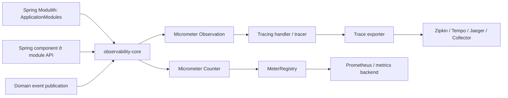
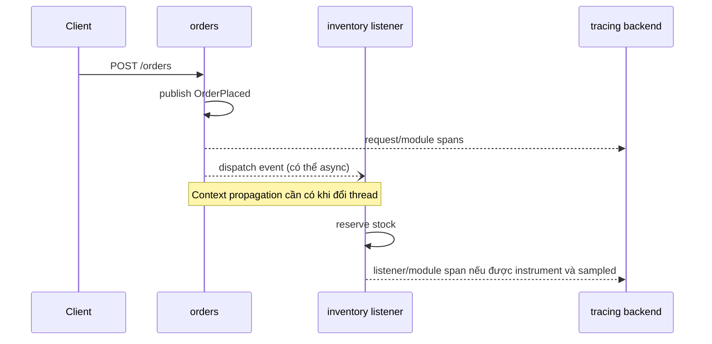

# Thêm spring-modulith-observability-core

## 1. Mục tiêu của bước bật quan sát

Trong ứng dụng Spring Boot được tổ chức theo **Spring Modulith**, các application module có ranh giới nghiệp vụ riêng nhưng thường cùng chạy trong một tiến trình. Chẳng hạn, hệ thống thương mại điện tử có các module `orders`, `inventory` và `notifications`. Một yêu cầu đặt hàng có thể kích hoạt lời gọi vào module `orders`, phát sự kiện `OrderPlaced`, rồi được các listener ở module khác tiếp nhận.

Muốn **kiểm chứng kiến trúc mô-đun khi hệ thống vận hành**, ta cần biết:

- Lời gọi nào thực sự đi qua API của application module?
- Mỗi tương tác được quan sát mất bao lâu, thuộc module nào và bắt đầu từ thao tác nào?
- Một domain event được phát bao nhiêu lần và do module nào phát?
- Khi xử lý bất đồng bộ, thông tin trace có được truyền sang tác vụ tiếp theo không?

Spring Modulith giải quyết phần instrumentation bằng artifact **`org.springframework.modulith:spring-modulith-observability-core`**. Đây là trọng tâm của bài thuộc chương **Bật quan sát**, trong module học **SPRING_MODULITH_DOCUMENTATION_OBSERVABILITY**. Nó bổ sung tín hiệu về ranh giới module cho nền tảng observability của Spring Boot/Micrometer.

Kết quả cần đạt sau bài: có thể khai báo dependency đúng phạm vi, nhận diện vai trò của nó so với Actuator và Insight starter, bổ sung hạ tầng xuất metrics/traces, sau đó kiểm tra bằng một tương tác module thực tế.

## 2. Observability core đảm nhiệm điều gì?

Theo tài liệu Spring Modulith hiện hành, artifact này là **hạ tầng triển khai ở runtime** cho khả năng quan sát application module. Hai nhóm tín hiệu chính:

| Nhóm tín hiệu | Cơ chế | Có ích khi nào? |
| --- | --- | --- |
| **Module entry observation/span** | Spring component nằm trong API của application module được trang trí bằng interceptor/aspect; lúc phương thức được gọi, Micrometer Observation có thể tạo span khi có tracing handler thích hợp. | Xác định phần nào của luồng xử lý đi qua ranh giới module và đo thời lượng tại các điểm vào được instrument. |
| **Domain event publication metrics** | Đăng ký counter cho những domain event được phát trong ứng dụng. | Theo dõi nhịp phát event theo module và loại event; phát hiện xu hướng bất thường. |

Spring Modulith dựa trên mô hình `ApplicationModules` ở runtime để nhận diện module và các thành phần thuộc API của chúng. Vì thế, dependency này liên quan trực tiếp đến mục tiêu **quan sát tương tác qua ranh giới**, nhưng không tạo telemetry chi tiết cho mọi câu lệnh Java hoặc mọi method nội bộ.

### 2.1. Cái gì được tạo và cái gì chỉ được cung cấp khả năng?



`spring-modulith-observability-core` phụ trách phần **tạo observation và metric gắn với module**. Để dữ liệu xuất hiện trên dashboard, ứng dụng còn cần registry, tracer, exporter hoặc collector tùy mục đích. Đặc biệt:

- **Có core** không tự đồng nghĩa với **có trace trong Tempo/Zipkin**.
- **Có Spring Boot Actuator** không tự đồng nghĩa với **có tracer/exporter**.
- **Có event counter tăng** không chứng minh listener đã hoàn tất xử lý.
- **Có module graph** không chứng minh mọi dependency đều được thực thi ở một request cụ thể.

## 3. Thêm dependency vào dự án

### 3.1. Trường hợp cần đúng observability mà chưa cần Module Actuator

Với Spring Modulith 2.x có hai artifact `observability-api` và `observability-core`, khai báo **core ở runtime**. Ví dụ Gradle Groovy DSL:

```groovy
dependencies {
    // Spring Boot đã cấu hình dependency management của riêng dự án.
    implementation 'org.springframework.boot:spring-boot-starter-actuator'

    // Bật instrumentation của Spring Modulith.
    runtimeOnly 'org.springframework.modulith:spring-modulith-observability-core'
}
```

Nếu dùng Maven:

```xml
<dependencies>
    <dependency>
        <groupId>org.springframework.boot</groupId>
        <artifactId>spring-boot-starter-actuator</artifactId>
    </dependency>

    <dependency>
        <groupId>org.springframework.modulith</groupId>
        <artifactId>spring-modulith-observability-core</artifactId>
        <scope>runtime</scope>
    </dependency>
</dependencies>
```

Các ví dụ giả định dự án đã là ứng dụng Spring Boot và đã nhập **Spring Modulith BOM** phù hợp (hoặc có cách quản lý phiên bản tương đương). Không chép một version Spring Modulith tùy ý vào project đang dùng Spring Boot phiên bản khác. Với Gradle chưa có BOM, có thể khai báo `implementation platform('org.springframework.modulith:spring-modulith-bom:<compatible-version>')` bằng phiên bản **có thật và tương thích** mà nhóm đã chọn, rồi bỏ version tại các dependency con.

**Tại sao dùng `runtimeOnly`?** Phần core được Spring Boot/Spring Modulith tìm và bật khi chạy ứng dụng; mã nguồn nghiệp vụ thông thường không cần import các lớp triển khai instrumentation của nó. Maven dùng `<scope>runtime</scope>` cho ý nghĩa tương tự. Spring Modulith runtime module model và các thành phần hỗ trợ được kéo vào theo dependency cần thiết, nhưng nên kiểm tra dependency tree trong dự án thực tế.

### 3.2. Khi nào cần `spring-modulith-observability-api`?

Nếu chỉ sử dụng behavior mặc định, thường **không cần thêm API trực tiếp**. Nếu mã nguồn muốn tùy biến counter hoặc convention, hãy khai báo API ở **compile classpath**:

```groovy
dependencies {
    runtimeOnly 'org.springframework.modulith:spring-modulith-observability-core'
    implementation 'org.springframework.modulith:spring-modulith-observability-api'
}
```

Ví dụ lớp mở rộng ở package `org.springframework.modulith.observability` gồm `ModulithEventMetricsCustomizer` và `ModulithObservationConvention`. API tách khỏi core vì đó là hợp đồng dành cho mã ứng dụng, còn core là phần thực thi. Không nên tham chiếu class nội bộ từ `observability-core` trực tiếp trong domain code chỉ để bật quan sát.

### 3.3. Nếu đã dùng `spring-modulith-starter-insight`?

**Không cần thêm core lần thứ hai.** Theo tài liệu Spring Modulith 2.x, Insight starter đã kéo theo:

| Dependency qua Insight starter | Mục đích |
| --- | --- |
| `spring-modulith-observability-core` | Instrumentation runtime |
| `spring-modulith-observability-api` | API mở rộng và tùy biến |
| `spring-modulith-actuator` | Expose mô hình module qua `/actuator/modulith` |
| `spring-boot-starter-actuator` | Hạ tầng Actuator của Spring Boot |

Insight phù hợp khi cùng lúc cần **đọc module graph** và **quan sát tương tác**. Cài core riêng phù hợp khi chỉ cần phần observability hoặc muốn chủ động ghép các thành phần. Trong Gradle, API được kéo theo ở mức transitively phù hợp runtime của starter, nhưng nếu trực tiếp biên dịch mã dùng API, cần đảm bảo API hiện diện ở compile classpath.

```groovy
dependencies {
    // Phương án thay thế nếu cần cả Modulith Actuator lẫn observability.
    runtimeOnly 'org.springframework.modulith:spring-modulith-starter-insight'
}
```

**Lưu ý phiên bản:** tài liệu các dòng Spring Modulith cũ có thể nhắc artifact `spring-modulith-observability` chưa tách thành API/core. Hãy xem tài liệu và BOM đúng phiên bản đang dùng thay vì kết hợp cả tên artifact cũ và mới.

## 4. Tín hiệu đầu tiên: span tại điểm vào application module

### 4.1. Một “module entry” có nghĩa gì?

Application module được tổ chức từ package gốc và API có thể truy cập từ module khác. Core có cơ chế quan sát các **Spring bean thuộc API của module**, ghi nhận lời gọi đến các phương thức đó.

Ví dụ:

```text
com.example.shop
├── orders
│   ├── OrderService.java       <-- Spring bean trong module API
│   ├── OrderPlaced.java        <-- Sự kiện công khai của module
│   └── internal
│       └── OrderRepository.java
├── inventory
│   ├── InventoryService.java   <-- API của module inventory
│   └── internal
│       └── StockRepository.java
└── notifications
    └── internal
        └── NotificationListener.java
```

Giả sử `OrderService` gọi `InventoryService.reserve(...)` qua Spring bean. Khi core được bật và cấu hình tracing phù hợp, có thể thấy một span cho lời gọi **vào API của module `inventory`**, với thông tin module và method. Nhưng nếu `InventoryService` thực hiện 20 phép tính nội bộ, core không mặc định tạo 20 span riêng chỉ nhờ chúng nằm trong module đó.

### 4.2. Các thuộc tính span quan trọng

| Tag ở module entry span | Vai trò |
| --- | --- |
| `module.identifier` | Định danh module được gọi, dùng để lọc trace theo module. |
| `module.name` | Tên hiển thị của module. |
| `module.invocation-type` | Kiểu lời gọi, ví dụ `bean` hoặc `event listener`. |
| `module.method` | Phương thức thuộc điểm vào module được thực thi. |

Trace có thể hiển thị theo dạng minh họa:

```text
traceId=94ac...
HTTP POST /orders
  └─ orders: placeOrder(...)
       └─ inventory: reserve(...)
```

Đây là ví dụ tuyến thực thi **được instrument**, không phải cam kết tên span và quan hệ parent/child ở mọi phiên bản. Nếu listener chạy bất đồng bộ hoặc qua broker, span có thể tách khỏi trace ban đầu khi thiếu propagation hoặc sampling. Cần đọc span tags và thời gian thực tế trong tracing UI.

### 4.3. Phân biệt trace với module graph

Module graph có thể được sinh bởi Spring Modulith Documenter khi build/test, hoặc được xem qua Modulith Actuator khi có dependency phù hợp. Nó diễn tả cấu trúc dependency: “`inventory` phụ thuộc module nào?”. Tracing diễn tả lần thực thi: “tại request này, có lời gọi nào qua API `inventory` và kéo dài bao lâu?”.

Đối chiếu hai nguồn rất hữu ích khi kiểm chứng kiến trúc. Nhưng chỉ thêm `spring-modulith-observability-core` **không tự tạo tài liệu PlantUML/Canvas, cũng không tự xuất** `/actuator/modulith`. Đó là các khả năng của artifact tài liệu/Actuator khác.

## 5. Tín hiệu thứ hai: metrics khi phát domain event

Spring Modulith ghi nhận domain event được phát và đăng ký hai nhóm counter:

| Tên Micrometer meter | Ý nghĩa |
| --- | --- |
| `module.events.published` | Counter tổng hợp các lần phát domain event. |
| `module.events.published.$moduleIdentifier.$simpleEventTypeName` | Counter riêng cho loại event được phát bởi một module. |

Metric tổng hợp có các low-cardinality keys như `module.event.type`, `module.identifier`, `module.name`. Metric của loại event riêng có thể được bổ sung các tag tùy biến nếu được cấu hình đúng.

Giả sử `orders` phát sự kiện `OrderPlaced`:

```java
// OrderPlaced.java (package com.example.shop.orders)
public record OrderPlaced(java.util.UUID orderId) {}
```

```java
// OrderService.java (package com.example.shop.orders)
import java.util.UUID;
import org.springframework.context.ApplicationEventPublisher;
import org.springframework.stereotype.Service;

@Service
public class OrderService {
    private final ApplicationEventPublisher events;

    public OrderService(ApplicationEventPublisher events) {
        this.events = events;
    }

    public void placeOrder(UUID orderId) {
        // Ví dụ giản lược: giả sử đơn đã được kiểm tra và lưu.
        events.publishEvent(new OrderPlaced(orderId));
    }
}
```

Sau khi gọi `placeOrder(...)`, metric publication tương ứng có thể được tạo/tăng. Ví dụ sử dụng `ApplicationEventPublisher` chỉ minh họa cách phát event; chưa trình bày giao dịch, persist đơn, idempotency hay cách consumer đảm bảo xử lý.

Một lưu ý có tính quyết định: **“event được phát” không đồng nghĩa “listener hoàn tất”**. Nếu `notifications` gửi email thất bại, counter publication vẫn có thể tăng. Muốn theo dõi việc xử lý thành công, cần thêm log/metric ở consumer, tracing và có thể event publication registry tùy thiết kế.

### 5.1. Đặt tag theo cardinality

Không nên đính kèm giá trị riêng cho từng đơn hàng vào metric:

| Nên đưa vào metric tag | Không nên đưa vào metric tag |
| --- | --- |
| `module=orders` | `orderId=...` |
| `eventType=OrderPlaced` | `customerId=...` |
| `channel=web|mobile` nếu chỉ có ít giá trị | `requestId`, `traceId` |

Metrics là dữ liệu số tổng hợp theo các chuỗi thời gian. Mỗi tổ hợp tag có thể tạo thêm time series; số lượng giá trị không giới hạn sẽ làm tăng cardinality và chi phí giám sát. ID nghiệp vụ có thể nằm trong log/trace theo chính sách dữ liệu, nhưng tránh đưa token, thông tin cá nhân hoặc payload bí mật vào bất kỳ nguồn telemetry nào.

### 5.2. Khi cần tùy biến

Khai báo `spring-modulith-observability-api` ở compile scope để dùng `ModulithEventMetricsCustomizer` nhằm bổ sung tag cho counter event riêng, hoặc `ModulithObservationConvention` để tùy biến thông tin module observation. Hãy chỉ dùng tag có tập giá trị nhỏ, ổn định.

Ví dụ có thể diễn giải một tag `channel` từ enum `WEB`/`MOBILE` của event rồi ánh xạ thành một trong hai chuỗi hằng. Không dùng giá trị `orderId` hoặc chuỗi tùy ý từ đầu vào trực tiếp làm tag.

## 6. Bổ sung hạ tầng để thấy metrics và traces

Việc bật core chỉ chuẩn bị instrumentation. Hai lộ trình sau cần cấu hình riêng.

### 6.1. Lộ trình Metrics: Actuator + Micrometer registry

Ví dụ cho Gradle:

```groovy
dependencies {
    implementation 'org.springframework.boot:spring-boot-starter-actuator'
    runtimeOnly 'org.springframework.modulith:spring-modulith-observability-core'
    runtimeOnly 'io.micrometer:micrometer-registry-prometheus'
}
```

Cấu hình phát triển:

```yaml
management:
  endpoints:
    web:
      exposure:
        include: "health,metrics,prometheus"
```

Kiểm tra sau khi chạy ứng dụng và phát ít nhất một event:

```bash
curl -i http://localhost:8080/actuator/health
curl -i http://localhost:8080/actuator/metrics
curl -i http://localhost:8080/actuator/metrics/module.events.published
curl -i http://localhost:8080/actuator/prometheus
```

Các điều kiện cần nhớ:

- `/actuator/metrics` truy vấn meter mà registry đã thấy; meter của một event có thể chưa xuất hiện **trước khi event được phát**.
- `/actuator/prometheus` cần Micrometer Prometheus registry và HTTP exposure; chỉ bật exposure không tự tạo exporter.
- Tên meter Micrometer và tên time series Prometheus có thể khác vì quy tắc chuẩn hóa tên và hậu tố counter. Luôn kiểm tra dữ liệu thực tế xuất ra.
- Đặt giới hạn quyền truy cập Actuator. Trong production, chỉ expose đúng endpoint cần thiết qua mạng và cơ chế xác thực phù hợp.

### 6.2. Lộ trình Tracing: Micrometer Tracing + tracer/exporter

Một quan sát ở module entry chỉ trở thành **span có thể xem trên tracing backend** khi pipeline Micrometer Observation → tracing handler → tracer → exporter được cấu hình đúng.

Với **Spring Boot 4.x**, Spring Boot có starter OpenTelemetry:

```groovy
dependencies {
    implementation 'org.springframework.boot:spring-boot-starter-actuator'
    runtimeOnly 'org.springframework.modulith:spring-modulith-observability-core'

    // Spring Boot 4.x: tích hợp Micrometer Tracing + OpenTelemetry.
    runtimeOnly 'org.springframework.boot:spring-boot-starter-opentelemetry'
}
```

Với **Spring Boot 3.5.x**, ví dụ tổ hợp OpenTelemetry + OTLP theo tài liệu dòng đó:

```groovy
dependencies {
    implementation 'org.springframework.boot:spring-boot-starter-actuator'
    runtimeOnly 'org.springframework.modulith:spring-modulith-observability-core'
    runtimeOnly 'io.micrometer:micrometer-tracing-bridge-otel'
    runtimeOnly 'io.opentelemetry:opentelemetry-exporter-otlp'
}
```

Chọn **một** tổ hợp phù hợp với phiên bản đang chạy. Cấu hình collector/backend như OTLP Collector, Tempo, Jaeger hoặc Zipkin theo tài liệu Spring Boot và hệ thống nhận trace. Tên thuộc tính export OTLP có thay đổi giữa Boot 3.5 và 4.x, nên không chép lẫn namespace:

| Dòng Spring Boot | Nhóm property export thường dùng |
| --- | --- |
| 3.5.x | `management.otlp.tracing.*` |
| 4.x | `management.opentelemetry.tracing.export.otlp.*` |

Trong thực hành có thể tăng sampling để dễ thấy trace:

```yaml
management:
  tracing:
    sampling:
      probability: 1.0
```

Đây là cấu hình **demo**: trong môi trường có tải cần chọn mức sampling hợp lý để giảm chi phí và dữ liệu thu thập. Nếu không thấy span, có thể do sampling, exporter không kết nối, thiếu tracer hoặc chính phương thức được gọi không nằm ở điểm vào module mà core instrument.

### 6.3. Logging và correlation ID

MDC có thể mang `traceId` và `spanId` khi Micrometer Tracing được cấu hình trong Spring Boot. Khi có log pattern phù hợp, người vận hành lọc log cùng trace để đi từ “`inventory` chậm” tới exception hoặc thông điệp nghiệp vụ cụ thể.

```text
INFO  [traceId=ab12... spanId=9f3a...] orders.OrderService - order.accepted
WARN  [traceId=ab12... spanId=03bc...] inventory.StockService - stock.low
```

Các giá trị trên chỉ minh họa. `traceId` là định danh hành trình xử lý đã được quan sát; `orderId` là định danh nghiệp vụ. Không giả định chúng giống nhau và không dùng một loại để thay thế hoàn toàn loại kia.

## 7. Context propagation khi xử lý bất đồng bộ

Một ứng dụng Modulith thường có listener chạy bằng `@Async` hoặc executor riêng. Context hiện tại thường gắn với thread đang thực thi. Khi đổi thread mà không truyền context, log và trace ở listener có thể mất `traceId` ban đầu hoặc được ghi thành hành trình độc lập.

Với Spring Framework/Boot hỗ trợ Micrometer Context Propagation, một lựa chọn là `ContextPropagatingTaskDecorator`:

```java
import org.springframework.context.annotation.Bean;
import org.springframework.context.annotation.Configuration;
import org.springframework.core.task.support.ContextPropagatingTaskDecorator;

@Configuration(proxyBeanMethods = false)
class ContextPropagationConfiguration {

    @Bean
    ContextPropagatingTaskDecorator contextPropagatingTaskDecorator() {
        return new ContextPropagatingTaskDecorator();
    }
}
```

**Điểm quan trọng:** decorator cần được gắn vào **đúng executor** thực hiện công việc. Với `AsyncTaskExecutor` do Spring Boot tự cấu hình, có phiên bản hỗ trợ dùng bean decorator như trên; với executor tự tạo, phải cấu hình task decorator trên executor đó. Một số phiên bản Spring Boot còn hỗ trợ thuộc tính `spring.task.execution.propagate-context`. Hãy đối chiếu hành vi với phiên bản Boot của project và kiểm tra trên trace thực tế.

Nếu dùng Reactor, cơ chế khác với chuyển thread thông thường: cần xem chế độ `spring.reactor.context-propagation=auto` ở các phiên bản được hỗ trợ. Nếu qua message broker hoặc microservice khác, phải bảo đảm cơ chế inject/extract trace headers tương ứng; không thể dựa chỉ vào task decorator của một JVM.



Sơ đồ chỉ mô tả luồng ý tưởng. Listener có thể chạy sau khi request trả về; quan hệ giữa spans và việc chúng có chung trace phụ thuộc propagation và instrumentation thực tế. **Không thấy listener span chưa đủ để kết luận listener không chạy.**

## 8. Kiểm tra nhanh bằng ứng dụng mẫu

Hãy thực hiện tuần tự theo đường tín hiệu để khoanh vùng lỗi cấu hình.

| Bước | Thao tác | Kết quả mong đợi |
| --- | --- | --- |
| 1. Kiểm tra dependency | Xem Gradle/Maven runtime dependency tree. | Có `spring-modulith-observability-core` và những dependency nền tảng tương thích; nếu dùng Insight thì core được kéo theo. |
| 2. Xác nhận module | Đảm bảo các package được Spring Modulith nhận diện thành application module. | Có module API thích hợp để instrumentation quan sát. |
| 3. Phát event | Gọi flow đặt hàng để phát `OrderPlaced`. | Counter publication được đăng ký/tăng khi event được quan sát. |
| 4. Truy vấn meter | Xem `/actuator/metrics/module.events.published` sau khi phát event. | Có meter với tags module/event phù hợp nếu registry và endpoint đã sẵn sàng. |
| 5. Gọi qua ranh giới | Tạo lời gọi từ bean/module khác vào API của `inventory`. | Trace sampled có module entry span và các tag mô tả module. |
| 6. Thử async | Chạy listener trên executor, so sánh trace/log trước và sau propagation. | Thấy tín hiệu liên kết theo chính sách instrumentation/tracing đã đặt. |
| 7. Đối chiếu graph | Sinh tài liệu module hoặc xem Modulith Actuator nếu đã bật riêng. | Hiểu dependency tĩnh và so sánh với các lời gọi runtime. |

### 8.1. Xem dependency thực tế

Nếu ứng dụng dùng Gradle và plugin/module phù hợp, lệnh tham khảo:

```bash
./gradlew dependencyInsight --configuration runtimeClasspath --dependency spring-modulith-observability-core
./gradlew dependencies --configuration runtimeClasspath
```

Với Maven:

```bash
mvn dependency:tree -Dincludes=org.springframework.modulith
```

Mục đích của việc xem dependency tree là để xác nhận **artifact thực sự có mặt ở runtime**, tránh sai lầm thêm nó vào dependency configuration chỉ dùng khi chạy test hoặc bị exclude bởi quy tắc khác.

### 8.2. Các triệu chứng phổ biến

| Triệu chứng | Kiểm tra trước tiên |
| --- | --- |
| Ứng dụng không khởi động sau khi thêm core | Xem stack trace, BOM và tương thích Spring Modulith/Spring Boot; kiểm tra dependency tree và phiên bản bị kéo lệch. |
| `/actuator/metrics` trả 404 | Đã có Boot Actuator? Endpoint có được expose? Port/base path quản trị có khác không? |
| Không có `module.events.published` | Domain event đã được phát chưa? Core hoạt động và registry có sẵn không? Kiểu phát event có đi qua đường được instrument không? |
| Có metric nhưng không có trace module | Tracer/handler/exporter đã cấu hình? Sampling? Có gọi qua Spring bean trong module API không? |
| Trace của listener bị tách | Có `@Async` hoặc executor riêng? Context có được propagate đến thread/transport đích không? |
| Traces xuất hiện nhưng thông tin module không đúng | Mô hình module có nhận diện đúng package, nested module/API không? Cấu hình phát hiện module có được áp dụng ở runtime không? |
| Số time series tăng bất thường | Có gắn ID động, URL thô hoặc dữ liệu người dùng vào metric tags không? |
| Có `modulith` endpoint nhưng không có event metrics | Actuator graph và observability là hai khả năng riêng; kiểm tra core, registry và sự kiện thực tế. |

## 9. Những giới hạn cần hiểu trước khi triển khai

1. **Instrumentation không thay thế thiết kế module.** Bật core không tự ngăn dependency sai ranh giới. Dùng cơ chế xác minh cấu trúc như `ApplicationModules.verify()`/module tests và tài liệu module song song với telemetry.
2. **Metrics không xác nhận kết quả xử lý event.** Counter publication đo lúc event được phát; cần thêm chỉ số consumer, retry hoặc event publication registry khi muốn theo dõi độ tin cậy xử lý.
3. **Trace có thể thiếu dữ liệu.** Sampling, interceptor/proxy boundary và context propagation quyết định những span nào có mặt và có liên kết hay không.
4. **Core không tự xuất module graph.** Muốn endpoint `/actuator/modulith`, thêm Modulith Actuator hoặc Insight starter; muốn sinh tài liệu PlantUML/Canvas từ mã nguồn, dùng công cụ `spring-modulith-docs` thích hợp trong test/build.
5. **Theo dõi dữ liệu có chi phí và yêu cầu bảo mật.** Không đưa password, token, thông tin thanh toán vào logs/traces; tránh tag metric có cardinality cao; giới hạn HTTP exposure và quyền truy cập các endpoint Actuator.
6. **API/cấu hình phụ thuộc phiên bản.** Tổ hợp tracer/exporter và tên property đã thay đổi giữa Boot 3.x và 4.x; tên artifact Modulith cũng khác giữa một số dòng. Luôn xem tài liệu theo phiên bản được BOM quản lý.

## 10. Ghi nhớ

`spring-modulith-observability-core` là thành phần **runtime** của Spring Modulith dùng để quan sát **lời gọi đi vào API application module** và **domain event được phát**. Thêm dependency này là bước kích hoạt instrumentation, nhưng chưa hoàn thành pipeline quan sát: metrics cần registry/export; spans cần tracing handler, tracer và exporter; xử lý bất đồng bộ cần context propagation phù hợp.

Nếu ứng dụng đã dùng `spring-modulith-starter-insight` thì đã có core. Nếu cần tùy biến metric/convention từ mã Java, khai báo `spring-modulith-observability-api` ở compile scope. Kết hợp dữ liệu runtime thu được với module graph và tài liệu kiến trúc giúp kiểm chứng rằng các ranh giới module trong thiết kế đang được sử dụng đúng cách trong hệ thống thực tế.

## Tài liệu tham khảo

- [Spring Modulith — Production-ready Features](https://docs.spring.io/spring-modulith/reference/production-ready.html): thêm `spring-modulith-observability-core`, module entry spans, metrics phát domain event, quy ước và customizer.
- [Spring Modulith — Appendix C: Spring Modulith modules](https://docs.spring.io/spring-modulith/reference/appendix.html): phạm vi `observability-api`/`observability-core`, các artifact mà Insight starter kéo theo.
- [Spring Boot — Observability](https://docs.spring.io/spring-boot/reference/actuator/observability.html): nền Micrometer Observation, cardinality và context propagation.
- [Spring Boot — Tracing](https://docs.spring.io/spring-boot/reference/actuator/tracing.html): tracer, sampling, exporter, network propagation và backend.
- [Spring Boot 3.5 — Tracing](https://docs.spring.io/spring-boot/3.5/reference/actuator/tracing.html): tổ hợp Micrometer Tracing bridge và OTLP exporter cho dòng Boot 3.5.
- [Spring Boot — Metrics](https://docs.spring.io/spring-boot/reference/actuator/metrics.html): Micrometer meter registry, endpoint và export metrics.

> **Phạm vi ví dụ:** Mã Java/Gradle/Maven và trace trong bài dùng để minh họa cơ chế. Chúng chưa phải ứng dụng hoàn chỉnh, chưa có kiểm thử integration và chưa đại diện cho cấu hình production. Khi áp dụng, sử dụng đúng dependency management, exporter và quy tắc bảo vệ dữ liệu của hệ thống đang vận hành.
