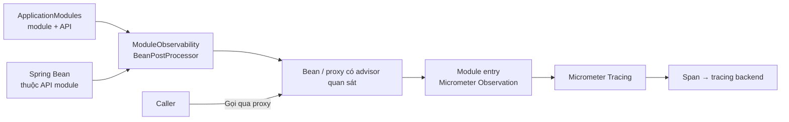
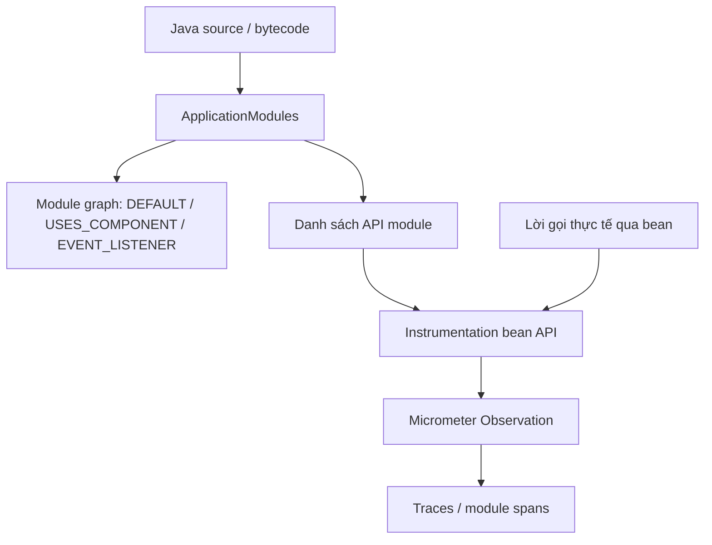
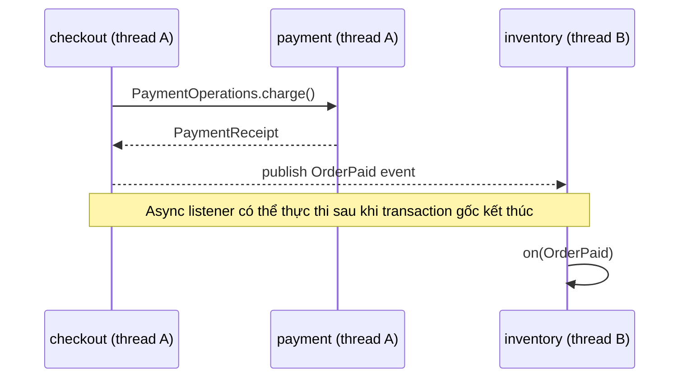

# Điều kiện để component API được instrument

## 1. Bài học đặt trong bối cảnh nào?

Trong chương **Bật quan sát**, ta tìm hiểu cách Spring Modulith tạo dữ liệu quan sát cho tương tác giữa các **application module** của ứng dụng Spring Boot. Spring Modulith hỗ trợ sinh tài liệu ranh giới module, công bố module graph qua Actuator, ghi nhận event metrics và bổ sung module entry span cho tracing. Muốn sử dụng những tín hiệu đó để kiểm chứng kiến trúc khi hệ thống vận hành, cần hiểu **chính xác những Spring component nào được instrument** và **khi nào lời gọi của chúng thực sự xuất hiện trong trace**.

Tài liệu Spring Modulith mô tả nguyên tắc trung tâm:

> Khi kích hoạt observability, các **Spring component thuộc API của application module** được trang trí bằng một aspect để chặn lời gọi và tạo module entry observation/span.

Vì thế, không thể suy luận rằng *mọi* `@Service` hay `@Component` trong ứng dụng đều có module span. Cũng không thể suy luận rằng một lớp `public` hoặc một tên xuất hiện trong module graph chắc chắn đã được instrument.

**Mục tiêu học tập**

1. Xác định một component có thuộc **API được công bố** của application module hay không.
2. Nhận biết điều kiện để Spring Modulith thực sự instrument một Spring bean.
3. Phân biệt **được instrument**, **được gọi** và **thấy span trong trace backend**.
4. Phân tích các tình huống không có span vì bean nội bộ, lời gọi không qua proxy, cấu hình tracing hoặc async.
5. Tự kiểm tra một luồng nghiệp vụ bằng module graph, span metadata, event metrics và tracing.

## 2. Phân biệt API module với implementation nội bộ

Spring Modulith phát hiện các application module từ cấu trúc package của ứng dụng Spring Boot. Theo cách phát hiện mặc định, các package trực tiếp dưới package chứa `@SpringBootApplication` là các module. Ví dụ:

```text
com.acme.shop
├── ShopApplication.java
├── checkout
│   ├── CheckoutService.java                  # Spring bean công khai của checkout
│   └── internal
│       └── CheckoutRepository.java          # Implementation nội bộ
├── payment
│   ├── PaymentOperations.java                # Spring bean API của payment
│   ├── PaymentReceipt.java                   # Kiểu dữ liệu API, không phải bean
│   └── internal
│       ├── PaymentGatewayAdapter.java        # Spring bean nội bộ
│       └── PaymentRepository.java            # Spring bean nội bộ
└── inventory
    ├── InventoryService.java
    └── internal
        └── InventoryRepository.java
```

Trong mô hình này:

- `payment.PaymentOperations` nằm ở **package gốc** của module `payment` và là một Spring bean. Đây là ví dụ điển hình cho **component API được instrument**.
- `payment.PaymentReceipt` cũng là kiểu API công khai, nhưng là `record` dữ liệu, **không phải Spring bean**; không tự được instrument như một component.
- `payment.internal.PaymentGatewayAdapter` có thể mang `@Service` và được Spring quản lý, nhưng nằm trong implementation nội bộ. Theo mặc định, nó **không phải bean thuộc API được module công bố**.
- `checkout.CheckoutService` là component API của module `checkout`. Khi bên ngoài đi vào component này qua proxy phù hợp, Spring Modulith có thể tạo span cho điểm vào module `checkout`.

**Lưu ý về Java `public`:** Một lớp `public` trong `payment.internal` vẫn có thể được Java import từ module khác nếu không có các biện pháp đóng gói bổ sung. Tuy nhiên, theo ranh giới Spring Modulith, việc đó không tự biến lớp này thành API hợp lệ hoặc thành component API được quan sát.

### API được công bố có thể nằm trong named interface

Mặc định package gốc của module là API công khai. Khi cần công bố thêm một subpackage, có thể khai báo **named interface**:

```java
// src/main/java/com/acme/shop/payment/api/package-info.java
@org.springframework.modulith.NamedInterface("api")
package com.acme.shop.payment.api;
```

Giả sử `payment.api.PaymentOperations` là Spring bean nằm trong named interface này, nó thuộc API được công bố của `payment`. Modulith có thể nhận diện điểm vào API đó để instrument theo cơ chế observability. Đây cũng là cách tách hợp đồng công khai khỏi phần hiện thực bên trong.

Nếu module `checkout` muốn giới hạn quyền phụ thuộc vào nhóm API này:

```java
// src/main/java/com/acme/shop/checkout/package-info.java
@org.springframework.modulith.ApplicationModule(
    allowedDependencies = "payment::api"
)
package com.acme.shop.checkout;
```

Khái niệm **được phép phụ thuộc vào API** và **được instrument** có liên hệ, nhưng không hoàn toàn trùng nhau. `allowedDependencies` mô tả chính sách kiến trúc; aspect observability phải được kích hoạt riêng và chỉ áp dụng lên các Spring component phù hợp.

## 3. Các điều kiện cần kiểm tra

Hãy xem xét **hai lớp điều kiện**: điều kiện lựa chọn bean để instrument và điều kiện để observation trở thành trace nhìn thấy được.

| Điều kiện | Vai trò | Nếu không thỏa mãn |
| --- | --- | --- |
| **1. Application module được phát hiện** | Spring Modulith nhận diện module sở hữu component | Không thể xác định API module tương ứng để gắn metadata |
| **2. Component thuộc API được module công bố** | Chọn đúng bean ở package API gốc hoặc named interface | Component nội bộ thường không được chọn để tạo module entry span |
| **3. Đối tượng là Spring bean phù hợp** | Cho phép BeanPostProcessor/aspect tham gia vòng đời bean | `new PaymentOperations()` thủ công không đi qua cơ chế Spring |
| **4. Runtime có Spring Modulith observability** | Đăng ký hạ tầng instrument | Không có aspect module observability dù package được tổ chức đúng |
| **5. Lời gọi đi qua điểm chặn của Spring AOP** | Interceptor nhận biết module entry/exit | Self-invocation, phương thức không được proxy chặn có thể không tạo observation riêng |
| **6. Có Micrometer observation/tracing phù hợp** | Từ lời gọi tạo observation và có thể chuyển thành span | Có code chạy nhưng không có trace được xuất |
| **7. Đường gọi thực sự chạy và trace được lấy mẫu/xuất** | Cho phép xuất hiện trên backend | Không thấy span trong một request chưa đi qua API hoặc bị loại bởi sampling/exporter |

Các điều kiện 1–5 chủ yếu trả lời **“component/method có được instrument và intercept không?”**. Điều kiện 6–7 trả lời **“có thấy được span không?”**. Chẩn đoán hiệu quả cần kiểm tra theo thứ tự này.

### 3.1. BeanPostProcessor và aspect hoạt động ra sao?

Spring Modulith cung cấp `ModuleObservabilityBeanPostProcessor`. Thành phần này làm việc với Spring bean, nhận biết bean được ứng dụng module công bố và gắn interceptor theo cơ chế Spring AOP.



Các điểm cần hiểu:

- Spring Modulith không đòi hỏi bạn đặt `@Observed` thủ công lên **từng phương thức API** để tạo module entry observation khi đã kích hoạt instrumentation phù hợp.
- Việc dùng Spring AOP có những hạn chế của proxy: một lời gọi trực tiếp từ `this` sang phương thức khác trong cùng object thường không đi qua proxy; `private`, `final` hoặc phương thức không proxy được cũng có thể không được intercept tùy kiểu proxy.
- Không nên dựa vào việc một class được quét thấy bởi `@ComponentScan` để kết luận có module span. **Component scanning** và **module API detection** là hai cơ chế khác nhau.

## 4. Kích hoạt instrumentation trong Spring Boot

### 4.1. Dùng starter dành cho quan sát module

Với Spring Modulith **2.2.x** và dòng Spring Boot tương thích, có thể dùng starter gom Actuator + observability:

```groovy
// build.gradle (Groovy DSL)
dependencies {
    implementation platform('org.springframework.modulith:spring-modulith-bom:2.2.0')

    implementation 'org.springframework.modulith:spring-modulith-starter-core'

    // Đưa Modulith Actuator và observability vào runtime.
    runtimeOnly 'org.springframework.modulith:spring-modulith-starter-insight'

    // Ví dụ sử dụng OpenTelemetry/OTLP với Spring Boot 4.x.
    implementation 'org.springframework.boot:spring-boot-starter-opentelemetry'
}
```

`spring-modulith-starter-insight` bao gồm phần hỗ trợ Actuator và observability. Nhờ đó, khi ứng dụng khởi động, các component API phù hợp có thể được gắn module entry interceptor. Starter này **không tự tạo ra một trace backend**: để xem trace, cần thêm tracer/exporter và dịch vụ lưu, hiển thị trace.

> **Về phiên bản:** Ví dụ dùng BOM `2.2.0` đã phát hành tháng 11/2026. Nếu dự án dùng Spring Boot 3.x hoặc phiên bản Spring Modulith khác, hãy chọn bộ dependency và phiên bản tương thích theo tài liệu của dự án; tên artifact hỗ trợ observability đã thay đổi giữa các dòng Modulith.

### 4.2. Chỉ dùng observability, không cần Modulith Actuator

Nếu chỉ cần instrumentation cho interaction giữa module mà không expose `/actuator/modulith`, có thể khai báo dependency runtime trực tiếp:

```groovy
dependencies {
    implementation platform('org.springframework.modulith:spring-modulith-bom:2.2.0')
    runtimeOnly 'org.springframework.modulith:spring-modulith-observability-core'
    implementation 'org.springframework.boot:spring-boot-starter-actuator'
    implementation 'org.springframework.boot:spring-boot-starter-opentelemetry'
}
```

`spring-modulith-observability-core` cung cấp phần instrument. Để tùy biến convention hoặc event metrics qua API public của Modulith, có thể bổ sung `spring-modulith-observability-api` ở compile scope. Khi dùng `starter-insight` thì không cần khai báo lặp các dependency mà starter đã kéo theo.

Trong các phiên bản Spring Modulith **1.x** và đầu **2.x**, artifact có tên `spring-modulith-observability`. Không sao chép tên dependency từ các bài viết dành cho phiên bản khác mà không đối chiếu BOM.

### 4.3. Cấu hình tracing exporter cho môi trường thử nghiệm

Ví dụ Spring Boot 4.x dùng OTLP HTTP:

```yaml
# application.yml (môi trường local/dev)
management:
  tracing:
    sampling:
      probability: 1.0
  opentelemetry:
    tracing:
      export:
        otlp:
          endpoint: "http://localhost:4318/v1/traces"
```

- `sampling.probability: 1.0` giúp tránh bỏ sót trace do lấy mẫu trong thử nghiệm. Môi trường production thường đặt tỷ lệ thấp hơn theo tải và chi phí.
- Endpoint OTLP phải trỏ tới **OpenTelemetry Collector hoặc tracing backend thực sự hoạt động**. Cấu hình endpoint đơn độc không tạo hệ thống nhận traces.
- Nếu Spring Boot không có tracer/exporter phù hợp, bạn có thể không thấy span trên Zipkin/Tempo/Jaeger dù Modulith đã instrument component API.
- Không cần expose HTTP endpoint `/actuator/modulith` để Spring Modulith tạo module entry observation; Actuator module graph và instrumentation là hai khả năng liên quan nhưng được kích hoạt riêng.

## 5. Ví dụ xuyên suốt: bean API được instrument

Giả sử module `checkout` gửi yêu cầu thanh toán cho module `payment`. Đặt bean API ở package gốc `com.acme.shop.payment`:

```java
// com/acme/shop/payment/PaymentOperations.java
package com.acme.shop.payment;

import java.util.UUID;
import com.acme.shop.payment.internal.PaymentGateway;
import org.springframework.stereotype.Service;

@Service
public class PaymentOperations {

    private final PaymentGateway gateway;

    public PaymentOperations(PaymentGateway gateway) {
        this.gateway = gateway;
    }

    public PaymentReceipt charge(UUID orderId) {
        return gateway.charge(orderId);
    }
}
```

Ở đây `PaymentGateway` cần một định nghĩa. Ta sử dụng interface nội bộ và adapter nội bộ, vì phần này không cần lộ ra API module:

```java
// com/acme/shop/payment/internal/PaymentGateway.java
package com.acme.shop.payment.internal;

import java.util.UUID;
import com.acme.shop.payment.PaymentReceipt;

public interface PaymentGateway {
    PaymentReceipt charge(UUID orderId);
}
```

Định nghĩa adapter:

```java
// com/acme/shop/payment/internal/PaymentGatewayAdapter.java
package com.acme.shop.payment.internal;

import java.util.UUID;
import com.acme.shop.payment.PaymentReceipt;
import org.springframework.stereotype.Component;

@Component
class PaymentGatewayAdapter implements PaymentGateway {
    @Override
    public PaymentReceipt charge(UUID orderId) {
        // Minh họa: ở hệ thống thật cần tích hợp cổng thanh toán.
        return new PaymentReceipt(orderId, true);
    }
}
```

Kiểu kết quả công khai:

```java
// com/acme/shop/payment/PaymentReceipt.java
package com.acme.shop.payment;

import java.util.UUID;

public record PaymentReceipt(UUID orderId, boolean successful) {}
```

Caller ở module khác:

```java
// com/acme/shop/checkout/CheckoutService.java
package com.acme.shop.checkout;

import java.util.UUID;
import com.acme.shop.payment.PaymentOperations;
import com.acme.shop.payment.PaymentReceipt;
import org.springframework.stereotype.Service;

@Service
public class CheckoutService {

    private final PaymentOperations payments;

    public CheckoutService(PaymentOperations payments) {
        this.payments = payments;
    }

    public PaymentReceipt checkout(UUID orderId) {
        return payments.charge(orderId);
    }
}
```

Khi một controller gọi `CheckoutService.checkout(orderId)` qua Spring-managed bean, quan hệ từ `checkout` đến `payment` đi qua API `PaymentOperations`. Với instrumentation và tracing đúng, bạn có thể thấy module entry span ở hai module.

```text
HTTP POST /checkout/{orderId}
└── checkout: CheckoutService.checkout(...)
    └── payment: PaymentOperations.charge(...)
        └── PaymentGatewayAdapter.charge(...) (internal; không tự có module entry span)
```

**Diễn giải:** `PaymentOperations.charge()` là điểm vào được instrument ở biên `payment`. `PaymentGatewayAdapter` là Spring component nội bộ; dù tham gia xử lý, nó không tự có **module entry span riêng** theo chính sách instrument API module mặc định. Bạn vẫn có thể quan sát code nội bộ bằng instrumentation khác, ví dụ `@Observed` hoặc span thủ công, nếu thật sự cần đo chi tiết.

> Ví dụ chỉ tập trung vào quan sát ranh giới. Logic nghiệp vụ đã lược bỏ exception, transaction, retry, idempotency và xử lý thanh toán thực tế.

## 6. Những component nào được instrument, component nào không?

| Thành phần trong module `payment` | Có được chọn để instrument theo mặc định? | Lý do |
| --- | --- | --- |
| `@Service public class PaymentOperations` ở package gốc `payment` | **Có khả năng được chọn** | Là Spring bean trong API module |
| `@Component public class PaymentFacade` trong named interface `payment.api` | **Có khả năng được chọn** | Named interface đã công bố package chứa component |
| `record PaymentReceipt(...)` ở package gốc | **Không phải component API để instrument** | Kiểu dữ liệu, không phải Spring bean |
| `@Service class PaymentGatewayAdapter` trong `payment.internal` | **Không theo quy tắc API mặc định** | Spring bean nhưng thuộc implementation nội bộ |
| `@Service public class InternalService` trong `payment.internal` | **Không theo quy tắc API mặc định** | Java `public` không đồng nghĩa API của Modulith |
| `new PaymentOperations(...)` được tạo thủ công | **Không qua Spring instrumentation** | Không được quản lý bằng Spring bean/proxy |
| Class dùng `@Bean` factory, trả về component API | **Phụ thuộc cách bean được đăng ký và kiểu bean được nhận diện** | Cần xác minh actual bean type, vị trí API và khả năng proxy |
| Event listener trong module | **Có cơ chế observability dành cho event listener** | Cần xem riêng luồng event, không đồng nhất với mọi method của bean |

Không nên dùng bảng này như quy tắc cứng cho mọi phiên bản hoặc mọi cách cấu hình AOP. Đây là **mô hình chẩn đoán** dựa trên nguyên tắc công bố component API của Spring Modulith. Khi dùng module `OPEN`, named interface, custom detection hay proxy tùy biến, phạm vi component có thể khác so với module đóng mặc định.

## 7. Vì sao `@Service` hoặc `public` chưa đủ?

### Trường hợp A — Spring bean nằm trong package nội bộ

```java
package com.acme.shop.payment.internal;

import org.springframework.stereotype.Service;

@Service
public class FraudScreeningService {
    public boolean allowPayment() {
        return true;
    }
}
```

Bean này được Spring quản lý nhưng thuộc `payment.internal`. Trong mô hình **closed module**, package nội bộ không phải API mặc định. Khi `PaymentOperations` gọi `FraudScreeningService`, không nên đòi hỏi một module entry span mới chỉ vì nó là `@Service`.

Giải pháp khi muốn caller module khác dùng khả năng kiểm tra gian lận: định nghĩa một API ở `payment` hoặc named interface, rồi để lớp nội bộ hiện thực. Không expose toàn bộ `payment.internal` chỉ để có thêm span.

### Trường hợp B — DTO public ở API

```java
package com.acme.shop.payment;

public record PaymentRequest(String paymentReference) {}
```

Đây là **public API type** hữu ích cho giao tiếp giữa module, nhưng không có vòng đời Spring bean. Spring Modulith không gắn aspect module entry cho mọi lần gọi constructor của record. Việc module khác tham chiếu `PaymentRequest` có thể tạo một dependency tĩnh `DEFAULT` trên module graph; nó **không chứng minh có lời gọi component API tại runtime**.

### Trường hợp C — Self-invocation làm bỏ qua proxy

```java
@Service
public class PaymentOperations {

    public void charge() {
        verifyRisk(); // this.verifyRisk(), không đi qua proxy riêng.
    }

    public void verifyRisk() {
        // ...
    }
}
```

Khi một caller bên ngoài gọi `charge()` qua proxy, interceptor có thể đo `charge()`. Nhưng lời gọi `verifyRisk()` trực tiếp trên `this` thường không đi qua Spring AOP proxy, nên không mặc nhiên có span thứ hai. Điều đó **không có nghĩa** logic `verifyRisk()` không chạy.

Nếu cần quan sát chi tiết bên trong, cân nhắc instrument có chủ đích bằng Micrometer Observation hoặc tách một Spring bean phù hợp khi ranh giới nghiệp vụ thực sự cần tách. Không nên tạo thêm module chỉ để tăng số span.

### Trường hợp D — Phương thức không thể được proxy

Với proxy dựa trên class, `final` class hoặc `final` method có thể không thể bị CGLIB intercept; `private` methods cũng không phải điểm chặn AOP thông thường. Với JDK dynamic proxy, chỉ các lời gọi thông qua interface proxy có ý nghĩa. Vì thế cần xét **kiểu proxy** và **phương thức thực sự được gọi qua proxy** trước khi kết luận công cụ quan sát bị lỗi.

### Trường hợp E — Thêm observability nhưng không thấy gì ở dashboard

Khi chưa bật tracing exporter, chưa chạy backend hoặc sampling bỏ request, Modulith có thể đã tạo observation mà bạn vẫn không thấy span trong dashboard. Một trace trống cũng có thể đơn giản là request thử nghiệm chưa đi qua component API.

## 8. Phân biệt cấu trúc tĩnh với dấu vết runtime

Một ứng dụng có hai cơ chế suy luận riêng:



Nếu `checkout` inject `PaymentOperations`, module graph có thể biểu diễn dependency `checkout → payment` dưới loại `USES_COMPONENT`. Đây là **quan hệ tĩnh**, tồn tại ngay cả khi không có request checkout nào được gọi.

Khi request thực sự vào `PaymentOperations.charge()` qua proxy đã instrument, Micrometer Observation mới có dữ liệu từ một lần chạy cụ thể; tracer có thể tạo span và exporter có thể gửi ra backend.

| Công cụ/tín hiệu | Câu hỏi trả lời | Không thể kết luận |
| --- | --- | --- |
| `ApplicationModules.verify()` | API/module dependency có đúng quy tắc không? | Không trả lời latency hay số lần gọi |
| `/actuator/modulith` | Có module nào, quan hệ dependency nào? | Không chứng minh API đã được gọi |
| `ModuleObservabilityBeanPostProcessor` | Spring bean API nào có thể được instrument? | Không đảm bảo một trace sẽ được xuất |
| Module entry span | Method API nào đã thực thi trong trace được ghi? | Không bao phủ mọi phương thức Java |
| Event metrics | Bao nhiêu event được publish? | Không chứng minh listener xử lý thành công |
| Event Publication Registry/log | Theo dõi trạng thái và lỗi xử lý event (nếu cấu hình) | Không tự suy ra toàn bộ graph |

## 9. Module entry span chứa thông tin gì?

Spring Modulith bổ sung những key cho **module entry observation/span**:

| Key | Mô tả |
| --- | --- |
| `module.identifier` | Định danh kỹ thuật của application module |
| `module.name` | Tên hiển thị của module |
| `module.method` | Phương thức tại điểm vào module |
| `module.invocation-type` | Loại lời gọi, ví dụ `bean` hoặc `event listener` |

Ví dụ minh họa một module entry span:

```text
name: payment
attributes:
  module.identifier: payment
  module.name: Payment
  module.method: PaymentOperations.charge
  module.invocation-type: bean
```

Đây là ví dụ về **ý nghĩa các thuộc tính**, không phải JSON export cố định. Tên span, mức chi tiết của `module.method` và cấu trúc metadata có thể thay đổi theo convention và phiên bản Spring Modulith. Nên kiểm tra chính xác key/value trong trace của ứng dụng đang chạy.

### Context propagation với lời gọi bất đồng bộ

Nếu `checkout` phát event và listener ở `inventory` xử lý trong executor khác, module entry của listener có thể được instrument nhưng không xuất hiện như một **child span** của request gốc nếu trace context không được truyền hoặc đã hết vòng đời.



**Phân biệt ba điều:** listener có được instrument không; listener có chạy thành công không; span của listener có cùng trace với request không. Để nối trace qua chuyển thread có thể cần Micrometer Context Propagation và executor được trang trí phù hợp. Với xử lý event bền vững/retry sau restart, thường cần correlation ID nghiệp vụ để liên hệ các trace riêng.

## 10. Quy trình kiểm chứng thực tế

Thực hiện trong một ứng dụng thử nghiệm:

1. **Xác định module:** Dùng mô hình `ApplicationModules` hoặc `/actuator/modulith` để kiểm tra `checkout` và `payment` có được phát hiện đúng không.
2. **Xác định component API:** Kiểm tra `PaymentOperations` là Spring bean nằm ở package API công khai, không nằm trong `payment.internal` chưa được expose.
3. **Kiểm tra dependency runtime:** Đảm bảo có `spring-modulith-observability-core` hoặc `spring-modulith-starter-insight` tương thích, và Spring Boot đã cấu hình observation/tracing.
4. **Tạo lời gọi thật:** Gửi request có đường đi qua `CheckoutService.checkout()` và `PaymentOperations.charge()`. Gọi trực tiếp một `new PaymentOperations(...)` trong test không tương đương gọi Spring-managed bean.
5. **Bật sampling phục vụ thử nghiệm:** Cấu hình `management.tracing.sampling.probability=1.0` tại local, chạy collector/backend thích hợp.
6. **Xem trace:** Tìm span có `module.identifier=payment`, `module.invocation-type=bean` và phương thức tương ứng.
7. **Thử thay đổi có chủ đích:** Chuyển implementation sang internal package, gọi một method qua `this`, hoặc dừng backend và quan sát điểm khác biệt giữa lựa chọn API bean và khả năng hiển thị trace.

### Bảng chẩn đoán nhanh

| Triệu chứng | Khả năng cần kiểm tra | Hành động |
| --- | --- | --- |
| Không thấy module `payment` | Module detection sai package hoặc cấu hình runtime khác test | Kiểm tra package gốc, detection strategy và cấu hình ở production source |
| Bean `PaymentOperations` tồn tại nhưng không có module span | Bean không thuộc exposed API, thiếu observability dependency, proxy không chặn | Kiểm tra package, named interface, dependency và đường lời gọi |
| Có span `PaymentOperations.charge` nhưng không có `PaymentGatewayAdapter.charge` | Adapter nội bộ không phải component API | Đây là kết quả bình thường; bổ sung span riêng nếu có nhu cầu chi tiết |
| Không có span cho `this.verifyRisk()` | Self-invocation đi qua `this` | Hiểu phạm vi interceptor; dùng instrumentation phù hợp nếu cần |
| Ứng dụng xử lý tốt nhưng trace backend trống | Exporter/tracer/backend/sampling thiếu hoặc sai | Kiểm tra starter tracing, endpoint OTLP, logs, sampling và backend |
| Event listener chạy nhưng trace tách rời | Thiếu async context propagation hoặc xử lý lại sau restart | Cấu hình propagation/correlation ID; xem cả trạng thái event |
| Trace hiển thị nhưng không thấy cạnh trên module graph như dự đoán | Hai công cụ nhìn những khía cạnh khác nhau, hoặc module detection lệch | Đối chiếu API/package, mã nguồn, `verify()` và phiên bản ứng dụng |

## 11. Bài tập thực hành: dự đoán component được instrument

Giả sử dự án có cấu trúc:

```text
com.acme.ticket
├── TicketApplication.java
├── booking
│   ├── BookingFacade.java              # @Service, public
│   ├── BookingResult.java              # record, public
│   └── internal
│       └── BookingValidator.java       # @Component, public
├── notification
│   ├── api
│   │   ├── package-info.java           # @NamedInterface("api")
│   │   └── NotificationOperations.java # @Service, public
│   └── internal
│       └── EmailSender.java            # @Component, public
└── analytics
    └── AnalyticsService.java           # @Service, public
```

Trả lời các câu hỏi:

1. `BookingFacade`, `BookingResult`, `BookingValidator`, `NotificationOperations`, `EmailSender` và `AnalyticsService` có phải là component API có thể được instrument theo mặc định không?
2. Nếu `BookingFacade` inject `NotificationOperations` và gọi qua Spring proxy, điều kiện nào cần thỏa mãn để thấy span `notification`?
3. Nếu `NotificationOperations` tự gọi `this.sendEmail()`, có nên mặc nhiên thấy hai module entry span khác nhau cho hai method không?
4. Nếu span `notification` không xuất hiện trong backend nhưng request có phản hồi đúng, nên kiểm tra những yếu tố nào trước?
5. Việc tham chiếu `BookingResult` từ module `analytics` có tự tạo module entry span ở `booking` không?

**Gợi ý đáp án:**

- `BookingFacade` và `AnalyticsService` là Spring bean trong root API module; `NotificationOperations` là Spring bean trong named interface đã công bố nên có thể được instrument. `BookingResult` chỉ là kiểu dữ liệu. `BookingValidator` và `EmailSender` thuộc package internal, không phải API mặc định.
- Muốn thấy span `notification`, cần instrumentation runtime, Spring-managed bean/proxy, lời gọi thực tế và tracer/exporter/backend lấy mẫu phù hợp.
- Self-invocation thường không qua Spring AOP proxy, nên không mặc nhiên có module span riêng cho method tự gọi.
- Kiểm tra package API, dependency observability, loại proxy/đường đi, sampler, exporter và backend.
- Tham chiếu `BookingResult` là dependency kiểu dữ liệu, có thể xuất hiện `DEFAULT` trong module graph; bản thân nó không tạo module entry span.

## 12. Tóm tắt kiến thức

Quy tắc cần nhớ là: **Spring Modulith instrument các Spring component thuộc API được application module công bố**, thông qua hạ tầng runtime và cơ chế interception phù hợp. Một bean nội bộ, một DTO công khai hoặc một lời gọi đi vòng qua proxy có thể không có module entry span. Ngay cả khi bean đã instrument, một trace chỉ xuất hiện trên dashboard khi method thực thi và hệ thống tracing/exporter/sampling hoạt động.

Vì vậy, khi muốn kiểm chứng kiến trúc mô-đun trong vận hành, hãy đọc **module graph** để hiểu quan hệ tĩnh, dùng **module entry spans** để thấy lời gọi đã xảy ra, **event metrics** để thấy hoạt động phát sự kiện và **context propagation** để duy trì hoặc liên hệ traces trong xử lý bất đồng bộ.

## Tài liệu tham khảo

1. [Spring Modulith – Production-ready Features, Observing Application Modules](https://docs.spring.io/spring-modulith/reference/production-ready.html): điều kiện instrument Spring component thuộc API module, dependency observability và module entry tags.
2. [Spring Modulith – Fundamentals](https://docs.spring.io/spring-modulith/reference/fundamentals.html): module API, package nội bộ, named interface, `@ApplicationModule` và phát hiện module.
3. [Spring Modulith – `ModuleObservabilityBeanPostProcessor` API](https://docs.spring.io/spring-modulith/docs/current/api/org/springframework/modulith/observability/support/ModuleObservabilityBeanPostProcessor.html): BeanPostProcessor trang trí component API bằng interceptor.
4. [Spring Modulith – `ObservedModule` API](https://docs.spring.io/spring-modulith/docs/current/api/org/springframework/modulith/observability/ObservedModule.html): `exposes(...)`, `getObservedModuleType(...)` và nhận diện event listener invocation.
5. [Spring Boot – Tracing](https://docs.spring.io/spring-boot/reference/actuator/tracing.html): Micrometer Tracing, cấu hình exporter, sampling.
6. [Spring Boot – Observability](https://docs.spring.io/spring-boot/reference/actuator/observability.html): Micrometer Observation và context propagation.
