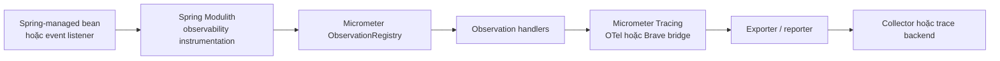
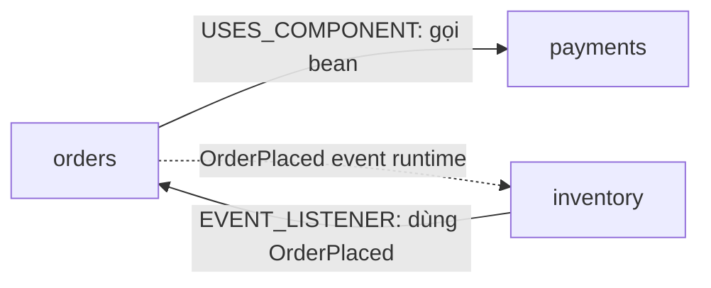
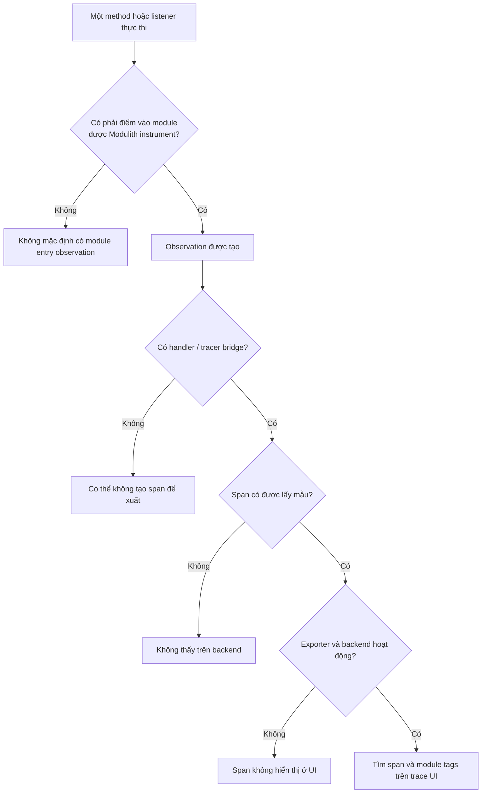
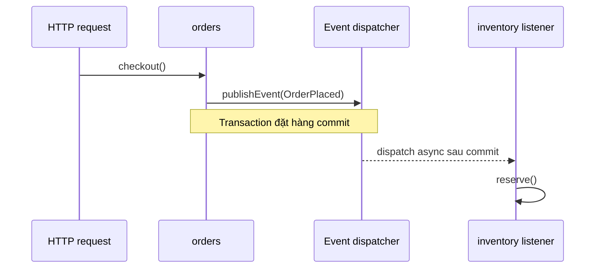

# Phạm vi tự động tạo observation

> **Chương:** Bật quan sát  
> **Ngữ cảnh:** Sử dụng Spring Modulith để hiểu ranh giới application module và quan sát tương tác giữa các phần trong ứng dụng Spring Boot. Trọng tâm bài này là xác định **những điểm thực thi nào được tạo observation tự động**, điều kiện để nhìn thấy chúng và những giới hạn cần lưu ý khi diễn giải trace.

## Mục tiêu học tập

Sau bài này, bạn có thể:

1. Phân biệt **observation**, **span**, **metric** và **module graph**, tránh nhầm một khái niệm với khái niệm khác.
2. Giải thích nguyên tắc Spring Modulith chọn các **điểm vào application module** để quan sát, bao gồm Spring bean ở API module và listener sự kiện được hỗ trợ.
3. Phân loại lời gọi nào thường có module entry observation, lời gọi nào cần instrumentation bổ sung và trường hợp nào không thể kết luận chỉ từ việc thiếu span.
4. Cấu hình bộ công cụ tối thiểu để nhìn thấy dữ liệu observability của Modulith và xác nhận kết quả bằng một ca chạy thực tế.
5. Diễn giải giới hạn của AOP/proxy, sampling, async context propagation, event metrics và transaction đối với việc quan sát kiến trúc.

## 1. Observation là gì?

Trong hệ sinh thái Spring Boot, **Micrometer Observation** là một mô hình ghi nhận một hoạt động có điểm bắt đầu, điểm kết thúc, bối cảnh và metadata. Một observation có thể được xử lý bởi các observation handler khác nhau để tạo dữ liệu phục vụ đo lường và truy vết.

Ví dụ, khi `orders` gọi API của `payments`, ta muốn biết:

- Module nào vừa được đi vào?
- Method nào nhận lời gọi?
- Đó là lời gọi bean thông thường hay xử lý event listener?
- Hoạt động mất bao lâu và có lỗi không?
- Hoạt động này có liên hệ tới HTTP request hoặc công việc bất đồng bộ nào?

Spring Modulith bổ sung **ngữ nghĩa application module** vào cơ chế quan sát. Micrometer cùng tracer/exporter có thể chuyển những observation đó thành span trong hệ thống truy vết.

| Khái niệm | Chức năng | Ví dụ |
| --- | --- | --- |
| Observation | Bao bọc một hoạt động và metadata trong ứng dụng | Quan sát khi gọi `payments.PaymentService.pay()` |
| Span | Một đoạn hoạt động có thời gian, trace context và quan hệ truy vết | Span với tag `module.identifier=payments` |
| Trace | Nhóm các span được liên kết trong một lần thực thi | HTTP request → `orders` → `payments` |
| Metric | Giá trị tổng hợp theo thời gian, thường có tag ít biến thiên | Counter event được publish |
| Module graph | Mô hình cấu trúc/phụ thuộc tĩnh của application module | `orders → payments` với `USES_COMPONENT` |

**Không đồng nhất observation với span.** Observation có thể được tạo và kết thúc hợp lệ nhưng không có span trên hệ thống lưu trace vì chưa có tracer bridge, exporter, backend hoặc do sampling đã loại lần thực thi đó.

Ngược lại, một HTTP span từ Spring MVC/WebFlux không đương nhiên là module entry span của Spring Modulith. Chúng có nguồn instrumentation và metadata khác nhau, dù có thể cùng xuất hiện trong một trace.

## 2. Thành phần nào thực hiện công việc?

Spring Modulith không phải hệ thống lưu trữ trace. Nó xác định ranh giới module và bổ sung instrumentation cho một số điểm tương tác phù hợp. Luồng quan sát thường gồm:



Các vai trò:

1. **Spring Modulith:** xác định application module và điểm vào phù hợp để gắn observation mang thông tin module.
2. **Micrometer ObservationRegistry:** quản lý các observation và thông báo tới handler được cấu hình.
3. **Micrometer Tracing:** ánh xạ observation sang span khi tracer được cài đặt và tích hợp.
4. **OpenTelemetry/Brave:** quản lý trace context, span và các cơ chế truyền context.
5. **Exporter/backend:** đưa dữ liệu tới Zipkin, Tempo, Jaeger hoặc hệ thống có khả năng nhận tương ứng.

Việc có `/actuator/modulith` chỉ chứng minh endpoint mô hình module khả dụng. Nó **không chứng minh** trace đã được xuất thành công. Tương tự, backend nhìn thấy HTTP span không có nghĩa Modulith đang tạo module entry observation.

## 3. Ranh giới module quyết định phạm vi quan sát

### 3.1. Application module không phải từng Spring bean

Theo quy ước package phổ biến của Spring Modulith, các package trực tiếp bên dưới package gốc ứng dụng tạo thành các application module:

```text
com.example.shop
├── ShopApplication.java
├── orders
│   ├── OrderService.java             # API module orders
│   ├── OrderPlaced.java              # Event công khai
│   └── internal
│       └── OrderValidator.java       # Thành phần nội bộ
├── payments
│   ├── PaymentService.java           # API module payments
│   └── internal
│       └── RiskEvaluator.java        # Thành phần nội bộ
└── inventory
    └── internal
        └── OnOrderPlaced.java        # Event listener
```

Thông thường, phần ở package gốc module như `com.example.shop.payments` được xem là API công khai; các package con như `payments.internal` là triển khai riêng. Ứng dụng có thể dùng thêm `@NamedInterface` hoặc cấu hình module tùy biến, vì vậy hãy xem **mô hình module thực tế** thay vì phán đoán chỉ từ một đường dẫn package.

Phạm vi observation tự động của Spring Modulith tập trung vào **các điểm vào module mà instrumentation nhận diện được**, thường là:

- Lời gọi vào Spring bean thuộc **API được công bố của application module**.
- Việc xử lý **event listener của application module** mà cơ chế observability hỗ trợ.

Đây là phạm vi quan sát theo kiến trúc, **không phải một profiler tự động gắn span cho mọi method Java trong toàn bộ project**.

### 3.2. Quy tắc thực dụng khi dự đoán observation

| Trường hợp | Kỳ vọng về module entry observation | Lý do |
| --- | --- | --- |
| Module `orders` gọi method của Spring bean được công bố trong API `payments` | **Thường có**, khi lời gọi đi qua đường được instrument | Điểm vào API của module được Modulith quan sát. |
| HTTP controller gọi một Spring bean API của module khác | **Thường có** cho bean API; HTTP request span là tín hiệu riêng | Modulith đo điểm vào module, framework web đo yêu cầu HTTP. |
| Bean trong một module gọi bean nội bộ của chính module đó | **Không mặc định có span module riêng cho mọi lần gọi** | Hệ thống hướng tới điểm tương tác module, không đo mọi call nội bộ. |
| Một method gọi `this.otherMethod()` trong cùng object | **Không nên chờ một observation AOP riêng** | Self-invocation thường đi vòng qua Spring proxy. |
| Gọi method trên object do `new` tạo, không do Spring quản lý | **Không được bảo đảm** | Cơ chế proxy/bean post-processing không áp dụng như cho Spring bean. |
| Listener do Spring quản lý nhận event của module khác | **Có thể có module listener observation**, tùy loại listener và phiên bản | Modulith có khả năng quan sát các điểm xử lý event của module. |
| Method `private`, Java utility/static method | **Không tự được đo chỉ vì ở trong module** | Không phải điểm vào Spring bean được instrument. |
| Truy vấn SQL trong `payments.internal` | **Không tự có SQL span từ Modulith** | Cần instrumentation datasource/JDBC tương ứng nếu muốn xem SQL. |
| HTTP client gọi một service bên ngoài | **Không tự có HTTP client span từ Modulith** | Đây là nhiệm vụ của instrumentation HTTP/Micrometer hoặc agent. |
| Công việc chuyển sang thread khác | Observation có thể được tạo, nhưng **trace liên kết có thể bị ngắt** | Cần truyền trace context qua executor/bộ lập lịch. |

Các chữ “thường”, “có thể” ở bảng trên là có chủ đích: hiệu quả chính xác phụ thuộc bản Spring Modulith, cấu trúc module, loại proxy/bean, cách gọi và cấu hình observability. Kiểm tra bằng trace thực tế và phiên bản thư viện là bước cuối cùng.

### 3.3. Phạm vi công bố API ảnh hưởng khả năng quan sát

Hãy xem hai thiết kế:

```text
Thiết kế A
orders.OrderService
    -> payments.PaymentService (API bean)
        -> payments.internal.RiskEvaluator

Thiết kế B
orders.OrderService
    -> payments.internal.RiskEvaluator (bean nội bộ)
```

Thiết kế A giữ ranh giới và API module rõ ràng: `orders` phụ thuộc vào phần công khai của `payments`. Modulith có một điểm vào có ý nghĩa để quan sát.

Thiết kế B làm module `orders` truy cập trực tiếp triển khai nội bộ của `payments`; đây còn có thể là **vi phạm ranh giới kiến trúc** nếu internal package không được công bố. Đừng dùng việc “không thấy span” làm lý do để chấp nhận kiểu truy cập này. Hãy dùng `ApplicationModules.verify()` để kiểm chứng các quy tắc phụ thuộc.

## 4. Ví dụ: lời gọi bean qua API module

Giả sử `payments` công bố một bean có chức năng thanh toán:

```java
// com.example.shop.payments.PaymentService
package com.example.shop.payments;

import com.example.shop.payments.internal.RiskEvaluator;
import java.util.UUID;
import org.springframework.stereotype.Service;

@Service
public class PaymentService {

    private final RiskEvaluator riskEvaluator;

    public PaymentService(RiskEvaluator riskEvaluator) {
        this.riskEvaluator = riskEvaluator;
    }

    public boolean pay(UUID orderId) {
        return riskEvaluator.isAllowed(orderId);
    }
}
```

```java
// com.example.shop.payments.internal.RiskEvaluator
package com.example.shop.payments.internal;

import java.util.UUID;
import org.springframework.stereotype.Component;

@Component
public class RiskEvaluator {

    public boolean isAllowed(UUID orderId) {
        // Logic minh họa; ứng dụng thật cần quy tắc và nguồn dữ liệu riêng.
        return orderId != null;
    }
}
```

Module `orders` sử dụng API `PaymentService`:

```java
// com.example.shop.orders.OrderService
package com.example.shop.orders;

import com.example.shop.payments.PaymentService;
import java.util.UUID;
import org.springframework.stereotype.Service;

@Service
public class OrderService {

    private final PaymentService payments;

    public OrderService(PaymentService payments) {
        this.payments = payments;
    }

    public boolean checkout(UUID orderId) {
        return payments.pay(orderId);
    }
}
```

Trong lượt chạy `OrderService.checkout()`:

1. `orders` gọi `payments.PaymentService.pay()` thông qua bean do Spring quản lý.
2. Modulith có thể tạo observation cho **điểm vào công khai** của `payments`, với metadata về module/method/loại lời gọi.
3. `PaymentService` gọi `payments.internal.RiskEvaluator.isAllowed()`. Đây là xử lý nội bộ của cùng module, nên không mặc định sinh một **module entry observation** độc lập cho mỗi lời gọi.

Một trace minh họa:

```text
HTTP POST /orders/{id}/checkout         # Web instrumentation
└── orders.OrderService.checkout         # Module span nếu điểm vào được instrument
    └── payments.PaymentService.pay      # Modulith module entry span
        module.identifier = payments
        module.invocation-type = bean
        module.method = PaymentService.pay(..)
        # Không bắt buộc có thêm span cho RiskEvaluator.isAllowed()
```

Đây là hình dung nghiệp vụ, **không phải tên span và thứ bậc cố định**. Ví dụ, nếu `OrderService.checkout()` chỉ được gọi từ một đường nội bộ không qua proxy, span của chính nó có thể khác kỳ vọng. Cần xem trace thực tế của phiên bản thư viện đang chạy.

### Có thể kết luận gì khi thấy span ở payments?

Nếu `module.identifier=payments` xuất hiện cùng method `PaymentService.pay()`, bạn biết điểm vào của module đó đã được instrument và thực thi trong trace được thu thập. Để kết luận **ai gọi** và **vì sao gọi**, cần xét context/span cha, log nghiệp vụ và luồng code tương ứng. Chỉ riêng tag module không nhất thiết chứng minh caller thuộc module khác, vì điểm vào API cũng có thể được gọi theo các đường khác.

## 5. Event listener được quan sát thế nào?

Giao tiếp bằng event thường được Spring Modulith dùng để giảm phụ thuộc trực tiếp từ bên phát tới các bên phản ứng.

Tại `orders`, định nghĩa event công khai:

```java
// com.example.shop.orders.OrderPlaced
package com.example.shop.orders;

import java.util.UUID;

public record OrderPlaced(UUID orderId) {}
```

Trong `inventory` có listener:

```java
// com.example.shop.inventory.internal.OnOrderPlaced
package com.example.shop.inventory.internal;

import com.example.shop.orders.OrderPlaced;
import org.springframework.modulith.events.ApplicationModuleListener;
import org.springframework.stereotype.Component;

@Component
class OnOrderPlaced {

    @ApplicationModuleListener
    void reserve(OrderPlaced event) {
        // Ví dụ rút gọn: cập nhật tồn kho cho orderId.
        // Cần xử lý idempotent nếu event bị chạy lại.
    }
}
```

`@ApplicationModuleListener` là tiện ích của Spring Modulith cho event listener xử lý theo pha transaction, bất đồng bộ và trong transaction mới. Một listener dạng này có thể là điểm vào module được quan sát dù lớp nằm trong package `inventory.internal`, bởi vì **kiểu tương tác qua event** được instrumentation nhận diện riêng với lời gọi bean API.

Điểm cần phân biệt:

| Dấu vết | Ý nghĩa |
| --- | --- |
| Observation/span của listener | Listener đã đi vào đường thực thi được instrument. |
| Tag `module.invocation-type=event listener` | Đây là loại tương tác listener, khác lời gọi bean trực tiếp. |
| Counter `module.events.published` | Một event đã được publish theo bộ đo, chưa nói listener xử lý xong. |
| Publication hoàn tất trong Event Publication Registry | Có thêm thông tin về tiến trình giao/xử lý theo cơ chế registry, nếu đã kích hoạt. |
| Dữ liệu tồn kho đã cập nhật | Bằng chứng nghiệp vụ để kết luận kết quả cuối cùng. |

Sự kiện **không tự động đồng nghĩa bất đồng bộ**. Listener `@EventListener` thông thường có thể chạy ngay trên thread phát event; `@TransactionalEventListener` có ngữ nghĩa theo pha transaction. Annotation và cấu hình executor/transaction mới quyết định thời điểm, cách thực thi và khả năng bắt lỗi.

Nếu event được phát trong transaction nhưng transaction rollback trước commit, listener ở pha `AFTER_COMMIT` có thể không chạy. Khi đó không thấy span listener là điều phù hợp với hành vi nghiệp vụ, không phải nhất thiết do instrumentation lỗi.

## 6. Module entry metadata: những gì được gắn vào observation/span

Khi phần tracing được kích hoạt, Spring Modulith có thể gắn các thông tin quan trọng về điểm vào module:

| Tag | Câu hỏi trả lời | Ví dụ minh họa |
| --- | --- | --- |
| `module.identifier` | Đang vào application module nào? | `payments` |
| `module.name` | Tên hiển thị của module là gì? | `Payments` |
| `module.method` | Method nào được quan sát? | `PaymentService.pay(..)` |
| `module.invocation-type` | Điểm vào thuộc loại gì? | `bean` hoặc `event listener` |

Trong trace backend, tên hiển thị/nhãn cụ thể có thể khác giữa các phiên bản hoặc cách map semantic conventions. Hãy ưu tiên kiểm tra **tag thực tế** trước khi tạo dashboard và bộ lọc cố định.

Các metadata trên mô tả **điểm đi vào module**. Chúng không tự chứa call graph đầy đủ, SQL statement, business ID, stack trace của từng method hoặc hợp đồng event. Nếu muốn những thông tin đó, bạn cần instrumentation/ghi log bổ sung phù hợp, đồng thời kiểm soát dữ liệu nhạy cảm.

### 6.1. Static dependency và runtime invocation là hai trục



- `USES_COMPONENT` và `EVENT_LISTENER` là các loại **phụ thuộc kiến trúc** trong module graph.
- `bean` và `event listener` là các loại **lời gọi** trong module entry metadata.
- Hướng dependency `inventory → orders` có thể ngược với hướng event runtime `orders → inventory`.

Đọc `/actuator/modulith` để biết **mô hình** và đọc trace để biết **một đường thực thi đã được lấy mẫu**. Hai nguồn phải được kết hợp nếu muốn kiểm chứng tính đúng đắn của thiết kế khi hệ thống vận hành.

## 7. Điều kiện để observation thực sự hiển thị trong trace

### 7.1. Kích hoạt phần Modulith observability

Nếu dự án đã quản lý version Spring Modulith bằng BOM tương thích, có thể dùng:

```groovy
dependencies {
    runtimeOnly 'org.springframework.modulith:spring-modulith-starter-insight'
}
```

Starter Insight cung cấp tích hợp liên quan đến Actuator và observability. Thành phần quan sát module cũng có thể được khai báo riêng thông qua `spring-modulith-observability-core` khi cần cấu hình tách biệt. Chỉ định artifact và phiên bản thực tế phải theo bộ Spring Boot/Spring Modulith đang sử dụng.

Để xuất trace đến backend, cần thêm tracer bridge và exporter/reporter phù hợp. Ví dụ dành cho **Spring Boot 3.5** với OpenTelemetry và OTLP HTTP:

```groovy
dependencies {
    runtimeOnly 'org.springframework.modulith:spring-modulith-starter-insight'
    runtimeOnly 'io.micrometer:micrometer-tracing-bridge-otel'
    runtimeOnly 'io.opentelemetry:opentelemetry-exporter-otlp'
}
```

```yaml
spring:
  application:
    name: shop-modulith

management:
  tracing:
    sampling:
      probability: 1.0    # Chỉ nên dùng để học/thử nghiệm.
  otlp:
    tracing:
      endpoint: http://localhost:4318/v1/traces
  endpoints:
    web:
      exposure:
        include: health,info,modulith,metrics
```

Giả định một collector/backend OTLP HTTP đang lắng nghe tại địa chỉ đó. Trong Docker hoặc Kubernetes, `localhost` trỏ tới chính container/pod hiện tại; cần thay bằng địa chỉ service thật nếu collector chạy riêng.

**Lưu ý phiên bản:** Spring Boot 4.x có nhóm tracing starter và đường cấu hình export khác Boot 3.x; ví dụ Boot 3.5 ở trên không nên sao chép nguyên sang Boot 4. Với Boot 4, hãy theo tài liệu tracing của Boot 4 cùng bộ Spring Modulith tương thích.

### 7.2. Chuỗi điều kiện cần kiểm tra



Đây là mô hình chẩn đoán logic, không có ý rằng mọi handler luôn tạo span hoặc metric với cùng tên. Tùy tích hợp, một observation có thể phát sinh nhiều tín hiệu; hãy xác minh bằng instrumentation và registry thật.

### 7.3. Sampling không thay đổi ranh giới module

`management.tracing.sampling.probability` điều chỉnh xác suất lấy mẫu trace. Ví dụ:

- `1.0`: thuận tiện trong môi trường học vì cố gắng giữ mọi trace đủ điều kiện.
- `0.1`: chỉ một phần trace được lấy mẫu.

Khi không thấy một lần chạy ở backend, cần xem sampling trước khi tuyên bố module không được instrument. Đồng thời, tracing sampling không đồng nghĩa cấu trúc module hay việc thực thi method đã thay đổi.

## 8. Giới hạn của proxy và lời gọi trong ứng dụng Spring

Module observability thường dựa vào cơ chế instrumentation trên Spring-managed component. Các trường hợp sau cần chú ý:

### 8.1. Self-invocation

```java
@Service
public class PaymentService {

    public void process() {
        validate();   // this.validate(): không đi qua Spring proxy bên ngoài
    }

    public void validate() {
        // ...
    }
}
```

Khi `process()` được gọi qua proxy, điểm vào `process()` có thể được quan sát. Nhưng lời gọi `validate()` từ trong cùng object là self-invocation, nên không đương nhiên tạo **một** observation AOP mới cho `validate()`.

Điều này không có nghĩa `validate()` không chạy. Muốn đo nó riêng, dùng instrumentation được hỗ trợ hoặc observation thủ công.

### 8.2. Object không do Spring quản lý

```java
RiskEvaluator evaluator = new RiskEvaluator();
evaluator.isAllowed(orderId);
```

Đây là object được tạo trực tiếp; chỉ vì class thuộc package module không đủ để mọi lời gọi của nó tự xuất hiện trên trace. Để quan sát module entry qua cơ chế bean, object phải tham gia đường quản lý và instrumentation của Spring tương ứng.

### 8.3. Interface công khai và class triển khai nội bộ

Một module có thể công bố interface ở package API nhưng đặt implementation trong package `internal`. Đây là thiết kế hợp lệ, tuy nhiên việc phương thức nào được instrument còn phụ thuộc cơ chế phát hiện API và bean type/proxy trong phiên bản đang chạy. Đừng suy ra từ vị trí file implementation rằng chắc chắn có hoặc chắc chắn không có module entry span. Hãy xác nhận bằng trace và metadata module.

### 8.4. Final method, private method và AOP

Proxy AOP thường không can thiệp được vào một số lời gọi như `private`, `final` (với cơ chế proxy tương ứng) hay lời gọi qua `this`. Vấn đề này đặc biệt đáng chú ý khi người học muốn biến mọi method thành một điểm quan sát. Spring Modulith không hứa chức năng đó.

## 9. Tạo observation thủ công cho công việc bên trong module

Khi muốn quan sát một bước nội bộ có giá trị nghiệp vụ, có thể dùng Micrometer Observation API. Ví dụ sau minh họa **việc bổ sung đo lường có chủ đích**, không phải một tính năng tự động của Spring Modulith.

```java
package com.example.shop.payments.internal;

import io.micrometer.observation.Observation;
import io.micrometer.observation.ObservationRegistry;
import java.util.UUID;
import org.springframework.stereotype.Component;

@Component
public class RiskCheck {

    private final ObservationRegistry registry;
    private final RiskEvaluator evaluator;

    public RiskCheck(ObservationRegistry registry, RiskEvaluator evaluator) {
        this.registry = registry;
        this.evaluator = evaluator;
    }

    public boolean check(UUID orderId) {
        return Observation.createNotStarted("payments.risk.check", registry)
                .lowCardinalityKeyValue("operation", "risk-check")
                .observe(() -> evaluator.isAllowed(orderId));
    }
}
```

Trong ví dụ, Micrometer Observation mở scope khi supplier chạy và đóng khi hoàn thành; handler quyết định loại tín hiệu phát ra. Lời gọi `RiskCheck.check()` không cần là API module để dùng observation thủ công.

Điểm cần lưu ý:

- **Đặt tên observation nhất quán:** dùng tên hoạt động ổn định, ví dụ `payments.risk.check`.
- **Tag cardinality thấp:** `operation=risk-check` phù hợp metric tag; tránh dùng `orderId`, email, access token làm low-cardinality tag.
- **Tránh đo trùng:** nếu method đã được instrument, bổ sung `@Observed` hoặc observation thủ công có thể tạo nhiều span lồng nhau. Chỉ làm khi chi tiết mới thực sự có ích.
- **Trách nhiệm triển khai:** observation thủ công không tự làm module graph thay đổi và không biến class nội bộ thành API công khai.

`@Observed` là một hướng thay thế cho instrumentation có chủ đích, nhưng cần Aspect/configuration thích hợp để annotation được xử lý. Đặt annotation trên method mà không xác nhận integration chưa phải bằng chứng method đã được đo.

## 10. Async và context propagation: hai câu hỏi khác nhau

Giả sử `orders` phát `OrderPlaced` và `inventory` xử lý qua `@ApplicationModuleListener`:



Ở đây có hai câu hỏi độc lập:

1. **Listener có được instrument không?** Nếu được, Modulith có thể tạo observation khi bắt đầu xử lý listener.
2. **Observation của listener có liên kết về cùng trace không?** Điều đó phụ thuộc vào **trace context propagation** qua cơ chế dispatch/executor.

Observation của listener vẫn có thể xuất hiện ở một trace mới nếu context không truyền qua thread; trường hợp này khác với listener hoàn toàn không được gọi. Ngoài ra, trace context không phải transaction context: listener chạy trong transaction mới không có nghĩa nó chia sẻ transaction trước commit.

Đối với các ứng dụng dùng executor riêng, nên kiểm tra hỗ trợ Micrometer Context Propagation và cấu hình task decorator/executor theo phiên bản Spring Boot. Ví dụ trên Spring Boot 3.x:

```java
import org.springframework.context.annotation.Bean;
import org.springframework.context.annotation.Configuration;
import org.springframework.core.task.support.ContextPropagatingTaskDecorator;

@Configuration(proxyBeanMethods = false)
class ObservationAsyncConfiguration {

    @Bean
    ContextPropagatingTaskDecorator contextPropagatingTaskDecorator() {
        return new ContextPropagatingTaskDecorator();
    }
}
```

Decorator cần được áp dụng trên **executor thật sự được dùng**. Khi tự cấu hình `ThreadPoolTaskExecutor` hoặc bộ thực thi khác, chỉ đăng ký một bean decorator không bảo đảm mọi thread pool tùy biến đều nhận được context.

Ngoài trace ID, hệ thống có thể dùng **business correlation ID** như `orderId` để liên kết nhiều lần retry cùng một nghiệp vụ. Hãy đưa ID đó vào event/log cần thiết và quản lý thông tin nhạy cảm; không dùng ID có cardinality cao như một tag metric.

## 11. Cách xác minh phạm vi tự động quan sát

Một thí nghiệm có thể thực hiện trên ứng dụng ví dụ:

### Bước 1: Xác nhận module boundary

Nếu có Actuator Modulith:

```http
GET /actuator/modulith
```

Tìm `orders`, `payments` và `inventory`; đối chiếu `basePackage` và `dependencies`. Đối với ví dụ, `orders` phụ thuộc `payments` qua component, còn `inventory` phụ thuộc kiểu event của `orders`.

### Bước 2: Tạo một lần gọi đi qua API module

Gọi một API nghiệp vụ có thể dẫn tới `OrderService.checkout()` và sau đó `PaymentService.pay()`. Dùng `orderId` thử nghiệm để đối chiếu log nghiệp vụ.

### Bước 3: Kiểm tra span và tag

Trong tracing backend, tìm service `shop-modulith` theo tên cấu hình, sau đó tìm `module.identifier=payments` và `module.invocation-type=bean`. Xem duration, kết quả và quan hệ span. Nếu không thấy, kiểm tra:

1. Lời gọi có thực sự chạy qua API bean do Spring quản lý?
2. Modulith observability có được cấu hình và khởi tạo?
3. Tracer bridge, exporter và backend có sẵn sàng?
4. Sampling có loại request khỏi trace không?

### Bước 4: Quan sát lời gọi nội bộ

So sánh với `payments.internal.RiskEvaluator.isAllowed()`. Không cần mong đợi một module entry span riêng cho mỗi lời gọi của helper. Nếu cần đo thời gian riêng, bổ sung observation thủ công như mục 9 rồi đối chiếu trace trước và sau.

### Bước 5: Publish event và theo dõi listener

Thử một transaction commit thành công và listener `inventory`. Tìm module invocation-type dành cho listener. Nếu listener có span nhưng traceId khác request, kiểm tra propagation. Nếu không có span, xác minh **listener có chạy** bằng log/trạng thái nghiệp vụ trước khi điều tra instrumentation.

### Bước 6: Đối chiếu metrics và kết quả nghiệp vụ

Kiểm tra counter `module.events.published` (nếu metric registry được cấu hình). Counter tăng cho biết event đã được publish theo meter; vẫn cần log, dữ liệu và Event Publication Registry (nếu có) để kết luận listener đã hoàn tất.

**Kết quả kỳ vọng của bài lab:** Có thể chỉ ra rõ **điểm vào module nào được đo**, **method nội bộ nào không mặc định có module span riêng** và **đâu là rủi ro khi đọc thiếu trace**.

## 12. Bảng chẩn đoán khi không thấy observation mong đợi

| Hiện tượng | Nguyên nhân có thể | Cách kiểm chứng |
| --- | --- | --- |
| Có `/actuator/modulith`, không có span module | Endpoint kiến trúc hoạt động nhưng thiếu tracing bridge/exporter hoặc không có lời gọi được instrument | Kiểm tra dependency, tracing config, call path thực tế. |
| Có HTTP span nhưng không có tag `module.identifier` | HTTP được instrument, module entry observability không được kích hoạt hoặc không có điểm vào phù hợp | Kiểm tra Spring Modulith Insight starter, bean/module API và phiên bản. |
| Bean nội bộ không có span | Trọng tâm instrumentation là điểm vào module, không phải mọi helper | Thêm observation có chủ đích nếu cần đo chi tiết. |
| Method `this.validate()` không có span riêng | Self-invocation bỏ qua proxy | Đọc call graph, xác minh ranh giới AOP; không coi đây là mất lời gọi. |
| Listener không xuất hiện sau rollback | Transaction chưa commit, listener `AFTER_COMMIT` không chạy | Kiểm tra transaction phase và log phát/nhận event. |
| Listener xuất hiện với traceId mới | Context không truyền qua executor hoặc bộ xử lý async | Kiểm tra task decorator, executor, tracing context propagation. |
| Chỉ một phần request có trace | Sampling, exporter batching hoặc hạ tầng backend | Dùng sampling 100% trong lab, kiểm tra export và thời gian flush. |
| Event counter tăng nhưng không thấy listener thành công | Publish khác với delivery/commit | Đối chiếu Event Publication Registry, transaction, retry và dữ liệu thực tế. |
| Cùng method xuất hiện nhiều span giống nhau | Nhiều lớp instrumentation, `@Observed` hoặc agent cùng đo một vị trí | Rà spring instrumentation, agent, observation thủ công để tránh lặp. |
| Cấu trúc module đổi nhưng trace tương tự | Thay đổi mã nguồn không nhất thiết thay đổi request đã thử | Kiểm thử `ApplicationModules.verify()`, so module graph và nhiều ca nghiệp vụ. |

## 13. Các nhầm lẫn cần tránh

**“Bật Insight starter là trace chắc chắn hiện lên.”** Insight starter giúp kích hoạt khả năng quan sát module, nhưng trace xuất hiện ở UI còn tùy tracer, exporter, cấu hình backend và sampling.

**“Một module có 20 bean thì sẽ có span cho cả 20 bean trong mỗi request.”** Module observation tập trung vào các điểm tương tác được instrument. Một số bean không được gọi; một số lời gọi nội bộ không nằm trong phạm vi tự động.

**“Mọi lời gọi qua module đều được chứng minh chỉ bằng module tag.”** Tag cho biết điểm vào module; để xác định caller và đường nghiệp vụ cần thêm span hierarchy, log và mã nguồn. Observation có thể được kích hoạt từ nhiều kiểu caller khác nhau.

**“Có `EVENT_LISTENER` trong graph nghĩa là event được nhận.”** Graph chỉ mô tả dependency ở mức kiến trúc; event có chạy hay không còn tùy phát event, transaction, dispatch, lỗi và cấu hình listener.

**“Không thấy listener cùng trace nghĩa là listener đã thất bại.”** Tác vụ async có thể tạo trace mới khi mất context. Phải kiểm tra trạng thái thực thi của listener riêng.

**“Có span thì nghiệp vụ thành công.”** Span không thay cho kiểm chứng các side effect như chuyển tiền, cập nhật tồn kho hoặc gửi thông báo. Cần xét exception, status và dữ liệu thực.

**“Observation tự động bằng với full distributed tracing.”** Span module chỉ là một phần. Muốn theo HTTP, JDBC, messaging và dịch vụ bên ngoài cần instrumentation chuyên biệt cho từng hạ tầng.

## 14. Bài tập tự kiểm tra

**Bài 1 — Phân loại phạm vi**

Cho ba lời gọi: (A) `orders.OrderService` gọi `payments.PaymentService.pay()` qua bean; (B) `PaymentService.pay()` gọi `payments.internal.RiskEvaluator.isAllowed()`; (C) method `PaymentService.process()` gọi `this.validate()`. Lời gọi nào là ứng viên rõ ràng nhất cho module entry observation tự động?

**Bài 2 — Phân biệt tín hiệu**

Bạn mở `/actuator/modulith` và thấy `inventory → orders` với loại `EVENT_LISTENER`. Counter publish tăng 10 lần, nhưng trace backend không thấy span listener. Hãy nêu ít nhất ba khả năng không thể loại trừ.

**Bài 3 — Trace bị tách**

`OrderService` và `PaymentService` nằm trong một trace, còn `OnOrderPlaced.reserve()` có một traceId khác. Có thể kết luận listener không được Modulith instrument không? Nêu bước kiểm tra tiếp theo.

**Bài 4 — Bổ sung đo lường**

Nhóm phát triển muốn đo riêng thời gian đánh giá rủi ro nội bộ, đồng thời vẫn giữ ranh giới API của `payments`. Cách làm nào hợp lý hơn: đưa `RiskEvaluator` vào API công khai chỉ để có span, hay bổ sung observation có chủ đích?

### Gợi ý đáp án

1. **A** là ứng viên rõ ràng: đi vào Spring bean API của module khác. **B** là helper nội bộ, **C** là self-invocation; chúng không mặc định có span module riêng cho từng lời gọi.
2. Có thể listener chưa chạy (rollback, điều kiện dispatch), đã chạy nhưng không được instrument, span bị sampling, exporter gặp lỗi hoặc context async tạo trace khác. Cần đối chiếu trạng thái nghiệp vụ, log, registry, sampling và config.
3. **Không.** Việc khác traceId có thể do không truyền context qua executor. Kiểm tra span/tags của listener, log, task decorator và trace propagation thực tế.
4. **Bổ sung observation có chủ đích** cho thao tác nội bộ, dùng tag cardinality thấp; không mở API chỉ để thỏa nhu cầu quan sát.

## 15. Tổng kết

- Phạm vi quan sát tự động của Spring Modulith được thiết kế quanh **điểm vào application module** và **các listener phù hợp**, thay vì toàn bộ method Java.
- Observation là hoạt động được đo; span/trace là một cách tiêu thụ dữ liệu quan sát khi Micrometer Tracing và exporter được cấu hình.
- Không thấy span có thể do lời gọi không thuộc phạm vi instrument, self-invocation, không qua Spring proxy, sampling, mất context hoặc lỗi exporter.
- Module graph mô tả phụ thuộc tĩnh; span mô tả tương tác runtime đã được đo; event metrics và dữ liệu nghiệp vụ giúp kiểm chứng chuyện gì thực sự hoàn tất.
- Muốn đo chi tiết nội bộ, hãy thêm observation có chủ đích, giữ thiết kế module rõ ràng và tránh đưa ID biến thiên lớn hoặc dữ liệu nhạy cảm vào metric tags.

### Tài liệu tham khảo

- [Spring Modulith — Production-ready Features](https://docs.spring.io/spring-modulith/reference/production-ready.html): application module observability, Actuator, module entry spans và event metrics.
- [Spring Modulith — Fundamentals](https://docs.spring.io/spring-modulith/reference/fundamentals.html): application module, API và mô hình package.
- [Spring Modulith — Working with Application Events](https://docs.spring.io/spring-modulith/reference/events.html): `@ApplicationModuleListener`, transaction và Event Publication Registry.
- [Spring Boot — Observability](https://docs.spring.io/spring-boot/reference/actuator/observability.html): Micrometer Observation, tracing và context propagation.
- [Spring Boot 3.5 — Tracing](https://docs.spring.io/spring-boot/3.5/reference/actuator/tracing.html): OpenTelemetry/Brave bridge, OTLP exporter, sampling.
- [Micrometer — Observation Documentation](https://docs.micrometer.io/micrometer/reference/observation.html): Observation API, ObservationRegistry và handler.
