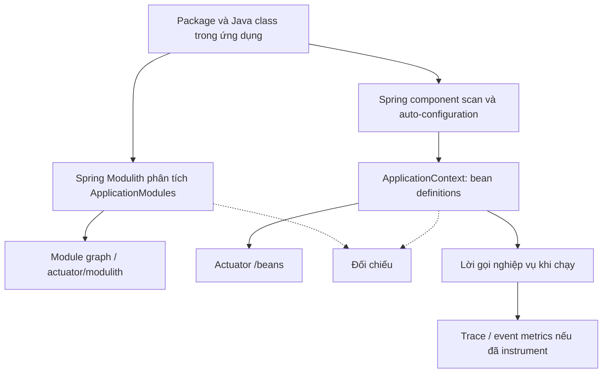
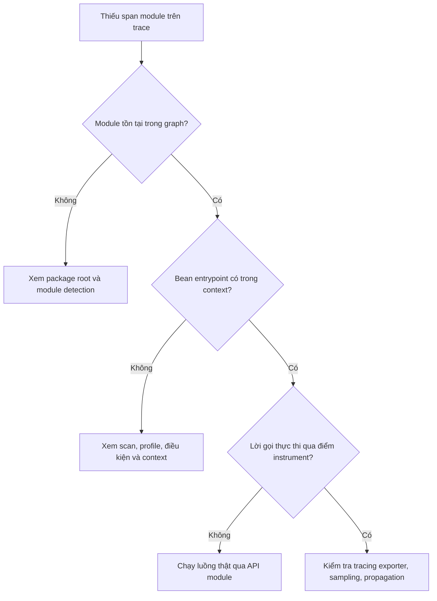

# Kiểm tra bean và module được phát hiện

## 1. Vì sao phải kiểm tra cả bean lẫn module?

Khi bật quan sát trong ứng dụng Spring Boot sử dụng **Spring Modulith**, việc ứng dụng khởi động thành công chưa đủ để chứng minh mọi application module đều được nhận diện và mọi bean cần thiết đều hoạt động. Ví dụ, nhóm phát triển mong đợi ba module `order`, `payment`, `inventory`. Hệ thống có thể chạy được nhưng endpoint Modulith chỉ hiển thị hai module; hoặc graph nhận diện đủ ba module trong khi listener của `inventory` không xuất hiện trong Spring `ApplicationContext`.

Hai hiện tượng này có nguyên nhân khác nhau:

- **Phát hiện application module** là quá trình Spring Modulith phân tích cấu trúc package, class và các quy tắc kiến trúc. Kết quả là một *mô hình tĩnh* mô tả module, API, thành phần nội bộ và dependency.
- **Đăng ký Spring bean** là quá trình Spring Framework dựng `ApplicationContext`, quét component, áp dụng auto-configuration, điều kiện, profile, khai báo `@Bean` và các cơ chế khác. Kết quả là các bean definition/bean instance thực sự có mặt trong ngữ cảnh chạy.

Một class có thể được Spring Modulith phân loại là thành phần của module nhưng **không có bean runtime** vì cấu hình scan hoặc profile. Ngược lại, một bean được tạo bằng `@Bean` hoặc từ auto-configuration có thể không tương ứng một-một với danh sách class mà module graph trình bày.

Bài thuộc chương **Bật quan sát**, trong phạm vi **SPRING_MODULITH_DOCUMENTATION_OBSERVABILITY**: dùng Spring Modulith tạo tài liệu ranh giới application module và quan sát tương tác giữa các phần của Spring Boot. Sau khi kiểm tra bean và module, ta mới có cơ sở đáng tin để đọc module graph, Actuator, event metrics, tracing và context propagation.

### Kết quả học tập

Sau bài này, bạn có thể:

1. Phân biệt module được phân tích từ code với bean được Spring đăng ký lúc chạy.
2. Liệt kê application module và Spring bean thuộc từng module bằng `ApplicationModules`.
3. Kiểm tra bean runtime bằng `ApplicationContext`, `/actuator/beans` và `/actuator/conditions`.
4. Đối chiếu module graph tại `/actuator/modulith` với các thành phần mong đợi.
5. Chẩn đoán module/bean không xuất hiện mà không nhầm lỗi component scan, module detection và cấu hình observability.

## 2. Hai góc nhìn cần đối chiếu

| Góc nhìn | Cách lấy dữ liệu | Phản ánh điều gì? | Không tự chứng minh điều gì? |
| --- | --- | --- | --- |
| **Module model** | `ApplicationModules.of(...)`, Documenter | Package/module và các Spring component Spring Modulith phân tích được từ mã nguồn | Bean đó đã được tạo trong ứng dụng đang chạy |
| **Runtime bean registry** | `ApplicationContext` hoặc `/actuator/beans` | Bean definition và bean Spring biết trong context hiện tại | Class đó đang thuộc module nào theo kiến trúc |
| **Module model của instance** | `/actuator/modulith` | Mô hình application module mà ứng dụng đang chạy xuất ra | Mọi bean thuộc module đều đã được khởi tạo hoặc từng được gọi |
| **Quan sát thực thi** | Traces, event metrics, log | Những hoạt động được instrument và ghi nhận | Không có dependency hay bean khác trong mã nếu dữ liệu vắng mặt |

Sơ đồ quan hệ:



**Quy tắc đọc:** “Có trong graph” nghĩa là có trong cấu trúc kiến trúc được nhận diện; “có trong context” nghĩa là được Spring đăng ký; “có span” nghĩa là một lời gọi đã thực thi, được instrument và được ghi/xuất. Ba kết luận này không thể thay thế nhau.

## 3. Ví dụ ứng dụng và điều kiện chuẩn bị

Giả sử `ShopApplication` nằm trong package gốc:

```text
src/main/java/com/example/shop/
├── ShopApplication.java
├── order/
│   └── OrderService.java
├── payment/
│   └── PaymentService.java
└── inventory/
    └── InventoryListener.java
```

Class khởi động:

```java
package com.example.shop;

import org.springframework.boot.SpringApplication;
import org.springframework.boot.autoconfigure.SpringBootApplication;

@SpringBootApplication
public class ShopApplication {

    public static void main(String[] args) {
        SpringApplication.run(ShopApplication.class, args);
    }
}
```

Ví dụ bean do Spring quản lý tại module `order`:

```java
package com.example.shop.order;

import org.springframework.stereotype.Service;

@Service
public class OrderService {

    public String createOrder() {
        return "created";
    }
}
```

Tương tự, `PaymentService` nằm trong package `com.example.shop.payment` và mang `@Service`; `InventoryListener` nằm tại `com.example.shop.inventory` và mang `@Component` hoặc annotation Spring phù hợp.

Với cách tổ chức **mặc định**, Spring Modulith coi mỗi subpackage trực tiếp dưới package gốc ứng dụng là một application module: `order`, `payment`, `inventory`. `@SpringBootApplication` cũng kích hoạt component scan từ package gốc và các package con theo mặc định. Đây là hai cơ chế *khác nhau* nhưng cùng có thể làm việc thuận lợi trên cấu trúc package này.

Nếu dự án dùng `@Modulithic(additionalPackages = ...)`, `@ApplicationModule`, nested modules hoặc `spring.modulith.detection-strategy=explicitly-annotated`, danh sách module có thể khác mặc định. Tương tự, việc thêm `@ComponentScan(basePackages = ...)` hoặc áp dụng `@Profile` có thể làm thay đổi bean registry mà không đổi cách Modulith nhận diện module.

### 3.1. Dependency tối thiểu

Ví dụ Gradle Groovy DSL khi dự án đã quản lý các phiên bản Spring Boot và Spring Modulith tương thích bằng BOM:

```groovy
dependencies {
    implementation "org.springframework.modulith:spring-modulith-starter-core"
    runtimeOnly "org.springframework.modulith:spring-modulith-starter-insight"

    // Dùng khi viết test trực tiếp với API mô hình kiến trúc.
    testImplementation "org.springframework.modulith:spring-modulith-core"
    testImplementation "org.springframework.boot:spring-boot-starter-test"
}
```

`spring-modulith-starter-insight` là cách thuận tiện để bổ sung support Actuator và observability cho Spring Modulith ở **runtime**. Nếu chỉ cần phần Actuator hoặc observability riêng lẻ, có thể dùng artifact tương ứng theo tài liệu. Phiên bản starter cần khớp dòng Spring Boot; hãy dùng BOM hoặc cơ chế dependency management hiện có thay vì ghim các phiên bản bắc cầu tùy ý.

**Không cần backend tracing để liệt kê module và bean.** Backend trace, bridge/exporter và cấu hình sampling là các bước riêng, chỉ cần khi muốn xem trace thực tế.

## 4. Kiểm tra module và Spring bean qua ApplicationModules

### 4.1. Liệt kê module tĩnh

Spring Modulith cung cấp `org.springframework.modulith.core.ApplicationModules`. Trong một bài kiểm tra JUnit 5:

```java
package com.example.shop;

import org.junit.jupiter.api.Test;
import org.springframework.modulith.core.ApplicationModules;

class ModuleDiscoveryTests {

    @Test
    void printDiscoveredModules() {
        ApplicationModules modules =
            ApplicationModules.of(ShopApplication.class);

        modules.forEach(System.out::println);
        modules.verify();
    }
}
```

`ApplicationModules.of(ShopApplication.class)` phân tích mã dưới package ứng dụng theo chiến lược phát hiện module được cấu hình. `modules.forEach(System.out::println)` in thông tin từng module, gồm tên logic, base package và các Spring component được nhận diện. `verify()` kiểm tra các quy tắc ranh giới (ví dụ chu trình hoặc phụ thuộc tới vùng nội bộ không được công khai). Kết quả **PASS không chứng minh tất cả bean đã đăng ký**; việc đó cần kiểm tra context thật.

Ví dụ đầu ra *rút gọn để minh họa*, không phải khuôn dạng API bắt buộc:

```text
## com.example.shop.inventory ##
> Logical name: inventory
> Base package: com.example.shop.inventory
> Spring beans:
  + com.example.shop.inventory.InventoryListener

## com.example.shop.order ##
> Logical name: order
> Base package: com.example.shop.order
> Spring beans:
  + com.example.shop.order.OrderService
```

Nếu `order` không xuất hiện, trước tiên xem package của `ShopApplication`, tên package `order` và chiến lược module detection. Đừng vội sửa `@Service`: annotation đó ảnh hưởng bean registration, còn việc xác định module trước hết dựa trên cấu trúc mã.

### 4.2. Liệt kê type bean được mô hình nhận diện

API `ApplicationModule.getSpringBeans()` trả về danh sách `SpringBean` thuộc module theo phân tích kiến trúc:

```java
package com.example.shop;

import org.junit.jupiter.api.Test;
import org.springframework.modulith.core.ApplicationModules;

class ModuleBeanMetadataTests {

    @Test
    void listDeclaredSpringBeans() {
        var modules = ApplicationModules.of(ShopApplication.class);

        modules.forEach(module -> {
            System.out.println("Module: " + module.getIdentifier());
            module.getSpringBeans().forEach(bean ->
                System.out.println("  " + bean.getFullyQualifiedTypeName())
            );
        });
    }
}
```

Đây là danh sách **Spring bean type được Spring Modulith nhận diện từ cấu trúc mã**, hữu ích để xem bean thuộc module nào, nằm ở phần API hay nội bộ. Không diễn giải danh sách này là số lượng bean instance đã khởi tạo, và không xem đây là bản dump đầy đủ mọi `BeanDefinition` do Spring Boot tạo từ auto-configuration.

## 5. Kiểm tra bean thực sự được đăng ký bằng ApplicationContext

### 5.1. Test context độc lập với module model

Để biết bean có được đăng ký trong profile/cấu hình đang kiểm thử hay không, khởi động ngữ cảnh Spring trong một integration test:

```java
package com.example.shop;

import static org.assertj.core.api.Assertions.assertThat;

import com.example.shop.order.OrderService;
import org.junit.jupiter.api.Test;
import org.springframework.beans.factory.annotation.Autowired;
import org.springframework.boot.test.context.SpringBootTest;
import org.springframework.context.ApplicationContext;

@SpringBootTest
class RuntimeBeanDiscoveryTests {

    @Autowired
    ApplicationContext context;

    @Test
    void orderServiceMustBeRegistered() {
        assertThat(context.getBeanNamesForType(OrderService.class))
            .isNotEmpty();
    }
}
```

Khác với `ApplicationModules.of(...)`, `@SpringBootTest` thực sự khởi tạo Spring context để xử lý component scan, auto-configuration và các điều kiện khác. Với ứng dụng có cơ sở dữ liệu hoặc dịch vụ ngoài, test có thể cần profile test và cấu hình phụ thuộc phù hợp.

Kiểm tra bean theo **type** thường đáng tin hơn đoán tên bean: Spring có quy tắc đặt tên mặc định, có thể đổi qua `@Component("...")` hoặc `@Bean(name = "...")`. Không mặc định instance runtime luôn có class đúng bằng class gốc vì AOP/tracing có thể tạo proxy.

### 5.2. Đối chiếu hai nguồn trong cùng một test

Ví dụ chỉ kiểm tra một thành phần chủ chốt, giúp phân loại lỗi nhanh:

```java
package com.example.shop;

import static org.assertj.core.api.Assertions.assertThat;

import com.example.shop.order.OrderService;
import org.junit.jupiter.api.Test;
import org.springframework.beans.factory.annotation.Autowired;
import org.springframework.boot.test.context.SpringBootTest;
import org.springframework.context.ApplicationContext;
import org.springframework.modulith.core.ApplicationModules;

@SpringBootTest
class ModuleAndContextConsistencyTests {

    @Autowired
    ApplicationContext context;

    @Test
    void orderModuleAndBeanArePresent() {
        var modules = ApplicationModules.of(ShopApplication.class);
        var order = modules.getModuleByName("order").orElseThrow();

        var modelBeanTypes = order.getSpringBeans().stream()
            .map(bean -> bean.getFullyQualifiedTypeName())
            .toList();

        assertThat(modelBeanTypes).contains(OrderService.class.getName());
        assertThat(context.getBeanNamesForType(OrderService.class))
            .isNotEmpty();
    }
}
```

Nếu kiểm tra đầu tiên PASS nhưng kiểm tra thứ hai FAIL, có thể Spring Modulith đã nhận diện type ở `order` nhưng bean không được Spring đăng ký trong context của test. Khi đó hãy kiểm tra component scan, profile, conditional configuration và cách bean được khai báo. Nếu kiểm tra thứ nhất FAIL, xem lại package structure/annotation và quy tắc Spring Modulith trước.

**Giới hạn của ví dụ:** Không phải mọi bean đều có thể so sánh một-một bằng tên class, đặc biệt bean do factory method hoặc auto-configuration tạo. Hãy dùng phép so trên các component nghiệp vụ rõ ràng mà bạn biết cần xuất hiện ở cả hai nguồn.

## 6. Kiểm tra qua các endpoint Spring Boot Actuator

Spring Boot Actuator có thể cho thấy cả mô hình module lẫn bean registry trong ứng dụng đang chạy. Trên môi trường phát triển cục bộ, cho phép expose những endpoint cần dùng:

```yaml
management:
  endpoints:
    web:
      exposure:
        include: "health,info,modulith,beans,conditions,metrics"
```

Trên các dòng Spring Boot mới, ngoài exposure còn có cấu hình **access** quyết định endpoint có khả dụng không. Spring Security và reverse proxy cũng có thể giới hạn truy cập. Không mở `beans`, `conditions` và chi tiết kiến trúc cho người dùng công cộng: chúng có thể tiết lộ thành phần nội bộ và cấu hình ứng dụng.

| Endpoint | Câu hỏi cần trả lời |
| --- | --- |
| `GET /actuator` | Trong instance đang chạy, các endpoint nào được quảng bá? |
| `GET /actuator/modulith` | Spring Modulith phát hiện module nào, base package và dependency ra sao? |
| `GET /actuator/beans` | Spring context này có bean nào; tên bean, type, scope hoặc dependency theo thông tin Actuator trả về? |
| `GET /actuator/conditions` | Tại sao auto-configuration/conditional bean được áp dụng hoặc bị loại? |
| `GET /actuator/metrics` | Metric nào thực sự đã đăng ký/được ghi nhận? |

Ví dụ lệnh PowerShell:

```powershell
curl.exe -i http://localhost:8080/actuator
curl.exe -i http://localhost:8080/actuator/modulith
curl.exe -i http://localhost:8080/actuator/beans
curl.exe -i http://localhost:8080/actuator/conditions
```

Nếu `management.server.port` hoặc `management.endpoints.web.base-path` khác mặc định, cần dùng URL tương ứng. Phản hồi `401/403` có thể đơn giản là cần xác thực hoặc cấp quyền, không kết luận bean/module bị thiếu.

### 6.1. Đọc kết quả modulith

Phản hồi `/actuator/modulith` có thể chứa các entry định danh module, tên hiển thị, base package và dependency. Ví dụ *minh họa rút gọn*:

```json
{
  "order": {
    "displayName": "Order",
    "basePackage": "com.example.shop.order",
    "dependencies": []
  },
  "inventory": {
    "displayName": "Inventory",
    "basePackage": "com.example.shop.inventory",
    "dependencies": [
      {"target": "order", "types": ["EVENT_LISTENER"]}
    ]
  }
}
```

Graph này mô tả **phụ thuộc kiến trúc**; một cạnh `inventory → order (EVENT_LISTENER)` nghĩa là `inventory` lắng nghe kiểu event do `order` sở hữu. Điều đó khác với hướng event runtime được phát từ `order` và đi đến listener. Khi đối chiếu, kiểm tra danh sách module, định danh, base package và hướng cạnh. Các thuộc tính cụ thể có thể thay đổi theo phiên bản Spring Modulith nên đọc phản hồi thực tế trước khi viết bộ so sánh JSON tự động.

### 6.2. Đọc kết quả beans

`/actuator/beans` do **Spring Boot**, không phải Spring Modulith, cung cấp. Nó liệt kê bean trong các context với thông tin như tên/type/scope/dependency tùy dòng Spring Boot. Chẳng hạn, tìm `orderService` và xác nhận type `com.example.shop.order.OrderService`.

Không so tổng số bean trong `/actuator/beans` với số mục của `ApplicationModule.getSpringBeans()`: actuator có thể bao gồm bean framework, auto-configuration và các context phụ, trong khi Modulith mô tả thành phần theo ranh giới package. Ngoài ra, một số bean được khai báo là **lazy**: bean definition tồn tại dù instance chưa được tạo.

### 6.3. Đọc kết quả conditions

Nếu component chỉ có mặt khi một feature flag hoặc classpath condition thỏa mãn, endpoint `/actuator/conditions` giúp xem điều kiện nào match hoặc không match. Đây là công cụ hữu ích khi:

- Một cấu hình `@ConditionalOnProperty` chưa được bật.
- Một bean của auto-configuration không được tạo do thiếu class/dependency.
- Một bean thay thế do người dùng khai báo khiến auto-configuration mặc định backing off.

Với bean phụ thuộc `@Profile` hoặc `@ComponentScan`, kiểm tra profile active, package scan và log startup tương ứng. Không mặc định mọi trường hợp thiếu bean đều được giải thích đầy đủ chỉ bằng `/actuator/conditions`.

## 7. Phân biệt ba trạng thái thường gặp

| Module được nhận diện? | Bean tồn tại trong context? | Cách hiểu và hướng kiểm tra |
| --- | --- | --- |
| **Có** | **Có** | Hai tầng phát hiện đã khớp với kỳ vọng; tiếp tục kiểm tra hành vi quan sát. |
| **Có** | **Không** | Tập trung vào `@Component`/`@Service`, `@Bean`, component scan, `@Profile`, điều kiện, lỗi tạo bean hoặc context đang kiểm tra. |
| **Không** | **Có** | Kiểm tra package gốc, `@Modulithic`, detection strategy và cấu trúc module; bean có thể nằm ngoài application modules được nhận diện. |
| **Không** | **Không** | Kiểm tra cả cấu trúc mã lẫn cấu hình scan/dependency; có thể đang chạy nhầm artifact/profile. |

Ví dụ:

1. `InventoryListener` nằm tại `com.example.shop.inventory` nên được phân tích là type thuộc module `inventory`, nhưng có `@Profile("warehouse")` và profile hiện tại chỉ là `local`. Module có thể vẫn xuất hiện trong graph, trong khi listener bean không có trong context.
2. Một bean `ExternalClient` được khai báo qua `@Bean` trong auto-configuration của thư viện ngoài vẫn nằm trong `ApplicationContext`, nhưng không nhất thiết tương ứng một application module nghiệp vụ.
3. Một developer chuyển `ShopApplication` xuống `com.example.shop.bootstrap`. Khi đó các package `order`, `inventory` có thể không còn nằm dưới package gốc mà Spring Modulith và component scan mặc định dùng. Cần sửa vị trí package root hoặc cấu hình rõ ràng từng cơ chế.

## 8. Khi bật observability nhưng không nhìn thấy span module

Kết quả “module được phát hiện và bean tồn tại” là **điều kiện quan trọng**, song chưa đủ để có distributed trace. Spring Modulith thường instrument các lời gọi đi qua **điểm vào được hỗ trợ của API application module**, rồi tạo Micrometer observation/span tương ứng khi hệ thống tracing được cấu hình. Nếu chưa chạy luồng thực tế hoặc instrumentation không bao phủ điểm gọi, không có span để hiển thị.

Quy trình kiểm tra theo tầng:

1. **Module model:** `ApplicationModules.of(...)` có phát hiện module mong đợi? `/actuator/modulith` có cùng danh sách module?
2. **Bean registry:** `/actuator/beans` hoặc integration test có các Spring component làm điểm vào module?
3. **Dependency runtime:** `spring-modulith-starter-insight` và các thư viện liên quan có trên `runtimeClasspath`? Các phiên bản Spring Boot/Spring Modulith có tương thích?
4. **Luồng thực thi:** Đã thực sự gọi qua bean/API module được instrument hay chỉ gọi trực tiếp một phương thức nội bộ không đi qua proxy?
5. **Tracing setup:** Micrometer Tracing, bridge, exporter và backend đã cấu hình? Sampling có giữ lại giao dịch đó không?
6. **Context propagation:** Nếu có `@Async`, task executor hoặc event listener bất đồng bộ, trace context có được truyền đúng qua ranh giới luồng không?

Ví dụ minh họa:



**Đừng dùng một trace vắng mặt để kết luận module hoặc bean không tồn tại.** Trace phản ánh lời gọi được instrument, lấy mẫu và xuất thành công; đó là dữ liệu vận hành có phạm vi khác với kiến trúc tĩnh và bean registry.

Tương tự, meter `module.events.published` đếm **lần phát domain event được instrument**, không chứng minh event listener đã xử lý thành công. Muốn xác nhận listener, cần test kết quả nghiệp vụ, trạng thái publication nếu dùng registry và các metric/trace phù hợp.

## 9. Chẩn đoán một số lỗi cụ thể

| Dấu hiệu | Nguyên nhân khả dĩ | Bước kiểm chứng |
| --- | --- | --- |
| `/actuator/modulith` trả `404` | Endpoint không được expose/bật, sai path/port, thiếu dependency runtime | Xem `/actuator`, cấu hình management, starter, log auto-configuration |
| `/actuator/beans` trả `403` | Quyền truy cập bị chặn | Kiểm tra Spring Security và quyền Actuator |
| Test `ApplicationModules.of(...)` chỉ thấy `order` | Package structure hoặc detection strategy không đúng | Xem package của application class, `@Modulithic` và `spring.modulith.detection-strategy` |
| Có `inventory` nhưng không có bean `InventoryListener` | Không được component scan, profile/conditional không match, không có annotation bean | Xem `@Component`, component scan, active profile và context |
| Có `OrderService` trong context nhưng module `order` không xuất hiện | Bean được đăng ký ngoài phạm vi package mà Modulith phân tích | Xem root package và cấu hình additional module packages |
| Runtime bean list khác nhau giữa local và test | Profile/test slice/mock/conditional khác | So environment và cách tạo context của hai môi trường |
| Bean của module được tạo nhưng không có span | Chưa đi qua điểm vào được instrument, tracing chưa hoàn chỉnh, trace bị lấy mẫu bỏ | Kích hoạt luồng thật, xem tracer/exporter và span |
| Có module nhưng dependency graph báo chu trình | Mã giữa các module tham chiếu vòng, kể cả qua API/type | Chạy `modules.verify()`, tìm đường phụ thuộc và tái thiết kế |

Một lỗi đặc biệt dễ bỏ qua: test dùng `@WebMvcTest`, `@DataJpaTest` hoặc các *test slice* chỉ tải một phần context. Nếu so với ứng dụng đầy đủ, danh sách bean có thể thiếu theo thiết kế của slice. Để kiểm tra đầy đủ cấu hình ứng dụng, dùng `@SpringBootTest` với profile phù hợp hoặc đối chiếu trực tiếp trên instance đang chạy.

## 10. Quy trình kiểm chứng hoàn chỉnh

Một nhóm phát triển vừa thêm `spring-modulith-starter-insight` có thể thực hiện:

| Bước | Hành động | Tiêu chí PASS |
| --- | --- | --- |
| 1 | Kiểm tra dependency build và startup | Insight starter trên runtime classpath; ứng dụng khởi động đúng cấu hình |
| 2 | Chạy test `ApplicationModules.of(ShopApplication.class)` | Có đúng `order`, `payment`, `inventory` và `verify()` không báo vi phạm |
| 3 | In `getSpringBeans()` | Các component nghiệp vụ quan trọng xuất hiện dưới module dự kiến |
| 4 | Kiểm tra `@SpringBootTest` / `ApplicationContext` | Bean mà luồng nghiệp vụ cần thực sự được đăng ký |
| 5 | Gọi `/actuator/modulith` và `/actuator/beans` | Mô hình module và bean trên instance hiện tại có thể giải thích, không có thiếu hụt bất ngờ |
| 6 | Gọi một API nghiệp vụ và phát event phù hợp | Quan sát event metrics/traces nếu đã cấu hình; test nghiệp vụ xác nhận listener hoàn thành |
| 7 | So sánh kết quả giữa môi trường | Phân biệt sự khác biệt do profile, scope, sampling và phiên bản đã triển khai |

Trong pull request, có thể lưu kết quả test/module graph làm tài liệu kiểm chứng. Không cần đưa toàn bộ kết quả `/actuator/beans` lên báo cáo công khai vì có thể lộ thông tin chi tiết về cấu trúc ứng dụng và dependency.

## 11. Những nhầm lẫn thường gặp

| Nhận định sai | Cách hiểu đúng |
| --- | --- |
| “Module xuất hiện trong `/actuator/modulith`, vậy mọi bean của module đã khởi tạo.” | Module graph là mô hình kiến trúc; kiểm tra context để xác nhận bean runtime, và phân biệt definition với instance lazy. |
| “Bean không có trong `getSpringBeans()` nghĩa là Spring không quản lý bean đó.” | Spring Modulith có phạm vi phân tích kiến trúc, trong khi Spring có auto-configuration và factory bean từ nhiều nguồn. |
| “Số bean theo Modulith phải bằng số bean ở `/actuator/beans`.” | Hai danh sách có phạm vi và đơn vị đếm khác nhau. |
| “Không thấy span tức là component scan hỏng.” | Cần kiểm tra instrumentation, luồng thực tế, exporter, sampling và propagation. |
| “Endpoint `/actuator/beans` trả 404 thì bean registry rỗng.” | Có thể endpoint chưa được bật/expose hoặc URL quản trị khác. |
| “Có `ObservationRegistry` là chắc chắn trace được gửi tới backend.” | Registry là một thành phần observability; còn cần cấu hình tracer/bridge/exporter và backend. |
| “`modules.verify()` PASS nghĩa là mọi bean nghiệp vụ đều có.” | Verification kiểm tra luật kiến trúc trong module model, không thay thế integration test bean context. |

## 12. Bài thực hành và checklist

Thực hiện trên ứng dụng mẫu với hai module `order` và `inventory`. Cố ý thêm `@Profile("warehouse")` vào listener ở `inventory`, chỉ bật profile `local`, rồi dự đoán kết quả:

1. `ApplicationModules.of(ShopApplication.class)` vẫn có thể nhận diện module `inventory` và type listener thuộc module.
2. `ApplicationContext` của profile `local` không có `InventoryListener` vì profile không match.
3. Nếu chỉ dựa vào `/actuator/modulith`, bạn sẽ bỏ sót lý do event không được xử lý. Kiểm tra thêm bean/context/conditions hoặc cấu hình profile.
4. Khi bật đúng profile và hoàn tất điều kiện runtime, chạy integration test chứng minh listener thực thi và nghiệp vụ đạt kết quả.

Checklist:

- [ ] Phân biệt được module detection tĩnh với Spring bean registration.
- [ ] In được danh sách module và type Spring bean được Modulith nhận diện.
- [ ] Chạy `modules.verify()` và hiểu ý nghĩa/giới hạn của kết quả.
- [ ] Dùng `ApplicationContext.getBeanNamesForType(...)` để xác nhận bean nghiệp vụ trong context.
- [ ] Gọi được `/actuator/modulith`, `/actuator/beans` và `/actuator/conditions` với cấu hình/quyền hợp lệ.
- [ ] Giải thích được ít nhất hai tình huống “có module nhưng thiếu bean” và “có bean nhưng thiếu module”.
- [ ] Chỉ kết luận tracing hoạt động khi có luồng thực tế và cấu hình export phù hợp; không suy từ module graph.

## Tài liệu tham khảo

- [Spring Modulith — Fundamentals](https://docs.spring.io/spring-modulith/reference/fundamentals.html): `ApplicationModules`, phát hiện module và danh sách Spring component.
- [Spring Modulith — Production-ready Features](https://docs.spring.io/spring-modulith/reference/production-ready.html): Insight starter, `/actuator/modulith`, event metrics và observability.
- [Spring Modulith — ApplicationModule API](https://docs.spring.io/spring-modulith/docs/current/api/org/springframework/modulith/core/ApplicationModule.html): `getSpringBeans()` và các API mô hình module.
- [Spring Boot — Actuator Endpoints](https://docs.spring.io/spring-boot/reference/actuator/endpoints.html): `beans`, `conditions`, exposure và bảo vệ endpoint.
- [Spring Boot — Tracing](https://docs.spring.io/spring-boot/reference/actuator/tracing.html): Tracing, sampling và export sang backend.
