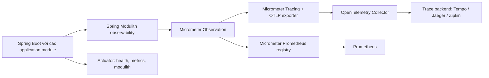
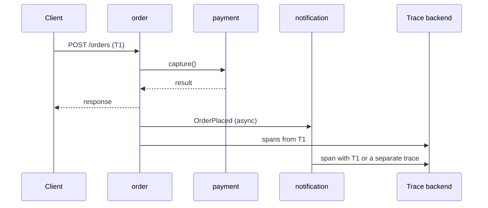

# Cấu hình môi trường local, staging và production

Trong ứng dụng Spring Boot sử dụng **Spring Modulith**, việc “bật observability” gồm nhiều công việc: cung cấp thông tin ranh giới *application module*, ghi nhận metrics và spans, truyền tracing context, xuất telemetry ra hệ thống giám sát và bảo vệ các endpoint quản trị. Ba môi trường **local**, **staging** và **production** chạy cùng logic nghiệp vụ nhưng yêu cầu quan sát, chi phí và kiểm soát truy cập khác nhau.

Bài thuộc chương **Bật quan sát** của học phần `SPRING_MODULITH_DOCUMENTATION_OBSERVABILITY`. Mục tiêu là cấu hình hệ thống để dùng **module graph, Actuator, event metrics, tracing và context propagation** nhằm đối chiếu thiết kế mô-đun với cách ứng dụng thực sự vận hành.

Sau bài học, bạn có thể: tổ chức các Spring profile; khai báo dependency và collector; điều chỉnh sampling, mức log, quyền truy cập Actuator theo môi trường; xác nhận event metrics và trace giữa các module; phát hiện lỗi context propagation; và kiểm chứng pipeline telemetry trước khi phát hành.

> **Phạm vi phiên bản:** các ví dụ cấu hình dùng cú pháp **Spring Boot 3.5.x** và **Spring Modulith 1.4.x**, một tổ hợp được tài liệu Spring Modulith ghi nhận là tương thích. Nếu dự án dùng dòng Spring Boot 4.x / Spring Modulith 2.x, hãy kiểm tra dependency và property theo tài liệu *của đúng dòng phiên bản* trước khi áp dụng, vì tên starter và cấu hình observability có thể thay đổi.

## 1. Các thành phần cần được kết nối

Spring Modulith phát hiện module theo cấu trúc ứng dụng, cung cấp công cụ tạo tài liệu module graph và hỗ trợ quan sát tương tác ở ranh giới module. Spring Boot Actuator và Micrometer bổ sung API/registry để thu thập rồi xuất dữ liệu.



| Thành phần | Nhiệm vụ | Điều kiện để quan sát được |
| --- | --- | --- |
| Spring Modulith | Nhận biết application module, cung cấp instrumentation và event metrics | Có artifact tương thích, cấu hình phát hiện module hợp lệ |
| Spring Boot Actuator | Expose health, metrics và thông tin module khi tích hợp | Endpoint tồn tại, được bật và được expose qua giao thức phù hợp |
| Micrometer Observation | Ghi nhận thao tác và thuộc tính | Có observation handler/registry và thao tác được instrument |
| Micrometer Tracing | Biến observations thành spans/traces | Có tracing bridge, exporter và sampling phù hợp |
| OTLP exporter + collector | Vận chuyển spans tới backend | Đúng giao thức, endpoint, mạng, xác thực |
| Prometheus registry | Xuất metrics cho Prometheus scrape | Có registry và endpoint `prometheus` được expose |
| Context propagation | Chuyển ngữ cảnh qua thread, HTTP, messaging | Phải dùng cơ chế tương thích với kiểu thực thi |

**Lưu ý:** một endpoint `/actuator/modulith` hoạt động cho biết có thể đọc *cấu trúc module*, không có nghĩa dữ liệu tracing đã tới backend. Một trace đi qua `order` và `inventory` phản ánh *lần thực thi*, không tự xác nhận hướng phụ thuộc đó hợp lệ về kiến trúc. Để kiểm chứng cần kết hợp tài liệu module graph, kiểm tra cấu trúc và dữ liệu runtime.

## 2. Cài dependency một lần, cấu hình theo môi trường

Ví dụ ứng dụng `shop-modulith` có các application module `order`, `inventory`, `payment` và `notification`. Với Maven đã import Spring Modulith BOM cùng dependency management của Spring Boot, có thể thêm:

```xml
<dependencies>
    <!-- Actuator và observability của Spring Modulith. -->
    <dependency>
        <groupId>org.springframework.modulith</groupId>
        <artifactId>spring-modulith-starter-insight</artifactId>
        <scope>runtime</scope>
    </dependency>

    <!-- Micrometer Tracing bridge qua OpenTelemetry. -->
    <dependency>
        <groupId>io.micrometer</groupId>
        <artifactId>micrometer-tracing-bridge-otel</artifactId>
    </dependency>

    <!-- OTLP exporter, cần collector tương ứng. -->
    <dependency>
        <groupId>io.opentelemetry</groupId>
        <artifactId>opentelemetry-exporter-otlp</artifactId>
    </dependency>

    <!-- Prometheus metrics endpoint. -->
    <dependency>
        <groupId>io.micrometer</groupId>
        <artifactId>micrometer-registry-prometheus</artifactId>
    </dependency>
</dependencies>
```

`spring-modulith-starter-insight` bao gồm chức năng Actuator và instrumentation module mà Spring Modulith cung cấp. Tracing bridge, exporter và registry Prometheus là phần bổ sung riêng: **starter Insight không tự thiết lập một backend trace hoặc Prometheus server**. Không viết version riêng ở từng artifact nếu BOM tương ứng đã quản lý chúng.

Một dự án Gradle dùng cơ chế dependency management phù hợp có thể khai báo:

```groovy
dependencies {
    runtimeOnly 'org.springframework.modulith:spring-modulith-starter-insight'
    implementation 'io.micrometer:micrometer-tracing-bridge-otel'
    runtimeOnly 'io.opentelemetry:opentelemetry-exporter-otlp'
    runtimeOnly 'io.micrometer:micrometer-registry-prometheus'
}
```

Hai đoạn trên là **phần dependency**, giả định dự án có Spring Boot plugin/parent, repository và version management tương thích. Các môi trường không cần biên dịch ba JAR khác nhau: nên build cùng một artifact và chọn profile khi deploy để khác nhau ở cấu hình.

## 3. Tách cấu hình chung và profile

Một cấu trúc quen thuộc:

```text
src/main/resources/
├── application.yml
├── application-local.yml
├── application-staging.yml
└── application-production.yml
```

Khi Spring Boot khởi động với profile `local`, nó đọc cấu hình chung và bổ sung/ghi đè các property từ `application-local.yml` theo quy tắc precedence. Tương tự cho `staging` và `production`. Ngoài file, biến môi trường, tham số dòng lệnh và nguồn cấu hình được quản lý cũng có thể ghi đè giá trị; điều này cần được kiểm tra khi triển khai.

Ví dụ `application.yml`:

```yaml
spring:
  application:
    name: shop-modulith

management:
  endpoints:
    web:
      exposure:
        include: "health,info"
  endpoint:
    health:
      show-details: never
      probes:
        enabled: true
  tracing:
    sampling:
      probability: 0.10
  observations:
    key-values:
      application: "${spring.application.name}"
```

Giải thích:

- `spring.application.name` là tên dịch vụ ổn định, giúp phân biệt telemetry của ứng dụng này với ứng dụng khác.
- `management.endpoints.web.exposure.include` xác định endpoint có thể truy cập qua HTTP; **expose không đồng nghĩa đã xác thực hoặc phân quyền**.
- `management.endpoint.health.probes.enabled` hỗ trợ health group liveness/readiness phục vụ điều phối triển khai khi phù hợp.
- `management.tracing.sampling.probability` là xác suất lấy mẫu trong khoảng `0.0`–`1.0`. Không dùng giá trị này để suy luận trực tiếp số request đã xử lý.
- `management.observations.key-values` là tag chung cho observations. Chỉ nên đưa các giá trị ổn định, cardinality thấp.

Ở cấu hình chung, endpoint `modulith` chưa được expose; profile nào cần mới mở thêm.

## 4. Local: tối đa khả năng quan sát để phát triển

Mục tiêu local là truy vấn trực tiếp module metadata, nhìn thấy trace của một request và phát hiện meter khi chạy chức năng. Vì lưu lượng nhỏ, có thể lấy mẫu `100%` để dễ học và gỡ lỗi.

`application-local.yml`:

```yaml
management:
  endpoints:
    web:
      exposure:
        include: "health,info,metrics,prometheus,modulith"
  endpoint:
    health:
      show-details: always
  tracing:
    sampling:
      probability: 1.0
  otlp:
    tracing:
      endpoint: "http://localhost:4318/v1/traces"
  observations:
    key-values:
      environment: local

logging:
  level:
    com.example.shop: DEBUG
```

Ví dụ giả định OpenTelemetry Collector/receiver hỗ trợ **OTLP qua HTTP** ở `localhost:4318`. Khi chạy Spring Boot trong container, `localhost` là chính container đó; phải dùng tên dịch vụ collector trên mạng container, ví dụ `http://otel-collector:4318/v1/traces`, **nếu** tên host này tồn tại trong hạ tầng của bạn.

Khởi chạy bằng Maven Wrapper trên Linux/macOS:

```bash
./mvnw spring-boot:run -Dspring-boot.run.profiles=local
```

Trên Windows dùng `.\mvnw.cmd` với tham số tương ứng. Khi ứng dụng chạy ở cổng `8080` theo mặc định, thử:

```bash
curl -i http://localhost:8080/actuator/health
curl -i http://localhost:8080/actuator/modulith
curl -i http://localhost:8080/actuator/metrics
curl -i http://localhost:8080/actuator/prometheus
```

| Địa chỉ | Nội dung dự kiến | Nếu thiếu dữ liệu |
| --- | --- | --- |
| `/actuator/health` | Health ứng dụng | Kiểm tra port, base path, profile và security |
| `/actuator/modulith` | Metadata application modules, quan hệ cấu trúc | Kiểm tra starter Insight và exposure; không nhầm với giao diện trace |
| `/actuator/metrics` | Danh sách meter trong ứng dụng | Cần có telemetry phát sinh; meter có thể xuất hiện sau lần chạy đầu |
| `/actuator/prometheus` | Dữ liệu metrics dạng Prometheus | Cần registry Prometheus và exposure |
| Trace backend | Span/trace được lấy mẫu và export | Cần bridge, exporter, collector, sampling và instrumentation |

Nếu một endpoint trả `401`/`403`, có thể lớp bảo mật đang chặn; đó không phải dấu hiệu nên tắt authentication để thử ngay. Kiểm tra cấu hình và sử dụng quyền truy cập được cấp.

### Một yêu cầu qua nhiều module

Khi gửi `POST /orders`, một cây trace **minh họa** có thể có dạng:

```text
Trace T1
└── HTTP POST /orders
    └── order.place
        ├── inventory.reserve
        ├── payment.capture
        └── order.publish OrderPlaced
```

Cùng một `traceId` có thể gồm nhiều span tương ứng nhiều module. Không mặc định mỗi lời gọi Java đều sinh span: điều đó phụ thuộc ranh giới được instrument và loại invocation. Nếu `notification` lắng nghe sự kiện bất đồng bộ, nó có thể tiếp tục trace cũ hoặc tạo trace riêng, tùy context propagation.

### Event metrics trong local

Theo tài liệu Spring Modulith 1.4, các metric event publication thường gồm:

- `module.events.published` — counter tổng quát về sự kiện được phát.
- `module.events.published.{moduleIdentifier}.{simpleEventTypeName}` — counter cho loại sự kiện cụ thể.

Tên metric và tags có thể thay đổi theo version. Sau khi phát một sự kiện như `OrderPlaced`, hãy tra cứu tên meter ở `/actuator/metrics` trước khi suy luận về nó. **Số lần publish không bằng số lần listener xử lý thành công**; trạng thái xử lý, retry và failed publication cần nguồn dữ liệu/metric khác.

## 5. Staging: kiểm thử đường quan sát gần production

Staging nên dùng cấu trúc collector, xác thực, mạng và hành vi bất đồng bộ gần production. Tuy nhiên sampling có thể cao hơn để dễ tìm những request thử nghiệm, và một số endpoint chẩn đoán được mở **trong mạng đã hạn chế quyền truy cập**.

`application-staging.yml`:

```yaml
management:
  endpoints:
    web:
      exposure:
        include: "health,info,metrics,prometheus,modulith"
  endpoint:
    health:
      show-details: when_authorized
  tracing:
    sampling:
      probability: 0.50
  otlp:
    tracing:
      endpoint: "${OTLP_TRACES_ENDPOINT}"
  observations:
    key-values:
      environment: staging
```

Đặt `OTLP_TRACES_ENDPOINT` qua cấu hình triển khai thực tế; ví dụ chỉ mang tính minh họa:

```text
SPRING_PROFILES_ACTIVE=staging
OTLP_TRACES_ENDPOINT=http://otel-collector.observability.svc:4318/v1/traces
```

Dùng placeholder không có giá trị mặc định khiến cấu hình phụ thuộc vào một biến cần được cấp, nhưng **chỉ có cấu hình YAML chưa đủ bảo đảm tính hợp lệ của DNS, TLS hay connectivity**.

Giá trị sampling `0.50` là ví dụ, không phải khuyến cáo cố định. Khi chạy bài test tích hợp ít request và cần theo dõi từng request, có thể tạm nâng lên `1.0` trong khoảng thời gian kiểm thử được kiểm soát.

### Kiểm tra context propagation

Ví dụ `order` gọi `payment` đồng bộ rồi phát `OrderPlaced` cho `notification` qua listener bất đồng bộ:



Với Spring Boot 3.5, thread pool có thể cần `ContextPropagatingTaskDecorator` để mang Observation context sang thread khác:

```java
import org.springframework.context.annotation.Bean;
import org.springframework.context.annotation.Configuration;
import org.springframework.core.task.support.ContextPropagatingTaskDecorator;

@Configuration(proxyBeanMethods = false)
class ContextPropagationConfiguration {

    @Bean
    ContextPropagatingTaskDecorator contextPropagatingTaskDecorator() {
        return new ContextPropagatingTaskDecorator();
    }
}
```

Khi tự cấu hình `TaskExecutor`, phải bảo đảm decorator được **gắn vào executor thực sự chạy listener**. Sự tồn tại của bean không đảm bảo mọi executor tự tạo đều dùng nó. Nếu dùng broker, cần xét propagation qua message headers. Trường hợp xử lý muộn hoặc retry có thể dùng một trace mới và liên kết bằng event ID/mã nghiệp vụ.

Ở staging hãy kiểm tra cả trường hợp thành công, thất bại và retry; xác nhận exporter có thể gửi dữ liệu, Prometheus scrape có dữ liệu và nhãn `environment=staging` không bị trộn vào dashboard production.

## 6. Production: giới hạn quyền và kiểm soát chi phí

Production cần metrics đủ để phát hiện vấn đề và traces đủ để điều tra. Điểm khác biệt nằm ở **mức lấy mẫu, phạm vi truy cập, độ bền đường xuất dữ liệu và lượng thông tin nhạy cảm**.

`application-production.yml`:

```yaml
management:
  server:
    port: 9090

  endpoints:
    web:
      exposure:
        include: "health,info,prometheus"

  endpoint:
    health:
      show-details: never

  tracing:
    sampling:
      probability: "${TRACING_SAMPLING_PROBABILITY:0.05}"

  otlp:
    tracing:
      endpoint: "${OTLP_TRACES_ENDPOINT}"

  observations:
    key-values:
      environment: production
```

Giải thích các lựa chọn:

1. Cổng quản trị `9090` tách khỏi cổng web ứng dụng, **nhưng vẫn phải được bảo vệ** bằng firewall/NetworkPolicy, ingress phù hợp và xác thực khi cần. Tách port tự nó không tạo ra biện pháp bảo mật.
2. Endpoint `modulith` không được expose mặc định ở production. Metadata kiến trúc nội bộ có thể nhạy cảm; khi cần dùng, nên truy cập theo quy trình quản trị có kiểm soát.
3. Sampling fallback `0.05` chỉ là một ví dụ. Chọn tỷ lệ dựa vào lưu lượng, ngân sách, khả năng backend và mức cần điều tra. Với traffic nhỏ và lỗi hiếm, cần đánh giá kỹ tác động của tỷ lệ thấp.
4. URL collector được cấp qua biến môi trường hoặc hệ thống secret/config quản lý; không đặt access token trực tiếp trong repository.
5. `/actuator/prometheus` được expose để *scraper nội bộ* đọc; cần xác định rõ dịch vụ nào được phép kết nối.

Trong Spring Boot, khi bạn tự định nghĩa `SecurityFilterChain`, cấu hình bảo mật Actuator tự động có thể lùi lại để nhường quyền cho policy tùy chỉnh. Vì vậy không được giả định endpoint đã an toàn chỉ vì Spring Security tồn tại trên classpath. Cũng không dùng `management.endpoints.web.exposure.include: "*"` cho production mà không kiểm soát từng endpoint.

Backend telemetry vẫn có thể hỏng khi ứng dụng hoạt động: exporter có thể gặp lỗi DNS, TLS, token, timeout hoặc collector quá tải. Cần theo dõi **collector/exporter ingest và errors** để phân biệt dữ liệu biến mất do pipeline quan sát với việc lưu lượng nghiệp vụ thật sự giảm.

## 7. So sánh trực tiếp ba môi trường

| Quyết định | Local | Staging | Production |
| --- | --- | --- | --- |
| Mục tiêu | Gỡ lỗi, thử module graph và event metrics | Kiểm thử tích hợp và propagation | Giám sát ổn định, điều tra sự cố |
| Sampling minh họa | `1.0` | `0.50` | `0.05` hoặc theo chính sách vận hành |
| Collector | OTLP receiver trong máy/mạng dev | Collector staging | Collector production, có kiểm soát truy cập |
| `/actuator/modulith` | Có thể expose trên máy dev | Chỉ nội bộ được cấp quyền | Không expose mặc định |
| `/actuator/metrics` | Mở để tra cứu meter | Mở có hạn chế | Thường không expose rộng |
| `/actuator/prometheus` | Kiểm tra thủ công | Scraper staging | Scraper production được phép |
| Health details | Có thể đầy đủ | Chỉ người được phép | Hạn chế hiển thị |
| Logging | DEBUG theo package đang phát triển | INFO, DEBUG khi cần kiểm thử | INFO/WARN, bật DEBUG có kiểm soát |
| Dữ liệu | Dữ liệu test | Dữ liệu staging đã quản lý | Dữ liệu thật, áp dụng chính sách bảo mật |
| Điểm xác minh | Endpoint/trace của một request | End-to-end telemetry và security | Dashboard, alert, pipeline và smoke test |

Bảng chỉ minh họa cách xây dựng chính sách. Không tồn tại một mức sampling phù hợp với mọi hệ thống; cũng không có yêu cầu phải mở mọi Actuator endpoint để Spring Modulith có thể phát sinh metrics và spans.

## 8. Giải thích các tín hiệu: module graph, metrics, traces, logs

Để kiểm chứng ứng dụng mô-đun, hãy phân biệt **cấu trúc** và **hành vi**:

- **Module graph:** Spring Modulith phân tích package/API và phụ thuộc, tạo tài liệu ranh giới. Đồ thị này mô tả cấu trúc code.
- **Actuator `modulith`:** cung cấp metadata module ở runtime khi thành phần tương ứng được bật và endpoint có thể truy cập.
- **Metrics:** giúp thấy xu hướng trên nhiều lần xử lý như số request, latency, số lần phát sự kiện, trạng thái JVM.
- **Tracing:** giúp theo dõi một execution path được lấy mẫu, gồm spans và quan hệ cha–con.
- **Logs:** cung cấp ngữ cảnh chẩn đoán; trace ID/span ID hoặc mã nghiệp vụ có thể giúp đối chiếu.

Khi sampling production là `0.05`, một request không xuất hiện trên trace backend có thể đơn giản là **không được lấy mẫu**. Không kết luận module đã ngừng được gọi chỉ từ việc thiếu span.

Với metric sự kiện, dùng giá trị cardinality thấp như `environment`, `module.identifier` hoặc loại sự kiện khi instrumentation hỗ trợ; tránh đưa `orderId`, email khách hàng, UUID sự kiện thành **metric tag** vì gây tăng số tổ hợp nhãn và chi phí lưu trữ. Dùng mã nghiệp vụ trong log/trace theo chính sách bảo mật thích hợp để nối các lần retry dù trace ID thay đổi.

## 9. Biến môi trường, secret và thứ tự ưu tiên

Trong thực tế, một profile có thể triển khai lên nhiều namespace và cụm khác nhau. Thay vì commit địa chỉ collector cố định của mọi môi trường, nên truyền chúng qua cấu hình deploy.

Ví dụ minh họa:

```text
# Staging:
SPRING_PROFILES_ACTIVE=staging
OTLP_TRACES_ENDPOINT=http://otel-collector.observability.svc:4318/v1/traces

# Production:
SPRING_PROFILES_ACTIVE=production
OTLP_TRACES_ENDPOINT=https://collector.example.internal/v1/traces
TRACING_SAMPLING_PROBABILITY=0.05
```

Các địa chỉ này **không phải endpoint có sẵn**; chỉ hoạt động khi hạ tầng thực tế có tên miền, collector, TLS và chính sách mạng tương ứng. Không đặt token trong biến URL hoặc source code.

Khi collector yêu cầu authentication, các property thuộc nhóm `management.otlp.tracing.headers` ở Spring Boot 3.5 có thể dùng để cấu hình header. Giá trị nhạy cảm nên được cung cấp từ secret manager hoặc nguồn runtime có kiểm soát. Với production, cần thêm chính sách retention và giới hạn chi phí ở collector/backend; Spring profile không tự thiết lập những phần đó.

Nếu YAML đã sửa mà hành vi không đổi, hãy kiểm tra profile active và **nguồn cấu hình ưu tiên cao hơn** như biến môi trường hay command-line argument. Không mở công khai `/actuator/env` hoặc `/actuator/configprops` chỉ để chẩn đoán, vì chúng có thể chứa metadata hệ thống.

## 10. Quy trình xác minh theo môi trường

### Local: xác nhận hoạt động cơ bản

1. Chạy collector, khởi động ứng dụng với profile `local`.
2. Xác nhận `/actuator/health` và `/actuator/modulith` truy cập được ở cổng/đường dẫn dự kiến.
3. Gọi luồng nghiệp vụ `order → inventory → payment`; tìm span ở backend.
4. Phát một sự kiện như `OrderPlaced`; truy vấn meter liên quan qua `/actuator/metrics`.
5. Thử listener bất đồng bộ; kiểm tra trace context và mã nghiệp vụ khi nó dùng trace khác.
6. Đối chiếu module metadata với tài liệu module graph đã sinh ở test/build.

### Staging: xác nhận đường tích hợp

1. Deploy cùng artifact với profile `staging`, truyền đúng URL collector.
2. Kiểm tra collector nhận data; dashboard có nhãn môi trường staging.
3. Dùng request thành công/thất bại, event listener và retry để kiểm tra spans, metrics, log.
4. Kiểm tra security: ai được gọi `modulith`, `metrics` và `prometheus`, từ mạng nào.
5. Kiểm tra khả năng quan sát khi tăng tải vừa phải; giám sát exporter/collector.

### Production: xác nhận sau phát hành

1. Xác nhận profile `production` và source của `OTLP_TRACES_ENDPOINT`, `TRACING_SAMPLING_PROBABILITY`.
2. Kiểm tra endpoint quản trị không công khai ngoài kế hoạch; scraper hợp lệ vẫn lấy được metrics.
3. Thực hiện smoke test nghiệp vụ có kiểm soát; xem health, counter, log và trace được lấy mẫu.
4. Theo dõi độ trễ, tỷ lệ lỗi, event publications và collector ingest/error.
5. Có quy trình nâng hoặc giảm sampling tạm thời khi điều tra và đưa trở lại mức bình thường.

| Tiêu chí đạt | Bằng chứng nên có |
| --- | --- |
| Module metadata đúng | `/actuator/modulith` khi có quyền hoặc tài liệu module graph được sinh lại |
| Tracing hoạt động | Trace đã tới backend, spans đúng với những thao tác có instrumentation |
| Event metrics hoạt động | Meter xuất hiện sau khi phát sự kiện và được registry export |
| Context propagation phù hợp | Quan hệ trace theo thiết kế hoặc business correlation rõ ràng |
| Security đúng | Chỉ các endpoint/nguồn truy cập được cho phép |
| Pipeline ổn định | Collector/exporter không mất dữ liệu bất thường |

## 11. Xử lý sự cố thường gặp

| Triệu chứng | Khả năng | Cách kiểm tra |
| --- | --- | --- |
| `/actuator/modulith` trả 404 | Thiếu starter, endpoint không expose, sai base path/profile | Kiểm tra classpath, exposure, active profile |
| Endpoint trả 401/403 | Bị chặn bởi security policy | Kiểm tra quyền truy cập và `SecurityFilterChain` |
| `/actuator/prometheus` trả 404 | Thiếu registry hoặc chưa expose | Kiểm tra `micrometer-registry-prometheus` và cấu hình |
| Có JVM metrics, thiếu event metrics | Chưa có event, instrumentation thiếu hoặc tên meter khác version | Phát sự kiện thử và tra cứu meter name thực tế |
| Backend không có trace | Sampling, thiếu bridge/exporter, collector không nhận, endpoint sai | Kiểm tra cả dependency, URL OTLP HTTP `/v1/traces`, network, collector log |
| Có trace HTTP nhưng không thấy module spans | Ranh giới gọi chưa được instrument hoặc chưa đi qua trong lần chạy | Xem Modulith observability và thao tác thực thi |
| Listener khác trace | Mất context qua executor/broker hoặc chạy retry sau đó | Kiểm tra task decorator, headers và event ID |
| Production quá nhiều spans | Sampling cao hoặc span/cardinality quá nhiều | Kiểm tra cấu hình runtime, traffic, ingest |
| Cổng Actuator riêng vẫn bị truy cập từ ngoài | Ingress/load balancer/firewall đang route cổng | Kiểm tra network policy và xác thực |
| Telemetry staging lẫn production | Tag sai, URL collector/tenant sai | Kiểm tra profile, environment tag, routing/backend |

Chẩn đoán pipeline theo thứ tự: **instrumentation → Observation/Tracing bridge → exporter → collector → backend → dashboard**. Không thấy dữ liệu ở bước cuối không đủ để khẳng định module nghiệp vụ gặp lỗi.

## 12. Bài thực hành cuối bài

Cho ứng dụng `shop-modulith` gồm các module `order`, `inventory`, `payment` và `notification`. Hãy tạo một phương án observability có thể review:

1. Tạo bốn file YAML như bài, thay những cổng/endpoint minh họa bằng thông số môi trường học thực tế.
2. Giải thích vì sao trong local `modulith` được expose, còn production mặc định không.
3. Phát một request đặt hàng thành công và một request thanh toán thất bại; dùng trace xác định bước nào chạy và nơi phát sinh lỗi.
4. Phát `OrderPlaced` và kiểm tra event counter. Vì sao counter publish không chứng minh listener thành công?
5. Chuyển xử lý thông báo sang executor bất đồng bộ; kiểm tra mối liên hệ của các spans và giải thích cơ chế context propagation.
6. Thay đổi sampling từ `1.0` sang `0.1` trong môi trường thử; so sánh số trace được lưu và metrics tổng hợp.
7. Viết checklist deployment cho staging/production về biến môi trường, collector, bảo vệ endpoint, metrics, tracing, logs và khả năng rollback cấu hình.

**Kết quả mong đợi:** bạn tạo được cấu hình theo môi trường, hiểu vai trò của từng dependency và endpoint, có bằng chứng observability hoạt động end-to-end, và biết kết hợp mô hình application module với traces, metrics, logs để kiểm tra hệ thống khi chạy.

## Tài liệu tham khảo

- [Spring Modulith 1.4 — Production-ready Features](https://docs.spring.io/spring-modulith/reference/1.4/production-ready.html): Insight starter, Modulith Actuator, module traces và event metrics.
- [Spring Modulith 1.4 — Compatibility Appendix](https://docs.spring.io/spring-modulith/reference/1.4/appendix.html): đối chiếu dòng Spring Boot và Modulith.
- [Spring Boot 3.5 — Actuator Endpoints](https://docs.spring.io/spring-boot/3.5/reference/actuator/endpoints.html): exposure, access và security.
- [Spring Boot 3.5 — Metrics](https://docs.spring.io/spring-boot/3.5/reference/actuator/metrics.html): Micrometer registry và Prometheus.
- [Spring Boot 3.5 — Tracing](https://docs.spring.io/spring-boot/3.5/reference/actuator/tracing.html): OpenTelemetry bridge, OTLP exporter và sampling.
- [Spring Boot 3.5 — Observability](https://docs.spring.io/spring-boot/3.5/reference/actuator/observability.html): Observations và context propagation.

Những giá trị sampling, cổng, hostname và profile ở đây là **mẫu học tập**. Với ứng dụng thật, cần kiểm tra API/config theo version, quyền truy cập, đường truyền telemetry và kết quả chạy trước khi sử dụng ở production.
