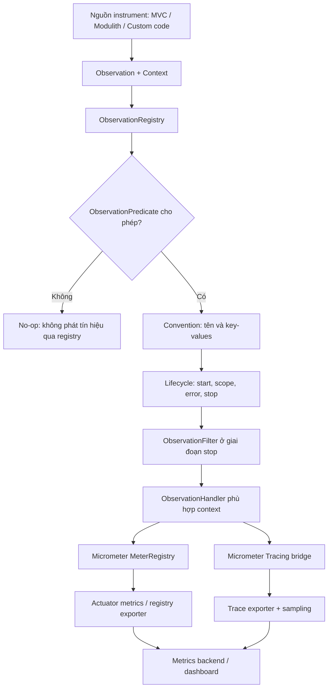
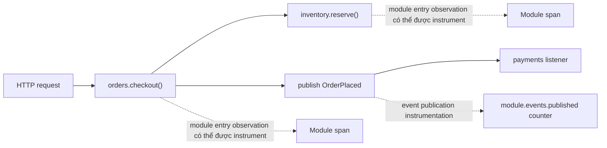

# Xác định nguồn tạo observation khi kết quả bất thường

## 1. Tình huống và mục tiêu

Trong một ứng dụng Spring Boot tổ chức theo **application module**, nhóm phát triển bật Spring Modulith Observability để kiểm tra tương tác giữa `orders`, `inventory` và `payments`. Sau khi triển khai, dashboard xuất hiện các hiện tượng khó giải thích:

- Một giao dịch có hai span mang tên gần giống nhau, hoặc timer tăng nhiều hơn số request.
- `/actuator/metrics` có metric nhưng hệ thống tracing không hiện span tương ứng.
- Trace cho thấy `inventory` hoạt động nhưng thiếu span của `orders`.
- Một listener xử lý sự kiện bất đồng bộ nằm trong trace riêng, không nối với request ban đầu.
- Metric `module.events.published` tăng nhưng không thấy listener xử lý.
- Tag `module.identifier` bất ngờ mang giá trị của module khác.
- Lệnh gọi kết thúc lỗi nhưng biểu đồ báo phần lớn là `error=none`.

Khi gặp những dấu hiệu này, câu hỏi đầu tiên nên là: **Tín hiệu mà ta đang xem được tạo ra ở điểm nào của ứng dụng, được xử lý qua cấu hình nào, và bị thay đổi ở chặng nào?**

Bài học thuộc chương **Bật quan sát** của học phần **SPRING_MODULITH_DOCUMENTATION_OBSERVABILITY**. Học phần sử dụng Spring Modulith để sinh tài liệu ranh giới application module, xem module graph qua Actuator và quan sát tương tác bằng event metrics, tracing và context propagation. Chủ đề ở đây là **xác định nguồn tạo observation khi kết quả bất thường**, nhằm phân biệt vấn đề tại lớp nghiệp vụ, instrumentation, Micrometer registry, handler, exporter và công cụ hiển thị.

Sau bài học, bạn sẽ có khả năng:

1. Truy ngược một metric hoặc span về **điểm bắt đầu observation** hoặc cơ chế ghi metric trực tiếp.
2. Phân biệt instrumentation tự động của Spring Boot, instrumentation module của Spring Modulith và observation do lập trình viên viết.
3. Xác định điều gì thay đổi tên, tags, lỗi hoặc quan hệ cha–con trong vòng đời observation.
4. Khoanh vùng các kết quả bất thường như **thiếu, trùng, sai module, sai thời lượng, sai error, mất liên kết async**.
5. Lập một quy trình kiểm chứng có dữ liệu và có thể lặp lại trong môi trường thử nghiệm.

> **Nguyên tắc:** Một giá trị thấy trên dashboard là **đầu ra sau nhiều lớp xử lý**. Không thể kết luận “Spring Modulith tạo sai observation” chỉ bằng cách nhìn hình dạng span, tên metric hay số đếm cuối cùng.

## 2. Sơ đồ nhân quả: ai tạo, ai biến đổi, ai xuất dữ liệu?

### 2.1. Observation không đồng nghĩa với metric hay span

Micrometer sử dụng **Observation** để mô tả một hoạt động có vòng đời bắt đầu/kết thúc, ngữ cảnh và metadata. Khi một observation đi qua `ObservationRegistry`, các `ObservationHandler` được đăng ký có thể xử lý nó để tạo metric hoặc trace span.



Sơ đồ trên là **mô hình kiểm tra nguyên nhân**. Các callback diễn ra theo vòng đời observation; một số handler xử lý ngay ở `onStart`/`onError`, còn `ObservationFilter` thường được gọi trước `onStop`. Vì vậy **không nên hiểu mọi thành phần chạy tuần tự chỉ một lần vào cuối observation**.

Một observation có thể dẫn đến metric, span, cả hai, hoặc không có tín hiệu bên ngoài. Điều đó phụ thuộc các handler được cấu hình và cơ sở hạ tầng monitoring. Ngược lại, **không phải mọi metric đều bắt nguồn từ Observation**: ứng dụng hoặc thư viện có thể ghi trực tiếp một `Counter`, `Timer` hay `Gauge` vào `MeterRegistry`.

### 2.2. Vai trò của từng điểm

| Thành phần | Trách nhiệm | Câu hỏi chẩn đoán |
| --- | --- | --- |
| **Instrumentation / producer** | Quyết định lúc nào ghi nhận thao tác và tạo Observation hoặc meter | Ai gọi `Observation.start()`, `observe()`, hoặc `meterRegistry.counter()`? |
| `ObservationRegistry` | Chứa handler, predicate, filter và quy ước liên quan | Có dùng cùng registry với Boot hay tạo registry riêng? |
| `ObservationPredicate` | Cho phép hoặc loại một observation ngay khi tạo | Có bộ lọc nào biến observation thành no-op? |
| `ObservationConvention` | Quyết định tên và key-values theo ngữ cảnh | Tên `orders.submit` và tag `module` đến từ đâu? |
| `ObservationFilter` | Bổ sung/điều chỉnh context ở giai đoạn kết thúc | Giá trị cuối cùng khác giá trị ban đầu do đâu? |
| `ObservationHandler` | Nhận callback vòng đời và tạo tín hiệu tương ứng | Có handler metrics/tracing phù hợp với loại context không? |
| `MeterRegistry` / exporter | Lưu/xuất metric | Tên metric, tag hoặc registry bị lọc/đổi ở đây không? |
| Tracing bridge / exporter | Ghi span, sampling và gửi tới backend | Span bị lấy mẫu bỏ, thiếu context hay xuất sai nơi? |
| Dashboard/query | Truy vấn, tính toán, hiển thị | Đã chọn đúng service, thời gian, tag và hàm tổng hợp chưa? |

**Cần phân biệt ba khái niệm:** *Observation name* là tên hoạt động ở Micrometer; *meter name* là tên phép đo do metrics handler hoặc code đăng ký; *span name* là tên span trong tracing. Chúng có thể giống nhau nhưng không bắt buộc phải trùng, nhất là khi có convention hoặc exporter mapping.

## 3. Bản đồ nguồn tạo tín hiệu trong Spring Boot và Spring Modulith

### 3.1. Instrumentation tự động của Spring Boot và Spring Framework

Spring Boot Actuator phối hợp với Micrometer để ghi nhận nhiều luồng xử lý có sẵn. Khi dùng đúng dependency và cấu hình, ví dụ:

- HTTP server request đi qua Spring MVC/WebFlux có thể tạo server-request observation.
- HTTP client có instrumentation phù hợp có thể tạo client-request observation.
- Thành phần hạ tầng khác có thể phát observation hoặc meter riêng, tùy starter, cấu hình và phiên bản.
- Tracing bridge có thể chuyển observation đó thành span trong một trace.

Do vậy, chỉ có span HTTP `POST /orders` **không chứng minh** Spring Modulith đã instrument method của module `orders`. Span HTTP có thể đến từ **Spring HTTP instrumentation**; span module-entry cần dựa vào những thuộc tính riêng của Spring Modulith.

### 3.2. Spring Modulith tạo module-entry observation như thế nào?

Spring Modulith quan sát tương tác giữa các **application module** bằng cách gắn instrumentation vào các Spring component nằm trong **API được công bố của module**. Ở đường đi được hỗ trợ, một interceptor tạo observation/span khi có lời gọi vào thành phần đó.

Theo API hỗ trợ của Spring Modulith, cơ chế này liên quan đến các thành phần nội bộ như `ModuleObservabilityBeanPostProcessor` và `ModuleEntryInterceptor`. Đây là **đầu mối đọc stack trace hoặc tra source khi debug**, không nên phụ thuộc trực tiếp vào chúng trong mã nghiệp vụ vì chúng là chi tiết triển khai của thư viện.

Các attribute điển hình của module-entry span:

| Thuộc tính | Ý nghĩa |
| --- | --- |
| `module.identifier` | Technical identifier của application module, ví dụ `inventory` |
| `module.name` | Tên hiển thị của module |
| `module.invocation-type` | Kiểu invocation, ví dụ `bean` hoặc `event listener` |
| `module.method` | Phương thức được instrument |

Không phải mọi lời gọi Java nội bộ đều tạo module-entry observation. Những giới hạn thường liên quan đến:

- Component được Spring quản lý hay đối tượng được tạo bằng `new`.
- Method có được gọi **qua proxy/interceptor** hay không.
- Component có nằm trong **module API** được Spring Modulith instrument hay chỉ là bean nội bộ.
- Có dùng self-invocation (một method của bean gọi method khác trên chính bean) hay không.
- Cấu hình phát hiện application module có thay đổi so với mặc định không.

Khi không thấy module span, việc kiểm tra **đúng điểm instrument** có giá trị hơn việc tăng sampling ngay lập tức.

### 3.3. Observation do ứng dụng chủ động tạo

Đội ngũ có thể viết observation thủ công trong một use case nghiệp vụ:

```java
package com.example.shop.orders;

import io.micrometer.observation.Observation;
import io.micrometer.observation.ObservationRegistry;
import org.springframework.stereotype.Service;

@Service
public class CheckoutService {

    private final ObservationRegistry registry;

    public CheckoutService(ObservationRegistry registry) {
        this.registry = registry;
    }

    public void checkout() {
        Observation.createNotStarted("shop.checkout", registry)
                .lowCardinalityKeyValue("module", "orders")
                .lowCardinalityKeyValue("operation", "checkout")
                .observe(this::processCheckout);
    }

    private void processCheckout() {
        // Xử lý nghiệp vụ minh họa.
    }
}
```

**Nguồn tạo observation** trong ví dụ là dòng `Observation.createNotStarted("shop.checkout", registry)`; tên `shop.checkout` do ứng dụng định nghĩa, không phải tên metric mặc định của Spring Modulith.

Nếu `CheckoutService` đồng thời là một điểm vào API module được instrument bởi Spring Modulith, bạn **có thể thấy hai observation/span lồng nhau**: module-entry do Modulith tạo và `shop.checkout` do code tự tạo. Sự xuất hiện của hai span chưa chắc là lỗi, nhưng cần quyết định liệu cả hai có phục vụ câu hỏi vận hành khác nhau hay chỉ gây nhiễu.

### 3.4. Annotation cũng là nguồn instrumentation

Một method được gắn `@Observed` có thể sinh observation qua cơ chế AspectJ/AOP của Micrometer nếu hỗ trợ annotation đã được bật và có dependency tương ứng. Chỉ gắn annotation **không bảo đảm instrumentation tự hoạt động ở mọi phiên bản/cấu hình**.

Trường hợp dễ sinh hai span/timer: một method đã được instrument tự động (ví dụ HTTP controller hoặc điểm vào module) lại được gắn `@Observed` mà không có mục đích phân tách operation rõ ràng.

Quy trình truy nguồn trong code nên tìm cả ba nhóm:

```text
1. Observation.createNotStarted(...), Observation.start(...), .observe(...)
2. @Observed, @Timed, @Counted, @NewSpan và cấu hình AOP liên quan
3. Instrumentation tự động của Spring Boot / Spring Modulith
```

`@Timed` hoặc `@Counted` có thể tạo **meter** trực tiếp theo cơ chế riêng, không đồng nghĩa lúc nào cũng tạo một Observation cùng tên.

### 3.5. Event publication counter không đồng nhất với module-entry observation

Spring Modulith có nhóm event publication metric:

- `module.events.published`: counter tổng hợp các domain event đã công bố.
- `module.events.published.<moduleIdentifier>.<simpleEventTypeName>`: counter riêng cho event type trong một module.

Chúng được ghi nhận bởi **cơ chế quan sát việc công bố sự kiện** của Spring Modulith. Các lớp hỗ trợ như `ModuleEventListener` và `ModuleEventCounterFactory` là gợi ý khi cần điều tra nguồn counter ở cấp thư viện.

**Quan trọng:** Đừng suy luận “có một span module-entry thì bắt buộc có một lần tăng `module.events.published`”. Một method có thể được gọi mà không phát event; một lần phát event có thể có nhiều listener; một counter tăng khi publish **không xác nhận** listener xử lý thành công.



Trên sơ đồ, đường nét đứt diễn tả **nguồn dữ liệu đo**; nó không bảo đảm mỗi mũi tên nghiệp vụ luôn tạo một span hoặc counter trong mọi cấu hình.

## 4. Vòng đời observation và những vị trí gây ra kết quả bất thường

### 4.1. Các callback quan trọng

Micrometer mô hình hóa vòng đời observation bằng các thao tác:

| Sự kiện | API thường gặp | Tác động |
| --- | --- | --- |
| Tạo | `Observation.createNotStarted(...)` | Xây observation và context, áp dụng cấu hình cần thiết |
| Bắt đầu | `start()` | Thông báo cho các handler về thao tác bắt đầu |
| Mở scope | `openScope()` | Đặt observation hiện tại vào ngữ cảnh phù hợp, thường gắn thread hiện tại |
| Ghi lỗi | `error(Throwable)` | Lưu lỗi trong context và gửi callback error |
| Phát event nội bộ | `event(Observation.Event)` | Thông báo một mốc trong quá trình theo dõi |
| Đóng scope | `Observation.Scope.close()` | Khôi phục/đóng ngữ cảnh observation hiện tại |
| Kết thúc | `stop()` | Handler kết thúc timer/span và xử lý context |

Phương thức tiện ích `observe(Runnable)` hoặc `observe(Supplier)` tự quản lý phần lớn vòng đời quanh hàm được truyền, kể cả việc ghi nhận exception thoát ra khỏi hàm. Khi tự quản lý `start()` và `stop()`, lập trình viên chịu trách nhiệm bảo đảm luồng kết thúc chính xác.

### 4.2. Ví dụ lỗi ghi nhận sai do đóng observation không đầy đủ

Mẫu dễ gây sai số:

```java
Observation observation =
        Observation.start("shop.payment", observationRegistry);

chargeCard(); // Nếu ném exception, stop() bị bỏ qua.

observation.stop();
```

Nếu `chargeCard()` ném lỗi, observation có thể không được stop và handler không thể hoàn tất phép đo thông thường. Mẫu an toàn hơn:

```java
Observation observation =
        Observation.start("shop.payment", observationRegistry);

try (Observation.Scope scope = observation.openScope()) {
    chargeCard();
} catch (RuntimeException ex) {
    observation.error(ex);
    throw ex;
} finally {
    observation.stop();
}
```

Ví dụ giả định `chargeCard()` và `observationRegistry` đã được định nghĩa trong lớp đang dùng. `try-with-resources` đảm bảo scope được đóng; `finally` đảm bảo gọi `stop()`. `error(ex)` đánh dấu lỗi được quan sát khi exception bị ném ra.

**Đừng gắn error chỉ vì nghiệp vụ trả trạng thái `DECLINED`:** Một phương thức trả kết quả từ chối theo business rule có thể không phát sinh exception. Muốn dashboard phân biệt outcome thì cần low-cardinality metadata hoặc phép đo nghiệp vụ phù hợp, thay vì ép mọi trạng thái từ chối thành lỗi kỹ thuật.

### 4.3. Convention, predicate, filter và handler khác nhau thế nào?

| Extension point | Thời điểm/vai trò | Dấu hiệu khi gặp vấn đề |
| --- | --- | --- |
| `ObservationConvention` | Chọn tên, contextual name và key-values cho context | Metric/span đổi tên; tag không đúng hoặc không đầy đủ |
| `ObservationPredicate` | Quyết định một observation được ghi nhận hay bị loại | Code chạy nhưng không có tín hiệu vì observation trở thành no-op |
| `ObservationFilter` | Biến đổi context trước khi observation được dừng | Tag cuối cùng khác tag đã gán ban đầu |
| `ObservationHandler` | Phản ứng với lifecycle nếu hỗ trợ context đó | Observation có tồn tại nhưng không phát metric/span mong đợi |
| `MeterFilter` | Lọc hoặc thay đổi meter khi đăng ký với MeterRegistry | Metric bị ẩn, đổi tên, giảm/bổ sung tags ở tầng metrics |
| Sampling/exporter | Giữ, loại hoặc chuyển trace sang backend | Có hoạt động/metric nhưng trace vắng mặt hoặc xuất không đầy đủ |

Ví dụ, `management.observations.enable.<prefix>=false` hoặc `ObservationPredicate` có thể khiến observation mang tên phù hợp bị tắt. Ngược lại, nếu vẫn có observation nhưng không có metric, phải xét xem metrics handler có được đăng ký hay không và có nhận diện context đó hay không.

**Lưu ý thứ tự:** `ObservationFilter` áp dụng trước `onStop`; không nên giả định thêm tag ở thời điểm stop sẽ tự retroactively thay đổi mọi thông tin đã xuất từ `onStart`. Dữ liệu runtime cần được kiểm chứng bằng metric/span quan sát được, theo phiên bản Micrometer đang dùng.

## 5. Bước đầu chẩn đoán: xác định điều gì thật sự bất thường

### 5.1. Giảm phạm vi xuống một thao tác có thể lặp lại

Trước khi bật logging chi tiết hoặc sửa instrumentation, hãy mô tả một case cố định:

| Thuộc tính của case | Ví dụ |
| --- | --- |
| Bản build | Commit hoặc phiên bản ứng dụng thử nghiệm |
| Entry point | `POST /orders` |
| Dữ liệu đầu vào | Một đơn thử nghiệm có SKU tồn tại |
| Kết quả kỳ vọng | Một đơn được lưu, một `OrderPlaced` được phát |
| Loại thực thi | Đồng bộ hay có `@Async`/transactional listener |
| Tín hiệu muốn kiểm tra | Module span, event counter, trace ID |
| Khung thời gian | Trong vài phút bao quanh request thử nghiệm |
| Môi trường | Local/staging với sampling và exporter đã biết |

Một request có thể đi qua HTTP, module-entry instrumentation, custom `@Observed`, một hoặc nhiều domain event và listener. Để tìm nguồn chính xác, cần **liệt kê các điểm instrument dự kiến** trước khi so sánh số tín hiệu.

### 5.2. So sánh dữ liệu ở từng tầng

Bắt đầu với Actuator:

```bash
curl -i http://localhost:8080/actuator/health
curl -i http://localhost:8080/actuator/metrics
curl -i http://localhost:8080/actuator/modulith
```

Các endpoint chỉ truy cập được nếu dependency, access/exposure, port, base path và bảo mật phù hợp. `/actuator/modulith` cung cấp **module graph**, không phải danh sách observation đang chạy.

Nếu có custom observation `shop.checkout` và metrics handler đang hoạt động, thử:

```bash
curl -i http://localhost:8080/actuator/metrics/shop.checkout
```

Nếu đang kiểm tra domain event:

```bash
curl -i http://localhost:8080/actuator/metrics/module.events.published
```

Một observation có thể được tạo trong code nhưng **không thấy tên meter** nếu handler không tạo metrics, observation bị lọc, chưa có hoạt động, hoặc meter bị đổi tên/lọc ở registry. Không nên lấy HTTP 404 của `/actuator/metrics/<name>` làm chứng cứ kết luận không có observation nào được tạo.

### 5.3. Sử dụng bảng phân nhánh để tìm lớp lỗi

| Triệu chứng | Lớp đầu tiên cần kiểm tra | Thao tác tiếp theo |
| --- | --- | --- |
| Không thấy metric **và** trace | Instrumentation/registry/predicate | Xác nhận code path, bean được instrument, handler và filtering |
| Có metric, không có trace | Tracing bridge/sampling/exporter | Kiểm tra bridge, sampler, collector và truy vấn trace backend |
| Có trace, không có metric | Meter handler/registry/filter | Kiểm tra meter registration, query name/tags, MeterFilter |
| Metric tăng nhiều hơn nghiệp vụ dự kiến | Điểm tạo event/observation, retry, listener | Đếm số lần method chạy, số lần publish, tự động + custom instrumentation |
| Một trace có span lặp tên | Nguồn instrument chồng nhau | Phân biệt server-request, module-entry, custom observation, annotation |
| Sai module tag | Metadata module/convention/filter/context | Đọc `module.identifier` của span gốc, kiểm tra module discovery và propagation |
| Span con mất parent | Scope/context propagation | Kiểm tra executor, reactive pipeline, async listener, detached span |
| Error là `none` dù nghiệp vụ thất bại | Exception handling/metadata | Xem exception có thoát qua observation không, có gọi `error()` không |
| Thời lượng quá lớn | Phạm vi `start()/stop()` và các thao tác async | Phân tích chính xác work nào nằm trong observation |
| Thời lượng quá nhỏ | Scope measurement đặt sai hoặc dừng sớm | Kiểm tra stop ở callback nào, công việc có chạy ngoài scope không |

Cách này giúp chọn thử nghiệm phù hợp: **thiếu trace** không nhất thiết phải sửa code instrument; **trùng span** cũng không nhất thiết là hai lượt xử lý nghiệp vụ.

## 6. Tìm nguồn tạo observation trong mã nguồn

### 6.1. Nhận diện bằng tên và tags trước

Giả sử trace backend hiển thị span tên `shop.checkout` với attribute `module=orders`.

Tìm trong source (ở dự án của người học):

```bash
rg -n 'shop[.]checkout|createNotStarted|Observation[.]start|@Observed' src
```

Nếu tìm thấy `Observation.createNotStarted("shop.checkout", ...)`, đó là một nguồn trực tiếp. Nếu không có, kiểm tra các `ObservationConvention`, annotation, custom handlers và instrumentation thư viện. Những tên như `http.server.requests` thường đến từ HTTP instrumentation; tên module-entry cần đối chiếu các attribute `module.identifier`, `module.invocation-type` và `module.method`.

Đừng dựa vào **chỉ tên span** để quyết định nguồn tạo. Một convention có thể đổi tên, còn exporter/backend có thể hiển thị tên đã được chuẩn hóa.

### 6.2. Dùng thuộc tính để suy ra nguồn

| Dấu hiệu quan sát được | Nguồn nhiều khả năng | Cách xác minh |
| --- | --- | --- |
| Span có `module.identifier` và `module.method` | Spring Modulith module-entry instrumentation | Đối chiếu class Spring component, API module và method thực tế |
| Observation tên nghiệp vụ do đội dự án đặt | Custom `Observation` hoặc `@Observed` | Tìm tên trong mã, annotation và convention |
| Meter tên `module.events.published` | Spring Modulith event publication metrics | Tìm chỗ publish domain event, listener và số lần publish |
| HTTP server request span | Spring Web/Boot HTTP instrumentation | Đối chiếu request method/route và cấu hình web observation |
| Có metric custom nhưng không có observation tương ứng | `MeterRegistry` trực tiếp hoặc thư viện tạo meter | Tìm `counter()`, `timer()`, `Gauge.builder()`, `MeterBinder` |

Trong Spring Modulith, metadata của module được xác định từ **mô hình application module**. Nếu package detection hoặc `@ApplicationModule`/`@NamedInterface` thay đổi, một method có thể nằm trong phạm vi instrument khác trước.

### 6.3. Khi thấy trùng observation

Ví dụ:

```java
@Observed(name = "shop.checkout")
public void checkout() {
    // ...
}
```

Nếu chính method `checkout()` đã được một interceptor của Spring Modulith bọc lại, có thể có **hai lớp đo**. Nếu bên trong lại gọi `Observation.createNotStarted("shop.checkout", ...)`, cả annotation và custom code có thể tạo thêm observation trùng tên.

Để xác định nguyên nhân, so sánh:

1. Số lần **method thực thi** bằng log nghiệp vụ có giới hạn.
2. Số lần observation đi qua callback `onStart`/`onStop`.
3. Các attribute như `module.method` hoặc operation name trên từng span.
4. Quan hệ **parent–child** giữa spans: hai span lồng nhau có thể là hai lớp đo quanh **một** lần thực thi.
5. Có retry, event redelivery, hoặc client gửi lặp request hay không.

Khi cả hai lớp đo không mang lại giá trị riêng, hãy chọn **một nơi instrument ổn định**, bảo toàn tên/tags cần thiết và loại bỏ phần lặp theo chính sách của dự án. Nếu chúng đo những phạm vi khác nhau, nên đặt tên rõ ràng để không gây nhầm lẫn.

## 7. Gắn diagnostic ObservationHandler để truy vết vòng đời

### 7.1. Handler chỉ dành cho môi trường thử nghiệm

Khi chưa tìm ra observation được tạo từ đâu, có thể đăng ký một `ObservationHandler` bổ sung để ghi những callback có chọn lọc. Spring Boot tự đăng ký các bean `ObservationHandler` vào `ObservationRegistry` được auto-configure, tùy phiên bản và cấu hình.

Ví dụ Java:

```java
package com.example.shop.observability;

import io.micrometer.observation.Observation;
import io.micrometer.observation.ObservationHandler;
import org.slf4j.Logger;
import org.slf4j.LoggerFactory;
import org.springframework.context.annotation.Profile;
import org.springframework.stereotype.Component;

@Component
@Profile("obs-debug")
public class ObservationLifecycleLogger
        implements ObservationHandler<Observation.Context> {

    private static final Logger log =
            LoggerFactory.getLogger(ObservationLifecycleLogger.class);

    @Override
    public boolean supportsContext(Observation.Context context) {
        return context.getName() != null
                && (context.getName().startsWith("shop.")
                    || context.getName().startsWith("module."));
    }

    @Override
    public void onStart(Observation.Context context) {
        log.info("Observation START name={} tags={}",
                context.getName(), context.getLowCardinalityKeyValues());
    }

    @Override
    public void onError(Observation.Context context) {
        log.warn("Observation ERROR name={} type={}",
                context.getName(),
                context.getError() == null
                        ? "unknown"
                        : context.getError().getClass().getSimpleName());
    }

    @Override
    public void onStop(Observation.Context context) {
        log.info("Observation STOP name={}", context.getName());
    }
}
```

Đây là ví dụ **instrument để chẩn đoán**, chưa phải công cụ production logging. Không in payload, ID khách hàng, raw high-cardinality tags hoặc exception message có thể chứa dữ liệu nhạy cảm. Chỉ bật profile `obs-debug` trên môi trường kiểm thử và giới hạn thời gian sử dụng để tránh tăng chi phí log.

**Phạm vi của handler:** Nó chỉ thấy observation đi qua đúng `ObservationRegistry`, vượt qua `ObservationPredicate` và được handler chấp nhận bởi `supportsContext()`. Nó không thấy meter được ghi **trực tiếp** vào `MeterRegistry`, và sẽ không thấy observation đã bị loại từ bước predicate. Ngoài ra, nếu observation tên module-entry không bắt đầu bằng `module.` ở phiên bản dự án, predicate mẫu này có thể không match; khi debug cần dựa trên tên thực tế từ phiên bản đang dùng.

### 7.2. Đọc log theo quan hệ nguyên nhân

Giả sử kết quả mô phỏng:

```text
Observation START name=shop.checkout tags=[module=orders,operation=checkout]
Observation START name=module.orders tags=[module.identifier=orders]
Observation STOP name=module.orders
Observation STOP name=shop.checkout
```

Các dòng trên chỉ là **ví dụ tình huống**, không cam kết tên/định dạng log thật của Spring Modulith. Diễn giải: custom observation `shop.checkout` bao một module-entry observation khác. Nếu dashboard đếm cả hai là “checkout operation”, số liệu sẽ bị phóng đại do **trùng phạm vi đo**, dù request nghiệp vụ có thể chỉ chạy một lần.

Ngược lại, nếu log handler chỉ có một START nhưng không có STOP, cần kiểm tra vòng đời observation và xem code có ném exception trước khi gọi `stop()` hay không.

### 7.3. Khi diagnostic handler không log gì

Không thấy log không đủ chứng minh code không chạy. Có thể:

- Profile `obs-debug` chưa bật.
- `supportsContext()` không match observation name thực tế.
- Có `ObservationPredicate` chặn sớm.
- Code dùng một `ObservationRegistry` khác với registry Boot quản lý.
- Code ghi meter trực tiếp, không đi qua Observation.
- Điểm module instrumentation không áp dụng cho method đó.

Vì vậy, trước khi bật tracing sâu, hãy xác định **registry nào** đang được inject và **handler nào** được đăng ký. Tránh tự tạo `ObservationRegistry.create()` ở từng service khi dự án đã có registry của Boot: điều đó có thể tạo registry không gắn metrics/tracing handlers mong muốn.

## 8. Các phép thử đặc trưng cho từng kiểu bất thường

### 8.1. Có metric nhưng không có trace

Giả sử `/actuator/metrics/shop.checkout` hiển thị một timer, nhưng Tempo hoặc Zipkin không có span tương ứng.

Chuỗi kiểm tra:

1. Metric có thể do `DefaultMeterObservationHandler` hoặc mã `MeterRegistry` trực tiếp tạo. Kiểm tra **nguồn sinh metric**.
2. Nếu từ Observation, xem cấu hình **Micrometer Tracing bridge**; metrics hoạt động không đồng nghĩa tracing bridge hoạt động.
3. Xem exporter, collector URL, service name và quyền kết nối backend.
4. Kiểm tra **sampling**: trace có thể bị bỏ, trong khi metric vẫn được tính.
5. Kiểm tra phạm vi thời gian, bộ lọc service, trạng thái collector và tên span cuối cùng trong backend.

Trong môi trường local, khi cần điều tra một request đơn lẻ, có thể tạm cấu hình sampling mức tối đa:

```yaml
management:
  tracing:
    sampling:
      probability: 1.0
```

Đây là cấu hình thử nghiệm nhằm giảm hiện tượng mất trace do sampling; không nên bật mặc định ở hệ thống sản xuất lưu lượng lớn vì có thể tăng tải và chi phí.

### 8.2. Có trace nhưng không có metric

Lấy một span cụ thể, xác định nó có bắt nguồn từ Observation hay trực tiếp từ API tracing. Sau đó:

- Kiểm tra metrics handler và `MeterRegistry` đang được cấu hình.
- Gọi `/actuator/metrics` để xem tên meter thực tế; đừng đoán tên chỉ từ span.
- Xem có `MeterFilter` hoặc `management.metrics.enable` đang chặn meter.
- Chạy tác vụ để observation kết thúc; nhiều timer chỉ được cập nhật khi `stop()`.
- Kiểm tra các key-value có làm tách dữ liệu thành nhiều series hay không.

Nếu span được tạo trực tiếp bằng tracer API, **không bắt buộc** có timer cùng tên: metric và trace là hai cơ chế có thể có nguồn khác nhau.

### 8.3. Observation có tên đúng nhưng tag module sai

Ví dụ, một span `inventory.reserve` hiển thị `module.identifier=orders` thay vì `inventory`.

Hãy hỏi lần lượt:

1. Spring Modulith đang nhận diện `InventoryOperations` thuộc application module nào? Đối chiếu `/actuator/modulith` và package/API.
2. Đây có phải module-entry span hay là custom observation con kế thừa context từ parent?
3. Có `ModulithObservationConvention` tùy biến hoặc `ObservationFilter` bổ sung/ghi đè tag không?
4. Observation được tạo trước hay sau khi chuyển thread? Có context cũ bị giữ lại do executor hoặc scope không được đóng?
5. Trong backend, tag được đọc từ **span hiện tại** hay được tổng hợp từ trace/parent?
6. Có dùng tên module hiển thị thay cho technical identifier khi lập query không?

Spring Modulith có hỗ trợ propagation metadata module giữa các observation trong phạm vi đã instrument. Các lớp như `ModuleIdentifierPassingObservationFilter` là chi tiết có thể tra cứu khi debug thư viện; không được tự giả định mọi child span đều mang identifier của module chủ sở hữu **method hiện tại**. Cần xem đúng **nguồn tag** và ngữ cảnh cha của span đó.

### 8.4. Event counter tăng hai lần cho một request

Một request có thể dẫn đến hai lần `publishEvent()` do code gọi ở hai nhánh, retry, transaction logic hoặc redelivery. Một domain event cũng có thể được publish nhiều lần mà chỉ dẫn đến một kết quả nghiệp vụ cuối cùng.

Để xác định nguồn:

- Kiểm tra chính xác vị trí gọi `ApplicationEventPublisher.publishEvent(...)`.
- Phân biệt **số lần publish** với **số listener** và **số lượt xử lý listener**.
- Kiểm tra retry, lệnh gọi lặp, transaction boundaries và các callback nghiệp vụ.
- Nếu dùng các event metric tùy biến, kiểm tra `ModulithEventMetricsCustomizer` có thay đổi tags/cách đo không.
- So sánh metric sau từng lần thử có kiểm soát, tránh đọc counter tổng từ những lượt chạy trước đó.

**Không lấy counter `module.events.published` để kết luận listener đã thành công.** Muốn xác minh listener, cần kết quả nghiệp vụ, trạng thái event publication và logs/traces tương ứng.

### 8.5. Error tag không phản ánh thất bại nghiệp vụ

Giả sử `checkout()` trả về `PaymentDeclined` nhưng không ném exception. Handler đo thời gian có thể ghi nhận `error=none`; đây không nhất thiết là lỗi quan sát.

Tách hai loại kết quả:

| Kiểu kết quả | Biểu diễn nên cân nhắc |
| --- | --- |
| Exception thực sự thoát qua observation | Ghi nhận `error(exception)` hoặc dùng `observe(...)` phù hợp |
| Outcome nghiệp vụ hữu hạn như `approved`/`declined` | Low-cardinality key `outcome=approved/declined` hoặc business counter |
| Chi tiết đơn hàng, user, token | Giữ ngoài metric tags; hạn chế trong logs/traces theo chính sách bảo mật |

Một exception đã được catch bên trong observation rồi xử lý thành công có thể không được tự động gắn error. Nếu cần ghi nhận lỗi đã xử lý, phải quyết định rõ **lỗi kỹ thuật** nào đáng phản ánh trong observation và thêm `error()` đúng thời điểm.

### 8.6. Thời gian span bao trùm công việc ngoài ý muốn

Một observation bao quanh cả truy vấn, chờ lock, retry và gọi hệ thống ngoài sẽ có thời lượng lớn hơn từng bước. Điều đó không đồng nghĩa đồng hồ đo sai.

Muốn tìm phạm vi đo:

- Tìm chính xác `start()` và `stop()` hoặc phạm vi lambda trong `observe()`.
- Xem observation bắt đầu trước hay sau khi acquiring lock/transaction.
- Kiểm tra lời gọi async được **await** hay trả về ngay.
- Đối chiếu trace spans con với logs thời gian và thời điểm thực thi.
- Với timer, xem phân bố, tags và phép tính query; trung bình và p95 không có cùng ý nghĩa.

Việc đặt `stop()` quá sớm (trước khi công việc async hoàn tất) thường khiến duration thấp hơn thời gian nghiệp vụ end-to-end. Ngược lại, quên `stop()` có thể khiến timer không được ghi đầy đủ.

## 9. Context propagation: khi observation được tạo nhưng trace “đứt”

### 9.1. Thread và scope tạo ra giới hạn gì?

Observation hiện tại thường gắn với một **scope trong execution context**. Khi một `@Async` listener chạy trên thread từ executor pool, ngữ cảnh quan sát của thread nhận request không tự động có mặt ở thread mới nếu thiếu cơ chế propagation.

Ví dụ:

```text
Thread HTTP:
  trace T1
  └── orders.place()
        └── publish OrderPlaced
              |
              v
Executor thread:
  payments.on(OrderPlaced)    <- có thể mất parent context T1
```

Nếu observation của listener vẫn được tạo nhưng không nhận parent context, backend có thể hiển thị một root span mới. **Span bị tách** khác với **listener không chạy**.

### 9.2. Cách khoanh vùng

1. Xác định listener dùng `@EventListener`, `@Async`, `@ApplicationModuleListener` hay một executor riêng.
2. Kiểm tra trace ID/span ID trong logs **hai phía** của ranh giới async, nếu log correlation đã cấu hình.
3. Xem executor có được cấu hình chuyển tiếp observation/tracing context không.
4. Kiểm tra scope có được đóng đúng sau từng công việc; một context bị giữ quá lâu trong thread pool có thể làm sai parent hoặc tag.
5. Kiểm tra sampling và exporter trước khi kết luận trace thực sự bị mất.
6. Phân biệt **parent context không truyền** với **tracing context đã truyền nhưng span của method không được instrument**.

Với Spring Boot/Framework hỗ trợ, có thể sử dụng `ContextPropagatingTaskDecorator` cho executor tự cấu hình:

```java
import org.springframework.context.annotation.Bean;
import org.springframework.context.annotation.Configuration;
import org.springframework.core.task.support.ContextPropagatingTaskDecorator;

@Configuration(proxyBeanMethods = false)
class ObservationAsyncConfiguration {

    @Bean
    ContextPropagatingTaskDecorator contextPropagatingTaskDecorator() {
        return new ContextPropagatingTaskDecorator();
    }
}
```

Ví dụ trên phù hợp khi cơ chế tự cấu hình của framework phát hiện và gắn decorator vào executor liên quan. **Không nên giả định** một bean decorator sẽ tác động lên mọi executor tự tạo; cần kiểm tra executor thực sự được listener sử dụng và thiết lập decorator đúng chỗ.

Một số phiên bản Spring Boot cung cấp cấu hình `spring.task.execution.propagate-context=true` cho executor được auto-configure; Reactor có tùy chọn `spring.reactor.context-propagation=auto`. Tên thuộc tính và hành vi cần đối chiếu tài liệu **đúng phiên bản Spring Boot/Framework đang dùng**.

## 10. Kiểm soát names, tags và độ trùng lặp

### 10.1. Low-cardinality và high-cardinality

Metrics thường dùng **low-cardinality tags**: tập giá trị nhỏ và ổn định, ví dụ `module=orders`, `operation=checkout`, `outcome=success`. Tracing có thể bổ sung **high-cardinality attributes** cho từng thao tác khi phù hợp chính sách bảo mật.

| Metadata | Ví dụ | Khuyến nghị |
| --- | --- | --- |
| Low cardinality | `module.identifier=inventory` | Phù hợp để nhóm metrics và trace |
| Low cardinality | `result=success/failure` | Phù hợp khi tập giá trị hữu hạn |
| High cardinality | `orderId=...` | Không dùng làm metric tag; hạn chế khi đưa vào trace |
| Dữ liệu nhạy cảm | Email, token, số thẻ | Không ghi vào tags/span/log chẩn đoán |

Số series metric thường phụ thuộc tích các tổ hợp tag. Ví dụ, một meter có 5 modules, 3 outcomes và 4 operations có thể tạo tới `5 × 3 × 4 = 60` tổ hợp, trước khi tính các labels khác như instance/region. Gắn ID duy nhất theo đơn hàng khiến con số tăng rất nhanh.

### 10.2. Quy tắc đặt tên giúp tìm đúng nguồn

Đặt tên custom observation phản ánh **phạm vi thao tác**:

| Tên | Đánh giá |
| --- | --- |
| `shop.checkout` | Rõ operation nghiệp vụ |
| `shop.payment.authorize` | Rõ bước con cần đo riêng |
| `orders` | Quá chung, dễ lẫn module identifier |
| `request` | Mơ hồ, có thể trùng server HTTP observation |
| `module.events.published` | Tên có ý nghĩa đặc biệt trong Spring Modulith; không dùng cho custom timer bất kỳ |

Tên thống nhất giúp tra code và dashboard. Với những method đã được Spring Modulith instrument, hãy hạn chế gắn thêm `@Observed` chỉ để có tên đẹp; nếu cần nhiều lớp đo, ghi rõ mục tiêu và phạm vi mỗi lớp.

### 10.3. Thay đổi thông qua convention hoặc filter

Spring Modulith cho phép tùy biến `ModulithObservationConvention` ở các phiên bản hỗ trợ. Điều này có thể đổi tên/metadata của observation module. Khi gặp thay đổi sau khi nâng cấp:

- Kiểm tra bean implement `ModulithObservationConvention`.
- Kiểm tra các `GlobalObservationConvention`, `ObservationFilter` và `ObservationPredicate` được Boot auto-register.
- Kiểm tra common observation key-values cấu hình ở cấp ứng dụng.
- Kiểm tra `MeterFilter` nếu chỉ metric bị đổi còn trace giữ nguyên.
- Đối chiếu exporter naming convention nếu tên thấy ở Prometheus khác tên trong Actuator.

Một trace có tag khác một metric không nhất thiết do lỗi dữ liệu: **high-cardinality keys không được đưa vào metrics**, trong khi low-cardinality keys có thể được sử dụng cho cả metrics và tracing.

## 11. Bài thực hành: điều tra một observation bất thường

### 11.1. Kịch bản

Ứng dụng có module:

```text
com.example.shop
├── ShopApplication.java
├── orders
│   └── CheckoutService.java
├── inventory
│   └── InventoryService.java
└── payments
    └── PaymentEventListener.java
```

Quy trình: HTTP request gọi `CheckoutService.checkout()`, service gọi API `inventory`, rồi công bố `OrderPlaced`; `payments` có listener xử lý sự kiện.

Nhóm vận hành thấy:

- Timer `shop.checkout` có số lượng lớn hơn dự kiến.
- Trace vừa có `shop.checkout`, vừa có một span module-entry gần giống nhau.
- Span listener `payments` đôi khi không thuộc cùng trace với request HTTP.
- `module.events.published` tăng, trong khi một số payment chưa hoàn tất.

### Bước 1 — Thu hẹp câu hỏi

Chọn **một request** với thời gian cụ thể trên staging. Ghi nhận trace ID (nếu có), endpoint, phiên bản build và số event dự kiến. Không sử dụng một ảnh dashboard tổng hợp nhiều giờ để kết luận về một request duy nhất.

### Bước 2 — Vẽ danh sách nguồn đo dự kiến

| Điểm xử lý | Nguồn tín hiệu có thể có |
| --- | --- |
| HTTP request `POST /orders` | Web server observation |
| API của `orders` | Spring Modulith module-entry observation nếu được instrument |
| `CheckoutService.checkout()` | Custom `shop.checkout` hoặc `@Observed` nếu được cấu hình |
| API `inventory` | Spring Modulith module-entry observation |
| `publishEvent(new OrderPlaced(...))` | Spring Modulith event publication counter |
| `PaymentEventListener` | Listener/module instrumentation nếu được hỗ trợ |
| Async executor | Context propagation quyết định liên hệ parent/child |

### Bước 3 — Xác nhận metric nào tồn tại

Gọi `/actuator/metrics` và đọc meter `shop.checkout`, `module.events.published`. Ghi **count trước và sau** khi chạy request trong môi trường cô lập. So sánh số lần publish trong mã với số event dự kiến; không cộng các tên meter khác nhau như thể chúng là một đơn vị đo.

### Bước 4 — Tìm nguyên nhân timer bị đếm nhiều

Tìm `shop.checkout` trong mã. Nếu method có cả `@Observed(name="shop.checkout")` và `Observation.createNotStarted("shop.checkout", ...)`, hai lớp đo có thể làm cùng một meter ghi thêm nhiều lần. Kiểm tra lifecycle bằng diagnostic handler, sau đó loại bỏ điểm đo trùng hoặc đổi tên để phân biệt phạm vi.

Nếu không có instrumentation kép, kiểm tra retry và request trùng thật sự trước khi sửa tên metric.

### Bước 5 — Phân biệt module-entry span và custom span

Trong trace, dùng `module.identifier` và `module.method` để nhận diện span Modulith. Tên `shop.checkout` với `operation=checkout` là dấu hiệu custom instrumentation. So sánh parent/child và timestamp; không đếm số span như số đơn hàng.

### Bước 6 — Điều tra listener tách trace

Kiểm tra listener có dùng `@Async` hoặc executor riêng không. So sánh trace IDs của request và listener. Nếu thiếu propagation, cấu hình đúng executor và chạy lại cùng case. Sau khi sửa, chỉ kết luận thành công khi có bằng chứng trace context đã liên kết theo mong đợi.

### Bước 7 — Kiểm tra kết quả payment riêng

Counter `module.events.published` chỉ chứng minh đã ghi nhận việc công bố event. Đọc trạng thái payment, kết quả xử lý listener, logs và cơ chế lưu/tracking event publication nếu hệ thống bật. Phân biệt event chưa xử lý, đang xử lý, lỗi, retry và thành công.

### Bước 8 — Ghi kết quả chẩn đoán

| Quan sát | Nguồn xác nhận | Kết luận hợp lệ |
| --- | --- | --- |
| Hai START observation cùng tên | Diagnostic handler + code search | Có ít nhất hai vòng đời observation đi qua handler |
| Một method chỉ được gọi một lần | Logs nghiệp vụ/kiểm thử | Lỗi count có thể nằm ở instrumentation hoặc phép tổng hợp |
| Timer tăng hai lần | Actuator metrics hoặc registry test | Hai lần ghi meter, cần tìm nguồn đo cụ thể |
| Listener ở trace riêng | Trace IDs + async executor | Có thể thiếu propagation hoặc khác ranh giới trace chủ ý |
| Counter event tăng | Event publication instrumentation | Có event được công bố; chưa kết luận listener hoàn tất |
| Sai `module.identifier` | Module graph + convention + trace context | Cần xác minh nơi tag được đặt hoặc kế thừa |

Điểm kết thúc của bài thực hành là **một giả thuyết đã kiểm chứng bằng bằng chứng ở đúng tầng**, ví dụ: “custom observation và annotation cùng đo checkout”, hoặc “executor của listener chưa truyền current observation”, thay vì một kết luận chung chung “Micrometer đếm sai”.

## 12. Các lỗi chẩn đoán thường gặp

1. **Nhìn dashboard để suy ra luôn code path.** Một biểu đồ có thể đã tổng hợp nhiều meter, tags, instance hoặc request. Cần kiểm tra phép truy vấn.
2. **Cho rằng mọi metric đều từ Observation.** Counter event hoặc metric custom có thể được ghi trực tiếp vào `MeterRegistry`.
3. **Cho rằng một observation luôn tạo đúng một metric và một span.** Số tín hiệu phụ thuộc handler, lifecycle, events, sampling, exporter và backend.
4. **Bật tracing sampling 100% ở production như giải pháp lâu dài.** Đây là một phương án điều tra ngắn hạn trên môi trường phù hợp, không phải cách sửa code hoặc propagation.
5. **Đổi tên metric để che trùng instrumentation.** Nếu hai điểm đo cùng đếm một thao tác, đổi tên có thể chỉ làm vấn đề khó nhìn thấy hơn.
6. **Dựa vào trace ID để suy ra event delivery thành công.** Correlation cho biết ngữ cảnh quan sát, không chứng minh state nghiệp vụ được commit.
7. **Gắn `orderId` vào metric tag để tìm một đơn hàng.** Cách này gây cardinality cao; nên tìm theo logs/trace với chính sách bảo mật phù hợp.
8. **Quên bộ lọc/predicate.** Observation có thể thành no-op trước khi handler nhận sự kiện; không thấy START log chưa chứng minh producer không chạy.
9. **Quên đóng scope và stop observation.** Điều này có thể làm thời lượng hoặc ngữ cảnh sai lệch và gây parent span không mong đợi.
10. **Đọc sai module graph.** Cạnh `payments → orders` cho biết dependency của listener đối với event type từ `orders`, không có nghĩa mọi lời gọi runtime đi từ payments đến orders.
11. **Suy ra lỗi từ số lượng span.** Một request có nhiều span là bình thường khi gồm HTTP, module-entry và custom operations; cần xét phạm vi từng span.
12. **Dùng tài liệu phiên bản khác để sửa cấu hình.** Annotation support, tracing bridge và thuộc tính propagation có thể thay đổi giữa các dòng Spring Boot/Spring Modulith.

## 13. Bộ câu hỏi tự đánh giá

1. Tại sao có thể thấy `shop.checkout` trong `/actuator/metrics` nhưng không thấy span tương ứng ở Tempo?
2. Điểm nào trong Spring Modulith giúp nhận diện module-entry span, và vì sao không phải mọi lời gọi Java đều tạo span?
3. `ObservationPredicate`, `ObservationFilter` và `ObservationHandler` khác nhau ở thời điểm và mục đích nào?
4. Làm thế nào để phân biệt metric tạo từ Observation với metric ghi trực tiếp vào `MeterRegistry`?
5. Vì sao một method vừa được Modulith instrument vừa có `@Observed` có thể tạo nhiều lớp đo?
6. Trong code tự quản lý `start()/stop()`, hai lỗi nào khiến duration hoặc error bị sai?
7. Một listener `@Async` có span mới nhưng không cùng trace với HTTP request: điều gì cần kiểm tra?
8. Tại sao `module.events.published` tăng không khẳng định listener thành công?
9. Khi thấy `module.identifier` khác module dự kiến, cần xem module graph, convention và context theo thứ tự nào?
10. Tại sao nên đếm method calls, observations và meter recordings **riêng biệt** khi chẩn đoán số đếm bất thường?

## 14. Tài liệu tham khảo chính thức

- [Spring Modulith — Production-ready Features](https://docs.spring.io/spring-modulith/reference/production-ready.html): instrumentation của application module, module-entry span attributes, event publication metrics, `ModulithObservationConvention`.
- [Spring Modulith — Fundamentals](https://docs.spring.io/spring-modulith/reference/fundamentals.html): nhận diện application module và ranh giới API công khai.
- [Spring Modulith — API: Observability Support](https://docs.spring.io/spring-modulith/docs/current/api/org/springframework/modulith/observability/support/package-summary.html): các thành phần hỗ trợ observability và điểm vào instrumentation.
- [Spring Boot — Observability](https://docs.spring.io/spring-boot/reference/actuator/observability.html): `ObservationRegistry`, extension points, annotation support, context propagation.
- [Spring Boot — Metrics](https://docs.spring.io/spring-boot/reference/actuator/metrics.html): `MeterRegistry`, Actuator metrics endpoint và filtering.
- [Spring Boot — Tracing](https://docs.spring.io/spring-boot/reference/actuator/tracing.html): tracing bridge, exporter, sampling và correlation.
- [Micrometer — Observation Components](https://docs.micrometer.io/micrometer/reference/observation/components.html): lifecycle, context, handler, predicate, filter và convention.
- [Micrometer — Observation Introduction](https://docs.micrometer.io/micrometer/reference/observation/introduction.html): mô hình Observation và các thành phần cơ bản.

> **Ghi nhớ:** Để tìm nguồn observation khi kết quả bất thường, hãy lần theo chuỗi **code/instrumentation → ObservationRegistry → predicate/convention/filter → handler → MeterRegistry hoặc tracing exporter → dashboard**. Với Spring Modulith, phân biệt **module-entry observation** với **event publication counter**; với Spring Boot, phân biệt **HTTP observation tự động** với **custom instrumentation**. Một kết luận chỉ đáng tin cậy khi được đối chiếu với mã nguồn, vòng đời observation và tín hiệu vận hành của cùng một lần thử.
