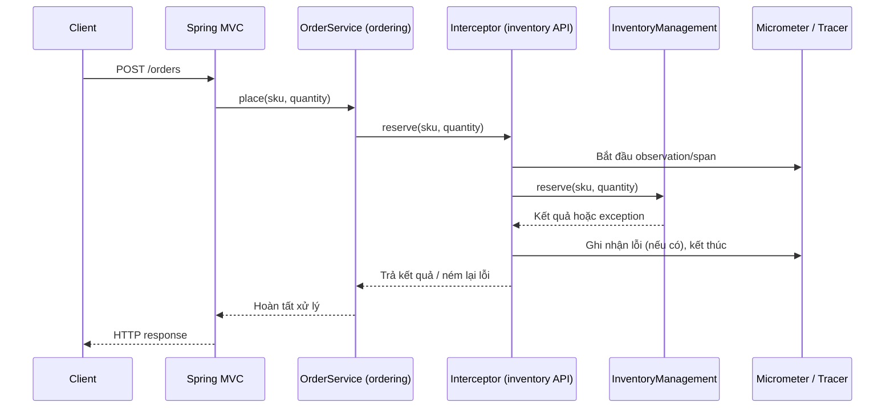
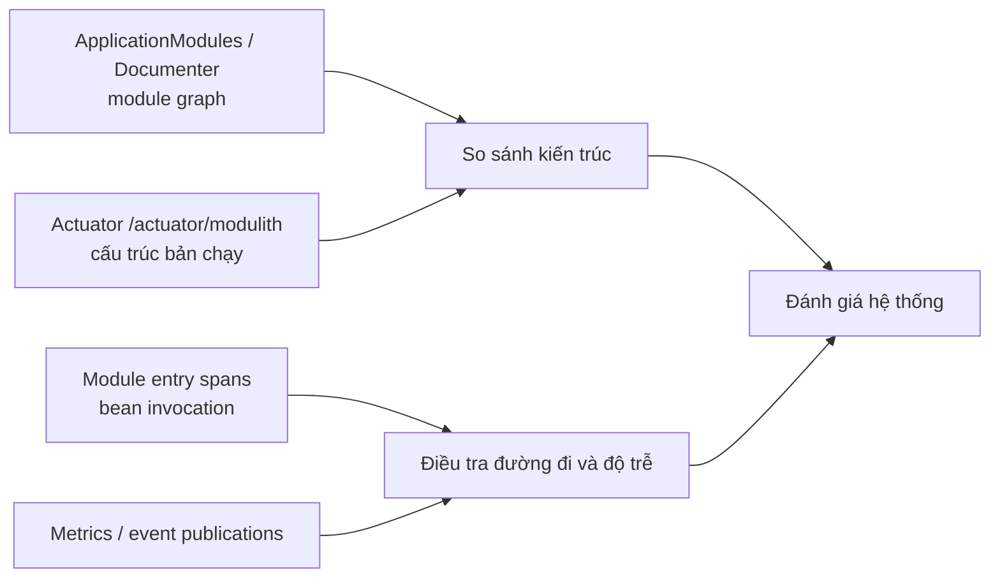

# Span được tạo cho lời gọi bean trong Spring Modulith

## 1. Vì sao một lời gọi Spring bean lại có span?

Khi xây dựng ứng dụng Spring Boot bằng **Spring Modulith**, các application module như `ordering`, `inventory` và `payment` có ranh giới API riêng. Tài liệu module graph cho biết những quan hệ phụ thuộc được phát hiện từ mã nguồn, nhưng không cho biết một yêu cầu đặt hàng cụ thể đã thực thi bước nào, bước nào chậm hoặc ném lỗi.

**Module entry span** là tín hiệu tracing giúp quan sát một lần đi vào thành phần thuộc API của application module. Trong phạm vi bài học này, ta tập trung vào **span sinh ra khi một phương thức của Spring bean được intercept**. Đây là loại invocation được ghi bằng giá trị `bean` ở thuộc tính `module.invocation-type`, phân biệt với invocation của event listener.

Một ví dụ gần gũi:

1. HTTP request gọi chức năng đặt hàng của module `ordering`.
2. `OrderService` gọi `InventoryManagement.reserve(...)`, là Spring bean nằm trong API của `inventory`.
3. Khi Spring Modulith observability và tracing được cấu hình phù hợp, lời gọi đi qua interceptor ở API module `inventory` có thể tạo **module entry span**.
4. Span chứa metadata module và phương thức, thời điểm bắt đầu/kết thúc; tracing backend có thể đặt span vào cùng trace với HTTP request.

> **Điểm cốt lõi:** Spring Modulith không biến **mọi method call** thành span. Instrumentation mặc định nhắm vào các **Spring components được expose qua API application module**. Span chỉ được quan sát trong backend nếu hạ tầng tracing/exporter, sampling và ngữ cảnh đều hoạt động phù hợp.

## 2. Hiểu đúng Observation, bean invocation, span và trace

| Khái niệm | Vai trò | Trong ví dụ đặt hàng |
| --- | --- | --- |
| **Bean invocation** | Một lời gọi thực tế tới phương thức Spring bean; nếu phù hợp pointcut thì bị interceptor bắt | `inventoryManagement.reserve("SKU-42", 2)` |
| **Observation** | Vòng đời quan sát trong Micrometer, chuyển các sự kiện bắt đầu/kết thúc/lỗi cho handlers | Observation bao quanh lời gọi `reserve` |
| **Module entry span** | Bản ghi tracing một lần thực thi được instrument; chứa span ID, trace ID, duration, module attributes | Span cho lần gọi `inventory.reserve` cụ thể |
| **Trace** | Tập các span liên quan bởi trace context; có thể mô tả hành trình một request | HTTP → ordering → inventory → database (nếu đều được instrument) |
| **Meter** | Bộ đo tổng hợp qua nhiều lượt thao tác, ví dụ Counter/Timer | Phân phối độ trễ hoặc số lần lỗi của thao tác nếu meter handler tương ứng được cấu hình |

Một bean method có thể được gọi hàng nghìn lần. Nếu cả nghìn lần đều được instrument và được chọn để xuất trace, chúng tạo ra những **span riêng biệt**, còn metric Timer (nếu có) thường tổng hợp dữ liệu qua nhiều lần gọi. Một span không đồng nghĩa một module, một bean instance hoặc một dòng code.

## 3. Spring Modulith quyết định intercept bean nào?

Theo tài liệu **Observing Application Modules** của Spring Modulith, khi bật observability:

- Framework sử dụng mô hình `ApplicationModules` để xác định các application module và API của chúng.
- Những **Spring component thuộc API module** được trang trí bằng aspect/interceptor phù hợp.
- Khi một phương thức được interceptor bắt, framework ghi nhận việc **đi vào/thoát khỏi module**, dùng Micrometer Observation và hạ tầng tracing để tạo module entry span khi đã được cấu hình.
- Span có metadata nhận diện module, phương thức và loại invocation.

Điều kiện và hệ quả cần nắm:

| Trường hợp | Có nên mặc định kỳ vọng module entry span? | Lý do |
| --- | --- | --- |
| Bean được Spring quản lý, class thuộc API được expose của module, method được gọi qua proxy/interceptor | **Có thể có**, khi observability/tracing hoạt động | Đây là điểm instrument mà framework nhắm đến |
| Class nằm trong package nội bộ của module, không được expose như API module | **Không mặc định** | Không phải mọi thành phần nội bộ đều là điểm vào module cần quan sát |
| Object được tạo thủ công bằng `new InventoryManagement()` | **Không** với interceptor bean thông thường | Object đó không đi qua cơ chế quản lý/proxy của Spring |
| Gọi method trong cùng object qua `this.someMethod()` | **Không đảm bảo** span riêng | Self-invocation thường bỏ qua proxy Spring AOP |
| Database query trong method bean | **Chỉ khi có instrumentation riêng** | Spring Modulith module entry span không tự tạo span cho mọi lệnh JDBC/JPA |
| Method của event listener | **Có thể**, với `module.invocation-type` khác | Đây là đường instrument riêng cần học ở phần event listener |

Không nên suy rằng *mọi lời gọi bean liên module chắc chắn đều được nhìn thấy*. Kết quả phụ thuộc điểm vào API, phiên bản Spring Modulith, proxy/AOP, cấu hình observability, tracing và sampling. Khi cần chắc chắn, kiểm tra một trace thật và đối chiếu với model module của ứng dụng.

### 3.1. “API module” có nghĩa gì?

Với cách tổ chức mặc định, các type đặt trực tiếp trong **base package** của application module là API được công bố; những package con thường đóng vai trò nội bộ, trừ khi cấu hình cho phép expose thêm, ví dụ qua **named interface**.

Ví dụ:

```text
com.example.shop
├── ShopApplication.java
├── ordering/
│   ├── OrderService.java           # API module ordering
│   └── internal/
│       └── OrderRepository.java    # nội bộ
└── inventory/
    ├── InventoryManagement.java    # API module inventory
    └── internal/
        └── StockRepository.java    # nội bộ
```

Thư mục trong sơ đồ chỉ minh họa cho package Java; Spring Modulith phân tích **package/type và các khai báo module**, không chỉ dựa vào tên thư mục trong hệ thống file.

Việc expose một type trong API **không tự đảm bảo** nó là Spring bean. Ngược lại, một class `@Service` trong package nội bộ vẫn là Spring bean, nhưng không nhất thiết tạo module entry span theo cơ chế mặc định của Spring Modulith.

## 4. Ví dụ thực hành: ordering gọi inventory qua Spring bean

Giả định `ShopApplication` có `@SpringBootApplication` tại `com.example.shop`, module mặc định là các package con trực tiếp `ordering` và `inventory`. Có thể dùng các class tối giản sau để quan sát hướng gọi.

### 4.1. API bean của module inventory

```java
// File: com/example/shop/inventory/InventoryManagement.java
package com.example.shop.inventory;

import org.springframework.stereotype.Service;

@Service
public class InventoryManagement {

    public boolean reserve(String sku, int quantity) {
        if (quantity <= 0) {
            throw new IllegalArgumentException("Quantity must be positive");
        }

        // Ví dụ học tập: trong hệ thống thật sẽ có kiểm tra và cập nhật tồn kho.
        return true;
    }
}
```

Class được đặt ngay trong base package `inventory` để làm API module; annotation `@Service` giúp Spring quản lý instance. Bài không triển khai tồn kho thật nên phương thức `reserve` chỉ mô phỏng công việc và nhánh lỗi.

### 4.2. Bean của module ordering sử dụng API inventory

```java
// File: com/example/shop/ordering/OrderService.java
package com.example.shop.ordering;

import com.example.shop.inventory.InventoryManagement;
import org.springframework.stereotype.Service;

@Service
public class OrderService {

    private final InventoryManagement inventory;

    public OrderService(InventoryManagement inventory) {
        this.inventory = inventory;
    }

    public void place(String sku, int quantity) {
        boolean reserved = inventory.reserve(sku, quantity);
        if (!reserved) {
            throw new IllegalStateException("Cannot reserve stock");
        }
        // Tiếp tục xử lý đơn hàng...
    }
}
```

Điểm then chốt là `OrderService` được Spring tạo qua constructor injection và gọi `inventory.reserve(...)` trên **Spring bean**. Nếu `ordering` và `inventory` được nhận diện là hai application module, lời gọi có một quan hệ module rõ ràng.

### 4.3. HTTP entry point kích hoạt luồng

```java
// File: com/example/shop/ordering/OrderController.java
package com.example.shop.ordering;

import org.springframework.http.ResponseEntity;
import org.springframework.web.bind.annotation.PostMapping;
import org.springframework.web.bind.annotation.RequestMapping;
import org.springframework.web.bind.annotation.RequestParam;
import org.springframework.web.bind.annotation.RestController;

@RestController
@RequestMapping("/orders")
public class OrderController {

    private final OrderService service;

    public OrderController(OrderService service) {
        this.service = service;
    }

    @PostMapping
    public ResponseEntity<Void> place(@RequestParam String sku,
                                      @RequestParam int quantity) {
        service.place(sku, quantity);
        return ResponseEntity.accepted().build();
    }
}
```

Gửi request thử:

```bash
curl -i -X POST "http://localhost:8080/orders?sku=SKU-42&quantity=2"
```

Nếu `quantity=-1`, `InventoryManagement.reserve` ném exception. Tình huống này giúp kiểm tra cách hệ thống ghi nhận lỗi trong trace/log, nhưng **cách thể hiện error status/event phụ thuộc tracer và instrumentation**; đừng giả định mọi backend hiển thị cùng định dạng.

## 5. Luồng tạo span diễn ra thế nào?

Trong một cấu hình đầy đủ, luồng điển hình:



Sơ đồ mô tả ý tưởng interceptor, không phải thứ tự gọi các hàm nội bộ chính xác của mọi phiên bản Spring Modulith. Quan trọng là observation/span gắn với **khoảng thực thi qua điểm được intercept**.

Giả sử HTTP tracing và instrumentation module đều có, backend có thể hiển thị một cây như sau:

```text
Trace: 4bf92f3577b34da6a3ce929d0e0e4736          (minh họa)
└── HTTP POST /orders                               (server span)
    └── ordering: OrderController.place(...)        (module entry, nếu được instrument)
        └── ordering: OrderService.place(...)       (module entry, nếu được instrument)
            └── inventory: InventoryManagement.reserve(...)
                                                    (module entry, bean)
```

**Không nên coi số lượng span hoặc tên span trong sơ đồ là cố định.** Framework có thể giảm bớt span lồng nhau, chọn các entry points khác nhau, hoặc tracing middleware có thể không tạo span cho controller/service trong cùng module. Hãy xác nhận span của điểm vào `inventory` và các attributes thực tế mà backend ghi nhận.

Một cách hiểu chính xác hơn về quan hệ cha-con:

- Nếu đang có **active trace context**, module entry span thường liên kết với span/context hiện hành khi handler tracing chạy.
- Nếu không có parent span mà tracer vẫn hoạt động, có thể xuất hiện **root span** mới.
- Nếu chỉ có module observability nhưng **chưa có tracing bridge hoặc exporter**, không thể mong đợi thấy module span trong Zipkin/Jaeger/Tempo.
- Nếu sampling loại bỏ trace, việc không tìm thấy span trong backend **không chứng minh** lời gọi không diễn ra.

## 6. Đọc thông tin của một module entry span

Spring Modulith công bố các tag keys dành cho module entry spans:

| Attribute/tag | Nội dung | Cách sử dụng |
| --- | --- | --- |
| `module.identifier` | Identifier của application module, ví dụ `inventory` | Lọc hoặc nhóm spans theo module kỹ thuật |
| `module.name` | Tên hiển thị module, ví dụ `Inventory` | Giúp người đọc nhận diện module |
| `module.invocation-type` | Loại invocation: `bean` hoặc `event listener` | Phân biệt lời gọi bean thông thường với invocation của listener |
| `module.method` | Phương thức thực hiện trong module | Khoanh vùng API operation được gọi |

Với ví dụ trên, một phần metadata hiển thị trong trace viewer có thể là:

```text
operation:         inventory > InventoryManagement.reserve(...)
traceId:           4bf92f3577b34da6a3ce929d0e0e4736
spanId:            00f067aa0ba902b7
parentSpanId:      7d3a2f29e0c9f111
duration:          18ms
attributes:
  module.identifier:      inventory
  module.name:            Inventory
  module.invocation-type: bean
  module.method:          reserve
```

Tất cả giá trị ở đây đều **minh họa**, không phải cam kết về format span name, signature của `module.method` hay duration. Các field như `traceId`, `spanId` và `parentSpanId` thuộc hệ thống tracing và có thể được biểu diễn khác nhau tùy backend.

Các điểm dễ nhầm:

1. `module.invocation-type=bean` nói về loại **điểm vào được instrument**, không phải về remote procedure call hay loại Spring bean là singleton/prototype.
2. `module.identifier` là identifier kỹ thuật của module, không phải bean name.
3. `module.method` xác định method được intercept, nhưng không phải cam kết mọi method đã chạy bên trong đều có span.
4. `duration` đo phạm vi thời gian của span; nếu thao tác bất đồng bộ tiếp tục sau khi method trả về, thời lượng span **không nhất thiết** phản ánh toàn bộ công việc phía sau. Cần xác minh semantics của phiên bản/instrumentation đang dùng.
5. Nếu có thêm database/HTTP child spans, chúng xuất hiện do instrumentation liên quan; không phải mọi child span đều do Spring Modulith trực tiếp tạo.

## 7. Cấu hình tối thiểu để quan sát được span

### 7.1. Bật module observability

Đối với phiên bản Spring Modulith hiện hành, dự án có thể chọn:

- `spring-modulith-observability-core` nếu chỉ muốn tích hợp module observability.
- `spring-modulith-starter-insight` nếu muốn gom module observability cùng Module Actuator và Spring Boot Actuator.

Ví dụ **Gradle Kotlin DSL** với dependency management/BOM Spring Modulith phù hợp:

```kotlin
dependencies {
    runtimeOnly("org.springframework.modulith:spring-modulith-starter-insight")
}
```

Hoặc Maven:

```xml
<dependency>
    <groupId>org.springframework.modulith</groupId>
    <artifactId>spring-modulith-starter-insight</artifactId>
    <scope>runtime</scope>
</dependency>
```

Các đoạn trên giả định version đã được quản lý bởi BOM/dependency management của dự án. **Không khai báo đồng thời cả starter và observability core chỉ vì nghĩ phải bật span hai lần**; starter đã bao gồm phần tích hợp tương ứng.

Nếu ứng dụng có custom module detection, cấu hình ấy phải hiện diện trong **runtime source/classpath** để hạ tầng quan sát nhận diện đúng API module. Cấu hình chỉ có trong test không tự áp dụng cho ứng dụng production.

### 7.2. Có instrumentation chưa đồng nghĩa xuất trace được

Để thấy module entry spans trong hệ thống tracing bên ngoài, cần kết hợp:

1. Spring Modulith observability tạo điểm quan sát cho API bean.
2. **Micrometer Tracing bridge** tương thích (ví dụ tích hợp OpenTelemetry hoặc Brave).
3. **Exporter/transport** gửi spans đến backend (ví dụ OTLP/Zipkin tùy hệ thống).
4. **Tracing backend** để lưu và xem trace.
5. **Sampling và context propagation** hoạt động theo yêu cầu vận hành.

Tùy phiên bản Spring Boot, các dependency và property cấu hình exporter có thể khác nhau. Hãy dùng hướng dẫn tracing của **đúng nhánh Spring Boot**; không dựa vào một bộ tên property cho mọi nhánh.

Ví dụ một cấu hình sampling thường dùng ở Spring Boot hỗ trợ property này:

```yaml
management:
  tracing:
    sampling:
      probability: 1.0
```

Giá trị `1.0` giúp quan sát mọi request trong **môi trường học tập**, nhưng production cần cân nhắc lưu lượng, bảo mật và chi phí. Sampling `1.0` **không khắc phục** việc thiếu tracer/exporter hoặc điểm instrument.

### 7.3. Actuator hỗ trợ gì?

Nếu dùng Insight và bật exposure thích hợp:

```yaml
management:
  endpoints:
    web:
      exposure:
        include: health, modulith, metrics
```

Thử:

```bash
curl -sS http://localhost:8080/actuator/modulith
curl -sS http://localhost:8080/actuator/metrics
```

- `/actuator/modulith` trả **module graph và quan hệ phụ thuộc đã được phát hiện**; dùng để kiểm tra `ordering → inventory` và tên module.
- `/actuator/metrics` liệt kê **meter** đang có trong Micrometer registry; không phải endpoint xem raw traces.
- **Trace viewer** thường nằm ở backend như Jaeger, Zipkin hoặc Grafana Tempo, không mặc định có `/actuator/traces` chỉ vì thêm Insight.

Endpoint `modulith` có thể cần expose thủ công. Trong production nên giới hạn truy cập vì phản ánh cấu trúc nội bộ của ứng dụng.

## 8. Kiểm chứng span trong một kịch bản cụ thể

Để biết bean call đã sinh span đúng kỳ vọng, làm theo trình tự sau:

1. **Xác minh module model.** Gọi `/actuator/modulith` và kiểm tra `ordering` có dependency đến `inventory` với loại `USES_COMPONENT` trong tình huống sử dụng bean. Cạnh cấu trúc không khẳng định lần gọi runtime đã chạy.
2. **Xác minh Spring bean được quản lý.** `InventoryManagement` phải là bean nằm trong application context; `OrderService` phải nhận instance qua Spring injection.
3. **Gửi request hợp lệ.** Gửi `POST /orders?sku=SKU-42&quantity=2` để kích hoạt `inventory.reserve`.
4. **Tìm trace cụ thể.** Dùng correlation trace ID từ log (nếu có cấu hình) hoặc query trace backend trong khoảng thời gian vừa gọi.
5. **Kiểm tra attributes.** Tìm module entry span có `module.identifier=inventory`, `module.invocation-type=bean` và `module.method` phù hợp.
6. **Gây lỗi có kiểm soát.** Gửi `quantity=-1` trong local; kiểm tra logs/trace để hiểu cách exception được ghi nhận; không dùng dữ liệu thật hoặc endpoint production cho thử nghiệm lỗi.
7. **Đối chiếu duration.** Xem span inventory chiếm bao nhiêu thời gian so với HTTP parent và các child spans có instrumentation. Nếu có async, xác định thời điểm method trả về.

Một kết quả ví dụ:

```text
Trace A (success)
HTTP POST /orders         52 ms
  ordering.place          39 ms
    inventory.reserve     21 ms  [module.invocation-type=bean]

Trace B (error)
HTTP POST /orders         12 ms
  ordering.place           8 ms
    inventory.reserve      3 ms  [exception: IllegalArgumentException]
```

Số liệu trên là **minh họa**. Trong thực tế, nếu không nhìn thấy `ordering.place` nhưng nhìn thấy `inventory.reserve` thì vẫn có thể có lời gọi đúng như code; sự hiện diện/số lượng spans phụ thuộc điểm instrument và sampling, không phản ánh nguyên vẹn call stack.

## 9. Trường hợp không xuất hiện module bean span và cách điều tra

| Hiện tượng | Nguyên nhân có thể | Kiểm tra thực tế |
| --- | --- | --- |
| Có dependency `ordering → inventory` nhưng không có span inventory | Module graph chỉ biểu thị phụ thuộc tĩnh; request chưa gọi code, hoặc điểm instrument không áp dụng | Log tạm ở `reserve` trong local và xác minh request thực sự đi qua bean |
| Request chạy đúng nhưng không thấy trace nào | Thiếu tracing bridge/exporter, endpoint backend sai, sampling không giữ trace | Kiểm tra cấu hình tracing, connectivity, sampling và trace HTTP mẫu |
| Có HTTP span nhưng không có module entry span | Thiếu `spring-modulith-observability-core`/Insight, module detection không đúng, bean không thuộc API hoặc proxy không intercept | Kiểm tra dependency runtime, cấu trúc module và bean trong Spring context |
| Object được tạo bằng `new` hoặc gọi qua `this.method()` | Không đi qua Spring AOP proxy | Dùng bean do Spring quản lý và gọi qua điểm API bean phù hợp |
| Có span inventory nhưng không thấy SQL spans | Không bật instrumentation JDBC/JPA/database | Kiểm tra instrumentation của database client riêng |
| Span không liên kết với HTTP parent | Context bị mất qua `@Async`, executor, Reactor hoặc broker; hoặc không có HTTP tracing | Kiểm tra capture/restore context và luồng parent-child |
| Span rất ngắn trong thao tác async | Method có thể chỉ lên lịch rồi trả về; công việc tiếp tục sau đó | Xem boundaries, semantics của reactive/async instrumentation và spans của các bước tiếp theo |
| Không tìm được bean span khi truy vấn bằng tên operation dự đoán | Span name/convention thay đổi theo version hoặc cấu hình | Lọc bằng attributes `module.identifier` và `module.invocation-type` |
| Có hai spans bao cùng một thao tác | Instrument trùng giữa auto module observability và manual observation/span | Kiểm tra các điểm instrument hiện có, chỉ giữ span trùng khi có mục đích rõ |
| Có span nhưng lỗi không hiện như kỳ vọng | Exception bị bắt/nuốt, adapter không ghi nhận lỗi, hoặc backend diễn giải status khác | Kiểm tra nhánh exception, event/status thực tế trên span |

### 9.1. Lưu ý về context propagation

Trong cùng request và cùng luồng xử lý, tracer có thể giữ current span context để module entry span nối với parent. Nhưng khi công việc đi qua `@Async`, `CompletableFuture`, một `Executor` khác, Reactor hoặc message broker, **context không tự nhiên theo mọi đường thực thi**.

Để nối trace đúng, cần cơ chế **capture/restore** context qua thread hoặc **inject/extract** qua message/HTTP headers (ví dụ W3C `traceparent`) theo thư viện đang dùng. Nếu muốn biểu diễn quan hệ bất đồng bộ mà không áp đặt parent-child trực tiếp, một số tracing stack hỗ trợ **span links**. Spring Modulith không tự bảo đảm mọi listener async nằm trong trace gốc.

### 9.2. Giới hạn thông tin ghi trong span

Span attributes như `module.identifier` hay `module.invocation-type` có cardinality thấp và thường phù hợp để lọc. Không tự động ghi `sku`, email, token, thông tin khách hàng hoặc toàn bộ method arguments vào attributes/baggage. Dữ liệu nghiệp vụ nhạy cảm có thể bị lưu lâu ở backend tracing hoặc truyền qua nhiều dịch vụ.

Tương tự, nếu sử dụng Micrometer metrics cho thao tác bean, tránh đưa `orderId` hay `userId` vào **metric tags**, vì tạo quá nhiều time series.

## 10. Đối chiếu module spans với kiến trúc

Spring Modulith có hai lớp tín hiệu bổ sung cho nhau:



Một module dependency `ordering → inventory [USES_COMPONENT]` được phát hiện ở graph cho biết quan hệ nguồn-đích **tồn tại trong cấu trúc**. Một trace có `inventory` module entry span cho biết có **một lượt thực thi được instrument** ở module inventory. Nếu graph có cạnh nhưng trace không có span, cần kiểm tra sampling và ngữ cảnh, chưa thể kết luận dependency không được dùng.

Ngược lại, việc thấy một span bean từ `inventory` **không chứng minh** hệ thống tuân thủ mọi quy tắc kiến trúc. Muốn kiểm tra chu kỳ phụ thuộc, ranh giới API và `allowedDependencies`, hãy chạy `ApplicationModules.verify()` hoặc các bài kiểm thử module tương ứng. Dùng trace để điều tra điều đã xảy ra trong một số luồng thực thi; dùng graph và verification để đánh giá cấu trúc trên toàn mô hình.

## 11. Bài tập tự kiểm tra

**Bài tập 1.** `OrderService` gọi `InventoryManagement.reserve(...)` qua Spring injection. Trace viewer cho thấy:

```text
module.identifier=inventory
module.invocation-type=bean
module.method=reserve
```

Hỏi: Những thông tin này khẳng định điều gì và chưa khẳng định điều gì?

**Gợi ý:** Có một invocation tại điểm module inventory được instrument, và instrumentation phân loại là bean invocation. Chưa khẳng định tất cả method bên trong inventory có span, request nào cũng được sampling, hoặc mọi dependency đều hợp lệ.

**Bài tập 2.** Bạn sửa `InventoryManagement.reserve` để gọi một helper nội bộ `StockCalculator`; code được Spring quản lý nhưng helper nằm ở `inventory.internal`. Trace vẫn chỉ hiện một module entry span `inventory.reserve`. Đây có chắc là lỗi?

**Gợi ý:** Không. Module observability nhắm vào điểm vào API module, nên helper nội bộ không mặc định có span riêng. Nếu cần đo helper, cân nhắc Observation/instrumentation bổ sung có chủ đích.

**Bài tập 3.** Sau khi thêm `@Async`, trace của request chỉ có span HTTP và `ordering`, còn span `inventory` xuất hiện ở một trace khác. Nên kiểm tra gì?

**Gợi ý:** Trước hết xác minh context propagation qua executor và thời điểm tạo/scope của span, rồi kiểm tra sampling và backend. Việc tồn tại hai trace chưa đủ kết luận nghiệp vụ đã thất bại.

## 12. Ghi nhớ

Span được tạo cho **lời gọi bean** trong Spring Modulith là một **module entry span** quanh một invocation đến **Spring component thuộc API application module** khi observability và tracing hoạt động phù hợp. Hãy nhớ:

1. **Điểm instrument:** API bean được Spring quản lý và được interceptor bắt, không phải mọi method Java.
2. **Metadata:** `module.identifier`, `module.name`, `module.invocation-type=bean` và `module.method` giúp đọc span theo ranh giới module.
3. **Điều kiện hiển thị:** cần tracing bridge/exporter/backend, sampling và context propagation phù hợp.
4. **Phạm vi kết luận:** span chứng minh một lượt thực thi được quan sát; module graph và `ApplicationModules.verify()` mới phục vụ kiểm chứng cấu trúc và ranh giới.

### Tài liệu tham khảo

- [Spring Modulith — Production-ready Features, Observing Application Modules](https://docs.spring.io/spring-modulith/reference/production-ready.html): observability runtime, module entry span và các tag keys chính thức.
- [Spring Modulith — ModuleObservabilityBeanPostProcessor API](https://docs.spring.io/spring-modulith/docs/current/api/org/springframework/modulith/observability/support/ModuleObservabilityBeanPostProcessor.html): interceptor trang trí exposed Spring beans để ghi nhận module entry/exit.
- [Spring Modulith — Fundamentals](https://docs.spring.io/spring-modulith/reference/fundamentals.html): application module, exposed APIs, named interfaces và module detection.
- [Spring Boot — Observability](https://docs.spring.io/spring-boot/reference/actuator/observability.html): Micrometer Observation, tracing infrastructure và tích hợp backend.
