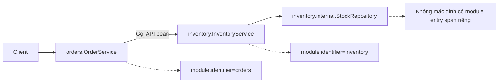
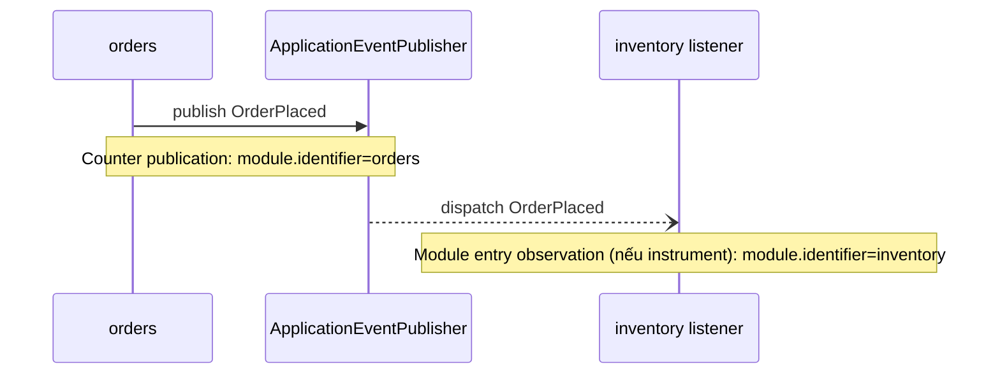

# Module identifier trong span

## 1. Vì sao một span cần biết nó thuộc module nào?

Trong Spring Boot sử dụng **Spring Modulith**, các application module như `orders`, `inventory`, `payments` có ranh giới trách nhiệm riêng, dù thường cùng chạy trong một tiến trình. Khi một yêu cầu đi từ xử lý đơn hàng tới đặt giữ tồn kho, trace thông thường có thể cho thấy tên method và thời lượng, nhưng người đọc còn cần biết **method đó là điểm vào của module nào**.

Spring Modulith bổ sung thuộc tính **`module.identifier`** cho **module entry span**. Thuộc tính này là định danh logic của application module được quan sát, giúp lọc trace, đối chiếu với module graph và kiểm tra rằng các tương tác runtime diễn ra qua ranh giới module như thiết kế.

Bài học thuộc chương **Module spans** của **SPRING_MODULITH_DOCUMENTATION_OBSERVABILITY**. Trọng tâm là hiểu `module.identifier`: nguồn gốc, vị trí trên span, cách sử dụng khi kiểm chứng kiến trúc, giới hạn của instrumentation, và ảnh hưởng của Actuator, event metrics, tracing cùng context propagation.

### Mục tiêu

Sau bài học, bạn có thể:

- Giải thích `module.identifier` trong span và phân biệt nó với `module.name`, `traceId`, `spanId`, `service.name`.
- Biết cách đặt hoặc đọc định danh module từ mô hình Spring Modulith, kể cả cấu hình `@ApplicationModule(id = ...)`.
- Tìm một module entry span qua tag, liên hệ nó với thao tác nghiệp vụ và dependency giữa module.
- Kiểm chứng `module.identifier` khi gọi qua bean và khi xử lý event bất đồng bộ.
- Chẩn đoán span thiếu tag, sai identifier hoặc không xuất hiện trên tracing backend.

## 2. `module.identifier` là gì?

**`module.identifier`** là key của một thuộc tính (tag/attribute) trong thông tin observability do Spring Modulith cung cấp. Giá trị là **định danh logic của application module**: ví dụ `inventory` hoặc `payments`.

Trong tài liệu Spring Modulith về **Module Entry Span**, các key được công bố là:

| Attribute | Mục đích | Ví dụ minh họa |
| --- | --- | --- |
| `module.identifier` | Định danh của module được quan sát. | `inventory` |
| `module.name` | Tên module dùng để hiển thị. | `Quản lý kho` |
| `module.invocation-type` | Kiểu gọi tại điểm vào. | `bean` hoặc `event listener` |
| `module.method` | Method được thực thi tại điểm vào module. | `reserve(UUID)` |

Các giá trị trong cột “Ví dụ” là dữ liệu giả định để diễn giải. Kiểu biểu diễn method và tên span thực tế tùy phiên bản, convention và trình xuất trace đang dùng.

### 2.1. Identifier là danh tính, name là nhãn hiển thị

Giả sử một nhóm tổ chức module quản lý tồn kho. Trong hệ thống giám sát, họ muốn dùng tên ổn định để truy vấn cả trước và sau khi đổi tên hiển thị:

| Thành phần | Giá trị | Ý nghĩa |
| --- | --- | --- |
| Module identifier | `inventory` | Khóa định danh logic phục vụ ánh xạ module. |
| Module display name | `Quản lý kho` | Tên dễ hiểu trong tài liệu và dashboard. |
| Base package | `com.example.shop.inventory` | Vị trí tổ chức mã nguồn Java. |
| Trace ID | `c7e...91a` | Định danh một hành trình thực thi được quan sát. |
| Span ID | `9f2...b03` | Định danh một span cụ thể trong trace. |
| Service name | `shop-backend` | Tên dịch vụ/tiến trình phục vụ hệ thống tracing. |

`module.identifier` **không phải trace ID**: có thể có hàng nghìn trace khác nhau chứa span của cùng module `inventory`. Nó cũng **không phải span ID**: một request có thể gọi API của `inventory` nhiều lần, tạo nhiều span cùng `module.identifier=inventory` nhưng khác span ID.

`module.name` có thể là tên người đọc thấy trong tài liệu; `module.identifier` thích hợp hơn làm khóa tham chiếu ổn định giữa các công cụ. Tuy nhiên, một identifier do nhóm phát triển đổi có thể làm đứt dashboard hoặc quy tắc tìm kiếm cũ. Vì vậy cần quản lý thay đổi của nó giống các tên kỹ thuật được sử dụng bên ngoài mã nguồn.

### 2.2. Identifier đến từ mô hình application module

Spring Modulith xác định application module theo quy tắc phát hiện module của ứng dụng. Trong cấu hình phổ biến, một module được gắn với package trực tiếp bên dưới package gốc và nhận identifier logic tương ứng. Với mô hình module tùy biến hoặc nested module, identifier có thể khác tên segment package; không nên luôn suy ra giá trị chỉ từ chuỗi package.

Bạn có thể chỉ định identifier và tên hiển thị bằng annotation `@ApplicationModule`, ví dụ trong `package-info.java`:

```java
@org.springframework.modulith.ApplicationModule(
    id = "inventory",
    displayName = "Quản lý kho"
)
package com.example.shop.inventory;
```

Ý nghĩa:

- `id="inventory"` khai báo định danh logic của application module.
- `displayName="Quản lý kho"` là nhãn con người có thể đọc.
- Span liên quan đến module này có thể được gắn `module.identifier=inventory` và `module.name=Quản lý kho` khi được instrument đúng điểm vào.

Trong API Spring Modulith, `ApplicationModule.getIdentifier()` trả `ApplicationModuleIdentifier`, còn `ApplicationModule.getDisplayName()` trả tên hiển thị. Đó là một cách khái niệm để phân biệt dữ liệu của mô hình module với những tag xuất hiện trong span. Đừng tạo giá trị `module.identifier` độc lập, tùy ý tại từng nơi ghi trace: nó phải nhất quán với module model.

## 3. Khi nào `module.identifier` xuất hiện trên span?

### 3.1. Điều kiện instrumentation tại module API

Spring Modulith cung cấp khả năng quan sát tương tác application module thông qua `spring-modulith-observability-core`, hoặc qua `spring-modulith-starter-insight` (starter kéo theo phần observability). Theo tài liệu chính thức, các **Spring component là một phần của API application module** được trang trí để ghi nhận lời gọi đi qua những điểm vào đó.

Luồng ví dụ:



Một lời gọi qua Spring bean `InventoryService` được công khai trong API của module `inventory` có thể tạo module entry observation/span. Các method nội bộ mà nó gọi sau đó **không mặc định** tạo span module riêng chỉ vì chúng thuộc cùng module.

Ví dụ mã tối giản, tách hai class ra đúng package:

```java
// com/example/shop/inventory/InventoryService.java
package com.example.shop.inventory;

import java.util.UUID;
import org.springframework.stereotype.Service;

@Service
public class InventoryService {

    public void reserve(UUID orderId) {
        // Phần kiểm tra và giữ hàng thực tế được lược bỏ.
    }
}
```

```java
// com/example/shop/orders/OrderService.java
package com.example.shop.orders;

import java.util.UUID;
import org.springframework.stereotype.Service;
import com.example.shop.inventory.InventoryService;

@Service
public class OrderService {
    private final InventoryService inventory;

    public OrderService(InventoryService inventory) {
        this.inventory = inventory;
    }

    public void placeOrder(UUID orderId) {
        // Giả sử đơn được kiểm tra trước khi giữ hàng.
        inventory.reserve(orderId);
    }
}
```

Trong ví dụ, một module entry span có `module.identifier=inventory` mô tả **module đích có API đang được thực thi**; điều đó không có nghĩa module `inventory` là nơi HTTP request bắt đầu, cũng không nhất thiết là module phát sinh lời gọi.

### 3.2. Các thành phần cần có

| Thành phần | Vai trò | Nếu thiếu |
| --- | --- | --- |
| Spring Modulith runtime model | Phát hiện application module, identifier và API. | Không có mô hình ranh giới phù hợp để instrument. |
| `spring-modulith-observability-core` hoặc Insight starter | Tạo observation tại điểm vào module. | Không có module entry observation do Modulith cung cấp. |
| Spring Boot/Micrometer Observation | Nền hạ tầng observation và handlers. | Không hoàn thiện đường xử lý tín hiệu observability. |
| Tracer implementation + exporter | Biến observation thành span và chuyển tới backend. | Có thể vẫn có metric/observation nhưng không có trace hiển thị. |
| Backend như Tempo, Zipkin hoặc Jaeger | Lưu và truy vấn trace đã được xuất. | Không có nơi tra cứu trace của luồng. |

Minh họa Gradle Groovy DSL cho **Spring Modulith 2.x**, với BOM tương thích đã được quản lý trong dự án:

```groovy
dependencies {
    implementation 'org.springframework.boot:spring-boot-starter-actuator'
    runtimeOnly 'org.springframework.modulith:spring-modulith-observability-core'

    // Tracer/OTLP exporter cần được bổ sung theo dòng Spring Boot sử dụng.
}
```

Nếu ứng dụng đã dùng `spring-modulith-starter-insight` thì không cần khai báo core thêm lần nữa. Khai báo một dependency chỉ mới bật khả năng instrument; việc thấy trace còn phụ thuộc sampling, exporter, collector, cấu hình mạng và thao tác được instrument thực tế.

## 4. Đọc `module.identifier` trong một trace

Giả sử client gửi `POST /orders`. `orders` gọi module `payments` để thanh toán, sau đó gọi `inventory` để giữ hàng.

```text
Trace (minh họa)
traceId = 7db1...
└─ HTTP POST /orders
   └─ orders.placeOrder(...)
      ├─ payments.authorize(...)
      │  attributes: module.identifier=payments, module.name=Thanh toán
      └─ inventory.reserve(...)
         attributes: module.identifier=inventory, module.name=Quản lý kho
```

Các bước đọc:

1. Tìm trace theo `traceId` hoặc theo truy vấn HTTP/operation của request (nếu tracing backend hỗ trợ).
2. Mở span tại ranh giới module đích; tìm trong phần **attributes/tags** key `module.identifier`.
3. Ghi nhận `module.identifier`, `module.invocation-type`, `module.method` và thời điểm bắt đầu/kết thúc span.
4. Đối chiếu identifier với danh sách module trong module graph hoặc tài liệu ranh giới do Spring Modulith tạo.
5. Nếu có điều bất thường, mở log cùng `traceId`/`spanId` để kiểm tra nguyên nhân; dùng metrics để biết bất thường đó có lặp lại trên nhiều request hay không.

Đây là ví dụ diễn giải, **không phải trace đã được xuất từ một ứng dụng cụ thể**. Span name, thứ bậc cha/con và cách hiển thị attribute có thể khác giữa tracer/backend, đặc biệt khi có xử lý bất đồng bộ.

### 4.1. Lọc theo module trong tracing UI

Nhu cầu “liệt kê các trace từng đi vào module `inventory`” khác với “tìm một trace của đơn hàng cụ thể”:

| Mục tiêu | Khóa phù hợp | Kết quả mong muốn |
| --- | --- | --- |
| Tìm một hành trình cụ thể | `traceId` | Các span liên quan đến một lần thực thi được ghi nhận. |
| Tìm đúng một span | `traceId` + `spanId` | Một công việc cụ thể trong trace. |
| Lọc tương tác vào module | `module.identifier=inventory` | Các module entry spans/trace chứa attribute này, theo khả năng backend. |
| Phân biệt điểm vào qua bean hay listener | `module.invocation-type` | Nhóm các lời gọi theo kiểu tương tác. |
| Phân tích một API cụ thể trong module | `module.identifier` + `module.method` | Các thao tác liên quan method cần khảo sát. |

Trong Tempo/Jaeger/Zipkin hoặc công cụ khác, vào phần tìm kiếm span theo attribute/tag và điền key `module.identifier` với giá trị `inventory`. **Cú pháp truy vấn thay đổi theo backend và phiên bản**, vì vậy không giả định cùng một expression áp dụng cho tất cả công cụ. Ngoài ra, một backend có thể lưu span nhưng chưa cấu hình lập chỉ mục cho attribute này; khi đó không tìm kiếm trực tiếp theo tag được dù vẫn xem thấy nó trong chi tiết trace.

### 4.2. Không nhầm “chứa tag” với “module tạo ra mọi span”

Một trace có span HTTP, JDBC, HTTP client, module entry... Không phải span nào cũng trực tiếp do Spring Modulith tạo. Một số hạ tầng observation có thể **truyền thông tin module từ observation cha sang observation con**; trong Spring Modulith 2.x, hỗ trợ có lớp `ModuleIdentifierPassingObservationFilter` nhằm bảo đảm key `MODULE_IDENTIFIER` từ parent sang child. Điều này giúp giữ ngữ cảnh module trong các observation liên quan.

Vì vậy:

- Span do Modulith tạo tại module entry là bằng chứng mạnh rằng điểm vào module đã được instrument.
- Span do thư viện khác tạo cũng có thể mang `module.identifier` do propagation trong cùng ngữ cảnh. Khi xem một span database mang identifier `inventory`, hãy đọc thêm span name, parent và loại operation để biết đó có phải module entry span hay chỉ hoạt động xảy ra **trong ngữ cảnh module**.
- Không mặc định attribute được sao chép xuyên mọi thread hoặc service qua network. Cơ chế propagation của Micrometer observation và trace context qua transport là những lớp khác nhau.

## 5. Quan hệ giữa module identifier, module name và kiến trúc

### 5.1. Đối chiếu cùng một identifier ở các nguồn

Một cách kiểm chứng kiến trúc hữu ích là so sánh:

| Nguồn | Có thể đọc điều gì từ `inventory`? | Giới hạn |
| --- | --- | --- |
| Module graph do Documenter sinh | Module tồn tại, API/named interface và dependency do phân tích mã nguồn nhận diện. | Đồ thị cấu trúc không chứng minh một request đã đi qua module. |
| `/actuator/modulith`, khi bật Modulith Actuator | Module runtime, `basePackage`, `displayName`, dependencies. | Đây vẫn là thông tin cấu trúc; endpoint cần được bảo vệ quyền truy cập. |
| Module entry span | Một lần lời gọi được instrument có `module.identifier=inventory`, method và thời lượng. | Có thể không được ghi do sampling, thiếu tracer hoặc không qua điểm vào được instrument. |
| `module.events.published` metric | Những event publication được thống kê theo module và loại event. | Đếm event được phát, không xác nhận listener hoàn tất. |
| Log có `traceId` | Diễn biến và lỗi trong lần thực thi cụ thể. | Log chỉ có đủ ngữ cảnh nếu ứng dụng ghi đúng và MDC/trace context hoạt động. |

**Cấu trúc** cho biết các module có thể liên hệ với nhau theo mô hình. **Trace** cho biết trong một lần xử lý được ghi nhận có những tương tác nào thực sự diễn ra. Hai nguồn giúp đối chiếu thiết kế và vận hành mà không thay thế nhau.

### 5.2. Khi đổi identifier hoặc refactor package

Nếu module `inventory` được đổi thành `stock`, hoặc chiến lược nhận diện module thay đổi, dashboard cũ lọc theo `module.identifier=inventory` có thể không còn trả dữ liệu mới. Đây là một thay đổi của **hợp đồng observability** ngay cả khi ứng dụng vẫn chạy đúng nghiệp vụ.

Quy trình đề xuất khi đổi định danh:

1. Ghi nhận identifier cũ và mới; xác định các dashboard, alerts, truy vấn tracing và tài liệu phụ thuộc vào nó.
2. Kiểm tra identifier mới trong module model và span của một request thực tế.
3. Cập nhật bộ lọc/dashboard, giữ khả năng truy vấn dữ liệu lịch sử bằng identifier cũ trong giai đoạn chuyển đổi nếu backend lưu dữ liệu cũ.
4. Đảm bảo tên hiển thị và identifier được dùng nhất quán giữa ứng dụng, tài liệu và observability.

Đừng gắn tên ngẫu nhiên hoặc một ID mới theo request vào `module.identifier`. Nó phải biểu thị **module logic ổn định**, không phải người dùng, đơn hàng, tenant hay thao tác.

## 6. Phân biệt identifier trong span với identifier trong event metrics

Spring Modulith cũng dùng các key liên quan module trong counter cho sự kiện domain được phát:

| Tín hiệu | Key | Ý nghĩa |
| --- | --- | --- |
| Module entry span | `module.identifier` | Module đang được gọi qua điểm vào được instrument. |
| All-events metric `module.events.published` | `module.identifier`, `module.name`, `module.event.type` | Module phát event và kiểu sự kiện. |
| Per-event metric | `module.identifier`, `module.name` | Đếm event cụ thể gắn với module phát. |

Xét luồng:



**Điểm quan trọng:** cùng một hành trình có thể có counter với `module.identifier=orders` (module **phát** event) và listener span với `module.identifier=inventory` (module **tiếp nhận/xử lý** event). Đó không phải dữ liệu mâu thuẫn; hai tín hiệu mô tả **vai trò khác nhau**.

Chẳng hạn publication counter của `orders` tăng trong khi trace hiển thị một listener span `inventory` chậm. Ta có thể biết event được phát và thấy đoạn listener bị chậm; nhưng **không được suy ra** toàn bộ event được xử lý thành công hoặc không bị retry chỉ từ hai tín hiệu ấy.

### 6.1. Cardinality và bảo vệ dữ liệu

`module.identifier` là một ứng viên tốt cho **low-cardinality key** nếu số module có giới hạn và giá trị ổn định. Nó thích hợp để phân nhóm dữ liệu theo phạm vi kiến trúc.

| Phù hợp để phân nhóm theo module | Không phù hợp làm identifier module |
| --- | --- |
| `inventory`, `payments`, `orders` | `orderId=bc92...` |
| Các module đã được Spring Modulith nhận diện | `userId=12345` |
| Identifier được quản lý khi refactor | `traceId=7db1...` |

Không gắn dữ liệu riêng của từng user/request vào key `module.identifier` và không thay thế identifier module bằng giá trị lấy từ payload. Điều đó làm tag mất ý nghĩa, tăng cardinality nếu metric dùng cùng key và có thể làm lộ dữ liệu nhạy cảm. Traces cũng phải tuân thủ quyền truy cập, retention và chính sách bảo vệ span attributes.

## 7. Async và context propagation: identifier đi theo luồng thế nào?

Một domain event có thể được xử lý bằng `@Async` hoặc executor do ứng dụng quản lý. Thông tin observation/tracing hiện hành thường nằm trong context của thread đang chạy. Khi listener chuyển sang thread khác:

- Listener span có thể được tạo như một span độc lập, không liên kết trace HTTP ban đầu.
- Log có thể mất `traceId`/`spanId` nếu MDC/trace context không được truyền.
- `module.identifier` của **module đang được xử lý** vẫn là thông tin về điểm vào module nếu instrumentation nhận diện đúng listener, nhưng không có nghĩa quan hệ parent/child và mọi child-span attributes sẽ tự được bảo toàn.

Vì vậy, phân biệt hai việc:

1. **Nhận diện module tại module entry:** Spring Modulith xác định listener/bean nằm trong module nào, rồi tạo observation có metadata module tương ứng.
2. **Truyền trace/observation context qua thread/transport:** Micrometer Context Propagation hoặc tích hợp HTTP/messaging giúp giữ quan hệ giữa những thao tác bất đồng bộ. Đây không phải chức năng được bảo đảm chỉ bằng việc có `module.identifier`.

Với Spring Framework hỗ trợ, một cách cấu hình là gắn `ContextPropagatingTaskDecorator` cho executor:

```java
import org.springframework.context.annotation.Bean;
import org.springframework.context.annotation.Configuration;
import org.springframework.core.task.support.ContextPropagatingTaskDecorator;
import org.springframework.scheduling.concurrent.ThreadPoolTaskExecutor;

@Configuration(proxyBeanMethods = false)
class AsyncConfiguration {

    @Bean
    ThreadPoolTaskExecutor moduleEventExecutor() {
        var executor = new ThreadPoolTaskExecutor();
        executor.setCorePoolSize(2);
        executor.setMaxPoolSize(4);
        executor.setThreadNamePrefix("module-events-");
        executor.setTaskDecorator(new ContextPropagatingTaskDecorator());
        return executor;
    }
}
```

Ví dụ trên thể hiện **cách gắn decorator với một executor cụ thể**. Nếu listener sử dụng executor khác (do `@Async`, event multicaster hay config riêng), phải gắn propagation vào **executor thực tế** mà listener chạy. Việc khai báo bean executor chưa bảo đảm listener tự dùng nó; còn cần liên kết đúng nơi cấu hình async/event multicaster. Với broker/service ngoài JVM, cần inject/extract trace headers theo protocol và thư viện tương ứng.

Trong tracing UI, hãy kiểm tra trực tiếp xem các span trước/sau async có cùng trace hoặc quan hệ liên kết được kỳ vọng hay không; không khẳng định một trace thiếu listener span là bằng chứng listener chưa chạy.

## 8. Quy trình thực hành: xác minh `module.identifier` end-to-end

### 8.1. Chuẩn bị môi trường

Giả định có ứng dụng Spring Boot, các package module `orders` và `inventory` như ví dụ, dependency `spring-modulith-observability-core` hoặc Insight starter và hạ tầng Micrometer Tracing.

Để demo, cần tracer/exporter và backend theo dòng Spring Boot đang dùng (ví dụ OpenTelemetry + OTLP Collector). Nếu cần tìm đủ trace khi học, có thể tăng sampling trong môi trường phát triển:

```yaml
management:
  tracing:
    sampling:
      probability: 1.0  # Chỉ dùng cho bài thực hành có tải thấp.
```

Trong production, cần chọn sampling và endpoint security phù hợp; không mặc định ghi 100% trace của lưu lượng thật. Nếu thêm `/actuator/modulith` để xem graph, cần cấu hình Modulith Actuator/Insight và chỉ expose endpoint cho người có quyền.

### 8.2. Các bước quan sát

1. **Kiểm tra module model:** xác nhận `inventory` là một application module, identifier là `inventory`, và `InventoryService` nằm trong API được Spring Modulith nhìn thấy.
2. **Chạy một lời gọi thực:** gọi API tạo đơn để `OrderService` thực sự thực thi `inventory.reserve(orderId)` qua Spring-managed bean.
3. **Tìm trace:** trong tracing backend, lọc theo request/trace ID và mở span liên quan tới method `reserve`.
4. **Xem attributes:** kiểm tra `module.identifier=inventory`, `module.name`, `module.invocation-type` và `module.method` trên module entry span.
5. **Đối chiếu:** mở module graph (tài liệu hoặc `/actuator/modulith` khi được bật), so sánh identifier trong trace với module đích trên sơ đồ.
6. **Thử thay đổi luồng:** gọi một method khác trong cùng module rồi quan sát: identifier thường giữ nguyên, method và span ID thay đổi. Cần phân biệt thông tin cố định theo module và thông tin theo mỗi lần thực thi.
7. **Thử async nếu có:** phát event, kiểm tra span listener và quan hệ trace trước/sau khi cấu hình context propagation.
8. **Ghi lại bằng chứng:** lưu tên module, method, thời điểm, trace ID (trong kênh nội bộ), phiên bản deploy và ảnh chụp/attribute cần thiết để đội có thể tái hiện.

### 8.3. Mẫu ghi nhận kết quả

| Kiểm tra | Kết quả mong đợi | Ví dụ ghi nhận |
| --- | --- | --- |
| Module model | Có identifier của module. | `inventory` |
| Đường đi thực thi | Gọi bean API của module. | `orders → inventory` |
| Module entry span | Có `module.identifier`. | `inventory` |
| Tên module | Phù hợp với hiển thị trong graph. | `Quản lý kho` |
| Kiểu invocation | Có giá trị tương ứng với luồng thực tế. | `bean` |
| Trace correlation | Có thể tìm span trong hành trình mong đợi. | Một trace ID chung trong luồng đồng bộ |

Không cần “chứng minh” toàn bộ module đã hoạt động chính xác chỉ bằng một span. Một trace là **mẫu quan sát** của một luồng cụ thể. Đánh giá hành vi tổng thể cần thêm metrics, logs và kiểm thử nghiệp vụ.

## 9. Khi `module.identifier` không xuất hiện hoặc không đúng

| Hiện tượng | Nguyên nhân có thể | Hướng kiểm tra |
| --- | --- | --- |
| Không có trace nào sau request | Chưa có tracer/exporter, backend không nhận dữ liệu, sampling bỏ trace. | Kiểm tra dependency, endpoint collector, logs exporter, sampling và mạng. |
| Trace có HTTP span nhưng không có module entry span | Core chưa bật hoặc method không nằm ở Spring component thuộc module API; gọi không qua interceptor. | Kiểm tra runtime dependency, module model, bean, API package và đường gọi thực tế. |
| Module entry span có `module.identifier` khác mong đợi | Có `@ApplicationModule(id=...)`, nested module hoặc chiến lược nhận diện module khác. | Đối chiếu identifier trong model/graph, không suy diễn từ tên package. |
| Trên một span JDBC có `module.identifier=inventory` | Attribute được truyền theo observation context từ module entry. | Xem span name, parent và loại operation để phân biệt child span với module entry. |
| Listener span không chung trace với publisher | Thread/transport thay đổi nhưng không truyền context; sampling hoặc instrumentation thiếu. | Kiểm tra executor, decorator, trace headers, và backend sampling. |
| Span thiếu `module.identifier` ở một đoạn xử lý | Đoạn đó không thuộc module entry instrumentation hoặc context propagation không áp dụng. | Xem scope của observation, Spring bean interception và vị trí mất context. |
| Dashboard lọc identifier cũ không thấy dữ liệu mới | Identifier đã đổi sau refactor. | Kiểm tra version deploy, cấu hình module và cập nhật truy vấn/dashboard. |
| Tag `module.identifier` tồn tại nhưng việc xử lý event vẫn thất bại | Tag chỉ nhận diện phạm vi module, không xác nhận thành công nghiệp vụ. | Đọc exception/log, metric kết quả listener, retry hoặc event publication registry nếu có. |

Lưu ý trong ứng dụng có AOP/proxy: self-invocation hoặc lời gọi không đi qua proxy có thể khiến một method không được interceptor ghi nhận. Mặt khác, điểm vào nằm trong package `internal` hoặc class không phải API cũng có thể không thuộc phạm vi instrument của Modulith. Từ một span bị thiếu, hãy kiểm tra kỹ **cấu trúc module + cách gọi + tracing pipeline** trước khi kết luận về luồng nghiệp vụ.

## 10. Những giới hạn cần ghi nhớ

- **`module.identifier` là thuộc tính về module**, không định danh request, user hoặc order; nó giúp nhóm span theo phạm vi kiến trúc.
- **Không phải mọi span đều là module entry span.** Một child span được gắn identifier qua observation filter vẫn có thể là span JDBC/HTTP thông thường.
- **Không phải mọi method đều tự có span.** Spring Modulith instrument các điểm vào phù hợp, không hứa ghi trace cho toàn bộ code nội bộ.
- **Trace không phải toàn bộ lịch sử xử lý.** Sampling, exporter, context propagation và retention quyết định dữ liệu nào thực sự xuất hiện.
- **Identifier có thể thay đổi khi sửa cấu trúc/metadata module.** Hãy quản lý cùng dashboard, truy vấn và tài liệu đối chiếu.
- **Quan sát không thay thế kiểm chứng kiến trúc và nghiệp vụ.** Dùng `ApplicationModules.verify()`, tài liệu module, kiểm thử, event metrics và logging cùng với tracing.
- **Dữ liệu observability cần quyền truy cập phù hợp.** Module names, package, method và quan hệ nghiệp vụ là metadata nội bộ, cần kiểm soát truy cập và chia sẻ.

## 11. Tổng kết

Trong Spring Modulith, `module.identifier` trên **module entry span** cho biết **định danh logic của application module đang được quan sát**. Đây là điểm nối hữu ích giữa **module model/module graph** và **traces phản ánh tương tác thực tế**. Khi kết hợp thêm `module.name`, `module.method`, `module.invocation-type`, `traceId` và metrics/logs, nhóm phát triển có thể hỏi cả “module nào tồn tại trong thiết kế?” lẫn “module nào đã được gọi trong một luồng vận hành cụ thể?”.

Để dùng thông tin này chính xác, phải có instrumentation tại ranh giới module, tracer/exporter phù hợp, hiểu phạm vi propagation và tránh nhầm span attributes với bằng chứng hoàn tất nghiệp vụ. Đó là cơ sở để kiểm chứng kiến trúc mô-đun trong hệ thống Spring Boot đang chạy.

## Tài liệu tham khảo

- [Spring Modulith — Production-ready Features](https://docs.spring.io/spring-modulith/reference/production-ready.html): module entry span, danh sách tag `module.identifier`, `module.invocation-type`, `module.method`, `module.name` và event metrics.
- [Spring Modulith — Fundamentals](https://docs.spring.io/spring-modulith/reference/fundamentals.html): mô hình application module, ranh giới API, named interfaces và cấu hình module.
- [Spring Modulith — `ApplicationModule` API](https://docs.spring.io/spring-modulith/docs/current/api/org/springframework/modulith/ApplicationModule.html): các thuộc tính `id`, `displayName` của annotation.
- [Spring Modulith — `ModulithObservations.LowKeys` API](https://docs.spring.io/spring-modulith/docs/current/api/org/springframework/modulith/observability/ModulithObservations.LowKeys.html): metadata low-cardinality của module observation.
- [Spring Modulith — Observability support API](https://docs.spring.io/spring-modulith/docs/current/api/org/springframework/modulith/observability/support/package-summary.html): `ModuleIdentifierPassingObservationFilter` và bean post-processor cho module entry.
- [Spring Boot — Tracing](https://docs.spring.io/spring-boot/reference/actuator/tracing.html): Micrometer Tracing, sampling, exporter, trace context.
- [Spring Boot — Observability](https://docs.spring.io/spring-boot/reference/actuator/observability.html): Micrometer Observation, key-values và context propagation.

> **Giới hạn phiên bản:** Các class, starter và property thay đổi giữa các dòng Spring Modulith/Spring Boot; phần tag ở đây theo tài liệu Spring Modulith 2.x. Ví dụ mã và sơ đồ phục vụ học tập, chưa đại diện cho một bản deploy cụ thể. Khi triển khai, hãy đối chiếu với dependency management và trace thực tế của dự án.
