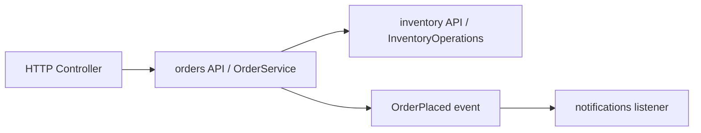
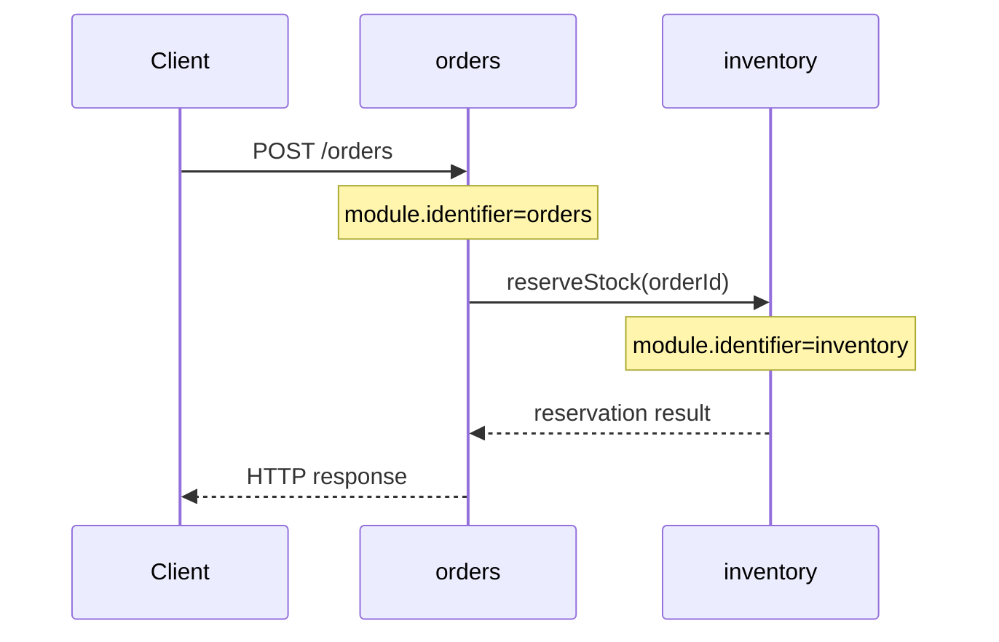
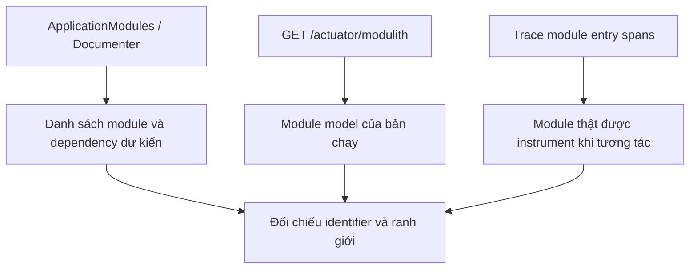

# Module name trong span

## 1. Vì sao cần thấy tên module trên một span?

Trong ứng dụng Spring Boot theo kiến trúc **modular monolith**, `orders`, `inventory` và `notifications` có thể cùng chạy trong một JVM, cùng một `service.name` và cùng một tiến trình triển khai. Nếu trace chỉ có span HTTP và SQL, người vận hành biết request chậm ở đâu về mặt kỹ thuật, nhưng khó trả lời **application module nào chịu trách nhiệm cho đoạn xử lý đó**.

**Module name trong span** là thông tin gắn một hoạt động đã được quan sát với *application module* mà Spring Modulith nhận diện. Với Spring Modulith Observability, các span tại điểm vào module có thể mang tag **`module.name`** và **`module.identifier`**, cùng metadata về cách module được gọi và phương thức thực thi. Đây là cầu nối từ sơ đồ ranh giới module tới dữ liệu tracing khi hệ thống chạy.

Trong phạm vi `SPRING_MODULITH_DOCUMENTATION_OBSERVABILITY`, ta dùng Spring Modulith để sinh tài liệu kiến trúc, kiểm tra quan hệ giữa các module, rồi đối chiếu module graph, Actuator, event metrics, trace và context propagation. Bài này tập trung vào **cách nhận diện đúng module trên một span**; các công cụ còn lại được dùng để kiểm chứng hoặc lý giải thông tin đó.

Sau bài học, bạn có thể:

- Phân biệt `span.name`, `module.name`, `module.identifier` và `service.name`.
- Biết những loại module entry được Spring Modulith Observability theo dõi và những giới hạn của instrumentation.
- Tìm tên module trên trace, xác nhận nó khớp với kiến trúc và tránh gán nhầm module ở listener bất đồng bộ.
- Chẩn đoán tình huống không thấy `module.name` hoặc tên module khác dự kiến.

## 2. Tên span và tên module không phải một khái niệm

Một **trace** biểu diễn hành trình của một yêu cầu hoặc chuỗi hoạt động có liên quan; mỗi **span** biểu diễn một hoạt động có thời điểm bắt đầu, kết thúc và các thuộc tính. Trong modular monolith, một trace có thể chứa nhiều span thuộc các application module khác nhau.

| Trường | Định danh cái gì? | Ví dụ minh họa | Phạm vi |
| --- | --- | --- | --- |
| `service.name` | Service/workload xuất trace, thường từ resource của OpenTelemetry | `shop-app` | Một ứng dụng hoặc tiến trình triển khai |
| `span.name` | Tên của **hoạt động** được đo | `orders.placeOrder` | Một span cụ thể |
| `module.name` | Tên application module trên **module entry span** của Spring Modulith | `Orders` | Module logic đang được quan sát |
| `module.identifier` | Định danh kỹ thuật của application module | `orders` | Khóa module trong mô hình kiến trúc |
| `module.method` | Phương thức thực thi tại điểm vào module | `placeOrder(...)` | Chi tiết thao tác đang được instrument |
| `module.invocation-type` | Cơ chế đi vào module | `bean` hoặc `event listener` | Ngữ cảnh tương tác |
| `traceId` / `spanId` | ID của hành trình / một span | ID do hệ thống tracing tạo | Correlation giữa các bước |

**`span.name` không bắt buộc phải trùng `module.name`.** Ví dụ span có tên biểu diễn một thao tác đặt hàng nhưng tag `module.name` cho biết thao tác đó thuộc module Orders. Cũng không nên giả định `service.name=orders`: khi `orders` chỉ là một application module trong cùng ứng dụng `shop-app`, giá trị service thường vẫn là `shop-app`.

Một span HTTP do Spring Boot instrument có thể **không mang** tag `module.name`; tag này có ý nghĩa với module entry span mà Spring Modulith Observability tạo hoặc với span được ứng dụng instrument thêm. Không nên tự động gán tất cả span con của một HTTP request cho module xuất hiện đầu tiên.

## 3. Những tag của module entry span

Theo tài liệu Spring Modulith về **Observability Spans**, module entry span có các tag sau:

| Tag chính thức | Nội dung | Cách sử dụng |
| --- | --- | --- |
| **`module.identifier`** | Định danh module | Nối trace với module kỹ thuật trong `ApplicationModules` và Actuator |
| **`module.name`** | Tên module | Đọc trace và phân nhóm thao tác theo module |
| **`module.invocation-type`** | Kiểu gọi vào module: `bean` hoặc `event listener` | Phân biệt lời gọi bean và xử lý application event |
| **`module.method`** | Phương thức được thực thi trên module | Khoanh vùng module API/entry point gây lỗi hoặc chậm |

Các tên tag ở bảng này được nêu trong tài liệu Spring Modulith hiện hành, thay vì dùng những khóa do nhóm tự suy đoán như `app.module` hoặc `spring.module` để mô tả metadata mặc định. Các phiên bản thư viện khác nhau có thể thay đổi tên operation/span, cách xuất tag hay phạm vi instrument; khi thiết lập dashboard cần xem **span thực tế trên backend** và tài liệu đúng phiên bản.

Về ý nghĩa, `module.identifier` thường là lựa chọn phù hợp để đối chiếu với khóa module trong sơ đồ kiến trúc; `module.name` hữu ích khi đọc và hiển thị. **Không ép hai trường phải giống hệt nhau** nếu mô hình ứng dụng có tên kỹ thuật và tên hiển thị khác nhau. Nếu cần khóa dữ liệu bền vững cho truy vấn, hãy kiểm tra tính ổn định của identifier và quy định đổi tên qua các phiên bản.

Một bản ghi trace đã được **đơn giản hóa để minh họa** (không phải JSON wire format OTLP):

```json
{
  "service.name": "shop-app",
  "traceId": "8a0d...",
  "spanId": "d3f1...",
  "span.name": "orders.placeOrder",
  "attributes": {
    "module.identifier": "orders",
    "module.name": "Orders",
    "module.invocation-type": "bean",
    "module.method": "placeOrder"
  }
}
```

Giá trị `span.name`, tên `module.name` và cách biểu diễn `module.method` trong ví dụ là dữ liệu giả lập. Chúng cho thấy **cách đọc mối quan hệ giữa các trường**, không phải lời cam kết về chuỗi chính xác mà mọi phiên bản Spring Modulith xuất ra.

## 4. Tên module được xác định từ đâu?

Spring Modulith xây dựng mô hình `ApplicationModules` từ code và cấu hình phát hiện module. Với cấu trúc thường gặp:

```text
com.example.shop
├── ShopApplication.java
├── orders
│   ├── OrderService.java
│   ├── OrderPlaced.java
│   └── internal
│       └── OrderRepository.java
├── inventory
│   ├── InventoryOperations.java
│   └── internal
│       └── InventoryService.java
└── notifications
    ├── OrderNotificationListener.java
    └── internal
        └── EmailAdapter.java
```

Các package `orders`, `inventory`, `notifications` là những ứng viên application module theo quy ước module mặc định. Thông tin module, gồm tên và ranh giới công khai, có thể được thay đổi thông qua cấu hình Spring Modulith; vì vậy không nên chỉ cắt chuỗi từ package Java rồi coi đó là tên cuối cùng của module.

Có thể kiểm tra mô hình bằng một bài test:

```java
import static org.assertj.core.api.Assertions.assertThat;

import org.junit.jupiter.api.Test;
import org.springframework.modulith.core.ApplicationModules;

class ModuleIdentityTests {

    @Test
    void ordersIsAnApplicationModule() {
        var modules = ApplicationModules.of(ShopApplication.class);

        assertThat(modules.getModuleByName("orders")).isPresent();
        modules.verify();
    }
}
```

Đoạn test giả định `ShopApplication` là class ứng dụng ở package gốc và các dependency test cần thiết đã có trong dự án. Nó kiểm tra rằng một module mang identifier `orders` được nhận diện và kiểm chứng các quy tắc cấu trúc mà Spring Modulith hỗ trợ. Nếu dự án đã dùng cách đặt tên module khác, cập nhật chuỗi kỳ vọng theo **mô hình thực tế**.

Khi bật Spring Modulith Actuator và expose endpoint thích hợp, có thể đọc mô hình của bản ứng dụng đang chạy tại:

```http
GET /actuator/modulith HTTP/1.1
Host: localhost:8080
Accept: application/json
```

Ví dụ phản hồi rút gọn:

```json
{
  "orders": {
    "basePackage": "com.example.shop.orders",
    "displayName": "Orders",
    "dependencies": [
      { "target": "inventory", "types": ["USES_COMPONENT"] }
    ]
  },
  "inventory": {
    "basePackage": "com.example.shop.inventory",
    "displayName": "Inventory",
    "dependencies": []
  }
}
```

Đây cũng là dữ liệu minh họa. Key cấp gốc của JSON Actuator là **tên kỹ thuật module**; `displayName` là tên hiển thị. Trong phần tracing, kiểm tra tag `module.identifier` và `module.name` trên span để đối chiếu với dữ liệu tương ứng, không suy đoán tuyệt đối chỉ từ văn bản hiển thị trong giao diện trace.

## 5. Spring Modulith tạo module entry span ở đâu?

**Spring Modulith Observability** instrument các Spring component thuộc **bề mặt API của application module**: một aspect/interceptor theo dõi lời gọi đến những component được framework hỗ trợ, tạo Micrometer Observation/span để ghi nhận điểm vào module.

Ví dụ kiến trúc:



Một luồng đặt hàng có thể tạo dấu vết logic:

```text
Trace: POST /orders                        service.name = shop-app
  HTTP server span                         không nhất thiết có module.name
    Module entry: OrderService.placeOrder   module.identifier = orders
      Module entry: reserve stock           module.identifier = inventory
      Application event publication         event.type = OrderPlaced
        Module entry: notification listener module.identifier = notifications
```

**Không phải mỗi dòng trong sơ đồ đều chắc chắn sinh span tự động.** Module entry spans phụ thuộc vào class/bean có thuộc API module, đường đi lời gọi có qua interceptor, cấu hình observability và phiên bản. Lời gọi phương thức nội bộ, tự gọi trong cùng bean (`self-invocation`), truy cập không qua Spring bean proxy hoặc thao tác chưa instrument có thể không được thể hiện như một module entry span riêng.

Việc có thể thấy module span cũng không chứng minh mọi phụ thuộc là hợp lệ: để kiểm tra chu trình, truy cập vào package nội bộ hoặc `allowedDependencies`, dùng `ApplicationModules.verify()` và module graph sinh từ code.

### 5.1. Module vào bằng bean hay event listener?

Tag **`module.invocation-type`** giúp xác định tính chất entry point:

| Loại entry | Dấu hiệu | Ví dụ |
| --- | --- | --- |
| `bean` | Gọi vào component thuộc API của module | `orders` gọi API tồn kho của `inventory` |
| `event listener` | Listener của module nhận application event | `notifications` xử lý `OrderPlaced` |

Hãy giữ riêng hai câu hỏi: **module nào đang xử lý span?** (đọc `module.identifier`/`module.name`) và **module được gọi theo cơ chế nào?** (đọc `module.invocation-type`). Event do module `orders` phát **không có nghĩa** listener ở `notifications` phải mang `module.name=Orders`.

## 6. Kích hoạt khả năng quan sát module

Spring Modulith cung cấp starter để bật đồng thời các tích hợp sản xuất liên quan đến Actuator và observability. Với bản Spring Modulith dùng artifact này, cách cài đơn giản là:

```xml
<dependency>
    <groupId>org.springframework.modulith</groupId>
    <artifactId>spring-modulith-starter-insight</artifactId>
    <scope>runtime</scope>
</dependency>
```

Quản lý phiên bản theo BOM/cấu hình Spring Boot và Spring Modulith tương thích. Nếu không dùng starter, **tên artifact quan sát thay đổi giữa các nhánh phiên bản**: tài liệu 1.4.x sử dụng `spring-modulith-observability`, trong khi tài liệu 2.1.x sử dụng `spring-modulith-observability-core`. Kiểm tra đúng hướng dẫn phiên bản của dự án trước khi khai báo trực tiếp artifact đó.

Để gửi traces tới Zipkin, Jaeger, Tempo hoặc backend khác, ứng dụng còn cần cấu hình **Micrometer Tracing bridge và exporter/transport** tương thích. Ví dụ một phần dependency khi dùng OpenTelemetry bridge:

```xml
<dependency>
    <groupId>io.micrometer</groupId>
    <artifactId>micrometer-tracing-bridge-otel</artifactId>
</dependency>
```

Chỉ khai báo bridge chưa bảo đảm span xuất hiện trong backend; phải có đường xuất trace và collector/backend nhận dữ liệu. Tùy phiên bản Spring Boot, artifact exporter và thuộc tính cấu hình OTLP có thể khác nhau. Spring Modulith cũng có thể tạo observation khi không có backend, nhưng khi chưa nối pipeline xuất thì bạn không thể quan sát trace qua giao diện bên ngoài.

Trong môi trường phát triển, có thể tăng xác suất sampling để dễ kiểm tra:

```yaml
management:
  tracing:
    sampling:
      probability: 1.0
```

`1.0` có nghĩa là lấy mẫu toàn bộ theo chính sách tương ứng, **chỉ nên dùng có kiểm soát trong dev/test** vì chi phí và lưu lượng trace có thể tăng mạnh ở production. Sampling không sửa được sự thiếu hụt instrumentation: nếu lời gọi không tạo observation ngay từ đầu thì tăng sampling cũng không làm xuất hiện span.

## 7. Tìm `module.name` trên trace backend

Giả sử ứng dụng đã xuất trace qua Micrometer và exporter phù hợp. Quy trình kiểm tra là:

1. Tạo một request có thể lặp lại, ví dụ `POST /orders` ở môi trường phát triển.
2. Mở trace bằng `traceId` từ log HTTP hoặc từ công cụ quan sát; tìm span thuộc module API thay vì chỉ xem HTTP root span.
3. Mở phần **Tags**, **Attributes** hoặc thông tin chi tiết của span trong giao diện backend.
4. Tìm các key `module.identifier`, `module.name`, `module.invocation-type`, `module.method`.
5. Đối chiếu identifier/tên hiển thị với module model hoặc metadata `GET /actuator/modulith` của **cùng build**.
6. Nếu có nhiều module trong một trace, xem mỗi span thuộc module nào, thứ tự thời gian và quan hệ cha–con hoặc span links khi được instrument.

Các giao diện Jaeger, Grafana Tempo, Zipkin và những backend khác có cách lọc khác nhau. Truy vấn dưới đây là **ý tưởng lọc theo thuộc tính**, không phải cú pháp truy vấn chung cho tất cả hệ thống:

```text
service.name = shop-app
module.identifier = orders
module.invocation-type = bean
```

Hãy chọn hệ thống cụ thể để viết câu truy vấn thực thi; trong một số giao diện, `service.name` là resource attribute còn `module.identifier` là span attribute. Không nên giả định chúng nằm ở cùng cấp JSON khi đọc dữ liệu OTLP thô.

### 7.1. Đọc một trace qua hai module

Ví dụ với hai module `orders` và `inventory`:



Nếu trace có một module entry span cho `OrderService.placeOrder` và một module entry span cho lời gọi `InventoryOperations.reserveStock`, tag `module.name` của **hai span** phải phản ánh module tương ứng. Một trace ID có thể liên kết cả hai nhưng **trace ID không xác định danh tính module**.

Khi một span gốc chỉ có `service.name=shop-app` còn module span con có `module.name`, đó có thể là hành vi bình thường. Nếu span con thuộc `inventory` nhưng bị gán `module.identifier=orders`, cần kiểm tra xem tag do Spring Modulith tự instrument hay do custom instrumentation/processor áp thêm giá trị của module nguồn.

## 8. Khi xử lý event bất đồng bộ, module name thuộc về ai?

Giả sử `orders` phát `OrderPlaced` và `notifications` lắng nghe:

```java
package com.example.shop.orders;

import java.util.UUID;

public record OrderPlaced(UUID orderId) { }
```

```java
package com.example.shop.notifications;

import com.example.shop.orders.OrderPlaced;
import org.springframework.modulith.events.ApplicationModuleListener;
import org.springframework.stereotype.Component;

@Component
class OrderNotificationListener {

    @ApplicationModuleListener
    void on(OrderPlaced event) {
        // Xử lý gửi thông báo của module notifications.
    }
}
```

Đây là ví dụ rút gọn, cần bổ sung logic nghiệp vụ và các dependency event tương ứng để chạy thực tế. Với instrumentation hỗ trợ module entry tại listener, **span của listener thuộc `notifications`**, dù sự kiện bắt nguồn từ `orders`:

```text
Publish OrderPlaced:
  current module = orders
  event type     = OrderPlaced

Consume OrderPlaced:
  module.identifier   = notifications
  module.name         = Notifications
  module.invocation-type = event listener
```

Không nên sao chép nhãn module của producer sang nhãn module của consumer. Nếu cần biết nguồn phát, thiết kế **event metadata** hoặc correlation riêng, chẳng hạn `source.module=orders`, tùy chính sách của ứng dụng. `source.module` ở đây là quy ước minh họa; không mặc định là tag mà Spring Modulith tự thêm vào mọi span.

### 8.1. Context propagation không đồng nghĩa với module attribution

Khi listener chạy ở thread khác hoặc xử lý sau khi transaction hoàn tất, context của trace có thể không được truyền tự động. Micrometer Context Propagation và `TaskDecorator` của Spring hỗ trợ chuyển ngữ cảnh ở ranh giới async khi được cấu hình đúng executor.

```java
import org.springframework.context.annotation.Bean;
import org.springframework.context.annotation.Configuration;
import org.springframework.core.task.support.ContextPropagatingTaskDecorator;
import org.springframework.scheduling.concurrent.ThreadPoolTaskExecutor;

@Configuration
class AsyncObservationConfiguration {

    @Bean(name = "taskExecutor")
    ThreadPoolTaskExecutor taskExecutor() {
        var executor = new ThreadPoolTaskExecutor();
        executor.setCorePoolSize(4);
        executor.setMaxPoolSize(8);
        executor.setThreadNamePrefix("module-events-");
        executor.setTaskDecorator(new ContextPropagatingTaskDecorator());
        executor.initialize();
        return executor;
    }
}
```

Ví dụ phụ thuộc phiên bản Spring Framework có `ContextPropagatingTaskDecorator` và **chỉ tác dụng nếu tác vụ thực sự dùng executor được cấu hình**. Với listener/event đã được lưu và retry ở một thời điểm khác, có thể cần một correlation ID hoặc span link phù hợp hơn việc ép span consumer thành con trực tiếp của span producer đã kết thúc.

Điều cần xác nhận riêng:

- **Liên kết hành trình:** listener có liên quan đến request/event gốc qua trace context, span link hoặc correlation metadata không?
- **Định danh nơi thực thi:** module entry span của listener có `module.identifier=notifications` không?
- **Kết quả xử lý:** listener hoàn thành, lỗi hoặc chờ retry? Đây là thông tin event publication/handler, không thể kết luận chỉ từ sự có mặt của module tag.

Nếu hai span bị tách thành hai trace khác nhau, đừng mặc nhiên coi `module.name` sai; vấn đề có thể thuộc về **truyền context**. Ngược lại, cùng trace không bảo đảm hai span mang cùng tên module.

## 9. Tùy chỉnh span và tránh nhãn sai

Khi cần đo một thao tác nghiệp vụ chưa có module entry span, ứng dụng có thể tự tạo Micrometer Observation. Ví dụ thêm module ID vào một observation **tự định nghĩa**:

```java
package com.example.shop.inventory;

import io.micrometer.observation.Observation;
import io.micrometer.observation.ObservationRegistry;
import org.springframework.stereotype.Service;

@Service
class StockAuditService {

    private final ObservationRegistry observations;

    StockAuditService(ObservationRegistry observations) {
        this.observations = observations;
    }

    void auditStock() {
        Observation.createNotStarted("inventory.audit-stock", observations)
            .lowCardinalityKeyValue("module.identifier", "inventory")
            .lowCardinalityKeyValue("module.name", "Inventory")
            .observe(() -> {
                // Công việc cần đo bổ sung.
            });
    }
}
```

Đoạn code này **tự thêm tag** và không chứng minh Spring Modulith sẽ thêm tag đó cho mọi span. Chỉ nên sử dụng khi cần mở rộng instrumentation sau khi đã kiểm tra span mặc định. Nếu phương thức đã được intercept và instrument, bọc thêm observation có thể tạo span hoặc metric chồng lặp, khiến việc đo thời gian khó diễn giải. Nếu dự án có quy tắc module naming riêng, nên tập trung mapping và convention thay vì hardcode mỗi nơi một giá trị.

Trong Spring Modulith, việc tùy chỉnh convention quan sát có thể thực hiện bằng `ModulithObservationConvention` theo API của phiên bản đang sử dụng. Khi viết convention riêng, đảm bảo các tag module vẫn phản ánh **module thật đang thực thi** và không đổi giá trị theo request. Những dữ liệu như `orderId`, `userId`, email hoặc `traceId` không nên dùng làm **metric low-cardinality tag**, vì dễ làm số chuỗi thời gian tăng đột biến.

### 9.1. Có nên dùng `module.name` làm tên span?

Không nên thay mọi `span.name` thành một chuỗi duy nhất như `Orders`:

- Nếu mọi span trong `orders` đều có `span.name=Orders`, người vận hành khó phân biệt `placeOrder`, `cancelOrder` và `refundOrder`.
- Tên span nên thể hiện **thao tác**, còn module ID/tên module nên là thuộc tính để có thể lọc và nhóm.
- Span name cần ổn định và tránh chứa ID động (ví dụ `placeOrder-<orderId>`).

Có thể đặt span name theo quy ước `orders.place-order` với module tag tương ứng, nhưng đó là **quy ước ứng dụng**, không phải yêu cầu rằng Spring Modulith tự sinh span name như vậy.

## 10. Đối chiếu span với module graph và Actuator

Một chiến lược kiểm chứng có ba lớp:



Để đối chiếu chính xác, cần dùng cùng một version/build. Một module ID không có trong Actuator nhưng xuất hiện trong trace có thể báo hiệu khác phiên bản đang chạy, cấu hình module detection không nhất quán hoặc tag được tự thêm không đúng. Một module có trên graph nhưng không có span trong một trace cũng có thể **hoàn toàn bình thường** nếu request không gọi vào module đó hoặc không đi qua điểm đã instrument.

Trong module graph, `notifications -> orders` với loại phụ thuộc `EVENT_LISTENER` mô tả **quan hệ phụ thuộc mã nguồn** của listener tới hợp đồng event. Trong trace, luồng `orders -> notifications` biểu diễn **dòng thực thi/event**. Không được dùng chiều mũi tên của trace để đảo chiều dependency khi kiểm tra kiến trúc.

Spring Modulith `ApplicationModules.verify()` kiểm tra những quy tắc cấu trúc được hỗ trợ; **một span mang đúng `module.name` không có nghĩa code chắc chắn tuân thủ mọi quy tắc module**. Nếu phát hiện module bất thường, dùng test verification và review source code để xác định bản chất phụ thuộc.

## 11. Các sự cố thường gặp và cách chẩn đoán

| Triệu chứng | Khả năng thường gặp | Bước kiểm tra |
| --- | --- | --- |
| Chỉ thấy HTTP span, không có `module.name` | Chưa bật instrumentation Modulith hoặc chưa gọi vào API module được hỗ trợ | Kiểm tra starter/dependency và đường gọi qua Spring bean |
| Không thấy trace nào trong backend | Chưa có bridge/exporter, endpoint collector sai hoặc sampling | Kiểm tra pipeline tracing và cấu hình collector |
| Một số method nội bộ không có module span | Instrumentation tập trung ở module API, không phải mọi method | Xem ranh giới API và cơ chế proxy/interceptor |
| Có `module.name` nhưng không có ID như kỳ vọng | Customization, khác phiên bản hoặc khác cách nhận diện module | Đối chiếu `module.identifier` và module model |
| `module.name` khác từ ngữ trên sơ đồ | Tên hiển thị, identifier hoặc cấu hình phát hiện module khác nhau | So sánh module ID, `displayName`, build version |
| Listener có trace mới tách biệt | Mất context qua executor, event xử lý trễ hoặc broker | Kiểm tra context propagation/span link/correlation |
| Listener bị gắn nhãn module nguồn | Custom tag/MDC của producer bị giữ qua thread | Xác nhận lại module đích tại entry point listener |
| Span có tên module nhưng thời gian bất thường | Lời gọi chồng nhau, custom span trùng hoặc phần I/O nằm ngoài phạm vi span | Kiểm tra span tree, instrumentation và thời điểm đo |
| Không thấy module trên trace do sampling | Trace không được giữ theo chính sách lấy mẫu | Kiểm tra sampling trong môi trường test trước |
| Module xuất hiện ở Actuator nhưng không có trên trace | Không có đường đi qua module trong kịch bản hoặc chưa được instrument | Kích hoạt đúng use case và kiểm tra API bean |

Đừng gộp tất cả lỗi vào “Spring Modulith không gắn tên module”. Một lỗi do **không tạo span**, một lỗi do **không xuất trace**, và một lỗi do **gắn sai module ID** cần ba cách xử lý khác nhau. Trước tiên xác định bạn đang thiếu *span*, thiếu *attribute* hay thiếu *correlation*.

## 12. Thực hành: kiểm tra tên module trong cùng một trace

Tạo ứng dụng demo có `orders`, `inventory`, `notifications`, dùng module API để đặt hàng và listener để gửi thông báo. Gắn Spring Modulith Observability/Insight cùng pipeline Micrometer tracing phù hợp rồi thực hiện:

| Bước | Thao tác | Tiêu chí đạt |
| --- | --- | --- |
| 1 | Xác định module bằng `ApplicationModules` | Có identifier `orders`, `inventory`, `notifications` |
| 2 | Kiểm tra `modules.verify()` | Không vi phạm quy tắc kiến trúc được áp dụng |
| 3 | Bật tracing và exporter ở môi trường dev | Có trace khi gửi request đặt hàng |
| 4 | Mở trace, chọn module entry span `orders` | Tìm được `module.identifier` và `module.name` phù hợp |
| 5 | Xác định module span của `inventory` | Tên module phản ánh nơi xử lý, không dùng tên `orders` cho mọi span |
| 6 | Kích hoạt listener `notifications` | Nếu có module entry span, `module.invocation-type` cho biết loại event listener |
| 7 | Đối chiếu `GET /actuator/modulith` | Identifier khớp module của bản đang chạy |
| 8 | Thử tắt/đổi executor propagation trong dev | Quan sát ảnh hưởng đến trace/correlation và phân biệt với module tag |
| 9 | Tạo một lỗi có kiểm soát | Tìm được module span liên quan và dấu hiệu exception nếu có instrumentation |

Một mẫu bảng ghi nhận kết quả:

| Span cần tìm | `module.identifier` kỳ vọng | `module.invocation-type` kỳ vọng | Câu hỏi xác minh |
| --- | --- | --- | --- |
| Xử lý lệnh tạo đơn | `orders` | `bean` | Đây có phải điểm vào API của `orders` không? |
| Gọi API tồn kho | `inventory` | `bean` | Có nhận diện module đích đúng không? |
| Nhận `OrderPlaced` | `notifications` | `event listener` | Listener có được quan sát và tương quan với event gốc không? |

Với `module.invocation-type`, giá trị thực tế cần lấy từ span do thư viện đang chạy xuất ra. Nếu dự án không tạo được một module entry span do cơ chế gọi hoặc cấu hình không được hỗ trợ, ghi nhận điều kiện đó như **giới hạn instrumentation**, không tự tạo kết quả kiểm tra giả.

### 12.1. Câu hỏi tự kiểm tra

1. Một HTTP root span có `service.name=shop-app` nhưng không có `module.name`. Có khẳng định Spring Modulith bị lỗi không? **Không**; cần tìm module entry spans và xem điểm vào module có được instrument hay không.
2. Một trace có hai span mang `module.identifier=orders` và `module.identifier=inventory`. Hai span này phải nằm ở hai service khác nhau không? **Không**; cả hai có thể cùng thuộc modular monolith `shop-app`.
3. Listener của `notifications` tiêu thụ event từ `orders`. `module.name` của listener nên biểu diễn module nào? **`notifications`**, tức nơi listener thực thi, nếu span đó là module entry span của `notifications`.
4. Tại sao dùng `module.identifier` để nối trace với graph đáng tin cậy hơn chỉ dựa vào `span.name`? **Vì `span.name` mô tả operation và có thể đổi theo instrumentation; identifier trỏ tới module kỹ thuật trong mô hình kiến trúc.**
5. Tăng sampling có chắc chắn làm xuất hiện `module.name` cho phương thức nội bộ không? **Không**; sampling không thể tạo span cho hoạt động chưa được instrument.

## 13. Ghi nhớ

**`module.name` trên module entry span cho biết tên application module đang được quan sát**, còn `module.identifier` là khóa nhận diện kỹ thuật để nối trace với mô hình Spring Modulith. Đọc cả `module.method` và `module.invocation-type` để biết điểm vào module và cơ chế tương tác.

`service.name` nhận diện ứng dụng được triển khai; `span.name` nhận diện thao tác; `traceId` liên kết hành trình. Các trường này không thay thế `module.name`. Ở giao tiếp bất đồng bộ, cần kiểm tra riêng **context propagation** và **module attribution**, vì trace có thể được nối đúng nhưng listener vẫn bị gắn nhầm tên module nếu custom instrumentation sao chép nhãn của producer.

Muốn kiểm chứng ranh giới module khi vận hành, hãy dùng **module graph/test verification** cho cấu trúc tĩnh, **Actuator** cho mô hình của bản chạy, và **tracing** cho hoạt động thực tế đã được instrument. Cả ba nguồn cùng có ý nghĩa khi được đối chiếu theo đúng phiên bản ứng dụng.

### Tài liệu tham khảo

- [Spring Modulith — Production-ready Features](https://docs.spring.io/spring-modulith/reference/production-ready.html): phần Observing Application Modules, bảng tag của module entry spans và starter Insight.
- [Spring Modulith — Fundamentals](https://docs.spring.io/spring-modulith/reference/fundamentals.html): cách xác định và tổ chức application module.
- [Micrometer — Observation](https://docs.micrometer.io/micrometer/reference/observation/introduction.html): cơ chế Observation và các key values.
- [Spring Boot — Tracing](https://docs.spring.io/spring-boot/reference/actuator/tracing.html): tracing bridge, sampling và cách nối tới backend.
- [OpenTelemetry — Traces](https://opentelemetry.io/docs/concepts/signals/traces/): span, trace, resource và attributes.
