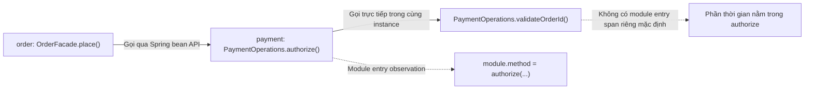
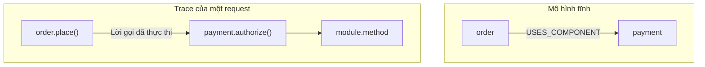
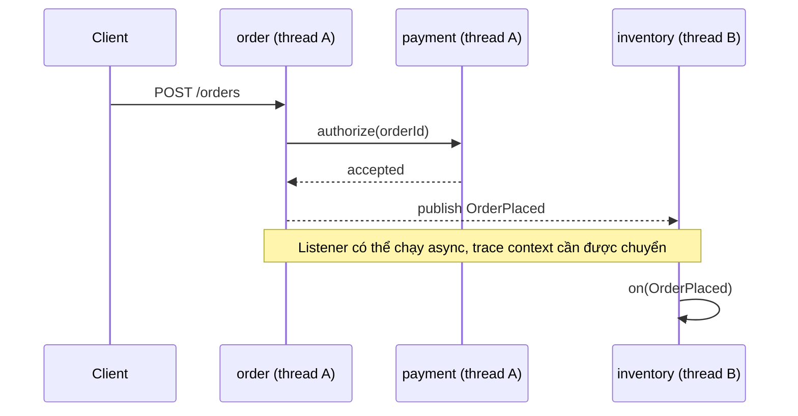

# Module method và phương thức được thực thi

Trong chương **Module spans**, chúng ta tìm hiểu cách Spring Modulith gắn một lời gọi Java cụ thể với ranh giới application module khi hệ thống Spring Boot đang chạy. Bài tập trung vào thuộc tính **`module.method`** trong module entry span: nó cho biết **phương thức nào đã được thực thi tại điểm vào module đang được quan sát**.

Đây là một phần của phạm vi **SPRING_MODULITH_DOCUMENTATION_OBSERVABILITY**: sinh tài liệu và module graph để hiểu ranh giới kiến trúc, rồi dùng Actuator, event metrics, tracing và context propagation để xem những ranh giới ấy được sử dụng thế nào trong vận hành.

Khác biệt cốt lõi:

- **Module graph** cho biết module nào *phụ thuộc* module nào theo mã nguồn.
- **Module entry observation/span** ghi nhận một *lần gọi đã được instrument và thực sự đi qua điểm vào*.
- **`module.method`** mô tả phương thức liên quan đến lần gọi đó; nó không phải danh sách mọi phương thức từng được khai báo trong module.

## 1. Mục tiêu và thuật ngữ

Sau bài này, bạn có thể:

1. Giải thích ý nghĩa của `module.method` và các thuộc tính đi cùng (`module.identifier`, `module.name`, `module.invocation-type`).
2. Chỉ ra phương thức có thể xuất hiện trên module span trong một ví dụ Java cụ thể.
3. Phân biệt lời gọi **bean API**, method nội bộ, self-invocation và event listener.
4. Đọc một cây trace và suy luận điểm vào module nào chạy, thời gian tương đối, lỗi và giới hạn của phép đo.
5. Điều tra vì sao code đã chạy nhưng không thấy `module.method` trên trace, đặc biệt khi xử lý bất đồng bộ.

| Thuật ngữ | Diễn giải trong bài |
| --- | --- |
| **Application module** | Đơn vị chức năng logic bên trong ứng dụng Spring Boot, được Spring Modulith phát hiện từ cấu trúc package hoặc cấu hình |
| **Module API** | Các kiểu/component được module công bố cho phần khác sử dụng |
| **Module entry** | Điểm một lời gọi đi vào hành vi của module được instrumentation nhận biết |
| **Micrometer Observation** | Vùng quan sát có vòng đời bắt đầu/kết thúc, có tên và key-value |
| **Span** | Bản ghi một thao tác có thời điểm bắt đầu, thời lượng, quan hệ trace và các thuộc tính |
| **`module.method`** | Thuộc tính mô tả phương thức được thực thi trên module tại module entry được ghi nhận |

Điều kiện quan trọng là **lời gọi được instrument**. Không phải mọi Java method đều tự động sinh span, kể cả khi chúng thuộc một module.

## 2. `module.method` nằm ở đâu trong module entry span?

Spring Modulith công bố bộ thuộc tính cho **Module Entry Span**. Theo tài liệu chính thức, bốn tên cần nhận biết là:

| Key | Ý nghĩa | Nhóm thông tin |
| --- | --- | --- |
| `module.identifier` | Định danh kỹ thuật của module, ví dụ `payment` | Module nào |
| `module.name` | Tên hiển thị của module, ví dụ `Payment` | Module nào |
| `module.invocation-type` | Hình thức gọi, điển hình `bean` hoặc `event listener` | Vào module bằng cách nào |
| **`module.method`** | **Phương thức được thực thi trên module** | **Đã thực thi phương thức nào** |

API `ModulithObservations.HighKeys.MODULE_METHOD` xác định `module.method` là một **high-cardinality key**. Các thuộc tính `module.identifier`, `module.name` và `module.invocation-type` thuộc nhóm low-cardinality của convention tiêu chuẩn. Điều này tác động đến cách dùng dữ liệu:

- **Trace** phù hợp để xem tên phương thức của từng thao tác, quan hệ cha–con và thời gian thực thi.
- **Metric tổng hợp** chỉ nên dùng các dimension có số lượng giá trị được kiểm soát. Không tự ý copy tên phương thức động, tham số, `orderId` hoặc `userId` vào metric tags.
- `module.method` là metadata của observation/span, **không phải một endpoint HTTP**, và cũng không phải tên của một counter event.

Một span minh họa trong trace backend có thể được biểu diễn như sau (giá trị phương thức là **ví dụ diễn giải**, không phải định dạng bắt buộc của mọi phiên bản):

```text
span: module entry - payment
traceId: 8f...              # Ví dụ rút gọn, không phải trace ID thực.
spanId: 13...
attributes:
  module.identifier = "payment"
  module.name = "Payment"
  module.invocation-type = "bean"
  module.method = "PaymentOperations.authorize(UUID)"
duration = 43 ms
```

Tên span thực tế, cách trình bày method (có/không có tên lớp, kiểu tham số), các key có được xuất thành attributes và hiển thị trên UI hay không phụ thuộc **Spring Modulith version, observation convention, tracer/exporter và backend**. Khi viết truy vấn cho production, hãy xem metadata thực tế của span trước rồi mới cố định cú pháp truy vấn.

### `getInvokedMethod` và phương thức thực sự được gọi

Ở tầng API của Spring Modulith, `ObservedModule#getInvokedMethod(MethodInvocation)` trả về **tên phương thức thực sự được gọi** theo thông tin invocation đang bị intercept; `ObservedModule#format(MethodInvocation)` cung cấp một chuỗi định dạng cho invocation. Hai API này cho thấy Modulith không đơn giản lấy tên module hay tên lớp để điền `module.method`: nó làm việc với **invocation cụ thể**.

Điều đó cũng giải thích vì sao cần chú ý đến Spring proxy, phương thức được intercept và trường hợp interface/implementation. Giá trị `module.method` nên được hiểu là nhận diện **method của entry invocation**; nó không phải một stack trace toàn bộ các method con.

## 3. Ví dụ: từ phương thức Java đến module span

Xét ứng dụng đặt hàng gồm ba application module: `order`, `payment` và `inventory`:

```text
com.acme.shop
├── ShopApplication.java
├── order
│   ├── OrderFacade.java            # Bean API của order
│   └── OrderPlaced.java            # Event công khai
├── payment
│   ├── PaymentOperations.java      # Bean API của payment
│   ├── PaymentReceipt.java         # DTO công khai
│   └── internal
│       └── PaymentAudit.java       # Bean nội bộ
└── inventory
    ├── InventoryListener.java      # Listener event
    └── internal
        └── StockRepository.java    # Phần nội bộ
```

Giả sử `@SpringBootApplication` nằm tại `com.acme.shop` và dùng cách phát hiện module mặc định. Các package `order`, `payment` và `inventory` là module; subpackage `internal` không phải API công khai theo cách tổ chức mặc định.

### 3.1. Module `payment`: điểm vào và các method nội bộ

```java
// com/acme/shop/payment/PaymentReceipt.java
package com.acme.shop.payment;

import java.util.UUID;

public record PaymentReceipt(UUID orderId, boolean accepted) {}
```

```java
// com/acme/shop/payment/PaymentOperations.java
package com.acme.shop.payment;

import java.util.UUID;
import org.springframework.stereotype.Service;

@Service
public class PaymentOperations {

    public PaymentReceipt authorize(UUID orderId) {
        validateOrderId(orderId);
        return new PaymentReceipt(orderId, true);
    }

    private void validateOrderId(UUID orderId) {
        if (orderId == null) {
            throw new IllegalArgumentException("orderId must not be null");
        }
    }
}
```

`PaymentOperations` là Spring bean trong package API của `payment`. Khi module khác gọi `authorize(UUID)` qua bean/proxy được Modulith instrument, một module entry observation có thể ghi nhận **method `authorize`**.

Ngược lại, `validateOrderId` là method `private` được gọi **nội bộ trong cùng instance**, không phải một module entry riêng. Nó vẫn chạy và góp phần vào thời gian của `authorize`, nhưng không tự tạo module span `payment` khác chỉ nhờ Spring Modulith.



### 3.2. Module `order`: gọi API ở module khác

```java
// com/acme/shop/order/OrderFacade.java
package com.acme.shop.order;

import java.util.UUID;
import com.acme.shop.payment.PaymentOperations;
import com.acme.shop.payment.PaymentReceipt;
import org.springframework.stereotype.Service;

@Service
public class OrderFacade {

    private final PaymentOperations payment;

    public OrderFacade(PaymentOperations payment) {
        this.payment = payment;
    }

    public PaymentReceipt place(UUID orderId) {
        return payment.authorize(orderId);
    }
}
```

Nếu một HTTP controller gọi Spring bean `OrderFacade.place()`, sau đó `OrderFacade` gọi Spring bean `PaymentOperations.authorize()`, ta có thể nhận được **hai module entry spans**, khi instrumentation, tracing và sampling cho phép:

```text
HTTP POST /orders
└── order [module entry; module.method ~ OrderFacade.place(...)]
    └── payment [module entry; module.method ~ PaymentOperations.authorize(...)]
```

Ký hiệu `~` có nghĩa chuỗi hiển thị là **gần đúng và dùng để minh họa**. Spring Modulith có thể biểu diễn tên method khác nhau tùy convention.

**Cách diễn giải đúng:**

1. `order` xuất hiện vì đường thực thi đã đi qua bean API của `order`.
2. `payment` xuất hiện vì `authorize` là điểm vào bean API `payment` được intercept.
3. Không có node riêng cho `validateOrderId`, dù method này đã chạy.
4. Nếu `authorize` ném exception, module entry observation vẫn kết thúc; việc backend biểu thị lỗi như thế nào phụ thuộc cấu hình observation/tracing và khả năng ghi nhận lỗi.

**Không suy ra:** Hai span chứng minh *mọi* phương thức trong `order` hay `payment` đã được gọi. Chúng chỉ thể hiện những điểm vào được quan sát trong lần thực thi tương ứng.

## 4. Phân biệt `module.method` với những tên method khác

Trong cùng một hệ thống có nhiều tên phương thức xuất hiện ở các nơi khác nhau:

| Nơi nhìn | Ví dụ | Ý nghĩa |
| --- | --- | --- |
| Mã Java | `PaymentOperations.authorize(UUID)` | Method được khai báo trong lớp |
| Module graph | `order → payment`, kiểu `USES_COMPONENT` | Quan hệ phụ thuộc tĩnh giữa module |
| **Module span** | **`module.method = authorize(...)`** | **Method tại điểm vào được ghi trong lần chạy** |
| HTTP server span | `POST /orders` | Request vào API HTTP, có thể bao trùm nhiều module |
| JDBC span | `SELECT ... FROM payment` | Thao tác DB, không phải tên module method |
| Manual `@Observed` span | `payment.gateway.call` | Điểm đo do người phát triển/công cụ khác tạo |
| Stack trace exception | `validateOrderId`, `authorize`, `place` | Chuỗi frame khi lỗi xảy ra, không chỉ các module entry |

Một trace có thể chứa cả HTTP span, module spans, SQL spans và span tích hợp ngoại vi. Chúng **không phải cùng một loại thao tác** và thường có quan hệ lồng nhau.

### Trường hợp method overload

Ví dụ trong `PaymentOperations` có:

```java
public PaymentReceipt authorize(UUID orderId) { /* ... */ }

public PaymentReceipt authorize(UUID orderId, String currency) { /* ... */ }
```

Hai method cùng tên nhưng khác tham số. Khi đọc `module.method`, hãy kiểm tra **chuỗi thực tế** do convention sinh ra để biết nó có hiển thị đầy đủ chữ ký hay không. Đừng chỉ dựa vào tên `authorize` để kết luận chính xác overload nào đã chạy nếu metadata không chứa thông tin phân biệt. Nếu cần, bổ sung span/event có chủ đích hoặc kiểm tra log/trace ở nơi thực thi phù hợp.

### Trường hợp interface và implementation

```java
public interface PaymentOperations {
    PaymentReceipt authorize(UUID orderId);
}
```

```java
@Service
class DefaultPaymentOperations implements PaymentOperations {
    @Override
    public PaymentReceipt authorize(UUID orderId) {
        return new PaymentReceipt(orderId, true);
    }
}
```

Đây là **phương án thay thế** cho ví dụ lớp `PaymentOperations` ở trên, không đặt hai khai báo cùng tên vào một dự án. Khi ứng dụng dùng interface proxy (JDK) hoặc class proxy, cách công cụ nhận biết method được invoke có thể chịu ảnh hưởng bởi kiểu proxy. Vì vậy, hãy ưu tiên **quan hệ thật giữa invocation và module** thay vì giả định `module.method` phải chứa tên class implementation.

## 5. Điều kiện để một method được quan sát

Spring Modulith dùng hạ tầng observability (trong đó có `ModuleObservabilityBeanPostProcessor` và interception bằng Spring AOP) để trang trí **Spring components thuộc API của application module**. Các điều kiện thực tế cần kiểm tra:

| Điều kiện | Vì sao quan trọng |
| --- | --- |
| Module được phát hiện đúng | Cần biết bean thuộc module nào |
| Bean thuộc API đã công bố | Điểm vào có ý nghĩa như giao tiếp giữa module |
| Bean nằm trong Spring container | Object tạo bằng `new` thủ công không nhận instrumentation của Spring bean |
| Có Modulith observability trên runtime classpath | Đăng ký thành phần instrument module entry |
| Method được gọi qua đường Spring AOP có thể intercept | Self-invocation, `private` và một số `final` method không đi qua proxy |
| Đường code được thực thi thật | Không có invocation thì không có span cho method đó |
| Tracer/exporter/backend/sampling hoạt động | Observation mới có thể nhìn thấy dưới dạng span trên công cụ truy vết |

### Dependency minh họa cho Spring Boot 4.x và Spring Modulith 2.2.x

Một cách bật Modulith Actuator và observability:

```groovy
// build.gradle (Groovy DSL)
dependencies {
    implementation platform('org.springframework.modulith:spring-modulith-bom:2.2.0')

    implementation 'org.springframework.modulith:spring-modulith-starter-core'

    // Runtime support: Modulith Actuator và module observability.
    runtimeOnly 'org.springframework.modulith:spring-modulith-starter-insight'

    // Ví dụ tracing OpenTelemetry trên Spring Boot 4.x.
    implementation 'org.springframework.boot:spring-boot-starter-opentelemetry'
}
```

Nếu chỉ muốn instrumentation, có thể dùng `spring-modulith-observability-core` phù hợp với phiên bản Modulith thay cho starter Insight. Dùng đúng BOM tương thích với phiên bản Spring Boot của dự án; Spring Boot 3.x có bộ starter/tracing exporter khác so với ví dụ Boot 4.x.

Cấu hình minh họa cho local, giả sử đã có OpenTelemetry collector hoặc backend nhận OTLP HTTP:

```yaml
# src/main/resources/application.yml
management:
  tracing:
    sampling:
      probability: 1.0
  opentelemetry:
    tracing:
      export:
        otlp:
          endpoint: "http://localhost:4318/v1/traces"
```

`probability: 1.0` giúp nhìn rõ các request khi học và thử nghiệm; production thường giảm sampling theo khối lượng và chi phí. Bộ xuất trace và hệ thống nhận trace là thành phần **riêng**; chỉ thêm Modulith instrumentation không làm dashboard tự xuất hiện.

### Khi method không tạo module entry span riêng

```java
@Service
public class PaymentOperations {

    public void authorize() {
        validate();    // Self-invocation trong instance.
    }

    public void validate() {
        // Phương thức này vẫn chạy.
    }
}
```

Khi gọi `authorize()` qua Spring proxy, interception có thể ghi nhận `authorize`; lời gọi `this.validate()` không tự đi qua proxy, nên không mặc nhiên sinh module entry span thứ hai. Cũng cần lưu ý rằng Java `public` chỉ là mức truy cập của class/method; việc có thuộc **API Spring Modulith** và có được proxy instrument hay không là câu hỏi khác.

## 6. `module.invocation-type` cho biết method được gọi theo cách nào?

Theo tài liệu Modulith, `module.invocation-type` phân biệt ít nhất hai dạng: **`bean`** và **`event listener`**.

### 6.1. Lời gọi Spring bean

Với `OrderFacade.place() → PaymentOperations.authorize()` ở phần 3, `module.invocation-type` của điểm vào `payment` thường thuộc nhóm `bean`. `module.method` mô tả method đã được gọi qua bean.

### 6.2. Lời gọi event listener

Giả sử `order` công bố event:

```java
// com/acme/shop/order/OrderPlaced.java
package com.acme.shop.order;

import java.util.UUID;

public record OrderPlaced(UUID orderId) {}
```

`inventory` nhận event bằng Spring listener:

```java
// com/acme/shop/inventory/InventoryListener.java
package com.acme.shop.inventory;

import com.acme.shop.order.OrderPlaced;
import org.springframework.context.event.EventListener;
import org.springframework.stereotype.Component;

@Component
public class InventoryListener {

    @EventListener
    public void on(OrderPlaced event) {
        reserveStock(event.orderId());
    }

    private void reserveStock(java.util.UUID orderId) {
        // Logic nghiệp vụ minh họa.
    }
}
```

Khi Spring dispatch `OrderPlaced` và Modulith nhận diện đây là **event listener invocation**, module entry observation của `inventory` có thể cho biết:

```text
module.identifier  = "inventory"
module.invocation-type = "event listener"
module.method       ≈ "InventoryListener.on(OrderPlaced)"
```

Giá trị của `module.method` ở đây tiếp tục là **mô tả minh họa**, không phải chuỗi literal bảo đảm. `reserveStock()` chạy bên trong listener nhưng không tự tạo thêm một module entry span.

Hai loại invocation phục vụ hai ý nghĩa:

| Thuộc tính | `bean` | `event listener` |
| --- | --- | --- |
| Điểm vào | Method trên Spring bean đã instrument | Method được hạ tầng event gọi |
| Dấu hiệu nghiệp vụ | Module khác yêu cầu một chức năng trực tiếp | Một event kích hoạt xử lý ở module nhận |
| `module.method` | Method API được gọi | Method listener được gọi |
| Liên hệ với HTTP request | Thường dễ lồng trong request trace khi đồng bộ | Có thể đồng bộ, bất đồng bộ hoặc retry ở thời điểm khác |
| Điều không chứng minh | Bean đã được gọi trong mọi request khác | Mỗi event đã được xử lý thành công và không trùng lặp |

Theo API `ObservedModule`, phương thức `isEventListenerInvocation(MethodInvocation)` phục vụ nhận diện kiểu invocation này. Với phiên bản và cơ chế event cụ thể, hãy đối chiếu quan sát thực tế; không phải mọi code xử lý sau event đều tự động trở thành span con trong cùng trace.

## 7. Đọc một cây trace đúng cách

Ví dụ cây trace minh họa:

```text
trace: request đặt hàng số 123 (minh họa)
HTTP POST /orders                      220 ms
└── order.place                      180 ms  [module.method ≈ OrderFacade.place]
    ├── payment.authorize             80 ms  [module.method ≈ PaymentOperations.authorize]
    │   └── HTTP call payment gateway  60 ms  [span hạ tầng riêng, nếu có]
    └── SQL INSERT orders              20 ms  [span JDBC, nếu có]
```

Trong ví dụ này:

1. **Parent/child** cho thấy quan hệ thực thi có trace context. Nếu `order` gọi `payment` đồng bộ trên cùng trace, module span `payment` có thể nằm bên dưới `order`.
2. **Duration** của span đo khoảng thời gian observation bao quanh lời gọi, có thể bao gồm lời gọi con và thời gian chờ. Không cộng thẳng duration các span lồng nhau để suy ra thời gian của request vì sẽ **đếm hai lần**.
3. **`module.method`** giúp tìm chính xác phương thức tại điểm vào module trong trace này, nhưng không hiển thị mọi câu lệnh hoặc method đã chạy bên trong.
4. **Span hạ tầng** như HTTP client, JDBC hoặc message producer có thể xuất hiện dưới module span nếu có instrumentation của thành phần tương ứng.
5. **Lỗi và exception** cần đối chiếu trạng thái span, logs và đường xử lý lỗi; riêng `module.method` không chứa kết quả nghiệp vụ thành công/thất bại.

### So sánh với module graph



Module graph có cạnh `order → payment` ngay cả khi chưa có request nào gọi `payment`. Trace chỉ xuất hiện khi execution thực sự qua điểm đo và trace được thu thập. Nếu graph có dependency nhưng trace không có module span tương ứng, chưa thể kết luận graph sai.

## 8. Module method trong xử lý bất đồng bộ và context propagation

Một ứng dụng nghiệp vụ thường phát event sau khi cập nhật trạng thái. Event có thể được lắng nghe ngay trên thread hiện tại hoặc xử lý bằng executor, transaction khác hay thậm chí chạy lại sau restart.



**Một event listener có thể thực thi mà không thấy span của nó bên dưới request gốc.** Nguyên nhân thường không nằm ở `module.method` mà ở vòng đời và ngữ cảnh của công việc:

- Nếu listener chạy **đồng bộ**, khi instrumentation/tracing phù hợp, span có cơ hội nằm trong trace của publisher.
- Nếu listener được xử lý **bất đồng bộ**, trace context có thể không được truyền sang thread/executor mới. Cần cấu hình Micrometer Context Propagation hoặc TaskDecorator tương ứng.
- Nếu dùng `@ApplicationModuleListener`, listener thường được xử lý bất đồng bộ, theo transaction mới sau commit. Trong hệ thống dùng Event Publication Registry, các lần retry hoặc republish sau restart có thể trở thành trace khác.
- Với công việc xử lý lại sau thời gian dài, dùng **correlation ID nghiệp vụ** (ví dụ mã event/đơn hàng với cơ chế kiểm soát dữ liệu nhạy cảm) để liên kết các trace có vòng đời khác nhau. Không bắt buộc mọi lần retry phải giữ nguyên một trace ID.

Ví dụ cách thay listener đồng bộ bằng phương thức của Spring Modulith để xử lý transaction event:

```java
import com.acme.shop.order.OrderPlaced;
import org.springframework.modulith.events.ApplicationModuleListener;
import org.springframework.stereotype.Component;

@Component
class InventoryEventHandler {

    @ApplicationModuleListener
    void on(OrderPlaced event) {
        // Xử lý event bằng transaction riêng sau transaction nguồn.
    }
}
```

Ví dụ trên chỉ minh họa hình thức listener. Để chạy đầy đủ, cần hạ tầng transaction, async execution và cấu hình event publication theo dự án; publisher nên phát event trong transaction nếu muốn dựa vào ngữ nghĩa sau commit. Đừng nhầm việc có `module.method` của listener với việc event đã xử lý bền vững hoặc thành công.

## 9. Quy trình kiểm tra `module.method` trong ứng dụng thực tế

Thực hiện trong môi trường local hoặc staging với trace backend được cấu hình và quyền truy cập phù hợp.

| Bước | Thao tác | Điều cần xác minh |
| --- | --- | --- |
| **1** | Xem module graph hoặc `/actuator/modulith` | `order` và `payment` được nhận diện đúng; `order` phụ thuộc bean API của `payment` |
| **2** | Xem package và Spring bean | `PaymentOperations` thuộc API module, là bean được Spring quản lý |
| **3** | Kiểm tra dependencies | Có Modulith observability và Micrometer tracer/exporter tương thích |
| **4** | Tạo một request thử nghiệm đi qua `authorize` | Đường code có thực sự được gọi không; request thành công hay thất bại |
| **5** | Mở trace trong backend | Có module span `payment`, key `module.identifier` và `module.method` phù hợp |
| **6** | Xem parent/child và duration | Method `authorize` có nằm dưới `place` không; span con nào chiếm thời gian |
| **7** | Thử đường xử lý event/async | Listener có module method không; span còn cùng trace hay cần correlation |
| **8** | Đối chiếu log và event metrics | Không suy ra listener thành công hoặc lượng event chỉ từ `module.method` |

### Ví dụ điều tra một request

Giả sử `POST /orders` trả `200` nhưng không thấy span `payment`. Có thể kiểm tra lần lượt:

1. **Lời gọi thực sự:** Request đã đi qua `payment.authorize` chưa, hay có nhánh bỏ qua thanh toán?
2. **Đúng bean:** `PaymentOperations` có được lấy từ Spring container hay được tạo thủ công?
3. **Điểm vào được instrument:** Bean có nằm trong module API, có qua proxy, method có được interceptor chặn không?
4. **Dependencies:** Có `spring-modulith-observability-core` hoặc `starter-insight` trên runtime classpath?
5. **Tracing:** Tracer, OTLP exporter, endpoint nhận, sampling và backend có hoạt động?
6. **Hiển thị UI:** Trace backend có đang lọc attribute sai tên, sai thời gian hoặc sai service?

Đôi khi span tồn tại nhưng UI gom nhóm theo service/operation name khác với `module.method`. Hãy mở **span attributes** trước khi kết luận không có dữ liệu.

## 10. Những giới hạn và lỗi hiểu nhầm phổ biến

| Nhận định | Đúng hay sai? | Giải thích |
| --- | --- | --- |
| “`module.method` liệt kê mọi method trong module.” | **Sai** | Nó mô tả method tại một entry invocation được quan sát |
| “Có span `authorize` thì `validateOrderId` đã chạy.” | **Tùy đường code** | Với ví dụ phần 3, điều đó đúng theo implementation; bản thân span không mô tả từng câu lệnh hoặc mọi nhánh |
| “Một Spring bean `@Service` bất kỳ đều có module span.” | **Sai** | Cần xem nó có thuộc API module và có được instrument hay không |
| “Không thấy method span nghĩa là method chưa chạy.” | **Sai** | Có thể method nội bộ, self-invocation, chưa có tracer/exporter, sampling hoặc lỗi propagation |
| “`module.method` là metric tag phù hợp để gắn mọi request ID.” | **Sai** | Đây là high-cardinality observation key; thêm ID động vào metric tag gây bùng nổ cardinality |
| “`module.method` chứng minh transaction thành công.” | **Sai** | Cần đối chiếu exception/status, transaction, log và trạng thái nghiệp vụ |
| “Module graph có `USES_COMPONENT` thì luôn thấy child span.” | **Sai** | Graph tĩnh; span phụ thuộc execution và instrumentation |
| “Event listener span luôn nằm trong trace của publisher.” | **Sai** | Async, retry và restart có thể tách traces; cần context propagation/correlation |

### Cách sử dụng `module.method` có trách nhiệm

Nên ưu tiên giá trị diễn tả method ở cấp ứng dụng, tránh đưa dữ liệu người dùng hay định danh bí mật vào convention. Chẳng hạn, method `authorize(UUID)` có thể là thông tin kỹ thuật hữu ích; việc chèn `orderId=...` vào tên span hoặc metric tags có thể làm lộ dữ liệu hoặc tăng cardinality không cần thiết. Đừng dùng số lượng **distinct `module.method`** để thay thế metrics về tốc độ, lỗi hoặc độ trễ; nên cấu hình metrics riêng cho SLI/SLO.

## 11. Bài tập tự kiểm tra

Giả sử ứng dụng gồm:

```text
com.example.booking
├── BookingApplication.java
├── booking
│   ├── BookingFacade.java          # @Service, API package
│   └── internal
│       └── BookingValidator.java   # @Component, internal
├── pricing
│   ├── PricingOperations.java      # @Service, API package
│   └── Quote.java                   # record, API package
└── notification
    └── BookingNotifier.java        # @Component, @EventListener
```

Luồng xử lý:

1. HTTP controller gọi `BookingFacade.reserve()` qua Spring bean.
2. `reserve()` gọi `PricingOperations.quote()` qua injected Spring bean.
3. Bên trong `quote()` gọi `this.checkInput()`.
4. `BookingFacade` phát event `BookingReserved` và `BookingNotifier.on()` xử lý.

**Câu hỏi:**

1. Những method nào có khả năng được ghi thành `module.method` ở các module entry spans?
2. `this.checkInput()` có tự tạo module span riêng không? Vì sao?
3. `Quote` là record public API. Có module entry span riêng cho constructor của `Quote` không?
4. Nếu listener chạy async, phải kiểm tra gì khi `BookingNotifier.on()` xuất hiện ở trace khác?
5. Hãy nêu một điểm khác biệt giữa cạnh `booking → pricing` trên module graph và span `pricing` trong request.
6. Một trace có duration `booking.reserve=300 ms` và `pricing.quote=120 ms` nằm lồng bên trong. Có được cộng thành `420 ms` cho request không?

**Gợi ý đáp án:**

1. `BookingFacade.reserve()` và `PricingOperations.quote()` là những ứng viên rõ nhất; `BookingNotifier.on()` cũng có thể được quan sát như event listener khi instrumentation tương ứng hoạt động.
2. Không mặc nhiên: self-invocation không qua Spring AOP proxy; `checkInput()` vẫn chạy nhưng thường không có module entry span riêng.
3. Không mặc nhiên: `Quote` là DTO/record, không phải Spring component API có advisor module entry.
4. Kiểm tra context propagation, async executor, thời điểm listener thực thi, retry và correlation ID.
5. Graph là dependency được phân tích tĩnh; span là bằng chứng đường gọi xảy ra trong một trace được lấy mẫu.
6. Không: hai span lồng nhau, duration của `reserve` có thể đã bao gồm `quote`; cộng trực tiếp là đếm hai lần.

## 12. Kết luận kiến thức

**`module.method` cho biết phương thức được thực thi tại một điểm vào application module đã được Spring Modulith quan sát.** Nó giúp kết nối API/module graph với đường thực thi thực tế, nhưng không đại diện mọi phương thức Java trong module và không tự xác nhận kết quả nghiệp vụ. Khi điều tra một luồng, hãy đọc đồng thời `module.identifier`, `module.invocation-type`, cấu trúc parent/child, thời lượng, trạng thái lỗi và ngữ cảnh async. Muốn kiểm chứng ranh giới, kết hợp **kiểm tra dependency tĩnh**, **Actuator module graph**, **module entry spans**, **event metrics** và **context propagation** đúng vai trò của từng tín hiệu.

## Tài liệu tham khảo

1. [Spring Modulith 2.2.0 – Production-ready Features: Observability Spans](https://docs.spring.io/spring-modulith/reference/2.2/production-ready.html): mô tả `module.method` là “Method executed on a module”, các tag `module.identifier`, `module.invocation-type` và `module.name`.
2. [Spring Modulith – ModulithObservations.HighKeys](https://docs.spring.io/spring-modulith/docs/current/api/org/springframework/modulith/observability/ModulithObservations.HighKeys.html): `MODULE_METHOD` là high-cardinality key.
3. [Spring Modulith – ObservedModule API](https://docs.spring.io/spring-modulith/docs/current/api/org/springframework/modulith/observability/ObservedModule.html): `getInvokedMethod(MethodInvocation)`, `format(MethodInvocation)` và `isEventListenerInvocation(MethodInvocation)`.
4. [Spring Modulith – ModuleObservabilityBeanPostProcessor](https://docs.spring.io/spring-modulith/docs/current/api/org/springframework/modulith/observability/support/ModuleObservabilityBeanPostProcessor.html): hỗ trợ intercept các Spring components do API module công bố.
5. [Spring Boot – Tracing](https://docs.spring.io/spring-boot/reference/actuator/tracing.html): cấu hình tracer, exporter và sampling.
6. [Spring Boot – Observability](https://docs.spring.io/spring-boot/reference/actuator/observability.html): Micrometer Observation và truyền context giữa luồng.
