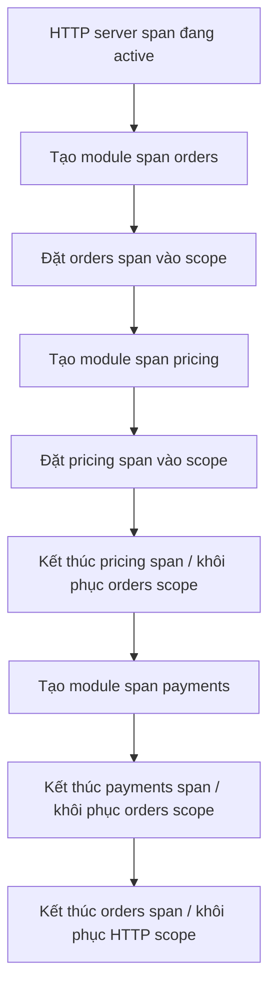
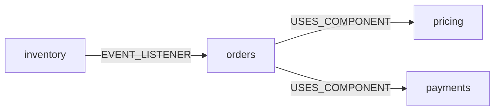
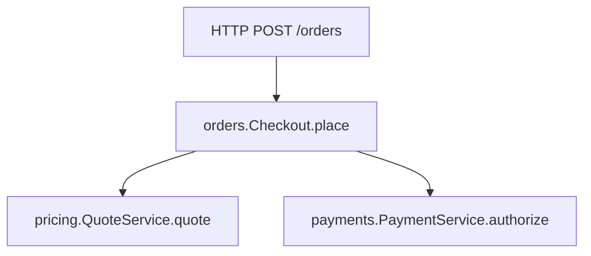
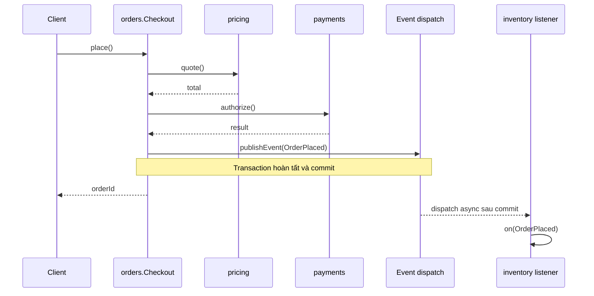

# Quan hệ parent-child giữa các span module

> **Chương:** Module spans  
> **Phạm vi:** Spring Modulith trong ứng dụng Spring Boot, với Micrometer Observation/Tracing và một tracer như OpenTelemetry hoặc Brave. Bài học tập trung vào cách đọc và kiểm chứng **quan hệ cha–con giữa những span quan sát điểm vào application module**, kể cả khi có lời gọi đồng bộ, listener sự kiện và chuyển luồng bất đồng bộ.

## Mục tiêu học tập

Sau bài này, bạn có thể:

1. Giải thích chính xác ý nghĩa của `traceId`, `spanId` và `parentSpanId`; phân biệt một **trace tree** với **module dependency graph**.
2. Dự đoán cây span điển hình khi request đi từ `orders` qua bean API của `pricing` và `payments` theo lời gọi đồng bộ.
3. Nhận biết khi nào một span module trở thành **con trực tiếp**, **con gián tiếp** hoặc **anh em** của span khác, và vì sao thứ tự thời gian đơn thuần không xác định quan hệ parent-child.
4. Giải thích ảnh hưởng của `@ApplicationModuleListener`, executor, context propagation, sampling và exporter đến hình dạng cây trace.
5. Sử dụng module graph, trace và dữ liệu nghiệp vụ để đánh giá đúng đường tương tác giữa các module trong lúc ứng dụng vận hành.

## 1. Span module nằm ở đâu trong hệ thống quan sát?

Trong Spring Modulith, một **application module** là ranh giới logic của ứng dụng Spring Boot, thường gắn với một package nghiệp vụ và các API mà module công bố. Phần observability của Modulith giúp quan sát các **điểm vào module** được hỗ trợ, ví dụ lời gọi Spring bean ở API module hoặc xử lý event listener. Khi tích hợp Micrometer Tracing, những observation này có thể xuất hiện dưới dạng **module entry span** trong trace.

Một hệ thống quan sát có các cấp dữ liệu khác nhau:

| Cấp độ | Trả lời câu hỏi nào? | Ví dụ |
| --- | --- | --- |
| Application module | Bộ phận nghiệp vụ nào sở hữu API hoặc event? | `orders`, `pricing`, `payments` |
| Module graph | Module nào phụ thuộc module nào tại mức mã/kiến trúc? | `orders → pricing` với `USES_COMPONENT` |
| Observation | Hoạt động nào được đo trong một lần thực thi? | Gọi method `QuoteService.quote()` |
| Span | Hoạt động đó có ID, thời gian và quan hệ tracing nào? | Span điểm vào `pricing` |
| Trace | Các span nào được liên kết bằng cùng trace context? | HTTP → `orders` → `pricing` |
| Metric | Giá trị tổng hợp nào được đo theo thời gian? | Số lần publish event |

**Cảnh báo quan trọng:** đồ thị phụ thuộc tĩnh và cây span mô tả hai khía cạnh khác nhau. Quan hệ `orders → pricing` trong module graph nói rằng mã của `orders` phụ thuộc vào API của `pricing`. Quan hệ parent-child trong trace nói rằng một span được bắt đầu khi **context của span cha đang có hiệu lực**. Không có quy tắc “mỗi cạnh dependency luôn tương ứng đúng một cạnh parent-child”.

## 2. Ba định danh quyết định parent-child

Một span trong distributed tracing thường có những trường:

| Trường | Vai trò | Quy tắc đọc |
| --- | --- | --- |
| `traceId` | Định danh toàn trace | Các span của một trace thường có cùng `traceId`. |
| `spanId` | Định danh span trong trace | Phân biệt từng khoảng hoạt động; phải tìm đúng `spanId` khi dựng cây. |
| `parentSpanId` | ID của span cha | Nếu `parentSpanId` bằng `spanId` của span khác trong cùng trace, ta có quan hệ cha–con trực tiếp. |

Một span **root** không có parent được ghi nhận trong trace hiện tại. Trong hệ thống phân tán, một span có parent ở service khác, nhưng parent có thể không xuất hiện trong dữ liệu mà bạn đang xem do sampling, thời gian lưu hoặc lỗi exporter.

Để xác định hai span là cha–con trực tiếp, kiểm tra đủ hai điều kiện:

1. Có cùng `traceId`.
2. `child.parentSpanId == parent.spanId`.

Chỉ có cùng `traceId` thì biết hai span thuộc cùng trace; chúng có thể là anh em, ông–cháu hoặc nằm ở những nhánh khác nhau.

### 2.1. Ví dụ bằng các ID minh họa

Bảng sau dùng ID viết tắt **cho dễ đọc**, không phải định dạng ID tracing thật:

| Span | `traceId` | `spanId` | `parentSpanId` |
| --- | --- | --- | --- |
| HTTP `POST /orders` | `T1` | `S1` | *(không có)* |
| `orders.Checkout.place()` | `T1` | `S2` | `S1` |
| `pricing.QuoteService.quote()` | `T1` | `S3` | `S2` |
| `payments.PaymentService.authorize()` | `T1` | `S4` | `S2` |
| `payments.internal.FraudCheck.evaluate()` *(nếu được instrument riêng)* | `T1` | `S5` | `S4` |

Cây tương ứng:

```text
Trace T1
└── S1 HTTP POST /orders
    └── S2 orders.Checkout.place
        ├── S3 pricing.QuoteService.quote
        └── S4 payments.PaymentService.authorize
            └── S5 payments.internal.FraudCheck.evaluate [instrument thủ công]
```

Ở đây:

- `S3` và `S4` là **anh em** vì cả hai có parent là `S2`.
- `S1` là **ông** của `S3`, không phải cha trực tiếp.
- `S5` là con của `S4` khi observation thủ công được tạo bên trong scope của `S4`.
- `S4` có thể chạy **sau** `S3` nhưng vẫn là anh em, không phải con của `S3`.

Trong các exporter theo chuẩn phổ biến, `traceId` thường là 128 bit (32 ký tự hex) và `spanId` là 64 bit (16 ký tự hex). Không dùng ví dụ `T1`/`S1` để kiểm tra độ dài ID thật.

## 3. Ai quyết định span cha?

Trong một đường tracing thông thường, khi instrumentation bắt đầu span mới, tracer xét **span context hiện hành**. Span mới thường nhận span đang active làm cha, rồi được đặt vào scope khi thực thi hoạt động tương ứng. Khi scope kết thúc, context được khôi phục.



Đây là diễn giải **logic về scope**; cách Micrometer/Brave/OpenTelemetry cài đặt nội bộ có thể khác chi tiết. Điều quyết định là context có hiệu lực **tại lúc tạo span**, không chỉ tên method hay package của class đang chạy.

### 3.1. Một vài hệ quả quan trọng

**Lồng nhau:** Khi `orders` gọi `pricing` đồng bộ, và điểm vào cả hai được instrument, `pricing` thường trở thành con của `orders` vì scope `orders` còn active.

**Gọi nối tiếp:** Khi `orders` gọi `pricing` xong rồi mới gọi `payments`, hai span đích thường là **anh em**. `payments` không tự trở thành con của `pricing` chỉ vì nó bắt đầu muộn hơn.

**Gọi xuyên nhiều tầng:** Nếu `pricing` thực sự gọi `tax` trong lúc span `pricing` active, span `tax` có thể là con trực tiếp của `pricing` và là cháu của `orders`.

**Có instrumentation xen giữa:** Một HTTP client span, database span hoặc observation thủ công có thể nằm giữa hai module span. Do đó, hai module có quan hệ caller-callee trong mã nhưng không nhất thiết phải có quan hệ cha–con **trực tiếp** trong trace; chúng có thể là ông–cháu.

**Context không được truyền:** Một tác vụ async không nhận được context sẽ tạo span root mới hoặc một trace khác, dù về nghiệp vụ nó bắt nguồn từ request cũ.

**Không tạo span:** Một lời gọi Java có thể đã thực thi nhưng không có span riêng do điểm đó không được instrument. Cây trace vì vậy **không phải** call stack đầy đủ.

## 4. Ví dụ nghiệp vụ: đặt hàng qua nhiều application module

Xét ứng dụng `shop` có các package:

```text
com.example.shop
├── ShopApplication.java
├── orders
│   ├── OrderPlaced.java
│   └── Checkout.java
├── pricing
│   └── QuoteService.java
├── payments
│   └── PaymentService.java
└── inventory
    └── internal
        └── OnOrderPlaced.java
```

Trong ví dụ đơn giản, `Checkout` gọi hai API module đồng bộ, sau đó phát event. Ta đặt bean API ở package gốc của từng module nhằm giữ đường đi rõ ràng.

### 4.1. Bean API thuộc pricing

```java
// com/example/shop/pricing/QuoteService.java
package com.example.shop.pricing;

import java.math.BigDecimal;
import org.springframework.stereotype.Service;

@Service
public class QuoteService {

    public BigDecimal quote(String sku, int quantity) {
        return new BigDecimal("125000").multiply(BigDecimal.valueOf(quantity));
    }
}
```

### 4.2. Bean API thuộc payments

```java
// com/example/shop/payments/PaymentService.java
package com.example.shop.payments;

import java.math.BigDecimal;
import java.util.UUID;
import org.springframework.stereotype.Service;

@Service
public class PaymentService {

    public void authorize(UUID orderId, BigDecimal total) {
        // Ví dụ minh họa: thực hiện kiểm tra/ủy quyền thanh toán.
    }
}
```

### 4.3. Module orders điều phối

```java
// com/example/shop/orders/OrderPlaced.java
package com.example.shop.orders;

import java.util.UUID;

public record OrderPlaced(UUID orderId) {}
```

```java
// com/example/shop/orders/Checkout.java
package com.example.shop.orders;

import com.example.shop.payments.PaymentService;
import com.example.shop.pricing.QuoteService;
import java.math.BigDecimal;
import java.util.UUID;
import org.springframework.context.ApplicationEventPublisher;
import org.springframework.stereotype.Service;
import org.springframework.transaction.annotation.Transactional;

@Service
public class Checkout {

    private final QuoteService pricing;
    private final PaymentService payments;
    private final ApplicationEventPublisher events;

    public Checkout(QuoteService pricing, PaymentService payments,
                    ApplicationEventPublisher events) {
        this.pricing = pricing;
        this.payments = payments;
        this.events = events;
    }

    @Transactional
    public UUID place(String sku, int quantity) {
        UUID orderId = UUID.randomUUID();
        BigDecimal total = pricing.quote(sku, quantity);
        payments.authorize(orderId, total);

        // Trong ứng dụng thật: lưu đơn hàng bằng repository trong transaction.
        events.publishEvent(new OrderPlaced(orderId));
        return orderId;
    }
}
```

Ví dụ bỏ qua repository, kết nối thanh toán thật và xử lý thất bại để tập trung vào **span tree**. Phương thức `place()` khai báo transaction, nhưng transaction chỉ được áp dụng khi lời gọi qua Spring proxy và hạ tầng transaction được cấu hình. Khi cần kiểm chứng listener chạy sau commit, hãy thêm dữ liệu lưu thực và transaction manager trong ứng dụng demo.

### 4.4. Kết quả trace đồng bộ có thể mong đợi

Giả sử HTTP controller của ứng dụng gọi `Checkout.place()` qua Spring bean, tracing đã được bật và instrumentation nhận diện các điểm vào module:

```text
HTTP POST /orders                            [root hoặc child của upstream]
└── orders.Checkout.place                    [module.identifier=orders]
    ├── pricing.QuoteService.quote           [module.identifier=pricing]
    │   └── (span khác nếu có instrumentation bổ sung)
    └── payments.PaymentService.authorize    [module.identifier=payments]
```

Đây là **cây minh họa**, không phải bảo đảm cả ba module span sẽ xuất hiện với tên và thứ bậc giống hệt trên mọi phiên bản. Đặc biệt, instrumentation của Spring Modulith hướng tới các điểm vào module được hỗ trợ; lời gọi `orders` từ controller chỉ tạo module entry span nếu điểm vào đó được instrument trong cấu hình đang chạy.

Trong cùng ứng dụng, module span của `pricing` và `payments` thường chia sẻ `traceId` của request và nhận parent theo scope hiện hành. Nếu tracing framework thêm span `@Observed` hay span khác xen giữa, cấu trúc direct parent có thể khác.

## 5. Phân biệt module graph và span tree bằng cùng một ví dụ

Graph dependency kiến trúc:



Trace tree của **một lần thực thi** có thể có nhánh:



Các khác biệt:

| Tiêu chí | Module graph | Span tree |
| --- | --- | --- |
| Đơn vị nút | Application module | Một span của hoạt động runtime |
| Đơn vị cạnh | Phụ thuộc mã/kiến trúc | Quan hệ trace parent-child |
| Có lặp một module nhiều lần? | Mỗi module thường được mô tả một lần | Có thể có nhiều span của cùng module trong một trace |
| Có thay đổi theo request? | Thường ổn định theo binary/module model | Có, tùy nhánh code, lỗi, sampling và instrumentation |
| Thể hiện độ trễ? | Không | Span có thời điểm bắt đầu/kết thúc |
| Thể hiện event listener đã chạy? | Chỉ phản ánh dependency listener | Có thể thấy hoạt động xử lý nếu nó được instrument và xuất trace |
| Cạnh có nhất thiết giống nhau? | Không | Không |

Một module có thể gọi hai lần cùng một API của module khác trong cùng request: graph vẫn chỉ có phụ thuộc `orders → pricing`; trace có thể ghi hai span `pricing` khác nhau, mỗi span mang `spanId` riêng.

## 6. Quan hệ parent-child khi có lồng nhiều tầng

Xét đường xử lý khác:

```text
orders.Checkout.place()
    -> pricing.QuoteService.quote()
        -> promotions.DiscountService.apply()
    -> payments.PaymentService.authorize()
```

Nếu cả ba điểm vào API module được instrument và không có span khác xen giữa, cây tương ứng có thể là:

```text
orders.Checkout.place
├── pricing.QuoteService.quote
│   └── promotions.DiscountService.apply
└── payments.PaymentService.authorize
```

Theo cây này, `promotions` là **con trực tiếp** của `pricing`, đồng thời là **cháu** của `orders`. Từ đó không thể kết luận rằng `orders` có dependency trực tiếp đến API của `promotions`: mã có thể chỉ biết `pricing`, còn `pricing` biết `promotions`.

### 6.1. Thời lượng span và khoảng chồng lấp

Giả sử:

| Span | Bắt đầu so với request | Kết thúc | Duration |
| --- | --- | --- | --- |
| HTTP | 0 ms | 140 ms | 140 ms |
| `orders` | 10 ms | 125 ms | 115 ms |
| `pricing` | 20 ms | 60 ms | 40 ms |
| `promotions` | 28 ms | 52 ms | 24 ms |
| `payments` | 70 ms | 110 ms | 40 ms |

Thời lượng `orders` thường bao gồm khoảng chờ các lời gọi đồng bộ được lồng trong nó. Vì vậy:

- `115 ms` của `orders` **không phải** 115 ms chỉ chạy logic riêng của `orders`.
- Không thể cộng tùy tiện toàn bộ duration của parent và child để ra thời gian của request; các khoảng thời gian bị tính trùng.
- Khi phân tích nơi chậm, nên xem waterfall và **self time/exclusive time** nếu backend hỗ trợ.
- Nếu thao tác chạy song song hoặc async, duration của span con có thể chồng lấp và thậm chí kết thúc sau span cha; **quan hệ cha–con không bắt buộc khoảng thời gian của con nằm trọn trong cha**.

Hai span có mốc thời gian nằm trong nhau vẫn có thể không phải quan hệ cha–con nếu `parentSpanId` không trỏ đúng `spanId` tương ứng.

## 7. Event listener bất đồng bộ: parent không còn hiển nhiên

Mở rộng ví dụ với listener ở module `inventory`:

```java
// com/example/shop/inventory/internal/OnOrderPlaced.java
package com.example.shop.inventory.internal;

import com.example.shop.orders.OrderPlaced;
import org.springframework.modulith.events.ApplicationModuleListener;
import org.springframework.stereotype.Component;

@Component
class OnOrderPlaced {

    @ApplicationModuleListener
    void on(OrderPlaced event) {
        // Ví dụ: giữ tồn kho cho đơn hàng.
        // Logic thật cần idempotency để xử lý retry.
    }
}
```

`@ApplicationModuleListener` trong Spring Modulith là shortcut cho event listener theo transaction, chạy bất đồng bộ với transaction mới. Khi event được publish trong transaction, listener thường được kích hoạt sau commit theo ngữ nghĩa mặc định của annotation.

### 7.1. Đường thời gian không quyết định parent



Sơ đồ là mô hình logic, **không định nghĩa thứ tự tuyệt đối** giữa việc client nhận response và thời điểm async listener bắt đầu. Điều quan trọng hơn là: listener thường chạy trên một thread/scope khác với nơi phát event.

Có ít nhất ba tình huống tracing cần phân biệt:

**Tình huống A — context được truyền đúng.** Executor/dispatcher mang trace context của luồng phát sang luồng nhận. Khi listener tạo span, nó có thể tiếp tục cùng `traceId` và trỏ đến parent context đã được capture. Span parent có thể **đã kết thúc** tại thời điểm child bắt đầu. Đây vẫn có thể là một quan hệ tracing hợp lệ.

**Tình huống B — context không được truyền.** Listener vẫn chạy và vẫn có thể được instrument nhưng tracer tạo trace mới, nên `traceId` khác với trace HTTP. Khi đó cây trace của request và cây trace của listener tách nhau.

**Tình huống C — hệ thống dùng cơ chế liên kết bất đồng bộ khác.** Một số instrumentation hoặc backend sử dụng **span link** để liên hệ công việc với context khởi phát. Link không giống `parentSpanId`; nó mô tả liên hệ mà không biến hai span thành cha–con.

Spring Modulith không tự bảo đảm rằng mọi event listener async luôn nằm dưới span module đã publish event. Để đọc đúng cần xem cấu hình tracing, executor, cơ chế dispatch và dữ liệu span thực.

### 7.2. Minh họa hai cây trace

**Context được giữ**, tùy nơi span context được capture:

```text
Trace T1
└── HTTP POST /orders
    └── orders.Checkout.place
        ├── pricing.QuoteService.quote
        ├── payments.PaymentService.authorize
        └── inventory.OnOrderPlaced.on  [async; parent theo captured context]
```

Đây là cách hiển thị **có thể xảy ra**, không phải hình dạng mặc định được cam kết cho mọi cấu hình. Span listener cũng có thể nằm dưới span khác trong trace hoặc được biểu diễn bằng link.

**Context bị đứt**:

```text
Trace T1
└── HTTP POST /orders
    └── orders.Checkout.place
        ├── pricing.QuoteService.quote
        └── payments.PaymentService.authorize

Trace T2
└── inventory.OnOrderPlaced.on
```

Thấy `T2` không đủ để kết luận “event không được xử lý”. Ngược lại, thấy listener cùng `T1` cũng không chứng minh side effect đã commit thành công.

### 7.3. Trace context khác transaction context

Trong ví dụ:

1. Transaction của `orders` phát event.
2. Transaction đó commit thành công.
3. Listener theo `@ApplicationModuleListener` xử lý trong transaction mới.

Nếu context tracing được truyền, span listener có thể nằm cùng trace với request. Tuy nhiên, hai transaction database vẫn là **hai transaction độc lập**. Lỗi ở listener sau commit không tự rollback giao dịch đặt hàng đã commit.

Vì vậy, parent-child của span là **quan hệ quan sát**, không phải quan hệ sở hữu transaction hoặc bảo đảm rollback dây chuyền.

## 8. Truyền context giữa thread và service

### 8.1. Lời gọi đồng bộ trong cùng thread

Micrometer Tracing thường duy trì current span trong scope của lời gọi đồng bộ. Khi caller gọi bean API tiếp theo, instrumentation có thể tạo span con dựa trên context đó.

Điều kiện thực tế: các Spring bean và điểm vào module phải được instrument phù hợp; những object tự tạo bằng `new`, lời gọi `this.method()`, method private/final trong cơ chế proxy có thể không tạo span tương ứng. **Không thấy span con không có nghĩa method không chạy.**

### 8.2. Chuyển qua executor bất đồng bộ

Với `@Async`, event listener async hoặc task scheduler, context có thể nằm trong `ThreadLocal` ở luồng phát và không tự động sang luồng nhận. Micrometer Context Propagation hỗ trợ capture/restore context khi được cấu hình.

Ví dụ với các phiên bản Spring Boot 3.x hỗ trợ `ContextPropagatingTaskDecorator`:

```java
import org.springframework.context.annotation.Bean;
import org.springframework.context.annotation.Configuration;
import org.springframework.core.task.support.ContextPropagatingTaskDecorator;

@Configuration(proxyBeanMethods = false)
class TracingAsyncConfiguration {

    @Bean
    ContextPropagatingTaskDecorator contextPropagatingTaskDecorator() {
        return new ContextPropagatingTaskDecorator();
    }
}
```

Decorator cần được áp dụng cho **executor thực sự chạy listener**. Nếu ứng dụng tự khai báo `ThreadPoolTaskExecutor` mà không cấu hình decorator cho nó, chỉ có một bean decorator trong context chưa đủ để khẳng định trace context được truyền. Cách áp dụng và auto-configuration cần đối chiếu với phiên bản Spring Boot đang chạy.

Khi dùng Reactor hoặc hạ tầng messaging, cần kiểm tra context propagation theo cơ chế của stack đó; không suy ra hành vi của Reactor context chỉ từ cách hoạt động `ThreadLocal`.

### 8.3. Qua HTTP sang tiến trình khác

Trong distributed tracing, truyền trace context qua HTTP thường dùng header `traceparent` của W3C Trace Context:

```http
traceparent: 00-4bf92f3577b34da6a3ce929d0e0e4736-00f067aa0ba902b7-01
```

Ví dụ trên chứa phiên bản, trace ID, span ID và trace flags. Nếu client inject context và server extract thành công, span ở service nhận có thể chia sẻ `traceId` và nhận parent là context đến từ service gửi.

Lưu ý:

- OpenTelemetry và Brave đều có thể làm việc với các định dạng propagation thông dụng, nhưng hai phía phải cấu hình tương thích (W3C hoặc B3 nếu dùng).
- Header có thể đi qua API gateway, proxy và thư viện HTTP; mất hoặc thay header có thể làm đứt trace.
- Trong cùng một **modular monolith**, lời gọi Java trực tiếp giữa các module thường không qua HTTP, nên trước tiên kiểm tra scope/proxy thay vì tìm HTTP header.

## 9. Bật instrumentation để nhìn thấy cây span module

Nếu dự án quản lý version Spring Modulith bằng BOM tương thích, có thể dùng:

```groovy
dependencies {
    runtimeOnly 'org.springframework.modulith:spring-modulith-starter-insight'
}
```

Insight starter cung cấp các tích hợp để hiển thị mô hình module qua Actuator và ghi nhận tương tác module. Để trace xuất hiện trong backend còn cần Micrometer Tracing bridge và exporter/reporter.

Ví dụ **Spring Boot 3.5 + OpenTelemetry/OTLP HTTP**:

```groovy
dependencies {
    runtimeOnly 'org.springframework.modulith:spring-modulith-starter-insight'
    runtimeOnly 'io.micrometer:micrometer-tracing-bridge-otel'
    runtimeOnly 'io.opentelemetry:opentelemetry-exporter-otlp'
}
```

```yaml
spring:
  application:
    name: shop-modulith

management:
  tracing:
    sampling:
      probability: 1.0
  otlp:
    tracing:
      endpoint: http://localhost:4318/v1/traces
  endpoints:
    web:
      exposure:
        include: health,info,modulith,metrics
```

Đây là cấu hình **môi trường học tập**; `probability: 1.0` chỉ dùng khi phù hợp về lưu lượng và chi phí. `localhost:4318` giả định collector/backend OTLP HTTP chạy cùng máy hoặc cùng không gian mạng phù hợp. Trong container, `localhost` chỉ chính container đó.

Nếu dùng Brave, chọn bridge và Zipkin reporter tương ứng thay vì khai báo cả Brave lẫn OTel bridge. Nếu dùng Spring Boot 4.x, các tracing starter và một số tên thuộc tính export đã thay đổi: cần dựa trên tài liệu đúng phiên bản Boot/Modulith, không sao chép nguyên cấu hình Boot 3.x.

### 9.1. Các tag có ích trên module entry span

Các tag thường được Spring Modulith dùng để mô tả điểm vào module gồm:

| Tag | Mục đích | Ví dụ minh họa |
| --- | --- | --- |
| `module.identifier` | Định danh module được đi vào | `pricing` |
| `module.name` | Tên hiển thị của module | `Pricing` |
| `module.method` | Method được quan sát | `QuoteService.quote(..)` |
| `module.invocation-type` | Phân loại điểm vào | `bean` hoặc listener |

Tên/giá trị tag chính xác cần đối chiếu với phiên bản và dữ liệu trace thật. Các tag này giúp lọc **span module**, trong khi `traceId`, `spanId` và `parentSpanId` giúp dựng **cây span**. Không nên dùng `module.identifier` như một khóa thay thế cho `spanId`, vì cùng module có thể xuất hiện nhiều lần trong một trace.

### 9.2. Module Actuator không trả span tree

```http
GET /actuator/modulith
```

Endpoint này phục vụ mô hình kiến trúc module. Nó không phải API truy vấn cây trace. Để xem cây span, dùng backend tracing như Zipkin, Jaeger, Tempo hoặc công cụ có khả năng đọc dữ liệu trace qua exporter tương thích. Để kiểm tra event publish, dùng Micrometer metrics và dữ liệu nghiệp vụ phù hợp.

## 10. Phương pháp đọc cây span trong trace UI

Một quy trình điều tra có thể áp dụng:

1. **Chọn đúng trace.** Từ `traceId` trong log hoặc truy vấn theo service/time window, mở trace liên quan đến request cần kiểm tra. Lưu ý sampling có thể khiến trace vắng mặt.
2. **Tìm entry span.** Xác định span HTTP/server hoặc span đầu nguồn mà request đi vào ứng dụng.
3. **Lọc module spans.** Tìm span mang tag như `module.identifier`, ghi lại `spanId`, `parentSpanId`, `module.method`.
4. **Dựng parent-child theo ID.** Mỗi span con trỏ tới một parent ID; parent có thể là span HTTP, module span hoặc span của instrumentation khác.
5. **Đọc theo waterfall.** Quan sát duration, khoảng trùng thời gian, các nhánh nối tiếp/song song; không cộng trùng thời gian parent–child.
6. **Kiểm tra event/async.** Nếu listener không nằm trong trace, tìm thêm theo business correlation ID và tracing backend, xem executor/propagation.
7. **Đối chiếu graph tĩnh.** Truy cập `/actuator/modulith` để biết dependency dự kiến, rồi xem liệu request này có đi qua các module tương ứng không.
8. **Đối chiếu kết quả nghiệp vụ.** Trace được thu thập không tự xác nhận đơn đã lưu, thanh toán hoàn tất hay tồn kho cập nhật.

### 10.1. Đọc bằng metadata thay vì hình vẽ UI

Một số trace backend đặt parent span gần child trên waterfall; số khác nhóm span theo service hoặc thời gian. Khi màn hình làm bạn hiểu nhầm hai span kề nhau là cha–con, hãy kiểm tra metadata:

```json
{
  "traceId": "aaaaaaaaaaaaaaaaaaaaaaaaaaaaaaaa",
  "spanId": "2222222222222222",
  "parentSpanId": "1111111111111111",
  "name": "pricing.QuoteService.quote",
  "attributes": {
    "module.identifier": "pricing",
    "module.invocation-type": "bean"
  }
}
```

Đây là **mẫu khái niệm**, không đại diện nguyên mẫu JSON của một exporter cụ thể. Span cha phải có `spanId=1111111111111111` cùng `traceId`, nếu dữ liệu parent được xuất và đang hiển thị. Nếu không tìm thấy parent, có thể có **remote parent**, sampling, lưu trữ không đầy đủ hoặc lỗi truyền/export dữ liệu.

### 10.2. Parent không hiển thị khác parent không tồn tại

Nếu một module span có `parentSpanId` nhưng backend không trả được span cha, hãy phân biệt:

- Parent ở **upstream service** chưa được exporter hoặc backend truy vấn.
- Parent đã bị bỏ vì **sampling**, filtering hoặc retention.
- Trace được gửi qua nhiều pipeline/backend khác nhau.
- Parent đang ở **service khác** chưa được đưa vào phạm vi tìm kiếm của UI.
- Dữ liệu bị thiếu do lỗi exporter/network.

Không nên tự sửa `parentSpanId` hoặc kết luận span là root chỉ vì backend hiển thị nó ở dòng đầu.

## 11. Các dấu hiệu thường gây hiểu nhầm

| Hiện tượng | Diễn giải phù hợp | Cần kiểm tra |
| --- | --- | --- |
| `pricing` và `payments` cùng parent là `orders` | Hai nhánh sibling, có thể được gọi nối tiếp | `parentSpanId` và thời điểm bắt đầu/kết thúc |
| `payments` bắt đầu sau `pricing` | Chỉ là thứ tự thời gian; không suy ra `payments` là con `pricing` | ID của parent và scope khi tạo span |
| Graph có `orders → pricing` nhưng trace không thấy `pricing` | Request này chưa đi qua đường đó hoặc instrumentation/sampling/exporter không ghi nhận | Nhánh code, dependency, sampling, proxy |
| Một module xuất hiện 3 span trong cùng trace | Có thể cùng API được gọi 3 lần hoặc nhiều điểm vào được instrument | `spanId`, method, thời gian, caller |
| Child span kết thúc sau parent | Có thể xảy ra với tác vụ bất đồng bộ khi context cha đã được capture | Async dispatch, context capture, cấu hình executor |
| Listener nằm ở trace khác | Context không được truyền hoặc propagation bị thay đổi | Executor, task decorator, log, registry |
| Listener không có span nhưng event counter tăng | Event đã publish, chưa chắc listener chạy/được instrument/xuất trace | Transaction phase, registry, log, sampling |
| Span module ở giữa các HTTP/SQL span | Tracing thu nhiều loại hoạt động khác nhau trong một trace | Span tags, kind, instrumentation source |
| Một method xuất hiện span trùng nhau | Có thể vừa được Modulith instrument vừa có `@Observed`/agent | Cấu hình instrumentation và observation thủ công |
| Cùng traceId nhưng không thấy parent của một span | Dữ liệu trace thiếu hoặc parent remote | Truy vấn các service, retention, exporter, sampling |

## 12. Tránh tự tạo quan hệ parent-child sai

### 12.1. Không bọc thủ công mọi method

Spring Modulith tập trung quan sát **điểm vào application module**. Nếu thêm `@Observed` hoặc `Observation.createNotStarted(...)` vào mọi helper:

- Cây trace có thể trở nên rất sâu và khó đọc.
- Dễ xuất hiện hai span cho cùng một thao tác đã được instrument.
- Số lượng span và chi phí lưu trữ tăng nhanh.
- Mức chi tiết vượt nhu cầu kiểm chứng ranh giới module.

Chỉ bổ sung span thủ công cho đoạn công việc có giá trị phân tích riêng như kiểm tra rủi ro, truy cập hệ thống ngoài hoặc tác vụ xử lý kéo dài. Tên span và tag cần có cardinality hợp lý.

### 12.2. Không dựng cây bằng tên module

Nếu hai span cùng `module.identifier=payments`, không thể kết luận một span là cha của span còn lại. Hãy dựa vào trace/span IDs. Đồng thời, việc một span `payments` là child của `orders` không chứng minh tất cả dependency code giữa hai module đều là bean call.

### 12.3. Không nhầm trace context với business correlation

`traceId` liên hệ các span của một lần thực thi được quan sát. `orderId` liên hệ nhiều thao tác của **cùng đơn hàng**, bao gồm retry, task định kỳ, listener chạy sau và các luồng ở thời điểm khác. Một đơn hàng có thể xuất hiện trong **nhiều trace**.

Để hỗ trợ điều tra async:

- Truyền business ID cần thiết trong event và log nghiệp vụ.
- Duy trì trace context qua cơ chế được hỗ trợ nếu muốn parent-child/correlation tracing.
- Không gắn `orderId`, `customerId` hoặc các ID biến thiên cao làm **metric tag cardinality thấp**.
- Tránh ghi token, dữ liệu cá nhân hoặc thông tin thanh toán vào span attributes/log.

### 12.4. Không coi parent-child là quan hệ rollback

Trace cha tồn tại khi span con được tạo không có nghĩa transaction cha chịu trách nhiệm rollback mọi side effect của con. Điều này đặc biệt đúng khi tác vụ chạy sau commit, trong transaction mới hoặc ở service bên ngoài.

## 13. Thực hành kiểm chứng hai kịch bản

### Kịch bản A — Cây span cho lời gọi đồng bộ

**Chuẩn bị:** ứng dụng Spring Boot với `orders`, `pricing`, `payments`, Insight starter, bridge tracing, exporter đang hoạt động; dùng sampling 100% trong lab để dễ quan sát.

**Thực hiện:** gọi endpoint HTTP kích hoạt `Checkout.place()`. Xác định spans mang module identifiers và đọc `traceId/spanId/parentSpanId`.

**Mong đợi:** span `pricing` và `payments` thường có parent là scope `orders` đang active hoặc một span trung gian phù hợp. Nếu cùng parent, chúng là anh em; duration của `orders` bao trùm công việc đồng bộ của hai lời gọi.

**Chú ý:** nếu không có một module span nào, kiểm tra instrumentation và đường gọi qua Spring proxy trước khi suy ra cấu trúc runtime. Không cố “ép” ví dụ phải có đúng ba span vì bản tracing có thể thêm HTTP/observation spans.

### Kịch bản B — Listener bất đồng bộ sau commit

**Chuẩn bị:** module `inventory` có `@ApplicationModuleListener` cho `OrderPlaced`, transaction thực sự hoạt động, log ghi `orderId` khi publish và khi xử lý.

**Thực hiện:** cho đơn hàng commit, xác nhận listener đã chạy. Tra cứu `traceId` của request và listener. Thử với executor có cấu hình context propagation phù hợp và với đường cấu hình mà context không được truyền.

**Mong đợi:** khi propagation đúng, listener có thể cùng trace với bên phát và mang parent context có ý nghĩa; khi không truyền, listener có thể có trace riêng. Trong cả hai trường hợp, event processing cần được đánh giá qua log, publication registry và dữ liệu tồn kho.

**Biến thể:** cố tình rollback transaction đặt hàng. Với listener ở pha after-commit, không có listener span cho lần đó có thể là hành vi đúng; cần phân biệt với lỗi tracing.

## 14. Câu hỏi tự kiểm tra

**Câu 1.** Hai span `pricing` và `payments` có cùng `traceId`, nhưng `parentSpanId` của cả hai đều bằng `spanId` của `orders`. Chúng là cha–con hay anh em?

**Câu 2.** Span `payments` bắt đầu sau khi span `pricing` kết thúc 5 ms. Có đủ cơ sở kết luận `payments` là con của `pricing` không?

**Câu 3.** Trace UI hiện span `inventory.OnOrderPlaced.on` với traceId khác HTTP request, nhưng log cho thấy listener hoàn tất. Đây có phải bằng chứng Spring Modulith không thể quan sát listener?

**Câu 4.** Một module span có `parentSpanId` khác rỗng nhưng trace UI không hiển thị span cha. Nêu ba nguyên nhân có thể.

**Câu 5.** Module graph có `orders → pricing`. Có thể kết luận trong mọi request `pricing` là child trực tiếp của `orders` không? Vì sao?

**Câu 6.** Listener `@ApplicationModuleListener` xử lý sau commit trong transaction mới và span của nó thuộc cùng trace với request. Lỗi listener có tự rollback transaction đặt hàng không?

### Gợi ý đáp án

1. **Anh em** vì hai span có cùng parent trực tiếp là span `orders`.
2. **Không.** Thời gian bắt đầu/kết thúc không cho biết parent. Phải so `payments.parentSpanId` với `pricing.spanId`.
3. **Không.** Listener đã chạy; context tracing có thể không được truyền qua executor. Kiểm tra listener span tags, task decorator và propagation.
4. Parent ở upstream service/remote context, sampling/filtering, retention hoặc lỗi exporter; cũng có thể UI đang lọc service/time window.
5. **Không.** Graph là phụ thuộc tĩnh; request có thể không gọi API đó, instrumentation có thể thêm span trung gian hoặc có sampling.
6. **Không.** Quan hệ tracing không nối transaction lại. Transaction đặt hàng đã commit không tự rollback do listener ở transaction riêng thất bại.

## 15. Checklist đọc span module khi điều tra sự cố

- [ ] Đã xác định đúng request, service, thời điểm và `traceId`.
- [ ] Đã xác nhận tracer bridge, exporter/backend và sampling phù hợp.
- [ ] Đã lọc đúng module entry spans theo tags, không chỉ theo tên hiển thị.
- [ ] Đã đọc `spanId` và `parentSpanId` để xác nhận parent-child.
- [ ] Đã xem những span xen giữa trước khi kết luận hai module là cha–con trực tiếp.
- [ ] Đã xem độ trễ theo waterfall, tránh cộng trùng duration của parent và child.
- [ ] Nếu có async, đã kiểm tra context propagation, executor và trace/link của listener.
- [ ] Đã đối chiếu module graph với runtime mà không đảo hướng dependency event listener.
- [ ] Đã kiểm tra transaction, event registry, log và kết quả nghiệp vụ trước khi kết luận thành công/thất bại.
- [ ] Đã phân biệt thiếu span do sampling/exporter với việc method thực sự không chạy.

## 16. Kết luận

Quan hệ **parent-child** trong module spans được quyết định bởi **trace context hiện hành khi span được tạo**, có thể xác nhận bằng bộ ba `traceId`, `spanId`, `parentSpanId`. Cùng `traceId` không đủ để hai span là cha–con; chỉ cùng parent có thể khiến chúng là anh em.

Spring Modulith giúp bổ sung ngữ nghĩa application module cho các điểm thực thi được quan sát. Trong lời gọi bean đồng bộ, module spans thường hình thành cây lồng nhau theo scope; ở listener bất đồng bộ, quan hệ giữa span bên phát và span bên nhận phụ thuộc vào context propagation và cơ chế tracing đang dùng.

Hãy dùng **module graph** để đọc phụ thuộc kiến trúc, **trace tree** để đọc đường thực thi đã instrument và **log/metrics/dữ liệu nghiệp vụ** để xác nhận kết quả cuối cùng. Cách kết hợp này giúp kiểm chứng ranh giới mô-đun một cách chính xác khi ứng dụng Spring Boot vận hành.

### Tài liệu tham khảo

- [Spring Modulith — Production-ready Features](https://docs.spring.io/spring-modulith/reference/production-ready.html): module observability, module entry spans, Actuator và event metrics.
- [Spring Modulith — Fundamentals](https://docs.spring.io/spring-modulith/reference/fundamentals.html): ranh giới và API application module.
- [Spring Modulith — Working with Application Events](https://docs.spring.io/spring-modulith/reference/events.html): listener, giao tiếp event, transaction và publication registry.
- [Spring Boot — Observability](https://docs.spring.io/spring-boot/reference/actuator/observability.html): Micrometer Observation và context propagation.
- [Spring Boot 3.5 — Tracing](https://docs.spring.io/spring-boot/3.5/reference/actuator/tracing.html): Micrometer Tracing, tracer bridge, exporter và sampling.
- [OpenTelemetry — Traces](https://opentelemetry.io/docs/concepts/signals/traces/): trace, span, parent, span links và context.
- [W3C Trace Context](https://www.w3.org/TR/trace-context/): định dạng propagation HTTP như `traceparent`.
