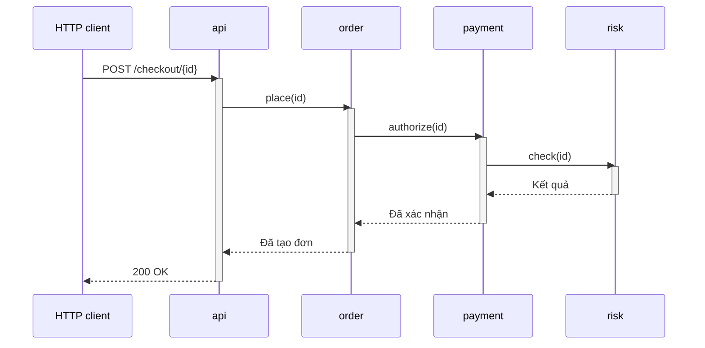
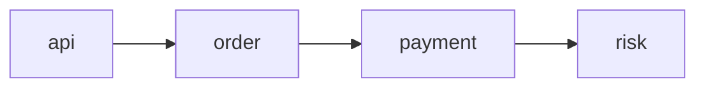
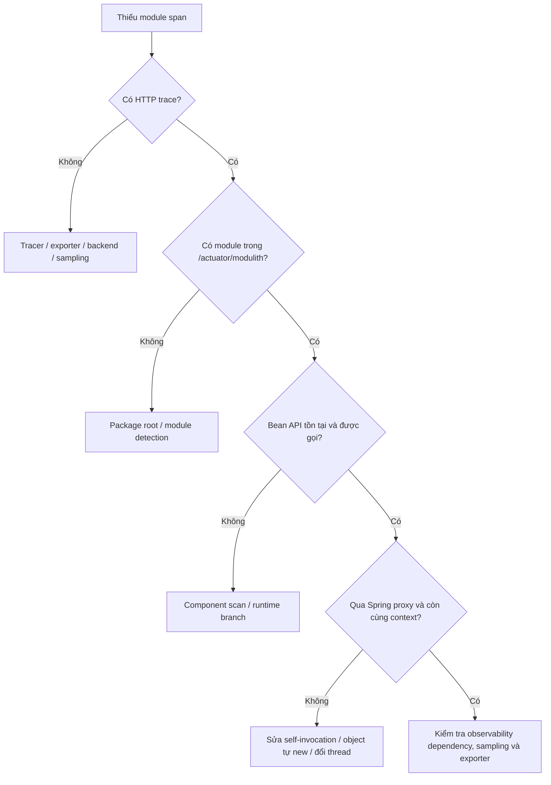

# Trace synchronous qua nhiều module

## 1. Bài toán: một yêu cầu đi qua nhiều application module

Trong ứng dụng Spring Boot được tổ chức bằng **Spring Modulith**, một request xử lý đặt hàng có thể bắt đầu ở module `api`, đi vào `order`, gọi module `payment` và tiếp tục sang `risk` để đánh giá giao dịch. Nếu các lời gọi diễn ra **đồng bộ**, cùng trên luồng thực thi hiện tại, ta muốn xem toàn bộ hành trình trong một trace:

```text
HTTP POST /checkout/{orderId}
  └─ api: CheckoutController.checkout(...)
      └─ order: OrderService.place(...)
          └─ payment: PaymentService.authorize(...)
              └─ risk: RiskService.check(...)
```

Trên giao diện tracing, các span cho biết **module nào được gọi, lời gọi nào là cha, thời gian chờ nằm ở đâu và lỗi xuất hiện ở bước nào**. Đây là một phần quan trọng của chương **Module spans** trong **SPRING_MODULITH_DOCUMENTATION_OBSERVABILITY**: dùng Spring Modulith tạo tài liệu ranh giới module và quan sát tương tác giữa các phần Spring Boot, rồi đối chiếu module graph, Actuator, event metrics, tracing và context propagation để kiểm chứng kiến trúc khi chạy.

**Mục tiêu sau bài học:**

1. Hiểu trace, span, `traceId`, `spanId`, quan hệ cha–con và thời lượng khi gọi đồng bộ qua nhiều module.
2. Biết điểm nào Spring Modulith có thể instrument và điều kiện để các module span được xuất tới backend.
3. Viết một luồng đồng bộ qua các Spring bean thuộc API module và đọc kết quả minh họa trên Zipkin.
4. Kiểm tra một trace thực tế với module graph tĩnh, tránh nhầm thời gian tổng, thời gian con và dữ liệu metrics.
5. Chẩn đoán span bị thiếu, trace bị tách hoặc kết quả sai do proxy, sampling, cấu hình tracing và việc chuyển luồng.

## 2. Trace và span trong lời gọi đồng bộ

Một **trace** ghi lại quá trình xử lý một hoạt động, thường bắt đầu từ HTTP request. Một trace gồm nhiều **span**; mỗi span đại diện một đoạn công việc và thường có:

| Thuộc tính | Ý nghĩa | Ví dụ |
| --- | --- | --- |
| `traceId` | Định danh chung của các span thuộc cùng trace | Cùng một giá trị cho HTTP, order, payment, risk |
| `spanId` | Định danh của span hiện tại | Mỗi lời gọi được instrument có ID riêng |
| `parentSpanId` | ID của span cha (nếu có) | Span payment có thể có cha là span order |
| Thời điểm bắt đầu | Mốc span được mở | Khi đi vào phương thức public của bean module |
| Duration | Tổng thời gian span tồn tại | 250 ms, bao gồm thời gian chờ con đồng bộ |
| Attributes/tags | Thông tin mô tả lời gọi | `module.identifier=payment` |
| Trạng thái/lỗi | Dữ liệu lỗi khi instrumentation ghi nhận | Exception xảy ra trong bước authorize |

Với lời gọi `order.place() → payment.authorize() → risk.check()`, quan hệ cha–con thường được thiết lập nhờ **current observation/tracing context** của luồng đang chạy. Khi span `payment` được tạo trong scope của `order`, nó trở thành span con của `order`; tương tự `risk` nằm dưới `payment`.



Lưu ý: **trình tự trên là ví dụ đồng bộ**. Nó không có `@Async`, message broker, reactive pipeline, `CompletableFuture` hay `@ApplicationModuleListener` chạy bất đồng bộ. Một lời gọi network đồng bộ cũng có thể giữ nguyên chuỗi cha–con nếu client/server được instrument và truyền trace context đúng, nhưng trong ví dụ này tất cả module cùng nằm trong **một ứng dụng, một JVM**.

## 3. Spring Modulith tạo module span tại đâu?

Spring Modulith có khả năng instrument **Spring component thuộc API công khai của application module** bằng cơ chế intercept lời gọi vào bean. Khi có nền tảng observability phù hợp, lời gọi được chuyển thành Micrometer observation và có thể tạo **module entry span** trong trace.

Điểm cần hiểu:

- Spring Modulith nhận diện **application module** qua cấu trúc mã/package và quy tắc mô-đun; danh sách module không đến từ trace.
- Instrumentation tập trung vào **lời gọi qua Spring bean thuộc API module**. Nó không tự động gắn một span cho mọi phương thức Java, mọi method private hay mọi câu lệnh trong module.
- Các Spring bean được AOP/proxy quản lý là điểm chặn quan trọng. Một đối tượng do code tự tạo bằng `new` hoặc lời gọi nội bộ `this.otherMethod()` có thể không đi qua interceptor như mong đợi.
- Nếu phương thức nằm trong package nội bộ và không được expose như API module, không nên mặc định rằng nó tự có module span riêng; thêm observation thủ công khi cần phân rã chi tiết.

Các thuộc tính (tag) mà tài liệu Spring Modulith mô tả cho **module entry span**:

| Tag | Ý nghĩa |
| --- | --- |
| `module.identifier` | Định danh kỹ thuật của module, ví dụ `order` |
| `module.name` | Tên module trong mô hình |
| `module.method` | Method được thực thi ở điểm vào module |
| `module.invocation-type` | Kiểu lời gọi, chẳng hạn `bean` hoặc `event listener` |

Với chuỗi gọi các bean trực tiếp, giá trị invocation type thường thuộc nhóm `bean`. Tag module là thông tin để lọc trace, **không tự xác nhận một dependency là hợp lệ**. Việc kiểm tra chu trình, API công khai hay phụ thuộc cấm cần dùng module graph và `ApplicationModules.verify()`.

## 4. Ví dụ mã nguồn: api → order → payment → risk

Để thấy nhiều module trong cùng trace, ta đặt mỗi Spring component công khai ở **package gốc của application module**:

```text
com.example.shop
├── ShopApplication.java
├── api/
│   └── CheckoutController.java
├── order/
│   └── OrderService.java
├── payment/
│   └── PaymentService.java
└── risk/
    └── RiskService.java
```

Với chiến lược phát hiện mặc định, bốn subpackage trực tiếp dưới `com.example.shop` tạo thành các application module. Đây là ví dụ học tập, các method nghiệp vụ được rút gọn để tập trung vào luồng synchronous.

### 4.1. Module risk: lớp công khai kiểm tra rủi ro

```java
// src/main/java/com/example/shop/risk/RiskService.java
package com.example.shop.risk;

import java.util.UUID;
import org.springframework.stereotype.Service;

@Service
public class RiskService {

    public void check(UUID orderId) {
        // Thực tế: xác minh quy tắc rủi ro hoặc gọi engine.
        // Phần nghiệp vụ được lược bỏ trong ví dụ.
    }
}
```

### 4.2. Module payment: gọi đồng bộ sang risk

```java
// src/main/java/com/example/shop/payment/PaymentService.java
package com.example.shop.payment;

import java.util.UUID;
import com.example.shop.risk.RiskService;
import org.springframework.stereotype.Service;

@Service
public class PaymentService {

    private final RiskService risk;

    public PaymentService(RiskService risk) {
        this.risk = risk;
    }

    public void authorize(UUID orderId) {
        risk.check(orderId);  // Đồng bộ: chỉ trả về sau khi check() kết thúc.
        // Thực tế: gọi cổng thanh toán và lưu trạng thái thanh toán.
    }
}
```

### 4.3. Module order: gọi đồng bộ sang payment

```java
// src/main/java/com/example/shop/order/OrderService.java
package com.example.shop.order;

import java.util.UUID;
import com.example.shop.payment.PaymentService;
import org.springframework.stereotype.Service;

@Service
public class OrderService {

    private final PaymentService payment;

    public OrderService(PaymentService payment) {
        this.payment = payment;
    }

    public void place(UUID orderId) {
        payment.authorize(orderId);
        // Thực tế: xác thực và lưu đơn theo quy tắc giao dịch đã thiết kế.
    }
}
```

### 4.4. Module api: HTTP endpoint kích hoạt chuỗi

```java
// src/main/java/com/example/shop/api/CheckoutController.java
package com.example.shop.api;

import java.util.UUID;
import com.example.shop.order.OrderService;
import org.springframework.web.bind.annotation.PathVariable;
import org.springframework.web.bind.annotation.PostMapping;
import org.springframework.web.bind.annotation.RequestMapping;
import org.springframework.web.bind.annotation.RestController;

@RestController
@RequestMapping("/checkout")
public class CheckoutController {

    private final OrderService orders;

    public CheckoutController(OrderService orders) {
        this.orders = orders;
    }

    @PostMapping("/{orderId}")
    public String checkout(@PathVariable UUID orderId) {
        orders.place(orderId);
        return "ok";
    }
}
```

Class khởi động đặt tại `com.example.shop.ShopApplication` với `@SpringBootApplication` để Spring Boot quét bean ở các package con:

```java
package com.example.shop;

import org.springframework.boot.SpringApplication;
import org.springframework.boot.autoconfigure.SpringBootApplication;

@SpringBootApplication
public class ShopApplication {
    public static void main(String[] args) {
        SpringApplication.run(ShopApplication.class, args);
    }
}
```

Trong ví dụ trên, không có lời gọi `new PaymentService(...)` hoặc `new RiskService(...)`: Spring đăng ký và inject các bean, cho phép instrumentation can thiệp vào API của module. Mỗi phương thức công khai mà module khác sử dụng nằm trong package API module; phương thức nội bộ sẽ không tự động tăng số lượng module span.

**Chú ý về ví dụ:** Phương thức `check()` đang là no-op nên thời gian thực thi thực tế sẽ rất ngắn. Các con số thời lượng ở phần tiếp theo chỉ mang tính **minh họa** để hướng dẫn cách đọc, không phải kết quả chạy mã no-op này.

## 5. Cấu hình observability và tracing để nhìn thấy span

Có hai phần độc lập nhưng phải cùng hoạt động:

1. **Spring Modulith instrumentation** tạo observation/span cho các lời gọi qua API module.
2. **Micrometer Tracing và exporter** kết nối observation với trace, rồi gửi tới backend như Zipkin hoặc một hệ thống tiếp nhận OTLP.

### 5.1. Dependency mẫu cho Spring Boot 4.x

Với Gradle Groovy DSL và dự án **Spring Boot 4.x + Spring Modulith 2.2.x**, sử dụng BOM phiên bản tương thích. Ví dụ:

```groovy
dependencies {
    implementation platform(
        "org.springframework.modulith:spring-modulith-bom:2.2.0"
    )

    implementation "org.springframework.modulith:spring-modulith-starter-core"

    // Actuator + khả năng quan sát module lúc chạy.
    runtimeOnly "org.springframework.modulith:spring-modulith-starter-insight"

    // Micrometer Tracing qua Brave, xuất trace tới Zipkin (Boot 4.x).
    implementation "org.springframework.boot:spring-boot-starter-zipkin"
}
```

Ví dụ giả định dự án **đã có** Spring Boot web starter và dependency management Spring Boot. Nếu chưa có REST starter thì cần bổ sung starter web phù hợp với dòng Spring Boot đang dùng.

Với Spring Boot **3.x**, cách ghép tracer và exporter khác, thường gồm Actuator, `micrometer-tracing-bridge-otel` và một exporter phù hợp (ví dụ OTLP). Không sao chép nguyên dependency Zipkin starter dành cho Boot 4.x sang dự án Boot 3.x khi chưa kiểm tra tài liệu tương ứng. Tương tự, Spring Modulith 1.x dùng tên artifact observability khác một số dòng 2.x; BOM và tài liệu đúng phiên bản luôn là nguồn xác thực.

Nếu chỉ muốn bật observability của Spring Modulith mà không dùng Insight starter, dòng 2.2.x có artifact `spring-modulith-observability-core` ở runtime; tuy nhiên starter Insight thuận tiện khi cần cả Actuator module model.

### 5.2. Cấu hình cục bộ

```yaml
spring:
  application:
    name: shop-modulith

management:
  tracing:
    sampling:
      probability: 1.0
  endpoints:
    web:
      exposure:
        include: "health,info,modulith,metrics"
```

`management.tracing.sampling.probability: 1.0` giữ lại toàn bộ các trace trong môi trường thử nghiệm, giúp dễ tìm một request. Trên môi trường có lưu lượng lớn, giảm sampling để kiểm soát chi phí và dữ liệu; cấu hình mặc định của Spring Boot chỉ lấy mẫu một phần request. Cần chạy backend Zipkin, bảo đảm exporter trỏ tới đúng endpoint và kiểm tra kết nối mạng.

**Không có endpoint HTTP `/actuator/traces` tiêu chuẩn chỉ vì đã thêm Insight starter.** `/actuator/modulith` cho biết **mô hình module**; trace cần được tìm ở backend được cấu hình, chẳng hạn giao diện Zipkin tại `http://localhost:9411`. Nếu không dùng Zipkin, xem trace ở backend OpenTelemetry/OTLP đã chọn.

## 6. Chạy một request và đọc trace synchronous

Khi ứng dụng, Zipkin và exporter đều chạy, gửi một yêu cầu:

```powershell
curl.exe -X POST http://localhost:8080/checkout/11111111-1111-1111-1111-111111111111
```

Phản hồi của mã ví dụ là `ok`. Tại Zipkin, chọn service tương ứng với `spring.application.name`, tìm trace mới và mở cây span. Một bản hiển thị **minh họa** có thể như sau:

```text
TraceId: 9d4f...a8be          Tổng thời gian request: 320 ms

HTTP POST /checkout/{orderId}             320 ms
└── [api] CheckoutController.checkout     310 ms
    └── [order] OrderService.place         290 ms
        └── [payment] PaymentService.authorize  240 ms
            └── [risk] RiskService.check   185 ms
```

Tên span thực tế và việc có span riêng cho controller hay không phụ thuộc instrumentation, thành phần được Spring Modulith xem là API module và cấu hình tracing. Điểm cần nhìn là **các module entry spans tương ứng với các lời gọi qua bean được hỗ trợ**, có cùng traceId và quan hệ cha–con hợp lý.

### 6.1. Cha bao gồm thời gian của con

Giả sử `order.place` kéo dài 290 ms, `payment.authorize` kéo dài 240 ms và `risk.check` kéo dài 185 ms. Nếu các span lồng nhau đúng như sơ đồ thì **không cộng 290 + 240 + 185** để tính thời gian yêu cầu. Thời lượng span cha đã chứa thời gian chờ các span con đồng bộ.

Với chuỗi lồng nhau không có nhánh song song:

- Tổng thời gian span order: 290 ms.
- Phần nằm trong span payment: 240 ms.
- Thời gian còn lại của order ngoài payment: xấp xỉ **50 ms**.
- Thời gian payment ngoài risk: xấp xỉ **55 ms**.

Đây là phép tính **self time gần đúng** khi một span cha chỉ có một span con đang xét và không có khoảng chồng lấn/khác biệt đáng kể. Nếu có nhiều span con chồng thời gian, hoặc các công việc không được instrument, phải xem timeline chi tiết; phép trừ đơn giản có thể sai.

```mermaid
gantt
    title Timeline minh họa (mili-giây)
    dateFormat X
    axisFormat %L
    section Request
    HTTP request :0, 320
    section Module spans
    api          :5, 315
    order        :10, 300
    payment      :20, 260
    risk         :35, 220
```



Sơ đồ Gantt chỉ minh họa quan hệ bao chứa và trật tự thời gian; công cụ tracing dùng dữ liệu timestamp thực tế, thường hiển thị span dưới dạng thanh ngang trong cùng một timeline.

### 6.2. Span cùng traceId nhưng khác spanId

Ví dụ mô phỏng cấu trúc ID:

| Span | traceId | spanId | parentSpanId |
| --- | --- | --- | --- |
| HTTP request | `T` | `S1` | Không có/đến từ client |
| api | `T` | `S2` | `S1` |
| order | `T` | `S3` | `S2` |
| payment | `T` | `S4` | `S3` |
| risk | `T` | `S5` | `S4` |

`T` và `S1` … `S5` chỉ là ký hiệu, không phải giá trị hex hợp lệ của một hệ thống tracing. Nhờ liên kết parent/child, ta hiểu được đường thực thi; chỉ nhìn một nhóm log có cùng traceId mà thiếu spanId/parentSpanId sẽ khó tái dựng thứ tự lồng nhau.

## 7. Kiểm chứng đường đi bằng module graph

Một trace cho biết **đã xảy ra điều gì** trên request được quan sát. **Module graph** cho biết cấu trúc phụ thuộc được phát hiện từ code và giúp đánh giá lời gọi đó có phù hợp với thiết kế hay không.

Với ví dụ này, các dependency tĩnh mong đợi:



Trong một test kiến trúc JUnit 5:

```java
package com.example.shop;

import org.junit.jupiter.api.Test;
import org.springframework.modulith.core.ApplicationModules;

class ArchitectureTests {
    @Test
    void verifiesApplicationModules() {
        ApplicationModules.of(ShopApplication.class).verify();
    }
}
```

Nếu Insight starter và Modulith actuator được bật, endpoint `GET /actuator/modulith` cung cấp mô hình module cùng dependency tĩnh. Có thể so danh sách module `api`, `order`, `payment`, `risk` và hướng phụ thuộc với trace. Không ép JSON có một cấu trúc tùy tiện; xem phản hồi thực tế theo phiên bản đang dùng.

**Một trace thấy `order → payment` không chứng minh mọi quy tắc kiến trúc đều đúng.** Ngược lại, một cạnh có trong module graph nhưng không xuất hiện ở trace của một request cụ thể có thể do nhánh xử lý không chạy hoặc span chưa được ghi. Phải kết hợp cả hai nguồn mới có bằng chứng thiết kế và vận hành.

## 8. Các tình huống cần chú ý

### 8.1. Hai lời gọi con nối tiếp là sibling, không phải nested

Giả sử `order.place()` lần lượt gọi `payment.authorize()` rồi `inventory.reserve()` và cả hai đều là lời gọi đồng bộ:

```java
public void place(UUID orderId) {
    payment.authorize(orderId);
    inventory.reserve(orderId);
}
```

Hai span `payment` và `inventory` cùng có cha là `order`, **không phải payment là cha của inventory**:

```text
order.place()
├── payment.authorize()
└── inventory.reserve()
```

Trên timeline, hai span con lần lượt xuất hiện. Điều này giúp phân biệt quan hệ **gọi nối tiếp** với **gọi lồng nhau**; có cùng traceId không đồng nghĩa tất cả span xếp thành một đường thẳng cha–con.

### 8.2. Lời gọi nội bộ không nhất thiết tạo module span mới

```java
public void place(UUID orderId) {
    validateOrder(orderId); // Method nội bộ trong cùng bean.
    payment.authorize(orderId);
}

private void validateOrder(UUID orderId) {
    // ...
}
```

`validateOrder()` không nhất thiết tạo span. Spring Modulith quan sát **điểm vào API module**, không hứa hẹn vẽ đầy đủ stack trace Java. Muốn đo đoạn validate, có thể thêm Micrometer `Observation` thủ công hoặc timer phù hợp; tránh instrument trùng ranh giới module đã có span.

Tương tự, `this.somePublicMethod()` là **self-invocation** trong cùng bean và thường không đi qua proxy Spring AOP; sử dụng `new PaymentService(...)` bên ngoài container cũng bỏ qua bean instrumentation. Khi một module span bị thiếu, xem luồng gọi qua Spring-managed proxy trước.

### 8.3. Khi xảy ra lỗi giữa chuỗi đồng bộ

Nếu `risk.check()` ném exception, lời gọi đồng bộ có thể khiến `payment.authorize()`, `order.place()` và HTTP endpoint cũng kết thúc lỗi. Trace có thể ghi trạng thái lỗi hoặc thuộc tính exception tùy instrumentation và xử lý exception trong ứng dụng.

Không mặc định rằng **mọi span cha** đều được đánh dấu error chỉ vì span con lỗi; một tầng cha có thể catch exception và xử lý fallback thành công. Hãy xem thời điểm, error tag, span events và HTTP status trước khi kết luận.

### 8.4. Đồng bộ trong một JVM khác đồng bộ qua HTTP

Các lời gọi bean giữa application module trong cùng JVM thường dùng **current tracing context** của thread đang chạy; không cần network header. Nếu module thực chất gọi một **dịch vụ từ xa** qua HTTP thì đó là thêm một ranh giới tiến trình. Để trace tiếp tục xuyên tiến trình, phải dùng HTTP client/server instrumentation và truyền trace context qua header, ví dụ W3C `traceparent`.

Với Spring Boot, nên dùng `RestClient.Builder` hoặc `WebClient.Builder` được auto-configure để có propagation tự động; client tạo thủ công có thể không được instrument. Đây là bài toán khác với việc đơn thuần inject Spring bean từ module cùng ứng dụng.

## 9. Vì sao mất span hoặc xuất hiện nhiều trace?

| Triệu chứng | Khả năng cần kiểm tra | Cách xác minh |
| --- | --- | --- |
| Không có trace cho HTTP request | Chưa cấu hình tracer/exporter/backend, sampling loại trace, sai service/time range | Kiểm tra dependency tracing, URL exporter, Zipkin, log và sampling |
| Có HTTP span nhưng không có module span | Thiếu Modulith observability runtime, bean không thuộc API module, lời gọi không qua proxy | Kiểm tra starter Insight, package, Spring bean và luồng gọi |
| Có order nhưng không có payment | Payment method không được gọi ở nhánh này; tự tạo object; self-invocation; method không được instrument | Đặt log/test tại payment, xác minh injection Spring và API boundary |
| Tất cả module span là span gốc riêng | Tracing context không được duy trì; observation scope bị tách | Kiểm tra context, thread, custom instrumentation và propagator |
| Trace thiếu risk nhưng business chạy | Thiếu instrumentation điểm vào risk hoặc dữ liệu trace bị loại/thất lạc | Xác minh bean/module, sampling, exporter và backend |
| Span có cùng traceId nhưng timeline đảo hoặc kéo dài bất thường | Có xử lý bất đồng bộ, clock skew qua nhiều host hoặc nested scope sai | Đối chiếu timestamp, thread, topology và span parent |
| Hiển thị hai span gần như trùng nhau | Đã tạo observation thủ công ngay trên điểm vào module được instrument | Xem instrumentation custom, `@Observed` và span mặc định |
| Không thấy trace sau khi dùng `@Async` | Context không được truyền qua executor hoặc trace sang task khác | Kiểm tra `ContextPropagatingTaskDecorator`/Micrometer Context Propagation |

Một quy trình chẩn đoán ngắn:



### Context propagation: giới hạn của “synchronous”

Trong cùng luồng gọi đồng bộ, span hiện hành thường đi theo **scope** một cách tự nhiên. Nhưng nếu code chuyển sang `@Async`, `CompletableFuture.supplyAsync()`, executor riêng, Kafka hoặc listener chạy sau commit, mối liên hệ span có thể bị đứt nếu không truyền context. Sử dụng cơ chế Spring/Micrometer Context Propagation phù hợp với executor/transport và kiểm tra trace thực tế.

**Không gán thủ công cùng traceId rồi coi mọi span có quan hệ cha–con đúng.** Tính đúng đắn cần cả context, parent span và thời điểm thực thi phù hợp. Một tác vụ tách rời thật sự có thể thích hợp với trace khác hoặc span link thay vì giả tạo quan hệ parent.

## 10. Kết hợp với metrics và log để chẩn đoán hiệu năng

| Dữ liệu | Dùng để làm gì? | Giới hạn |
| --- | --- | --- |
| Module spans/traces | Xem đường thực thi của **một giao dịch cụ thể**, thời lượng từng lời gọi module | Sampling có thể khiến không có trace; một trace không đại diện cho toàn hệ thống |
| HTTP metrics / timer nghiệp vụ | Đo tốc độ, tỷ lệ lỗi và phân phối độ trễ trong nhiều giao dịch | Không tự cho biết đường đi cụ thể của một request |
| Spring Modulith event metrics | Đếm các domain event được **công bố** | Không chứng minh listener xử lý thành công |
| Log có `traceId` / `spanId` | Liên kết log lỗi/nhật ký với request và span | Cần log correlation và context propagation đúng |
| Module graph / Actuator Modulith | Xem quan hệ phụ thuộc **tĩnh** và ranh giới module | Không cho biết lời gọi nào đã chạy trong request |

Ví dụ: dashboard HTTP báo p95 `POST /checkout` tăng từ 300 ms lên 900 ms sau triển khai (**số liệu giả định**). Chọn một trace chậm và thấy `payment.authorize` chiếm gần hết thời gian của `order.place`. Như vậy có cơ sở điều tra `payment` và phụ thuộc của nó. Nhưng để kết luận tối ưu thành công, phải nhìn **metrics trên một tập request đủ lớn**, không chỉ một trace bất thường hoặc một trace nhanh.

Trong môi trường dùng Micrometer Tracing, Spring Boot thường có cơ chế log correlation với trace ID/span ID. Có thể lọc log theo traceId của request, đối chiếu với span ở Zipkin. Tránh đưa ID giao dịch, dữ liệu thanh toán, thông tin cá nhân vào metric tag hoặc trace attribute không cần thiết; metric cardinality tăng mạnh nếu gắn UUID theo từng request.

## 11. Bài thực hành có kiểm chứng

Thực hiện theo thứ tự để tránh kết luận nhầm từ một nguồn dữ liệu:

1. **Kiến trúc:** giữ `api → order → payment → risk`; chạy test `ApplicationModules.of(ShopApplication.class).verify()` và xem `/actuator/modulith`.
2. **Bean:** xác minh các class `OrderService`, `PaymentService` và `RiskService` được Spring quản lý qua component scan (có thể kiểm tra `/actuator/beans` nếu expose và được cấp quyền).
3. **Instrument:** thêm Insight starter và tracing exporter theo phiên bản Spring Boot; chạy Zipkin hoặc backend đã chọn.
4. **Trace:** đặt sampling `1.0` chỉ trong môi trường học tập, gọi `POST /checkout/{orderId}`, tìm trace và kiểm tra traceId chung, spanId riêng, parent hợp lý.
5. **Tính thời gian:** chọn ba span lồng nhau, ghi thời lượng cha/con, tránh cộng dồn thời lượng bao chứa.
6. **Thử nhánh khác:** sửa `order.place()` gọi `payment` rồi `inventory` tuần tự; xác nhận hai span con là **sibling** trong trace.
7. **Thử lỗi:** làm `risk.check()` ném exception có chủ đích trong môi trường test; kiểm tra HTTP status, span error và log theo traceId.
8. **Thử một điểm không qua proxy:** tạo `private validate()` hoặc self-invocation; so sự khác nhau giữa method stack và module spans. Chỉ thêm observation khi cần chi tiết thực sự.

Checklist tự đánh giá:

- [ ] Hiểu quan hệ giữa `traceId`, `spanId` và `parentSpanId` khi gọi đồng bộ.
- [ ] Biết Spring Modulith instrument điểm vào của Spring component thuộc **API module**, không tự động instrument mọi method.
- [ ] Có một trace chứa chuỗi module spans phù hợp với luồng đã thực sự thực thi.
- [ ] Đọc được `module.identifier`, `module.name`, `module.method` và `module.invocation-type`.
- [ ] Không cộng lặp thời gian span cha với con.
- [ ] Phân biệt một lời gọi **nested** với hai lời gọi **sibling** nối tiếp.
- [ ] Đối chiếu trace với graph tĩnh và kiểm tra ranh giới kiến trúc riêng.
- [ ] Biết tìm lỗi mất span do component scan, Spring proxy, sampling, exporter và context propagation.
- [ ] Không kết luận hiệu năng tổng thể từ một trace đơn lẻ.

## 12. Tài liệu tham khảo

- [Spring Modulith — Production-ready Features](https://docs.spring.io/spring-modulith/reference/production-ready.html): Insight starter, instrument các điểm vào module và bốn tag của module entry span.
- [Spring Modulith — Fundamentals](https://docs.spring.io/spring-modulith/reference/fundamentals.html): application module, API công khai và quy tắc phụ thuộc.
- [Spring Boot — Tracing](https://docs.spring.io/spring-boot/reference/actuator/tracing.html): Micrometer Tracing, sampling, exporter Zipkin/OTLP, log correlation và propagation.
- [Spring Framework — Observability Support](https://docs.spring.io/spring-framework/reference/integration/observability.html): Observation, instrumentation và tracing.
- [Spring Framework — AOP Proxying Mechanisms](https://docs.spring.io/spring-framework/reference/core/aop/proxying.html): giới hạn Spring proxy, bao gồm self-invocation.
- [Spring Boot — Actuator Endpoints](https://docs.spring.io/spring-boot/reference/actuator/endpoints.html): cách expose và bảo vệ endpoint.
