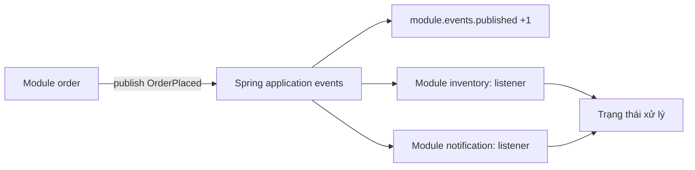
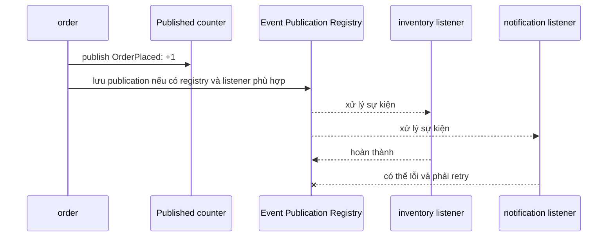
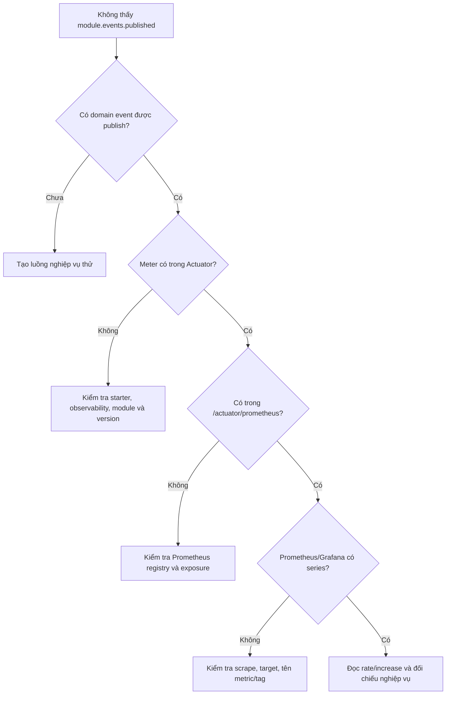

# Metric module.events.published

Trong ứng dụng Spring Boot tổ chức bằng **Spring Modulith**, nhiều module phối hợp bằng application events. Chẳng hạn, module `order` phát sự kiện `OrderPlaced` sau khi đặt hàng và module `notification` dùng sự kiện đó để gửi thông báo. Khi hệ thống đang chạy, nhóm phát triển cần trả lời một câu hỏi cơ bản: **có bao nhiêu sự kiện đã được ứng dụng phát ra?**

Spring Modulith cung cấp metric **`module.events.published`** để theo dõi số lần phát các domain event được instrumentation của framework ghi nhận. Đây là một **Micrometer Counter**, cho phép xem số lượng sự kiện và tốc độ phát theo thời gian. Metric hỗ trợ kết hợp **module graph, Actuator, metrics, tracing và context propagation** để đối chiếu kiến trúc mô-đun với hành vi runtime.

Bài thuộc chương **Event metrics** của học phần `SPRING_MODULITH_DOCUMENTATION_OBSERVABILITY`. Trọng tâm là ý nghĩa của `module.events.published`, các tag đi kèm, cách đọc qua Actuator/Prometheus, cách dùng trong chẩn đoán và các giới hạn quan trọng khi suy luận về quá trình xử lý sự kiện.

Sau bài học, bạn có thể:

- Nhận diện `module.events.published` là counter đo **event publication** thay vì số listener đã xử lý xong.
- Phân biệt metric tổng hợp với counter chi tiết theo module và kiểu sự kiện.
- Đọc số liệu bằng Spring Boot Actuator và Prometheus, tính tốc độ phát/số lượng trong khoảng thời gian.
- Dùng module identifier, display name và event type để phân tích lưu lượng theo module.
- Kết hợp event metrics với Event Publication Registry, logs và traces khi xảy ra thất bại hoặc retry.
- Bổ sung tag nghiệp vụ có kiểm soát và tránh metric cardinality cao.

> **Phạm vi phiên bản:** Spring Modulith bổ sung bộ counter cho application events từ **dòng 1.4**. Ví dụ tập trung vào Spring Modulith 1.4.x và Spring Boot 3.5.x, vốn tương thích theo dòng phát hành. Một số API, tên artifact, tag được xuất hoặc khả năng quản trị thay đổi ở các dòng 2.x; luôn đối chiếu tài liệu và dữ liệu runtime của phiên bản đang sử dụng.

## 1. Đặt metric trong mô hình trao đổi sự kiện giữa các module

Giả sử ứng dụng thương mại điện tử có các application module:

```text
com.example.shop
├── order          # Tạo đơn hàng
├── inventory      # Quản lý tồn kho
├── payment        # Thanh toán
└── notification   # Gửi thông báo
```

Một luồng nghiệp vụ giả định:

1. `order` hoàn thành bước đặt hàng và gọi `ApplicationEventPublisher.publishEvent(new OrderPlaced(...))`.
2. Spring phát sự kiện qua cơ chế application event.
3. Instrumentation của Spring Modulith ghi nhận sự kiện phù hợp và tăng counter.
4. Listener ở `inventory` hoặc `notification` có thể xử lý sự kiện đồng bộ, theo pha giao dịch hoặc bất đồng bộ, tùy định nghĩa listener.
5. Một số listener có thể hoàn thành, thất bại hoặc được chạy lại.



**Điểm then chốt:** nhánh tăng counter thể hiện **sự kiện được phát**, trong khi các nhánh listener có kết quả độc lập. Một `OrderPlaced` có hai listener **không mặc nhiên khiến counter tăng hai đơn vị**. Trong các luồng có Event Publication Registry, hệ thống có thể ghi nhiều bản ghi publication theo từng listener; số bản ghi đó cũng không đồng nhất với số lần tăng của counter.

Metric chỉ có dữ liệu khi các sự kiện **được cơ chế quan sát của Modulith nhận diện**. Không nên mặc định mọi internal Spring event, sự kiện khởi động framework hay mọi message ở broker bên ngoài đều được tính theo cùng cơ chế.

### Vì sao cần metric này?

Trace trả lời: “Trong lần đặt hàng vừa rồi, các bước nào đã chạy và mất bao lâu?”. Còn counter trả lời: “Trong khoảng thời gian quan sát, ứng dụng đã phát bao nhiêu sự kiện như vậy?”. Hai dạng dữ liệu bổ sung cho nhau:

| Nhu cầu | Tín hiệu thích hợp |
| --- | --- |
| Đếm số lần phát domain event | `module.events.published` |
| Theo dõi tốc độ phát sự kiện | Tốc độ thay đổi counter trong một cửa sổ thời gian |
| Xác định module phát sự kiện | Tag module của counter |
| Tìm sự kiện nào đang tăng mạnh | Tag event type hoặc counter chi tiết theo loại |
| Xác định listener nào xử lý lỗi | Metrics/log/traces của listener và trạng thái publication |
| Biết quan hệ module nào được phép | Module graph và kiểm chứng kiến trúc |

## 2. `module.events.published` là Counter, không phải Gauge hay Timer

Trong Micrometer, `Counter` đại diện cho số lần một hành động xảy ra. Một counter chỉ tăng khi sự kiện được ghi nhận. Ta quan sát **giá trị tích lũy** hoặc, thường hữu ích hơn, **tốc độ tăng** trong một khoảng thời gian.

Giả sử một tiến trình đã ghi nhận tổng cộng 120 lần phát domain event kể từ khi meter được tạo. Sau một phút có thêm 30 lần phát:

```text
Thời điểm     Giá trị counter
09:00         120
09:01         150
                 ↑ tăng 30 trong 1 phút
```

Nếu đây là cùng một counter series, tốc độ trung bình khoảng **0,5 sự kiện/giây** trong phút đó. Số liệu là ví dụ minh họa.

Counter có những đặc tính cần nắm:

- Giá trị tích lũy **không phải tổng toàn hệ thống từ trước đến nay**; nó chỉ phản ánh phần đã được instrument, thu thập và giữ lại trong phiên chạy/series tương ứng.
- Khi tiến trình khởi động lại, giá trị counter trong instance thường trở về mức khởi đầu. Backend chuỗi thời gian cần xử lý reset khi tính rate/increase.
- Nếu một module phát nhiều loại sự kiện, metric có thể tồn tại dưới **nhiều tổ hợp tag**. Giá trị từng series là số lần phát trong tổ hợp nhãn đó.
- Số liệu thiếu có thể do chưa có sự kiện, meter chưa được tạo, instrumentation bị vô hiệu, classpath thiếu, endpoint chưa expose hoặc collector/scraper không hoạt động; “không có series” không đồng nghĩa “0 sự kiện”.
- Counter đo sự kiện phát ra; nó **không đo latency xử lý listener**, không xác nhận transaction commit và không tự bảo đảm nhận thành công ở module đích.

Khi sử dụng dashboard, ưu tiên đồ thị tốc độ hoặc số lần phát trong một khoảng thời gian thay vì chỉ nhìn một số tích lũy luôn tăng.

## 3. Hai nhóm event metrics được Spring Modulith cung cấp

Spring Modulith mô tả hai dạng metric cho domain event publications:

| Metric | Kiểu | Ý nghĩa |
| --- | --- | --- |
| `module.events.published` | Counter | Metric tổng quát ghi nhận các lần phát sự kiện, có thể phân biệt bằng tags |
| `module.events.published.$moduleIdentifier.$simpleEventTypeName` | Counter | Counter riêng cho một loại sự kiện do module tương ứng phát |

Ở dạng thứ hai, ký hiệu `$moduleIdentifier` và `$simpleEventTypeName` là **placeholder biểu diễn thành phần tên**, không phải cú pháp phải gõ nguyên xi. Chẳng hạn với module `order` và event class `OrderPlaced`, tên dự kiến theo mẫu có thể là `module.events.published.order.OrderPlaced`.

Không nên tự xây dựng quy tắc tên Prometheus từ ví dụ này. Spring Boot/Micrometer có thể chuẩn hóa tên và tag khi xuất sang hệ thống monitoring; cần tra cứu meter gốc ở Actuator rồi xem tên series thực tế trong endpoint Prometheus.

### Metric tổng hợp: các key mặc định

Theo mô tả của Spring Modulith, counter tổng hợp sử dụng các **low-cardinality keys**:

| Key của Micrometer | Mục đích | Giá trị minh họa |
| --- | --- | --- |
| `module.event.type` | Kiểu domain event được phát | `OrderPlaced` hoặc tên kiểu do instrumentation cung cấp |
| `module.identifier` | Định danh kỹ thuật của module | `order` |
| `module.name` | Tên module phù hợp cho hiển thị | `Quản lý đơn hàng` |

Các giá trị trong bảng chỉ là minh họa. Giá trị thực tế của tag event type hoặc module name phụ thuộc cấu trúc module, naming convention và phiên bản framework. Khi dùng Prometheus, ký tự dấu chấm của key có thể được đổi thành dấu gạch dưới, chẳng hạn `module_identifier`.

Điều đáng chú ý: một counter “tổng hợp” vẫn có thể được **phân tách theo các tag**. Muốn biết số lần phát từ *tất cả module*, phải cộng các series liên quan với điều kiện lọc đúng. Nếu chỉ truy vấn một tổ hợp nhãn, ta mới có số lần phát của tổ hợp đó.

### Counter cho một loại event

Counter riêng theo event có thể phù hợp khi cần dashboard cho một sự kiện quan trọng như `OrderPlaced` hoặc `PaymentCaptured`. Theo tài liệu, nó có các tag module cơ bản:

- `module.identifier` — identifier kỹ thuật.
- `module.name` — tên module.

Counter riêng cũng có thể được mở rộng bằng thuộc tính nghiệp vụ giới hạn số giá trị qua `ModulithEventMetricsCustomizer`. Tuy nhiên nếu chỉ cần tổng số sự kiện, hãy dùng counter tổng hợp và các tag sẵn có để tránh duy trì dashboard có tên meter phụ thuộc nhiều vào class name.

## 4. Bật meter qua Spring Modulith Insight và Spring Boot Actuator

Trong dự án Maven có Spring Boot và Spring Modulith BOM tương thích, có thể thêm:

```xml
<dependencies>
    <!-- Bao gồm hỗ trợ Actuator và observability của Modulith. -->
    <dependency>
        <groupId>org.springframework.modulith</groupId>
        <artifactId>spring-modulith-starter-insight</artifactId>
        <scope>runtime</scope>
    </dependency>

    <!-- Cho phép xuất metrics qua /actuator/prometheus nếu cần. -->
    <dependency>
        <groupId>io.micrometer</groupId>
        <artifactId>micrometer-registry-prometheus</artifactId>
        <scope>runtime</scope>
    </dependency>
</dependencies>
```

Ở các dòng Spring Modulith mà starter Insight có cấu trúc tương ứng, nó kéo theo Actuator và observability support. Spring Boot Micrometer tự tạo meter registry phù hợp khi dependency có mặt. Nếu ứng dụng chỉ dùng quan sát module mà không dùng starter tổng hợp, cần khai báo các artifact hẹp hơn và Actuator theo tài liệu phiên bản.

Với Gradle Groovy DSL, ý tưởng tương tự:

```groovy
dependencies {
    runtimeOnly 'org.springframework.modulith:spring-modulith-starter-insight'
    runtimeOnly 'io.micrometer:micrometer-registry-prometheus'
}
```

Các đoạn dependency giả định **đã cấu hình repository, plugin và BOM/version management**. Không cần thêm Micrometer Tracing hoặc OTLP exporter nếu chỉ muốn đọc event counter; tracing là luồng dữ liệu khác, có thể bật sau.

Trong môi trường **local** hoặc staging nội bộ, cấu hình tối thiểu cho việc khám phá meter:

```yaml
management:
  endpoints:
    web:
      exposure:
        include: "health,info,metrics,prometheus,modulith"
```

Các endpoint này phải được bảo vệ phù hợp với môi trường. **Không expose công khai `metrics`, `modulith` và `prometheus` trong production** chỉ để tiện thực hành. Có thể giới hạn mạng hoặc quyền truy cập và chỉ mở endpoint nào hệ thống vận hành cần.

### Sự kiện nghiệp vụ mẫu

Giả sử ở package của module `order` ta có:

```java
package com.example.shop.order;

import java.util.UUID;

public record OrderPlaced(UUID orderId) {
}
```

Một thành phần nghiệp vụ phát event:

```java
package com.example.shop.order;

import org.springframework.context.ApplicationEventPublisher;
import org.springframework.stereotype.Service;

@Service
class OrderApplicationService {

    private final ApplicationEventPublisher events;

    OrderApplicationService(ApplicationEventPublisher events) {
        this.events = events;
    }

    void publishOrderPlaced(java.util.UUID orderId) {
        events.publishEvent(new OrderPlaced(orderId));
    }
}
```

Code minh họa **thao tác phát event**. Trong ứng dụng thật, thường chỉ publish sau khi nghiệp vụ đã ở trạng thái thích hợp và xem xét ranh giới giao dịch. Việc có mã gọi `publishEvent()` **chưa đảm bảo** counter của Modulith đã tăng: cần đúng runtime instrumentation và module/event được nhận diện.

Thử gửi một request nghiệp vụ làm `publishOrderPlaced(...)` chạy, sau đó truy vấn meter. Nếu không thấy dữ liệu, hãy kiểm tra từ phía dependency và instrumentation trước khi tự tạo counter thay thế, để tránh đếm trùng.

## 5. Đọc metric qua Spring Boot Actuator

Actuator cung cấp API để xem tên meter và dữ liệu đo trong tiến trình. Sau khi ứng dụng chạy ở `localhost:8080` và đã phát sự kiện thử:

```bash
curl -s http://localhost:8080/actuator/metrics
curl -s http://localhost:8080/actuator/metrics/module.events.published
```

Một response **minh họa** cho tên meter có thể giống:

```json
{
  "name": "module.events.published",
  "measurements": [
    { "statistic": "COUNT", "value": 12.0 }
  ],
  "availableTags": [
    { "tag": "module.identifier", "values": ["order"] },
    { "tag": "module.event.type", "values": ["order.OrderPlaced"] }
  ]
}
```

Không nên coi các con số và chuỗi tag trong JSON này là output mặc định chính xác cho mọi phiên bản. Actuator có thể trả thêm `description`, `baseUnit` và các tag khác. Điều cần kiểm tra là **tên meter**, phép đo `COUNT` và danh sách tag mà tiến trình thực sự có.

### Lọc theo module

Nếu đã xác minh meter có tag `module.identifier`, có thể lọc bằng query parameter `tag`:

```bash
curl -s 'http://localhost:8080/actuator/metrics/module.events.published?tag=module.identifier:order'
```

Giá trị `order` là identifier minh họa, không phải tên hiển thị “Quản lý đơn hàng”. Khi thêm bộ lọc event type phải dùng **giá trị chính xác** từ `availableTags`; đừng đoán event type chỉ từ tên Java class.

Lưu ý: Actuator ở đây đọc **giá trị hiện tại của registry trong tiến trình**. Nếu có nhiều instance Spring Boot, một request vào `instance-A` không cho biết counter của `instance-B`. Để tổng hợp toàn hệ thống qua nhiều instance, cần backend metrics thu thập tất cả instance và quy tắc group/aggregation tương ứng.

## 6. Xem counter trong Prometheus và Grafana

Khi có `micrometer-registry-prometheus` và endpoint được expose, gọi:

```bash
curl -s http://localhost:8080/actuator/prometheus
```

Một tên Prometheus thường tương ứng với `module.events.published` theo naming convention kiểu:

```text
module_events_published_total
```

Đây là **tên có tính minh họa** cho một Prometheus counter sau khi đổi định dạng; tên chính xác có thể phụ thuộc phiên bản Micrometer/registry và cách chuẩn hóa. Hãy tìm series thực tế trong output `/actuator/prometheus` trước khi đặt query hoặc tạo alert.

Giả sử series thật sự mang tên `module_events_published_total`, có thể dùng PromQL:

```promql
# Tốc độ phát trung bình, đơn vị sự kiện/giây, trong cửa sổ 5 phút.
sum(rate(module_events_published_total[5m]))
```

```promql
# Số lần phát ước tính trong 30 phút gần nhất.
sum(increase(module_events_published_total[30m]))
```

Nếu cần tách theo module và label đã được Prometheus xuất là `module_identifier`:

```promql
sum by (module_identifier) (
  rate(module_events_published_total[5m])
)
```

Các công thức giả định backend thu thập đủ các instance và label đúng. Tên metric/tag phải được xác nhận từ dữ liệu thực tế; PromQL sẽ không tự chuyển tên Micrometer có dấu chấm. `rate` và `increase` dùng cho counter để xử lý giá trị tăng và các lần reset, tốt hơn phép trừ hai giá trị counter thô khi tiến trình có thể khởi động lại.

### Ví dụ đọc số liệu thực tế

Giả sử dashboard cho module `order` cho thấy:

| Khoảng thời gian | Sự kiện `OrderPlaced` | Yêu cầu HTTP đặt hàng | Nhận xét |
| --- | ---: | ---: | --- |
| 10:00–10:05 | 210 | 250 | Có thể có request không tạo đơn hoặc request phát loại event khác |
| 10:05–10:10 | 205 | 245 | Lưu lượng tương đối ổn định |
| 10:10–10:15 | 35 | 240 | Tốc độ publish giảm rõ, cần điều tra nguyên nhân |

**Toàn bộ số liệu chỉ là giả lập.** Việc 240 HTTP request nhưng chỉ 35 event không đủ để kết luận hệ thống lỗi: có thể do nhiều endpoint cùng được tính, nghiệp vụ không phát event cho một số request, metric thiếu ở một instance, điều kiện lọc khác nhau hoặc hành vi có thay đổi. Cần đối chiếu API, code, logs và traces.

Một cảnh báo có ý nghĩa hơn “counter phải luôn tăng” là: **lưu lượng đặt hàng vẫn có, nhưng tốc độ phát `OrderPlaced` giảm bất thường so với cùng loại request trong khoảng thời gian đủ dài**. Cần xác định ngưỡng dựa trên tải thật, thời gian hoạt động và khả năng ngừng phát sự kiện hợp lệ vào ban đêm.

## 7. Không nhầm publication với delivery hay xử lý thành công

Đây là giới hạn quan trọng nhất của `module.events.published`.

Một domain event có thể được phát một lần nhưng được nhiều listener quan tâm:



Sơ đồ nhằm diễn tả **khác biệt ngữ nghĩa**; thứ tự lưu/dispatch và cách registry tương tác phụ thuộc cấu hình giao dịch và phiên bản. Trong runtime thực tế, `ApplicationEventPublisher` phát sự kiện, instrumentation cập nhật counter và Event Publication Registry (nếu được dùng) quản lý bản ghi cho các listener phù hợp.

| Điều cần biết | `module.events.published` có trả lời trực tiếp không? | Nên kiểm tra thêm |
| --- | --- | --- |
| Bao nhiêu domain event được ghi nhận khi phát? | Có, trong phạm vi instrumentation/series | Actuator/Prometheus |
| Có bao nhiêu listener đăng ký cho event? | Không | Cấu trúc application module, danh sách listeners |
| Listener đã thực thi thành công? | Không | Event Publication Registry, logs, metrics xử lý |
| Event có được xử lý lại do retry? | Không xác định từ counter này | Retry metrics và publication state |
| Transaction nghiệp vụ đã commit? | Không | Kết quả transaction, persistence, nghiệp vụ |
| Xử lý event mất bao lâu? | Không | Timer hoặc trace/span listener |
| Sự kiện phát từ module nào? | Có thể qua tag module | `module.identifier` / `module.name` |

Với listener `@ApplicationModuleListener`, Spring Modulith hỗ trợ mô hình transaction-aware và thường chạy bất đồng bộ. Event Publication Registry có thể lưu publication cho từng transactional listener rồi ghi nhận kết quả hoàn thành. Counter publication ở điểm phát **không phải** metric độ bền hay hàng đợi backlog của registry.

Vì vậy, nếu counter vẫn tăng nhưng email thông báo không được gửi, nguyên nhân có thể nằm ở listener, transaction, tích hợp SMTP, retry hoặc Event Publication Registry. Chỉ nhìn counter publication không đủ để chẩn đoán.

### Một sự kiện được phát lại có thể được đếm lại

Nếu code thực sự gọi lại `publishEvent()` cho cùng một đối tượng nghiệp vụ, instrumentation có thể đếm thêm lần phát. Điều đó không có nghĩa một thực thể nghiệp vụ mới được tạo. Counter không tự đảm bảo exactly-once semantics hoặc idempotency.

Khi cần kiểm tra trùng lặp, dùng **event ID, mã nghiệp vụ, trạng thái xử lý** và thiết kế idempotent listener. Tuy nhiên các ID riêng lẻ không nên trở thành metric tag vì cardinality sẽ tăng theo số event.

## 8. Bổ sung tag cho metric loại sự kiện bằng `ModulithEventMetricsCustomizer`

Spring Modulith cho phép tùy chỉnh counter cho từng loại domain event. Cơ chế `ModulithEventMetricsCustomizer` có từ dòng 1.4. Ví dụ, nếu sự kiện `OrderPlaced` có kênh đặt hàng với tập giá trị cố định:

```java
package com.example.shop.order;

import java.util.UUID;

public record OrderPlaced(UUID orderId, Channel channel) {
    public enum Channel {
        WEB, MOBILE, POS
    }
}
```

Có thể gắn tag `order.channel` vào counter riêng của `OrderPlaced`:

```java
package com.example.shop;

import java.util.Locale;

import com.example.shop.order.OrderPlaced;
import org.springframework.context.annotation.Bean;
import org.springframework.context.annotation.Configuration;
import org.springframework.modulith.observability.ModulithEventMetricsCustomizer;

@Configuration(proxyBeanMethods = false)
class EventMetricsConfiguration {

    @Bean
    ModulithEventMetricsCustomizer eventMetricsCustomizer() {
        return metrics -> metrics.customize(
            OrderPlaced.class,
            (event, builder) -> builder.tag(
                "order.channel",
                event.channel().name().toLowerCase(Locale.ROOT)
            )
        );
    }
}
```

Ở ví dụ này, `order.channel` chỉ nhận một trong ba giá trị `web`, `mobile` hoặc `pos`. Các class domain cần hiện diện trên compile classpath; với cấu trúc dependency có scope `runtime` cho starter, có thể cần thêm artifact observability API tương thích ở compile scope nếu lớp config không biên dịch. Hãy xem packaging của Spring Modulith đúng phiên bản đang dùng.

**Không thêm `orderId`, `customerId`, email, UUID message hoặc chuỗi URL tùy ý vào tags.** Mỗi giá trị khác nhau làm tăng số time series, gây chi phí bộ nhớ/lưu trữ và có thể rò rỉ dữ liệu. Nếu muốn phân tích theo đơn hàng riêng lẻ, dùng log có kiểm soát hoặc trace metadata, không dùng counter tag.

Mức tùy chỉnh chỉ nên dùng khi các thuộc tính bổ sung thực sự hỗ trợ quyết định vận hành; việc tạo quá nhiều series riêng có thể khiến metric khó tổng hợp.

## 9. Kết hợp với module graph và tracing

Metric `module.events.published` chỉ cho biết **sự kiện do module nào phát ra** trong dữ liệu mà instrumentation ghi nhận. Nó không mô tả đầy đủ **module nào đã nhận** hoặc **quan hệ phụ thuộc nào được cho phép**.

Ví dụ module graph có các module `order`, `inventory`, `notification`. Metadata trong metric có thể cho biết `order` phát nhiều `OrderPlaced`. Nhưng để hiểu luồng kiến trúc, bạn cần:

1. Xem module graph, danh sách application module và quan hệ event listener để biết listener ở đâu.
2. Chạy kiểm chứng ranh giới bằng Spring Modulith (ví dụ `ApplicationModules.verify()`) để phát hiện phụ thuộc sai.
3. Đối chiếu Event Publication Registry/trạng thái xử lý để xem publication đã hoàn tất.
4. Truy trace được instrument để tìm chỗ tốn thời gian hoặc lỗi.
5. Đối chiếu log bằng mã đơn hàng/event ID nếu listener chạy ở trace khác.

Một trace có thể chứa span của `order` rồi `inventory` nếu context propagation được bảo toàn. Với tác vụ bất đồng bộ, listener có thể chạy trên thread khác; tracing context có thể không tiếp tục như mong đợi nếu thiếu cơ chế propagation. Metric publication vẫn có thể tăng cho dù span listener nằm ở trace mới hoặc hoàn toàn chưa được xuất. Đây là lý do **event counter và trace cần được đọc cùng nhau**.

## 10. Những sự cố thường gặp khi không thấy counter

| Triệu chứng | Khả năng | Cách kiểm tra |
| --- | --- | --- |
| `/actuator/metrics/module.events.published` trả 404 | Meter chưa được tạo, instrumentation chưa bật hoặc không được nhận diện | Xem dependency, phát sự kiện thử, kiểm tra profile |
| `/actuator/metrics` không có meter Modulith | Thiếu Insight/observability, registry không hoạt động hoặc chưa có event | Kiểm tra classpath và cơ chế phát event thực |
| `/actuator/prometheus` trả 404 | Thiếu Prometheus registry hoặc endpoint không expose | Kiểm tra `micrometer-registry-prometheus` và Actuator exposure |
| Metric có nhưng luôn đứng yên | Không phát event phù hợp hoặc đang nhìn sai instance/tag | Gửi request thử, so sánh `module.identifier` và instance |
| Không thấy event type như mong đợi | Tag giá trị khác với giả định hoặc event không qua instrumentation | Đọc `availableTags` thay vì đoán từ tên class |
| PromQL không trả dữ liệu | Tên metric/tag chuẩn hóa khác, Prometheus chưa scrape, dùng sai label | Xem raw `/actuator/prometheus` và Prometheus targets |
| Counter giảm sau deploy | Instance khởi động lại, counter reset hoặc series bị thay | Dùng `rate`/`increase` và kiểm tra restart |
| Counter tăng mà listener thất bại | Publication và processing là hai giai đoạn khác nhau | Xem publication state, retry, logs, traces listener |
| Số đếm giữa các instance khác nhau | Mỗi instance có registry riêng | Thu thập tất cả instance và tổng hợp phù hợp |
| Dashboard tăng số series đột biến | Custom tags có cardinality quá cao | Kiểm tra tag keys/values và bỏ nhãn động |

### Quy trình chẩn đoán ngắn



Trình tự này giúp tách ba loại lỗi: **không ghi nhận dữ liệu trong ứng dụng**, **không xuất được dữ liệu**, và **truy vấn nhầm series**. Những vấn đề này có cách xử lý khác nhau.

## 11. Bài thực hành kiểm chứng

Hãy sử dụng một ứng dụng Spring Boot có Spring Modulith và ít nhất hai application module: `order` phát `OrderPlaced` và `notification` lắng nghe. Nếu có `inventory`, thêm một listener để thấy quan hệ giữa một event và nhiều nơi xử lý.

**Bước 1 — Khởi động hạ tầng metrics.** Thêm dependency Modulith Insight và Prometheus registry tương thích; bật `metrics` và `prometheus` qua Actuator ở local. Xác minh endpoint chạy trước khi phát event.

**Bước 2 — Phát event có chủ đích.** Thực thi chức năng tạo ba đơn hàng thử để nghiệp vụ gọi `publishEvent()` ba lần. Ghi lại thời điểm và module phát. Nếu mỗi request có thể thất bại trước khi publish, hãy xác nhận số lần publish thực tế.

**Bước 3 — Truy vấn counter.** Gọi `/actuator/metrics/module.events.published`, xem `COUNT` và `availableTags`. Lọc theo `module.identifier:order` rồi ghi lại giá trị. Nếu chưa xuất hiện, dùng quy trình chẩn đoán ở phần 10.

**Bước 4 — So với Prometheus.** Tra cứu tên metric đã chuẩn hóa trong `/actuator/prometheus`. Tạo biểu đồ tốc độ bằng `rate(...)`; thử `increase(...)` trên cửa sổ có ít nhất vài mẫu scrape. Nhận xét sự khác biệt giữa raw counter và rate.

**Bước 5 — Thử nhiều listener.** Với cùng `OrderPlaced`, đăng ký hai listener và phát một event. Giải thích vì sao không thể lấy số counter của publisher để suy ra hai listener đều đã hoàn thành.

**Bước 6 — Thử lỗi và retry.** Làm cho một listener thất bại có kiểm soát. Kiểm tra logs và trạng thái Event Publication Registry nếu dự án có cấu hình registry; so sánh với counter publish.

**Bước 7 — Tùy chỉnh tag giới hạn.** Thêm trường `Channel` với ba giá trị cố định và cấu hình customizer. Kiểm tra time series phát sinh; giải thích vì sao không dùng `orderId` làm tag.

**Bước 8 — Đối chiếu kiến trúc.** Sinh module graph hoặc dùng Actuator `modulith` để đọc quan hệ module. So sánh thông tin module phát trong metric với listener thực tế và trace nếu có instrumentation.

**Kết quả mong đợi:** đọc được metric `module.events.published` và tốc độ publish theo module/loại sự kiện; nhận diện giới hạn của counter; xác minh pipeline Actuator/Prometheus; biết ghép metrics với registry, trace, log và module graph để điều tra hành vi liên module.

## 12. Ghi nhớ khi đưa vào vận hành

`module.events.published` là tín hiệu hữu ích để theo dõi **mức hoạt động của event-driven modules**, nhưng ý nghĩa của nó gắn với hành động **publication**. Khi cần độ tin cậy của tiến trình bất đồng bộ, nên định nghĩa thêm tín hiệu thành công/thất bại của listener, publication còn tồn đọng, thời gian xử lý và độ trễ end-to-end theo yêu cầu hệ thống.

Về dashboard và alerts, ưu tiên:

- Tốc độ phát theo loại event và module kỹ thuật.
- So sánh tốc độ phát event với lưu lượng nghiệp vụ có liên quan.
- Phát hiện đột biến/tụt giảm có ngữ cảnh, tránh quy tắc “counter không tăng luôn là lỗi”.
- Theo dõi lỗi xử lý, retry và backlog bằng các dữ liệu chuyên biệt.
- Giữ tag cardinality thấp và giới hạn truy cập endpoint quản trị ở môi trường sản xuất.

## Tài liệu tham khảo

- [Spring Modulith — Production-ready Features](https://docs.spring.io/spring-modulith/reference/production-ready.html): phần Observability Metrics mô tả `module.events.published`, counter riêng và các low-cardinality keys.
- [Spring Modulith 1.4 release notes](https://spring.io/blog/2025/05/28/spring-modulith-1-4-1-3-6-and-1-2-13-released/): giới thiệu counters cho application events và API `ModulithEventMetricsCustomizer`.
- [Spring Modulith 1.4 — Application Events](https://docs.spring.io/spring-modulith/reference/1.4/events.html): Event Publication Registry và sự khác nhau giữa phát sự kiện với hoàn thành listener.
- [Spring Boot 3.5 — Metrics](https://docs.spring.io/spring-boot/3.5/reference/actuator/metrics.html): Micrometer, endpoint `metrics` và registry Prometheus.
- [Micrometer Concepts — Counters](https://docs.micrometer.io/micrometer/reference/concepts/counters.html): Counter và lý do nên xem rate theo thời gian.
- [Prometheus — Query Functions](https://prometheus.io/docs/prometheus/latest/querying/functions/): `rate()` và `increase()` khi làm việc với counter.

**Lưu ý phiên bản:** tên và tags trên endpoint Prometheus có thể khác tên Micrometer gốc; xác nhận trực tiếp trên runtime. Tài liệu tham khảo dòng mới cũng có thể mô tả tính năng không có ở dòng cũ, vì vậy luôn ghép đúng tài liệu với BOM của dự án.
